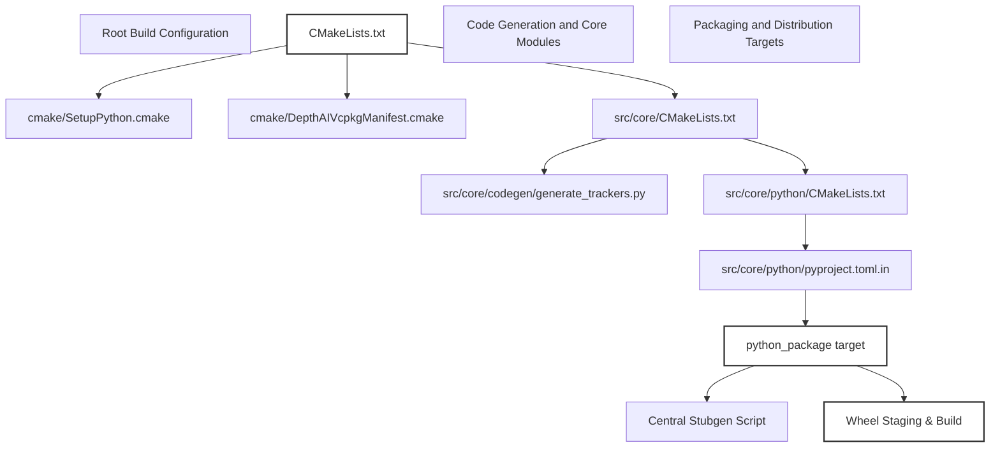
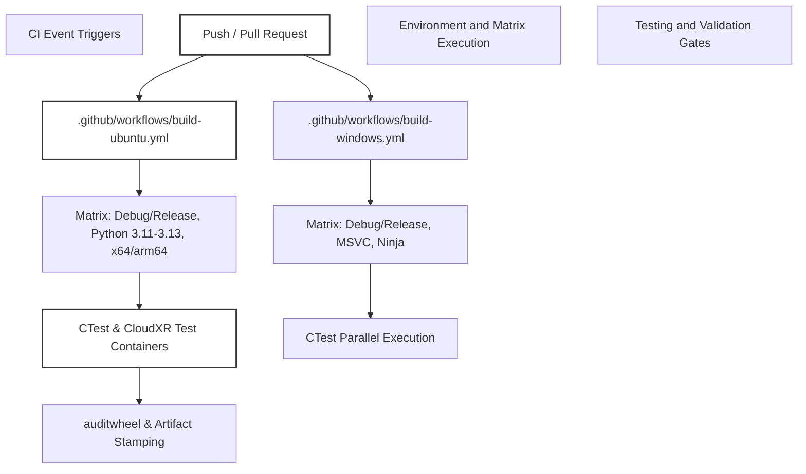

<!-- source: DeepWiki mcp.deepwiki.com · repo NVIDIA/IsaacCapture · page 8 Build System, Packaging and CI · fetched 2026-10-26 -->

# Build System, Packaging and CI

Relevant source files

The following files were used as context for generating this wiki page:

- [.github/actions/setup-uv/action.yml](.github/actions/setup-uv/action.yml)
- [.github/workflows/build-ubuntu.yml](.github/workflows/build-ubuntu.yml)
- [.github/workflows/build-windows.yml](.github/workflows/build-windows.yml)
- [CMakeLists.txt](CMakeLists.txt)
- [cmake/GenerateTrackers.cmake](cmake/GenerateTrackers.cmake)
- [src/core/AGENTS.md](src/core/AGENTS.md)
- [src/core/CMakeLists.txt](src/core/CMakeLists.txt)
- [src/core/cloudxr/python/CMakeLists.txt](src/core/cloudxr/python/CMakeLists.txt)
- [src/core/codegen/AGENTS.md](src/core/codegen/AGENTS.md)
- [src/core/codegen/generate_trackers.py](src/core/codegen/generate_trackers.py)
- [src/core/codegen/test_generate_prune.py](src/core/codegen/test_generate_prune.py)
- [src/core/python/CMakeLists.txt](src/core/python/CMakeLists.txt)
- [src/core/python/MANIFEST.in](src/core/python/MANIFEST.in)
- [src/core/python/pyproject.toml.in](src/core/python/pyproject.toml.in)

## Purpose and Scope

The build system, packaging, and CI infrastructure of `isaaccapture` orchestrate the compilation of C++ runtime components, pybind11 Python modules, configure-time code generation (`generate_trackers.py`), and multi-architecture wheel packaging. This parent page provides a high-level overview of how CMake, uv, GitHub Actions workflows, test runners, and documentation tools integrate to maintain reproducible builds and quality gates.

For detailed technical references, refer to the child pages:
- [CMake Build and Python Packaging](#8.1)
- [CI/CD Workflows](#8.2)
- [Testing Infrastructure](#8.3)
- [Documentation Site](#8.4)

---

## Build System and Packaging Architecture

*Figure 1: High-level flow from root `CMakeLists.txt` configuration through configure-time code generation and `python_package` staging to the final wheel.*

Sources: `CMakeLists.txt:1-216`, `src/core/CMakeLists.txt:1-50`, `src/core/python/CMakeLists.txt:1-119`, `src/core/python/pyproject.toml.in:1-104`

The build process is rooted in CMake (`CMakeLists.txt`), which manages C++ standards, compiler flags, and conditional compilation flags such as `BUILD_VIZ` and plugin options (`CMakeLists.txt:32-105`). Python virtual environments and dependency management are handled via `uv` through `cmake/SetupPython.cmake`. Configure-time generators like `src/core/codegen/generate_trackers.py` parse manifest definitions (`trackers.toml`) to produce C++ facade headers, live/replay implementations, and dispatch bindings before building pybind11 modules (`src/core/python/CMakeLists.txt:25-56`). 

For complete details on root options, `scikit-build-core` integration, versioning via `CMake/IsaacTeleopVersion.cmake`, and third-party dependencies, see [CMake Build and Python Packaging](#8.1).

---

## CI/CD and Verification Pipelines

*Figure 2: Continuous integration workflow execution matrices across Ubuntu and Windows runners, running CTest verification and wheel packaging gates.*

Sources: `.github/workflows/build-ubuntu.yml:1-158`, `.github/workflows/build-windows.yml:1-127`

Automated validation is driven by GitHub Actions workflows. The primary Linux pipeline (`.github/workflows/build-ubuntu.yml`) executes matrix builds across Python versions (`3.11`, `3.12`, `3.13`), architectures (`x64`, `arm64`), and build types (`Debug`, `Release`) [ .github/workflows/build-ubuntu.yml:36-42 ]. It utilizes `ccache`, `vcpkg`, and custom CUDA actions [ .github/workflows/build-ubuntu.yml:82-116 ]. The experimental Windows pipeline (`.github/workflows/build-windows.yml`) validates source compilation using MSVC, Ninja, and sccache [.github/workflows/build-windows.yml:22-124].

For full details on concurrency controls, caching strategies, `auditwheel` processing, and release branch synchronization, see [CI/CD Workflows](#8.2).

---

## Testing and Documentation Infrastructure

Unit testing, regression tests, and documentation builds operate downstream from the core build targets. 

- **Testing Infrastructure**: C++ and Python unit tests (`tests/cpp`, `tests/python`) are integrated via CTest (`CMakeLists.txt:69`). Environment-isolated integration tests run inside CloudXR-backed containers utilizing wrapper scripts such as `run_tests_with_cloudxr.sh`. For details, see [Testing Infrastructure](#8.3).
- **Documentation Site**: The Sphinx documentation site uses `docs/conf.py`, custom Makefile targets, versioning templates, and the `ecosystem_grid` extension to build and verify API references and user guides. For details, see [Documentation Site](#8.4).

Sources: `CMakeLists.txt:69-69`, `.github/workflows/build-ubuntu.yml:125-158`

---

