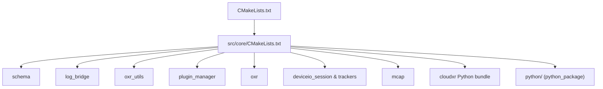
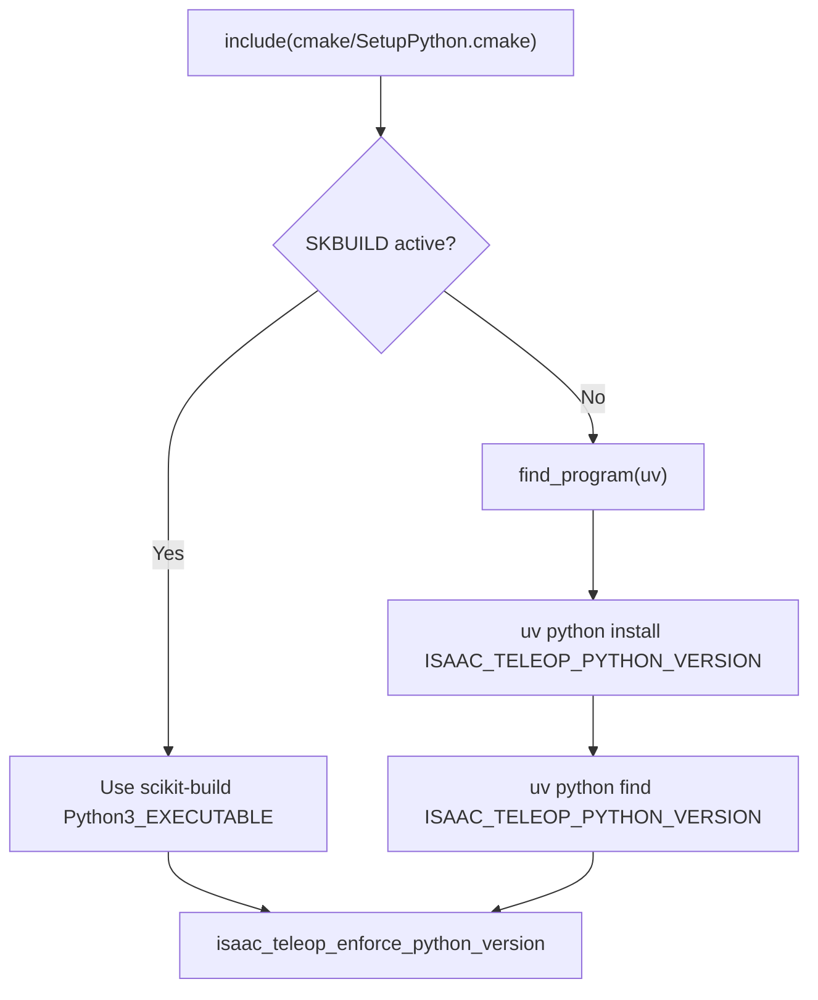

<!-- source: DeepWiki mcp.deepwiki.com · repo NVIDIA/IsaacCapture · page 8.1 CMake Build and Python Packaging · fetched 2026-10-26 -->

# CMake Build and Python Packaging

Relevant source files

The following files were used as context for generating this wiki page:

- [.github/workflows/sync-release-branches.yml](.github/workflows/sync-release-branches.yml)
- [CMakeLists.txt](CMakeLists.txt)
- [VERSION](VERSION)
- [cmake/InstallPythonExample.cmake](cmake/InstallPythonExample.cmake)
- [cmake/IsaacTeleopVersion.cmake](cmake/IsaacTeleopVersion.cmake)
- [cmake/SetupPython.cmake](cmake/SetupPython.cmake)
- [deps/README.md](deps/README.md)
- [deps/third_party/CMakeLists.txt](deps/third_party/CMakeLists.txt)
- [docs/source/getting_started/build_from_source/index.rst](docs/source/getting_started/build_from_source/index.rst)
- [docs/source/getting_started/quick_start.rst](docs/source/getting_started/quick_start.rst)
- [docs/source/references/build.rst](docs/source/references/build.rst)
- [examples/noitom/README.md](examples/noitom/README.md)
- [examples/noitom/assets/record.gif](examples/noitom/assets/record.gif)
- [examples/noitom/assets/replay.gif](examples/noitom/assets/replay.gif)
- [examples/noitom/assets/teleop.gif](examples/noitom/assets/teleop.gif)
- [examples/noitom/noitom_reference_draw.py](examples/noitom/noitom_reference_draw.py)
- [examples/noitom/noitom_tasks.py](examples/noitom/noitom_tasks.py)
- [examples/robot_viz/pyproject.toml](examples/robot_viz/pyproject.toml)
- [pyproject.toml](pyproject.toml)
- [src/core/AGENTS.md](src/core/AGENTS.md)
- [src/core/CMakeLists.txt](src/core/CMakeLists.txt)
- [src/core/cloudxr/python/CMakeLists.txt](src/core/cloudxr/python/CMakeLists.txt)
- [src/core/deviceio_base/cpp/inc/deviceio_base/tracker_vendor.hpp](src/core/deviceio_base/cpp/inc/deviceio_base/tracker_vendor.hpp)
- [src/core/oxr/python/CMakeLists.txt](src/core/oxr/python/CMakeLists.txt)
- [src/core/plugin_manager/python/CMakeLists.txt](src/core/plugin_manager/python/CMakeLists.txt)
- [src/core/python/CMakeLists.txt](src/core/python/CMakeLists.txt)
- [src/core/python/MANIFEST.in](src/core/python/MANIFEST.in)
- [src/core/python/pyproject.toml.in](src/core/python/pyproject.toml.in)
- [src/core/python/requirements-cloudxr.txt](src/core/python/requirements-cloudxr.txt)
- [src/python/CMakeLists.txt](src/python/CMakeLists.txt)
- [src/python/isaaccapture/viz/robot/__init__.py](src/python/isaaccapture/viz/robot/__init__.py)
- [src/python/isaaccapture/viz/robot/clutch_preview.py](src/python/isaaccapture/viz/robot/clutch_preview.py)
- [src/python/isaaccapture/viz/robot/controller-guide-disengaged.png](src/python/isaaccapture/viz/robot/controller-guide-disengaged.png)
- [src/python/isaaccapture/viz/robot/controller-guide-engaged.png](src/python/isaaccapture/viz/robot/controller-guide-engaged.png)
- [src/python/isaaccapture/viz/robot/hud.py](src/python/isaaccapture/viz/robot/hud.py)
- [src/python/isaaccapture/viz/robot/scene.py](src/python/isaaccapture/viz/robot/scene.py)

## Purpose and Scope

This document details the build system and packaging pipeline for Isaac Capture (`isaaccapture`), encompassing the top-level CMake configuration, the Python environment bootstrap mechanism via `uv`, pybind11 module compilation, component staging targets, type stub generation, and the alternative `scikit-build-core` PEP 517 build backend. It serves as a comprehensive reference for developers building the C++ core and packaging Python wheels from source.

Sources: `CMakeLists.txt:1-216`, `src/core/CMakeLists.txt:1-50`, `pyproject.toml:1-169`

---

## Root CMake Options and Core Build Flow

The root `CMakeLists.txt` establishes the project version, enforces a C++20 standard, compiles position-independent code (`CMAKE_POSITION_INDEPENDENT_CODE`), and sets up compiler export commands (`[CMakeLists.txt:32-38]()`). It declares major configuration options that dictate which subsystems and hardware plugins are compiled:

- `BUILD_PLUGINS`: Enables compilation of device plugins located under `src/plugins/` (`[CMakeLists.txt:60]()`).
- `BUILD_PYTHON_BINDINGS`: Controls whether pybind11 modules and the Python package staging targets are constructed (`[CMakeLists.txt:61]()`).
- `BUILD_VIZ`: Conditionally enables Televiz (`src/viz`), auto-detected based on the availability of Vulkan and the CUDA Toolkit (`[CMakeLists.txt:75-87]()`).
- `BUILD_TESTING`: Triggers the compilation of unit test suites under `tests/` (`[CMakeLists.txt:69]()`).
- `ENABLE_CLOUDXR_EXP_BUNDLE`: Packages the experimental CloudXR Runtime SDK alongside the stable runtime as `isaaccapture.cloudxr_exp` (`[CMakeLists.txt:96]()`).

The core libraries are coordinated by `src/core/CMakeLists.txt`, which sequences targets in explicit dependency order, starting with FlatBuffer schemas (`schema`), log bridging (`log_bridge`), OpenXR utilities (`oxr_utils`), the plugin manager (`plugin_manager`), OpenXR sessions (`oxr`), tracker code generation, `deviceio` sessions, MCAP recording, and the CloudXR bundle staging (`[src/core/CMakeLists.txt:7-44]()`).

*Diagram 1: Core CMake directory evaluation flow from root to packaging targets.*

Sources: `CMakeLists.txt:32-97`, `src/core/CMakeLists.txt:7-49`

---

## Python Environment Discovery (`SetupPython.cmake` and `uv`)

Python version management is centralized in `cmake/SetupPython.cmake`, driven by `ISAAC_TELEOP_PYTHON_VERSION` (defaulting to `3.11`, with a supported range of `3.11 <= version < 3.14`) (`[CMakeLists.txt:44-46](), [cmake/SetupPython.cmake:20-66]()`). 

The helper function `isaac_teleop_enforce_python_version()` validates major.minor strings and enforces version bounds before interpreter lookup (`[cmake/SetupPython.cmake:20-49]()`). When building via classic CMake, the build system leverages `uv` to install and resolve the exact managed Python version, completely bypassing system site-packages and avoiding environment contamination (`[cmake/SetupPython.cmake:116-144]()`). Conversely, when invoked via `scikit-build-core` (`SKBUILD`), the build inherits the build backend's active Python interpreter (`Python3_EXECUTABLE`) to guarantee ABI consistency between the wheel tag and compiled `.so` binaries (`[cmake/SetupPython.cmake:93-108]()`).

*Diagram 2: Code entity resolution path for Python discovery inside `cmake/SetupPython.cmake`.*

Sources: `CMakeLists.txt:44-52`, `cmake/SetupPython.cmake:20-144`

---

## pybind11 Modules and Staging Targets (`python_package`)

Python bindings are compiled as individual pybind11 shared libraries (`_oxr`, `_deviceio_session`, `_deviceio_trackers`, `_plugin_manager`, `_schema`, `_mcap`, and optionally `_viz`) and assembled into a structured directory hierarchy by `src/core/python/CMakeLists.txt` (`[src/core/python/CMakeLists.txt:4-56]()`).

The `python_package` custom target executes the following staging operations:
1. Copies the curated public robotic grounding package (`ROBOTIC_GROUNDING_STAGED_DIR`) into the staging root (`[src/core/python/CMakeLists.txt:37-41]()`).
2. Generates `pyproject.toml` from `src/core/python/pyproject.toml.in` using `configure_file()` to inject project version metadata (`[src/core/python/CMakeLists.txt:15-20, 42]()`).
3. Stages support files including `MANIFEST.in`, `setup.py`, `README.md`, and dependency requirement text files (`[src/core/python/CMakeLists.txt:43-53]`).
4. Relies on `stage_generated_tracker_exports` to inject `_generated_tracker_exports.py` into `isaaccapture/deviceio_trackers/` (`[src/core/python/CMakeLists.txt:25-29]()`).

The generated `pyproject.toml` utilizes `setuptools` with `namespaces = false` and explicit package inclusion filters to bundle extension modules, stubs, and device plugin directories (`[src/core/python/pyproject.toml.in:54-92]()`).

Sources: `src/core/python/CMakeLists.txt:1-66`, `src/core/python/pyproject.toml.in:1-92`

---

## Type Stubs Generation (`stubgen`)

To provide robust IDE intellisense and type-checking support, the build system generates Python type stubs (`.pyi`) for all pybind11 extension modules (`[src/core/python/CMakeLists.txt:67-117]()`). 

The stub generation command uses `pybind11-stubgen` executed via `uv run` with an isolated stubgen project configuration (`stubgen_pyproject.toml`) (`[src/core/python/CMakeLists.txt:100-117]()`). The target list `STUBGEN_MODULES` explicitly processes:
- `isaaccapture.deviceio_trackers._deviceio_trackers` (`[src/core/python/CMakeLists.txt:76]()`)
- `isaaccapture.deviceio_session._deviceio_session` (`[src/core/python/CMakeLists.txt:77]()`)
- `isaaccapture.oxr._oxr` (`[src/core/python/CMakeLists.txt:78]()`)
- `isaaccapture.plugin_manager._plugin_manager` (`[src/core/python/CMakeLists.txt:79]()`)
- `isaaccapture.schema._schema` (`[src/core/python/CMakeLists.txt:80]()`)
- `isaaccapture.viz._viz` (when `BUILD_VIZ=ON`) (`[src/core/python/CMakeLists.txt:90-92]()`)

A `py.typed` marker file is created upon successful completion, satisfying PEP 561 compliance (`[src/core/python/CMakeLists.txt:119-122]()`).

Sources: `src/core/python/CMakeLists.txt:67-122`

---

## Alternative Packaging: `scikit-build-core` Flow

In addition to the classic CMake build flow that produces wheels under `install/wheels/`, the repository supports direct installation and editable development via `scikit-build-core` through the root `pyproject.toml` (`[pyproject.toml:4-96]`, `docs/source/references/build.rst:77-94`).

Key attributes of the `scikit-build-core` configuration include:
- **Build Directory Separation:** Specifies `build-dir = "build-wheel/{cache_tag}"` to isolate `pip` builds from classic `cmake -B build` directories, preventing cache collisions across Python interpreter versions (`[pyproject.toml:116-117]()`).
- **Default Target Compilation:** Invokes the top-level CMake configuration with standard defaults (`BUILD_PLUGINS=ON`, `BUILD_TESTING=ON`), enforcing C++ source formatting (`ENABLE_CLANG_FORMAT_CHECK`) (`[pyproject.toml:119-125]()`).
- **Component Installation:** Installs the `isaaccapture_wheel` and `isaaccapture_binaries` components into the target virtual environment (`[pyproject.toml:128-134]()`).
- **Editable Mode:** Implements `mode = "redirect"` for authored Python sources, allowing live iteration on pure-Python files without recompilation while keeping compiled binary products frozen until explicit re-installation (`[pyproject.toml:150-152]()`).

Sources: `pyproject.toml:1-152`, `docs/source/references/build.rst:77-124`

---

## Version Management and Third-Party Dependencies

Project versioning is governed by the top-level `VERSION` file (containing `1.7.x`) (`[VERSION:1]()`). The CMake helper `cmake/IsaacTeleopVersion.cmake` reads this file to set `ISAAC_TELEOP_VERSION` and `ISAAC_TELEOP_PYPROJECT_VERSION` (`[CMakeLists.txt:9-10]()`). For the `scikit-build-core` backend, dynamic metadata derivation via regex transforms the version file format into a local development version string (`MAJOR.MINOR+local`) (`[pyproject.toml:79-90]()`).

Third-party dependencies (such as the OpenXR SDK, pybind11, yaml-cpp, FlatBuffers, Catch2, and MCAP) are automatically retrieved during CMake configuration via `FetchContent` declared in `deps/third_party/CMakeLists.txt` (`[docs/source/references/build.rst:20-21, 141-150]()`). For the CloudXR runtime SDK, `src/core/cloudxr/python/CMakeLists.txt` inspects `deps/cloudxr/.env.default` for `CXR_RUNTIME_SDK_VERSION`, triggers `scripts/download_cloudxr_runtime_sdk.sh` if tarballs are absent, extracts core libraries, and strips spurious `libssl.so.3` dependencies from `libcloudxr.so` using `patchelf` to prevent symbol collisions when loaded from Python (`[src/core/cloudxr/python/CMakeLists.txt:7-108]()`).

Sources: `VERSION:1-2`, `CMakeLists.txt:9-10`, `pyproject.toml:79-90`, `src/core/cloudxr/python/CMakeLists.txt:1-108`, `docs/source/references/build.rst:141-150`

---

