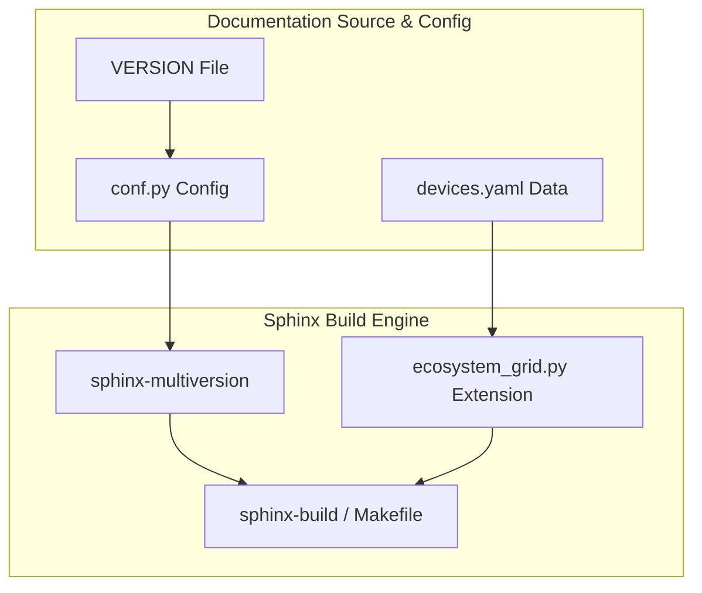
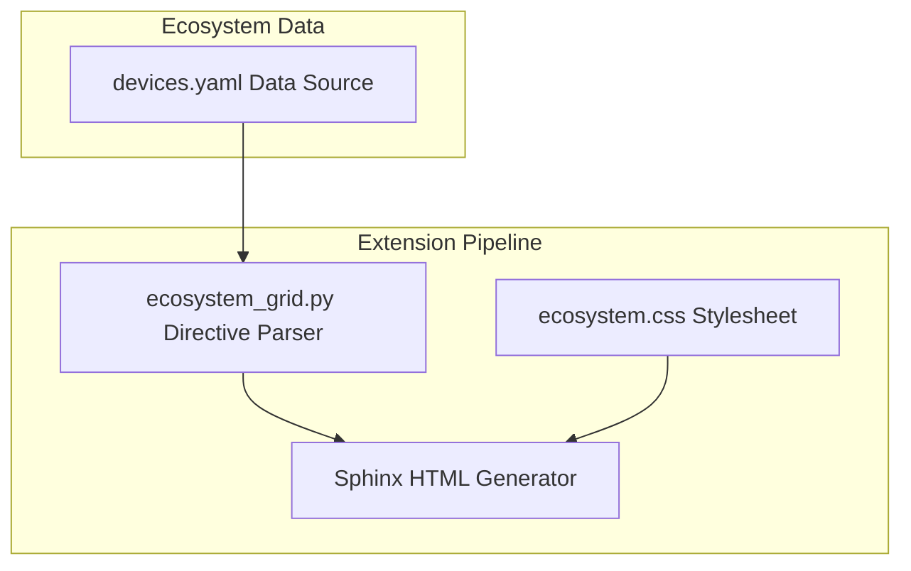

<!-- source: DeepWiki mcp.deepwiki.com · repo NVIDIA/IsaacCapture · page 8.4 Documentation Site · fetched 2026-10-26 -->

# Documentation Site

Relevant source files

The following files were used as context for generating this wiki page:

- [.gitattributes](.gitattributes)
- [.github/scripts/remove_docs_preview.sh](.github/scripts/remove_docs_preview.sh)
- [.github/workflows/docs-cleanup-preview.yaml](.github/workflows/docs-cleanup-preview.yaml)
- [.github/workflows/docs-preview-on-demand.yaml](.github/workflows/docs-preview-on-demand.yaml)
- [.github/workflows/docs-preview-sweep.yaml](.github/workflows/docs-preview-sweep.yaml)
- [.github/workflows/docs.yaml](.github/workflows/docs.yaml)
- [.github/workflows/pre-commit.yaml](.github/workflows/pre-commit.yaml)
- [.github/workflows/promote-stable-client.yaml](.github/workflows/promote-stable-client.yaml)
- [docs/Makefile](docs/Makefile)
- [docs/requirements.txt](docs/requirements.txt)
- [docs/source/_data/devices.yaml](docs/source/_data/devices.yaml)
- [docs/source/_ext/ecosystem_grid.py](docs/source/_ext/ecosystem_grid.py)
- [docs/source/_static/css/custom.css](docs/source/_static/css/custom.css)
- [docs/source/_static/css/ecosystem.css](docs/source/_static/css/ecosystem.css)
- [docs/source/_static/favicon.ico](docs/source/_static/favicon.ico)
- [docs/source/_static/logos/htc-vive-dark.png](docs/source/_static/logos/htc-vive-dark.png)
- [docs/source/_static/logos/htc-vive.png](docs/source/_static/logos/htc-vive.png)
- [docs/source/_static/logos/wuji-dark.svg](docs/source/_static/logos/wuji-dark.svg)
- [docs/source/_static/logos/wuji.svg](docs/source/_static/logos/wuji.svg)
- [docs/source/_templates/versioning.html](docs/source/_templates/versioning.html)
- [docs/source/conf.py](docs/source/conf.py)
- [docs/source/device/spacemouse.rst](docs/source/device/spacemouse.rst)
- [docs/source/getting_started/contributing.rst](docs/source/getting_started/contributing.rst)
- [examples/teleop/python/spacemouse_printer_example.py](examples/teleop/python/spacemouse_printer_example.py)
- [scripts/check_copyright_year.py](scripts/check_copyright_year.py)
- [src/core/schema/fbs/spacemouse.fbs](src/core/schema/fbs/spacemouse.fbs)
- [src/core/schema/golden/spacemouse.bfbs](src/core/schema/golden/spacemouse.bfbs)

## Purpose and Scope
This section covers the technical architecture, build infrastructure, extension mechanisms, styling, and CI/CD automation of the Isaac Teleop documentation site. The documentation site is built using Sphinx (`sphinx==8.1.3`), powered by the NVIDIA Sphinx theme (`nvidia_sphinx_theme==0.0.9.post1`), and integrates custom extensions such as the `ecosystem_grid` directive for rendering device support matrices. Documentation builds are fully automated via GitHub Actions, handling multi-version generation, pull request previews, and deployment to GitHub Pages.

Sources: `[docs/source/conf.py:1-253]()`, `[docs/requirements.txt:1-6](), [.github/workflows/docs.yaml:1-181]()`

---

## 1. Sphinx Configuration and Build System
The Sphinx configuration file (`docs/source/conf.py`) defines project metadata, extension lists, HTML theme options, multiversion settings, and dynamic substitutions (`rst_epilog`).

### Key Configuration Mechanisms
- **Version Resolution**: Reads from the root `VERSION` file to determine the release series `[docs/source/conf.py:35-43]()`.
- **Multiversioning (`sphinx-multiversion`)**: Whitelists branches (`main`, `release/.*`) and tags (`^v[1-9]\d*\.\d+\.\d+$`) to build version-pinned documentation artifacts (`[docs/source/conf.py:82-84]()`).
- **Dynamic Epilog Substitutions (`rst_epilog`)**: Injects version-pinned package specifiers (`|pip_version_pin|`) and branch-specific web client links (`|web_client_url|`) into every rendered page (`[docs/source/conf.py:134-139]()`).

*Diagram 1: Natural Language to Code Entity mapping for documentation configuration and build execution.*

Sources: `[docs/source/conf.py:1-253]()`, `[docs/requirements.txt:1-6]()`

---

## 2. Ecosystem Grid Extension (`ecosystem_grid`)
The custom Sphinx extension `ecosystem_grid` (located in `docs/source/_ext/ecosystem_grid.py`) parses structured device definitions from `docs/source/_data/devices.yaml` and renders interactive device support tables and ecosystem grids.

### Data Flow and Rendering Pipeline
1. **Source YAML**: `docs/source/_data/devices.yaml` provides metadata including device IDs, names, URLs, grouping categories (`xr`, `peripheral`, `data_factory`, `cloud`), interaction modes, and setup/requirement details (`[docs/source/_data/devices.yaml:1-141]()`).
2. **Parser & Directive**: The `ecosystem_grid` extension registers a custom Sphinx directive that validates schema constraints (e.g., required `id`, `name`, `group`, `modes`) and transforms data entries into structured HTML tables.
3. **Styling**: Rendered grids leverage custom CSS definitions in `docs/source/_static/css/ecosystem.css` to maintain theme-agnostic layout structures.

*Diagram 2: Ecosystem grid data ingestion and HTML generation pipeline.*

Sources: `[docs/source/_data/devices.yaml:1-141]()`, `[docs/source/_ext/ecosystem_grid.py]()`, `[docs/source/_static/css/ecosystem.css:1-240]()`

---

## 3. Theme, Versioning, and Styling
The documentation utilizes `nvidia_sphinx_theme` with customized CSS overrides to support dual light/dark color schemes and embedded version selectors.

### Key Styling & UI Modules
- **Custom CSS (`custom.css`)**: Overrides inline code styles (`code.literal`), fixes dark/light mode CSS variables (`--pst-color-primary`, `--pst-color-background`), and styles the persistent version switcher dropdown (`[docs/source/_static/css/custom.css:7-119]()`).
- **Versioning Template (`versioning.html`)**: Injected into the navbar center/end regions via `conf.py` settings to provide multi-version selection options (`[docs/source/conf.py:168-169]()`).

Sources: `[docs/source/conf.py:141-169](), [docs/source/_static/css/custom.css:1-235]()`

---

## 4. Documentation CI/CD and GitHub Pages Deployment
Documentation builds and deployments are managed via GitHub Actions workflows, ensuring automated documentation previews on pull requests and canonical deployment on merges to `main` or release branches.

### Workflow Orchestration
- **Build and Deploy (`docs.yaml`)**: Detects file changes under `docs/` or `deps/cloudxr/webxr_client/`, installs Python requirements, runs `make current-docs`, and executes multi-version builds on canonical push events (`[.github/workflows/docs.yaml:22-150]()`).
- **On-Demand Previews (`docs-preview-on-demand.yaml`)**: Allows maintainers to trigger `/preview-docs` comments on fork pull requests, reusing pre-built artifacts from `docs.yaml` to deploy isolated previews to `preview/pr-<N>/` (`[.github/workflows/docs-preview-on-demand.yaml:1-166]()`).
- **Cleanup and Sweeps (`docs-cleanup-preview.yaml`, `docs-preview-sweep.yaml`)**: Automatically removes stale preview deployments when pull requests are closed or via nightly reconciliation cron jobs (`[.github/workflows/docs-cleanup-preview.yaml:1-92](), [.github/workflows/docs-preview-sweep.yaml:1-99]()`).

Sources: `[.github/workflows/docs.yaml:1-181](), [.github/workflows/docs-cleanup-preview.yaml:1-92](), [.github/workflows/docs-preview-on-demand.yaml:1-166](), [.github/workflows/docs-preview-sweep.yaml:1-99]()`

---

## 5. Contributing and Reference Checks
Developer documentation for contributing to the repository and writing documentation resides in `docs/source/getting_started/contributing.rst`.

### Key Verification Checks
- **Pre-Commit Hooks (`pre-commit.yaml`)**: Runs formatting, linting, and header copyright checks (`[.github/workflows/pre-commit.yaml:1-23]()`).
- **Reference Validation**: Sphinx checks cross-references, docstrings, and RST syntax during builds to prevent broken links or missing substitution targets.

Sources: `[docs/source/getting_started/contributing.rst](), [.github/workflows/pre-commit.yaml:1-23]()`

---

