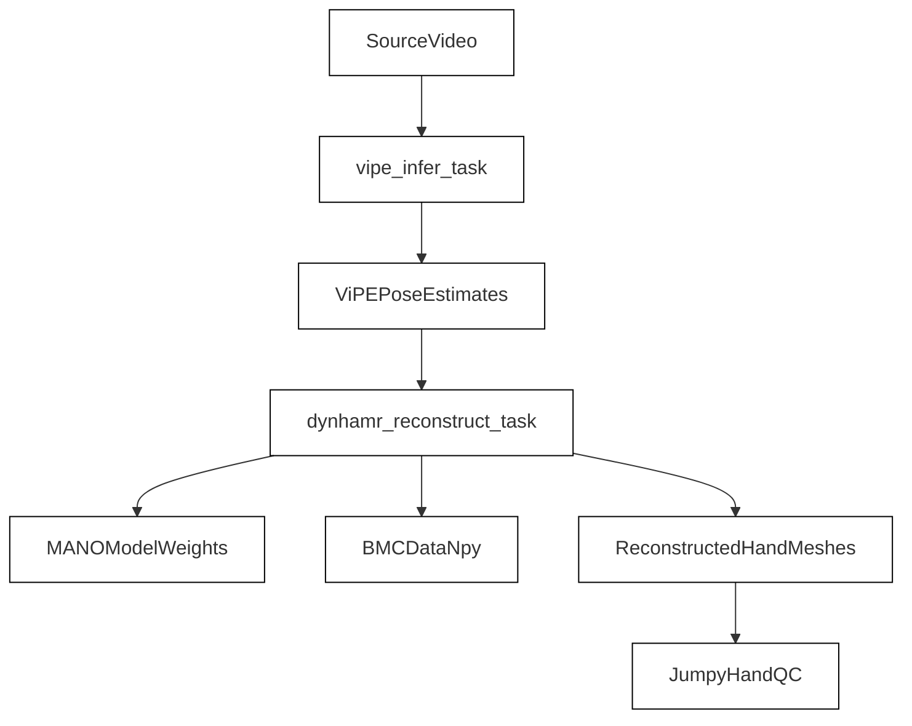
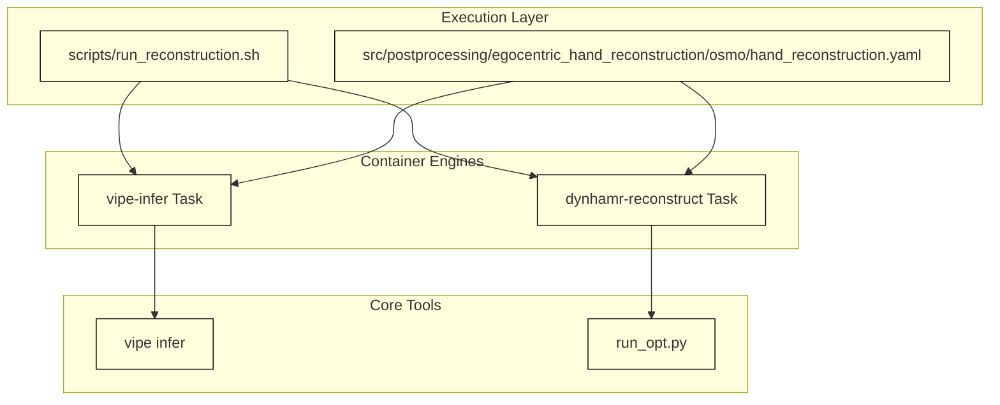

<!-- source: DeepWiki mcp.deepwiki.com · repo NVIDIA/IsaacCapture · page 9 Post-Processing: Egocentric Hand Reconstruction · fetched 2026-10-26 -->

# Post-Processing: Egocentric Hand Reconstruction

Relevant source files

The following files were used as context for generating this wiki page:

- [docs/source/_static/egocentric-input.gif](docs/source/_static/egocentric-input.gif)
- [docs/source/_static/egocentric-reconstruction.gif](docs/source/_static/egocentric-reconstruction.gif)
- [docs/source/references/egocentric_hand_reconstruction.rst](docs/source/references/egocentric_hand_reconstruction.rst)
- [src/postprocessing/egocentric_hand_reconstruction/osmo/README.md](src/postprocessing/egocentric_hand_reconstruction/osmo/README.md)
- [src/postprocessing/egocentric_hand_reconstruction/osmo/hand_reconstruction.yaml](src/postprocessing/egocentric_hand_reconstruction/osmo/hand_reconstruction.yaml)

The `src/postprocessing` pipeline provides an automated framework for reconstructing 4D hand meshes and camera poses from raw egocentric video recordings [docs/source/references/egocentric_hand_reconstruction.rst:7-8](). The pipeline integrates the ViPE camera pose estimation engine and the Dyn-HaMR hand reconstruction optimizer within containerized execution environments [docs/source/references/egocentric_hand_reconstruction.rst:7-8](), supporting both local execution scripts [docs/source/references/egocentric_hand_reconstruction.rst:146-151]() and scalable batch processing workflows on [OSMO](https://github.com/NVIDIA/OSMO) [docs/source/references/egocentric_hand_reconstruction.rst:199-204]().

*Sources: [docs/source/references/egocentric_hand_reconstruction.rst:7-8](), [src/postprocessing/egocentric_hand_reconstruction/osmo/hand_reconstruction.yaml:32-171]()*

---

## Reconstruction Pipeline and Containers

The reconstruction workflow is structured around two main stages: camera pose estimation via ViPE and dynamic hand mesh optimization via Dyn-HaMR [src/postprocessing/egocentric_hand_reconstruction/osmo/README.md:8-12](). These tools are encapsulated in dedicated Docker containers managed through build scripts (`docker/vipe.sh` and `docker/dynhamr.sh`) [docs/source/references/egocentric_hand_reconstruction.rst:130-131]() and orchestrated locally via `scripts/run_reconstruction.sh` [docs/source/references/egocentric_hand_reconstruction.rst:150-151]() or at scale using the OSMO workflow configuration defined in `src/postprocessing/egocentric_hand_reconstruction/osmo/hand_reconstruction.yaml` [docs/source/references/egocentric_hand_reconstruction.rst:199-204]().

*Sources: [docs/source/references/egocentric_hand_reconstruction.rst:130-151](), [src/postprocessing/egocentric_hand_reconstruction/osmo/hand_reconstruction.yaml:32-173]()*

For detailed instructions on container setup, system requirements, asset configuration (MANO and BMC data), and execution parameters, see [Reconstruction Pipeline and Containers](#9.1).

*Sources: [docs/source/references/egocentric_hand_reconstruction.rst:31-212](), [src/postprocessing/egocentric_hand_reconstruction/osmo/README.md:6-186]()*

---

## Quality Control

Following reconstruction, output data sequences undergo automated quality control checks to identify artifacts such as tracking jitter, tracking loss, or anatomically implausible motion [src/postprocessing/egocentric_hand_reconstruction/osmo/README.md:11](). The quality control subsystem executes diagnostic scripts such as `run_jumpy_qc.sh` during the final phase of the reconstruction workflow [src/postprocessing/egocentric_hand_reconstruction/osmo/hand_reconstruction.yaml:167-170](), aggregating proportion metrics and saving diagnostic logs into structured output directories [src/postprocessing/egocentric_hand_reconstruction/osmo/README.md:174-181]().

For detailed information on filtering algorithms, proportion metrics, and evaluation reports, see [Quality Control](#9.2).

*Sources: [src/postprocessing/egocentric_hand_reconstruction/osmo/README.md:8-12](), [src/postprocessing/egocentric_hand_reconstruction/osmo/hand_reconstruction.yaml:167-170]()*

---

