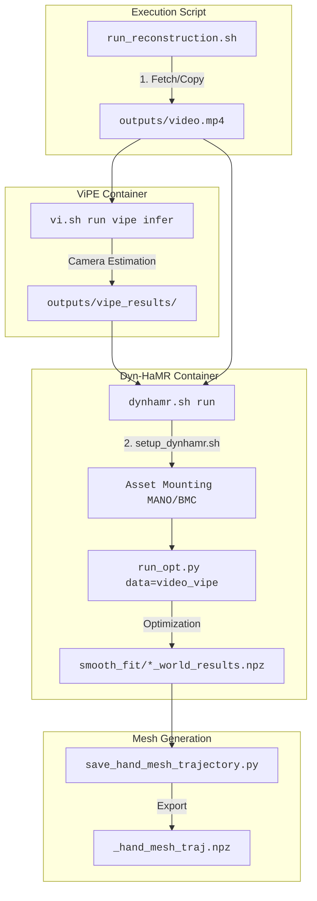
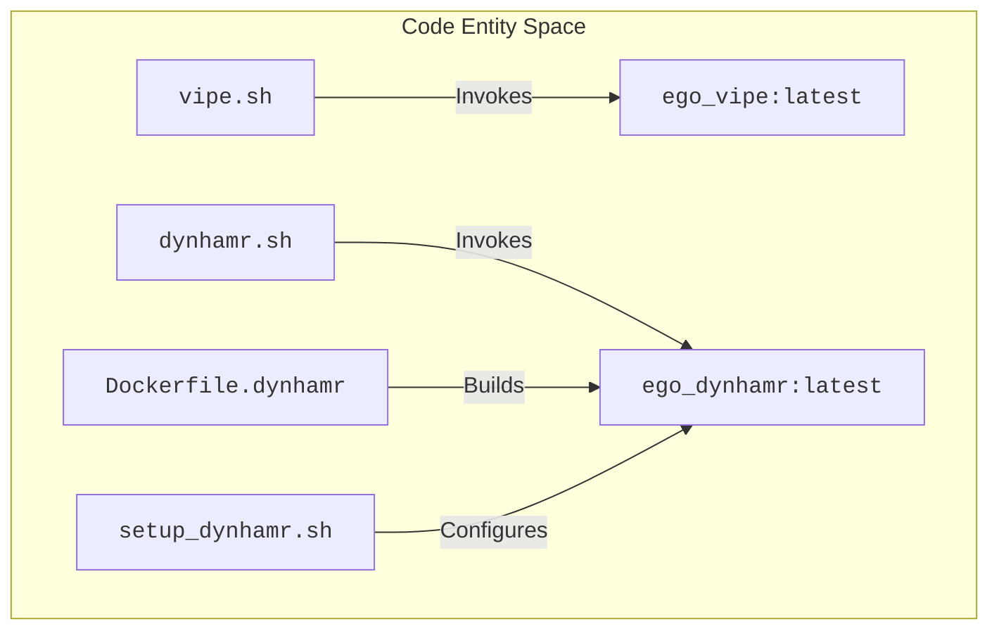
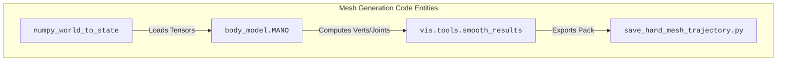

<!-- source: DeepWiki mcp.deepwiki.com · repo NVIDIA/IsaacCapture · page 9.1 Reconstruction Pipeline and Containers · fetched 2026-10-26 -->

# Reconstruction Pipeline and Containers

Relevant source files

The following files were used as context for generating this wiki page:

- [src/postprocessing/egocentric_hand_reconstruction/docker/Dockerfile.dynhamr](src/postprocessing/egocentric_hand_reconstruction/docker/Dockerfile.dynhamr)
- [src/postprocessing/egocentric_hand_reconstruction/docker/Dockerfile.vipe](src/postprocessing/egocentric_hand_reconstruction/docker/Dockerfile.vipe)
- [src/postprocessing/egocentric_hand_reconstruction/docker/dynhamr.sh](src/postprocessing/egocentric_hand_reconstruction/docker/dynhamr.sh)
- [src/postprocessing/egocentric_hand_reconstruction/docker/setup_dynhamr.sh](src/postprocessing/egocentric_hand_reconstruction/docker/setup_dynhamr.sh)
- [src/postprocessing/egocentric_hand_reconstruction/docker/vipe.sh](src/postprocessing/egocentric_hand_reconstruction/docker/vipe.sh)
- [src/postprocessing/egocentric_hand_reconstruction/mesh_generation/README_mesh_generation.md](src/postprocessing/egocentric_hand_reconstruction/mesh_generation/README_mesh_generation.md)
- [src/postprocessing/egocentric_hand_reconstruction/mesh_generation/save_hand_mesh_trajectory.py](src/postprocessing/egocentric_hand_reconstruction/mesh_generation/save_hand_mesh_trajectory.py)
- [src/postprocessing/egocentric_hand_reconstruction/quality_control/README_cal_jumpy_proportions.md](src/postprocessing/egocentric_hand_reconstruction/quality_control/README_cal_jumpy_proportions.md)
- [src/postprocessing/egocentric_hand_reconstruction/quality_control/README_jumpy_hand_filtering.md](src/postprocessing/egocentric_hand_reconstruction/quality_control/README_jumpy_hand_filtering.md)
- [src/postprocessing/egocentric_hand_reconstruction/quality_control/cal_jumpy_proportions.py](src/postprocessing/egocentric_hand_reconstruction/quality_control/cal_jumpy_proportions.py)
- [src/postprocessing/egocentric_hand_reconstruction/quality_control/detect_jumpy_hand_from_world_results.py](src/postprocessing/egocentric_hand_reconstruction/quality_control/detect_jumpy_hand_from_world_results.py)
- [src/postprocessing/egocentric_hand_reconstruction/quality_control/run_jumpy_qc.sh](src/postprocessing/egocentric_hand_reconstruction/quality_control/run_jumpy_qc.sh)
- [src/postprocessing/egocentric_hand_reconstruction/scripts/run_reconstruction.sh](src/postprocessing/egocentric_hand_reconstruction/scripts/run_reconstruction.sh)

## Purpose and Scope

The egocentric hand reconstruction pipeline (`src/postprocessing/egocentric_hand_reconstruction/`) processes egocentric RGB video recordings to reconstruct temporally smooth, 3D hand meshes and joint trajectories using computer vision and parametric hand models (MANO). This page details the containerized architecture, execution scripts, runtime environment initialization, and mesh generation tools that power offline post-processing workflows.

---

## 1. Pipeline Architecture and Data Flow

The reconstruction workflow transforms raw video inputs (local files or remote S3/Swift object storage buckets) into calibrated camera parameters, optimized 3D hand states, and exported trajectory packages. 

*Sources: [src/postprocessing/egocentric_hand_reconstruction/scripts/run_reconstruction.sh:31-127](), [src/postprocessing/egocentric_hand_reconstruction/docker/setup_dynhamr.sh:15-94](), [src/postprocessing/egocentric_hand_reconstruction/mesh_generation/save_hand_mesh_trajectory.py:117-184]()*

---

## 2. Docker Images and Container Runners

The pipeline executes inside two isolated, GPU-accelerated Docker containers (`ego_vipe` and `ego_dynhamr`) managed via CLI wrapper scripts.

### ViPE Container (`ego_vipe`)
* **Dockerfile**: `src/postprocessing/egocentric_hand_reconstruction/docker/Dockerfile.vipe`
* **Runner Script**: `src/postprocessing/egocentric_hand_reconstruction/docker/vipe.sh`
* **Responsibilities**: Video pose estimation, camera intrinsics/extrinsics tracking.
* **Volume Mounts**: Maps host `outputs/` directory to `/home/appuser/ViPE/vipe_results` [src/postprocessing/egocentric_hand_reconstruction/docker/vipe.sh:84-93]().

### Dyn-HaMR Container (`ego_dynhamr`)
* **Dockerfile**: `src/postprocessing/egocentric_hand_reconstruction/docker/Dockerfile.dynhamr`
* **Runner Script**: `src/postprocessing/egocentric_hand_reconstruction/docker/dynhamr.sh`
* **Responsibilities**: Dynamic hand mesh recovery, optimization, and visualization fitting.
* **Base Environment**: `nvidia/cuda:12.1.1-devel-ubuntu22.04`, Miniconda, Python 3.10, PyTorch 2.3.0 (`cu121`), pinned `numpy==1.23.5` (for `chumpy` compatibility), MANO, and HaMeR [src/postprocessing/egocentric_hand_reconstruction/docker/Dockerfile.dynhamr:8-123]().

*Sources: [src/postprocessing/egocentric_hand_reconstruction/docker/Dockerfile.dynhamr:1-162](), [src/postprocessing/egocentric_hand_reconstruction/docker/dynhamr.sh:1-123](), [src/postprocessing/egocentric_hand_reconstruction/docker/vipe.sh:1-122]()*

---

## 3. Reconstruction Orchestration Script (`run_reconstruction.sh`)

The entrypoint script `src/postprocessing/egocentric_hand_reconstruction/scripts/run_reconstruction.sh` orchestrates end-to-end execution.

| Step | Action | Implementation Detail |
| :--- | :--- | :--- |
| **Prerequisites** | Asset Validation | Verifies presence of `MANO_RIGHT.pkl` and `BMC/` data inside `outputs/` [src/postprocessing/egocentric_hand_reconstruction/scripts/run_reconstruction.sh:54-66](). |
| **Step 1** | Ingestion | Detects if argument is a bucket URL (`s3://`, `swift://`) or local path. Downloads via `download_video_from_bucket.py` or copies to `outputs/` [src/postprocessing/egocentric_hand_reconstruction/scripts/run_reconstruction.sh:35-99](). |
| **Step 2** | Camera Estimation | Executes ViPE inference container via `docker/vipe.sh` [src/postprocessing/egocentric_hand_reconstruction/scripts/run_reconstruction.sh:103-105](). |
| **Step 3** | Hand Reconstruction | Launches Dyn-HaMR container via `docker/dynhamr.sh`, runs container setup, links video streams, and invokes `run_opt.py` with Hydra configs [src/postprocessing/egocentric_hand_reconstruction/scripts/run_reconstruction.sh:109-127](). |

*Sources: [src/postprocessing/egocentric_hand_reconstruction/scripts/run_reconstruction.sh:1-133]()*

---

## 4. Runtime Container Initialization (`setup_dynhamr.sh`)

Upon launching the Dyn-HaMR container, `src/postprocessing/egocentric_hand_reconstruction/docker/setup_dynhamr.sh` prepares the environment:

1. **Directory Layout**: Creates internal directory structures for MANO models, BMC data, and YOLO detector checkpoints [src/postprocessing/egocentric_hand_reconstruction/docker/setup_dynhamr.sh:15-20]().
2. **Asset Deployment**: Copies `MANO_RIGHT.pkl` and BMC datasets from mounted host volumes [src/postprocessing/egocentric_hand_reconstruction/docker/setup_dynhamr.sh:35-55]().
3. **Placeholder Generation**: Generates placeholder `CONVEX_HULLS.npy` arrays if missing [src/postprocessing/egocentric_hand_reconstruction/docker/setup_dynhamr.sh:57-67]().
4. **Configuration Patching**: Updates `confs/data/video_vipe.yaml` paths to point to container volume mounts (`/home/appuser/outputs`) [src/postprocessing/egocentric_hand_reconstruction/docker/setup_dynhamr.sh:69-79]().
5. **Prior Disabling**: Comment out Human Motion Prior (`HMP`) integration in `run_opt.py` when running without full body priors [src/postprocessing/egocentric_hand_reconstruction/docker/setup_dynhamr.sh:83-94]().

*Sources: [src/postprocessing/egocentric_hand_reconstruction/docker/setup_dynhamr.sh:1-108]()*

---

## 5. Hand Mesh Generation and Trajectory Export

Once optimization finishes, `src/postprocessing/egocentric_hand_reconstruction/mesh_generation/save_hand_mesh_trajectory.py` extracts per-track MANO hand meshes and joint trajectories into self-contained `.npz` files [src/postprocessing/egocentric_hand_reconstruction/mesh_generation/README_mesh_generation.md:8-11]().

*Sources: [src/postprocessing/egocentric_hand_reconstruction/mesh_generation/save_hand_mesh_trajectory.py:117-184]()*

### Exported `.npz` Data Schema

| Array Name | Shape | dtype | Description |
| :--- | :--- | :--- | :--- |
| `verts` | `(B, T, 778, 3)` | `float32` | 3D mesh vertices in final visualization world frame [src/postprocessing/egocentric_hand_reconstruction/mesh_generation/README_mesh_generation.md:110](). |
| `joints` | `(B, T, 21, 3)` | `float32` | 3D joint positions (index 0 = wrist) [src/postprocessing/egocentric_hand_reconstruction/mesh_generation/README_mesh_generation.md:111](). |
| `is_right` | `(B, T)` | `int8` | Handedness flag (1 = right hand, 0 = left hand) [src/postprocessing/egocentric_hand_reconstruction/mesh_generation/README_mesh_generation.md:112](). |
| `faces_left` | `(F, 3)` | `int32` | Triangle face indices for left hand [src/postprocessing/egocentric_hand_reconstruction/mesh_generation/README_mesh_generation.md:113](). |
| `faces_right` | `(F, 3)` | `int32` | Triangle face indices for right hand [src/postprocessing/egocentric_hand_reconstruction/mesh_generation/README_mesh_generation.md:114](). |
| `vis_mask` | `(B, T)` | `int8` | Visibility status (1 = visible, 0 = occluded, -1 = out of scene) [src/postprocessing/egocentric_hand_reconstruction/mesh_generation/README_mesh_generation.md:115](). |
| `track_ids` | `(B,)` | `int` | Track identifier index [src/postprocessing/egocentric_hand_reconstruction/mesh_generation/README_mesh_generation.md:116](). |
| `fps` | scalar | `float32` | Sequence frame rate [src/postprocessing/egocentric_hand_reconstruction/mesh_generation/README_mesh_generation.md:117](). |

*Sources: [src/postprocessing/egocentric_hand_reconstruction/mesh_generation/README_mesh_generation.md:106-118]()*

---

## 6. OSMO and Distributed Job Configuration

For large-scale dataset generation, the container images (`ego_vipe` and `ego_dynhamr`) are structured for deployment on cloud orchestrators such as NVIDIA OSMO. 
* **Batch Processing**: Container arguments map directly to batch sequences defined in cluster job manifests.
* **Storage Backends**: Integration with S3/Swift object storage via `run_reconstruction.sh` allows cluster nodes to stream raw videos directly into local container scratch space and push back `smooth_fit/` optimization checkpoints and quality control reports [src/postprocessing/egocentric_hand_reconstruction/scripts/run_reconstruction.sh:31-49]().

*Sources: [src/postprocessing/egocentric_hand_reconstruction/scripts/run_reconstruction.sh:1-133](), [src/postprocessing/egocentric_hand_reconstruction/docker/dynhamr.sh:1-123]()*

---

