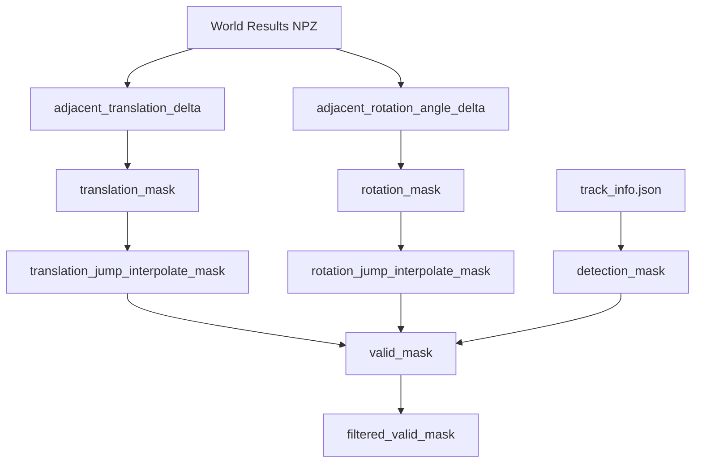

<!-- source: DeepWiki mcp.deepwiki.com · repo NVIDIA/IsaacCapture · page 9.2 Quality Control · fetched 2026-10-26 -->

# Quality Control

<details>
<summary>Relevant source files</summary>

The following files were used as context for generating this wiki page:

- [docs/source/_static/egocentric-input.gif](docs/source/_static/egocentric-input.gif)
- [docs/source/_static/egocentric-reconstruction.gif](docs/source/_static/egocentric-reconstruction.gif)
- [docs/source/references/egocentric_hand_reconstruction.rst](docs/source/references/egocentric_hand_reconstruction.rst)
- [src/postprocessing/egocentric_hand_reconstruction/docker/Dockerfile.dynhamr](src/postprocessing/egocentric_hand_reconstruction/docker/Dockerfile.dynhamr)
- [src/postprocessing/egocentric_hand_reconstruction/docker/Dockerfile.vipe](src/postprocessing/egocentric_hand_reconstruction/docker/Dockerfile.vipe)
- [src/postprocessing/egocentric_hand_reconstruction/mesh_generation/README_mesh_generation.md](src/postprocessing/egocentric_hand_reconstruction/mesh_generation/README_mesh_generation.md)
- [src/postprocessing/egocentric_hand_reconstruction/mesh_generation/save_hand_mesh_trajectory.py](src/postprocessing/egocentric_hand_reconstruction/mesh_generation/save_hand_mesh_trajectory.py)
- [src/postprocessing/egocentric_hand_reconstruction/osmo/README.md](src/postprocessing/egocentric_hand_reconstruction/osmo/README.md)
- [src/postprocessing/egocentric_hand_reconstruction/osmo/hand_reconstruction.yaml](src/postprocessing/egocentric_hand_reconstruction/osmo/hand_reconstruction.yaml)
- [src/postprocessing/egocentric_hand_reconstruction/quality_control/README_cal_jumpy_proportions.md](src/postprocessing/egocentric_hand_reconstruction/quality_control/README_cal_jumpy_proportions.md)
- [src/postprocessing/egocentric_hand_reconstruction/quality_control/README_jumpy_hand_filtering.md](src/postprocessing/egocentric_hand_reconstruction/quality_control/README_jumpy_hand_filtering.md)
- [src/postprocessing/egocentric_hand_reconstruction/quality_control/cal_jumpy_proportions.py](src/postprocessing/egocentric_hand_reconstruction/quality_control/cal_jumpy_proportions.py)
- [src/postprocessing/egocentric_hand_reconstruction/quality_control/detect_jumpy_hand_from_world_results.py](src/postprocessing/egocentric_hand_reconstruction/quality_control/detect_jumpy_hand_from_world_results.py)

</details>


## Overview and Scope

The Quality Control (QC) sub-system within the egocentric hand reconstruction pipeline is responsible for evaluating, detecting, and filtering unstable ("jumpy") hand tracks and tracking loss from Dyn-HaMR world reconstruction results (`*_world_results.npz`) [src/postprocessing/egocentric_hand_reconstruction/quality_control/detect_jumpy_hand_from_world_results.py:1-22](). It executes automatically as the final verification stage of the `dynhamr-reconstruct` task in OSMO workflows [src/postprocessing/egocentric_hand_reconstruction/osmo/hand_reconstruction.yaml:167-171] or during standalone post-processing runs [docs/source/references/egocentric_hand_reconstruction.rst:146-151] inside the Dyn-HaMR container environment [src/postprocessing/egocentric_hand_reconstruction/docker/Dockerfile.dynhamr:156-160].

Sources: [docs/source/references/egocentric_hand_reconstruction.rst:146-151](), [src/postprocessing/egocentric_hand_reconstruction/osmo/hand_reconstruction.yaml:167-171](), [src/postprocessing/egocentric_hand_reconstruction/docker/Dockerfile.dynhamr:156-160](), [src/postprocessing/egocentric_hand_reconstruction/quality_control/detect_jumpy_hand_from_world_results.py:1-22]()

---

## Jumpy-Hand Detection Architecture

The detection engine (`detect_jumpy_hand_from_world_results.py`) analyzes two independent jump signals per hand track alongside visibility masks from tracking metadata [src/postprocessing/egocentric_hand_reconstruction/quality_control/README_jumpy_hand_filtering.md:12-35]():

1. **Translation Jumps**: Computes the L2 norm of adjacent-frame differences of the root translation vector `trans` (`(B, T, 3)`) [src/postprocessing/egocentric_hand_reconstruction/quality_control/detect_jumpy_hand_from_world_results.py:105-116]():
   $$\Delta_{\text{trans}}[t] = \|\text{trans}[t] - \text{trans}[t-1]\|$$

2. **Rotation Jumps**: Converts axis-angle root orientations (`root_orient`, `(B, T, 3)`) to rotation matrices via Rodrigues formula `axis_angle_to_rotmat`, computes relative rotation delta angles between consecutive frames, and evaluates the angle in radians [src/postprocessing/egocentric_hand_reconstruction/quality_control/detect_jumpy_hand_from_world_results.py:78-140]():
   $$\theta[t] = \arccos\left(\frac{\text{tr}(R[t-1]^T R[t]) - 1}{2}\right)$$

3. **Detection Loss**: Integrates per-frame visibility flags (`vis_mask`) extracted from `track_info.json` (`left_hand_detection_mask` and `right_hand_detection_mask`) [src/postprocessing/egocentric_hand_reconstruction/quality_control/README_jumpy_hand_filtering.md:28-35]().

### Diagram: Detection Pipeline to Code Entities

```mermaid
graph TD
    A["InputWorldResults" --> |"numpy_world_to_state()"| B["_world_results.npz"]]
    B --> C["adjacent_translation_delta()"]
    B --> D["axis_angle_to_rotmat() & adjacent_rotation_angle_delta()"]
    C --> E["TranslationMasks"]
    D --> F["RotationMasks"]
    G["track_info.json"] --> H["DetectionMasks"]
    E & F & H --> I["detect_jumpy_tracks()"]
    I --> J["qc_world_jumpy_per_frame_labels.json"]
```

Sources: [src/postprocessing/egocentric_hand_reconstruction/quality_control/detect_jumpy_hand_from_world_results.py:78-140](), [src/postprocessing/egocentric_hand_reconstruction/quality_control/README_jumpy_hand_filtering.md:12-35]()

---

## Mask Hierarchy and Pipeline Flow

The quality control script builds a hierarchical cascade of boolean per-frame masks (`true` = OK/normal, `false` = jump/lost/invalid) [src/postprocessing/egocentric_hand_reconstruction/quality_control/README_jumpy_hand_filtering.md:37-68]():

* **Base Jump Masks (`*_mask`)**: Frame-level boolean arrays indicating whether translation or rotation deltas stay below the configured thresholds (median multiplied by `--trans_factor` / `--rot_factor`, or absolute thresholds) [src/postprocessing/egocentric_hand_reconstruction/quality_control/detect_jumpy_hand_from_world_results.py:35-37]().
* **Jump-Interpolate Masks (`*_jump_interpolate_mask`)**: Fills 10-frame gaps between two nearby jump frames with `false` to prevent fragmented valid segments [src/postprocessing/egocentric_hand_reconstruction/quality_control/detect_jumpy_hand_from_world_results.py:15-20]().
* **Valid Mask (`valid_mask`)**: The logical `AND` combination of all raw jump masks, interpolate masks, and detection masks across both hands [src/postprocessing/egocentric_hand_reconstruction/quality_control/README_jumpy_hand_filtering.md:81-89]().
* **Filtered Valid Mask (`filtered_valid_mask`)**: Removes isolated single-frame `false` spikes by re-asserting frames as `true` if they are surrounded by 10 consecutive `true` frames on both sides [src/postprocessing/egocentric_hand_reconstruction/quality_control/README_jumpy_hand_filtering.md:90-92]().

### Diagram: Mask Derivation and Filtering Logic



Sources: [src/postprocessing/egocentric_hand_reconstruction/quality_control/detect_jumpy_hand_from_world_results.py:15-20](), [src/postprocessing/egocentric_hand_reconstruction/quality_control/README_jumpy_hand_filtering.md:54-92]()

---

## Batch QC and Proportion Metrics

When processing batch directories via `--world_results_dir`, the detector generates `qc_world_jumpy_batch_summary.json` [src/postprocessing/egocentric_hand_reconstruction/quality_control/README_jumpy_hand_filtering.md:129-133](). The auxiliary script `cal_jumpy_proportions.py` parses this summary to compute dataset-wide metrics [src/postprocessing/egocentric_hand_reconstruction/quality_control/cal_jumpy_proportions.py:4-19]():

* **True/False Proportions**: Evaluates the fraction of frames that are `true` versus `false` for every mask key across all videos [src/postprocessing/egocentric_hand_reconstruction/quality_control/cal_jumpy_proportions.py:34-59]().
* **Error Video Filtering**: Computes statistics in two modes: across all videos versus exclusively over valid videos (`error_video = false`) [src/postprocessing/egocentric_hand_reconstruction/quality_control/cal_jumpy_proportions.py:143-160]().
* **Useful Frames & Seconds**: Aggregates `total_useful_frames` where `filtered_valid_mask` is `true`, and calculates `total_useful_seconds` when an `--fps` argument (e.g., `30`) is provided [src/postprocessing/egocentric_hand_reconstruction/quality_control/cal_jumpy_proportions.py:62-85]().

Sources: [src/postprocessing/egocentric_hand_reconstruction/quality_control/cal_jumpy_proportions.py:4-85](), [src/postprocessing/egocentric_hand_reconstruction/quality_control/README_jumpy_hand_filtering.md:129-133]()

---

## Execution and Container Integration

Quality control scripts are packaged directly inside the Dyn-HaMR container image (`Dockerfile.dynhamr`) alongside the core optimizer and mesh generation utilities [src/postprocessing/egocentric_hand_reconstruction/docker/Dockerfile.dynhamr:156-160](). 

During OSMO batch execution (`hand_reconstruction.yaml`), the `dynhamr-reconstruct` task executes `run_jumpy_qc.sh` immediately following Dyn-HaMR optimization [src/postprocessing/egocentric_hand_reconstruction/osmo/hand_reconstruction.yaml:167-171]():

```bash
# Jumpy-hand QC on reconstruction results inside container
echo "Running jumpy-hand QC on ${OUTPUT_DIR} ..."
cd /home/appuser
bash run_jumpy_qc.sh "${OUTPUT_DIR}" || echo "WARN: jumpy QC failed (non-fatal)"
```

Sources: [src/postprocessing/egocentric_hand_reconstruction/docker/Dockerfile.dynhamr:156-160](), [src/postprocessing/egocentric_hand_reconstruction/osmo/hand_reconstruction.yaml:167-171]()

---

