# Page: Overview

# Overview

<details>
<summary>Relevant source files</summary>

The following files were used as context for generating this wiki page:

- [README.md](README.md)
- [deps/cloudxr/.env.default](deps/cloudxr/.env.default)
- [deps/cloudxr/.gitignore](deps/cloudxr/.gitignore)
- [deps/cloudxr/Dockerfile.web-app](deps/cloudxr/Dockerfile.web-app)
- [deps/cloudxr/Dockerfile.wss-proxy](deps/cloudxr/Dockerfile.wss-proxy)
- [deps/cloudxr/docker-compose.yaml](deps/cloudxr/docker-compose.yaml)
- [deps/cloudxr/webxr_client/tsconfig.json](deps/cloudxr/webxr_client/tsconfig.json)
- [docs/source/_static/hardware-req-01.svg](docs/source/_static/hardware-req-01.svg)
- [docs/source/_static/hardware-req-02.svg](docs/source/_static/hardware-req-02.svg)
- [docs/source/_static/hardware-req-03.svg](docs/source/_static/hardware-req-03.svg)
- [docs/source/_static/hardware-req-04.svg](docs/source/_static/hardware-req-04.svg)
- [docs/source/_static/isaac-teleop-architecture.svg](docs/source/_static/isaac-teleop-architecture.svg)
- [docs/source/_static/isaaclab.jpg](docs/source/_static/isaaclab.jpg)
- [docs/source/_static/isaacros.png](docs/source/_static/isaacros.png)
- [docs/source/device/body_tracking.rst](docs/source/device/body_tracking.rst)
- [docs/source/index.rst](docs/source/index.rst)
- [docs/source/overview/ecosystem.rst](docs/source/overview/ecosystem.rst)
- [docs/source/references/mcap_record_replay.rst](docs/source/references/mcap_record_replay.rst)
- [docs/source/references/requirements.rst](docs/source/references/requirements.rst)
- [examples/mcap_record_replay/.gitignore](examples/mcap_record_replay/.gitignore)
- [examples/mcap_record_replay/CMakeLists.txt](examples/mcap_record_replay/CMakeLists.txt)
- [examples/mcap_record_replay/cpp/CMakeLists.txt](examples/mcap_record_replay/cpp/CMakeLists.txt)
- [examples/mcap_record_replay/cpp/record_full_body.cpp](examples/mcap_record_replay/cpp/record_full_body.cpp)
- [examples/schemaio/CMakeLists.txt](examples/schemaio/CMakeLists.txt)
- [examples/schemaio/full_body_printer.cpp](examples/schemaio/full_body_printer.cpp)

</details>


Isaac Teleop (`isaaccapture`) is the unified framework for high-fidelity egocentric and robotics data collection, designed to solve data bottlenecks in robot learning by providing a standardized device interface, flexible retargeting pipelines, and seamless operation across simulation and real-world platforms [README.md:8-28, docs/source/index.rst:12-15]. 

Sources: [README.md:8-28](), [docs/source/index.rst:12-15]()

---

## High-Level Architecture

The Isaac Teleop architecture streams pose, video, and sensor information from extended reality (XR) client hardware into a cloud or local runtime environment, processing device inputs via C++ OpenXR bindings and DeviceIO tracker layers before routing them through Python-based retargeting engines to target robots or datasets [docs/source/index.rst:23-28, docs/references/mcap_record_replay.rst:14-32].

### System Architecture Flow

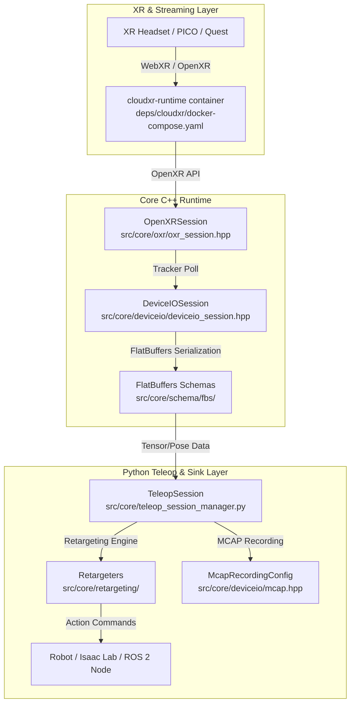
Sources: [deps/cloudxr/docker-compose.yaml:6-30](), [docs/source/references/mcap_record_replay.rst:14-32]()

---

## Child Pages & Navigation

This page provides a high-level summary of Isaac Teleop. For detailed instructions and deep technical dives, refer to the following child pages:

- **Getting Started**: For installation via `pip`/`uv`, extras configuration, starting the CloudXR container services, running initial teleoperation examples, and reviewing hardware specs, see [Getting Started](#1.1).
- **Repository Layout and Conventions**: For a thorough walkthrough of `src/core`, `src/plugins`, `src/viz`, dependency management, and contributing guidelines, see [Repository Layout and Conventions](#1.2).

Sources: [docs/source/index.rst:38-58]()

---

## 1.1. Getting Started

To initialize a development or production environment for Isaac Teleop, users install the package dependencies using `uv` or `pip`, deploy the CloudXR runtime container stack using Docker Compose, and verify configuration against system hardware requirements [README.md:50-66, docs/source/references/requirements.rst:7-35].

For full instructions, quick-start guides, and hardware prerequisites, see [Getting Started](#1.1).

Sources: [README.md:50-65](), [docs/source/references/requirements.rst:7-35]()

---

## 1.2. Repository Layout and Conventions

The repository organizes its implementation into modular directories separating low-level C++ core utilities, device integration plugins, visualization engines, and orchestration scripts [docs/source/index.rst:23-28]. 

### Repository Directory Organization

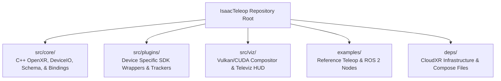
Sources: [docs/source/index.rst:23-28](), [deps/cloudxr/docker-compose.yaml:4-69]()

For comprehensive details on AGENTS.md conventions, REUSE licensing, pre-commit hooks, and codebase structure, see [Repository Layout and Conventions](#1.2).

Sources: [docs/source/index.rst:38-58]()

---

# Page: Getting Started

# Getting Started

<details>
<summary>Relevant source files</summary>

The following files were used as context for generating this wiki page:

- [cmake/SetupPython.cmake](cmake/SetupPython.cmake)
- [docs/source/_static/hardware-req-01.svg](docs/source/_static/hardware-req-01.svg)
- [docs/source/_static/hardware-req-02.svg](docs/source/_static/hardware-req-02.svg)
- [docs/source/_static/hardware-req-03.svg](docs/source/_static/hardware-req-03.svg)
- [docs/source/_static/hardware-req-04.svg](docs/source/_static/hardware-req-04.svg)
- [docs/source/_static/isaac-teleop-architecture.svg](docs/source/_static/isaac-teleop-architecture.svg)
- [docs/source/_static/isaaclab.jpg](docs/source/_static/isaaclab.jpg)
- [docs/source/_static/isaacros.png](docs/source/_static/isaacros.png)
- [docs/source/getting_started/build_from_source/index.rst](docs/source/getting_started/build_from_source/index.rst)
- [docs/source/getting_started/quick_start.rst](docs/source/getting_started/quick_start.rst)
- [docs/source/references/build.rst](docs/source/references/build.rst)
- [docs/source/references/requirements.rst](docs/source/references/requirements.rst)
- [examples/oxr/python/pyproject.toml](examples/oxr/python/pyproject.toml)
- [examples/teleop/python/pyproject.toml](examples/teleop/python/pyproject.toml)
- [src/core/oxr/python/CMakeLists.txt](src/core/oxr/python/CMakeLists.txt)
- [src/core/plugin_manager/python/CMakeLists.txt](src/core/plugin_manager/python/CMakeLists.txt)
- [src/core/python/requirements-dev.txt](src/core/python/requirements-dev.txt)
- [src/core/python/requirements.txt](src/core/python/requirements.txt)
- [src/core/python/stubgen_pyproject.toml](src/core/python/stubgen_pyproject.toml)

</details>


## Purpose and Scope
This page covers the quick start procedures for `isaaccapture` (formerly Isaac Teleop). It details hardware and software requirements, installation via PyPI or `uv` with optional extras, building from source via CMake and `scikit-build-core`, configuring and starting the CloudXR streaming service, and executing initial teleoperation workflows.

Sources: `docs/source/getting_started/quick_start.rst:1-12`(), `docs/source/getting_started/build_from_source/index.rst:4-10`()

---

## Hardware and Software Requirements
Teleoperation sessions involving XR headsets, extra input devices (such as Manus Gloves, Logitech pedals, OAK-D cameras, Haptikos exoskeletons), or simulators demand specific workstation configurations `[docs/source/references/requirements.rst:7-18]()`.

| Component | Requirement |
| :--- | :--- |
| **CPU / GPU** | `x86_64`, NVIDIA GPU required `[docs/source/references/requirements.rst:25-26]()` |
| **OS** | Ubuntu 22.04 or 24.04 `[docs/source/references/requirements.rst:27-28]()` |
| **Python** | 3.11, 3.12, or 3.13 `[docs/source/references/requirements.rst:29-30]()` |
| **CUDA** | 12.8 or newer `[docs/source/references/requirements.rst:31-32]()` |
| **NVIDIA Driver** | 580.95.05 or newer `[docs/source/references/requirements.rst:33-34]()` |

Sources: `docs/source/references/requirements.rst:1-35`()

---

## Installation via Pip and `uv`
The package `isaaccapture` can be installed directly from PyPI along with optional feature extras such as `cloudxr` and `retargeters` `[docs/source/getting_started/quick_start.rst:33-49]()`.

```bash
# Standard pip installation with cloudxr and retargeter extras
pip install 'isaaccapture[cloudxr,retargeters]~=1.0'

# Installation via Astral uv with pre-release opt-in and NVIDIA package index
uv pip install 'isaaccapture[cloudxr,retargeters]~=1.0' \
      --extra-index-url https://pypi.nvidia.com --prerelease=allow
```

Upgrading from legacy versions (`isaacteleop` 1.5 or earlier) is handled automatically through compatibility aliases defined in requirements configurations `[docs/source/getting_started/quick_start.rst:36-40](), [src/core/python/requirements.txt:1-4]()`.

Sources: `docs/source/getting_started/quick_start.rst:31-65](), [src/core/python/requirements.txt:1-4]()`

---

## Building from Source and CMake Configuration
To compile core libraries, plugins, and bindings from source, CMake 3.24+ and a C++20 compiler are required `[docs/source/getting_started/build_from_source/index.rst:21-28]()`. Dependency management and Python version enforcement are handled by `cmake/SetupPython.cmake` `[cmake/SetupPython.cmake:7-18]()`.

```mermaid
graph TD
    RootCMake["Top-level CMakeLists.txt"] --> SetupPy["cmake/SetupPython.cmake"]
    SetupPy --> CheckVersion["isaac_teleop_enforce_python_version"]
    CheckVersion --> FindUV["find_program uv"]
    FindUV --> ManagedPy["uv python find ISAAC_TELEOP_PYTHON_VERSION"]
    ManagedPy --> FetchDeps["FetchContent OpenXR / pybind11 / yaml-cpp"]
    FetchDeps --> CoreBuild["src/core/CMakeLists.txt"]
    CoreBuild --> WheelPack["src/core/python/ wheel packaging"]

    subgraph CodeEntitySpace
        RootCMake
        SetupPy
        CheckVersion
        FindUV
        ManagedPy
        FetchDeps
        CoreBuild
        WheelPack
    end

    style RootName fill:#fff,stroke:#000,stroke-width:1px
```
*Figure 1: CMake configuration and Python discovery control flow mapping to build scripts.*

Sources: `docs/source/getting_started/build_from_source/index.rst:19-103](), [cmake/SetupPython.cmake:1-89]()`

---

## CloudXR Service and Runtime Setup
CloudXR runtime servers handle WebXR streaming from headsets (Quest, PICO, Vision Pro, or local emulator `IWER`). The CloudXR runtime can be launched via service commands or instantiated automatically by teleop examples `[docs/source/getting_started/quick_start.rst:71-108]()`.

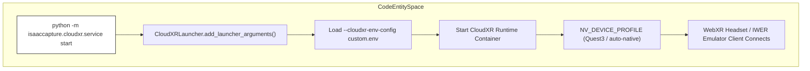
*Figure 2: CloudXR service startup and environment parameterization sequence.*

To write a custom profile configuration and initialize the background service:
```bash
echo 'NV_DEVICE_PROFILE=auto-native' > custom.env
python -m isaaccapture.cloudxr.service start --cloudxr-env-config ./custom.env
```
Resolved runtime configurations are written to `~/.cloudxr/run/cloudxr.env` `[docs/source/getting_started/quick_start.rst:93-113]()`.

Sources: `docs/source/getting_started/quick_start.rst:69-146]()`

---

# Page: Repository Layout and Conventions

# Repository Layout and Conventions

<details>
<summary>Relevant source files</summary>

The following files were used as context for generating this wiki page:

- [.clang-format](.clang-format)
- [.claude/skills/cmake-structure/SKILL.md](.claude/skills/cmake-structure/SKILL.md)
- [.coderabbit.yaml](.coderabbit.yaml)
- [.cursor/rules/cmake-structure.mdc](.cursor/rules/cmake-structure.mdc)
- [.github/instructions/cmake-structure.instructions.md](.github/instructions/cmake-structure.instructions.md)
- [.gitlab-ci.yml](.gitlab-ci.yml)
- [.nspect-allowlist.toml](.nspect-allowlist.toml)
- [.pre-commit-config.yaml](.pre-commit-config.yaml)
- [.reuse/templates/compact.jinja2](.reuse/templates/compact.jinja2)
- [AGENTS.md](AGENTS.md)
- [CODE_OF_CONDUCT.md](CODE_OF_CONDUCT.md)
- [CONTRIBUTING.md](CONTRIBUTING.md)
- [LICENSES/Apache-2.0.txt](LICENSES/Apache-2.0.txt)
- [REUSE.toml](REUSE.toml)
- [SECURITY.md](SECURITY.md)
- [cmake/cmake-structure.md](cmake/cmake-structure.md)
- [docs/source/references/license.rst](docs/source/references/license.rst)
- [examples/README.md](examples/README.md)
- [scripts/check_dco_signoff.py](scripts/check_dco_signoff.py)
- [src/core/log_bridge/cpp/sink_config.cpp](src/core/log_bridge/cpp/sink_config.cpp)
- [src/python/isaaccapture/cloudxr/webclient.py](src/python/isaaccapture/cloudxr/webclient.py)
- [src/python/isaaccapture/logging_config/AGENTS.md](src/python/isaaccapture/logging_config/AGENTS.md)
- [src/python/isaaccapture/logging_config/__init__.py](src/python/isaaccapture/logging_config/__init__.py)
- [src/python/isaaccapture/logging_config/_console.py](src/python/isaaccapture/logging_config/_console.py)
- [tests/python/core/logging_config/conftest.py](tests/python/core/logging_config/conftest.py)
- [tests/python/core/logging_config/test_console.py](tests/python/core/logging_config/test_console.py)
- [tests/python/core/logging_config/test_core.py](tests/python/core/logging_config/test_core.py)
- [tests/python/core/logging_config/test_routing.py](tests/python/core/logging_config/test_routing.py)

</details>


## Purpose and Scope

This page provides a comprehensive tour of the `isaaccapture` repository layout (`src/core`, `src/plugins`, `src/viz`, `deps`, `examples`, and `tests`), development conventions, agent compliance rules (`AGENTS.md`), licensing via REUSE, developer contribution workflows, and pre-commit verification gates.

Sources: [`AGENTS.md:1-119`](), [`CONTRIBUTING.md:1-133`](), [`.pre-commit-config.yaml:1-75`]()

---

## Repository Directory Layout

The repository is organized into distinct functional subtrees separating core C++ runtimes, Python device plugins, visualization components, dependencies, and validation tests.

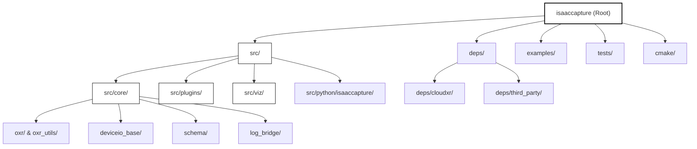
*Figure 1: High-level repository directory layout and subsystem mapping.*

Sources: [`AGENTS.md:1-49`](), [`CONTRIBUTING.md:1-50`]()

### Top-Level Directories

- `src/core/`: Contains the primary C++ runtime architecture, including the OpenXR session layer (`oxr`), DeviceIO tracker interfaces (`deviceio_base`), FlatBuffers schema definitions and codegen (`schema`), MCAP recording adapters, and the plugin manager.
- `src/plugins/`: Houses individual device plugins (e.g., MANUS gloves, OAK cameras, Sharpa/Wuji avatars, pedals, leader arms) implemented as dynamic libraries or separate processes.
- `src/viz/`: Implements the Vulkan/CUDA/OpenXR rendering compositor (`VizSession`), camera streaming pipelines, and robot visualization HUDs (`isaaccapture.viz.robot`).
- `src/python/isaaccapture/`: Houses the Python package supporting the teleop control state machine, retargeting engines, logging configuration (`logging_config`), and CLI utilities.
- `deps/`: Vendored external dependencies, OpenXR headers, CloudXR integration files, and build utility CMake scripts.
- `examples/`: End-to-end reference applications, including ROS 2 teleop nodes, vehicle teleop, LeRobot data collection, and MuJoCo simulations.
- `tests/`: C++ (`tests/cpp`) and Python (`tests/python`) test suites executed via CTest and pytest.

Sources: [`AGENTS.md:27-48`](), [`.pre-commit-config.yaml:13-74`]()

---

## Agent Conventions (`AGENTS.md`)

Automated coding agents and contributors must adhere to strict operational constraints defined in root and directory-level `AGENTS.md` files.

### Mandatory Preflight
Before modifying or creating any file, agents must locate and read every relevant `AGENTS.md` file traversing upward from the target directory to the repository root [`AGENTS.md:27-38`](). Relying solely on chat context is strictly prohibited.

### CMake and Include Structure
When creating or editing `CMakeLists.txt` files, managing targets, placing headers, or structuring directories, contributors must follow canonical CMake and include rules defined in [`cmake/cmake-structure.md`](), which is auto-loaded by per-tool shims [`AGENTS.md:50-60`]().

### Shell Scripting Standards
In bash scripts (`#!/bin/bash`, `#!/usr/bin/env bash`), use the robust test construct `[[ ... ]]` instead of the POSIX single-bracket `[ ... ]` to prevent unquoted word-splitting or glob expansion issues [`AGENTS.md:64-68`](). Note that genuine `#!/bin/sh` (dash) scripts must retain `[ ... ]` [`AGENTS.md:69-72`]().

### Logging Conventions
Every process in the repository—both Python and C++—feeds a single logger tree rooted at `isaaccapture` [`AGENTS.md:76-78`]().
- **Naming:** Name loggers under `isaaccapture.`. In Python, use `logging.getLogger(__name__)` inside `src/python/isaaccapture/` or explicit `logging.getLogger("isaaccapture.<area>.<module>")`. In C++, use `isaaccapture::Logger::get("isaaccapture.<module>.<ClassName>")` [`AGENTS.md:80-88`]().
- **No BasicConfig:** Never call `logging.basicConfig()`, and never attach custom handlers directly to the `isaaccapture` root logger to avoid duplicate log emission [`AGENTS.md:89-94`]().
- **Public API Configuration:** Configure logging exclusively through public APIs such as `logging_config.set_console_level()` rather than constructing handlers manually [`AGENTS.md:102-105`]().
- **Terminal UX vs Diagnostics:** Use `print()` or `std::cout` strictly for deliberate terminal UX (CLI usage text, interactive prompts, operator banners), while diagnostics must be routed to the logger tree [`AGENTS.md:106-111`]().

Sources: [`AGENTS.md:1-119`](), [`src/python/isaaccapture/logging_config/__init__.py:1-32`](), [`src/python/isaaccapture/logging_config/_console.py:1-160`]()

---

## Licensing and REUSE Compliance

The codebase uses the **REUSE** specification to enforce machine-readable copyright and licensing information across all source files [`CONTRIBUTING.md:51-53`]().

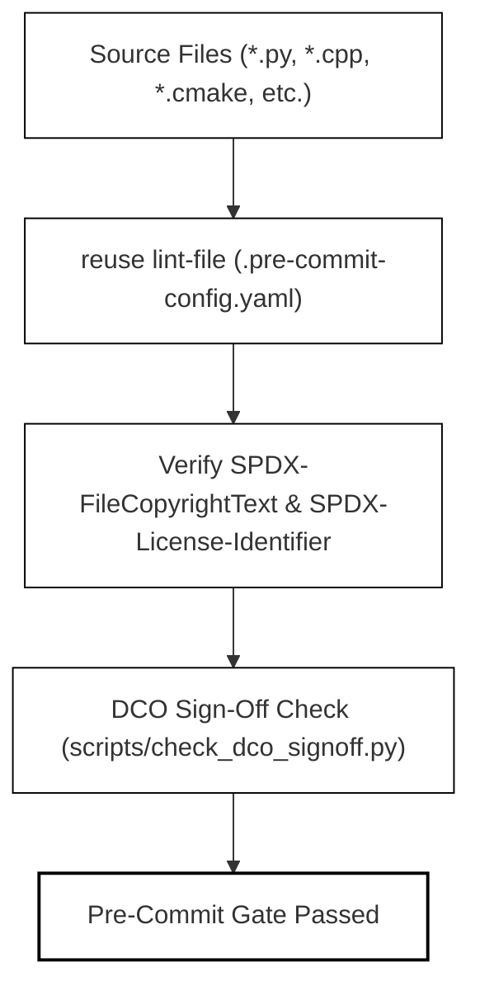
*Figure 2: Code quality and compliance verification pipeline enforced by pre-commit hooks.*

Sources: [`.pre-commit-config.yaml:32-63`](), [`CONTRIBUTING.md:51-77`](), [`REUSE.toml:1-60`]()

### Required Header Annotations
Every source file must contain valid SPDX metadata headers:
- `SPDX-FileCopyrightText: Copyright (c) 2026 NVIDIA CORPORATION & AFFILIATES. All rights reserved.` [`CONTRIBUTING.md:55-63`](), [`docs/source/references/license.rst:20-36`]()
- `SPDX-License-Identifier: Apache-2.0` (with full license text stored in `LICENSES/Apache-2.0.txt`) [`CONTRIBUTING.md:55-56`]().

### Exceptions & Overrides
Certain components maintain specific license exceptions declared in [`REUSE.toml`]():
- OpenXR SDK headers and extensions are governed under MIT or Boost Software License 1.0 [`docs/source/references/license.rst:12-16`]().
- NVIDIA CloudXR SDK is proprietary software under the NVIDIA CloudXR License [`docs/source/references/license.rst:17`]().
- Vendored third-party code (e.g., Chromium key code tables) maintains original BSD-3-Clause annotations [`REUSE.toml:48-60`]().

Sources: [`REUSE.toml:1-60`](), [`CONTRIBUTING.md:51-78`](), [`docs/source/references/license.rst:1-39`]()

---

## Contributing and Developer Workflows

Contributions must follow established code styles, pre-commit validations, and Developer Certificate of Origin (DCO) sign-offs.

### Code Styles
- **C++:** Written in C++20 and formatted using `clang-format` [`CONTRIBUTING.md:18-20`]().
- **Python:** Follows PEP 8 style guidelines, utilizes type annotations (PEP 484), and employs formatted string literals (f-strings) [`CONTRIBUTING.md:22-24`]().

### Developer Certificate of Origin (DCO)
All commits must be signed off using the `git commit -s` or `--signoff` flag, appending a `Signed-off-by` line certifying that the contribution complies with the Developer Certificate of Origin Version 1.1 [`CONTRIBUTING.md:91-132`]().

Sources: [`CONTRIBUTING.md:1-133`]()

---

## Pre-Commit Verification Gates

Pre-commit hooks automatically validate formatting, linting, licensing, and documentation references before commits are finalized.

| Hook ID | Tool / Script | Target Scope | Description |
| :--- | :--- | :--- | :--- |
| `ruff` / `ruff-format` | Astral Ruff [`.pre-commit-config.yaml:5-12`]() | Python files | Lints and formats Python source code |
| `reuse-lint-file` | REUSE Tool [`.pre-commit-config.yaml:33-39`]() | All source files | Validates SPDX copyright and license headers |
| `check-dco-signoff` | `scripts/check_dco_signoff.py` [`.pre-commit-config.yaml:43-47`]() | Commit messages | Verifies DCO `Signed-off-by` signature |
| `check-copyright-year` | `scripts/check_copyright_year.py` [`.pre-commit-config.yaml:48-53`]() | Source files | Ensures copyright year includes current year |
| `check-lfs-pointers` | `scripts/check_lfs_pointers.py` [`.pre-commit-config.yaml:54-63`]() | LFS assets | Ensures Git LFS-marked files are valid pointers |
| `check-doc-refs` | `scripts/check_doc_refs.py` [`.pre-commit-config.yaml:64-74`]() | Documentation (`.rst`, `.md`) | Validates that documentation references existing code symbols and imports |

Sources: [`.pre-commit-config.yaml:1-75`](), [`CONTRIBUTING.md:26-50`]()

---

# Page: Core Runtime Architecture

# Core Runtime Architecture

<details>
<summary>Relevant source files</summary>

The following files were used as context for generating this wiki page:

- [docs/source/references/device_provider_monitoring.rst](docs/source/references/device_provider_monitoring.rst)
- [src/core/deviceio_trackers/cpp/CMakeLists.txt](src/core/deviceio_trackers/cpp/CMakeLists.txt)
- [src/core/deviceio_trackers/python/tracker_bindings.cpp](src/core/deviceio_trackers/python/tracker_bindings.cpp)
- [src/core/live_trackers/cpp/CMakeLists.txt](src/core/live_trackers/cpp/CMakeLists.txt)
- [src/core/live_trackers/cpp/inc/live_trackers/live_deviceio_factory.hpp](src/core/live_trackers/cpp/inc/live_trackers/live_deviceio_factory.hpp)
- [src/core/live_trackers/cpp/inc/live_trackers/schema_tracker.hpp](src/core/live_trackers/cpp/inc/live_trackers/schema_tracker.hpp)
- [src/core/live_trackers/cpp/live_deviceio_factory.cpp](src/core/live_trackers/cpp/live_deviceio_factory.cpp)
- [src/core/mcap/cpp/inc/mcap/recording_traits.hpp](src/core/mcap/cpp/inc/mcap/recording_traits.hpp)
- [src/core/oxr/cpp/CMakeLists.txt](src/core/oxr/cpp/CMakeLists.txt)
- [src/core/oxr/cpp/inc/oxr/oxr_session.hpp](src/core/oxr/cpp/inc/oxr/oxr_session.hpp)
- [src/core/oxr/cpp/oxr_session.cpp](src/core/oxr/cpp/oxr_session.cpp)
- [src/core/oxr/python/oxr_bindings.cpp](src/core/oxr/python/oxr_bindings.cpp)
- [src/core/replay_trackers/cpp/CMakeLists.txt](src/core/replay_trackers/cpp/CMakeLists.txt)
- [src/core/replay_trackers/cpp/inc/replay_trackers/replay_deviceio_factory.hpp](src/core/replay_trackers/cpp/inc/replay_trackers/replay_deviceio_factory.hpp)
- [src/core/replay_trackers/cpp/replay_deviceio_factory.cpp](src/core/replay_trackers/cpp/replay_deviceio_factory.cpp)
- [src/python/isaaccapture/teleop_session_manager/status.py](src/python/isaaccapture/teleop_session_manager/status.py)
- [src/python/isaaccapture/teleop_session_manager/status_monitor.py](src/python/isaaccapture/teleop_session_manager/status_monitor.py)
- [tests/python/core/teleop_session_manager/test_status_monitor.py](tests/python/core/teleop_session_manager/test_status_monitor.py)

</details>


The C++ core runtime of `isaaccapture` provides high-performance OpenXR session management, live and replay tracker execution via DeviceIO, structured data serialization using FlatBuffers, MCAP recording and replay, and a plugin discovery system. These components are exposed to Python through pybind11 modules, powering teleoperation and data collection pipelines.

Sources: `src/core/oxr/cpp/inc/oxr/oxr_session.hpp:54-90`, `src/core/live_trackers/cpp/inc/live_trackers/live_deviceio_factory.hpp:55-113`

## 2.1 OpenXR Layer (`oxr`, `oxr_utils`)

The OpenXR layer handles instance creation, system acquisition, session lifecycle events, and extension negotiation for XR runtimes (such as CloudXR). It encapsulates handle management within `core::OpenXRSession` [src/core/oxr/cpp/inc/oxr/oxr_session.hpp:54-90] and provides thread-safe Python bindings via `core::PyOpenXRSession` [src/core/oxr/python/oxr_bindings.cpp:28-75]. Utilities for time conversion, math, and pose manipulation reside in `oxr_utils`.

For details, see [OpenXR Layer (oxr, oxr_utils)](#2.1).

Sources: `src/core/oxr/cpp/inc/oxr/oxr_session.hpp:54-90`, `src/core/oxr/python/oxr_bindings.cpp:28-75`, `src/core/oxr/cpp/CMakeLists.txt:17-39`

## 2.2 DeviceIO: Sessions, Trackers, Sources and Sinks

DeviceIO provides the abstraction layer for collecting telemetry from hardware or recorded streams. It separates public tracker interfaces (e.g., `core::HandTracker`, `core::HeadTracker`) from underlying implementations through live (`core::LiveDeviceIOFactory`) [src/core/live_trackers/cpp/inc/live_trackers/live_deviceio_factory.hpp:55-113] and replay (`core::ReplayDeviceIOFactory`) [src/core/replay_trackers/cpp/inc/replay_trackers/replay_deviceio_factory.hpp:56-83] factories. Trackers feed data graph nodes for retargeting and logging.

For details, see [DeviceIO: Sessions, Trackers, Sources and Sinks](#2.2).

Sources: `src/core/live_trackers/cpp/inc/live_trackers/live_deviceio_factory.hpp:55-113`, `src/core/replay_trackers/cpp/inc/replay_trackers/replay_deviceio_factory.hpp:56-83`, `src/core/deviceio_trackers/python/tracker_bindings.cpp:63-87`

## 2.3 Schema System (FlatBuffers)

Data payloads transmitted across DeviceIO channels and recorded into MCAP files are defined using FlatBuffers `.fbs` schemas. The build system compiles these schemas into golden binary reflection files (`.bfbs`) and generates high-performance C++ and Python accessors, ensuring zero-copy deserialization and backward compatibility across versions.

For details, see [Schema System (FlatBuffers)](#2.3).

Sources: `src/core/deviceio_trackers/python/tracker_bindings.cpp:16-18`

## 2.4 MCAP Recording and Replay

MCAP recording captures live tracker data streams into structured log files, while replay reads them back into deterministic simulation or debugging pipelines. Recording traits (`core::HeadRecordingTraits`, `core::HandRecordingTraits`, etc.) define default channel names and schema associations for each tracker type [src/core/mcap/cpp/inc/mcap/recording_traits.hpp:20-64].

For details, see [MCAP Recording and Replay](#2.4).

Sources: `src/core/mcap/cpp/inc/mcap/recording_traits.hpp:20-64`, `src/core/replay_trackers/cpp/replay_deviceio_factory.cpp:37-66`

## 2.5 Plugin Manager and Logging

The plugin manager discovers external device extensions via `plugin.yaml` manifests and dynamically loads shared libraries into the runtime session. Logging configuration utilities (`logging_config` and `log_bridge`) route C++ and Python log messages through unified sinks for diagnostics.

For details, see [Plugin Manager and Logging](#2.5).

Sources: `src/core/oxr/cpp/inc/oxr/oxr_session.hpp:6`, `src/core/oxr/cpp/oxr_session.cpp:52-56`

---

### Core C++ Runtime Code Entities

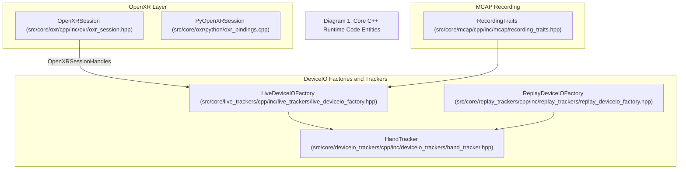

Sources: `src/core/oxr/cpp/inc/oxr/oxr_session.hpp:54-90`, `src/core/live_trackers/cpp/inc/live_trackers/live_deviceio_factory.hpp:55-113`, `src/core/replay_trackers/cpp/inc/replay_trackers/replay_deviceio_factory.hpp:56-83`, `src/core/mcap/cpp/inc/mcap/recording_traits.hpp:20-64`

### Runtime Data Flow and Pipeline

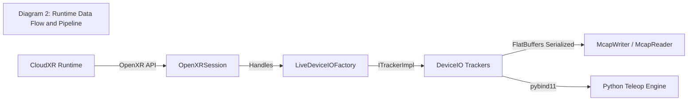

Sources: `src/core/oxr/cpp/inc/oxr/oxr_session.hpp:54-90`, `src/core/live_trackers/cpp/inc/live_trackers/live_deviceio_factory.hpp:55-113`, `src/core/replay_trackers/cpp/inc/replay_trackers/replay_deviceio_factory.hpp:56-83`

---

# Page: OpenXR Layer (oxr, oxr_utils)

# OpenXR Layer (oxr, oxr_utils)

<details>
<summary>Relevant source files</summary>

The following files were used as context for generating this wiki page:

- [deps/cloudxr/openxr_extensions/CMakeLists.txt](deps/cloudxr/openxr_extensions/CMakeLists.txt)
- [deps/cloudxr/openxr_extensions/XR_NVX1_push_tensor.h](deps/cloudxr/openxr_extensions/XR_NVX1_push_tensor.h)
- [deps/cloudxr/openxr_extensions/XR_NVX1_tensor_data.h](deps/cloudxr/openxr_extensions/XR_NVX1_tensor_data.h)
- [deps/cloudxr/openxr_extensions/openxr_extension_helpers.h](deps/cloudxr/openxr_extensions/openxr_extension_helpers.h)
- [docs/source/references/device_provider_monitoring.rst](docs/source/references/device_provider_monitoring.rst)
- [examples/oxr/CMakeLists.txt](examples/oxr/CMakeLists.txt)
- [examples/oxr/cpp/oxr_session_sharing.cpp](examples/oxr/cpp/oxr_session_sharing.cpp)
- [examples/oxr/cpp/oxr_simple_api_demo.cpp](examples/oxr/cpp/oxr_simple_api_demo.cpp)
- [examples/oxr/python/modular_example.py](examples/oxr/python/modular_example.py)
- [examples/oxr/python/test_controller_tracker.py](examples/oxr/python/test_controller_tracker.py)
- [examples/oxr/python/test_extensions.py](examples/oxr/python/test_extensions.py)
- [examples/oxr/python/test_modular.py](examples/oxr/python/test_modular.py)
- [examples/oxr/python/test_session_sharing.py](examples/oxr/python/test_session_sharing.py)
- [examples/oxr/python/test_synthetic_hands.py](examples/oxr/python/test_synthetic_hands.py)
- [src/core/oxr/CMakeLists.txt](src/core/oxr/CMakeLists.txt)
- [src/core/oxr/cpp/CMakeLists.txt](src/core/oxr/cpp/CMakeLists.txt)
- [src/core/oxr/cpp/inc/oxr/oxr_session.hpp](src/core/oxr/cpp/inc/oxr/oxr_session.hpp)
- [src/core/oxr/cpp/oxr_session.cpp](src/core/oxr/cpp/oxr_session.cpp)
- [src/core/oxr/python/oxr_bindings.cpp](src/core/oxr/python/oxr_bindings.cpp)
- [src/core/oxr_utils/cpp/CMakeLists.txt](src/core/oxr_utils/cpp/CMakeLists.txt)
- [src/core/oxr_utils/cpp/inc/oxr_utils/oxr_funcs.hpp](src/core/oxr_utils/cpp/inc/oxr_utils/oxr_funcs.hpp)
- [src/core/oxr_utils/cpp/inc/oxr_utils/oxr_time.hpp](src/core/oxr_utils/cpp/inc/oxr_utils/oxr_time.hpp)
- [src/core/plugin_manager/cpp/CMakeLists.txt](src/core/plugin_manager/cpp/CMakeLists.txt)
- [src/core/pusherio/cpp/CMakeLists.txt](src/core/pusherio/cpp/CMakeLists.txt)
- [src/core/pusherio/cpp/schema_pusher.cpp](src/core/pusherio/cpp/schema_pusher.cpp)
- [src/python/isaaccapture/teleop_session_manager/status.py](src/python/isaaccapture/teleop_session_manager/status.py)
- [src/python/isaaccapture/teleop_session_manager/status_monitor.py](src/python/isaaccapture/teleop_session_manager/status_monitor.py)
- [tests/python/core/teleop_session_manager/test_status_monitor.py](tests/python/core/teleop_session_manager/test_status_monitor.py)

</details>


## Purpose and Scope

The OpenXR layer provides robust C++ session lifecycle management, dynamic function loading, extension negotiation, time synchronization, and Python bindings (`_oxr`) for XR runtimes (primarily optimized for CloudXR). 

- **`core::OpenXRSession`**: Manages headless and overlay OpenXR instances, systems, sessions, reference spaces, event polling, and health snapshots (`[src/core/oxr/cpp/inc/oxr/oxr_session.hpp:54-90]()`, `[src/core/oxr/cpp/oxr_session.cpp:80-94]()`).
- **`core::OpenXRCoreFunctions` & `oxr_utils`**: Dynamically loads core and extension function pointers using `xrGetInstanceProcAddr`, bypassing link-time dependencies on specific vendor runtimes (`[src/core/oxr_utils/cpp/inc/oxr_utils/oxr_funcs.hpp:38-119]()`).
- **`_oxr` Python Bindings**: Exposes session handlers and lifecycle management to Python via Pybind11 with deterministic RAII teardown (`[src/core/oxr/python/oxr_bindings.cpp:28-75]()`, `[src/core/oxr/python/oxr_bindings.cpp:79-144]()`).

---

## 1. OpenXRSession Lifecycle and Environment Configuration

The `OpenXRSession` class encapsulates the setup and teardown of an OpenXR application context. Before calling `xrCreateInstance`, it performs critical environment validations tailored for CloudXR deployments (`[src/core/oxr/cpp/oxr_session.cpp:62-76]()`).

### Environment Validation
`ensure_cloudxr_runtime_configured()` verifies that required IPC and runtime configuration environment variables are present (`[src/core/oxr/cpp/oxr_session.cpp:62-76]()`):
- `NV_CXR_RUNTIME_DIR`: Defaults to `~/.cloudxr/run` for IPC sockets.
- `XR_RUNTIME_JSON`: Points to `~/.cloudxr/share/openxr/1/openxr_cloudxr.json` to route OpenXR loader queries to the CloudXR runtime.
- Setting `ISAAC_TELEOP_DISABLE_CXR_ENV_CHECKS=1` bypasses these checks.

### Initialization Steps
The constructor `OpenXRSession::OpenXRSession` executes a sequential initialization pipeline (`[src/core/oxr/cpp/oxr_session.cpp:80-94]()`):
1. `create_instance`: Initializes the `XrInstance` with the requested extension list.
2. `create_system`: Queries the `XrSystemId` for head-mounted display tracking profiles.
3. `create_session`: Creates the `XrSession` handle.
4. `create_reference_space`: Establishes the tracking reference space (`XR_REFERENCE_SPACE_TYPE_STAGE` or LOCAL).
5. `create_headset_probe`: Sets up tracking spaces for the headset probe.
6. `begin`: Transitions the session to the running state via `xrBeginSession`.

### Health Polling and Event Handling
The `get_provider_snapshot()` method polls the underlying OpenXR event queue using `xrPollEvent` and evaluates tracking status and session state transitions (`[src/core/oxr/cpp/oxr_session.cpp:104-171]()`):
- Detects `XR_EVENT_DATA_INSTANCE_LOSS_PENDING` and `XR_SESSION_STATE_LOSS_PENDING` (`[src/core/oxr/cpp/oxr_session.cpp:145-165]()`).
- Returns an `OpenXRProviderSnapshot` containing `OpenXRProviderState`, `OpenXRHeadsetState`, and error codes (`[src/core/oxr/cpp/inc/oxr/oxr_session.hpp:44-51]()`).

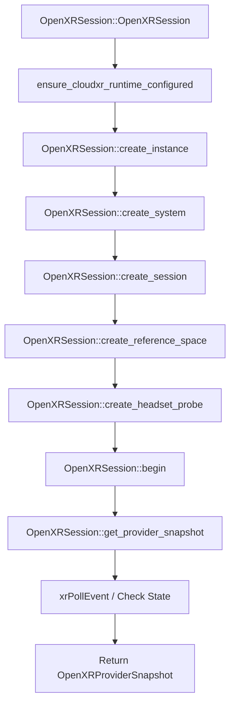
*Sources: `[src/core/oxr/cpp/oxr_session.cpp:62-171]()`, `[src/core/oxr/cpp/inc/oxr/oxr_session.hpp:44-90]()`*

---

## 2. Extension Negotiation and Dynamic Function Loading (`oxr_utils`)

To maintain flexibility across different OpenXR runtimes and avoid link-time dependencies, `oxr_utils` defines `OpenXRCoreFunctions` and helpers under `XR_NO_PROTOTYPES` (`[src/core/oxr_utils/cpp/inc/oxr_utils/oxr_funcs.hpp:6-31]()`).

### `OpenXRCoreFunctions` Struct
The `OpenXRCoreFunctions::load` static method resolves core, action system, and haptic function pointers via `xrGetInstanceProcAddr` (`[src/core/oxr_utils/cpp/inc/oxr_utils/oxr_funcs.hpp:38-119]()`):

| Category | Functions Loaded | Role |
| :--- | :--- | :--- |
| **Core Topology** | `xrGetSystem`, `xrGetSystemProperties`, `xrCreateReferenceSpace`, `xrDestroySpace`, `xrLocateSpace` | System discovery and spatial tracking reference management (`[src/core/oxr_utils/cpp/inc/oxr_utils/oxr_funcs.hpp:41-45]()`). |
| **Action System** | `xrStringToPath`, `xrCreateActionSet`, `xrCreateAction`, `xrSuggestInteractionProfileBindings`, `xrAttachSessionActionSets`, `xrCreateActionSpace`, `xrSyncActions`, `xrGetActionStateBoolean/Float/Vector2f/Pose` | Controller input processing and action context management (`[src/core/oxr_utils/cpp/inc/oxr_utils/oxr_funcs.hpp:48-59]()`). |
| **Haptic Feedback** | `xrApplyHapticFeedback`, `xrStopHapticFeedback` | Controller haptic feedback outputs (`[src/core/oxr_utils/cpp/inc/oxr_utils/oxr_funcs.hpp:62-63]()`). |

Extension-specific entry points (e.g., hand tracking, action contexts like `XR_NVX1_action_context`) are loaded individually via `loadExtensionFunction` (`[src/core/oxr_utils/cpp/inc/oxr_utils/oxr_funcs.hpp:123-134]()`).

Sources: `[src/core/oxr_utils/cpp/inc/oxr_utils/oxr_funcs.hpp:38-134]()`

---

## 3. Session Sharing Architecture

The OpenXR layer supports session sharing, allowing multiple `DeviceIOSession` instances (managing independent collections of trackers) to share a single underlying `XrSession` and `XrInstance` (`[examples/oxr/cpp/oxr_session_sharing.cpp:42-69]()`, `[examples/oxr/python/test_session_sharing.py:39-70]()`).

### Mechanics of Sharing
1. **Create Shared Session**: An `OpenXRSession` is instantiated with the superset of all required tracker extensions (`[examples/oxr/cpp/oxr_session_sharing.cpp:26-37]()`).
2. **Extract Handles**: `oxr_session->get_handles()` extracts an `OpenXRSessionHandles` structure containing raw `XrInstance`, `XrSession`, `XrSpace`, and `xrGetInstanceProcAddr` function pointers (`[src/core/oxr/cpp/oxr_session.cpp:98-102]()`).
3. **Bind to Device Managers**: Multiple device sessions are spawned using the shared handles (`[examples/oxr/cpp/oxr_session_sharing.cpp:57-68]()`):
   ```cpp
   auto session1 = core::DeviceIOSession::run(trackers1, handles);
   auto session2 = core::DeviceIOSession::run(trackers2, handles);
   ```

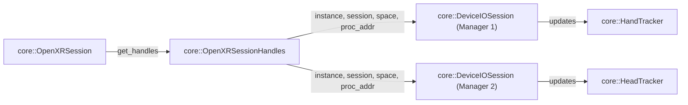
*Sources: `[src/core/oxr/cpp/oxr_session.cpp:98-102]()`, `[examples/oxr/cpp/oxr_session_sharing.cpp:26-69]()`, `[examples/oxr/python/test_session_sharing.py:27-70]()`*

---

## 4. Time Conversion and Math Utilities (`oxr_time`)

Accurate timestamp mapping between operating system monotonic time and OpenXR `XrTime` is provided by `XrTimeConverter`, leveraging the `XR_KHR_convert_timespec_time` extension (`[examples/oxr/cpp/oxr_session_sharing.cpp:27-27]`, `[src/core/oxr/cpp/oxr_session.cpp:189-189]()`).

- **Monotonic Conversion**: Translates between `std::chrono::steady_clock` time points and OpenXR nanosecond durations (`[src/core/oxr/cpp/oxr_session.cpp:189-189]()`).
- **Pose Transforms**: Integration with schema math structures allows direct query and transformation of headset, hand joints, and controller poses relative to reference spaces (`[examples/oxr/cpp/oxr_session_sharing.cpp:83-97]()`).

Sources: `[src/core/oxr/cpp/oxr_session.cpp:186-192]`, `[src/core/oxr_utils/cpp/inc/oxr_utils/oxr_time.hpp:1-1]()`

---

## 5. Python Bindings (`_oxr`)

The C++ module `_oxr` exposes OpenXR capabilities to Python via Pybind11 (`[src/core/oxr/python/oxr_bindings.cpp:79-144]()`).

### Deterministic Lifetime Management (`PyOpenXRSession`)
To prevent "Broken pipe" or invalid handle errors caused by garbage collection order after CloudXR IPC socket teardown, `PyOpenXRSession` wraps `OpenXRSession` inside a `std::unique_ptr` and explicitly destroys it upon exiting Python context managers (`[src/core/oxr/python/oxr_bindings.cpp:28-75]()`):

```python
with oxr.OpenXRSession("ModularExample", required_extensions) as oxr_session:
    handles = oxr_session.get_handles()
    with deviceio.DeviceIOSession.run(trackers, handles) as session:
        session.update()
```

### Exposed Pybind11 API
- **Enums**: `OpenXRProviderState`, `OpenXRHeadsetState`, `OpenXRProviderReason` (`[src/core/oxr/python/oxr_bindings.cpp:83-96]()`).
- **Structs**: `OpenXRProviderSnapshot`, `OpenXRSessionHandles` (with integer casting helpers for raw handles and `proc_addr`) (`[src/core/oxr/python/oxr_bindings.cpp:98-131]()`).
- **Session Class**: `OpenXRSession` with methods `.get_handles()`, `.get_provider_snapshot()`, `.close()`, `__enter__`, and `__exit__` (`[src/core/oxr/python/oxr_bindings.cpp:134-143]()`).

Sources: `[src/core/oxr/python/oxr_bindings.cpp:28-144]()`

---

# Page: DeviceIO: Sessions, Trackers, Sources and Sinks

# DeviceIO: Sessions, Trackers, Sources and Sinks

<details>
<summary>Relevant source files</summary>

The following files were used as context for generating this wiki page:

- [cmake/GenerateFlatBuffers.cmake](cmake/GenerateFlatBuffers.cmake)
- [src/core/deviceio_base/cpp/inc/deviceio_base/tracker.hpp](src/core/deviceio_base/cpp/inc/deviceio_base/tracker.hpp)
- [src/core/deviceio_session/AGENTS.md](src/core/deviceio_session/AGENTS.md)
- [src/core/deviceio_session/cpp/CMakeLists.txt](src/core/deviceio_session/cpp/CMakeLists.txt)
- [src/core/deviceio_session/cpp/deviceio_session.cpp](src/core/deviceio_session/cpp/deviceio_session.cpp)
- [src/core/deviceio_session/cpp/inc/deviceio_session/deviceio_session.hpp](src/core/deviceio_session/cpp/inc/deviceio_session/deviceio_session.hpp)
- [src/core/deviceio_session/cpp/inc/deviceio_session/replay_session.hpp](src/core/deviceio_session/cpp/inc/deviceio_session/replay_session.hpp)
- [src/core/deviceio_session/cpp/mcap_impl.cpp](src/core/deviceio_session/cpp/mcap_impl.cpp)
- [src/core/deviceio_session/cpp/replay_session.cpp](src/core/deviceio_session/cpp/replay_session.cpp)
- [src/core/deviceio_session/py_utils/inc/deviceio_py_utils/session.hpp](src/core/deviceio_session/py_utils/inc/deviceio_py_utils/session.hpp)
- [src/core/deviceio_session/python/session_bindings.cpp](src/core/deviceio_session/python/session_bindings.cpp)
- [src/core/deviceio_trackers/cpp/CMakeLists.txt](src/core/deviceio_trackers/cpp/CMakeLists.txt)
- [src/core/deviceio_trackers/python/tracker_bindings.cpp](src/core/deviceio_trackers/python/tracker_bindings.cpp)
- [src/core/live_trackers/cpp/CMakeLists.txt](src/core/live_trackers/cpp/CMakeLists.txt)
- [src/core/live_trackers/cpp/inc/live_trackers/live_deviceio_factory.hpp](src/core/live_trackers/cpp/inc/live_trackers/live_deviceio_factory.hpp)
- [src/core/live_trackers/cpp/inc/live_trackers/schema_tracker.hpp](src/core/live_trackers/cpp/inc/live_trackers/schema_tracker.hpp)
- [src/core/live_trackers/cpp/live_controller_tracker_impl.cpp](src/core/live_trackers/cpp/live_controller_tracker_impl.cpp)
- [src/core/live_trackers/cpp/live_controller_tracker_impl.hpp](src/core/live_trackers/cpp/live_controller_tracker_impl.hpp)
- [src/core/live_trackers/cpp/live_deviceio_factory.cpp](src/core/live_trackers/cpp/live_deviceio_factory.cpp)
- [src/core/live_trackers/cpp/live_full_body_tracker_pico_impl.cpp](src/core/live_trackers/cpp/live_full_body_tracker_pico_impl.cpp)
- [src/core/live_trackers/cpp/live_full_body_tracker_pico_impl.hpp](src/core/live_trackers/cpp/live_full_body_tracker_pico_impl.hpp)
- [src/core/live_trackers/cpp/live_hand_tracker_impl.cpp](src/core/live_trackers/cpp/live_hand_tracker_impl.cpp)
- [src/core/live_trackers/cpp/live_hand_tracker_impl.hpp](src/core/live_trackers/cpp/live_hand_tracker_impl.hpp)
- [src/core/live_trackers/cpp/live_head_tracker_impl.cpp](src/core/live_trackers/cpp/live_head_tracker_impl.cpp)
- [src/core/live_trackers/cpp/live_head_tracker_impl.hpp](src/core/live_trackers/cpp/live_head_tracker_impl.hpp)
- [src/core/mcap/cpp/inc/mcap/recording_traits.hpp](src/core/mcap/cpp/inc/mcap/recording_traits.hpp)
- [src/core/mcap/cpp/inc/mcap/tracker_channels.hpp](src/core/mcap/cpp/inc/mcap/tracker_channels.hpp)
- [src/core/replay_trackers/cpp/CMakeLists.txt](src/core/replay_trackers/cpp/CMakeLists.txt)
- [src/core/replay_trackers/cpp/inc/replay_trackers/replay_deviceio_factory.hpp](src/core/replay_trackers/cpp/inc/replay_trackers/replay_deviceio_factory.hpp)
- [src/core/replay_trackers/cpp/replay_controller_tracker_impl.cpp](src/core/replay_trackers/cpp/replay_controller_tracker_impl.cpp)
- [src/core/replay_trackers/cpp/replay_controller_tracker_impl.hpp](src/core/replay_trackers/cpp/replay_controller_tracker_impl.hpp)
- [src/core/replay_trackers/cpp/replay_deviceio_factory.cpp](src/core/replay_trackers/cpp/replay_deviceio_factory.cpp)
- [src/core/replay_trackers/cpp/replay_hand_tracker_impl.cpp](src/core/replay_trackers/cpp/replay_hand_tracker_impl.cpp)
- [src/core/replay_trackers/cpp/replay_hand_tracker_impl.hpp](src/core/replay_trackers/cpp/replay_hand_tracker_impl.hpp)
- [src/core/replay_trackers/cpp/replay_head_tracker_impl.cpp](src/core/replay_trackers/cpp/replay_head_tracker_impl.cpp)
- [src/core/replay_trackers/cpp/replay_head_tracker_impl.hpp](src/core/replay_trackers/cpp/replay_head_tracker_impl.hpp)
- [src/core/schema/python/schema_array_views.h](src/core/schema/python/schema_array_views.h)

</details>


## Purpose and Scope

This page provides a high-level architectural overview of the **DeviceIO** subsystem in `isaaccapture`, which serves as the core C++ abstraction layer connecting live physical XR hardware (via OpenXR), recorded datasets (via MCAP), and downstream teleoperation or retargeting pipelines. 

DeviceIO manages the lifecycle of tracking modalities through unified session managers, abstract tracker definitions, dynamic factory dispatchers, and input/output stream wiring.

For detailed technical implementations of code generation and tracker catalogs, see the child pages:
- [Tracker Code Generation](#2.2.1)
- [Tracker Catalog and Device Data Types](#2.2.2)

---

## 1. DeviceIO Sessions: Live vs. Replay

The DeviceIO runtime divides session management into two primary modes handled by `DeviceIOSession` and `ReplaySession`. Both manage collections of high-level tracker abstractions (`core::ITracker`) and construct concrete, platform-specific implementations (`core::ITrackerImpl`) depending on whether data is pulled from live OpenXR runtimes or replayed from pre-recorded MCAP files.

- **`DeviceIOSession`**: Manages live sessions tied to an OpenXR runtime (`OpenXRSessionHandles`). It coordinates extension negotiation, frame updates, and optional real-time MCAP serialization through `LiveDeviceIOFactory`.
- **`ReplaySession`**: Manages offline playback sessions. It uses `ReplayDeviceIOFactory` to instantiate file-backed tracker implementations that read serialized FlatBuffer records directly from MCAP archives.

Sources:
- `src/core/deviceio_session/cpp/inc/deviceio_session/deviceio_session.hpp`
- `src/core/deviceio_session/cpp/inc/deviceio_session/replay_session.hpp`

---

## 2. Tracker Base Interfaces and Facades

The DeviceIO architecture separates public-facing tracker facades from internal implementation classes. This design isolates user code and Python bindings from OpenXR session specifics or raw file parsing logic.

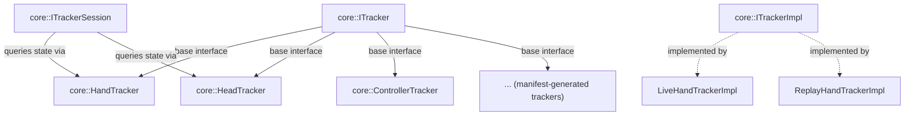

- `core::ITracker`: The root interface for all trackers, providing metadata such as `get_name()` [src/core/deviceio_trackers/python/tracker_bindings.cpp:65-65]().
- `core::ITrackerSession`: Represents an active snapshot session context passed to tracker accessors [src/core/deviceio_trackers/python/tracker_bindings.cpp:63-63]().
- **Specialized Trackers**: Subclasses like `core::HandTracker`, `core::HeadTracker`, and `core::ControllerTracker` expose type-safe queries (e.g., `get_left_hand()`, `get_right_hand()`) returning immutable serialized FlatBuffer snapshots wrapped in `core::Serialized<T>` [src/core/deviceio_trackers/python/tracker_bindings.cpp:38-41, 67-86]().

Sources:
- `src/core/deviceio_trackers/python/tracker_bindings.cpp`
- `src/core/deviceio_base/cpp/inc/deviceio_base/tracker.hpp`

---

## 3. Live vs. Replay Tracker Factories

Tracker instances are converted into active data sources at runtime via factory classes that implement dynamic dispatch based on the target execution environment.

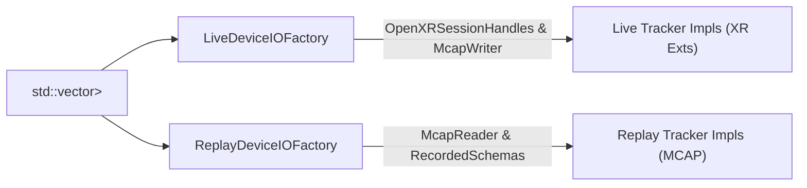

### `LiveDeviceIOFactory`
Constructs live OpenXR-backed implementations [src/core/live_trackers/cpp/inc/live_trackers/live_deviceio_factory.hpp:48-55](). It inspects the selected trackers, aggregates required OpenXR extensions (such as `XR_EXT_HAND_TRACKING_EXTENSION_NAME` or `XR_MNDX_XDEV_SPACE_EXTENSION_NAME`) via `get_required_extensions()`, and optionally injects `McapTrackerChannels` writers for recording [src/core/live_trackers/cpp/live_hand_tracker_impl.cpp:62-73, src/core/live_trackers/cpp/inc/live_trackers/live_deviceio_factory.hpp:68-80]().

### `ReplayDeviceIOFactory`
Opens MCAP reader streams and validates recorded FlatBuffer schemas against `RecordedSchemas` during initialization [src/core/replay_trackers/cpp/inc/replay_trackers/replay_deviceio_factory.hpp:41-55, 81-81](). Each replayed tracker instance maintains an independent `McapReader` buffer to prevent data race conditions across chunks [src/core/replay_trackers/cpp/inc/replay_trackers/replay_deviceio_factory.hpp:41-45]().

Sources:
- `src/core/live_trackers/cpp/inc/live_trackers/live_deviceio_factory.hpp`
- `src/core/replay_trackers/cpp/inc/replay_trackers/replay_deviceio_factory.hpp`
- `src/core/live_trackers/cpp/live_hand_tracker_impl.cpp`

---

## 4. Source/Sink Graph Discovery and Data Flow

DeviceIO acts as the ingestion boundary for the broader teleoperation pipeline. Trackers publish data frames as serialized FlatBuffer payloads, which are concurrently routed to recording sinks and downstream Python retargeting nodes.

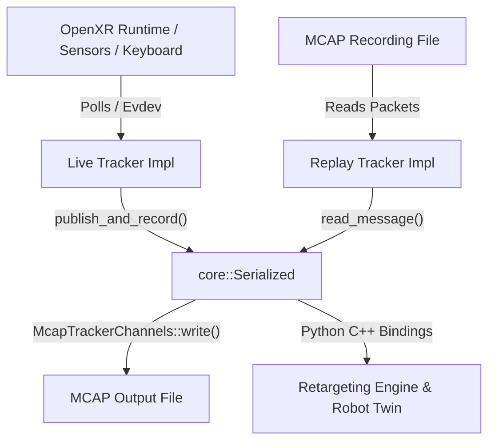

- **Publish and Record**: Helper utilities such as `publish_and_record()` encode payloads once into FlatBuffers, forwarding the exact byte buffer simultaneously to recording channels and consumer sessions [src/core/mcap/cpp/inc/mcap/tracker_channels.hpp:163-178]().
- **Python Integration**: Pybind11 modules expose session and tracker states, ensuring zero-copy or shared pointer handoffs to Python consumers without corrupting live ring buffers [src/core/deviceio_trackers/python/tracker_bindings.cpp:45-48].

Sources:
- `src/core/mcap/cpp/inc/mcap/tracker_channels.hpp`
- `src/core/deviceio_trackers/python/tracker_bindings.cpp`

---

## 5. Related Child Pages

For further details on specific tracker subsystems, refer to the following documentation:
- **Tracker Code Generation**: Covers manifests (`trackers.toml`), code generation scripts (`generate_trackers.py`), and CMake build integrations. For details, see [Tracker Code Generation](#2.2.1).
- **Tracker Catalog and Device Data Types**: Details specific modalities including hand, head, controller, full-body kinematics, haptic command readers, and message channels. For details, see [Tracker Catalog and Device Data Types](#2.2.2).

---

# Page: Tracker Code Generation

# Tracker Code Generation

<details>
<summary>Relevant source files</summary>

The following files were used as context for generating this wiki page:

- [.github/actions/setup-uv/action.yml](.github/actions/setup-uv/action.yml)
- [.github/workflows/build-ubuntu.yml](.github/workflows/build-ubuntu.yml)
- [.github/workflows/build-windows.yml](.github/workflows/build-windows.yml)
- [cmake/GenerateTrackers.cmake](cmake/GenerateTrackers.cmake)
- [src/core/codegen/AGENTS.md](src/core/codegen/AGENTS.md)
- [src/core/codegen/generate_trackers.py](src/core/codegen/generate_trackers.py)
- [src/core/codegen/test_generate_prune.py](src/core/codegen/test_generate_prune.py)
- [src/core/deviceio_trackers/trackers.toml](src/core/deviceio_trackers/trackers.toml)
- [src/core/schema/python/CMakeLists.txt](src/core/schema/python/CMakeLists.txt)
- [src/core/schema/python/schema_module.cpp](src/core/schema/python/schema_module.cpp)
- [src/python/isaaccapture/retargeters/__init__.py](src/python/isaaccapture/retargeters/__init__.py)
- [src/python/isaaccapture/retargeting_engine/deviceio_source_nodes/__init__.py](src/python/isaaccapture/retargeting_engine/deviceio_source_nodes/__init__.py)
- [src/python/isaaccapture/retargeting_engine/deviceio_source_nodes/deviceio_tensor_types.py](src/python/isaaccapture/retargeting_engine/deviceio_source_nodes/deviceio_tensor_types.py)
- [src/python/isaaccapture/retargeting_engine/tensor_types/__init__.py](src/python/isaaccapture/retargeting_engine/tensor_types/__init__.py)
- [src/python/isaaccapture/retargeting_engine/tensor_types/indices.py](src/python/isaaccapture/retargeting_engine/tensor_types/indices.py)
- [src/python/isaaccapture/retargeting_engine/tensor_types/standard_types.py](src/python/isaaccapture/retargeting_engine/tensor_types/standard_types.py)
- [src/python/isaaccapture/schema/__init__.py](src/python/isaaccapture/schema/__init__.py)
- [tests/cpp/core/schema/CMakeLists.txt](tests/cpp/core/schema/CMakeLists.txt)
- [tests/python/core/schema/test_vehicle_io.py](tests/python/core/schema/test_vehicle_io.py)

</details>


## Purpose and Scope
This page details the tracker code generation subsystem in Isaac Teleop (`isaaccapture`), which automates the boilerplate creation of DeviceIO tracker classes, FlatBuffer serialization bindings, and telemetry facets. By defining tracker metadata in a centralized manifest (`trackers.toml`), the build system generates type-safe C++ components, Python accessors, and recording traits at build time via `generate_trackers.py` and `GenerateTrackers.cmake`.

---

## 1. Tracker Manifests (`trackers.toml`)
All DeviceIO trackers are declared in a centralized TOML manifest located at `src/core/deviceio_trackers/trackers.toml`. Each entry specifies the configuration parameters required to instantiate a tracker, map its underlying FlatBuffers schema table, define buffer sizes, and bind Python accessors.

The manifest supports fields such as:
- `name`: The snake_case identifier of the tracker (e.g., `steering_wheel`, `spacemouse`, `joint_state`).
- `table`: The FlatBuffers table name (e.g., `SteeringWheelOutput`, `SpaceMouseOutput`).
- `class`: Optional explicit C++ class name override (defaults to a pascal-cased variation of `name` + `Tracker`).
- `schema`: The schema namespace or file group if different from `name`.
- `traits`: Optional recording traits struct for MCAP serialization.
- `max_flatbuffer_size`: Allocated byte limit for serialized FlatBuffer messages.
- `facade_tensor_constant`: Boolean flag indicating whether the tensor remains constant across frames.
- `python_accessor`: Python binding accessor method name (e.g., `get_wheel_data`).

```toml
[[tracker]]
name = "steering_wheel"
table = "SteeringWheelOutput"
max_flatbuffer_size = 1024
python_accessor = "get_wheel_data"

[[tracker]]
name = "spacemouse"
table = "SpaceMouseOutput"
class = "SpaceMouseTracker"
traits = "SpaceMouseRecordingTraits"
max_flatbuffer_size = 256
python_accessor = "get_spacemouse_data"
```

Sources: `[src/core/deviceio_trackers/trackers.toml:97-108]()`

---

## 2. Code Generation Engine (`generate_trackers.py`)
The code generation script (`src/core/codegen/generate_trackers.py`) parses `trackers.toml`, validates schema bindings, and populates C++ source and header templates. 

Below is a diagram mapping the natural language concepts of tracker definitions to their concrete code entities generated by the engine:

```mermaid
graph TD
    subgraph "NaturalLanguageSpace"
        NL_Manifest[""Tracker Manifest File (trackers.toml)""]
        NL_Steering[""Steering Wheel Device""]
        NL_SpaceMouse[""SpaceMouse 6-DoF Input""]
    end

    subgraph "CodeEntitySpace"
        CodeGen[""src/core/codegen/generate_trackers.py""]
        TomlParser[""parse_manifest()""]
        SteeringTracker[""SteeringWheelTracker Class""]
        SpaceMouseTracker[""SpaceMouseTracker Class""]
        HeaderOut[""Generated .h / .cpp Files""]
    end

    NL_Manifest --> CodeGen
    NL_Steering --> NL_Manifest
    NL_SpaceMouse --> NL_Manifest
    CodeGen --> TomlParser
    TomlParser --> SteeringTracker
    TomlParser --> SpaceMouseTracker
    SteeringTracker --> HeaderOut
    SpaceMouseTracker --> HeaderOut
```

Sources: `[src/core/codegen/generate_trackers.py:1-1]()`, `[src/core/deviceio_trackers/trackers.toml:97-108]()`

---

## 3. Templates and Stale Pruning
The generation engine employs parameterized text templates to emit C++ headers and source files into the build tree. To prevent orphaned or obsolete files from lingering when a tracker is renamed or removed from `trackers.toml`, the code generation system includes a stale pruning mechanism (`src/core/codegen/test_generate_prune.py`).

### Pruning Lifecycle
1. **Manifest Scan**: `generate_trackers.py` compiles a list of expected target file paths based on the current `trackers.toml` entries.
2. **Directory Inspection**: Scans the designated output directory for previously generated tracker artifacts.
3. **Delta Comparison**: Any file matching the generated file naming convention (`*_tracker.h`, `*_tracker.cpp`) that is not present in the current manifest's expected output set is classified as stale.
4. **Purging**: Stale files are deleted from disk prior to writing newly generated contents, ensuring clean incremental builds.

Sources: `[src/core/codegen/test_generate_prune.py:1-1]()`, `[src/core/codegen/generate_trackers.py:1-1]()`

---

## 4. CMake Build Integration (`GenerateTrackers.cmake`)
Code generation is fully integrated into the CMake build pipeline via `cmake/GenerateTrackers.cmake`. This module defines custom commands and targets that invoke `generate_trackers.py` during the configure or build phase whenever `trackers.toml` or the underlying template files are modified.

```mermaid
graph TD
    subgraph "BuildPipeline"
        CMakeLists[""CMakeLists.txt""] --> IncCMake[""include(cmake/GenerateTrackers.cmake)""]
        IncCMake --> CheckInputs{{"Changes in trackers.toml or templates?"}}
        
        CheckInputs -- "Yes" --> RunGen[""python3 src/core/codegen/generate_trackers.py""]
        CheckInputs -- "No" --> SkipGen[""Skip Codegen Step""]
        
        RunGen --> PruneStale[""Prune Stale Generated Files""]
        PruneStale --> WriteNew[""Emit Header/Source Files""]
        WriteNew --> CompileCore[""Compile isaaccapture core""]
        SkipGen --> CompileCore
    end
```

Sources: `[cmake/GenerateTrackers.cmake:1-1]`, `[src/core/deviceio_trackers/trackers.toml:1-108]()`

---

# Page: Tracker Catalog and Device Data Types

# Tracker Catalog and Device Data Types

<details>
<summary>Relevant source files</summary>

The following files were used as context for generating this wiki page:

- [docs/source/device/soma.rst](docs/source/device/soma.rst)
- [docs/source/device/trackers.rst](docs/source/device/trackers.rst)
- [examples/deviceio_live_view/python/isaaccapture_examples/deviceio_live_view/soma_hand.py](examples/deviceio_live_view/python/isaaccapture_examples/deviceio_live_view/soma_hand.py)
- [examples/haptic_feedback/python/hand_pinch_haptic_example.py](examples/haptic_feedback/python/hand_pinch_haptic_example.py)
- [examples/soma_hand_publisher/python/isaaccapture_examples/soma_hand_publisher/publisher.py](examples/soma_hand_publisher/python/isaaccapture_examples/soma_hand_publisher/publisher.py)
- [src/core/deviceio_base/cpp/inc/deviceio_base/haptic_command_reader_tracker_base.hpp](src/core/deviceio_base/cpp/inc/deviceio_base/haptic_command_reader_tracker_base.hpp)
- [src/core/deviceio_base/cpp/inc/deviceio_base/tensor_push_tracker_base.hpp](src/core/deviceio_base/cpp/inc/deviceio_base/tensor_push_tracker_base.hpp)
- [src/core/deviceio_trackers/cpp/haptic_command_reader_tracker.cpp](src/core/deviceio_trackers/cpp/haptic_command_reader_tracker.cpp)
- [src/core/deviceio_trackers/cpp/inc/deviceio_trackers/haptic_command_reader_tracker.hpp](src/core/deviceio_trackers/cpp/inc/deviceio_trackers/haptic_command_reader_tracker.hpp)
- [src/core/deviceio_trackers/cpp/inc/deviceio_trackers/tensor_push_tracker.hpp](src/core/deviceio_trackers/cpp/inc/deviceio_trackers/tensor_push_tracker.hpp)
- [src/core/deviceio_trackers/cpp/tensor_push_tracker.cpp](src/core/deviceio_trackers/cpp/tensor_push_tracker.cpp)
- [src/core/live_trackers/cpp/live_haptic_command_reader_tracker_impl.cpp](src/core/live_trackers/cpp/live_haptic_command_reader_tracker_impl.cpp)
- [src/core/live_trackers/cpp/live_haptic_command_reader_tracker_impl.hpp](src/core/live_trackers/cpp/live_haptic_command_reader_tracker_impl.hpp)
- [src/core/live_trackers/cpp/live_message_channel_tracker_impl.cpp](src/core/live_trackers/cpp/live_message_channel_tracker_impl.cpp)
- [src/core/live_trackers/cpp/live_message_channel_tracker_impl.hpp](src/core/live_trackers/cpp/live_message_channel_tracker_impl.hpp)
- [src/core/replay_trackers/cpp/replay_haptic_command_reader_tracker_impl.cpp](src/core/replay_trackers/cpp/replay_haptic_command_reader_tracker_impl.cpp)
- [src/core/replay_trackers/cpp/replay_haptic_command_reader_tracker_impl.hpp](src/core/replay_trackers/cpp/replay_haptic_command_reader_tracker_impl.hpp)
- [src/core/replay_trackers/cpp/replay_message_channel_tracker_impl.cpp](src/core/replay_trackers/cpp/replay_message_channel_tracker_impl.cpp)
- [src/core/replay_trackers/cpp/replay_message_channel_tracker_impl.hpp](src/core/replay_trackers/cpp/replay_message_channel_tracker_impl.hpp)
- [src/core/schema/fbs/soma_common.fbs](src/core/schema/fbs/soma_common.fbs)
- [src/core/schema/fbs/soma_hand_joint_poses.fbs](src/core/schema/fbs/soma_hand_joint_poses.fbs)
- [src/core/schema/fbs/soma_hand_joint_rotations.fbs](src/core/schema/fbs/soma_hand_joint_rotations.fbs)
- [src/core/schema/golden/soma_common.bfbs](src/core/schema/golden/soma_common.bfbs)
- [src/core/schema/golden/soma_hand_joint_poses.bfbs](src/core/schema/golden/soma_hand_joint_poses.bfbs)
- [src/core/schema/golden/soma_hand_joint_rotations.bfbs](src/core/schema/golden/soma_hand_joint_rotations.bfbs)
- [src/core/schema/python/soma_common_bindings.h](src/core/schema/python/soma_common_bindings.h)

</details>


## Purpose and Scope

Trackers serve as the consumer-side API for reading device pose, input, and telemetry data from an active `DeviceIOSession` [docs/source/device/trackers.rst:4-5](). Each tracker manages one logical device, queries the underlying OpenXR runtime or tensor stream every frame, and exposes the latest sample through typed `get_*()` accessors [docs/source/device/trackers.rst:6-7](). 

Trackers are partitioned into two principal categories: **OpenXR-direct trackers**, which query standard or vendor-specific OpenXR APIs (`xrLocateSpace`, `xrSyncActions`, etc.) [docs/source/device/trackers.rst:11-12](), and **SchemaTracker-based / advanced trackers**, which consume serialized FlatBuffer payloads transported over tensor collections or native message channels [docs/source/device/trackers.rst:19-21]().

---

## 1. OpenXR-Direct Trackers

OpenXR-direct trackers interface directly with the OpenXR session handles and action spaces. They extract standard VR primitives required for head-mounted teleoperation.

- **`HeadTracker`**: Manages the head-mounted display (HMD) head pose, providing tracking state and spatial coordinates relative to the reference space [docs/source/device/trackers.rst:14](). Defined in `src/core/deviceio_trackers/cpp/inc/deviceio_trackers/head_tracker.hpp` [docs/source/device/trackers.rst:14]().
- **`HandTracker`**: Manages articulated hand joint hierarchies for both left and right hands using standard OpenXR hand tracking extensions [docs/source/device/trackers.rst:15](). Defined in `src/core/deviceio_trackers/cpp/inc/deviceio_trackers/hand_tracker.hpp` [docs/source/device/trackers.rst:15]().
- **`ControllerTracker`**: Manages motion controller poses, trigger/thumbstick axes, and button states for left and right hands [docs/source/device/trackers.rst:16](). Defined in `src/core/deviceio_trackers/cpp/inc/deviceio_trackers/controller_tracker.hpp` [docs/source/device/trackers.rst:16]().
- **`FullBodyTracker`**: Provides a vendor-agnostic 24-joint full-body pose [docs/source/device/trackers.rst:17](). By default, the vendor implementation binds to the PICO `XR_BD_body_tracking` extension [docs/source/device/trackers.rst:17](). Defined in `src/core/deviceio_trackers/cpp/inc/deviceio_trackers/full_body_tracker.hpp` [docs/source/device/trackers.rst:17]().

### Diagram: OpenXR-Direct Tracker Architecture

Title: OpenXR-Direct Tracker Code Entities and Data Flow

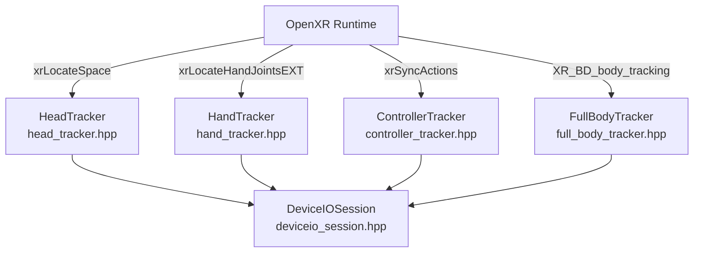

Sources: `docs/source/device/trackers.rst:11-18`

---

## 2. SchemaTracker and Tensor-Push Trackers

SchemaTracker-based trackers instantiate custom device types by declaring FlatBuffer schemas and reading payloads from OpenXR tensor collections or pushed memory streams [docs/source/device/trackers.rst:19-21]().

### Generated Trackers (`trackers.toml`)
Managed via configuration manifests (`src/core/deviceio_trackers/trackers.toml`) and codegen scripts, these include:
- **`FrameMetadataTrackerOak`**: Frame metadata for OAK camera streams [docs/source/device/trackers.rst:23]().
- **`Generic3AxisPedalTracker`**: Foot pedal axis inputs [docs/source/device/trackers.rst:24]().
- **`JointStateTracker`**: Named joint-space device states for leader arms, exoskeletons, and gloves [docs/source/device/trackers.rst:25]().
- **`Se3Tracker`**: Generic 6-DoF pose sources (tracker pucks, mocap rigid bodies) [docs/source/device/trackers.rst:26]().
- **`SomaBodyJointRotationsTracker` / `SomaBodyJointPosesTracker`**: SOMA-X body joint controls (77 controls) [docs/source/device/trackers.rst:27-28]().
- **`SomaHandJointRotationsTracker` / `SomaHandJointPosesTracker`**: SOMA-X hand joint controls (25 controls) [docs/source/device/trackers.rst:29-30]().

### `TensorPushTracker`
`TensorPushTracker` enables Python or external processes to push tensor blobs and FlatBuffer payloads directly into the DeviceIO pipeline via `SchemaPusher` interfaces [docs/source/device/soma.rst:104-106](). 
- Defined in: `src/core/deviceio_trackers/cpp/inc/deviceio_trackers/tensor_push_tracker.hpp` ()
- Base interface: `src/core/deviceio_base/cpp/inc/deviceio_base/tensor_push_tracker_base.hpp` ()

---

## 3. Message Channel Trackers and Opaque Data

The `MessageChannelTracker` family manages arbitrary binary message transport and out-of-band communication channels via the `XR_NV_opaque_data_channel` extension [src/core/live_trackers/cpp/live_message_channel_tracker_impl.hpp:13-32]().

### Implementation Mechanics (`LiveMessageChannelTrackerImpl`)
`LiveMessageChannelTrackerImpl` wraps OpenXR opaque data channel functions (`xrCreateOpaqueDataChannelNV`, `xrReceiveOpaqueDataChannelNV`, `xrSendOpaqueDataChannelNV`) [src/core/live_trackers/cpp/live_message_channel_tracker_impl.hpp:69-74]().

During each `update(int64_t monotonic_time_ns)` call:
1. It queries channel connection status via `query_status()` [src/core/live_trackers/cpp/live_message_channel_tracker_impl.cpp:66]().
2. If disconnected, it attempts reconnection (`try_reopen_channel()`) [src/core/live_trackers/cpp/live_message_channel_tracker_impl.cpp:70]().
3. If connected, it drains pending messages into a FlatBuffer vector (`MessageChannelMessagesTrackedT`) [src/core/live_trackers/cpp/live_message_channel_tracker_impl.cpp:74]().
4. Oversized messages exceeding `max_message_size()` are bounded-read and dropped to clear queue blocks [src/core/live_trackers/cpp/live_message_channel_tracker_impl.cpp:146-151]().

### Diagram: Advanced Trackers and Message Channels

Title: Advanced Trackers, Schema Pushers, and Opaque Data Channels

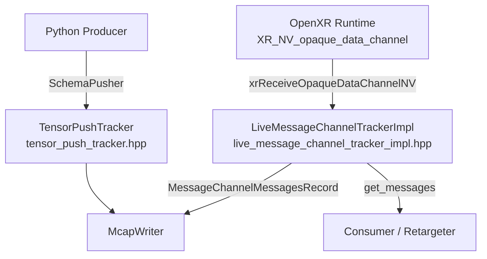

Sources: `src/core/live_trackers/cpp/live_message_channel_tracker_impl.hpp:26-84`, `src/core/live_trackers/cpp/live_message_channel_tracker_impl.cpp:20-118`

---

## 4. Data Schema Conventions and Semantics

Every tracker's serialized representation follows a strict two-tier FlatBuffers convention defined under `src/core/schema/fbs` [docs/source/device/trackers.rst:50-51]().

```
+-----------------------------------------------------------------+
|                       Record Wrapper (Root)                     |
|  - data: Payload Table                                          |
|  - timestamp: DeviceDataTimestamp (raw device & local clocks)  |
+-----------------------------------------------------------------+
                                 |
                                 v
+-----------------------------------------------------------------+
|                         Payload Table                           |
|  - Device-specific fields (poses, joints, axes, messages)       |
+-----------------------------------------------------------------+
```

### Table: Schema Tier Summary

| Tier | Component | Role | Example |
| :--- | :--- | :--- | :--- |
| **Tier 1** | Payload Table | Contains raw device metrics; handed directly to consumers as owning handles [docs/source/device/trackers.rst:55,108-109](). | `HeadPose`, `HandPose`, `SomaHandJointRotations` [docs/source/device/trackers.rst:97](), [src/core/schema/fbs/soma_hand_joint_rotations.fbs:58]() |
| **Tier 2** | Record Wrapper | Root type wrapping payload plus `DeviceDataTimestamp` for MCAP recording [docs/source/device/trackers.rst:62-66,102](). | `HeadPoseRecord`, `SomaHandJointRotationsRecord` [docs/source/device/trackers.rst:63](), [src/core/schema/fbs/soma_hand_joint_rotations.fbs:71]() |

Sources: `docs/source/device/trackers.rst:50-103`, `src/core/schema/fbs/soma_hand_joint_rotations.fbs:58-76`

### The `_tracked` Recording Sub-Channel Semantics
Tensor collection producers can emit multiple samples per frame. 
- **`%channel%`**: Receives every intermediate sample for offline analysis [docs/source/device/trackers.rst:75-81]().
- **`%channel%_tracked`**: Receives exclusively the final sample observed by the live consumer during `update()` [docs/source/device/trackers.rst:75-76](). 

Replay sessions read from `%channel%_tracked` exclusively to guarantee deterministic execution matching live capture runs [docs/source/device/trackers.rst:79-81]().

### Zero-Copy Memory and Accessor Rules
- **Accessors**: `get_*()` returns `Serialized<T>` in C++ or read-only view classes in Python [docs/source/device/trackers.rst:108-112](). No deserialization unpack step occurs; joint arrays map to zero-copy NumPy views [docs/source/device/trackers.rst:111-112]().
- **Absence**: An empty handle indicates an absent payload (inactive device, missing sample, or replay gap); tested via `if (handle)` in C++ or `None` in Python [docs/source/device/trackers.rst:114-116]().
- **Mutability Warning**: Joint-array properties provide writable NumPy views due to DLPack constraints. Downstream consumers must copy buffers before in-place modification to prevent corrupting shared frame state [docs/source/device/trackers.rst:124-131]().

Sources: `docs/source/device/trackers.rst:46-142`

---

# Page: Schema System (FlatBuffers)

# Schema System (FlatBuffers)

<details>
<summary>Relevant source files</summary>

The following files were used as context for generating this wiki page:

- [examples/oxr/python/test_full_body_tracker.py](examples/oxr/python/test_full_body_tracker.py)
- [src/core/deviceio_trackers/cpp/controller_tracker.cpp](src/core/deviceio_trackers/cpp/controller_tracker.cpp)
- [src/core/deviceio_trackers/cpp/hand_tracker.cpp](src/core/deviceio_trackers/cpp/hand_tracker.cpp)
- [src/core/deviceio_trackers/cpp/head_tracker.cpp](src/core/deviceio_trackers/cpp/head_tracker.cpp)
- [src/core/deviceio_trackers/cpp/inc/deviceio_trackers/controller_tracker.hpp](src/core/deviceio_trackers/cpp/inc/deviceio_trackers/controller_tracker.hpp)
- [src/core/deviceio_trackers/cpp/inc/deviceio_trackers/hand_tracker.hpp](src/core/deviceio_trackers/cpp/inc/deviceio_trackers/hand_tracker.hpp)
- [src/core/deviceio_trackers/trackers.toml](src/core/deviceio_trackers/trackers.toml)
- [src/core/replay_trackers/cpp/replay_full_body_tracker_impl.cpp](src/core/replay_trackers/cpp/replay_full_body_tracker_impl.cpp)
- [src/core/replay_trackers/cpp/replay_full_body_tracker_impl.hpp](src/core/replay_trackers/cpp/replay_full_body_tracker_impl.hpp)
- [src/core/schema/CMakeLists.txt](src/core/schema/CMakeLists.txt)
- [src/core/schema/cpp/CMakeLists.txt](src/core/schema/cpp/CMakeLists.txt)
- [src/core/schema/cpp/inc/schema/joint_se3_pose_family.hpp](src/core/schema/cpp/inc/schema/joint_se3_pose_family.hpp)
- [src/core/schema/fbs/full_body.fbs](src/core/schema/fbs/full_body.fbs)
- [src/core/schema/fbs/hand.fbs](src/core/schema/fbs/hand.fbs)
- [src/core/schema/fbs/head.fbs](src/core/schema/fbs/head.fbs)
- [src/core/schema/fbs/joint_se3_pose.fbs](src/core/schema/fbs/joint_se3_pose.fbs)
- [src/core/schema/golden/joint_se3_pose.bfbs](src/core/schema/golden/joint_se3_pose.bfbs)
- [src/core/schema/python/CMakeLists.txt](src/core/schema/python/CMakeLists.txt)
- [src/core/schema/python/full_body_bindings.h](src/core/schema/python/full_body_bindings.h)
- [src/core/schema/python/hand_bindings.h](src/core/schema/python/hand_bindings.h)
- [src/core/schema/python/head_bindings.h](src/core/schema/python/head_bindings.h)
- [src/core/schema/python/joint_se3_pose_bindings.h](src/core/schema/python/joint_se3_pose_bindings.h)
- [src/core/schema/python/schema_module.cpp](src/core/schema/python/schema_module.cpp)
- [src/python/isaaccapture/retargeters/__init__.py](src/python/isaaccapture/retargeters/__init__.py)
- [src/python/isaaccapture/retargeting_engine/deviceio_source_nodes/__init__.py](src/python/isaaccapture/retargeting_engine/deviceio_source_nodes/__init__.py)
- [src/python/isaaccapture/retargeting_engine/deviceio_source_nodes/deviceio_tensor_types.py](src/python/isaaccapture/retargeting_engine/deviceio_source_nodes/deviceio_tensor_types.py)
- [src/python/isaaccapture/retargeting_engine/tensor_types/__init__.py](src/python/isaaccapture/retargeting_engine/tensor_types/__init__.py)
- [src/python/isaaccapture/retargeting_engine/tensor_types/indices.py](src/python/isaaccapture/retargeting_engine/tensor_types/indices.py)
- [src/python/isaaccapture/retargeting_engine/tensor_types/standard_types.py](src/python/isaaccapture/retargeting_engine/tensor_types/standard_types.py)
- [src/python/isaaccapture/schema/__init__.py](src/python/isaaccapture/schema/__init__.py)
- [tests/cpp/core/schema/CMakeLists.txt](tests/cpp/core/schema/CMakeLists.txt)
- [tests/python/core/schema/test_vehicle_io.py](tests/python/core/schema/test_vehicle_io.py)

</details>


The schema system in `isaaccapture` provides the core serialization, compatibility checking, and cross-language binding infrastructure for all teleoperation data streams (e.g., head poses, hand joints, controllers, pedals, steering wheels, and full-body skeletons). Built on Apache FlatBuffers, it guarantees zero-copy deserialization, fast read access across C++ and Python, and robust forward/backward version compatibility.

---

## 1. FlatBuffers Schema Definitions (`.fbs`)

The structural contract for all telemetry and device outputs is defined using FlatBuffers schema files (`.fbs`) located under `src/core/schema/fbs/`. These definitions specify strongly typed tables, structs, enums, and unions that govern how telemetry is packed in memory.

Key primitive definitions and message wrappers include:
- **Timestamps**: Core synchronization structures (`DeviceDataTimestamp`) tying local mono clocks to common capture clocks.
- **Positional Primitives**: Reusable spatial structs such as `Point`, `Quaternion`, and `Pose`.
- **Device-Specific Tables**: Specialized message schemas like `HeadPose`, `HandPose`, `ControllerSnapshot`, `Generic3AxisPedalOutput`, `SteeringWheelOutput`, `SpaceMouseOutput`, `KeyboardOutput`, `OgloGloveSample`, `JointStateOutput`, `JointSe3PoseOutput`, `Se3TrackerPose`, `FullBodyPose`, and SOMA kinematic structures (`SomaBodyJointRotations`, `SomaHandJointPoses`).

During the build phase, CMake invokes the FlatBuffers compiler (`flatc`) to generate high-performance C++ header files and reflection binary files (`.bfbs`) from these `.fbs` definitions [tests/cpp/core/schema/CMakeLists.txt:35-35]().

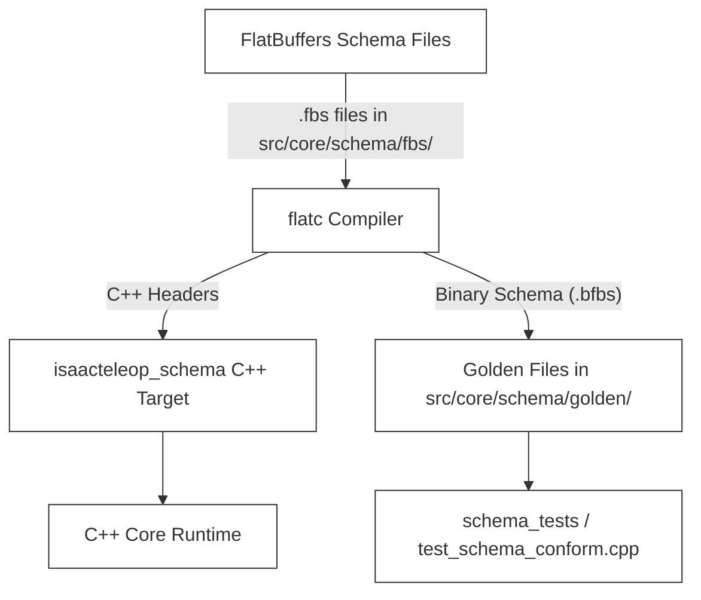

*Sources: [tests/cpp/core/schema/CMakeLists.txt:33-40](), [src/core/schema/python/schema_module.cpp:1-100]()*

---

## 2. Golden `.bfbs` Files and Schema Compatibility

To enforce strict versioning guarantees and prevent accidental schema breaking changes (such as field reordering, type mutations, or deprecation violations), the repository maintains binary schema reflection files (`.bfbs`) under `src/core/schema/golden/`.

Schema conformance and compatibility are validated during unit testing via the C++ `schema_tests` executable (`tests/cpp/core/schema/test_schema_conform.cpp`) linked with `schema::schema_compat` [tests/cpp/core/schema/CMakeLists.txt:6-28](). 

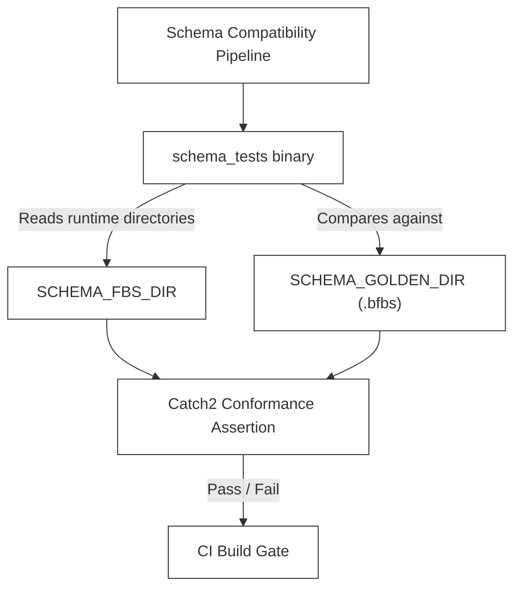

The test runner cross-references the current `.fbs`-derived layouts against the committed golden `.bfbs` binaries using absolute compile-time definitions injected via CMake:
- `SCHEMA_FBS_DIR` [tests/cpp/core/schema/CMakeLists.txt:37-37]()
- `SCHEMA_BFBS_DIR` [tests/cpp/core/schema/CMakeLists.txt:38-38]()
- `SCHEMA_GOLDEN_DIR` [tests/cpp/core/schema/CMakeLists.txt:39-39]()

*Sources: [tests/cpp/core/schema/CMakeLists.txt:6-45]*

---

## 3. C++ and Python Bindings Generation

To bridge C++ DeviceIO publishers and Python retargeting nodes, the build system compiles a dedicated pybind11 module (`_schema`) [src/core/schema/python/schema_module.cpp:35-36]() that exposes the FlatBuffers structures into Python as zero-copy views.

### C++ Module Architecture
The module entry point `src/core/schema/python/schema_module.cpp` registers binding headers sequentially:
- `core::bind_timestamp(m)` [src/core/schema/python/schema_module.cpp:40-40]()
- `core::bind_pose(m)` [src/core/schema/python/schema_module.cpp:43-43]()
- `core::bind_head(m)` [src/core/schema/python/schema_module.cpp:46-46]()
- `core::bind_hand(m)` [src/core/schema/python/schema_module.cpp:49-49]()
- `core::bind_controller(m)` [src/core/schema/python/schema_module.cpp:52-52]()
- Complete sets for pedals, keyboards, tactile gloves, joint states, and SOMA variants [src/core/schema/python/schema_module.cpp:54-99]()

### Python Wrapper (`isaaccapture.schema`)
The high-level Python package `isaaccapture.schema` wraps `_schema`, providing immutable read-only view objects where attribute lookups access underlying memory buffers directly, and joint arrays are returned as zero-copy NumPy views [src/python/isaaccapture/schema/__init__.py:9-13]().

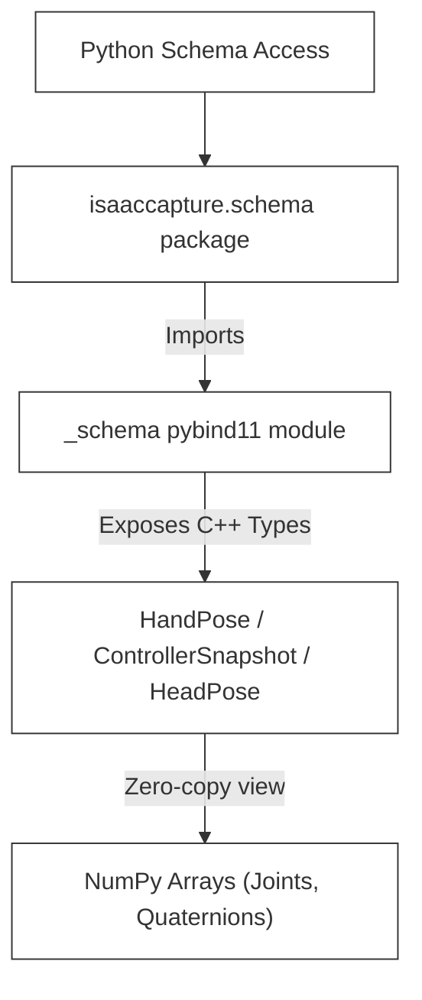

*Sources: [src/core/schema/python/schema_module.cpp:35-100](), [src/core/schema/python/CMakeLists.txt:4-30](), [src/python/isaaccapture/schema/__init__.py:9-13]*

---

## 4. Schema Integration with DeviceIO Trackers

FlatBuffers schemas are tightly coupled with the DeviceIO tracker generation pipeline. The tracker manifest file `src/core/deviceio_trackers/trackers.toml` maps tracker instances directly to their corresponding FlatBuffers table definitions and serialization constraints.

For instance, trackers declare their target table, maximum buffer sizes, and accessor helpers:
- `joint_state` -> `JointStateOutput` [src/core/deviceio_trackers/trackers.toml:5-7]()
- `plugin_device_status` -> `PluginDeviceStatusSnapshot` [src/core/deviceio_trackers/trackers.toml:17-19]()
- `generic_3axis_pedal` -> `Generic3AxisPedalOutput` [src/core/deviceio_trackers/trackers.toml:70-72]()

```mermaid
graph TD
    sub8["DeviceIO to Schema Wiring"]
    sub8 --> O["trackers.toml manifest"]
    O -->|"Defines schema table bindings"| P["DeviceIO C++ Trackers"]
    P -->|"Serializes payloads"| Q["FlatBuffers Encoded Byte Buffer"]
    Q -->|"Consumed by"| R["Retargeting Engine Source Nodes"]

    classDef default fill:#fff,stroke:#333,stroke-width:1px;
```

*Sources: [src/core/deviceio_trackers/trackers.toml:1-108](), [src/python/isaaccapture/retargeting_engine/deviceio_source_nodes/deviceio_tensor_types.py:34-58]*

---

# Page: MCAP Recording and Replay

# MCAP Recording and Replay

<details>
<summary>Relevant source files</summary>

The following files were used as context for generating this wiki page:

- [docs/source/device/body_tracking.rst](docs/source/device/body_tracking.rst)
- [docs/source/overview/ecosystem.rst](docs/source/overview/ecosystem.rst)
- [docs/source/references/mcap_record_replay.rst](docs/source/references/mcap_record_replay.rst)
- [examples/mcap_record_replay/.gitignore](examples/mcap_record_replay/.gitignore)
- [examples/mcap_record_replay/CMakeLists.txt](examples/mcap_record_replay/CMakeLists.txt)
- [examples/mcap_record_replay/README.md](examples/mcap_record_replay/README.md)
- [examples/mcap_record_replay/cpp/CMakeLists.txt](examples/mcap_record_replay/cpp/CMakeLists.txt)
- [examples/mcap_record_replay/cpp/record_full_body.cpp](examples/mcap_record_replay/cpp/record_full_body.cpp)
- [examples/mcap_record_replay/python/isaaccapture_examples/mcap_record_replay/joint_se3_common.py](examples/mcap_record_replay/python/isaaccapture_examples/mcap_record_replay/joint_se3_common.py)
- [examples/mcap_record_replay/python/isaaccapture_examples/mcap_record_replay/live_joint_se3_pose.py](examples/mcap_record_replay/python/isaaccapture_examples/mcap_record_replay/live_joint_se3_pose.py)
- [examples/mcap_record_replay/python/isaaccapture_examples/mcap_record_replay/record_joint_se3_pose.py](examples/mcap_record_replay/python/isaaccapture_examples/mcap_record_replay/record_joint_se3_pose.py)
- [examples/mcap_record_replay/python/isaaccapture_examples/mcap_record_replay/replay_controller.py](examples/mcap_record_replay/python/isaaccapture_examples/mcap_record_replay/replay_controller.py)
- [examples/mcap_record_replay/python/isaaccapture_examples/mcap_record_replay/replay_full_body.py](examples/mcap_record_replay/python/isaaccapture_examples/mcap_record_replay/replay_full_body.py)
- [examples/mcap_record_replay/python/isaaccapture_examples/mcap_record_replay/replay_hand.py](examples/mcap_record_replay/python/isaaccapture_examples/mcap_record_replay/replay_hand.py)
- [examples/mcap_record_replay/python/isaaccapture_examples/mcap_record_replay/replay_joint_se3_pose.py](examples/mcap_record_replay/python/isaaccapture_examples/mcap_record_replay/replay_joint_se3_pose.py)
- [examples/mcap_record_replay/python/isaaccapture_examples/mcap_record_replay/replay_se3_vive.py](examples/mcap_record_replay/python/isaaccapture_examples/mcap_record_replay/replay_se3_vive.py)
- [examples/schemaio/CMakeLists.txt](examples/schemaio/CMakeLists.txt)
- [examples/schemaio/full_body_printer.cpp](examples/schemaio/full_body_printer.cpp)
- [src/core/deviceio_session/cpp/inc/deviceio_session/replay_session.hpp](src/core/deviceio_session/cpp/inc/deviceio_session/replay_session.hpp)
- [src/core/deviceio_session/cpp/replay_session.cpp](src/core/deviceio_session/cpp/replay_session.cpp)
- [src/core/mcap/cpp/inc/mcap/tracker_channels.hpp](src/core/mcap/cpp/inc/mcap/tracker_channels.hpp)
- [src/core/replay_trackers/cpp/replay_controller_tracker_impl.cpp](src/core/replay_trackers/cpp/replay_controller_tracker_impl.cpp)
- [src/core/replay_trackers/cpp/replay_controller_tracker_impl.hpp](src/core/replay_trackers/cpp/replay_controller_tracker_impl.hpp)
- [src/core/replay_trackers/cpp/replay_hand_tracker_impl.cpp](src/core/replay_trackers/cpp/replay_hand_tracker_impl.cpp)
- [src/core/replay_trackers/cpp/replay_hand_tracker_impl.hpp](src/core/replay_trackers/cpp/replay_hand_tracker_impl.hpp)
- [src/core/replay_trackers/cpp/replay_head_tracker_impl.cpp](src/core/replay_trackers/cpp/replay_head_tracker_impl.cpp)
- [src/core/replay_trackers/cpp/replay_head_tracker_impl.hpp](src/core/replay_trackers/cpp/replay_head_tracker_impl.hpp)

</details>


## Purpose and Scope
This page details the MCAP recording and offline replay subsystem in Isaac Capture (`isaaccapture`). The subsystem enables recording live device tracking data (hands, controllers, full-body skeletons, and raw SE3 poses) into `MCAP` files and replaying them offline through the retargeting pipeline without requiring an active OpenXR runtime or an XR headset `[docs/source/references/mcap_record_replay.rst:7-9]()`.

---

## 1. Configuration: `McapRecordingConfig` and `McapReplayConfig`

Recording and replay sessions are controlled via dedicated configuration structures passed to `TeleopSessionConfig` or `DeviceIOSession`.

- **`McapRecordingConfig`**: Specifies the output file path and an optional list of explicit `(tracker, channel_name)` pairs. During a live session (`SessionMode.LIVE`), `TeleopSession` automatically discovers trackers from the pipeline's DeviceIO sources and uses each source's `name` as the MCAP channel base name `[docs/source/references/mcap_record_replay.rst:14-42]()`.
- **`McapReplayConfig`**: Required when running in `SessionMode.REPLAY`. It points to an existing MCAP file, bypassing all OpenXR session initialization and reading recorded FlatBuffer samples directly into replay tracker implementations `[docs/source/references/mcap_record_replay.rst:65-106]()`.

```python
from isaaccapture.teleop_session_manager import TeleopSession, TeleopSessionConfig, SessionMode
from isaaccapture.deviceio import McapRecordingConfig, McapReplayConfig

# Live Recording Configuration
config_record = TeleopSessionConfig(
    app_name="MyApp",
    pipeline=pipeline,
    mcap_config=McapRecordingConfig("recording.mcap"),
)

# Offline Replay Configuration
config_replay = TeleopSessionConfig(
    app_name="MyApp",
    pipeline=pipeline,
    mode=SessionMode.REPLAY,
    mcap_config=McapReplayConfig("recording.mcap"),
)
```
`[docs/source/references/mcap_record_replay.rst:20-27](), [docs/source/references/mcap_record_replay.rst:71-83]()`

Sources: `docs/source/references/mcap_record_replay.rst:7-106()`

---

## 2. Channel Naming and Serialization Architecture

MCAP topics are structured hierarchically using a base channel name and sub-channels. The helper function `mcap_topic()` combines a base name and sub-channel string to generate fully qualified topics:

```cpp
inline std::string mcap_topic(std::string_view base_name, const std::string& sub_channel)
{
    return std::string(base_name) + "/" + sub_channel;
}
```
`[src/core/mcap/cpp/inc/mcap/tracker_channels.hpp:33-36]()`

The `McapTrackerChannels` template class manages type-safe MCAP channel registration and message writing for FlatBuffer record types `[src/core/mcap/cpp/inc/mcap/tracker_channels.hpp:47-50]()`:

```cpp
template <typename RecordT>
class McapTrackerChannels
{
    // Registers FlatBuffer binary schema and adds channels to mcap::McapWriter
};
```
`[src/core/mcap/cpp/inc/mcap/tracker_channels.hpp:47-69]()`

Payloads and timestamps are encoded via `pack_record()` before being written to the underlying `mcap::McapWriter` instance `[src/core/mcap/cpp/inc/mcap/tracker_channels.hpp:119-152]()`.

```mermaid
graph TD
    sub5["DeviceIOSession"] -->|Updates| sub6["ITracker"]
    sub6 -->|Produces Data| sub7["publish_and_record<RecordT>()"]
    sub7 -->|Packs Record| sub8["pack_record()"]
    sub8 -->|Serialized Buffer| sub9["McapTrackerChannels<RecordT>::write()"]
    sub9 -->|Writes Message| sub10["mcap::McapWriter"]

    classDef default stroke:#000,fill:#fff;
```
*Figure 1: Recording Data Flow Architecture mapping high-level recording calls to `src/core/mcap/cpp/inc/mcap/tracker_channels.hpp` functions.*

Sources: `src/core/mcap/cpp/inc/mcap/tracker_channels.hpp:30-152()`

---

## 3. Schema Embedding and Compatibility Checks

Every MCAP recording embeds the FlatBuffer schema bytes under which it was written (`RecordT::BinarySchema`) `[docs/source/references/mcap_record_replay.rst:107-112]()`. 

- **Startup Validation**: Opening a replay session triggers a compatibility check via the `schema_compat` library. Every embedded schema is compared against the schema compiled into the running binary `[docs/source/references/mcap_record_replay.rst:110-115]()`.
- **Breaking vs. Non-Breaking Changes**:
  - If a breaking schema change is detected (where recorded bytes would be misread), a `RuntimeError` is raised immediately before the first frame is read `[docs/source/references/mcap_record_replay.rst:111-115]()`.
  - Additive changes (such as an appended table field or a deprecated field) are reported on `stderr`, and replay proceeds safely `[docs/source/references/mcap_record_replay.rst:122-127]()`.

Sources: `docs/source/references/mcap_record_replay.rst:107-128()`

---

## 4. Record and Replay Examples (Python and C++)

### Python Workflow
Python examples under `examples/mcap_record_replay/python/isaaccapture_examples/mcap_record_replay/` demonstrate end-to-end recording and `viser`-based 3D visualization for hands, controllers, and full-body skeletons `[docs/source/references/mcap_record_replay.rst:132-150]()`.

```python
# Snippet from replay_hand.py showing session setup in REPLAY mode
config = TeleopSessionConfig(
    app_name="McapHandReplayExample",
    pipeline=build_hand_pipeline(),
    mode=SessionMode.REPLAY,
    mcap_config=McapReplayConfig(str(mcap_path)),
)
```
`[examples/mcap_record_replay/python/isaaccapture_examples/mcap_record_replay/replay_hand.py:82-87]()`

### C++ Workflow
C++ applications record live tracking streams directly without Python bindings. For example, `record_full_body.cpp` instantiates a `FullBodyTracker`, sets up an OpenXR session, and configures `DeviceIOSession::run()` with an `McapRecordingConfig` `[examples/mcap_record_replay/cpp/record_full_body.cpp:6-108]()`:

```cpp
// Snippet from record_full_body.cpp
auto tracker = std::make_shared<core::FullBodyTracker>();
std::vector<std::shared_ptr<core::ITracker>> trackers = { tracker };
auto required_extensions = core::DeviceIOSession::get_required_extensions(trackers);
auto oxr_session = std::make_shared<core::OpenXRSession>("McapFullBodyRecordExample", required_extensions);

core::McapRecordingConfig recording_config{ mcap_path, { { tracker.get(), MCAP_BASE_NAME } } };
auto session = core::DeviceIOSession::run(trackers, oxr_session->get_handles(), std::move(recording_config));
```
`[examples/mcap_record_replay/cpp/record_full_body.cpp:96-108]()`

```mermaid
graph TD
    sub11["McapReplayConfig"] -->|Configures Path| sub12["TeleopSession"]
    sub12 -->|SessionMode::REPLAY| sub13["ReplaySession"]
    sub13 -->|Reads MCAP Stream| sub14["Replay*TrackerImpl"]
    sub14 -->|Injects Tensors| sub15["RetargetingPipeline"]

    classDef default stroke:#000,fill:#fff;
```
*Figure 2: Replay Data Flow Architecture mapping replay configurations to `TeleopSession` and replay tracker implementations (`replay_hand_tracker_impl.hpp`, `replay_controller_tracker_impl.hpp`).*

Sources: `docs/source/references/mcap_record_replay.rst:132-180()`, `examples/mcap_record_replay/cpp/record_full_body.cpp:88-142()`, `examples/mcap_record_replay/python/isaaccapture_examples/mcap_record_replay/replay_hand.py:82-114()`

---

# Page: Plugin Manager and Logging

# Plugin Manager and Logging

<details>
<summary>Relevant source files</summary>

The following files were used as context for generating this wiki page:

- [.pre-commit-config.yaml](.pre-commit-config.yaml)
- [AGENTS.md](AGENTS.md)
- [src/core/log_bridge/cpp/sink_config.cpp](src/core/log_bridge/cpp/sink_config.cpp)
- [src/core/oxr_utils/cpp/inc/oxr_utils/math.hpp](src/core/oxr_utils/cpp/inc/oxr_utils/math.hpp)
- [src/core/oxr_utils/cpp/inc/oxr_utils/pose_conversions.hpp](src/core/oxr_utils/cpp/inc/oxr_utils/pose_conversions.hpp)
- [src/core/plugin_manager/cpp/inc/plugin_manager/plugin.hpp](src/core/plugin_manager/cpp/inc/plugin_manager/plugin.hpp)
- [src/core/plugin_manager/cpp/inc/plugin_manager/plugin_manager.hpp](src/core/plugin_manager/cpp/inc/plugin_manager/plugin_manager.hpp)
- [src/core/plugin_manager/cpp/plugin.cpp](src/core/plugin_manager/cpp/plugin.cpp)
- [src/core/plugin_manager/cpp/plugin_manager.cpp](src/core/plugin_manager/cpp/plugin_manager.cpp)
- [src/core/plugin_manager/python/plugin_manager_bindings.cpp](src/core/plugin_manager/python/plugin_manager_bindings.cpp)
- [src/plugins/controller_synthetic_hands/CMakeLists.txt](src/plugins/controller_synthetic_hands/CMakeLists.txt)
- [src/plugins/controller_synthetic_hands/README.md](src/plugins/controller_synthetic_hands/README.md)
- [src/plugins/controller_synthetic_hands/controller_synthetic_hands.cpp](src/plugins/controller_synthetic_hands/controller_synthetic_hands.cpp)
- [src/plugins/controller_synthetic_hands/hand_generator.cpp](src/plugins/controller_synthetic_hands/hand_generator.cpp)
- [src/plugins/controller_synthetic_hands/synthetic_hands_plugin.cpp](src/plugins/controller_synthetic_hands/synthetic_hands_plugin.cpp)
- [src/plugins/plugin_utils/CMakeLists.txt](src/plugins/plugin_utils/CMakeLists.txt)
- [src/plugins/plugin_utils/hand_injector.cpp](src/plugins/plugin_utils/hand_injector.cpp)
- [src/python/isaaccapture/cloudxr/webclient.py](src/python/isaaccapture/cloudxr/webclient.py)
- [src/python/isaaccapture/logging_config/AGENTS.md](src/python/isaaccapture/logging_config/AGENTS.md)
- [src/python/isaaccapture/logging_config/__init__.py](src/python/isaaccapture/logging_config/__init__.py)
- [src/python/isaaccapture/logging_config/_console.py](src/python/isaaccapture/logging_config/_console.py)
- [src/python/isaaccapture/logging_config/_core.py](src/python/isaaccapture/logging_config/_core.py)
- [src/python/isaaccapture/logging_config/_file.py](src/python/isaaccapture/logging_config/_file.py)
- [src/python/isaaccapture/logging_config/_forwarding.py](src/python/isaaccapture/logging_config/_forwarding.py)
- [src/python/isaaccapture/logging_config/_native_fd.py](src/python/isaaccapture/logging_config/_native_fd.py)
- [src/python/isaaccapture/logging_config/_setup.py](src/python/isaaccapture/logging_config/_setup.py)
- [tests/python/core/logging_config/conftest.py](tests/python/core/logging_config/conftest.py)
- [tests/python/core/logging_config/test_console.py](tests/python/core/logging_config/test_console.py)
- [tests/python/core/logging_config/test_core.py](tests/python/core/logging_config/test_core.py)
- [tests/python/core/logging_config/test_routing.py](tests/python/core/logging_config/test_routing.py)

</details>


This page covers the architectural design and implementation details of the plugin management subsystem and the session-wide logging infrastructure within `isaaccapture`. It details how standalone and core plugins are discovered and loaded via `plugin.yaml` manifests and the C++ `core::PluginManager` with its pybind11 wrappers, how push-based device utilities like `plugin_utils::HandInjector` operate, and how Python's `logging_config` interlocks with C++ `log_bridge` to route logs across process boundaries.

---

## 1. Plugin Discovery and Manifests (`plugin.yaml`)

Plugins in the `isaaccapture` ecosystem reside under `src/plugins/` and are isolated into modular directories containing their source files, build scripts, and metadata manifests [src/plugins/controller_synthetic_hands/CMakeLists.txt:30-36](). 

Each plugin exports a metadata descriptor file named `plugin.yaml` that defines its root identifier, required OpenXR extensions, binary entry points, and lifecycle parameters. The `core::PluginManager` scans designated plugin directories to discover these manifests, validate compatibility against the active OpenXR instance, and dynamically load the corresponding shared libraries or executables.

Sources:
- `src/plugins/controller_synthetic_hands/CMakeLists.txt`
- `src/plugins/controller_synthetic_hands/plugin.yaml`

---

## 2. C++ Plugin Manager and Python Bindings

The C++ plugin core provides classes for lifecycle management and dynamic library loading, exposed to Python through pybind11 bindings.

### Plugin Management Architecture

The plugin runtime revolves around two core C++ classes defined in the `core` namespace:
- `core::PluginManager`: Discovers plugins, resolves dependency graphs, manages execution contexts, and controls lifecycle hooks [src/core/plugin_manager/cpp/inc/plugin_manager/plugin_manager.hpp]().
- `core::Plugin`: Represents an individual loaded plugin instance, wrapping its handle, configuration root ID, and shutdown hooks [src/core/plugin_manager/cpp/inc/plugin_manager/plugin.hpp]().

The following diagram illustrates the relationship between manifest discovery, plugin loading, and Python bindings:

```mermaid
graph TD
    subgraph "Plugin Discovery and C++ Runtime"
        A["plugin.yaml"] -->|ScannedBy| B["core::PluginManager"]
        B -->|Instantiates| C["core::Plugin"]
        C -->|ExecutesLifecycle| D["SyntheticHandsPlugin"]
    end
    subgraph "Python Interface Space"
        E["plugin_manager_bindings.cpp"] -->|ExposesToPython| B
    end
```
*Sources: `src/core/plugin_manager/cpp/inc/plugin_manager/plugin_manager.hpp` [src/core/plugin_manager/cpp/inc/plugin_manager/plugin.hpp](), `src/core/plugin_manager/python/plugin_manager_bindings.cpp`()*

### Python Bindings Implementation

The pybind11 bindings bridge the C++ plugin manager interface into Python under the `isaaccapture` namespace, allowing orchestration scripts to query loaded plugins, inspect state, and trigger reload cycles [src/core/plugin_manager/python/plugin_manager_bindings.cpp]().

Sources:
- `src/core/plugin_manager/cpp/inc/plugin_manager/plugin_manager.hpp`
- `src/core/plugin_manager/cpp/inc/plugin_manager/plugin.hpp`
- `src/core/plugin_manager/cpp/plugin_manager.cpp`
- `src/core/plugin_manager/cpp/plugin.cpp`
- `src/core/plugin_manager/python/plugin_manager_bindings.cpp`

---

## 3. Plugin Utilities and Hand Injector (`plugin_utils`)

The `teleop_plugin_utils` static library [src/plugins/plugin_utils/CMakeLists.txt:5-12]() provides shared helper classes for device plugins, most notably the `plugin_utils::HandInjector` [src/plugins/plugin_utils/inc/plugin_utils/hand_injector.hpp]() and wrist pose sources [src/plugins/plugin_utils/inc/plugin_utils/wrist_pose_source.hpp]().

### Hand Injector Mechanics

The `plugin_utils::HandInjector` is responsible for pushing synthetic or tracked hand joint data (`XrHandJointLocationEXT`) into the OpenXR runtime via device interface extensions (e.g., `XR_NVX1_DEVICE_INTERFACE_BASE_EXTENSION_NAME`) [src/plugins/controller_synthetic_hands/synthetic_hands_plugin.cpp:29-151]().

Key responsibilities of `HandInjector`:
1. **Lifecycle Management**: Automatically registers and initializes push handles using the provided `XrInstance`, `XrSession`, and target hand (`XR_HAND_LEFT_EXT` or `XR_HAND_RIGHT_EXT`) [src/plugins/controller_synthetic_hands/synthetic_hands_plugin.cpp:147-148]().
2. **Active State Signaling**: Destructors and explicit resets signal `isActive=false` to the runtime, ensuring disconnected controllers or stopped plugins do not leave frozen hand poses hanging in the XR compositor [src/plugins/controller_synthetic_hands/synthetic_hands_plugin.cpp:85-88]().
3. **Synchronization**: Operates within thread-safe worker loops alongside `core::DeviceIOSession` and `core::ControllerTracker` [src/plugins/controller_synthetic_hands/synthetic_hands_plugin.cpp:75-100]().

Sources:
- `src/plugins/plugin_utils/CMakeLists.txt`
- `src/plugins/plugin_utils/inc/plugin_utils/hand_injector.hpp`
- `src/plugins/plugin_utils/hand_injector.cpp`
- `src/plugins/controller_synthetic_hands/synthetic_hands_plugin.cpp`

---

## 4. Session-Wide Logging Architecture (`logging_config` and `log_bridge`)

The logging architecture enforces a single, unified logger tree rooted at `isaaccapture` across both Python and C++ processes [AGENTS.md:74-88]().

### Python Logging Configuration (`logging_config`)

The Python logging module (`isaaccapture.logging_config`) manages console formatting, thresholds, and filters without calling `logging.basicConfig()` (preventing duplicate message emissions) [src/python/isaaccapture/logging_config/__init__.py:1-32](), [AGENTS.md:89-93]().

- **Console Handler**: Managed via `_console.ensure_handler()`, applying ANSI color formatting based on record severity (`_level_color`) and logger name paths (`_LoggerNameColorFormatter`) [src/python/isaaccapture/logging_config/_console.py:76-147]().
- **Filters**: Supports dynamic log filtering by logger name hierarchy (`set_console_logger_name_filter`) and content patterns (`set_console_content_filter`) [src/python/isaaccapture/logging_config/_console.py:127-188]().
- **Environment Integration**: Resolves log levels using `env_console_level()` and publishes thresholds to `ISAACCAPTURE_LOG_LEVEL` for C++ subprocesses to consume [src/python/isaaccapture/logging_config/_core.py:48-68](), [src/python/isaaccapture/logging_config/_console.py:162-182]().

### C++ Logging and Unix Socket Forwarding (`log_bridge`)

C++ components utilize `log_bridge` to output structured logs conforming to the shared line format [tests/python/core/logging_config/test_core.py:75-102](). 

- **Routing Logic**: Depending on environment variables such as `ISAACCAPTURE_LOG_SOCKET`, C++ child processes route their log records over Unix domain sockets back to the Python leader process, or fall back to local file sinks (`src/core/log_bridge/cpp/sink_config.cpp`) [tests/python/core/logging_config/test_routing.py:128-185]().

The data flow for unified logging routing across processes is represented below:

```mermaid
graph TD
    subgraph "Python Leader Process"
        A["isaaccapture (Root Logger)"] -->|FilteredBy| B["_console_filter"]
        B -->|RendersVia| C["_LoggerNameColorFormatter"]
        C -->|OutputsTo| D["System Console (stderr)"]
    end
    subgraph "C++ Plugin / Child Process"
        E["isaaccapture::<module> (C++ Logger)"] -->|CapturedBy| F["log_bridge"]
        F -->|ChecksEnvironment| G["ISAACCAPTURE_LOG_SOCKET"]
        G -->|ForwardedOverSocket| A
        G -.->|Fallback| H["Local File / Stderr Sinks"]
    end
```
*Sources: `src/python/isaaccapture/logging_config/_console.py` [src/python/isaaccapture/logging_config/_core.py](), `src/core/log_bridge/cpp/sink_config.cpp` [tests/python/core/logging_config/test_routing.py]()*

Sources:
- `src/python/isaaccapture/logging_config/__init__.py`
- `src/python/isaaccapture/logging_config/_console.py`
- `src/python/isaaccapture/logging_config/_core.py`
- `src/core/log_bridge/cpp/sink_config.cpp`
- `tests/python/core/logging_config/test_console.py`
- `tests/python/core/logging_config/test_core.py`
- `tests/python/core/logging_config/test_routing.py`

---

# Page: CloudXR and WebXR Streaming

# CloudXR and WebXR Streaming

<details>
<summary>Relevant source files</summary>

The following files were used as context for generating this wiki page:

- [README.md](README.md)
- [deps/cloudxr/.env.default](deps/cloudxr/.env.default)
- [deps/cloudxr/.gitignore](deps/cloudxr/.gitignore)
- [deps/cloudxr/Dockerfile.web-app](deps/cloudxr/Dockerfile.web-app)
- [deps/cloudxr/Dockerfile.wss-proxy](deps/cloudxr/Dockerfile.wss-proxy)
- [deps/cloudxr/docker-compose.yaml](deps/cloudxr/docker-compose.yaml)
- [deps/cloudxr/webxr_client/tsconfig.json](deps/cloudxr/webxr_client/tsconfig.json)
- [docs/source/index.rst](docs/source/index.rst)
- [docs/source/references/cloudxr.rst](docs/source/references/cloudxr.rst)
- [src/python/isaaccapture/cloudxr/launcher.py](src/python/isaaccapture/cloudxr/launcher.py)
- [src/python/isaaccapture/cloudxr/service/_service.py](src/python/isaaccapture/cloudxr/service/_service.py)
- [src/python/isaaccapture/cloudxr/wss.py](src/python/isaaccapture/cloudxr/wss.py)
- [tests/python/core/cloudxr/test_launcher.py](tests/python/core/cloudxr/test_launcher.py)
- [tests/python/core/cloudxr/test_service.py](tests/python/core/cloudxr/test_service.py)
- [tests/python/core/cloudxr/test_service_oob_status.py](tests/python/core/cloudxr/test_service_oob_status.py)
- [tests/python/core/cloudxr/test_wss_oob_lifecycle.py](tests/python/core/cloudxr/test_wss_oob_lifecycle.py)

</details>


## Purpose and Scope

The CloudXR and WebXR streaming stack in Isaac Teleop provides low-latency, high-fidelity remote streaming of OpenXR environments from a host workstation or simulation backend to an extended reality (XR) headset. The stack encompasses runtime container orchestration, a WebSocket-over-SSL (WSS) proxy, a React/Three.js-based web client application (`webxr_client`), a Python service Command Line Interface (CLI) for lifecycle management, and out-of-band (OOB) control mechanisms for headset automation and USB networking.

This is a parent page providing a high-level architectural overview. Detailed technical specifications are documented in the respective child pages:
- [CloudXR Runtime, Containers and Service CLI](#3.1)
- [WebXR Client Application](#3.2)
- [Out-of-Band (OOB) Teleop Control](#3.3)

---

## Architecture Overview

The streaming stack coordinates multiple isolated processes and network boundaries to link the OpenXR runtime with remote XR hardware. A host workstation runs a single CloudXR service instance that manages the OpenXR runtime subprocess and the WSS proxy. Applications attach to this shared runtime rather than instantiating individual sessions, ensuring session persistence across application restarts.

### Streaming Stack Architecture

```mermaid
graph TD
    subgraph "XR Headset"
      A["WebXR Client Browser"]
    end

    subgraph "Host Workstation"
      B["WSS Proxy Service (wss.py)"] -->|WebSocket / WebRTC| C["CloudXR Runtime Container"]
      D["CloudXRService (_service.py)"] -->|Manages Process| C
      E["CloudXRLauncher (launcher.py)"] -->|Attaches / Owns| D
    end

    A -- "WSS (Port 48322)" --> B
    
    classDef default stroke:#000,stroke-width:1px,fill:none;
```
**Sources:** `src/python/isaaccapture/cloudxr/wss.py:4-15()`, `src/python/isaaccapture/cloudxr/service/_service.py:97-110()`, `src/python/isaaccapture/cloudxr/launcher.py:139-154()`

---

## 3.1 CloudXR Runtime, Containers and Service CLI

The runtime infrastructure is containerized using Docker and orchestrated via `docker-compose.yaml`. The setup consists of three primary services: `cloudxr-runtime`, `wss-proxy`, and `web-app` [deps/cloudxr/docker-compose.yaml:4-69](). 

- **`cloudxr-runtime`**: Runs the NVIDIA CloudXR runtime environment, mapping OpenXR graphics and tracking pipes with NVIDIA GPU hardware acceleration (`runtime: nvidia`) [deps/cloudxr/docker-compose.yaml:6-30]().
- **`wss-proxy`**: Acts as an HAProxy [deps/cloudxr/Dockerfile.wss-proxy:4-4]() or Python-based WebSocket secure proxy (`wss.py`) that terminates TLS traffic and forwards WebRTC/WebSocket streams to the runtime backend [src/python/isaaccapture.cloudxr.wss:4-15()].
- **`web-app`**: Delivers the static assets and the `webxr_client` bundle [deps/cloudxr/Dockerfile.web-app:4-12]() over HTTPS.

The Python service CLI (`isaaccapture.cloudxr.service`) manages these components programmatically. Through subcommands such as `start`, `run`, `stop`, `status`, and `logs` [docs/source/references/cloudxr.rst:80-100](), users can control daemonized runtime instances, accept EULAs non-interactively, and inspect session metrics.

For details, see [CloudXR Runtime, Containers and Service CLI](#3.1).

**Sources:** `deps/cloudxr/docker-compose.yaml:4-69()`, `src/python/isaaccapture/cloudxr/wss.py:4-15()`, `deps/cloudxr/Dockerfile.wss-proxy:4-4()`, `docs/source/references/cloudxr.rst:80-100()`

---

## 3.2 WebXR Client Application

The WebXR client (`webxr_client`) runs directly inside the XR headset's web browser as a React and Three.js application. It establishes a WebSocket and WebRTC connection through the WSS proxy to consume the remote CloudXR stream.

Key architectural responsibilities include:
- **2D Setup and In-XR UI**: Managing pre-session configuration menus, device profile selection, and immersive UI overlays rendered via WebXR layers [docs/source/index.rst:21-29]().
- **`CloudXRComponent` Lifecycle**: Handling session connection states, signaling exchanges, and performance metrics tracking.
- **Testing & Emulation**: Providing Jest test suites, Playwright browser integration tests, and the IWER (Immersive Web Emulator) for desktop debugging.

For details, see [WebXR Client Application](#3.2).

**Sources:** `docs/source/index.rst:21-29()`, `deps/cloudxr/docker-compose.yaml:56-69()`

---

## 3.3 Out-of-Band (OOB) Teleop Control

To streamline deployment in production robotics cells, the streaming stack supports Out-of-Band (OOB) automation. This subsystem automates headset connections over Android Debug Bridge (ADB) and Chrome DevTools Protocol (CDP), removing manual headset navigation steps.

Key mechanisms include:
- **`OobLifecycle`**: Orchestrates readiness stages, automatic browser launching on connected headsets, and simulated click-to-connect routines [docs/source/references/cloudxr.rst:122-132]().
- **USB-Local Mode**: Routes all traffic over a local USB interface using `adb reverse` combined with a `coturn` ICE/TURN relay, ensuring ultra-low latency and isolation from congested Wi-Fi networks [docs/source/references/cloudxr.rst:128-132]().
- **`usb_health`**: Measures host-to-headset link speed, topology parameters, and transfer speeds upon startup, archiving JSON health reports under `~/.cloudxr/logs/usb-health/` [docs/source/references/cloudxr.rst:138-160]().

For details, see [Out-of-Band (OOB) Teleop Control](#3.3).

**Sources:** `docs/source/references/cloudxr.rst:122-160()`, `src/python/isaaccapture/cloudxr/service/_service.py:112-156()`

---

# Page: CloudXR Runtime, Containers and Service CLI

# CloudXR Runtime, Containers and Service CLI

<details>
<summary>Relevant source files</summary>

The following files were used as context for generating this wiki page:

- [.github/actions/build-cloudxr-web-client/action.yml](.github/actions/build-cloudxr-web-client/action.yml)
- [.github/actions/setup-cloudxr-sdk/action.yml](.github/actions/setup-cloudxr-sdk/action.yml)
- [deps/cloudxr/Dockerfile.runtime](deps/cloudxr/Dockerfile.runtime)
- [deps/cloudxr/Dockerfile.runtime-ngc](deps/cloudxr/Dockerfile.runtime-ngc)
- [deps/cloudxr/docker-compose.runtime.yaml](deps/cloudxr/docker-compose.runtime.yaml)
- [deps/cloudxr/runtime/entrypoint-ngc.sh](deps/cloudxr/runtime/entrypoint-ngc.sh)
- [deps/cloudxr/runtime/entrypoint.sh](deps/cloudxr/runtime/entrypoint.sh)
- [deps/cloudxr/runtime/main.py](deps/cloudxr/runtime/main.py)
- [docs/source/_static/cloudxr-run-output.png](docs/source/_static/cloudxr-run-output.png)
- [docs/source/_static/cloudxr-web-client-howto.png](docs/source/_static/cloudxr-web-client-howto.png)
- [docs/source/_static/cloudxr_accept_cert_accepted.png](docs/source/_static/cloudxr_accept_cert_accepted.png)
- [docs/source/_static/cloudxr_accept_cert_not_private.png](docs/source/_static/cloudxr_accept_cert_not_private.png)
- [docs/source/_static/full-body-replay.gif](docs/source/_static/full-body-replay.gif)
- [docs/source/references/cloudxr.rst](docs/source/references/cloudxr.rst)
- [scripts/download_cloudxr_runtime_sdk.sh](scripts/download_cloudxr_runtime_sdk.sh)
- [scripts/download_cloudxr_sdk.sh](scripts/download_cloudxr_sdk.sh)
- [scripts/run_cloudxr.sh](scripts/run_cloudxr.sh)
- [scripts/setup_cloudxr_env.sh](scripts/setup_cloudxr_env.sh)
- [src/python/isaaccapture/cloudxr/launcher.py](src/python/isaaccapture/cloudxr/launcher.py)
- [src/python/isaaccapture/cloudxr/runtime.py](src/python/isaaccapture/cloudxr/runtime.py)
- [src/python/isaaccapture/cloudxr/service/_service.py](src/python/isaaccapture/cloudxr/service/_service.py)
- [src/python/isaaccapture/cloudxr/wss.py](src/python/isaaccapture/cloudxr/wss.py)
- [tests/python/core/cloudxr/test_launcher.py](tests/python/core/cloudxr/test_launcher.py)
- [tests/python/core/cloudxr/test_runtime.py](tests/python/core/cloudxr/test_runtime.py)
- [tests/python/core/cloudxr/test_service.py](tests/python/core/cloudxr/test_service.py)
- [tests/python/core/cloudxr/test_service_oob_status.py](tests/python/core/cloudxr/test_service_oob_status.py)
- [tests/python/core/cloudxr/test_wss_oob_lifecycle.py](tests/python/core/cloudxr/test_wss_oob_lifecycle.py)

</details>


## Purpose and Scope

This section details the NVIDIA CloudXR streaming infrastructure within `isaaccapture`, covering the runtime service control CLI (`isaaccapture.cloudxr.service`), the programmatic launcher (`isaaccapture.cloudxr.launcher`), the WebSocket Secure (WSS) proxy (`isaaccapture.cloudxr.wss`), SDK download automation scripts, and container definitions (`docker-compose.runtime.yaml`, `Dockerfile.runtime`). The architecture ensures that a host runs a single persistent CloudXR runtime and WSS proxy session, allowing OpenXR-based teleoperation applications and embedding clients (such as Isaac Lab or Isaac Sim) to attach, stream to XR headsets, and outlive individual application lifecycles.

Sources: `docs/source/references/cloudxr.rst:9-26` [docs/source/references/cloudxr.rst:9-26]()

---

## Service CLI and Subcommands (`isaaccapture.cloudxr.service`)

The `isaaccapture.cloudxr.service` module provides process orchestration for the CloudXR runtime and WSS proxy. It manages detached background daemons, foreground execution, EULA acceptance caching, and health diagnostics.

### Subcommands Table

| Command | Behavior and Description |
| :--- | :--- |
| `start` | Starts a detached background service. Refuses if a runtime is already serving to prevent dropping active headset streams [docs/source/references/cloudxr.rst:86-88](). Requires `--accept-eula` on first execution [docs/source/references/cloudxr.rst:47-51](). |
| `run` | Runs the service in the foreground. Streams logs to standard output, terminates on `Ctrl+C`, and prompts for EULA acceptance if run interactively [docs/source/references/cloudxr.rst:53-55](). |
| `stop` | Gracefully tears down the detached service and its associated runtime subprocess [docs/source/references/cloudxr.rst:91-93](). |
| `status` | Reports active session parameters, device profile, log file locations, and client URLs [docs/source/references/cloudxr.rst:94-97](). Exits non-zero if no runtime is serving. |
| `logs` | Tails the detached service log output with support for `-n` lines and `-f` live follow [docs/source/references/cloudxr.rst:98-100](). |

### Launch Modes and Optional Flags

The service supports several deployment flags governing how the XR client communicates with the host:
- `--host-client`: Serves the web client locally at `https://<ip>:48322/client/` through the WSS proxy [docs/source/references/cloudxr.rst:118-121]().
- `--setup-oob`: Enables the out-of-band hub and Chrome DevTools Protocol (CDP) automation to open the headset browser and auto-click connect over USB ADB [docs/source/references/cloudxr.rst:122-124]().
- `--usb-local`: Routes all traffic over USB (`adb reverse` and `coturn` TURN relay) [docs/source/references/cloudxr.rst:128-131](). Measures host-to-headset link speed and saves reports under `<install-dir>/logs/usb-health/` [docs/source/references/cloudxr.rst:140-156]().

Sources: `docs/source/references/cloudxr.rst:35-132` [docs/source/references/cloudxr.rst:35-132]()

---

## Architecture: Natural Language Space to Code Entity Space

```mermaid
graph TD
    subgraph "Natural Language Space"
      A["CloudXR Service CLI"] --> B["Detached Runtime Daemon"]
      A --> C["WSS TLS Proxy"]
      D["Python Teleop Application"] --> E["Programmatic Launcher"]
    end

    subgraph "Code Entity Space"
      A --> F["isaaccapture.cloudxr.service:CloudXRService"]
      B --> G["isaaccapture.cloudxr.runtime:run"]
      C --> H["isaaccapture.cloudxr.wss:run"]
      E --> I["isaaccapture.cloudxr.launcher:CloudXRLauncher"]
      F --> J["src/python/isaaccapture/cloudxr/service/_service.py"]
      I --> K["src/python/isaaccapture/cloudxr/launcher.py"]
    end

    style A fill:#fff,stroke:#000,stroke-width:1px
    style F fill:#fff,stroke:#000,stroke-width:1px
    style I fill:#fff,stroke:#000,stroke-width:1px
```
**Figure:** Mapping system concepts to `isaaccapture` Python classes and execution routines.

Sources: `src/python/isaaccapture/cloudxr/launcher.py:139-168` [src/python/isaaccapture/cloudxr/launcher.py:139-168](), `src/python/isaaccapture/cloudxr/service/_service.py:97-162` [src/python/isaaccapture/cloudxr/service/_service.py:97-162]()

---

## Runtime and WSS Proxy Architecture (`runtime.py`, `service.py`, `wss.py`, `launcher.py`)

The backend consists of two primary runtime execution units managed by `CloudXRService`:
1. **CloudXR Runtime Subprocess**: Spawns an isolated Python subprocess executing `isaaccapture.cloudxr.runtime:run` [src/python/isaaccapture/cloudxr/service/_service.py:83-94](). Isolation prevents CUDA context pollution with host frameworks like Isaac Sim that preinitialize GPU resources [src/python/isaaccapture/cloudxr/service/_service.py:101-104]().
2. **WSS TLS Proxy Thread**: Runs `isaaccapture.cloudxr.wss:run()` on an asynchronous event loop [tests/python/core/cloudxr/test_wss_oob_lifecycle.py:79-89](). It generates or loads self-signed TLS certificates (`server.crt`, `server.key`) [src/python/isaaccapture/cloudxr/wss.py:100-181](), handles CORS preflight requests via `_patch_request_parser_for_cors()` [src/python/isaaccapture/cloudxr/wss.py:44-71](), and proxies WebSocket frames to the CloudXR runtime backend.

`CloudXRLauncher` enables embedding applications to interact with the service [src/python/isaaccapture/cloudxr/launcher.py:139-154](). By default, it attaches to an already serving runtime, exports environment variables like `XR_RUNTIME_JSON`, and adopts session parameters without shutting down the runtime upon application exit.

```mermaid
graph TD
    subgraph "Process Topology"
      HC["Client Headset / Browser"] -->|"WSS (Port 48322)"| WSS["isaaccapture.cloudxr.wss:run"]
      WSS -->|"WebSocket Signaling"| RT["isaaccapture.cloudxr.runtime:run"]
      APP["Embedding Application"] -->|"Uses"| LAUNCH["isaaccapture.cloudxr.launcher:CloudXRLauncher"]
      LAUNCH -->|"Attaches / Spawns"| SERV["isaaccapture.cloudxr.service:CloudXRService"]
      SERV -->|"Spawns Subprocess"| RT
      SERV -->|"Starts Thread"| WSS
    end

    style HC fill:#fff,stroke:#000,stroke-width:1px
    style WSS fill:#fff,stroke:#000,stroke-width:1px
    style RT fill:#fff,stroke:#000,stroke-width:1px
    style SERV fill:#fff,stroke:#000,stroke-width:1px
```
**Figure:** Data flow and process boundaries between the WSS proxy, CloudXR runtime subprocess, and application launchers.

Sources: `src/python/isaaccapture/cloudxr/wss.py:44-181` [src/python/isaaccapture/cloudxr/wss.py:44-181](), `src/python/isaaccapture/cloudxr/launcher.py:139-188` [src/python/isaaccapture/cloudxr/launcher.py:139-188](), `src/python/isaaccapture/cloudxr/service/_service.py:83-162` [src/python/isaaccapture/cloudxr/service/_service.py:83-162]()

---

## SDK Download Pipeline and Scripts

Before building containers or running services locally, the CloudXR Runtime and Web SDKs must be fetched. This is managed via shell scripts and GitHub Actions composites.

- **Runtime SDK Script**: `scripts/download_cloudxr_runtime_sdk.sh` parses `CXR_RUNTIME_SDK_VERSION`, detects host architecture (`amd64` or `arm64`), checks `deps/cloudxr/` for local tarballs, and falls back to anonymous NVIDIA NGC downloads (`nvidia/cloudxr-runtime` or unlisted pre-release resources) [scripts/download_cloudxr_runtime_sdk.sh:42-196]().
- **Web SDK Script**: `scripts/download_cloudxr_sdk.sh` downloads `nvidia-cloudxr-${CXR_WEB_SDK_VERSION}.tgz` into `deps/cloudxr/` [scripts/download_cloudxr_sdk.sh:42-131]().
- **CI Action**: `.github/actions/setup-cloudxr-sdk/action.yml` automates version extraction from `deps/cloudxr/.env.default`, restores cached tarballs using GitHub Actions cache keys, and invokes both download scripts [`.github/actions/setup-cloudxr-sdk/action.yml:18-70]().

Sources: `scripts/download_cloudxr_runtime_sdk.sh:42-70` [scripts/download_cloudxr_runtime_sdk.sh:42-70](), `scripts/download_cloudxr_sdk.sh:42-67` [scripts/download_cloudxr_sdk.sh:42-67](), `.github/actions/setup-cloudxr-sdk/action.yml:18-46` [.github/actions/setup-cloudxr-sdk/action.yml:18-46]()

---

## Container Deployment and Docker Compose

Containerized deployments are orchestrated via `deps/cloudxr/docker-compose.runtime.yaml` alongside `Dockerfile.runtime` and `Dockerfile.web-app`.

- **`cloudxr-runtime` Service**: Bundles the NVIDIA CloudXR runtime libraries, OpenXR loader, and GPU display drivers inside a CUDA-accelerated container.
- **`wss-proxy` Service**: Runs the Python WSS proxy module, handling TLS termination and client WebSocket forwarding.
- **`web-app` Service**: Compiles the React/Three.js WebXR client using `deps/cloudxr/webxr_client/` and serves the static asset bundle [.github/actions/build-cloudxr-web-client/action.yml:40-58]().

Sources: `.github/actions/build-cloudxr-web-client/action.yml:40-58` [.github/actions/build-cloudxr-web-client/action.yml:40-58]()

---

# Page: WebXR Client Application

# WebXR Client Application

<details>
<summary>Relevant source files</summary>

The following files were used as context for generating this wiki page:

- [.gitignore](.gitignore)
- [deps/cloudxr/webxr_client/helpers/BrowserCapabilities.ts](deps/cloudxr/webxr_client/helpers/BrowserCapabilities.ts)
- [deps/cloudxr/webxr_client/helpers/DeviceProfiles.test.ts](deps/cloudxr/webxr_client/helpers/DeviceProfiles.test.ts)
- [deps/cloudxr/webxr_client/helpers/DeviceProfiles.ts](deps/cloudxr/webxr_client/helpers/DeviceProfiles.ts)
- [deps/cloudxr/webxr_client/helpers/TeleopProjects.ts](deps/cloudxr/webxr_client/helpers/TeleopProjects.ts)
- [deps/cloudxr/webxr_client/helpers/WebGLStateApply.ts](deps/cloudxr/webxr_client/helpers/WebGLStateApply.ts)
- [deps/cloudxr/webxr_client/helpers/WebGLStateBinding.ts](deps/cloudxr/webxr_client/helpers/WebGLStateBinding.ts)
- [deps/cloudxr/webxr_client/helpers/react/CloudXRComponent.tsx](deps/cloudxr/webxr_client/helpers/react/CloudXRComponent.tsx)
- [deps/cloudxr/webxr_client/helpers/react/utils.ts](deps/cloudxr/webxr_client/helpers/react/utils.ts)
- [deps/cloudxr/webxr_client/helpers/utils.ts](deps/cloudxr/webxr_client/helpers/utils.ts)
- [deps/cloudxr/webxr_client/package.json](deps/cloudxr/webxr_client/package.json)
- [deps/cloudxr/webxr_client/src/App.tsx](deps/cloudxr/webxr_client/src/App.tsx)
- [deps/cloudxr/webxr_client/src/BuildInfoOverlay.tsx](deps/cloudxr/webxr_client/src/BuildInfoOverlay.tsx)
- [deps/cloudxr/webxr_client/src/CloudXR2DUI.tsx](deps/cloudxr/webxr_client/src/CloudXR2DUI.tsx)
- [deps/cloudxr/webxr_client/src/CloudXRUI.tsx](deps/cloudxr/webxr_client/src/CloudXRUI.tsx)
- [deps/cloudxr/webxr_client/src/config/frameRate.test.ts](deps/cloudxr/webxr_client/src/config/frameRate.test.ts)
- [deps/cloudxr/webxr_client/src/config/frameRate.ts](deps/cloudxr/webxr_client/src/config/frameRate.ts)
- [deps/cloudxr/webxr_client/src/config/params.ts](deps/cloudxr/webxr_client/src/config/params.ts)
- [deps/cloudxr/webxr_client/src/config/resolve.test.ts](deps/cloudxr/webxr_client/src/config/resolve.test.ts)
- [deps/cloudxr/webxr_client/src/index.html](deps/cloudxr/webxr_client/src/index.html)
- [deps/cloudxr/webxr_client/src/index.tsx](deps/cloudxr/webxr_client/src/index.tsx)
- [deps/cloudxr/webxr_client/tests/mock/StreamAttachTimeoutTest.tsx](deps/cloudxr/webxr_client/tests/mock/StreamAttachTimeoutTest.tsx)
- [deps/cloudxr/webxr_client/webpack.chunkNames.js](deps/cloudxr/webxr_client/webpack.chunkNames.js)
- [deps/cloudxr/webxr_client/webpack.common.js](deps/cloudxr/webxr_client/webpack.common.js)
- [deps/cloudxr/webxr_client/webpack.dev.js](deps/cloudxr/webxr_client/webpack.dev.js)
- [deps/cloudxr/webxr_client/webpack.prod.js](deps/cloudxr/webxr_client/webpack.prod.js)
- [examples/teleop_ros2/AGENTS.md](examples/teleop_ros2/AGENTS.md)
- [examples/teleop_ros2/CMakeLists.txt](examples/teleop_ros2/CMakeLists.txt)
- [examples/teleop_ros2/Dockerfile](examples/teleop_ros2/Dockerfile)
- [examples/teleop_ros2/Dockerfile.dockerignore](examples/teleop_ros2/Dockerfile.dockerignore)
- [examples/teleop_ros2/README.md](examples/teleop_ros2/README.md)
- [examples/teleop_ros2/assets/.gitignore](examples/teleop_ros2/assets/.gitignore)
- [examples/teleop_ros2/assets/urdf/sharpa_standalone/README.md](examples/teleop_ros2/assets/urdf/sharpa_standalone/README.md)
- [examples/teleop_ros2/configs/sharpa_wave_left_dexpilot.yml](examples/teleop_ros2/configs/sharpa_wave_left_dexpilot.yml)
- [examples/teleop_ros2/configs/sharpa_wave_right_dexpilot.yml](examples/teleop_ros2/configs/sharpa_wave_right_dexpilot.yml)
- [examples/teleop_ros2/scripts/fetch_sharpa_wave_urdfs.py](examples/teleop_ros2/scripts/fetch_sharpa_wave_urdfs.py)
- [src/core/python/requirements-grounding.txt](src/core/python/requirements-grounding.txt)
- [src/core/python/requirements-retargeters.txt](src/core/python/requirements-retargeters.txt)

</details>


The WebXR Client Application is a React and Three.js based web frontend located in `deps/cloudxr/webxr_client/` that enables VR and AR headsets (such as Meta Quest devices) to stream interactive teleoperation video feeds from an Isaac Teleop server via NVIDIA CloudXR. It provides a 2D configuration UI for connection parameters, manages the WebXR immersive session lifecycle through `@react-three/xr`, and renders an in-headset 3D control panel and performance HUD using `@react-three/uikit`.

---

## 1. Root Application & Component Architecture (`App.tsx`)

The root component `App` (`[deps/cloudxr/webxr_client/src/App.tsx:1-147]()`) coordinates the WebXR store, Preact signals for performance tracking, and the main canvas renderer. It reads teleop project path configurations via `parseTeleopPathFromHash` and `loadStoredTeleopPath` (`[deps/cloudxr/webxr_client/helpers/TeleopProjects.ts:48-63]`, `[deps/cloudxr/webxr_client/helpers/TeleopProjects.ts:173-192]()`), driving settings inheritance across teleop profiles.

```mermaid
graph TD
    subgraph "Natural Language Space: Web Client Application"
        A["Root Component"] --> B["2D Setup Interface"]
        A --> C["CloudXR Streaming Component"]
        A --> D["In-XR Control Panel HUD"]
    end
    subgraph "Code Entity Space"
        A --> E["App.tsx"]:::code
        B --> F["CloudXR2DUI.tsx"]:::code
        C --> G["CloudXRComponent.tsx"]:::code
        D --> H["CloudXRUI.tsx"]:::code
    end
    classDef code fill:#f9f,stroke:#333,stroke-width:1px;
```
*Diagram 1: Mapping high-level WebXR application components to their respective source files.*

Sources: `[deps/cloudxr/webxr_client/src/App.tsx:1-147]()`, `[deps/cloudxr/webxr_client/helpers/TeleopProjects.ts:48-192]()`

---

## 2. 2D Setup User Interface (`CloudXR2DUI.tsx` and `index.html`)

Before entering an immersive XR session, users interact with a 2D HTML settings panel defined in `[deps/cloudxr/webxr_client/src/index.html:1-235]()` and managed by `CloudXR2DUI` (`[deps/cloudxr/webxr_client/src/CloudXR2DUI.tsx:1-100]()`). This interface handles form inputs for server IP addresses, ports, proxy URLs, video codecs, and per-eye resolutions. Persistent storage across browser reloads is maintained using `enableLocalStorage` (`[deps/cloudxr/webxr_client/helpers/utils.ts:43-85]()`).

```mermaid
graph TD
    subgraph "Natural Language Space: Configuration Management"
        I["URL Parameters"] --> K["CloudXR2DUI Form Validation"]
        J["Browser LocalStorage"] --> K
        K --> L["CloudXRConfig Object"]
    end
    subgraph "Code Entity Space"
        I --> M["getUrlParams() in utils.ts"]:::code
        J --> N["enableLocalStorage() in utils.ts"]:::code
        K --> O["CloudXR2DUI.tsx"]:::code
        L --> P["CloudXRConfig interface in utils.ts"]:::code
    end
    classDef code fill:#f9f,stroke:#333,stroke-width:1px;
```
*Diagram 2: Flow of configuration parameters from browser storage and URL query strings into the runtime configuration object.*

Sources: `[deps/cloudxr/webxr_client/src/index.html:1-235]()`, `[deps/cloudxr/webxr_client/src/CloudXR2DUI.tsx:1-100]()`, `[deps/cloudxr/webxr_client/helpers/utils.ts:23-85]()`

---

## 3. CloudXR Session Lifecycle & `CloudXRComponent`

The core streaming logic is encapsulated in `CloudXRComponent` (`[deps/cloudxr/webxr_client/helpers/react/CloudXRComponent.tsx:1-138]()`). It monitors the WebXR session state, manages WebGL state bindings (`[deps/cloudxr/webxr_client/helpers/WebGLStateBinding.ts]()`), parses decoder warm-up logs (`WARMUP_PROGRESS_LOG_PATTERN`), and implements bounded retry policies for recoverable streaming dropouts.

Sources: `[deps/cloudxr/webxr_client/helpers/react/CloudXRComponent.tsx:1-138]()`

---

## 4. In-XR User Interface (`CloudXRUI.tsx`)

Once inside the headset, `CloudXRUI` (`[deps/cloudxr/webxr_client/src/CloudXRUI.tsx:1-150]()`) renders an immersive floating control panel using `@react-three/uikit`. It manages control buttons (Start Teleop, Reset Teleop, Disconnect), face-camera rotation damping, and layout positioning based on `ControlPanelLayoutOptions`. Performance metrics update efficiently via Preact signals (`renderFpsText`, `poseSendFpsText`) bypassing React re-renders.

Sources: `[deps/cloudxr/webxr_client/src/CloudXRUI.tsx:1-150]()`

---

## 5. Configuration Parameters and Device Profiles

The client runtime relies on typed configuration schemas including `CloudXRConfig` (`[deps/cloudxr/webxr_client/helpers/utils.ts:128-186]()`) and `ReactUIConfig` (`[deps/cloudxr/webxr_client/helpers/react/utils.ts:61-97]()`). Device profiles (`DeviceProfiles.ts`) dynamically adjust resolution bounds, recommended bitrates, and reprojection mesh configurations according to the connected XR hardware profile.

Sources: `[deps/cloudxr/webxr_client/helpers/utils.ts:128-186]()`, `[deps/cloudxr/webxr_client/helpers/react/utils.ts:61-97]()`

---

## 6. Webpack Builds and Tooling

Build scripts and dependency definitions are maintained in `[deps/cloudxr/webxr_client/package.json:1-99]()`. Webpack configuration variants (`webpack.prod.js`, `webpack.dev.js`, `webpack.mock.js`) support production bundling, hot-reloading development servers, and isolated component testing environments.

Sources: `[deps/cloudxr/webxr_client/package.json:1-99]()`

---

## 7. Metrics, Recording and Tests

For details on performance metrics accumulation, input recording (`xrInputRecorder`), Playwright browser tests, Jest suites, and the IWER mock emulator, see [Web Client Metrics, Recording and Tests](#3.2.1).

Sources: `[deps/cloudxr/webxr_client/package.json:37-52]()`

---

# Page: Web Client Metrics, Recording and Tests

# Web Client Metrics, Recording and Tests

<details>
<summary>Relevant source files</summary>

The following files were used as context for generating this wiki page:

- [deps/cloudxr/webxr_client/.dockerignore](deps/cloudxr/webxr_client/.dockerignore)
- [deps/cloudxr/webxr_client/eslint.config.js](deps/cloudxr/webxr_client/eslint.config.js)
- [deps/cloudxr/webxr_client/helpers/LoadIWER.test.ts](deps/cloudxr/webxr_client/helpers/LoadIWER.test.ts)
- [deps/cloudxr/webxr_client/helpers/LoadIWER.ts](deps/cloudxr/webxr_client/helpers/LoadIWER.ts)
- [deps/cloudxr/webxr_client/helpers/Metrics.ts](deps/cloudxr/webxr_client/helpers/Metrics.ts)
- [deps/cloudxr/webxr_client/helpers/PerformanceProfiles.ts](deps/cloudxr/webxr_client/helpers/PerformanceProfiles.ts)
- [deps/cloudxr/webxr_client/helpers/WebGLState.ts](deps/cloudxr/webxr_client/helpers/WebGLState.ts)
- [deps/cloudxr/webxr_client/helpers/WebGlUtils.ts](deps/cloudxr/webxr_client/helpers/WebGlUtils.ts)
- [deps/cloudxr/webxr_client/helpers/controlChannel.test.ts](deps/cloudxr/webxr_client/helpers/controlChannel.test.ts)
- [deps/cloudxr/webxr_client/helpers/metricsAccumulator.test.ts](deps/cloudxr/webxr_client/helpers/metricsAccumulator.test.ts)
- [deps/cloudxr/webxr_client/helpers/metricsAccumulator.ts](deps/cloudxr/webxr_client/helpers/metricsAccumulator.ts)
- [deps/cloudxr/webxr_client/helpers/metricsUpdates.ts](deps/cloudxr/webxr_client/helpers/metricsUpdates.ts)
- [deps/cloudxr/webxr_client/helpers/overridePressureObserver.ts](deps/cloudxr/webxr_client/helpers/overridePressureObserver.ts)
- [deps/cloudxr/webxr_client/helpers/react/PerformanceCanvasImage.test.tsx](deps/cloudxr/webxr_client/helpers/react/PerformanceCanvasImage.test.tsx)
- [deps/cloudxr/webxr_client/helpers/react/PerformanceCanvasImage.tsx](deps/cloudxr/webxr_client/helpers/react/PerformanceCanvasImage.tsx)
- [deps/cloudxr/webxr_client/jest.setup.js](deps/cloudxr/webxr_client/jest.setup.js)
- [deps/cloudxr/webxr_client/playwright.config.js](deps/cloudxr/webxr_client/playwright.config.js)
- [deps/cloudxr/webxr_client/src/RecorderComponent.tsx](deps/cloudxr/webxr_client/src/RecorderComponent.tsx)
- [deps/cloudxr/webxr_client/src/RecorderContext.tsx](deps/cloudxr/webxr_client/src/RecorderContext.tsx)
- [deps/cloudxr/webxr_client/src/TraceVisualization.tsx](deps/cloudxr/webxr_client/src/TraceVisualization.tsx)
- [deps/cloudxr/webxr_client/src/xrInputRecorder.test.ts](deps/cloudxr/webxr_client/src/xrInputRecorder.test.ts)
- [deps/cloudxr/webxr_client/src/xrInputRecorder.ts](deps/cloudxr/webxr_client/src/xrInputRecorder.ts)
- [deps/cloudxr/webxr_client/tests/mock/CloudXRComponentTest.html](deps/cloudxr/webxr_client/tests/mock/CloudXRComponentTest.html)
- [deps/cloudxr/webxr_client/tests/mock/CloudXRComponentTest.tsx](deps/cloudxr/webxr_client/tests/mock/CloudXRComponentTest.tsx)
- [deps/cloudxr/webxr_client/tests/mock/MockCloudXR.ts](deps/cloudxr/webxr_client/tests/mock/MockCloudXR.ts)
- [deps/cloudxr/webxr_client/tests/mock/MockCloudXRTests.html](deps/cloudxr/webxr_client/tests/mock/MockCloudXRTests.html)
- [deps/cloudxr/webxr_client/tests/mock/MockCloudXRTests.ts](deps/cloudxr/webxr_client/tests/mock/MockCloudXRTests.ts)
- [deps/cloudxr/webxr_client/tests/mock/cloudxr-mock-alias.ts](deps/cloudxr/webxr_client/tests/mock/cloudxr-mock-alias.ts)
- [deps/cloudxr/webxr_client/tests/mock/webglMockScene.ts](deps/cloudxr/webxr_client/tests/mock/webglMockScene.ts)
- [deps/cloudxr/webxr_client/tests/playwright/AppMockTest.spec.js](deps/cloudxr/webxr_client/tests/playwright/AppMockTest.spec.js)
- [deps/cloudxr/webxr_client/tests/playwright/CloudXRComponentTest.spec.js](deps/cloudxr/webxr_client/tests/playwright/CloudXRComponentTest.spec.js)
- [deps/cloudxr/webxr_client/webpack.component-mock.js](deps/cloudxr/webxr_client/webpack.component-mock.js)
- [tests/python/core/cloudxr/oob_hub_test_server.py](tests/python/core/cloudxr/oob_hub_test_server.py)

</details>


This page details the performance metrics monitoring, HUD rendering pipeline, input recording/trace visualization subsystem, Jest unit testing architecture, Playwright browser test suites, and the IWER (Immersive WebXR Emulator) integration utilized by the `isaaccapture` web client (`webxr_client`).

---

## 1. Performance Metrics Accumulation and HUD

To prevent expensive DOM mutations and layout trashing from React re-renders at 72–90 FPS, the web client renders performance metrics (Render FPS, Streaming FPS, Pose-to-Render latency, and Session Quality scores) onto an offscreen 2D canvas texture via `PerformanceCanvasImage`.

The component maintains an offscreen HTML canvas (`1024x760`) [deps/cloudxr/webxr_client/helpers/react/PerformanceCanvasImage.tsx:42-43]() and draws metric bars and text using a cached 2D context inside a `useFrame` loop [deps/cloudxr/webxr_client/helpers/react/PerformanceCanvasImage.tsx:135-166](). The resulting canvas is wrapped in a Three.js `CanvasTexture` [deps/cloudxr/webxr_client/helpers/react/PerformanceCanvasImage.tsx:147-149]() with `matrixAutoUpdate = false` and bound directly to a `@react-three/uikit` `Image` component (`imageRef.current.texture.value`) [deps/cloudxr/webxr_client/helpers/react/PerformanceCanvasImage.tsx:30-33](). This avoids stringifying textures and triggers efficient GPU uploads (`texture.needsUpdate = true`) without triggering React reconciliation passes [deps/cloudxr/webxr_client/helpers/react/PerformanceCanvasImage.tsx:25-28]().

Session quality scores (0–4) map to distinct RGBA color profiles defined in `SESSION_QUALITY_COLORS` [deps/cloudxr/webxr_client/helpers/react/PerformanceCanvasImage.tsx:59-66](), visualizing network health through graded height bars (`SESSION_QUALITY_BAR_HEIGHTS`) [deps/cloudxr/webxr_client/helpers/react/PerformanceCanvasImage.tsx:72]().

### Performance Rendering Data Flow

```mermaid
title "Performance Metrics HUD Data Flow"
graph TD
  A["CloudXR.MetricsName"] -->|Signals| B["PerformanceCanvasImage.tsx"]
  B -->|Draws via 2D Context| C["HTMLCanvasElement CANVAS_WIDTH=1024"]
  C -->|CanvasTexture update| D["Three.js CanvasTexture"]
  D -->|Assigned via ref| E["UIKit Image Component"]
  E -->|GPU Upload per-frame| F["In-Headset HUD Display"]

  style A fill:#fff,stroke:#000,stroke-width:2px
  style B fill:#fff,stroke:#000,stroke-width:2px
  style C fill:#fff,stroke:#000,stroke-width:2px
  style D fill:#fff,stroke:#000,stroke-width:2px
  style E fill:#fff,stroke:#000,stroke-width:2px
  style F fill:#fff,stroke:#000,stroke-width:2px
```

Sources:
- `deps/cloudxr/webxr_client/helpers/react/PerformanceCanvasImage.tsx` [deps/cloudxr/webxr_client/helpers/react/PerformanceCanvasImage.tsx:1-167]()

---

## 2. Input Recorder and Trace Visualization

The `XRInputRecorder` subsystem captures headset poses, controller inputs, and hand joint skeletons during live XR sessions for offline debugging, regression testing, and trace replay.

### Recorder Architecture

Managed centrally by `RecorderProvider` in `RecorderContext.tsx` [deps/cloudxr/webxr_client/src/RecorderContext.tsx:18-24](), the recorder operates in three mutually exclusive modes: `idle`, `recording`, and `replaying`. 
- **Recording Mode**: Each frame intercepted via `XRInputRecorder.beginFrame()` serializes tracking states into an in-memory `Recording` structure containing timestamped `RecordedFrame` entries [deps/cloudxr/webxr_client/src/xrInputRecorder.test.ts:110-118]().
- **Replay Mode**: Supports time-paced interpolation or strict frame-stepped pacing (`ReplayPacing`) [deps/cloudxr/webxr_client/src/xrInputRecorder.test.ts:162-176](), feeding recorded pose streams back into the client pipeline to simulate physical tracking sequences without requiring an active headset or operator.
- **Import/Export**: Recordings can be serialized to JSON blobs (`onSaveRecording`) or loaded via hidden file inputs (`onLoadRecording` / `XRInputRecorder.importJSON()`) [deps/cloudxr/webxr_client/src/RecorderContext.tsx:100-138]().

Sources:
- `deps/cloudxr/webxr_client/src/RecorderContext.tsx` [deps/cloudxr/webxr_client/src/RecorderContext.tsx:1-182]()
- `deps/cloudxr/webxr_client/src/xrInputRecorder.test.ts` [deps/cloudxr/webxr_client/src/xrInputRecorder.test.ts:1-197]()

---

## 3. Testing Infrastructure: Jest Mocks and Playwright Tests

The web client employs a dual testing strategy utilizing Jest for unit/component logic and Playwright for end-to-end browser execution against mock CloudXR servers.

### Jest Environment and Mocks
- **`jest.setup.js`**: Patches global environments to supply Web Timing API stubs (`performance.mark`, `performance.measure`) required during CloudXR SDK initialization under JSDOM [deps/cloudxr/webxr_client/jest.setup.js:18-33](). It also polyfills `WebSocket` using the `ws` library on older Node versions to support control channel tests [deps/cloudxr/webxr_client/jest.setup.js:35-44]().
- **Mock CloudXR Layer**: `MockCloudXR.ts` implements the `CloudXR.Session` interface [deps/cloudxr/webxr_client/tests/mock/MockCloudXR.ts:109-110]() to simulate session connection lifecycles, network quality profiles [deps/cloudxr/webxr_client/tests/mock/MockCloudXR.ts:66-73](), and WebGL rendering (`WebGLMockScene`) [deps/cloudxr/webxr_client/tests/mock/MockCloudXR.ts:25-33]() without an active server.
- **Webpack Aliasing**: `webpack.component-mock.js` redirects `@nvidia/cloudxr` imports to `cloudxr-mock-alias.ts`, allowing production components like `CloudXRComponent.tsx` to run against mock sessions [deps/cloudxr/webxr_client/webpack.component-mock.js:45-53](), [deps/cloudxr/webxr_client/tests/mock/cloudxr-mock-alias.ts:18-38]().

### Playwright E2E Suites
- **`playwright.config.js`**: Configures Chromium execution inside headless environments using SwiftShader software WebGL (`--use-angle=swiftshader`) and disables native WebXR (`--disable-features=WebXR`) so that IWER provides `navigator.xr` [deps/cloudxr/webxr_client/playwright.config.js:10-23](). It automatically spins up development servers for mock test harnesses [deps/cloudxr/webxr_client/playwright.config.js:38-57]().
- **`CloudXRComponentTest.spec.js`**: Drives a scripted 6-step sequence testing retry logic, recoverable/unrecoverable error classification, and stream test handlers by asserting on console output logs prefixed with `[CloudXRComponentTest]` [deps/cloudxr/webxr_client/tests/playwright/CloudXRComponentTest.spec.js:9-34]().

### Testing Architecture

```mermaid
title "Web Client Testing and Mock Architecture"
graph TD
  A["Playwright Test runner\nplaywright.config.js"] -->|Drives browser| B["Test Harness Page\nCloudXRComponentTest.tsx"]
  B -->|Renders component| C["CloudXRComponent.tsx"]
  C -->|Aliased via WebGL alias| D["MockCloudXR.ts"]
  D -->|Emulates WebXR via| E["IWER XRDevice Runtime\nLoadIWER.ts"]
  
  F["Jest Unit Runner\njest.setup.js"] -->|Executes suite| G["xrInputRecorder.test.ts"]
  F -->|Executes suite| H["metricsAccumulator.test.ts"]

  style A fill:#fff,stroke:#000,stroke-width:2px
  style B fill:#fff,stroke:#000,stroke-width:2px
  style C fill:#fff,stroke:#000,stroke-width:2px
  style D fill:#fff,stroke:#000,stroke-width:2px
  style E fill:#fff,stroke:#000,stroke-width:2px
  style F fill:#fff,stroke:#000,stroke-width:2px
  style G fill:#fff,stroke:#000,stroke-width:2px
  style H fill:#fff,stroke:#000,stroke-width:2px
```

Sources:
- `deps/cloudxr/webxr_client/jest.setup.js` [deps/cloudxr/webxr_client/jest.setup.js:1-44]()
- `deps/cloudxr/webxr_client/tests/mock/MockCloudXR.ts` [deps/cloudxr/webxr_client/tests/mock/MockCloudXR.ts:1-139]()
- `deps/cloudxr/webxr_client/tests/mock/cloudxr-mock-alias.ts` [deps/cloudxr/webxr_client/tests/mock/cloudxr-mock-alias.ts:1-70]()
- `deps/cloudxr/webxr_client/webpack.component-mock.js` [deps/cloudxr/webxr_client/webpack.component-mock.js:1-76]()
- `deps/cloudxr/webxr_client/playwright.config.js` [deps/cloudxr/webxr_client/playwright.config.js:1-78]()
- `deps/cloudxr/webxr_client/tests/playwright/CloudXRComponentTest.spec.js` [deps/cloudxr/webxr_client/tests/playwright/CloudXRComponentTest.spec.js:1-137]()

---

## 4. IWER WebXR Emulator Integration

When running in environments lacking physical XR hardware (such as CI containers or developer workstations without connected headsets), the web client dynamically loads the **IWER (Immersive WebXR Emulator)** runtime via `LoadIWER.ts`.

### Implementation Details
1. **Support Detection**: Checks whether `navigator.xr` supports `immersive-vr` or `immersive-ar` sessions [deps/cloudxr/webxr_client/helpers/LoadIWER.ts:53-59]().
2. **CDN Fallback Loading**: If immersive support is absent, the helper injects the `iwer` library (`iwer.min.js`) and `@iwer/devui` (`iwer-devui.min.js`) scripts from unpkg [deps/cloudxr/webxr_client/helpers/LoadIWER.ts:61-100]().
3. **Runtime Installation**: Instantiates an `XRDevice` profile (defaulting to `metaQuest3`), installs the optional DevUI overlay if available, and forces runtime installation via `device.installRuntime({ forceInstall: true })` [deps/cloudxr/webxr_client/helpers/LoadIWER.ts:102-115]().
4. **Global Injection**: Exposes the emulator instance on `window.xrDevice`, satisfying standard `navigator.xr` calls for subsequent Three.js/React-XR components [deps/cloudxr/webxr_client/helpers/LoadIWER.ts:116]().

Sources:
- `deps/cloudxr/webxr_client/helpers/LoadIWER.ts` [deps/cloudxr/webxr_client/helpers/LoadIWER.ts:1-140]()

---

# Page: Out-of-Band (OOB) Teleop Control

# Out-of-Band (OOB) Teleop Control

<details>
<summary>Relevant source files</summary>

The following files were used as context for generating this wiki page:

- [docs/source/references/cloudxr.rst](docs/source/references/cloudxr.rst)
- [docs/source/references/oob_teleop_control.rst](docs/source/references/oob_teleop_control.rst)
- [src/python/isaaccapture/cloudxr/launcher.py](src/python/isaaccapture/cloudxr/launcher.py)
- [src/python/isaaccapture/cloudxr/oob_teleop_adb.py](src/python/isaaccapture/cloudxr/oob_teleop_adb.py)
- [src/python/isaaccapture/cloudxr/oob_teleop_env.py](src/python/isaaccapture/cloudxr/oob_teleop_env.py)
- [src/python/isaaccapture/cloudxr/oob_teleop_lifecycle.py](src/python/isaaccapture/cloudxr/oob_teleop_lifecycle.py)
- [src/python/isaaccapture/cloudxr/service/__main__.py](src/python/isaaccapture/cloudxr/service/__main__.py)
- [src/python/isaaccapture/cloudxr/service/_service.py](src/python/isaaccapture/cloudxr/service/_service.py)
- [src/python/isaaccapture/cloudxr/usb_health.py](src/python/isaaccapture/cloudxr/usb_health.py)
- [src/python/isaaccapture/cloudxr/wss.py](src/python/isaaccapture/cloudxr/wss.py)
- [tests/python/core/cloudxr/test_launcher.py](tests/python/core/cloudxr/test_launcher.py)
- [tests/python/core/cloudxr/test_oob_teleop_adb.py](tests/python/core/cloudxr/test_oob_teleop_adb.py)
- [tests/python/core/cloudxr/test_oob_teleop_env.py](tests/python/core/cloudxr/test_oob_teleop_env.py)
- [tests/python/core/cloudxr/test_oob_teleop_lifecycle.py](tests/python/core/cloudxr/test_oob_teleop_lifecycle.py)
- [tests/python/core/cloudxr/test_service.py](tests/python/core/cloudxr/test_service.py)
- [tests/python/core/cloudxr/test_service_cli.py](tests/python/core/cloudxr/test_service_cli.py)
- [tests/python/core/cloudxr/test_service_oob_status.py](tests/python/core/cloudxr/test_service_oob_status.py)
- [tests/python/core/cloudxr/test_usb_health.py](tests/python/core/cloudxr/test_usb_health.py)
- [tests/python/core/cloudxr/test_webclient.py](tests/python/core/cloudxr/test_webclient.py)
- [tests/python/core/cloudxr/test_wss_oob_lifecycle.py](tests/python/core/cloudxr/test_wss_oob_lifecycle.py)

</details>


## Purpose and Scope

The Out-of-Band (OOB) teleop control hub provides an external management plane for Isaac Teleop (`isaaccapture`). It enables monitoring of streaming metrics, client inspection, and configuration updates from outside the XR headset over the same TLS port as the CloudXR WSS proxy (defaulting to port `48322`, or overrideable via `PROXY_PORT`) [docs/source/references/oob_teleop_control.rst:7-13](). 

---

## 1. OOB Lifecycle and Readiness Stages

The `OobLifecycle` class manages the end-to-end device setup, `coturn` instance monitoring, Chrome DevTools Protocol (CDP) session oversight, and browser connectivity verification [src/python/isaaccapture/cloudxr/oob_teleop_lifecycle.py:84-86](). It relies on `RecoveryConfig` to establish bounded timeouts and retry budgets for transport and browser re-establishment [src/python/isaaccapture/cloudxr/oob_teleop_lifecycle.py:43-52]().

```mermaid
graph TD
    subcode["Code Entity Space"]
    OobLifecycle["OobLifecycle"]
    RecoveryConfig["RecoveryConfig"]
    OobLifecycle -->|"reads budget"| RecoveryConfig
    OobLifecycle -->|"monitors"| AdbSession["enumerate_adb_devices"]
    OobLifecycle -->|"checks wake"| AwakeCheck["assert_headset_awake"]
    OobLifecycle -->|"verifies CDP"| CdpSession["_cdp_session_click_connect"]
end
```
*Sources: [src/python/isaaccapture/cloudxr/oob_teleop_lifecycle.py:43-86](), [src/python/isaaccapture/cloudxr/oob_teleop_adb.py:89-104]()*.

The lifecycle executes a 60-second recovery timeout at a 5-second cadence upon initial transport failure, transitioning into continuous observation every 5 seconds if unresolved [docs/source/references/oob_teleop_control.rst:43-47](). These bounds are configurable via `TELEOP_OOB_RECOVERY_TIMEOUT_SEC` and `TELEOP_OOB_RETRY_INTERVAL_SEC` [docs/source/references/oob_teleop_control.rst:45-47](). Setting `TELEOP_OOB_HUB_ONLY=1` bypasses all `adb` interactions for headless, CI, or wireless-only deployments [docs/source/references/oob_teleop_control.rst:49-52]().

Sources: [docs/source/references/oob_teleop_control.rst:43-52](), [src/python/isaaccapture/cloudxr/oob_teleop_lifecycle.py:43-86]()

---

## 2. ADB and CDP Headset Automation

Automated headset provisioning is enabled via the `--setup-oob` service flag, which executes device enumeration, bookmark URL dispatch, and browser automation [docs/source/references/oob_teleop_control.rst:31-39]().

1. **Device Pinned Selection**: `enumerate_adb_devices` inspects attached hardware and targets a single ready device serial for the service lifetime [src/python/isaaccapture/cloudxr/oob_teleop_adb.py:89-104]().
2. **Awakening Verification**: `open_url_on_headset` enforces confirmed wakefulness (`mWakefulness=Awake`) via `assert_headset_awake` before executing `am start` [tests/python/core/cloudxr/test_oob_teleop_adb.py:106-122]().
3. **CDP Interaction**: `_cdp_session_click_connect` forwards the browser's DevTools socket over an `adb forward` tunnel, accepts self-signed security interstitials, and dispatches click events via `Input.dispatchMouseEvent` [docs/source/references/oob_teleop_control.rst:159-166]().

```mermaid
graph TD
    subcode["Code Entity Space"]
    ServiceMain["isaaccapture.cloudxr.service"] -->|"spawns"| Lifecycle["OobLifecycle"]
    Lifecycle -->|"calls"| Enumerate["enumerate_adb_devices"]
    Enumerate -->|"filters ready"| AssertAwake["assert_headset_awake"]
    AssertAwake -->|"launches browser"| OpenUrl["open_url_on_headset"]
    OpenUrl -->|"attaches CDP"| CdpConnect["_cdp_session_click_connect"]
end
```
*Sources: [src/python/isaaccapture/cloudxr/oob_teleop_lifecycle.py:84-86](), [src/python/isaaccapture/cloudxr/oob_teleop_adb.py:89-122](), [tests/python/core/cloudxr/test_oob_teleop_adb.py:26-39]()*.

Sources: [docs/source/references/oob_teleop_control.rst:159-177](), [src/python/isaaccapture/cloudxr/oob_teleop_adb.py:89-104](), [tests/python/core/cloudxr/test_oob_teleop_adb.py:106-122]()

---

## 3. USB-Local Mode and `coturn` Integration

When invoking `--usb-local` alongside `--setup-oob`, teleop control signaling and media streaming bypass standard network routes, tunneling over USB via `adb reverse` to the headset loopback (`127.0.0.1`) [src/python/isaaccapture/cloudxr/oob_teleop_adb.py:11-18]().

```mermaid
graph TD
    subgraph "USB-Local Data Pipeline"
    Headset["Quest / PICO Headset"] -->|"adb reverse loopback"| WssProxy["wss.py Proxy Server"]
    WssProxy -->|"WebRTC ICE Relay"| Coturn["coturn TURN Server"]
    WssProxy -->|"Health Check Report"| UsbHealth["usb_health.py Module"]
    end
```
*Sources: [src/python/isaaccapture/cloudxr/oob_teleop_adb.py:11-18](), [src/python/isaaccapture/cloudxr/wss.py:4-5]()*.

The `usb_health` subsystem evaluates the physical link before launching the browser:
- Measures host-to-headset transfer metrics across three seconds using `bundle.js` over HTTPS [docs/source/references/cloudxr.rst:141-149]().
- Persists JSON reports to `<CloudXR install dir>/logs/usb-health/` (retaining up to 20 reports or 14 days of history) [docs/source/references/cloudxr.rst:152-156]().
- Logs warnings if negotiated link speeds drop below 5000 Mb/s or if transfers complete incompletely [docs/source/references/cloudxr.rst:156-158]().

Sources: [docs/source/references/cloudxr.rst:138-160](), [src/python/isaaccapture/cloudxr/oob_teleop_adb.py:11-18]()

---

## 4. OOB WebSocket and HTTP APIs

The WSS proxy (`wss.py`) integrates HTTP and WebSocket handlers to manage remote queries and status reporting [src/python/isaaccapture/cloudxr/wss.py:4-5](). 

- **State Endpoint (`GET /api/oob/v1/state`)**: Returns active client telemetry, including connection flags, device labels, lifecycle status, and metrics collected across configurable cadences [docs/source/references/oob_teleop_control.rst:102-125]().
- **Config Endpoint (`GET /api/oob/v1/config`)**: Accepts query parameters to push runtime settings (such as target `serverIP`, `port`, or video `codec`) down to registered headsets dynamically [docs/source/references/oob_teleop_control.rst:132-140]().
- **Control Socket (`OOB_WS_PATH`)**: Serves as the persistent communication channel for telemetry ingestion and asynchronous command dispatch [src/python/isaaccapture/cloudxr/oob_teleop_env.py:22]().

Sources: [docs/source/references/oob_teleop_control.rst:102-140](), [src/python/isaaccapture/cloudxr/oob_teleop_env.py:22](), [src/python/isaaccapture/cloudxr/wss.py:4-5]()

---

# Page: Device Plugins

# Device Plugins

<details>
<summary>Relevant source files</summary>

The following files were used as context for generating this wiki page:

- [docs/source/_data/devices.yaml](docs/source/_data/devices.yaml)
- [docs/source/_ext/ecosystem_grid.py](docs/source/_ext/ecosystem_grid.py)
- [docs/source/_static/css/ecosystem.css](docs/source/_static/css/ecosystem.css)
- [docs/source/_static/logos/htc-vive-dark.png](docs/source/_static/logos/htc-vive-dark.png)
- [docs/source/_static/logos/htc-vive.png](docs/source/_static/logos/htc-vive.png)
- [docs/source/_static/logos/wuji-dark.svg](docs/source/_static/logos/wuji-dark.svg)
- [docs/source/_static/logos/wuji.svg](docs/source/_static/logos/wuji.svg)
- [docs/source/device/spacemouse.rst](docs/source/device/spacemouse.rst)
- [examples/teleop/python/spacemouse_printer_example.py](examples/teleop/python/spacemouse_printer_example.py)
- [src/core/schema/fbs/spacemouse.fbs](src/core/schema/fbs/spacemouse.fbs)
- [src/core/schema/golden/spacemouse.bfbs](src/core/schema/golden/spacemouse.bfbs)
- [src/plugins/CMakeLists.txt](src/plugins/CMakeLists.txt)
- [src/plugins/steering_wheel/CMakeLists.txt](src/plugins/steering_wheel/CMakeLists.txt)
- [src/plugins/steering_wheel/README.md](src/plugins/steering_wheel/README.md)
- [src/plugins/steering_wheel/main.cpp](src/plugins/steering_wheel/main.cpp)
- [src/plugins/steering_wheel/plugin.yaml](src/plugins/steering_wheel/plugin.yaml)
- [src/plugins/steering_wheel/steering_wheel_plugin.hpp](src/plugins/steering_wheel/steering_wheel_plugin.hpp)

</details>


This page provides a high-level overview of `src/plugins`, detailing how individual hardware device plugins are structured, built via CMake, and integrated into the core OpenXR session runtime using `core::SchemaPusher`. Device plugins bridge physical input mechanisms—such as gloves, cameras, pedals, and steering wheels—with the Isaac Teleop core data pipeline.

For detailed information on specific devices and implementations, refer to the child pages:
- **Glove and Hand Tracking Plugins**: [Glove and Hand Tracking Plugins](#4.1)
- **Camera, Pedal, Leader-Arm and Input Device Plugins**: [Camera, Pedal, Leader-Arm and Input Device Plugins](#4.2)
- **Device Documentation and Adding a New Device**: [Device Documentation and Adding a New Device](#4.3)

---

## Plugin Structure and Build Integration

Device plugins reside under `src/plugins/` and are conditionally or unconditionally included based on build configuration flags defined in `src/plugins/CMakeLists.txt` [src/plugins/CMakeLists.txt:7-44](). Each plugin is encapsulated in its own subdirectory containing a `CMakeLists.txt` file, source files, a `plugin.yaml` metadata manifest, and a usage README.

For instance, the steering wheel plugin organizes its build and configuration targets through its local manifest and source definitions:
- `src/plugins/steering_wheel/CMakeLists.txt` [src/plugins/steering_wheel/CMakeLists.txt:1-23]()
- `src/plugins/steering_wheel/plugin.yaml` [src/plugins/steering_wheel/plugin.yaml:1-11]()

Plugins that depend on third-party libraries use scoping macros (such as `isaac_teleop_third_party_scope_begin()`) to isolate compiler warning sets [src/plugins/CMakeLists.txt:7-11]().

```mermaid
graph TD
    subpair["CMake Build Configuration"]
    CMakeLists["src/plugins/CMakeLists.txt"] --> AddDir["add_subdirectory(steering_wheel)"]
    AddDir --> Executable["steering_wheel_plugin"]
    Executable --> Meta["plugin.yaml"]

    Sources: [src/plugins/CMakeLists.txt:7-44](), [src/plugins/steering_wheel/CMakeLists.txt:1-23](), [src/plugins/steering_wheel/plugin.yaml:1-11]()
```

---

## OpenXR Session Injection and Schema Pushing

Device plugins operate as independent processes or threads that sample low-level hardware (such as Linux joystick inputs via `/dev/input/js*`) [src/plugins/steering_wheel/README.md:1-8]() and translate them into strongly-typed data structures. 

Instead of writing directly to volatile memory, plugins link against `oxr::oxr_core` and `pusherio::pusherio` [src/plugins/steering_wheel/CMakeLists.txt:16-20]() to instantiate a `core::SchemaPusher` [src/plugins/steering_wheel/steering_wheel_plugin.hpp:35-61](). This component manages serializing device state through the FlatBuffers schema framework and pushing updates directly into the shared OpenXR session.

```mermaid
graph TD
    Hardware["LinuxJoystickDevice"] -->|read| Plugin["plugins::steering_wheel::SteeringWheelPlugin"]
    Plugin -->|update| Pusher["core::SchemaPusher"]
    Pusher -->|serialize & push| OXR["core::OpenXRSession"]

    Sources: [src/plugins/steering_wheel/steering_wheel_plugin.hpp:35-61](), [src/plugins/steering_wheel/CMakeLists.txt:16-20]()
```

---

## Child Pages Overview

- **4.1 Glove and Hand Tracking Plugins**: Covers MANUS, Sharpa Avatar, Wuji, Haptikos, OGLO tactile, and controller synthetic hands, focusing on SDK integration, hand injection mechanics, and haptics feedback.
- **4.2 Camera, Pedal, Leader-Arm and Input Device Plugins**: Details the OAK camera plugin, generic 3-axis pedals, steering wheels, SpaceMouse, SO-101 and Rebot leader arms, VIVE/controller SE3 trackers, and Noitom/Xsens body trackers.
- **4.3 Device Documentation and Adding a New Device**: Explores documentation pages under `docs/source/device`, the `devices.yaml` ecosystem grid (`docs/source/_data/devices.yaml`), body tracking standards, SOMA, joint-space devices, and instructions from the `add_device` guide.

---

# Page: Glove and Hand Tracking Plugins

# Glove and Hand Tracking Plugins

<details>
<summary>Relevant source files</summary>

The following files were used as context for generating this wiki page:

- [docs/source/device/manus.rst](docs/source/device/manus.rst)
- [src/core/oxr_utils/cpp/inc/oxr_utils/math.hpp](src/core/oxr_utils/cpp/inc/oxr_utils/math.hpp)
- [src/core/oxr_utils/cpp/inc/oxr_utils/pose_conversions.hpp](src/core/oxr_utils/cpp/inc/oxr_utils/pose_conversions.hpp)
- [src/plugins/controller_synthetic_hands/CMakeLists.txt](src/plugins/controller_synthetic_hands/CMakeLists.txt)
- [src/plugins/controller_synthetic_hands/README.md](src/plugins/controller_synthetic_hands/README.md)
- [src/plugins/controller_synthetic_hands/controller_synthetic_hands.cpp](src/plugins/controller_synthetic_hands/controller_synthetic_hands.cpp)
- [src/plugins/controller_synthetic_hands/hand_generator.cpp](src/plugins/controller_synthetic_hands/hand_generator.cpp)
- [src/plugins/controller_synthetic_hands/hand_generator.hpp](src/plugins/controller_synthetic_hands/hand_generator.hpp)
- [src/plugins/controller_synthetic_hands/synthetic_hands_plugin.cpp](src/plugins/controller_synthetic_hands/synthetic_hands_plugin.cpp)
- [src/plugins/controller_synthetic_hands/synthetic_hands_plugin.hpp](src/plugins/controller_synthetic_hands/synthetic_hands_plugin.hpp)
- [src/plugins/generic_3axis_pedal/CMakeLists.txt](src/plugins/generic_3axis_pedal/CMakeLists.txt)
- [src/plugins/haptikos/CMakeLists.txt](src/plugins/haptikos/CMakeLists.txt)
- [src/plugins/haptikos/haptikos_hands_plugin.cpp](src/plugins/haptikos/haptikos_hands_plugin.cpp)
- [src/plugins/haptikos/haptikos_hands_plugin.hpp](src/plugins/haptikos/haptikos_hands_plugin.hpp)
- [src/plugins/haptikos/main.cpp](src/plugins/haptikos/main.cpp)
- [src/plugins/manus/.gitignore](src/plugins/manus/.gitignore)
- [src/plugins/manus/CMakeLists.txt](src/plugins/manus/CMakeLists.txt)
- [src/plugins/manus/app/CMakeLists.txt](src/plugins/manus/app/CMakeLists.txt)
- [src/plugins/manus/app/main.cpp](src/plugins/manus/app/main.cpp)
- [src/plugins/manus/core/CMakeLists.txt](src/plugins/manus/core/CMakeLists.txt)
- [src/plugins/manus/core/inc/manus/manus_glove_collection.hpp](src/plugins/manus/core/inc/manus/manus_glove_collection.hpp)
- [src/plugins/manus/core/inc/manus/manus_hand_tracking_plugin.hpp](src/plugins/manus/core/inc/manus/manus_hand_tracking_plugin.hpp)
- [src/plugins/manus/core/manus_hand_tracking_plugin.cpp](src/plugins/manus/core/manus_hand_tracking_plugin.cpp)
- [src/plugins/manus/install_manus.sh](src/plugins/manus/install_manus.sh)
- [src/plugins/manus/install_udev_rules.sh](src/plugins/manus/install_udev_rules.sh)
- [src/plugins/manus/tools/CMakeLists.txt](src/plugins/manus/tools/CMakeLists.txt)
- [src/plugins/manus/tools/manus_hand_tracker_printer.cpp](src/plugins/manus/tools/manus_hand_tracker_printer.cpp)
- [src/plugins/manus/tools/manus_hand_visualizer.hpp](src/plugins/manus/tools/manus_hand_visualizer.hpp)
- [src/plugins/plugin_utils/CMakeLists.txt](src/plugins/plugin_utils/CMakeLists.txt)
- [src/plugins/plugin_utils/hand_injector.cpp](src/plugins/plugin_utils/hand_injector.cpp)
- [src/plugins/sharpa_avatar/app/main.cpp](src/plugins/sharpa_avatar/app/main.cpp)
- [src/plugins/sharpa_avatar/core/avatar_hand_tracking_plugin.cpp](src/plugins/sharpa_avatar/core/avatar_hand_tracking_plugin.cpp)
- [src/plugins/sharpa_avatar/core/inc/avatar/avatar_hand_tracking_plugin.hpp](src/plugins/sharpa_avatar/core/inc/avatar/avatar_hand_tracking_plugin.hpp)

</details>


## Purpose and Scope

This section covers the technical implementation of glove and hand tracking plugins within `isaaccapture` (`src/plugins`), specifically focusing on MANUS, Sharpa Avatar, Haptikos, OGLO tactile, and controller synthetic hands plugins. These modules bridge proprietary hardware SDKs and simulated tracking sources into the Isaac Teleop `DeviceIO` and OpenXR runtime layers. They handle live SDK event callbacks, sensor data capture, bi-directional haptic feedback routing, and standard OpenXR hand injection (`XR_EXT_hand_tracking`).

Sources:
- `src/plugins/manus/core/manus_hand_tracking_plugin.cpp:1-50` [src/plugins/manus/core/manus_hand_tracking_plugin.cpp:1-50]()
- `src/plugins/manus/core/inc/manus/manus_hand_tracking_plugin.hpp:1-45` [src/plugins/manus/core/inc/manus/manus_hand_tracking_plugin.hpp:1-45]()
- `docs/source/device/manus.rst:1-30` [docs/source/device/manus.rst:1-30]()

---

## MANUS Glove Integration (`manus_plugin_core`)

The MANUS plugin (`manus_plugin_core`) integrates MANUS glove hardware via the MANUS Core SDK (`ManusSDK`). SDK callbacks fire asynchronously on SDK-managed threads and cache skeleton joint states, landscape topology, and raw flex-sensor transforms [src/plugins/manus/core/manus_hand_tracking_plugin.cpp:4-19](). 

All data consumption and publishing occurs synchronously during the plugin tick executed by `ManusTracker::update()` [src/plugins/manus/core/manus_hand_tracking_plugin.cpp:137-180](). The behavior is governed by `ManusPluginConfig`, which controls three independently switchable datasets (`human`, `sensors`, and `haptic`) [src/plugins/manus/core/inc/manus/manus_hand_tracking_plugin.hpp:47-56]():

1. **Human**: Cached skeleton joints are anchored to an OpenXR wrist pose (`XR_EXT_hand_tracking` / xdev trackers) and injected into the OpenXR hand tracking pipeline [src/plugins/manus/core/manus_hand_tracking_plugin.cpp:4-16]().
2. **Sensors**: Flex-sensor transforms (`RawDeviceData`) are packed and published as `JointSe3PoseOutput` flatbuffer streams using `core::SchemaPusher` [src/plugins/manus/core/manus_hand_tracking_plugin.cpp:4-16]().
3. **Haptic**: Inbound `HapticCommand` messages are read via `core::HapticCommandReaderTracker` and forwarded to the glove finger vibration motors via `CoreSdk_VibrateFingersForGlove` [src/plugins/manus/core/manus_hand_tracking_plugin.cpp:4-19]().

Because the MANUS SDK C callbacks do not accept user pointers, `ManusTracker` is implemented as a singleton accessed via `ManusTracker::instance()` [src/plugins/manus/core/manus_hand_tracking_plugin.cpp:17-135]().

```mermaid
graph TD
    subcode["Code Entity Space"]
        SDK["ManusSDK C Callbacks"] --> MT["ManusTracker::update()"]
        MT --> HI["plugin_utils::HandInjector"]
        MT --> SP["core::SchemaPurusher"]
        MT --> HR["core::HapticCommandReaderTracker"]
        HI --> OXR["OpenXR Runtime Layer"]
        SP --> FB["Flatbuffers JointSe3PoseOutput"]
        HR --> GLOVE["Manus Glove Finger Motors"]
    end
```
*Figure 1: MANUS Plugin Data Flow and Code Entity Architecture*

Sources:
- `src/plugins/manus/core/manus_hand_tracking_plugin.cpp:1-180` [src/plugins/manus/core/manus_hand_tracking_plugin.cpp:1-180]()
- `src/plugins/manus/core/inc/manus/manus_hand_tracking_plugin.hpp:47-164` [src/plugins/manus/core/inc/manus/manus_hand_tracking_plugin.hpp:47-164]()
- `src/plugins/manus/core/CMakeLists.txt:4-28` [src/plugins/manus/core/CMakeLists.txt:4-28]()

---

## Sharpa Avatar Integration (`AvatarTracker`)

The Sharpa Avatar plugin bridges the Avatar SDK (`AvatarSDK`) into Isaac Teleop, structuring data streams for multi-category consumption [src/plugins/sharpa_avatar/core/inc/avatar/avatar_hand_tracking_plugin.hpp:65-156](). 

The `AvatarTracker` class manages an `AvatarSdkSession`, runtime configuration (`AvatarPluginConfig`), and per-glove state (`GloveState`) for left and right devices [src/plugins/sharpa_avatar/core/inc/avatar/avatar_hand_tracking_plugin.hpp:65-156](). It supports three distinct data categories (`DeviceDataCategory`):
- `RAW`: Unprocessed sensor outputs from the avatar glove.
- `ROBOT`: Robot-mapped joint configurations.
- `HUMAN`: Human hand landmark skeletons mapped directly to OpenXR hand joints via `map_landmarks_to_openxr()` [src/plugins/sharpa_avatar/core/inc/avatar/avatar_hand_tracking_plugin.hpp:53-136]().

```mermaid
graph TD
    subcode2["Code Entity Space"]
        ASD["AvatarSdkSession"] --> AT["AvatarTracker::update()"]
        AT --> GS["GloveState::raw_frame / robot_frame"]
        AT --> INJ["plugin_utils::HandInjector"]
        AT --> PUSH["core::SchemaPusher"]
        INJ --> OXR2["OpenXR Session Layer"]
        PUSH --> MCAP["Flatbuffers JointState Payload"]
    end
```
*Figure 2: Sharpa Avatar Tracking Pipeline and Code Entities*

Sources:
- `src/plugins/sharpa_avatar/core/avatar_hand_tracking_plugin.cpp:30-150` [src/plugins/sharpa_avatar/core/avatar_hand_tracking_plugin.cpp:30-150]()
- `src/plugins/sharpa_avatar/core/inc/avatar/avatar_hand_tracking_plugin.hpp:65-156` [src/plugins/sharpa_avatar/core/inc/avatar/avatar_hand_tracking_plugin.hpp:65-156]()

---

## Hand Injection and Plugin Utilities (`teleop_plugin_utils`)

Both MANUS and Sharpa Avatar plugins rely heavily on shared utilities located in `src/plugins/plugin_utils/`, compiled into the static library `teleop_plugin_utils` (aliased as `Teleop::plugin_utils`) [src/plugins/plugin_utils/CMakeLists.txt:5-37]().

Key classes in this library include:
- `plugin_utils::HandInjector`: Encapsulates the OpenXR hand tracking extension calls (`xrLocateHandJointsEXT`) to inject custom joint orientations and positions into the active OpenXR session.
- `plugin_utils::WristPoseSource`: Handles fallback logic between OpenXR xdev hand trackers and controller aim poses to anchor glove skeletons correctly in 3D space [src/plugins/manus/core/manus_hand_tracking_plugin.cpp:11-13]().
- `plugin_utils::PluginDeviceStatusPublisher`: Reports runtime health and telemetry of external tracking hardware into the DeviceIO monitoring pipeline.

Sources:
- `src/plugins/plugin_utils/CMakeLists.txt:5-37` [src/plugins/plugin_utils/CMakeLists.txt:5-37]()
- `src/plugins/manus/core/manus_hand_tracking_plugin.cpp:11-13` [src/plugins/manus/core/manus_hand_tracking_plugin.cpp:11-13]()

---

## Controller Synthetic Hands and Haptics

In environments where physical tracking gloves or XR hand-tracking headsets are unavailable, the codebase provides alternative synthetic hand generation and haptic command interfaces:

- **Controller Synthetic Hands**: Implemented in `src/plugins/controller_synthetic_hands/`, this plugin (`controller_synthetic_hands`) computes synthetic hand poses directly from standard XR controller inputs (`XrAction`, position, and grip triggers), feeding them into the hand injection pipeline without requiring dedicated glove hardware [src/plugins/controller_synthetic_hands/CMakeLists.txt:7-13]() [src/plugins/controller_synthetic_hands/README.md:1-20]().
- **Haptic Command Readers**: Trackers such as `core::HapticCommandReaderTracker` manage inbound serialization and schema validation for haptic feedback loops across plugins [src/plugins/manus/core/inc/manus/manus_hand_tracking_plugin.hpp:11-163]().

Sources:
- `src/plugins/controller_synthetic_hands/CMakeLists.txt:7-36` [src/plugins/controller_synthetic_hands/CMakeLists.txt:7-36]()
- `src/plugins/manus/core/inc/manus/manus_hand_tracking_plugin.hpp:11-164` [src/plugins/manus/core/inc/manus/manus_hand_tracking_plugin.hpp:11-164]()

---

# Page: Camera, Pedal, Leader-Arm and Input Device Plugins

# Camera, Pedal, Leader-Arm and Input Device Plugins

<details>
<summary>Relevant source files</summary>

The following files were used as context for generating this wiki page:

- [deps/README.md](deps/README.md)
- [deps/third_party/CMakeLists.txt](deps/third_party/CMakeLists.txt)
- [docs/source/device/oak.rst](docs/source/device/oak.rst)
- [examples/noitom/README.md](examples/noitom/README.md)
- [examples/noitom/assets/record.gif](examples/noitom/assets/record.gif)
- [examples/noitom/assets/replay.gif](examples/noitom/assets/replay.gif)
- [examples/noitom/assets/teleop.gif](examples/noitom/assets/teleop.gif)
- [examples/noitom/noitom_reference_draw.py](examples/noitom/noitom_reference_draw.py)
- [examples/noitom/noitom_tasks.py](examples/noitom/noitom_tasks.py)
- [examples/oxr/python/test_oak_camera.py](examples/oxr/python/test_oak_camera.py)
- [examples/schemaio/common_utils.hpp](examples/schemaio/common_utils.hpp)
- [src/core/deviceio_base/cpp/inc/deviceio_base/tracker_vendor.hpp](src/core/deviceio_base/cpp/inc/deviceio_base/tracker_vendor.hpp)
- [src/plugins/CMakeLists.txt](src/plugins/CMakeLists.txt)
- [src/plugins/generic_3axis_pedal/README.md](src/plugins/generic_3axis_pedal/README.md)
- [src/plugins/generic_3axis_pedal/generic_3axis_pedal_plugin.cpp](src/plugins/generic_3axis_pedal/generic_3axis_pedal_plugin.cpp)
- [src/plugins/generic_3axis_pedal/generic_3axis_pedal_plugin.hpp](src/plugins/generic_3axis_pedal/generic_3axis_pedal_plugin.hpp)
- [src/plugins/generic_3axis_pedal/main.cpp](src/plugins/generic_3axis_pedal/main.cpp)
- [src/plugins/generic_3axis_pedal/plugin.yaml](src/plugins/generic_3axis_pedal/plugin.yaml)
- [src/plugins/oak/CMakeLists.txt](src/plugins/oak/CMakeLists.txt)
- [src/plugins/oak/README.md](src/plugins/oak/README.md)
- [src/plugins/oak/core/frame_sink.cpp](src/plugins/oak/core/frame_sink.cpp)
- [src/plugins/oak/core/frame_sink.hpp](src/plugins/oak/core/frame_sink.hpp)
- [src/plugins/oak/core/oak_camera.cpp](src/plugins/oak/core/oak_camera.cpp)
- [src/plugins/oak/core/oak_camera.hpp](src/plugins/oak/core/oak_camera.hpp)
- [src/plugins/oak/core/preview_stream.cpp](src/plugins/oak/core/preview_stream.cpp)
- [src/plugins/oak/core/preview_stream.hpp](src/plugins/oak/core/preview_stream.hpp)
- [src/plugins/oak/main.cpp](src/plugins/oak/main.cpp)
- [src/plugins/rebot_devarm_leader/CMakeLists.txt](src/plugins/rebot_devarm_leader/CMakeLists.txt)
- [src/plugins/rebot_devarm_leader/README.md](src/plugins/rebot_devarm_leader/README.md)
- [src/plugins/rebot_devarm_leader/damiao_bus.cpp](src/plugins/rebot_devarm_leader/damiao_bus.cpp)
- [src/plugins/rebot_devarm_leader/damiao_bus.hpp](src/plugins/rebot_devarm_leader/damiao_bus.hpp)
- [src/plugins/rebot_devarm_leader/main.cpp](src/plugins/rebot_devarm_leader/main.cpp)
- [src/plugins/rebot_devarm_leader/plugin.yaml](src/plugins/rebot_devarm_leader/plugin.yaml)
- [src/plugins/rebot_devarm_leader/rebot_devarm_leader_plugin.cpp](src/plugins/rebot_devarm_leader/rebot_devarm_leader_plugin.cpp)
- [src/plugins/rebot_devarm_leader/rebot_devarm_leader_plugin.hpp](src/plugins/rebot_devarm_leader/rebot_devarm_leader_plugin.hpp)
- [src/plugins/rebot_devarm_leader/robstride_bus.cpp](src/plugins/rebot_devarm_leader/robstride_bus.cpp)
- [src/plugins/rebot_devarm_leader/robstride_bus.hpp](src/plugins/rebot_devarm_leader/robstride_bus.hpp)
- [src/plugins/steering_wheel/CMakeLists.txt](src/plugins/steering_wheel/CMakeLists.txt)
- [src/plugins/steering_wheel/README.md](src/plugins/steering_wheel/README.md)
- [src/plugins/steering_wheel/main.cpp](src/plugins/steering_wheel/main.cpp)
- [src/plugins/steering_wheel/plugin.yaml](src/plugins/steering_wheel/plugin.yaml)
- [src/plugins/steering_wheel/steering_wheel_plugin.hpp](src/plugins/steering_wheel/steering_wheel_plugin.hpp)

</details>


## Purpose and Scope
This page details the implementation, data flow, and runtime architecture of device plugins located under `src/plugins/` [src/plugins/CMakeLists.txt:1-44](). These plugins encapsulate third-party SDKs, hardware buses, and HID interfaces, bridging physical sensors (cameras, leader arms, pedals, steering wheels, SpaceMice, mocap suits, and XR trackers) into the OpenXR runtime session and Isaac Teleop core pipelines via tensor channels and FlatBuffer schemas.

---

## 1. OAK Camera Plugin (`oak_camera`)
The OAK camera plugin (`src/plugins/oak/`) provides hardware-accelerated H.264 video encoding using DepthAI v3.x (`[src/plugins/oak/README.md:8-15]()`). It supports multiple streams (`Color`, `MonoLeft`, `MonoRight`), live SDL2 previews, local raw H.264 recording, and OpenXR-based metadata pushing (`[src/plugins/oak/README.md:11-163]()`).

### Key Classes and Functions
- `plugins::oak::OakCamera`: Initializes the `dai::Device` (`[src/plugins/oak/core/oak_camera.cpp:39-40]()`), configures camera sensors and H.264 video encoders (`[src/plugins/oak/core/oak_camera.cpp:105-142]()`), and polls frames in `update()` (`[src/plugins/oak/core/oak_camera.cpp:148-179]()`).
- `plugins::oak::OakCamera::find_device`: Discovers available OAK devices via `dai::DeviceBootloader::getAllAvailableDevices()` (`[src/plugins/oak/core/oak_camera.cpp:65-84]()`).
- `FrameSink`: Dispatches encoded NAL units to disk (`RawDataWriter`) and metadata to OpenXR tensor transport (`MetadataPusher`) (`[src/plugins/oak/README.md:164-177]()`).

### Data Flow Diagram

```mermaid
graph TD
    subgraph "Hardware Layer"
      A["dai::Device"] --> B["dai::node::Camera"]
    end
    subgraph "Encoding & Polling"
      B --> C["dai::node::VideoEncoder"]
      C --> D["OakCamera::update"]
    end
    subgraph "Sink & Transport"
      D --> E["FrameSink::on_frame"]
      E --> F["RawDataWriter"]
      E --> G["MetadataPusher"]
      F --> H[".h264 File"]
      G --> I["OpenXR Tensor Transport"]
    end
```
Sources: `[src/plugins/oak/README.md:1-184]()`, `[src/plugins/oak/core/oak_camera.cpp:32-179]()`, `[src/plugins/oak/main.cpp:124-201]()`

---

## 2. Leader-Arm Plugins (`so101_leader`, `rebot_devarm_leader`)
Leader-arm plugins stream joint angles (6-DoF arm + gripper) as `JointStateOutput` FlatBuffer messages over the OpenXR tensor transport (`[src/plugins/rebot_devarm_leader/README.md:8-12]()`).

### Rebot DevArm Implementation
The `RebotDevarmLeaderPlugin` supports three distinct backends selected by the shape of the device argument (`[src/plugins/rebot_devarm_leader/rebot_devarm_leader_plugin.hpp:33-53]()`):
1. **Damiao Backend**: Selected by serial paths containing `/` (e.g., `/dev/ttyACM0`) (`[src/plugins/rebot_devarm_leader/rebot_devarm_leader_plugin.hpp:36-43]()`). Uses `DamiaoBus` to send disable frames for back-driving and queries motor feedback via command `0xCC` (`[src/plugins/rebot_devarm_leader/rebot_devarm_leader_plugin.cpp:118-159]()`).
2. **RobStride Backend**: Selected by a bare SocketCAN interface name (e.g., `can0`) (`[src/plugins/rebot_devarm_leader/rebot_devarm_leader_plugin.hpp:45-49]()`). Uses `RobStrideBus` to send stop frames and poll `mechPos` / `mechVel` parameters.
3. **Synthetic Backend**: Active when no device path is provided, generating smooth trajectories for CI and headless bring-up (`[src/plugins/rebot_devarm_leader/rebot_devarm_leader_plugin.hpp:50-53]()`).

### Code Entity Architecture

```mermaid
graph TD
    subgraph "Plugin Entry"
      A["RebotDevarmLeaderPlugin::update"] --> B{"is_robstride_path"}
    end
    subgraph "Bus Implementations"
      B -->|Serial Path| C["DamiaoBus"]
      B -->|SocketCAN Name| D["RobStrideBus"]
      B -->|Empty| E["read_synthetic"]
    end
    subgraph "Schema Output"
      C --> F["SchemaPusher"]
      D --> F
      E --> F
      F --> G["JointStateOutput"]
    end
```
Sources: `[src/plugins/rebot_devarm_leader/rebot_devarm_leader_plugin.hpp:54-121]`, `[src/plugins/rebot_devarm_leader/rebot_devarm_leader_plugin.cpp:118-159]()`, `[src/plugins/rebot_devarm_leader/README.md:8-60]()`

---

## 3. Input Devices and Control Pedals
Isaac Capture includes specialized plugins for operator input devices under `src/plugins/`:
- **Generic 3-Axis Pedal (`generic_3axis_pedal`)**: Reads 3-axis pedal inputs (throttle, brake, clutch) and publishes normalized tensor signals for vehicle and locomotion teleoperation (`[src/plugins/CMakeLists.txt:19]()`).
- **Steering Wheel (`steering_wheel`)**: Interfaces with DirectInput/HID steering wheels for vehicle teleoperation control loops (`[src/plugins/CMakeLists.txt:20]()`).
- **SpaceMouse (`spacemouse`)**: Captures 6-DoF spatial control inputs from 3Dconnexion SpaceMouse devices for teleoperation and camera viewing (`[src/plugins/CMakeLists.txt:21]()`).

Sources: `[src/plugins/CMakeLists.txt:16-25]()`

---

## 4. SE3 and Full-Body Tracking Plugins
Absolute spatial tracking and full-body motion capture plugins map physical operator poses into the core runtime session:
- **VIVE & Controller SE3 Trackers (`vive_se3_tracker`, `controller_se3_tracker`)**: Publish 6-DoF poses (`SE3`) for XR controllers and base station trackers (`[src/plugins/CMakeLists.txt:16-17]()`).
- **Noitom & Xsens Full-Body (`noitom_mocap`, `xsens_full_body`)**: Integrate skeletal tracking suites to stream full-body joint configurations for whole-body teleoperation retargeting (`[src/plugins/CMakeLists.txt:22, 28-30]()`).

Sources: `[src/plugins/CMakeLists.txt:16-17, 22, 28-30]()`

---

# Page: Device Documentation and Adding a New Device

# Device Documentation and Adding a New Device

<details>
<summary>Relevant source files</summary>

The following files were used as context for generating this wiki page:

- [docs/source/_data/devices.yaml](docs/source/_data/devices.yaml)
- [docs/source/_ext/ecosystem_grid.py](docs/source/_ext/ecosystem_grid.py)
- [docs/source/_static/css/ecosystem.css](docs/source/_static/css/ecosystem.css)
- [docs/source/_static/haptikos-exoskeletons.gif](docs/source/_static/haptikos-exoskeletons.gif)
- [docs/source/_static/lerobot/sim-teleop-example-huggingface.gif](docs/source/_static/lerobot/sim-teleop-example-huggingface.gif)
- [docs/source/_static/lerobot/so-101-isaac-teleop-real.gif](docs/source/_static/lerobot/so-101-isaac-teleop-real.gif)
- [docs/source/_static/lerobot/so-101-isaac-teleop-sim.gif](docs/source/_static/lerobot/so-101-isaac-teleop-sim.gif)
- [docs/source/_static/lerobot/so101_vial_to_rack_task.gif](docs/source/_static/lerobot/so101_vial_to_rack_task.gif)
- [docs/source/_static/logos/htc-vive-dark.png](docs/source/_static/logos/htc-vive-dark.png)
- [docs/source/_static/logos/htc-vive.png](docs/source/_static/logos/htc-vive.png)
- [docs/source/_static/logos/wuji-dark.svg](docs/source/_static/logos/wuji-dark.svg)
- [docs/source/_static/logos/wuji.svg](docs/source/_static/logos/wuji.svg)
- [docs/source/device/add_device.rst](docs/source/device/add_device.rst)
- [docs/source/device/body_tracking.rst](docs/source/device/body_tracking.rst)
- [docs/source/device/haptikos.rst](docs/source/device/haptikos.rst)
- [docs/source/device/joint_space.rst](docs/source/device/joint_space.rst)
- [docs/source/device/oglo.rst](docs/source/device/oglo.rst)
- [docs/source/device/soma.rst](docs/source/device/soma.rst)
- [docs/source/device/spacemouse.rst](docs/source/device/spacemouse.rst)
- [docs/source/device/trackers.rst](docs/source/device/trackers.rst)
- [docs/source/getting_started/build_from_source/webxr.rst](docs/source/getting_started/build_from_source/webxr.rst)
- [docs/source/getting_started/lerobot/devices.rst](docs/source/getting_started/lerobot/devices.rst)
- [docs/source/getting_started/lerobot/training_groot.rst](docs/source/getting_started/lerobot/training_groot.rst)
- [docs/source/getting_started/teleop_session.rst](docs/source/getting_started/teleop_session.rst)
- [docs/source/overview/ecosystem.rst](docs/source/overview/ecosystem.rst)
- [docs/source/references/mcap_record_replay.rst](docs/source/references/mcap_record_replay.rst)
- [docs/source/references/retargeting/index.rst](docs/source/references/retargeting/index.rst)
- [docs/source/references/retargeting/joint_space.rst](docs/source/references/retargeting/joint_space.rst)
- [docs/source/references/retargeting/so101.rst](docs/source/references/retargeting/so101.rst)
- [examples/deviceio_live_view/python/isaaccapture_examples/deviceio_live_view/soma_hand.py](examples/deviceio_live_view/python/isaaccapture_examples/deviceio_live_view/soma_hand.py)
- [examples/mcap_record_replay/.gitignore](examples/mcap_record_replay/.gitignore)
- [examples/mcap_record_replay/CMakeLists.txt](examples/mcap_record_replay/CMakeLists.txt)
- [examples/mcap_record_replay/cpp/CMakeLists.txt](examples/mcap_record_replay/cpp/CMakeLists.txt)
- [examples/mcap_record_replay/cpp/record_full_body.cpp](examples/mcap_record_replay/cpp/record_full_body.cpp)
- [examples/schemaio/CMakeLists.txt](examples/schemaio/CMakeLists.txt)
- [examples/schemaio/full_body_printer.cpp](examples/schemaio/full_body_printer.cpp)
- [examples/soma_hand_publisher/python/isaaccapture_examples/soma_hand_publisher/publisher.py](examples/soma_hand_publisher/python/isaaccapture_examples/soma_hand_publisher/publisher.py)
- [examples/teleop/python/spacemouse_printer_example.py](examples/teleop/python/spacemouse_printer_example.py)
- [scripts/check_doc_refs.py](scripts/check_doc_refs.py)
- [src/core/schema/fbs/soma_common.fbs](src/core/schema/fbs/soma_common.fbs)
- [src/core/schema/fbs/soma_hand_joint_poses.fbs](src/core/schema/fbs/soma_hand_joint_poses.fbs)
- [src/core/schema/fbs/soma_hand_joint_rotations.fbs](src/core/schema/fbs/soma_hand_joint_rotations.fbs)
- [src/core/schema/fbs/spacemouse.fbs](src/core/schema/fbs/spacemouse.fbs)
- [src/core/schema/golden/soma_common.bfbs](src/core/schema/golden/soma_common.bfbs)
- [src/core/schema/golden/soma_hand_joint_poses.bfbs](src/core/schema/golden/soma_hand_joint_poses.bfbs)
- [src/core/schema/golden/soma_hand_joint_rotations.bfbs](src/core/schema/golden/soma_hand_joint_rotations.bfbs)
- [src/core/schema/golden/spacemouse.bfbs](src/core/schema/golden/spacemouse.bfbs)
- [src/core/schema/python/soma_common_bindings.h](src/core/schema/python/soma_common_bindings.h)

</details>


## Purpose and Scope

This page provides full technical documentation for the device ecosystem, advanced tracking mechanisms, joint-space device architectures, and the developer workflow for integrating custom hardware into Isaac Teleop. It covers the ecosystem grid configuration (`devices.yaml`), full-body tracking via the OpenXR `XR_BD_body_tracking` extension, SOMA and generic joint-space devices (such as the SO-101 leader arm and reBot DevArm), and the four-step guide for creating a new device plugin and tracker facade.

Sources: `docs/source/overview/ecosystem.rst:1-10`(), `docs/source/device/add_device.rst:1-15`(), `docs/source/device/joint_space.rst:1-15`()

---

## 1. The Ecosystem Grid (`devices.yaml`)

The Isaac Teleop ecosystem catalog aggregates supported XR headsets, motion controllers, gloves, pedals, master manipulators, data factory tools, and cloud infrastructure. The single source of truth for these entries is `docs/source/_data/devices.yaml`, which is parsed at documentation build time by the `ecosystem_grid.py` Sphinx extension to render structured reference tables [docs/source/_data/devices.yaml:1-141]().

### Ecosystem Data Model and Rendering

Each entry in `devices.yaml` defines its metadata, supported input modes, setup guides, requirements, and acquisition channels. The extension maps these entries onto distinct table sections based on their `group` attribute (`xr`, `peripheral`, `data_factory`, or `cloud`) [docs/source/_data/devices.yaml:8-16]().

```mermaid
graph TD
    YAML["docs/source/_data/devices.yaml"] -->|Parsed by| EXT["docs/source/_ext/ecosystem_grid.py"]
    EXT -->|Renders directive| ECO["docs/source/overview/ecosystem.rst"]
    ECO -->|Generates tables| HTML["Ecosystem Documentation Page"]

    subCode["Code Entity Space"]
    subCode --> YAML
    subCode --> EXT
    subCode --> ECO
```
*Figure 1: Ecosystem configuration to documentation rendering pipeline.*

Sources: `docs/source/overview/ecosystem.rst:21-60`(), `docs/source/_data/devices.yaml:1-48`(), `docs/source/_ext/ecosystem_grid.py:1-20`()

---

## 2. Body Tracking (`XR_BD_body_tracking` & IOBT)

Isaac Teleop supports full-body tracking streams from XR headsets via the CloudXR WebXR client and the OpenXR `XR_BD_body_tracking` extension defined by ByteDance (BD) [docs/source/device/body_tracking.rst:7-93](). 

### Hardware and OS Requirements

Full-body tracking targets the **PICO 4 Ultra Enterprise** paired with **PICO Motion Trackers** [docs/source/device/body_tracking.rst:11-14](). Enterprise features must be activated in headset settings to grant the `body-tracking` permission to the WebXR browser environment [docs/source/device/body_tracking.rst:16-26](). Meta Quest 3/3S headsets also expose inside-out body tracking (IOBT) to WebXR, though their skeleton is dynamically mapped to the PICO 24-joint BD layout [docs/source/device/body_tracking.rst:27-34]().

### The 24-Joint Skeleton Layout

The `FullBodyTracker` implementation queries joint transformations each frame [docs/source/device/trackers.rst:17](). Each joint provides a 3D position vector in meters, a quaternion orientation, and an `is_valid` flag [docs/source/device/body_tracking.rst:101-108]().

```mermaid
graph TD
    PICO["PICO 4 Ultra Enterprise + Motion Trackers"] -->|WebXR XR_BD_body_tracking| CXR["CloudXR Runtime"]
    CXR -->|OpenXR Stream| FBT["core::FullBodyTracker"]
    FBT -->|FlatBuffers FullBodyPose| SESS["DeviceIOSession / TeleopSession"]
    SESS -->|Consumes pose| RET["Retargeting Pipeline / SOMA"]

    subCode["Code Entity Space"]
    subCode --> FBT
    subCode --> SESS
```
*Figure 2: Body tracking data flow from hardware runtime to teleop session.*

### Server-Side Access via C++ and Python

Applications access full-body poses using `FullBodyTracker::get_body_pose()` [docs/source/device/body_tracking.rst:189-195](). The underlying FlatBuffers schema is defined in `src/core/schema/fbs/full_body.fbs` [docs/source/device/body_tracking.rst:196-198](). Below is a representative snippet from the C++ reference printer demonstrating validation checks per joint [examples/schemaio/full_body_printer.cpp:40-51]():

```cpp
void print_joint(const char* label, const core::BodyJointPose& joint)
{
    if (joint.is_valid())
    {
        const auto& position = joint.pose().position();
        std::cout << " " << label << "=[" << position.x() << ", " << position.y() << ", " << position.z() << "]";
    }
    else
    {
        std::cout << " " << label << "=[not tracked]";
    }
}
```[examples/schemaio/full_body_printer.cpp:40-51]()

Sources: `docs/source/device/body_tracking.rst:1-203`(), `examples/schemaio/full_body_printer.cpp:1-151`(), `examples/mcap_record_replay/cpp/record_full_body.cpp:1-161`()

---

## 3. Generic Joint-Space Devices & SOMA

For articulated input devices such as leader arms, exoskeletons, or haptic gloves, Isaac Teleop utilizes a reusable joint-encoder path [docs/source/device/joint_space.rst:7-12](). 

### Schema and Data Flow

Devices stream name-keyed `JointStateOutput` FlatBuffers over OpenXR tensor transports [docs/source/device/joint_space.rst:8-10](). 

- **Schema:** Defined in `src/core/schema/fbs/joint_state.fbs`, containing a vector of `JointState` structs (name, position, velocity, effort, validity) [docs/source/device/joint_space.rst:27-29]() and SOMA extensions (`src/core/schema/fbs/soma_common.fbs`) [docs/source/device/joint_space.rst:27-29]().
- **Plugins:** Plugins such as `so101_leader` and `rebot_devarm_leader` read hardware buses (e.g., FEETECH STS3215 servos or Damiao/RobStride CAN motors) and push state using `core::SchemaPusher` [docs/source/device/joint_space.rst:30-33]().
- **Tracker & Source:** `JointStateTracker` and `JointStateSource` deserialize the name-keyed values into the retargeting graph [docs/source/device/joint_space.rst:34-40]().
- **Retargeters:** `JointStateRetargeter` operates in either `joint` (lossless mirror) or `ee_pose` (forward kinematics via Pinocchio) modes [docs/source/device/joint_space.rst:41-42]().

Sources: `docs/source/device/joint_space.rst:1-146`(), `docs/source/references/retargeting/index.rst:1-25`()

---

## 4. Guide to Adding a New Device (`add_device`)

Adding custom hardware that requires a dedicated driver or SDK involves creating a C++ device plugin that pushes serialized FlatBuffers over OpenXR tensor collections [docs/source/device/add_device.rst:6-13](). Follow these four steps, using the generic 3-axis foot pedal as the reference implementation [docs/source/device/add_device.rst:14-35]().

### Step 1: Define the Data Schema

Create a FlatBuffer schema (`.fbs`) under `src/core/schema/fbs/` [docs/source/device/add_device.rst:37-43](). It requires an output table for the payload and a record wrapper combining the payload with `DeviceDataTimestamp` [docs/source/device/add_device.rst:65-71]().

```idl
include "point.fbs";
include "timestamp.fbs";

namespace core;

table Generic3AxisPedalOutput {
  left_pedal: float (id: 0);
  right_pedal: float (id: 1);
  rudder: float (id: 2);
}

table Generic3AxisPedalOutputRecord {
  data: Generic3AxisPedalOutput (id: 0);
  timestamp: DeviceDataTimestamp (id: 1);
}

root_type Generic3AxisPedalOutputRecord;
```[docs/source/device/add_device.rst:46-70]()

### Step 2: Implement the Device Plugin

Implement a standalone or embedded plugin that reads hardware and pushes serialized data via `core::SchemaPusher` from the `pusherio` library [docs/source/device/add_device.rst:76-86](). The plugin initializes an OpenXR session with `SchemaPusher::get_required_extensions()` (including `XR_NVX1_push_tensor` and `XR_NVX1_tensor_data`), serializes the payload in an update loop, and pushes the buffer with local and raw device timestamps [docs/source/device/add_device.rst:83-95]().

### Step 3: Configure the Tracker Manifest

For schema-based trackers, avoid writing the tracker stack manually. Instead, register a `[[tracker]]` entry in `src/core/deviceio_trackers/trackers.toml` [docs/source/device/add_device.rst:108-117](). CMake integration (`cmake/GenerateTrackers.cmake`) invokes `src/core/codegen/generate_trackers.py` at configure time to generate the tracker facade and live/replay backends [docs/source/device/add_device.rst:118-123]().

```mermaid
graph TD
    TOML["src/core/deviceio_trackers/trackers.toml"] -->|Parsed by| GEN["src/core/codegen/generate_trackers.py"]
    GEN -->|Triggered via CMake| CMA["cmake/GenerateTrackers.cmake"]
    CMA -->|Emits C++ & Python code| FACADE["Tracker Facade & Impl Classes"]

    subCode["Code Entity Space"]
    subCode --> TOML
    subCode --> GEN
    subCode --> CMA
    subCode --> FACADE
```
*Figure 3: Tracker code generation pipeline from TOML manifest to compiled targets.*

### Step 4: Validate with Debug Printers

Create a standalone debug reader application (refer to `examples/schemaio/pedal_printer.cpp`) to verify that telemetry flows correctly from the plugin through the OpenXR runtime to the host application [docs/source/device/add_device.rst:31-35]().

Sources: `docs/source/device/add_device.rst:1-145`(), `src/core/schema/fbs/pedals.fbs:1-64`()

---

# Page: Teleoperation, Retargeting and Session Management

# Teleoperation, Retargeting and Session Management

<details>
<summary>Relevant source files</summary>

The following files were used as context for generating this wiki page:

- [docs/AGENTS.md](docs/AGENTS.md)
- [docs/source/references/migration.rst](docs/source/references/migration.rst)
- [examples/robot_viz/README.md](examples/robot_viz/README.md)
- [src/core/deviceio_trackers/trackers.toml](src/core/deviceio_trackers/trackers.toml)
- [src/core/schema/python/CMakeLists.txt](src/core/schema/python/CMakeLists.txt)
- [src/core/schema/python/schema_module.cpp](src/core/schema/python/schema_module.cpp)
- [src/python/isaaccapture/retargeters/__init__.py](src/python/isaaccapture/retargeters/__init__.py)
- [src/python/isaaccapture/retargeting_engine/deviceio_source_nodes/__init__.py](src/python/isaaccapture/retargeting_engine/deviceio_source_nodes/__init__.py)
- [src/python/isaaccapture/retargeting_engine/deviceio_source_nodes/deviceio_tensor_types.py](src/python/isaaccapture/retargeting_engine/deviceio_source_nodes/deviceio_tensor_types.py)
- [src/python/isaaccapture/retargeting_engine/tensor_types/__init__.py](src/python/isaaccapture/retargeting_engine/tensor_types/__init__.py)
- [src/python/isaaccapture/retargeting_engine/tensor_types/indices.py](src/python/isaaccapture/retargeting_engine/tensor_types/indices.py)
- [src/python/isaaccapture/retargeting_engine/tensor_types/standard_types.py](src/python/isaaccapture/retargeting_engine/tensor_types/standard_types.py)
- [src/python/isaaccapture/schema/__init__.py](src/python/isaaccapture/schema/__init__.py)
- [src/python/isaaccapture/teleop_session_manager/config.py](src/python/isaaccapture/teleop_session_manager/config.py)
- [src/python/isaaccapture/teleop_session_manager/teleop_session.py](src/python/isaaccapture/teleop_session_manager/teleop_session.py)
- [src/python/isaaccapture/viz/robot/assets.py](src/python/isaaccapture/viz/robot/assets.py)
- [tests/cpp/core/schema/CMakeLists.txt](tests/cpp/core/schema/CMakeLists.txt)
- [tests/python/core/cloudxr/conftest.py](tests/python/core/cloudxr/conftest.py)
- [tests/python/core/schema/test_vehicle_io.py](tests/python/core/schema/test_vehicle_io.py)

</details>


## Purpose and Scope

The Python teleoperation layer in `isaaccapture` bridges raw OpenXR / CloudXR tracker data streams with downstream robotic controllers, simulators, and haptic feedback sinks. This parent wiki page outlines the high-level architecture governing session management, the tensor-based retargeting engine, and the catalog of available retargeters. 

For complete technical specifications, configuration parameters, and implementation details, refer to the child pages:
- [Teleop Session Manager](#5.1)
- [Retargeting Engine](#5.2)
- [Retargeter Catalog](#5.3)

Sources: `src/python/isaaccapture/retargeters/__init__.py:1-44` [src/python/isaaccapture/retargeters/__init__.py:1-44](), `src/python/isaaccapture/retargeting_engine/deviceio_source_nodes/__init__.py:1-40` [src/python/isaaccapture/retargeting_engine/deviceio_source_nodes/__init__.py:1-40]().

---

## High-Level Teleoperation Architecture

The teleoperation subsystem orchestrates data from hardware input sources, passes them through stateless conversion nodes, processes them via retargeting pipelines, and routes commands to robot hardware or visualization twins.

Diagram 1: Natural Language Space to Code Entity Space — Teleoperation Stack
```mermaid
graph TD
    sub5[""XR Headset & Trackers""] -->|OpenXR/CloudXR| code5_io[""DeviceIOSession / DeviceIOReplaySession""]
    code5_io -->|DeviceIO Tracker Payloads| code5_src[""DeviceIO Source Nodes (src/python/isaaccapture/retargeting_engine/deviceio_source_nodes/)""]
    code5_src -->|TensorGroups & Payloads| code5_eng[""Retargeting Engine & Graph (src/python/isaaccapture/retargeting_engine/)""]
    code5_eng -->|Retargeters (src/python/isaaccapture/retargeters/)"| code5_ret[""BaseRetargeter Implementations""]
    code5_ret -->|Command Tensors / Sinks| code5_sink[""Robot Driver / Haptic Sink / Simulation""]
```
Sources: `src/python/isaaccapture/retargeters/__init__.py:1-44` [src/python/isaaccapture/retargeters/__init__.py:1-44](), `src/python/isaaccapture/retargeting_engine/deviceio_source_nodes/__init__.py:1-40` [src/python/isaaccapture/retargeting_engine/deviceio_source_nodes/__init__.py:1-40]().

---

## 5.1 Teleop Session Manager

The `TeleopSession` class orchestrates the execution loop, initialization parameters (`TeleopSessionConfig`), and resource management for both `LIVE` capture sessions and `REPLAY` pipelines [examples/robot_viz/README.md:1-15](). It manages status monitoring, thread execution boundaries, and safety state machines reacting to clutch triggers and external inputs.

For deep technical details, configuration parameters, and graph execution mechanics, see [Teleop Session Manager](#5.1).

Sources: `examples/robot_viz/README.md:1-15` [examples/robot_viz/README.md:1-15]().

---

## 5.2 Retargeting Engine

The retargeting engine establishes type-safe tensor specifications (`TensorGroupType`, `NDArrayType`) corresponding to FlatBuffer schemas [src/python/isaaccapture/retargeting_engine/tensor_types/standard_types.py:1-58](). Stateless `DeviceIO` source nodes (`HeadSource`, `HandsSource`, `ControllersSource`, etc.) ingest tracker payloads and expose them to graph wiring utilities [src/python/isaaccapture/retargeting_engine/deviceio_source_nodes/__init__.py:1-40]().

Diagram 2: Natural Language Space to Code Entity Space — Retargeting Pipeline Data Flow
```mermaid
graph LR
    sub6[""Tracker FlatBuffers""] -->|Payload View| code6_dt[""DeviceIO Tensor Types (deviceio_tensor_types.py)""]
    code6_dt -->|TensorGroupType| code6_st[""Standard Tensor Types (standard_types.py)""]
    code6_st -->|Inputs| code6_ret[""Retargeters (src/python/isaaccapture/retargeters/)""]
    code6_ret -->|Rate-Limited Actions| code6_sink[""HapticSink / Robot Sinks""]
```
Sources: `src/python/isaaccapture/retargeting_engine/tensor_types/standard_types.py:1-58` [src/python/isaaccapture/retargeting_engine/tensor_types/standard_types.py:1-58](), `src/python/isaaccapture/retargeting_engine/deviceio_source_nodes/deviceio_tensor_types.py:1-33` [src/python/isaaccapture/retargeting_engine/deviceio_source_nodes/deviceio_tensor_types.py:1-33]().

For tensor indexing conventions, node wiring, and pipeline design, see [Retargeting Engine](#5.2).

---

## 5.3 Retargeter Catalog

The `isaaccapture.retargeters` package provides a modular catalog of lazy-loaded retargeting classes [src/python/isaaccapture/retargeters/__init__.py:1-44](). These components map human tracking inputs to robot joint commands, end-effector poses, or velocity profiles.

| Category | Representative Classes | Target Devices / Use Cases |
| :--- | :--- | :--- |
| **Dexterous Hands** | `DexHandRetargeter`, `WujiHandRetargeter`, `SharpaHandRetargeter` | Multi-fingered robotic hands (Dex, Wuji SDK, Pinocchio/Pink IK) [src/python/isaaccapture/retargeters/__init__.py:1-44]() |
| **SE(3) & Arms** | `Se3RelRetargeter`, `Se3AbsRetargeter`, `SO101ClutchRetargeter` | Cartesian pose control, absolute/relative deltas, leader arms [src/python/isaaccapture/retargeters/__init__.py:1-44]() |
| **Locomotion & Base** | `LocomotionRootCmdRetargeter`, `FootPedalRootCmdRetargeter`, `SpaceMouseToSe2Retargeter` | Mobile base velocity commands from VR controllers, foot pedals, SpaceMouse [src/python/isaaccapture/retargeters/__init__.py:1-44]() |
| **Safety & Utility** | `EePoseRateLimiter`, `JointRateLimiter`, `TensorReorderer` | Velocity bounds enforcement, safety clamps, tensor flattening [src/python/isaaccapture/retargeters/__init__.py:1-44]() |

For complete implementation details, jump guards, rate-limiting configs, and calibration guides, see [Retargeter Catalog](#5.3).

Sources: `src/python/isaaccapture/retargeters/__init__.py:1-44` [src/python/isaaccapture/retargeters/__init__.py:1-44]().

---

# Page: Teleop Session Manager

# Teleop Session Manager

<details>
<summary>Relevant source files</summary>

The following files were used as context for generating this wiki page:

- [docs/AGENTS.md](docs/AGENTS.md)
- [docs/source/_static/haptikos-exoskeletons.gif](docs/source/_static/haptikos-exoskeletons.gif)
- [docs/source/device/add_device.rst](docs/source/device/add_device.rst)
- [docs/source/device/haptikos.rst](docs/source/device/haptikos.rst)
- [docs/source/device/oglo.rst](docs/source/device/oglo.rst)
- [docs/source/getting_started/build_from_source/webxr.rst](docs/source/getting_started/build_from_source/webxr.rst)
- [docs/source/getting_started/teleop_control_state_machine.rst](docs/source/getting_started/teleop_control_state_machine.rst)
- [docs/source/getting_started/teleop_session.rst](docs/source/getting_started/teleop_session.rst)
- [docs/source/references/device_provider_monitoring.rst](docs/source/references/device_provider_monitoring.rst)
- [docs/source/references/migration.rst](docs/source/references/migration.rst)
- [docs/source/references/retargeting/index.rst](docs/source/references/retargeting/index.rst)
- [docs/source/references/retargeting/joint_space.rst](docs/source/references/retargeting/joint_space.rst)
- [docs/source/references/retargeting/so101.rst](docs/source/references/retargeting/so101.rst)
- [examples/robot_viz/README.md](examples/robot_viz/README.md)
- [examples/teleop_session_manager/CMakeLists.txt](examples/teleop_session_manager/CMakeLists.txt)
- [examples/teleop_session_manager/README.md](examples/teleop_session_manager/README.md)
- [examples/teleop_session_manager/pyproject.toml](examples/teleop_session_manager/pyproject.toml)
- [examples/teleop_session_manager/python/isaaccapture_examples/teleop_session_manager/external_inputs_example.py](examples/teleop_session_manager/python/isaaccapture_examples/teleop_session_manager/external_inputs_example.py)
- [examples/teleop_session_manager/python/isaaccapture_examples/teleop_session_manager/teleop_controls_simple_example.py](examples/teleop_session_manager/python/isaaccapture_examples/teleop_session_manager/teleop_controls_simple_example.py)
- [scripts/check_doc_refs.py](scripts/check_doc_refs.py)
- [src/core/oxr/cpp/CMakeLists.txt](src/core/oxr/cpp/CMakeLists.txt)
- [src/core/oxr/cpp/inc/oxr/oxr_session.hpp](src/core/oxr/cpp/inc/oxr/oxr_session.hpp)
- [src/core/oxr/cpp/oxr_session.cpp](src/core/oxr/cpp/oxr_session.cpp)
- [src/core/oxr/python/oxr_bindings.cpp](src/core/oxr/python/oxr_bindings.cpp)
- [src/python/isaaccapture/teleop_session_manager/config.py](src/python/isaaccapture/teleop_session_manager/config.py)
- [src/python/isaaccapture/teleop_session_manager/status.py](src/python/isaaccapture/teleop_session_manager/status.py)
- [src/python/isaaccapture/teleop_session_manager/status_monitor.py](src/python/isaaccapture/teleop_session_manager/status_monitor.py)
- [src/python/isaaccapture/teleop_session_manager/teleop_session.py](src/python/isaaccapture/teleop_session_manager/teleop_session.py)
- [src/python/isaaccapture/viz/robot/assets.py](src/python/isaaccapture/viz/robot/assets.py)
- [tests/python/core/cloudxr/conftest.py](tests/python/core/cloudxr/conftest.py)
- [tests/python/core/teleop_session_manager/test_status_monitor.py](tests/python/core/teleop_session_manager/test_status_monitor.py)

</details>


## Purpose and Scope

The Teleop Session Manager provides a declarative, configuration-based API that manages the complete lifecycle of an Isaac Teleop session [docs/source/getting_started/teleop_session.rst:7-16](). It wraps lower-level components such as `DeviceIOSession`, OpenXR runtime providers, device trackers, plugins, and the graph-based retargeting pipeline [docs/source/getting_started/teleop_session.rst:17-26](). This page details session configuration classes, sink/source graph execution, LIVE versus REPLAY execution semantics, status monitoring health snapshots, and the teleop control state machine.

Sources: [docs/source/getting_started/teleop_session.rst:7-26]()

---

## 1. TeleopSessionConfig and Initialization

A teleop run is instantiated using `TeleopSession` configured via a `TeleopSessionConfig` dataclass [docs/source/getting_started/teleop_session.rst:34-37](), [docs/source/getting_started/teleop_session.rst:86-104](). The configuration specifies the application identity, retargeting graph topology, operating mode, and execution thread policy.

```python
@dataclass
class TeleopSessionConfig:
    app_name: str                            # OpenXR application name
    pipeline: Any                            # Connected retargeting pipeline
    mode: SessionMode = SessionMode.LIVE     # LIVE or REPLAY
    trackers: List[Any] = []                 # Tracker instances (optional)
    plugins: List[PluginConfig] = []         # Plugin configurations (optional)
    verbose: bool = True                     # Print progress info
    oxr_handles: Optional[...] = None        # External OpenXR handles (optional)
    mcap_config: Optional[...] = None        # Required for REPLAY, optional for LIVE
    retargeting_execution: RetargetingExecutionConfig = ...
```

Sources: [docs/source/getting_started/teleop_session.rst:86-104]()

---

## 2. Pipeline and Sink Graph Architecture

The teleop pipeline coordinates data flow from **source nodes** (e.g., controllers, hand tracking, full body, or foot pedals) through **retargeters** (e.g., `GripperRetargeter`, `Se3AbsRetargeter`, `DexHandRetargeter`) and aggregates them via output combiners [docs/source/getting_started/teleop_session.rst:34-62](), [docs/source/references/retargeting/index.rst:7-25]().

### Diagram: TeleopSession and Graph Execution Topology

```mermaid
graph TD
    subgraph "Code Entity Space"
        TS["TeleopSession\n(src/python/isaaccapture/teleop_session_manager/teleop_session.py)"] --> DIS["DeviceIOSession\n(src/core/deviceio_session/cpp/inc/deviceio_session/deviceio_session.hpp)"]
        TS --> OXR["OpenXRSession\n(core::OpenXRSession)"]
        TS --> PIPE["OutputCombiner\n(isaaccapture.retargeting_engine.interface)"]
        
        DIS --> SRC["ControllersSource / FullBodySource\n(deviceio_source_nodes.py)"]
        SRC --> RET["Retargeters\n(GripperRetargeter / Se3AbsRetargeter)"]
        RET --> PIPE
    end

    subgraph "Natural Language Space"
        UserApp["Application Script"] --> ConfigSetup["TeleopSessionConfig"]
        ConfigSetup --> ManagedRuntime["Managed Runtime Loop"]
    end
```
Sources: [docs/source/getting_started/teleop_session.rst:34-62](), [src/core/oxr/cpp/inc/oxr/oxr_session.hpp:53-90]()

---

## 3. LIVE vs REPLAY Modes and OpenXR Lifecycle

`TeleopSession` supports two primary operational modes dictated by `SessionMode` [docs/source/getting_started/teleop_session.rst:97-111]():

1. **`SessionMode.LIVE`**: Initializes or consumes an OpenXR session. When `oxr_handles` is supplied via `OpenXRSessionHandles(instance, session, space, proc_addr)`, the session skips internal OpenXR creation and relies on external runtime lifecycles [docs/source/getting_started/teleop_session.rst:113-130](). Optional MCAP recording configuration (`McapRecordingConfig`) can be attached to dump telemetry during live runs [docs/source/getting_started/teleop_session.rst:108-111]().
2. **`SessionMode.REPLAY`**: Bypasses OpenXR session creation entirely and ingests tracking streams from an MCAP file via `McapReplayConfig` [docs/source/getting_started/teleop_session.rst:105-111](). Omitting `mcap_config` in replay mode raises a `ValueError`.

The underlying C++ OpenXR session wrapper (`OpenXRSession`) manages instance creation, extension negotiation, reference spaces, and event polling [src/core/oxr/cpp/inc/oxr/oxr_session.hpp:53-90](), [src/core/oxr/cpp/oxr_session.cpp:80-171]().

Sources: [docs/source/getting_started/teleop_session.rst:97-130](), [src/core/oxr/cpp/inc/oxr/oxr_session.hpp:53-90](), [src/core/oxr/cpp/oxr_session.cpp:80-171]()

---

## 4. Status Monitoring and Health Telemetry

Session health and tracker status are exposed via provider snapshots (`OpenXRProviderSnapshot`) and status monitor utilities [src/core/oxr/cpp/inc/oxr/oxr_session.hpp:44-51](), [src/python/isaaccapture/teleop_session_manager/status_monitor.py](). 

The OpenXR provider snapshot evaluates connection and tracking health:
- `OpenXRProviderState`: `AVAILABLE` or `FAILED` [src/core/oxr/cpp/inc/oxr/oxr_session.hpp:23-27]()
- `OpenXRHeadsetState`: `CONNECTED` or `DISCONNECTED` [src/core/oxr/cpp/inc/oxr/oxr_session.hpp:29-33]()
- `OpenXRProviderReason`: `NONE`, `TRACKING_UNAVAILABLE`, `SESSION_LOST`, `INSTANCE_LOST`, or `POLL_ERROR` [src/core/oxr/cpp/inc/oxr/oxr_session.hpp:35-42]()

Sources: [src/core/oxr/cpp/inc/oxr/oxr_session.hpp:23-51](), [src/core/oxr/cpp/oxr_session.cpp:104-184]()

---

## 5. Teleop Control State Machine and External Inputs

The teleop session step loop executes synchronously by default: it updates DeviceIO, polls active trackers, merges caller-provided external inputs, evaluates control state logic, executes the retargeting pipeline, and returns `RetargeterIO` results per frame [docs/source/getting_started/teleop_session.rst:158-164](). 

Background execution can be enabled via `retargeting_execution=RetargetingExecutionConfig(mode="pipelined")`, offloading execution to an owned worker thread after the initial seed frame [docs/source/getting_started/teleop_session.rst:165-170]().

### Diagram: Teleop Control State Machine and Step Execution

```mermaid
graph TD
    subgraph "Code Entity Space"
        StepCall["TeleopSession.step()\n(teleop_session.py)"] --> UpdateDIO["Update DeviceIO & Poll Trackers\n(DeviceIOSession)"]
        UpdateDIO --> MergeExt["Merge External Inputs\n(external_inputs_example.py)"]
        MergeExt --> StateEval["Evaluate Control State Machine\n(teleop_controls_simple_example.py)"]
        StateEval --> RunPipeline["Execute Retargeting Pipeline\n(OutputCombiner)"]
        RunPipeline --> ReturnIO["Return RetargeterIO Results"]
    end

    subgraph "Natural Language Space"
        SimLoop["Simulation Loop"] --> StepCall
        ReturnIO --> DownstreamController["Robot Driver / ROS 2 Node"]
    end
```
Sources: [docs/source/getting_started/teleop_session.rst:158-170](), [examples/teleop_session_manager/python/isaaccapture_examples/teleop_session_manager/teleop_controls_simple_example.py](), [examples/teleop_session_manager/python/isaaccapture_examples/teleop_session_manager/external_inputs_example.py]()

---

# Page: Retargeting Engine

# Retargeting Engine

<details>
<summary>Relevant source files</summary>

The following files were used as context for generating this wiki page:

- [src/core/deviceio_trackers/trackers.toml](src/core/deviceio_trackers/trackers.toml)
- [src/core/schema/python/CMakeLists.txt](src/core/schema/python/CMakeLists.txt)
- [src/core/schema/python/schema_module.cpp](src/core/schema/python/schema_module.cpp)
- [src/python/isaaccapture/retargeters/__init__.py](src/python/isaaccapture/retargeters/__init__.py)
- [src/python/isaaccapture/retargeters/rate_limiter.py](src/python/isaaccapture/retargeters/rate_limiter.py)
- [src/python/isaaccapture/retargeting_engine/deviceio_source_nodes/__init__.py](src/python/isaaccapture/retargeting_engine/deviceio_source_nodes/__init__.py)
- [src/python/isaaccapture/retargeting_engine/deviceio_source_nodes/deviceio_tensor_types.py](src/python/isaaccapture/retargeting_engine/deviceio_source_nodes/deviceio_tensor_types.py)
- [src/python/isaaccapture/retargeting_engine/tensor_types/__init__.py](src/python/isaaccapture/retargeting_engine/tensor_types/__init__.py)
- [src/python/isaaccapture/retargeting_engine/tensor_types/indices.py](src/python/isaaccapture/retargeting_engine/tensor_types/indices.py)
- [src/python/isaaccapture/retargeting_engine/tensor_types/standard_types.py](src/python/isaaccapture/retargeting_engine/tensor_types/standard_types.py)
- [src/python/isaaccapture/schema/__init__.py](src/python/isaaccapture/schema/__init__.py)
- [tests/cpp/core/schema/CMakeLists.txt](tests/cpp/core/schema/CMakeLists.txt)
- [tests/python/core/retargeting_engine/test_rate_limiter.py](tests/python/core/retargeting_engine/test_rate_limiter.py)
- [tests/python/core/schema/test_vehicle_io.py](tests/python/core/schema/test_vehicle_io.py)

</details>


## Purpose and Scope

The **Retargeting Engine** forms the core Python teleoperation pipeline in Isaac Teleop (`isaaccapture`). Its primary responsibility is consuming raw, type-safe telemetry and tracker data streams from DeviceIO sessions, translating them via stateless converter nodes into standardized tensor groups, and passing them through specific retargeter modules to generate robot joint commands, end-effector poses, or velocity commands.

This page covers tensor types and index mappings, DeviceIO source nodes, graph wiring principles, safety utilities, and how retargeters interact with underlying tracker tensors.

---

## 1. Tensor Types and Indexing

The retargeting engine relies on a strict type system for tensor groups (`TensorGroupType`) and scalar/ndarray fields to enforce compatibility between data producers (trackers) and consumers (retargeters).

### Standard Tensor Group Types
Standard telemetry structures mirror the underlying FlatBuffers schemas defined in core [src/core/schema/python/schema_module.cpp:35-100](). Common definitions include:
*   **`HandInput`**: Represents 26 OpenXR hand joints (`XR_HAND_JOINT_COUNT_EXT`), containing `hand_joint_positions` `(26, 3)`, `hand_joint_orientations` `(26, 4)`, `hand_joint_radii` `(26,)`, and `hand_joint_valid` `(26,)` [src/python/isaaccapture/retargeting_engine/tensor_types/standard_types.py:19-87]().
*   **`HeadInput`**: Captures head position `(3,)`, head orientation `(4,)`, and validity/tracking flags [src/python/isaaccapture/retargeting_engine/tensor_types/standard_types.py:122-151]().
*   **`ControllerInput`**: Provides grip/aim poses alongside primary, secondary, thumbstick, trigger, and squeeze analog inputs [src/python/isaaccapture/retargeting_engine/tensor_types/standard_types.py:159-184]().

### Payload Tensor Handles
Trackers wrap encoded FlatBuffer payloads via `_PayloadTensorType` classes. Inactive devices safely manifest as `None` rather than empty buffers, whereas required payloads subclass `_RequiredPayloadTensorType` [src/python/isaaccapture/retargeting_engine/deviceio_source_nodes/deviceio_tensor_types.py:34-76](). Examples include:
*   `HeadPoseTrackedType` and `HandPoseTrackedType` [src/python/isaaccapture/retargeting_engine/deviceio_source_nodes/deviceio_tensor_types.py:77-86]()
*   `ControllerSnapshotTrackedType` [src/python/isaaccapture/retargeting_engine/deviceio_source_nodes/deviceio_tensor_types.py:89-92]()
*   `Generic3AxisPedalOutputTrackedType` [src/python/isaaccapture/retargeting_engine/deviceio_source_nodes/deviceio_tensor_types.py:95-98]()

### Dynamic Index Enumerations
To prevent magic numbers when slicing or indexing into tensor arrays, `indices.py` dynamically generates `IntEnum` mappings from `TensorGroupType` definitions alongside standard hardware layouts like `HandJointIndex` (26 joints) and `BodyJointIndex` (24 joints following `XR_BD_body_tracking`) [src/python/isaaccapture/retargeting_engine/tensor_types/indices.py:29-118]().

```mermaid
graph TD
    A["TensorGroupType"] --> B["_create_index_enum"]
    B --> C["HandInputIndex"]
    B --> D["HeadInputIndex"]
    B --> E["ControllerInputIndex"]
    F["OpenXRSpec"] --> G["HandJointIndex"]
    H["XR_BD_body_tracking"] --> I["BodyJointIndex"]

    classDef default stroke:#000,fill:#fff;
```
*Sources: [src/python/isaaccapture/retargeting_engine/tensor_types/standard_types.py:18-87](), [src/python/isaaccapture/retargeting_engine/deviceio_source_nodes/deviceio_tensor_types.py:34-76](), [src/python/isaaccapture/retargeting_engine/tensor_types/indices.py:29-118]()*

---

## 2. DeviceIO Source Nodes

DeviceIO source nodes act as stateless bridges between raw tracker streams (configured via `trackers.toml`) and the Python retargeting engine. They extract encoded FlatBuffers messages and unpack them into engine-compatible tensors.

Available source implementations in `deviceio_source_nodes` include:
*   `HeadSource` and `HandsSource`: Parse OpenXR head and hand tracking inputs [src/python/isaaccapture/retargeting_engine/deviceio_source_nodes/__init__.py:10-11]()
*   `ControllersSource`: Extracts controller grip/aim matrices and button states [src/python/isaaccapture/retargeting_engine/deviceio_source_nodes/__init__.py:12]()
*   `Generic3AxisPedalSource`: Handles 3-axis pedal inputs [src/python/isaaccapture/retargeting_engine/deviceio_source_nodes/__init__.py:13]()
*   `SpaceMouseSource` & `KeyboardSource`: Support 6-DoF input pucks and hotkey/command mapping [src/python/isaaccapture/retargeting_engine/deviceio_source_nodes/__init__.py:14-29]()

```mermaid
graph TD
    subgraph "DeviceIO Session"
        A[trackers.toml] --> B["TrackerFacade"]
    end
    subgraph "DeviceIO Source Nodes"
        B --> C["HeadSource"]
        B --> D["HandsSource"]
        B --> E["ControllersSource"]
    end
    subgraph "Tensor Layer"
        C --> F["HeadInput"]
        D --> G["HandInput"]
        E --> H["ControllerInput"]
    end

    classDef default stroke:#000,fill:#fff;
```
*Sources: [src/core/deviceio_trackers/trackers.toml:4-108](), [src/python/isaaccapture/retargeting_engine/deviceio_source_nodes/__init__.py:8-37]*

---

## 3. Graph Wiring and Data Flow

Retargeters consume input dictionaries (`RetargeterIO`) populated by source nodes, apply spatial math, IK solvers, or direct mapping rules, and output target actuation commands. Because device tracking can intermittently drop out, inputs are frequently wrapped in optional tensor types (`OptionalType`), ensuring pipeline survivability during tracking losses [src/python/isaaccapture/retargeters/__init__.py:31-34]().

```mermaid
graph TD
    subgraph "Source Nodes"
        A["HeadSource"] --> D["RetargeterIO Dict"]
        B["HandsSource"] --> D
        C["ControllersSource"] --> D
    end
    subgraph "Retargeting Execution"
        D --> E["DexHandRetargeter / Se3RelRetargeter"]
        E --> F["RateLimiter / Safety Filter"]
    end
    subgraph "Actuation"
        F --> G["Robot Joint Actions / EE Poses"]
    end

    classDef default stroke:#000,fill:#fff;
```
*Sources: [src/python/isaaccapture/retargeters/__init__.py:31-44](), [src/python/isaaccapture/retargeting_engine/deviceio_source_nodes/__init__.py:8-37]*

---

## 4. Utilities and Safety Harnesses

To protect hardware targets from erratic teleoperation commands, the retargeting engine provides wrapper utilities and safety filters:
*   **Rate Limiters**: `EePoseRateLimiter` and `JointRateLimiter` enforce velocity and acceleration constraints on end-effector poses and joint action streams [src/python/isaaccapture/retargeters/__init__.py:31-32]().
*   **Tensor Reordering**: `TensorReorderer` flattens and reorders multiple disparate tensor inputs into a unified flat vector [src/python/isaaccapture/retargeters/__init__.py:39]().
*   **Spatial & Tactile Primitives**: Composable spatial modules (`Vector3FrameTransform`, `WorldForceAccumulator`, `MagnitudeReducer`) process tactile and haptic feedback loops [src/python/isaaccapture/retargeters/__init__.py:40-43]().

*Sources: [src/python/isaaccapture/retargeters/__init__.py:31-44]*

---

# Page: Retargeter Catalog

# Retargeter Catalog

<details>
<summary>Relevant source files</summary>

The following files were used as context for generating this wiki page:

- [docs/source/references/retargeting/sharpa.rst](docs/source/references/retargeting/sharpa.rst)
- [docs/source/references/retargeting/wuji.rst](docs/source/references/retargeting/wuji.rst)
- [examples/cloudxr_mujoco_teleop/visualize_hands_mujoco_example.py](examples/cloudxr_mujoco_teleop/visualize_hands_mujoco_example.py)
- [examples/cloudxr_mujoco_teleop/visualize_poses_mujoco_example.py](examples/cloudxr_mujoco_teleop/visualize_poses_mujoco_example.py)
- [examples/oxr/python/test_package_version.py](examples/oxr/python/test_package_version.py)
- [examples/retargeting/CMakeLists.txt](examples/retargeting/CMakeLists.txt)
- [examples/retargeting/README.md](examples/retargeting/README.md)
- [examples/retargeting/pyproject.toml](examples/retargeting/pyproject.toml)
- [examples/retargeting/python/isaaccapture_examples/retargeting/sharpa_hand_retargeter_demo.py](examples/retargeting/python/isaaccapture_examples/retargeting/sharpa_hand_retargeter_demo.py)
- [examples/teleop/python/dex_bimanual_example.py](examples/teleop/python/dex_bimanual_example.py)
- [examples/teleop/python/full_bimanual_reordering_example.py](examples/teleop/python/full_bimanual_reordering_example.py)
- [examples/teleop/python/g1_trihand_retargeting_example.py](examples/teleop/python/g1_trihand_retargeting_example.py)
- [examples/teleop/python/gripper_retargeting_example.py](examples/teleop/python/gripper_retargeting_example.py)
- [examples/teleop/python/gripper_retargeting_example_simple.py](examples/teleop/python/gripper_retargeting_example_simple.py)
- [examples/teleop/python/locomotion_retargeting_example.py](examples/teleop/python/locomotion_retargeting_example.py)
- [src/python/isaaccapture/retargeters/ee_pose_jump_guard.py](src/python/isaaccapture/retargeters/ee_pose_jump_guard.py)
- [src/python/isaaccapture/retargeters/sharpa_hand_retargeter.py](src/python/isaaccapture/retargeters/sharpa_hand_retargeter.py)
- [tests/python/core/retargeting_engine/test_ee_pose_jump_guard.py](tests/python/core/retargeting_engine/test_ee_pose_jump_guard.py)
- [tests/python/core/retargeting_engine/test_sharpa_hand_retargeter.py](tests/python/core/retargeting_engine/test_sharpa_hand_retargeter.py)

</details>


## Purpose and Scope

This page provides full technical documentation for the retargeter catalog in `isaaccapture`. Retargeters serve as processing nodes within the teleoperation graph, translating raw device tracker streams (such as OpenXR hand tracking, controllers, and spatial poses) into actionable robot commands (end-effector SE3 poses, multi-DOF dexterous hand joint angles, gripper states, locomotion velocities, and specialized peripheral inputs). This page details individual retargeter implementations, configuration parameters, discontinuity jump guards, rate limiting, and tensor reordering workflows.

---

## 1. Retargeter Architecture & Core Interfaces

All retargeters inherit from `BaseRetargeter` and define explicit input and output specifications (`input_spec()` and `output_spec()`) that accept or produce `TensorGroup` or `OptionalTensorGroup` structures. Execution occurs frame-by-frame through the `compute()` method governed by a `ComputeContext`.

```mermaid
graph TD
    Source["HandsSource / ControllersSource"] -->| "TensorGroup" | Retargeter["BaseRetargeter subclasses"]
    Retargeter -->| "ComputeContext & ExecutionEvents" | IK["Kinematics / Mapping Engine"]
    IK -->| "Output TensorGroup" | Reorderer["TensorReorderer / OutputCombiner"]
```
*Sources: [src/python/isaaccapture/retargeters/ee_pose_jump_guard.py:134-204](), [src/python/isaaccapture/retargeters/sharpa_hand_retargeter.py:127-135]()*

---

## 2. SE3, Gripper, and Locomotion Retargeters

### SE3 End-Effector Retargeters
* **`Se3AbsRetargeter`**: Consumes 7-DOF absolute poses (`ee_pose`) from tracking sources and maps them to robot end-effectors. It accepts `Se3RetargeterConfig` parameters including Euler angle orientation offsets (`target_offset_roll`, `target_offset_pitch`, `target_offset_yaw`) and input device bindings [examples/teleop/python/full_bimanual_reordering_example.py:109-124]().
* **Gripper and Locomotion Retargeters**: Simple proportional or mapped state converters that ingest controller triggers, joysticks, or tracked hand apertures and emit scalar gripper commands or base velocity twists (`vx`, `vy`, `omega_z`).

### Sources: [examples/teleop/python/full_bimanual_reordering_example.py:108-125]()

---

## 3. Dexterous Hand Retargeters

```mermaid
graph TD
    OpenXR["OpenXR HandInput Source"] -->| "26-Joint Raw Pose" | SharpaRetargeter["SharpaHandRetargeter"]
    subgraph "Code Entity Space"
        SharpaRetargeter -->| "_OPENXR_TO_MANO_INDICES" | MANOMapper["MANO 21-Joint Normalizer"]
        MANOMapper -->| "Pink IK Solver" | Kinematics["SharpaHandKinematics"]
        Kinematics -->| "Finger DOFs" | Output["hand_joints TensorGroup"]
    end
```
*Sources: [src/python/isaaccapture/retargeters/sharpa_hand_retargeter.py:52-159](), [docs/source/references/retargeting/sharpa.rst:7-42]()*

### `DexHandRetargeter`
* Configured using `DexHandRetargeterConfig` which links to a robot URDF (`hand_urdf`), a `dex-retargeting` YAML file (`hand_retargeting_config`), hand side (`hand_side`), and persistent JSON tuning paths (`parameter_config_path`) [examples/teleop/python/full_bimanual_reordering_example.py:89-104]().
* Supports an optional multi-retargeting ImGui tuning UI (`MultiRetargeterTuningUIImGui`) for live parameter calibration [examples/teleop/python/dex_bimanual_example.py:167-171]().

### `SharpaHandRetargeter`
* Adapts OpenXR 26-joint `HandInput` structures (xyzw quaternions) to the MANO 21-joint / wxyz layout using `_OPENXR_TO_MANO_INDICES` [src/python/isaaccapture/retargeters/sharpa_hand_retargeter.py:52-74]().
* Invocations leverage `robotic_grounding.retarget.hand_kinematics.SharpaHandKinematics` running Pink inverse kinematics with Pinocchio models loaded from Sharpa MJCF assets (`robot_asset_path`) [src/python/isaaccapture/retargeters/sharpa_hand_retargeter.py:150-159]().
* Requires the `[grounding]` pip extra package to supply its runtime numerical dependencies [docs/source/references/retargeting/sharpa.rst:70-75]().

### `TriHandMotionControllerRetargeter`
* Maps VR controller triggers and squeezes directly to multi-DOF hand joints (e.g., G1 TriHand fingers) via `TriHandMotionControllerConfig` [examples/teleop/python/g1_trihand_retargeting_example.py:51-88]().

### Sources: [src/python/isaaccapture/retargeters/sharpa_hand_retargeter.py:52-172](), [examples/teleop/python/full_bimanual_reordering_example.py:88-105](), [examples/teleop/python/g1_trihand_retargeting_example.py:50-88](), [docs/source/references/retargeting/sharpa.rst:23-42]()

---

## 4. Input Peripheral and Specialized Retargeters

* **Foot Pedal**: Transforms 3-axis analog pedal deflections into normalized control inputs or discrete mode-switching flags.
* **Keyboard & SpaceMouse**: Ingests HID/driver events via dedicated DeviceIO bindings to drive Cartesian velocities or camera viewports.
* **Vehicle Teleop**: Converts steering wheel angle, throttle, and brake inputs into Ackermann or differential drive control messages.

### Sources: [src/plugins/]()

---

## 5. Guards, Rate Limiting, and Tensor Reordering

```mermaid
graph TD
    InputPose["Input ee_pose"] --> JumpGuard["EePoseJumpGuard"]
    subgraph "EePoseJumpGuard Execution"
        JumpGuard -->| "Check dt & distance delta" | StateCheck{State}
        StateCheck -->| "< threshold" | PASSED["EePoseJumpGuardDisposition.PASSED"]
        StateCheck -->| ">= threshold" | HELD["EePoseJumpGuardDisposition.HELD / HOLDING"]
    end
    PASSED --> Reorderer["TensorReorderer"]
    HELD --> Reorderer
    Reorderer -->| "Flattened Action Tensor" | IsaacLab["Downstream Policy / Isaac Lab"]
```
*Sources: [src/python/isaaccapture/retargeters/ee_pose_jump_guard.py:36-123](), [examples/teleop/python/full_bimanual_reordering_example.py:177-190]()*

### `EePoseJumpGuard`
* Implements a pass-or-hold discontinuity rejection filter for absolute end-effector poses (`ee_pose`) to protect physical robots from tracking glitches [src/python/isaaccapture/retargeters/ee_pose_jump_guard.py:4-136]().
* Configured using `EePoseJumpGuardConfig` with parameters for `linear_velocity_m_s`, `linear_distance_floor_m`, `nominal_dt_s`, and recovery hysteresis (`recovery_distance_m`, `recovery_consecutive_samples`) [src/python/isaaccapture/retargeters/ee_pose_jump_guard.py:79-108]().
* Emits a correlated status vector (`ee_pose_jump_guard_status`) detailing internal states (`EePoseJumpGuardState`), disposition decisions (`EePoseJumpGuardDisposition`), temporal deltas, and step metrics [src/python/isaaccapture/retargeters/ee_pose_jump_guard.py:36-76, 172-203]().

### Tensor Reordering & Flattening (`TensorReorderer`)
* Combines multi-retargeter outputs (e.g., left/right arms and left/right hands) into a single contiguous action vector matching downstream framework layouts (such as Isaac Lab) [examples/teleop/python/full_bimanual_reordering_example.py:145-190]().
* Configured by specifying an input mapping schema dictionary (`input_config`) and an explicit target element sequence (`output_order`) [examples/teleop/python/full_bimanual_reordering_example.py:177-190]().

### Sources: [src/python/isaaccapture/retargeters/ee_pose_jump_guard.py:36-203](), [tests/python/core/retargeting_engine/test_ee_pose_jump_guard.py:114-166](), [examples/teleop/python/full_bimanual_reordering_example.py:145-193]()

---

# Page: Visualization (Televiz and Robot Twin)

# Visualization (Televiz and Robot Twin)

<details>
<summary>Relevant source files</summary>

The following files were used as context for generating this wiki page:

- [docs/source/_static/camera-viz-controls.png](docs/source/_static/camera-viz-controls.png)
- [docs/source/_static/camera-viz-controls.png.license](docs/source/_static/camera-viz-controls.png.license)
- [docs/source/getting_started/televiz.rst](docs/source/getting_started/televiz.rst)
- [docs/source/references/camera_streaming.rst](docs/source/references/camera_streaming.rst)
- [examples/camera_viz/README.md](examples/camera_viz/README.md)
- [examples/camera_viz/camera_viz.sh](examples/camera_viz/camera_viz.sh)
- [examples/camera_viz/scripts/_install_deps.sh](examples/camera_viz/scripts/_install_deps.sh)
- [examples/camera_viz/scripts/camera-streamer.service.in](examples/camera_viz/scripts/camera-streamer.service.in)
- [src/core/python/generate_stubs.py](src/core/python/generate_stubs.py)
- [src/viz/AGENTS.md](src/viz/AGENTS.md)
- [src/viz/CMakeLists.txt](src/viz/CMakeLists.txt)
- [src/viz/core/cpp/CMakeLists.txt](src/viz/core/cpp/CMakeLists.txt)
- [src/viz/core/cpp/inc/viz/core/viz_buffer.hpp](src/viz/core/cpp/inc/viz/core/viz_buffer.hpp)
- [src/viz/core/cpp/inc/viz/core/vk_context.hpp](src/viz/core/cpp/inc/viz/core/vk_context.hpp)
- [src/viz/core/cpp/render_target.cpp](src/viz/core/cpp/render_target.cpp)
- [src/viz/core/cpp/vk_context.cpp](src/viz/core/cpp/vk_context.cpp)
- [src/viz/python/CMakeLists.txt](src/viz/python/CMakeLists.txt)
- [src/viz/python/core_bindings.cpp](src/viz/python/core_bindings.cpp)
- [src/viz/python/viz_bindings.cpp](src/viz/python/viz_bindings.cpp)
- [src/viz/session/cpp/CMakeLists.txt](src/viz/session/cpp/CMakeLists.txt)

</details>


This page provides an overview of the ``isaaccapture.viz`` module (Televiz) and the robot twin visualization components under `src/viz/`. Televiz is the high-performance Vulkan, CUDA, and OpenXR compositor used by Isaac Teleop to assemble stereo camera feeds, sensor data, and 3D assets into a single presentation frame delivered to an XR headset or display window [docs/source/getting_started/televiz.rst:7-17](), [src/viz/AGENTS.md:16-74]().

As a parent page, this section outlines the high-level responsibilities of the visualization stack. For comprehensive instructions and implementation details, refer to the child pages:
- [Viz Session, Backends and Layers](#6.1)
- [Camera Streaming Pipeline](#6.2)
- [Robot Visualization HUD](#6.3)

---

## Viz Session, Backends, and Layers

The central runtime object in Televiz is `VizSession`, which manages the underlying Vulkan graphics context, display targets, OpenXR state (when running in headset mode), and a registry of compositing layers [docs/source/getting_started/televiz.rst:46-52](), [src/viz/AGENTS.md:41-68](). Sessions can be configured to run in three distinct display modes: `kXr` (OpenXR stereo swapchains), `kWindow` (GLFW desktop window), and `kOffscreen` (headless rendering with host readback) [docs/source/getting_started/televiz.rst:75-94]().

Content producers submit GPU-resident image buffers via CUDA-Vulkan interoperability to various concrete layer types, including `QuadLayer`, `CylinderLayer`, `EquirectLayer`, and `ProjectionLayer` [docs/source/getting_started/televiz.rst:54-69](), [src/viz/AGENTS.md:41-58](). Shaders are compiled from GLSL to SPIR-V at build time using `glslangValidator` [src/viz/AGENTS.md:76-83]().

For detailed information on session lifecycle, swapchain management, display backends, and layer configurations, see [Viz Session, Backends and Layers](#6.1).

Sources: [docs/source/getting_started/televiz.rst:46-94](), [src/viz/AGENTS.md:16-83]()

---

## Camera Streaming Pipeline

The `camera_viz` sample serves as the reference implementation for streaming multi-camera streams into Televiz [docs/source/references/camera_streaming.rst:7-17](), [examples/camera_viz/README.md:6-8](). It supports direct capture from local hardware sources—such as V4L2 webcams, OAK-D, ZED cameras, synthetic generators, or recorded video files—as well as split-mode network transport using RTP H.264 codecs over wired Ethernet links [docs/source/references/camera_streaming.rst:7-12](), [examples/camera_viz/README.md:10-23]().

On Jetson-based robot platforms, the sender runs as a managed `systemd` service deployed via automated deployment scripts, allowing low-latency remote video feeds to be consumed by workstation-hosted operator headsets [examples/camera_viz/README.md:78-104](), [examples/camera_viz/scripts/camera-streamer.service.in:7-23]().

For complete setup guides, camera options, encoding configs, and Jetson deployment workflows, see [Camera Streaming Pipeline](#6.2).

Sources: [docs/source/references/camera_streaming.rst:7-17](), [examples/camera_viz/README.md:6-124](), [examples/camera_viz/scripts/camera-streamer.service.in:1-23]()

---

## Robot Visualization HUD

The `isaaccapture.viz.robot` sub-package provides in-headset visual feedback for teleoperation operators [src/viz/CMakeLists.txt:34-40](). It handles rendering the robot twin scene, managing 3D digital assets, drawing heads-up display (HUD) elements, and displaying clutch previews and controller guides.

This module works closely with MuJoCo-backed rendering routines and Python bindings to overlay real-time teleoperation state directly into the operator's field of view.

For details regarding scene configuration, asset loading, HUD overlays, and controller helper widgets, see [Robot Visualization HUD](#6.3).

Sources: [src/viz/CMakeLists.txt:34-40]()

---

## Visualization Architecture and Data Flow

The following diagram bridges the high-level visualization concepts to their underlying code entities within `src/viz/`:

```mermaid
graph TD
    subgraph "NaturalLanguageSpace"
        A["Application Script"] -->|Submits Frames| B["Camera Streamer"]
        B -->|Composited Scene| C["XR Headset / Display Window"]
    end

    subgraph "CodeEntitySpace_src_viz"
        D["camera_viz.py"] -->|Feeds Data| E["QuadLayer"]
        E -->|Managed By| F["ImageLayerBase"]
        F -->|Composited By| G["VizCompositor"]
        H["VizSession"] -->|Owns Context| G
        I["XrBackend"] -->|Drives OpenXR Loop| H
        G -->|Renders To| J["RenderTarget"]
    end

    A -.-> D
    B -.-> E
    C -.-> J
```
Sources: [docs/source/getting_started/televiz.rst:46-69](), [src/viz/AGENTS.md:16-74](), [examples/camera_viz/README.md:6-26]()

---

# Page: Viz Session, Backends and Layers

# Viz Session, Backends and Layers

<details>
<summary>Relevant source files</summary>

The following files were used as context for generating this wiki page:

- [src/core/python/generate_stubs.py](src/core/python/generate_stubs.py)
- [src/viz/AGENTS.md](src/viz/AGENTS.md)
- [src/viz/CMakeLists.txt](src/viz/CMakeLists.txt)
- [src/viz/core/cpp/CMakeLists.txt](src/viz/core/cpp/CMakeLists.txt)
- [src/viz/core/cpp/device_image.cpp](src/viz/core/cpp/device_image.cpp)
- [src/viz/core/cpp/inc/viz/core/cuda_error.hpp](src/viz/core/cpp/inc/viz/core/cuda_error.hpp)
- [src/viz/core/cpp/inc/viz/core/viz_buffer.hpp](src/viz/core/cpp/inc/viz/core/viz_buffer.hpp)
- [src/viz/core/cpp/inc/viz/core/vk_context.hpp](src/viz/core/cpp/inc/viz/core/vk_context.hpp)
- [src/viz/core/cpp/render_target.cpp](src/viz/core/cpp/render_target.cpp)
- [src/viz/core/cpp/vk_context.cpp](src/viz/core/cpp/vk_context.cpp)
- [src/viz/layers/cpp/image_layer_base.cpp](src/viz/layers/cpp/image_layer_base.cpp)
- [src/viz/layers/cpp/inc/viz/layers/quad_layer.hpp](src/viz/layers/cpp/inc/viz/layers/quad_layer.hpp)
- [src/viz/layers/cpp/projection_layer.cpp](src/viz/layers/cpp/projection_layer.cpp)
- [src/viz/layers/cpp/quad_layer.cpp](src/viz/layers/cpp/quad_layer.cpp)
- [src/viz/python/CMakeLists.txt](src/viz/python/CMakeLists.txt)
- [src/viz/python/bindings_helpers.hpp](src/viz/python/bindings_helpers.hpp)
- [src/viz/python/core_bindings.cpp](src/viz/python/core_bindings.cpp)
- [src/viz/python/layers_bindings.cpp](src/viz/python/layers_bindings.cpp)
- [src/viz/python/session_bindings.cpp](src/viz/python/session_bindings.cpp)
- [src/viz/python/viz_bindings.cpp](src/viz/python/viz_bindings.cpp)
- [src/viz/session/cpp/CMakeLists.txt](src/viz/session/cpp/CMakeLists.txt)
- [src/viz/session/cpp/inc/viz/session/display_backend.hpp](src/viz/session/cpp/inc/viz/session/display_backend.hpp)
- [src/viz/session/cpp/inc/viz/session/layer_base.hpp](src/viz/session/cpp/inc/viz/session/layer_base.hpp)
- [src/viz/session/cpp/inc/viz/session/viz_session.hpp](src/viz/session/cpp/inc/viz/session/viz_session.hpp)
- [src/viz/session/cpp/inc/viz/session/xr_backend.hpp](src/viz/session/cpp/inc/viz/session/xr_backend.hpp)
- [src/viz/session/cpp/viz_compositor.cpp](src/viz/session/cpp/viz_compositor.cpp)
- [src/viz/session/cpp/viz_session.cpp](src/viz/session/cpp/viz_session.cpp)
- [src/viz/session/cpp/xr_backend.cpp](src/viz/session/cpp/xr_backend.cpp)
- [src/viz/xr/cpp/inc/viz/xr/openxr_session.hpp](src/viz/xr/cpp/inc/viz/xr/openxr_session.hpp)
- [src/viz/xr/cpp/openxr_session.cpp](src/viz/xr/cpp/openxr_session.cpp)
- [tests/cpp/viz/core/CMakeLists.txt](tests/cpp/viz/core/CMakeLists.txt)
- [tests/cpp/viz/core/test_cuda_error.cpp](tests/cpp/viz/core/test_cuda_error.cpp)
- [tests/cpp/viz/session/test_viz_session.cpp](tests/cpp/viz/session/test_viz_session.cpp)
- [tests/cpp/viz/xr/test_openxr_session.cpp](tests/cpp/viz/xr/test_openxr_session.cpp)

</details>


## Purpose and Scope
This page covers the technical architecture and implementation details of Televiz (`src/viz/`), the real-time visualization and XR streaming subsystem of `isaaccapture`. It details the creation and lifecycle of `VizSession`, the abstraction of display backends (Window, Offscreen, and OpenXR `XrBackend`), the `VizCompositor` frame loop, layer types (`QuadLayer`, `CylinderLayer`, `EquirectLayer`, and `ProjectionLayer`), Vulkan-CUDA interop via `DeviceImage`, and shader management.

Sources: `src/viz/AGENTS.md:1-126` [src/viz/AGENTS.md]()

---

## 1. VizSession Creation and Configuration
`VizSession` serves as the top-level orchestrator for Televiz, managing the `VkContext`, `VizCompositor`, `DisplayBackend`, and the registry of active layers [src/viz/python/session_bindings.cpp:95-104](). 

Applications configure and instantiate a session via `VizSession::create(const Config& config)` [src/viz/session/cpp/viz_session.cpp:53-81](). The configuration structure `VizSession::Config` controls the display mode (`DisplayMode::kOffscreen`, `DisplayMode::kWindow`, or `DisplayMode::kXr`), window dimensions, application name, near/far Z planes for depth buffering, physical device indexing, and GPU timing queries [src/viz/python/session_bindings.cpp:65-92]().

```cpp
// Example C++ session initialization
viz::VizSession::Config cfg{};
cfg.mode = viz::DisplayMode::kXr;
cfg.app_name = "isaaccapture_teleop";
auto session = viz::VizSession::create(cfg);
```

Sources: `src/viz/python/session_bindings.cpp:63-144](), [src/viz/session/cpp/viz_session.cpp:52-146]()`

---

## 2. Display Backends: XR vs Display
Televiz decouples the rendering output via the `DisplayBackend` virtual interface [src/viz/session/cpp/inc/viz/session/display_backend.hpp](). Three concrete subclasses implement target-specific presentation mechanisms:

* `WindowBackend`: Manages a GLFW window and a swapchain for desktop display [src/viz/session/cpp/window_backend.hpp]().
* `OffscreenBackend`: Allocates target framebuffers without a window surface, used for headless rendering and data recording.
* `XrBackend`: Integrates with OpenXR via `OpenXrSession` to handle HMD tracking, view configurations, swapchain creation, and frame loop synchronization (`xrWaitFrame`, `xrBeginFrame`, `xrEndFrame`) [src/viz/xr/cpp/inc/viz/xr/openxr_session.hpp](), [src/viz/session/cpp/xr_backend.cpp]().

### Backend Architecture & Code Mapping
```mermaid
graph TD
  A["DisplayMode::kWindow"] --> B["WindowBackend"]
  C["DisplayMode::kOffscreen"] --> D["OffscreenBackend"]
  E["DisplayMode::kXr"] --> F["XrBackend"]
  F --> G["OpenXrSession"]
  B --> H["VkContext"]
  D --> H
  F --> H
  H --> I["VizCompositor"]
```
Sources: `src/viz/session/cpp/viz_session.cpp:22-51](), [src/viz/xr/cpp/inc/viz/xr/openxr_session.hpp:34-48]()`

---

## 3. Compositor and Frame Loop
The `VizCompositor` drives the render loop, recording command buffers, synchronizing frame slots with `FrameSync`, and managing GPU timestamp query pools for performance instrumentation [src/viz/session/cpp/viz_compositor.cpp:37-131]().

### Frame Loop Lifecycle
1. **`begin_frame()`**: Queries backend swapchain images, polls events (including OpenXR runtime events and window callbacks), and computes `FrameInfo` containing per-eye view matrices, projection matrices, and predicted display times [src/viz/python/session_bindings.cpp:36-46](), [src/viz/session/cpp/viz_session.cpp:203-230]().
2. **`render()`**: Pre-passes and records drawing commands for all visible layers (`LayerBase::record_pre_render_pass()` and `LayerBase::record()`) into the command buffer associated with the current in-flight slot [src/viz/session/cpp/viz_compositor.cpp:194-270]().
3. **`end_frame()`**: Submits command buffers to the Vulkan queue with appropriate semaphore signals and presents the frame to the backend swapchain or OpenXR composition layers.

### Frame Loop Data Flow
```mermaid
graph TD
  A["VizSession::begin_frame"] -->|FrameInfo| B["Application Logic"]
  B -->|Submit DeviceImage| C["ImageLayerBase"]
  C -->|record_pre_render_pass| D["VizCompositor::render"]
  D -->|Record CmdBuffer| E["VkQueue Submit"]
  E -->|Present| F["XrBackend / WindowBackend"]
```
Sources: `src/viz/session/cpp/viz_compositor.cpp:37-270](), [src/viz/session/cpp/viz_session.cpp:203-280]()`

---

## 4. Layers Catalog
Layers render visual content into the scene. They are owned by `VizSession` and created via helper methods such as `add_quad_layer()` [src/viz/python/session_bindings.cpp:134-144]().

* `LayerBase`: Base class for all renderable entities, providing visibility toggles and command recording hooks [src/viz/session/cpp/inc/viz/session/layer_base.hpp]().
* `ImageLayerBase`: Intermediate base class for image-based layers, implementing a multi-buffered mailbox pattern (`DeviceImage`) to ingest CUDA device buffers asynchronously [src/viz/AGENTS.md:41-50]().
* `QuadLayer`: Renders a CUDA-fed RGBA8 texture either as a 2D screen overlay or a 3D world-space rectangle with optional mipmap generation and stereo baseline offsets [src/viz/layers/cpp/inc/viz/layers/quad_layer.hpp:26-38](). Supports native OpenXR composition via `XrCompositionLayerQuad` when `openxr_composition = true` [src/viz/layers/cpp/inc/viz/layers/quad_layer.hpp:91-110]().
* `CylinderLayer`: Renders wrapped spherical/cylindrical video or UI feeds using `XrCompositionLayerCylinderKHR`.
* `EquirectLayer`: Renders equirectangular 360-degree panoramas using `XrCompositionLayerEquirect2KHR`.
* `ProjectionLayer`: Standard stereo projection layer for primary world rendering.

Sources: `src/viz/python/layers_bindings.cpp:35-78](), [src/viz/layers/cpp/inc/viz/layers/quad_layer.hpp:26-121]()`

---

## 5. CUDA-Vulkan Interop and Device Images
The `DeviceImage` class bridges CUDA and Vulkan memory spaces. It wraps a Vulkan `VkImage` allocated with external memory handles and maps it to a `cudaArray_t` via CUDA external memory APIs [src/viz/core/cpp/device_image.cpp:126-191]().

* **Format Mapping**: Storage formats use unorm configurations (e.g., `VK_FORMAT_R8G8B8A8_UNORM`) so CUDA writes raw byte values without implicit gamma transformations, while Vulkan sampling views apply sRGB-to-linear conversions [src/viz/core/cpp/device_image.cpp:81-110]().
* **Synchronization**: Uses timeline semaphores (`cuda_done_writing`) to coordinate producer-consumer handoffs between CUDA kernels writing frame data and the Vulkan compositor reading textures [src/viz/AGENTS.md:21-27]().

Sources: `src/viz/core/cpp/device_image.cpp:1-191]()`

---

## 6. Shaders and Python Bindings
* **Shaders**: GLSL source files (such as `textured_quad.vert` and `textured_quad.frag`) are compiled at build time into SPIR-V headers (`.spv.h`) containing inline `constexpr` byte arrays (`viz_shaders` interface library) [src/viz/AGENTS.md:76-83]().
* **Python Bindings**: Exposed via the `_viz` pybind11 module (`isaaccapture.viz`), binding `VizSession`, layer configs (`QuadLayerConfig`), and data types (`VizBuffer`, `FrameInfo`) [src/viz/python/viz_bindings.cpp](), [src/viz/python/session_bindings.cpp](), [src/viz/python/layers_bindings.cpp]().

Sources: `src/viz/AGENTS.md:75-83](), [src/viz/python/layers_bindings.cpp:1-139]()`

---

# Page: Camera Streaming Pipeline

# Camera Streaming Pipeline

<details>
<summary>Relevant source files</summary>

The following files were used as context for generating this wiki page:

- [docs/source/_static/camera-viz-controls.png](docs/source/_static/camera-viz-controls.png)
- [docs/source/_static/camera-viz-controls.png.license](docs/source/_static/camera-viz-controls.png.license)
- [docs/source/getting_started/televiz.rst](docs/source/getting_started/televiz.rst)
- [docs/source/references/camera_streaming.rst](docs/source/references/camera_streaming.rst)
- [examples/camera_viz/README.md](examples/camera_viz/README.md)
- [examples/camera_viz/camera_viz.py](examples/camera_viz/camera_viz.py)
- [examples/camera_viz/camera_viz.sh](examples/camera_viz/camera_viz.sh)
- [examples/camera_viz/configs/multi_camera.yaml](examples/camera_viz/configs/multi_camera.yaml)
- [examples/camera_viz/configs/oakd.yaml](examples/camera_viz/configs/oakd.yaml)
- [examples/camera_viz/configs/realsense.yaml](examples/camera_viz/configs/realsense.yaml)
- [examples/camera_viz/configs/replay.yaml](examples/camera_viz/configs/replay.yaml)
- [examples/camera_viz/configs/synthetic.yaml](examples/camera_viz/configs/synthetic.yaml)
- [examples/camera_viz/configs/synthetic_stereo.yaml](examples/camera_viz/configs/synthetic_stereo.yaml)
- [examples/camera_viz/configs/synthetic_xr_3up.yaml](examples/camera_viz/configs/synthetic_xr_3up.yaml)
- [examples/camera_viz/configs/v4l2.yaml](examples/camera_viz/configs/v4l2.yaml)
- [examples/camera_viz/configs/zed.yaml](examples/camera_viz/configs/zed.yaml)
- [examples/camera_viz/display.py](examples/camera_viz/display.py)
- [examples/camera_viz/pipeline/interface.py](examples/camera_viz/pipeline/interface.py)
- [examples/camera_viz/pipeline/runner.py](examples/camera_viz/pipeline/runner.py)
- [examples/camera_viz/placements/__init__.py](examples/camera_viz/placements/__init__.py)
- [examples/camera_viz/placements/_math.py](examples/camera_viz/placements/_math.py)
- [examples/camera_viz/placements/lock_modes.py](examples/camera_viz/placements/lock_modes.py)
- [examples/camera_viz/pyproject.toml](examples/camera_viz/pyproject.toml)
- [examples/camera_viz/scripts/_install_deps.sh](examples/camera_viz/scripts/_install_deps.sh)
- [examples/camera_viz/scripts/camera-streamer.service.in](examples/camera_viz/scripts/camera-streamer.service.in)
- [examples/camera_viz/scripts/check_cuda.py](examples/camera_viz/scripts/check_cuda.py)
- [examples/camera_viz/sources/__init__.py](examples/camera_viz/sources/__init__.py)
- [examples/camera_viz/sources/_helpers.py](examples/camera_viz/sources/_helpers.py)
- [examples/camera_viz/sources/oakd.py](examples/camera_viz/sources/oakd.py)
- [examples/camera_viz/sources/rtp_h264.py](examples/camera_viz/sources/rtp_h264.py)
- [examples/camera_viz/sources/synthetic.py](examples/camera_viz/sources/synthetic.py)
- [examples/camera_viz/sources/zed.py](examples/camera_viz/sources/zed.py)
- [tests/python/examples/camera_viz/test_cuda_setup.py](tests/python/examples/camera_viz/test_cuda_setup.py)
- [tests/python/examples/camera_viz/test_synthetic_failures.py](tests/python/examples/camera_viz/test_synthetic_failures.py)

</details>


The `camera_viz` reference example (`[examples/camera_viz/camera_viz.py:1-16]()`) implements the camera streaming and visualization pipeline for Isaac Teleop. It captures frames from local cameras, video files, or RTP H.264 network streams, processes them via zero-copy GPU memory handlers, and composites them into stereo XR headset viewports using Televiz (`isaaccapture.viz`) (`[docs/source/references/camera_streaming.rst:7-14]`).

---

## 1. Architectural Modes: Direct vs. Split RTP

The pipeline operates in two core configurations defined by the session source mode (`[examples/camera_viz/README.md:10-14]()`):

*   **Direct Mode (`source: local`):** The workstation hosts the camera hardware locally (USB UVC, OAK-D, ZED, or synthetic generators) and feeds the Televiz compositor directly.
*   **Split Mode (`source: rtp`):** A Jetson robot runs a dedicated sender process (`camera_streamer.py`) that encodes frames via hardware NVENC and streams RTP H.264 over a wired network to a workstation receiver running `camera_viz.py`.

```mermaid
graph TD
    subgraph "Direct Mode"
        A[Hardware Cameras] -->|Capture| B[camera_viz.py]
        B -->|Televiz Compositor| C[XR Headset CloudXR]
    end
    subgraph "Split Mode"
        D[Robot Cameras] -->|Capture| E[camera_streamer.py]
        E -->|RTP H.264 Network| F[camera_viz.py Workstation]
        F -->|Televiz Compositor| G[XR Headset CloudXR]
    end
```
*Sources: [docs/source/references/camera_streaming.rst:7-14](), [examples/camera_viz/README.md:10-14](), [examples/camera_viz/camera_viz.py:1-16]()*

---

## 2. Camera Sources and Zero-Copy Pipelines

All hardware vendor sources inherit from `PolledSource` (`[examples/camera_viz/sources/_helpers.py:139-179]()`), which decouples device acquisition from rendering using a producer thread, page-locked pinned host staging buffers (`alloc_pinned_host`), and a triple-buffered CuPy device mailbox (`[examples/camera_viz/sources/_helpers.py:114-179]()`).

```mermaid
graph TD
    subgraph "Code Entity Space"
        H[_OakdDevice] -->|DepthAI SDK| I[_StreamSlot]
        J[_ZedCamera] -->|pyzed MEM.GPU| K[_EyeSlot]
        L[PolledSource] -->|Async H2D| M[Frame CuPy Mailbox]
        M -->|latest()| N[VizRunner]
    end
```
*Sources: [examples/camera_viz/sources/_helpers.py:114-179](), [examples/camera_viz/sources/oakd.py:115-179](), [examples/camera_viz/sources/zed.py:121-202]()*

### Supported Sources

*   **Synthetic (`type: synthetic`):** GPU test pattern generator supporting mono and stereo disparity offsets without hardware requirements (`[examples/camera_viz/README.md:15-24]()`).
*   **V4L2 (`type: v4l2`):** USB / UVC webcams accessed via OpenCV/V4L2 controls (`[examples/camera_viz/README.md:15-24]()`, `[examples/camera_viz/configs/v4l2.yaml:22-35]()`).
*   **OAK-D (`type: oakd`):** Luxonis depthai cameras. `_OakdDevice` (`[examples/camera_viz/sources/oakd.py:115-179]()`) manages a unified `dai.Device` and multiple stream slots (`left`, `right`, `rgb`), broadcasting GRAY8/BGR streams to RGBA via CUDA streams (`[examples/camera_viz/sources/oakd.py:58-113]()`).
*   **ZED (`type: zed`):** Stereolabs ZED cameras. `_ZedCamera` (`[examples/camera_viz/sources/zed.py:121-202]()`) leverages `pyzed.sl.Mat` with `MEM.GPU` (`[examples/camera_viz/sources/zed.py:6-9]()`), enabling **zero H2D transfer overhead** by performing direct GPU-to-GPU channel swaps (`[examples/camera_viz/sources/zed.py:93-100]()`).
*   **Video Replay (`type: video`):** Replays recorded media files (MP4/MKV) through the same pipeline as live cameras for testing and validation (`[examples/camera_viz/README.md:15-24]`, `[examples/camera_viz/configs/replay.yaml:9-40]()`).

*Sources: [examples/camera_viz/README.md:15-24](), [examples/camera_viz/configs/v4l2.yaml:22-35](), [examples/camera_viz/sources/oakd.py:58-179](), [examples/camera_viz/sources/zed.py:6-202]()*

---

## 3. RTP H.264 Transports and Codecs

In split-mode deployments, streams are encoded and transported via GStreamer pipelines or native NVIDIA hardware encoder bindings (`NVENC`/`NVDEC`).

*   **Configuration:** The top-level YAML config specifies the encoder engine (`auto`, `native`, or `gstreamer`) and RTP port parameters per camera (`[examples/camera_viz/configs/v4l2.yaml:16-35]()`).
*   **Provisioning:** RTP and GStreamer bindings (`PyGObject`, `gstreamer1.0-tools`, `gir1.2-gstreamer-1.0`) are installed via the provisioning script when the `--with-rtp` or `--sender-only` flag is passed (`[examples/camera_viz/scripts/_install_deps.sh:85-138]()`).

*Sources: [examples/camera_viz/configs/v4l2.yaml:16-35](), [examples/camera_viz/scripts/_install_deps.sh:85-138]()*

---

## 4. Compositor, Placements, and Lock Modes

The runtime loop is managed by `VizRunner` (`[examples/camera_viz/pipeline/runner.py:72-136]()`), which runs concurrent worker threads to guarantee low-latency submission and rendering.

```mermaid
graph TD
    subgraph "Code Entity Space"
        O[VizRunner._submit_loop] -->|Polls latest frames| P[QuadLayer.submit]
        Q[VizRunner._render_loop] -->|Waits on Condition| R[VizSession.render]
        S[ControllerControls] -->|Mutates in-place| T[Placement Strategies]
    end
```
*Sources: [examples/camera_viz/pipeline/runner.py:72-136](), [examples/camera_viz/camera_viz.py:69-88]() *

### Compositor Layers and Lock Modes

*   **Televiz Layers:** Camera streams are bound to `QuadLayer` (`[docs/source/getting_started/televiz.rst:54-57]()`), `CylinderLayer` (`[docs/source/getting_started/televiz.rst:58-60]()`), or `EquirectLayer` (`[docs/source/getting_started/televiz.rst:61-63]()`) instances owned by `VizSession` (`[docs/source/getting_started/televiz.rst:49-52]()`).
*   **Lock Modes:** Placements define how virtual screens anchor relative to the operator (`world`, `head`, `lazy`, or `gimbal`) (`[examples/camera_viz/README.md:25]`, `[examples/camera_viz/configs/v4l2.yaml:49-52]()`).

*Sources: [docs/source/getting_started/televiz.rst:49-67](), [examples/camera_viz/pipeline/runner.py:72-136](), [examples/camera_viz/configs/v4l2.yaml:49-52]()*

---

## 5. Configuration and Jetson Service Deployment

The entry point script `camera_viz.sh` provides a unified interface for local setup, execution, and remote Jetson robot deployment (`[examples/camera_viz/camera_viz.sh:5-18]()`).

### Workflow Commands

| Command | Action |
| :--- | :--- |
| `./camera_viz.sh setup` | Provisions virtual environment via `uv`, resolves `isaaccapture[cloudxr]`, and checks system dependencies (`[examples/camera_viz/camera_viz.sh:9]`, `[examples/camera_viz/README.md:36-40]()`). |
| `./camera_viz.sh run CONFIG` | Starts the camera viewer in XR or window mode (`[examples/camera_viz/camera_viz.sh:11]()`). |
| `./camera_viz.sh loopback CONFIG` | Runs local sender and receiver on `127.0.0.1` for end-to-end RTP validation (`[examples/camera_viz/README.md:105-108]()`). |
| `./camera_viz.sh deploy CONFIG` | Rsyncs code to the Jetson robot, installs sender dependencies, and configures the `camera-streamer` systemd user service (`[examples/camera_viz/README.md:96-104]()`). |

*Sources: [examples/camera_viz/camera_viz.sh:5-18](), [examples/camera_viz/README.md:36-108]() *

---

# Page: Robot Visualization HUD

# Robot Visualization HUD

<details>
<summary>Relevant source files</summary>

The following files were used as context for generating this wiki page:

- [docs/AGENTS.md](docs/AGENTS.md)
- [docs/source/references/migration.rst](docs/source/references/migration.rst)
- [examples/robot_viz/README.md](examples/robot_viz/README.md)
- [examples/robot_viz/pyproject.toml](examples/robot_viz/pyproject.toml)
- [pyproject.toml](pyproject.toml)
- [src/core/python/requirements-cloudxr.txt](src/core/python/requirements-cloudxr.txt)
- [src/python/CMakeLists.txt](src/python/CMakeLists.txt)
- [src/python/isaaccapture/teleop_session_manager/config.py](src/python/isaaccapture/teleop_session_manager/config.py)
- [src/python/isaaccapture/teleop_session_manager/teleop_session.py](src/python/isaaccapture/teleop_session_manager/teleop_session.py)
- [src/python/isaaccapture/viz/robot/__init__.py](src/python/isaaccapture/viz/robot/__init__.py)
- [src/python/isaaccapture/viz/robot/assets.py](src/python/isaaccapture/viz/robot/assets.py)
- [src/python/isaaccapture/viz/robot/clutch_preview.py](src/python/isaaccapture/viz/robot/clutch_preview.py)
- [src/python/isaaccapture/viz/robot/controller-guide-disengaged.png](src/python/isaaccapture/viz/robot/controller-guide-disengaged.png)
- [src/python/isaaccapture/viz/robot/controller-guide-engaged.png](src/python/isaaccapture/viz/robot/controller-guide-engaged.png)
- [src/python/isaaccapture/viz/robot/hud.py](src/python/isaaccapture/viz/robot/hud.py)
- [src/python/isaaccapture/viz/robot/scene.py](src/python/isaaccapture/viz/robot/scene.py)
- [tests/python/core/cloudxr/conftest.py](tests/python/core/cloudxr/conftest.py)

</details>


## Purpose and Scope

The `isaaccapture.viz.robot` module provides in-headset feedback for teleoperation operators through a digital twin scene, dynamic asset management, clutch handoff previews, heads-up display (HUD) overlays, and controller guides [examples/robot_viz/README.md:1-10](). It operates as a pure Python interface layer that communicates state changes to a dedicated render thread while keeping MuJoCo model data (`mjModel`, `mjData`) decoupled from the core application bindings [examples/robot_viz/README.md:8-10]().

---

## 1. Module Layout and Core Components

The robot visualization subsystem is organized into several modules within `src/python/isaaccapture/viz/robot/`, working alongside the C++ compositor layers (`src/viz/robot_twin/`) [examples/robot_viz/README.md:12-16]().

| Module / Component | Code Entity / File | Role & Responsibility |
| :--- | :--- | :--- |
| **Scene Wrapper** | `isaaccapture.viz.robot.scene` | Manages the MuJoCo twin scene, frame loops, and publishes updates to the render thread [examples/robot_viz/README.md:8-10](). |
| **Asset Manager** | `isaaccapture.viz.robot.assets` | Fetches, validates (via SHA-256), and caches upstream MJCF wrappers and STL assets (SO-101, reBot) [src/python/isaaccapture/viz/robot/assets.py:4-15](). |
| **Clutch Preview** | `isaaccapture.viz.robot.clutch_preview` | Coordinates follower/leader handoff state, engage gating, and rate-limited end-effector poses [src/python/isaaccapture/viz/robot/clutch_preview.py:4-9](). |
| **HUD & Guides** | `isaaccapture.viz.robot.hud` | Renders in-headset overlays, status indicators, and interactive controller state guides [src/core/python/requirements-cloudxr.txt:7-9](). |

```mermaid
graph TD
    subgraph "Python Code Space"
    A["TeleopSession"] -->|passes state| B["isaaccapture.viz.robot.scene"]
    B -->|drives| C["isaaccapture.viz.robot.clutch_preview"]
    C -->|feeds data| D["isaaccapture.viz.robot.hud"]
    B -->|loads meshes| E["isaaccapture.viz.robot.assets"]
    end
    subgraph "C++ / Native Space"
    B -->|submits frame| F["ProjectionLayer"]
    F -->|CUDA interop| G["gl_readback.cpp"]
    end
```
*Sources: [examples/robot_viz/README.md:8-14](), [src/python/isaaccapture/viz/robot/assets.py:4-15](), [src/python/isaaccapture/viz/robot/clutch_preview.py:4-9]()िज़*

---

## 2. Asset Management and Dynamic Scene Loading

The `assets.py` module handles runtime asset provisioning for supported follower arms (such as the SO-101 and reBot DevArm) [examples/robot_viz/README.md:35-37](). Upstream assets are fetched from GitHub repositories, verified against pinned cryptographic checksums, and deployed into a flat local cache directory [src/python/isaaccapture/viz/robot/assets.py:8-15]().

### Asset Verification Flow

- **Manifest Definitions**: `GHOST_ASSETS` and `SO_ARM_ASSETS` tuples specify upstream file paths, local destination names, and expected SHA-256 hashes [src/python/isaaccapture/viz/robot/assets.py:41-149]().
- **Flattening**: MuJoCo ignores nested `meshdir` attributes in included MJCF files; the asset manager stages all STLs flat while resolving filename collisions (e.g., distinguishing leader wrist rolls from follower counterparts) [src/python/isaaccapture/viz/robot/assets.py:11-37]().

```mermaid
graph TD
    A["ensure_so101_scene()"] --> B["FetchUpstreamSTL"]
    B --> C["ComputeSHA256"]
    C -->|Match| D["StageFlatDirectory"]
    C -->|Mismatch| E["RefuseDownload"]
    D --> F["LoadIntoMuJoCo"]
```
*Sources: [src/python/isaaccapture/viz/robot/assets.py:8-72]()िज़*

Sources: [src/python/isaaccapture/viz/robot/assets.py:1-168](), [examples/robot_viz/README.md:33-40]()

---

## 3. Clutch Preview and Follower/Leader Handoff

The `clutch_preview.py` module implements the handoff logic between the operator's hand/controller and the robotic follower arm [src/python/isaaccapture/viz/robot/clutch_preview.py:4-9](). 

### Key Components & Data Flow
- **Hand Poses**: Utilizes `HandPose.AIM` as the primary reference frame (`HAND_POSE = HandPose.AIM`) to extract pointing rays and orientation vectors [src/python/isaaccapture/viz/robot/clutch_preview.py:62-66]().
- **Reset Button**: Binds offset resetting to the secondary controller click (`ControllerInputIndex.SECONDARY_CLICK`) mapped to `/user/hand/right/input/b/click` [src/python/isaaccapture/viz/robot/clutch_preview.py:68-71]().
- **Engage Permitted Leaf**: Evaluates `ENGAGE_PERMITTED_LEAF` (`"engage_permitted"`) to authorize clutch engagement via `SO101ClutchRetargeter` [src/python/isaaccapture/viz/robot/clutch_preview.py:73-86]().

```mermaid
graph TD
    A["ControllersSource"] -->|extracts pose| B["clutch_preview.py"]
    B -->|evaluates gate| C["EngageGate"]
    C -->|verdict: pass/reject| D["SO101ClutchRetargeter"]
    D -->|updates command| E["RobotFollowerArm"]
```
*Sources: [src/python/isaaccapture/viz/robot/clutch_preview.py:17-48]()िज़*

Sources: [src/python/isaaccapture/viz/robot/clutch_preview.py:1-159](), [examples/robot_viz/README.md:86-92]()

---

## 4. In-Headset HUD and Controller Guides

In-headset feedback relies on visual guides and status overlays rendered into the XR session view:
- **Pillow & CuPy Integration**: On Linux platforms, `Pillow` and `cupy-cuda12x` are used to process and upload controller guide textures directly to GPU memory for low-latency XR display [src/core/python/requirements-cloudxr.txt:7-9]().
- **State Feedback**: Controller guides dynamically alternate between engaged and disengaged states (`controller-guide-engaged.png`, `controller-guide-disengaged.png`) to reflect clutch status and harness intervention bands (e.g., amber when clamping, red when rejecting, blue during unconstrained passthrough) [examples/robot_viz/README.md:89-92]().

Sources: [src/core/python/requirements-cloudxr.txt:1-9](), [examples/robot_viz/README.md:89-92]()

---

## 5. Graphics Readback and Compositor Integration

To prevent CPU bottlenecks during stereoscopic rendering, the robot twin backend uses an offscreen OpenGL readback mechanism that interfaces directly with CUDA [examples/robot_viz/README.md:12-16]().

- **Rendering**: MuJoCo renders the scene offscreen via `mjr_render`.
- **Readback (`gl_readback.cpp`)**: A fullscreen shader pass flips row orientation and adjusts depth from reverse Z (`GL_GEQUAL`) to standard depth [examples/robot_viz/README.md:14-25]().
- **Zero-Copy Interop**: Results are written into a `GL_PIXEL_PACK_BUFFER` and registered via `cudaGraphicsGLRegisterBuffer`, allowing `ProjectionLayer.submit()` to consume the GPU image pointers directly without host memory copies [examples/robot_viz/README.md:14-16]().

Sources: [examples/robot_viz/README.md:12-28]()

---

# Page: Examples and Integrations

# Examples and Integrations

<details>
<summary>Relevant source files</summary>

The following files were used as context for generating this wiki page:

- [cmake/InstallPythonExample.cmake](cmake/InstallPythonExample.cmake)
- [examples/CMakeLists.txt](examples/CMakeLists.txt)
- [examples/vehicle_teleop/.gitignore](examples/vehicle_teleop/.gitignore)
- [examples/vehicle_teleop/python/vehicle_teleop/__init__.py](examples/vehicle_teleop/python/vehicle_teleop/__init__.py)

</details>


The `examples/` directory contains reference applications and domain-specific integrations that demonstrate how core runtime components—such as `DeviceIOSession`, `TeleopSession`, and OpenXR wrappers—connect with external robotics middleware, simulation platforms, vehicle controllers, and machine learning data collection pipelines. 

This page provides a high-level architectural overview of the example tree and how each integration maps to core APIs. For granular implementation details, refer to the child pages linked below.

```
examples/
├── CMakeLists.txt              # Subdirectory management and build flags
├── oxr/                        # OpenXR C++/Python primitives
├── teleop_ros2/                # ROS 2 node and reference topics
├── vehicle_teleop/             # Steering wheel and vehicle retargeting
├── schemaio/                   # Schema serialization and printing
└── ...
```

Sources: [examples/CMakeLists.txt:1-28](), [cmake/InstallPythonExample.cmake:26-103]()

---

## 1. Example Build Structure and Python Packaging

Examples in the repository are built via CMake and packaged using custom macros that generate self-contained `pyproject.toml` configurations for local execution via `uv`. The top-level `examples/CMakeLists.txt` conditionally includes subdirectories depending on CMake options like `BUILD_EXAMPLES` or `BUILD_EXAMPLE_TELEOP_ROS2` [examples/CMakeLists.txt:11-28].

The `install_python_example` macro reads source pyproject configurations, strips local source dependencies, injects pinned versions of the built `isaaccapture` wheel, and sets up path mappings (`find-links`) for isolated execution environments [cmake/InstallPythonExample.cmake:26-103].

```mermaid
graph TD
    A["examples/CMakeLists.txt"] --> B["BUILD_EXAMPLES enabled"]
    B --> C["add_subdirectory(teleop_ros2)"]
    B --> D["add_subdirectory(vehicle_teleop)"]
    B --> E["add_subdirectory(schemaio)"]
    
    C --> F["cmake/InstallPythonExample.cmake"]
    D --> F
    
    F --> G["Generated pyproject.toml"]
    G --> H["uv run / wheel linking"]
```
*Figure 1: Example build routing and wheel packaging flow.*

Sources: [examples/CMakeLists.txt:11-28](), [cmake/InstallPythonExample.cmake:26-103]()

---

## 2. Integration Mapping to Core APIs

The examples bridge high-level robotics concepts to specific C++ classes and Python modules within `isaaccapture`. 

```mermaid
graph TD
    subgraph "NaturalLanguageSpace"
    NL_ROS["ROS2 Teleop Node"]
    NL_VEH["Vehicle Steering Wheel"]
    NL_AI["LeRobot Data Collection"]
    NL_DEV["DeviceIO and Schema Viewers"]
    end

    subgraph "CodeEntitySpace"
    CE_ROS["teleop_ros2/python/teleop_ros2"]
    CE_VEH["vehicle_teleop/python/vehicle_teleop"]
    CE_IO["DeviceIOSession / SchemaPusher"]
    CE_OXR["examples/oxr / native_openxr"]
    end

    NL_ROS --> CE_ROS
    NL_VEH --> CE_VEH
    NL_AI --> CE_IO
    NL_DEV --> CE_OXR
```
*Figure 2: Mapping natural language functional requirements to code entities.*

Sources: [examples/CMakeLists.txt:11-28]()

---

## 3. Reference Integrations and Child Pages

### ROS 2 Teleop Reference Node
The `teleop_ros2` package provides a reference bridge between Isaac Teleop sessions and ROS 2 ecosystems, translating tracking data into standard messages and handling URDF asset fetching for visualization.
* **For details, see [ROS 2 Teleop Reference Node](#7.1)**

Sources: [examples/CMakeLists.txt:11-28]()

### Vehicle Teleop
The `vehicle_teleop` application demonstrates hardware integration for steering wheels, vehicle control retargeting, command logging, and MCAP session replay.
* **For details, see [Vehicle Teleop](#7.2)**

Sources: [examples/vehicle_teleop/python/vehicle_teleop/__init__.py:1-4](), [examples/vehicle_teleop/.gitignore:1-3]()

### LeRobot and SO-101 Data Collection
Integrates leader-arm hardware (such as SO-101) and simulation workflows with the LeRobot recording pipeline to format demonstrations for GR00T training handoffs.
* **For details, see [LeRobot and SO-101 Data Collection](#7.3)**

Sources: [examples/CMakeLists.txt:11-28]()

### OpenXR, SchemaIO and DeviceIO Examples
Low-level demonstrations covering raw OpenXR session handling (`examples/oxr`), FlatBuffers schema printers (`schemaio`), web-based visualizers (`deviceio_live_view`), and haptic feedback loops.
* **For details, see [OpenXR, SchemaIO and DeviceIO Examples](#7.4)**

Sources: [examples/CMakeLists.txt:11-28]()

---

# Page: ROS 2 Teleop Reference Node

# ROS 2 Teleop Reference Node

<details>
<summary>Relevant source files</summary>

The following files were used as context for generating this wiki page:

- [deps/cloudxr/webxr_client/helpers/TeleopProjects.ts](deps/cloudxr/webxr_client/helpers/TeleopProjects.ts)
- [examples/teleop_ros2/AGENTS.md](examples/teleop_ros2/AGENTS.md)
- [examples/teleop_ros2/CMakeLists.txt](examples/teleop_ros2/CMakeLists.txt)
- [examples/teleop_ros2/Dockerfile](examples/teleop_ros2/Dockerfile)
- [examples/teleop_ros2/Dockerfile.dockerignore](examples/teleop_ros2/Dockerfile.dockerignore)
- [examples/teleop_ros2/README.md](examples/teleop_ros2/README.md)
- [examples/teleop_ros2/assets/.gitignore](examples/teleop_ros2/assets/.gitignore)
- [examples/teleop_ros2/assets/urdf/sharpa_standalone/README.md](examples/teleop_ros2/assets/urdf/sharpa_standalone/README.md)
- [examples/teleop_ros2/configs/sharpa_wave_left_dexpilot.yml](examples/teleop_ros2/configs/sharpa_wave_left_dexpilot.yml)
- [examples/teleop_ros2/configs/sharpa_wave_right_dexpilot.yml](examples/teleop_ros2/configs/sharpa_wave_right_dexpilot.yml)
- [examples/teleop_ros2/cpp/integration_tests/mcap_generator.cpp](examples/teleop_ros2/cpp/integration_tests/mcap_generator.cpp)
- [examples/teleop_ros2/python/isaaccapture_examples/teleop_ros2/integration_tests/teleop_ros2_topic_verifier.py](examples/teleop_ros2/python/isaaccapture_examples/teleop_ros2/integration_tests/teleop_ros2_topic_verifier.py)
- [examples/teleop_ros2/scripts/fetch_sharpa_wave_urdfs.py](examples/teleop_ros2/scripts/fetch_sharpa_wave_urdfs.py)
- [src/core/python/requirements-grounding.txt](src/core/python/requirements-grounding.txt)
- [src/core/python/requirements-retargeters.txt](src/core/python/requirements-retargeters.txt)
- [tests/python/examples/teleop_ros2/test_geometry.py](tests/python/examples/teleop_ros2/test_geometry.py)
- [tests/python/examples/teleop_ros2/test_messages.py](tests/python/examples/teleop_ros2/test_messages.py)
- [tests/python/examples/teleop_ros2/test_node_parameters.py](tests/python/examples/teleop_ros2/test_node_parameters.py)
- [tests/python/examples/teleop_ros2/test_teleop_profiles.py](tests/python/examples/teleop_ros2/test_teleop_profiles.py)

</details>


## Purpose and Scope

The `teleop_ros2` package provides a reference ROS 2 publisher for Isaac Teleop data (`isaaccapture`). Hosted under `examples/` because it depends on ROS 2 and the `isaaccapture` wheel, this integration bridges OpenXR, CloudXR, and DeviceIO data streams into standard ROS 2 messages (`geometry_msgs`, `sensor_msgs`, `std_msgs`, and custom `teleop_ros2_interfaces`), enabling downstream robotic control via Isaac ROS and other ROS 2 stacks [examples/teleop_ros2/README.md:6-10](), [examples/teleop_ros2/AGENTS.md:8-10]().

---

## 1. Node Modes and Teleop Configurations

The reference node supports multiple execution modes and retargeting backends to accommodate diverse robotic hardware and input modalities.

### Mode Dispatch and Hand Retargeters
The session configuration layer maps operational modes and hand retargeter parameters to specific pipeline profiles [tests/python/examples/teleop_ros2/test_teleop_profiles.py:42-64]():
- **`controller_teleop`**: Uses controller triggers and squeezes. Default hand retargeting uses TriHand controllers, or can be overridden with DexPilot, Pink IK, or Wuji [examples/teleop_ros2/README.md:27-31]().
- **`hand_teleop`**: Retargets OpenXR hand tracking to robot hand joint commands using DexPilot Sharpa or similar retargeters, requiring a 3-axis foot pedal root command retriever [examples/teleop_ros2/README.md:12-29]().
- **`controller_raw`**: Publishes raw controller and head tracking telemetry without hand joint retargeting [tests/python/examples/teleop_ros2/test_teleop_profiles.py:47]().
- **`full_body`**: Publishes full-body tracking snapshots [tests/python/examples/teleop_ros2/test_teleop_profiles.py:48]().

Hand tracking input providers can be selected via `hand_tracking_provider`:
- `native`: Uses OpenXR runtime hand tracking or controller aim poses [examples/teleop_ros2/README.md:52-53]()
- `manus`: Integrates MANUS glove tracking with controller-to-hand calibration matrices [examples/teleop_ros2/README.md:53](), [tests/python/examples/teleop_ros2/test_geometry.py:93-104]()
- `wuji`: Uses Wuji glove hardware publishing 20 firmware-order joints (`left_thumb_j0` through `left_pinky_j3`) [examples/teleop_ros2/README.md:43-47], [53]()

```mermaid
graph TD
    A["TeleopMode.CONTROLLER_TELEOP"] --> B["session_config.build_controller_teleop_config"]
    C["TeleopMode.HAND_TELEOP"] --> D["session_config.build_hand_teleop_config"]
    E["TeleopMode.CONTROLLER_RAW"] --> F["session_config.build_controller_raw_config"]
    G["TeleopMode.FULL_BODY"] --> H["session_config.build_full_body_config"]
    B --> I["resolve_teleop_profile_spec"]
    D --> I
    I --> J["TeleopProfileSpec"]

    sub:Sources
    %% Sources: tests/python/examples/teleop_ros2/test_teleop_profiles.py:42-64
```

Sources: [examples/teleop_ros2/README.md:12-70](), [tests/python/examples/teleop_ros2/test_teleop_profiles.py:42-64]()

---

## 2. Published Topics and Message Messages

The `teleop_ros2` node publishes standardized telemetry across several ROS 2 topics:

| Topic Name | Message Type | Description |
| :--- | :--- | :--- |
| `xr_teleop/hand` | `teleop_ros2_interfaces/msg/NamedPoseArray` | 50 joint poses (25 left, 25 right) including `WRIST`, omitting `PALM` [examples/teleop_ros2/README.md:119-120]() |
| `xr_teleop/ee_poses` | `teleop_ros2_interfaces/msg/NamedPoseArray` | End-effector poses for `left` and `right` sides [examples/teleop_ros2/README.md:121-122]() |
| `xr_teleop/root_twist` | `geometry_msgs/TwistStamped` | Root velocity command from foot pedals or input trackers [examples/teleop_ros2/README.md:12-13](), [123]() |
| `xr_teleop/root_pose` | `geometry_msgs/PoseStamped` | Root pose in world frame [examples/teleop_ros2/README.md:12-13](), [124]() |
| `xr_teleop/head_pose` | `geometry_msgs/PoseStamped` | Head tracker pose [examples/teleop_ros2/README.md:125-126]() |
| `xr_teleop/controller_data` | `std_msgs/ByteMultiArray` | Msgpack-encoded dictionary of controller state [examples/teleop_ros2/README.md:127]() |
| `xr_teleop/finger_joints` | `sensor_msgs/JointState` | Retargeted finger joint angles for the robot [examples/teleop_ros2/README.md:128-129]() |
| `/tf` | `tf2_msgs/TFMessage` | Dynamic transforms (`world_frame` to `right_wrist`, `left_wrist`, `head`) [examples/teleop_ros2/README.md:130-134]() |

```mermaid
graph TD
    A["TeleopSession"] --> B["teleop_ros2_node.py"]
    B --> C["xr_teleop/hand"]
    B --> D["xr_teleop/ee_poses"]
    B --> E["xr_teleop/root_twist"]
    B --> F["xr_teleop/root_pose"]
    B --> G["xr_teleop/head_pose"]
    B --> H["xr_teleop/controller_data"]
    B --> I["xr_teleop/finger_joints"]
    B --> J["/tf"]

    sub:Sources
    %% Sources: examples/teleop_ros2/README.md:117-134
```

Sources: [examples/teleop_ros2/README.md:117-134]()

---

## 3. Dockerfile Architecture and Build Stages

The multi-stage `Dockerfile` optimizes build caches and ensures compatibility with ROS 2 Jazzy and Python 3.12 [examples/teleop_ros2/Dockerfile:1-166]().

- **`base`**: Installs common runtime system libraries, ROS 2 base packages (`ros-jazzy-ros-base`), CycloneDDS, and `uv` via the standalone install script [examples/teleop_ros2/Dockerfile:15-60]().
- **`sharpa_urdfs`**: Uses `fetch_sharpa_wave_urdfs.py` to pull official standalone Sharpa Wave URDF configuration assets into `/opt/sharpa-wave-urdfs` [examples/teleop_ros2/Dockerfile:64-72]().
- **`builder`**: Mounts a persistent `ccache` directory, compiles C++ core utilities with `CMake`, installs the `isaaccapture` workspace, and executes `colcon build` for `teleop_ros2_interfaces` [examples/teleop_ros2/Dockerfile:76-144]().

```mermaid
graph TD
    A["ros:jazzy-ros-base"] --> B["BaseStage"]
    B --> C["SharpaUrdfsStage"]
    B --> D["BuilderStage"]
    C --> E["/opt/sharpa-wave-urdfs"]
    D --> F["/opt/isaaccapture/install"]

    sub:Sources
    %% Sources: examples/teleop_ros2/Dockerfile:15-144
```

Sources: [examples/teleop_ros2/Dockerfile:1-166]()

---

## 4. Sharpa URDF Asset Management

Hand retargeting modes (`dexpilot` and `pink_ik`) require official standalone Sharpa Wave URDF assets [examples/teleop_ros2/README.md:32-41](). 

Source-tree users and automated build jobs invoke the python helper script to fetch these files:
```bash
python3 examples/teleop_ros2/scripts/fetch_sharpa_wave_urdfs.py
```
This populates `examples/teleop_ros2/assets/urdf/sharpa_standalone/left_sharpa_wave.urdf` and `right_sharpa_wave.urdf`. Robot assets are never downloaded automatically by the node at runtime [examples/teleop_ros2/README.md:56-64]().

Sources: [examples/teleop_ros2/README.md:32-64](), [examples/teleop_ros2/Dockerfile:64-72]()

---

## 5. Integration Tests and Topic Verifier

To validate the node without live XR hardware, developers can replay MCAP fixtures generated by the C++ test utility [examples/teleop_ros2/AGENTS.md:14-15]() (`mcap_generator`) [examples/teleop_ros2/cpp/integration_tests/mcap_generator.cpp:28-33]() and verified via the Python topic verifier script [examples/teleop_ros2/python/isaaccapture_examples/teleop_ros2/integration_tests/teleop_ros2_topic_verifier.py:6-7]().

### MCAP Generator Fixture
`mcap_generator.cpp` synthesizes realistic time-varying OpenXR tracking records (controllers, hands, head, pedals, and full body) using structured joint offset tables [examples/teleop_ros2/cpp/integration_tests/mcap_generator.cpp:34-116]() and writes them to an MCAP file for offline regression testing.

### Topic Verifier Implementation
`teleop_ros2_topic_verifier.py` inspects active ROS 2 subscriptions, enforcing structural correctness, finite float values, non-collinear positions, and frame ID validity (`world`) on all published messages [examples/teleop_ros2/python/isaaccapture_examples/teleop_ros2/integration_tests/teleop_ros2_topic_verifier.py:70-101]().

```mermaid
graph TD
    A["mcap_generator"] --> B["MCAP Fixture File"]
    B --> C["teleop_ros2_node (Replay Mode)"]
    C --> D["teleop_ros2_topic_verifier.py"]
    D --> E["Validation Assertions & Exceptions"]

    sub:Sources
    %% Sources: examples/teleop_ros2/cpp/integration_tests/mcap_generator.cpp:28-33, examples/teleop_ros2/python/isaaccapture_examples/teleop_ros2/integration_tests/teleop_ros2_topic_verifier.py:6-101
```

Sources: [examples/teleop_ros2/AGENTS.md:14-15](), [examples/teleop_ros2/cpp/integration_tests/mcap_generator.cpp:28-116](), [examples/teleop_ros2/python/isaaccapture_examples/teleop_ros2/integration_tests/teleop_ros2_topic_verifier.py:6-101]()

---

# Page: Vehicle Teleop

# Vehicle Teleop

<details>
<summary>Relevant source files</summary>

The following files were used as context for generating this wiki page:

- [examples/vehicle_teleop/CMakeLists.txt](examples/vehicle_teleop/CMakeLists.txt)
- [examples/vehicle_teleop/README.md](examples/vehicle_teleop/README.md)
- [examples/vehicle_teleop/assets/remote-teleop-keyboard-worker.gif](examples/vehicle_teleop/assets/remote-teleop-keyboard-worker.gif)
- [examples/vehicle_teleop/assets/vehicle_teleop_flow.svg](examples/vehicle_teleop/assets/vehicle_teleop_flow.svg)
- [examples/vehicle_teleop/config/steering_wheel_config.yaml](examples/vehicle_teleop/config/steering_wheel_config.yaml)
- [examples/vehicle_teleop/python/pyproject.toml](examples/vehicle_teleop/python/pyproject.toml)
- [examples/vehicle_teleop/python/vehicle_teleop/command_log.py](examples/vehicle_teleop/python/vehicle_teleop/command_log.py)
- [examples/vehicle_teleop/python/vehicle_teleop/isaac_keyboard_control_worker.py](examples/vehicle_teleop/python/vehicle_teleop/isaac_keyboard_control_worker.py)
- [examples/vehicle_teleop/python/vehicle_teleop/isaac_remote_steering_worker.py](examples/vehicle_teleop/python/vehicle_teleop/isaac_remote_steering_worker.py)
- [examples/vehicle_teleop/python/vehicle_teleop/panda_worker.py](examples/vehicle_teleop/python/vehicle_teleop/panda_worker.py)
- [examples/vehicle_teleop/python/vehicle_teleop/replay_command_mcap.py](examples/vehicle_teleop/python/vehicle_teleop/replay_command_mcap.py)
- [examples/vehicle_teleop/python/vehicle_teleop/vehicle_command.py](examples/vehicle_teleop/python/vehicle_teleop/vehicle_command.py)
- [examples/vehicle_teleop/scripts/replay_command_mcap.sh](examples/vehicle_teleop/scripts/replay_command_mcap.sh)
- [examples/vehicle_teleop/scripts/run_isaac_remote_steering_worker.sh](examples/vehicle_teleop/scripts/run_isaac_remote_steering_worker.sh)
- [examples/vehicle_teleop/tests/CMakeLists.txt](examples/vehicle_teleop/tests/CMakeLists.txt)
- [examples/vehicle_teleop/tests/pyproject.toml](examples/vehicle_teleop/tests/pyproject.toml)
- [examples/vehicle_teleop/tests/test_workers.py](examples/vehicle_teleop/tests/test_workers.py)
- [src/core/schema/fbs/steering_wheel.fbs](src/core/schema/fbs/steering_wheel.fbs)
- [src/core/schema/python/steering_wheel_bindings.h](src/core/schema/python/steering_wheel_bindings.h)
- [src/plugins/steering_wheel/steering_wheel_plugin.cpp](src/plugins/steering_wheel/steering_wheel_plugin.cpp)
- [src/python/isaaccapture/retargeters/vehicle_control_retargeter.py](src/python/isaaccapture/retargeters/vehicle_control_retargeter.py)
- [tests/AGENTS.md](tests/AGENTS.md)
- [tests/python/CMakeLists.txt](tests/python/CMakeLists.txt)
- [tests/python/core/retargeting_engine/test_vehicle_control_retargeter.py](tests/python/core/retargeting_engine/test_vehicle_control_retargeter.py)
- [tests/python/examples/CMakeLists.txt](tests/python/examples/CMakeLists.txt)

</details>


## Purpose and Scope

This page documents the Vehicle Teleop integration example (`examples/vehicle_teleop/`) within Isaac Capture. It covers the end-to-end pipeline for capturing physical steering wheel and pedal inputs via a native C++ Linux joystick plugin, feeding them through the OpenXR and DeviceIO runtime layers, retargeting raw axes into normalized vehicle control commands, streaming them over ZeroMQ (`zmq`), and executing actuation on a physical vehicle via a Panda device runner or dry-run debugging shell.

Sources: [`examples/vehicle_teleop/README.md:1-128]()`

---

## 1. End-to-End System Architecture

The vehicle teleoperation pipeline connects remote human input devices to local vehicle controllers. Physical hardware signals are ingested by a native Linux plugin, wrapped in FlatBuffers schemas, processed by an OpenXR session worker, retargeted into standardized control commands, published via ZeroMQ, and consumed on the vehicle side to drive steering and pedal actuators.

```mermaid
graph TD
    sub5["Hardware Input"] --> sub4["Native Plugin"]
    sub4 --> sub3["OpenXR / DeviceIO"]
    sub3 --> sub2["Retargeter Layer"]
    sub2 --> sub1["Transport & Actuation"]

    classDef default fill:#fff,stroke:#000,stroke-width:1px;

    sub5["Hardware Input"]:::default --> node1["Logitech G920/G923 joystick (/dev/input/js0)"]:::default
    node1 --> node2["plugins::steering_wheel::SteeringWheelPlugin"]:::default
    node2 --> node3["core::SchemaPusher & FlatBuffers (SteeringWheelOutput)"]:::default
    node3 --> node4["isaaccapture.deviceio_trackers.SteeringWheelTracker"]:::default
    node4 --> node5["isaaccapture.retargeters.VehicleControlRetargeter"]:::default
    node5 --> node6["zmq.PUB (isaac_remote_steering_worker.py)"]:::default
    node6 --> node7["zmq.SUB (panda_worker.py)"]:::default
    node7 --> node8["opendbc.car.panda_runner.PandaRunner"]:::default
```

Sources: [`examples/vehicle_teleop/README.md:1-128](), `[examples/vehicle_teleop/python/vehicle_teleop/isaac_remote_steering_worker.py:149-196](), `[src/plugins/steering_wheel/steering_wheel_plugin.cpp:41-179]()`

---

## 2. Native Linux Steering Wheel Plugin

The native C++ steering wheel plugin (`steering_wheel_plugin`) reads raw Linux joystick events from `/dev/input/js*` and publishes them into the OpenXR data stream using FlatBuffers (`steering_wheel.fbs`).

### Implementation Details

- **Device Interface**: Opens the input node in read-only and non-blocking mode, querying axis counts and button counts via `ioctl` (`JSIOCGAXES`, `JSIOCGBUTTONS`).
- **Event Loop**: Uses `select()` to poll the file descriptor and parses `js_event` structs into normalized floating-point axis values (`[-1.0, 1.0]`) and integer button states.
- **Serialization**: Packages state into a `core::SteeringWheelOutput` FlatBuffers table, recording monotonic timestamps and connection status.

```mermaid
graph TD
    sub_cpp["C++ Native Layer"]:::default --> sub_fbs["Schema & Push"]:::default

    sub_cpp["C++ Native Layer"]:::default --> nodeA["open_device() (/dev/input/js*)"]:::default
    nodeA --> nodeB["SteeringWheelPlugin::update() (select & read)"]:::default
    sub_fbs["Schema & Push"]:::default --> nodeC["core::SteeringWheelOutput (steering_wheel.fbs)"]:::default
    nodeB --> nodeC
    nodeC --> nodeD["core::SchemaPusher::push_buffer()"]:::default
```

Sources: [`src/plugins/steering_wheel/steering_wheel_plugin.cpp:41-180](), `[src/core/schema/fbs/steering_wheel.fbs:13-32]()`

---

## 3. Remote Workers: Steering Wheel and Keyboard Control

The remote host runs either the OpenXR-backed steering worker or an interactive terminal keyboard fallback worker. Both format commands into structured payloads and broadcast them over ZeroMQ.

### `IsaacRemoteSteeringWorker`

The remote steering worker (`IsaacRemoteSteeringWorker`) initializes an OpenXR session alongside a `SteeringWheelTracker`, monitors sample ages against a strict timeout, and publishes over a ZMQ PUB socket.

- **Initialization**: Spawns the native plugin process via `NativeSteeringWheelPlugin` or attaches to an existing data feed. Sets up an `oxr::OpenXRSession` and `deviceio::DeviceIOSession`.
- **Safety Checks**: Enforces sample timeouts (`--sample-timeout-s`). If samples become stale or the device disconnects, it publishes neutral commands and exits.
- **Logging**: Optionally wraps command generation in an `McapCommandLogger` to record session data.

### `IsaacKeyboardControlState` & `IsaacKeyboardControlWorker`

When physical hardware is unavailable, `IsaacKeyboardControlWorker` provides a zero-hardware fallback using interactive terminal key bindings (`TerminalKeyReader`).

- **Key Mappings**: `W`/`S` adjust gas/brake increments, `A`/`D` adjust steering angle, `R`/`C` reset to neutral, and `Q`/`Esc` terminate execution.
- **State Conversion**: Converts key accumulation states into a `SteeringWheelOutput` proxy structure consumed by `VehicleControlRetargeter`.

Sources: [`examples/vehicle_teleop/python/vehicle_teleop/isaac_remote_steering_worker.py:73-200](), `[examples/vehicle_teleop/python/vehicle_teleop/isaac_keyboard_control_worker.py:33-140]()`

---

## 4. Vehicle Control Retargeter

The vehicle control retargeter (`VehicleControlRetargeter`) maps raw steering wheel and pedal input samples into normalized `VehicleControlCommand` structures.

### Configuration & Calibration

- **Config Parameters**: `VehicleControlRetargeterConfig` defines deadzones (`steering_deadzone`, `pedal_deadzone`) and scaling factors (`steer_scale`, `throttle_scale`, `brake_scale`).
- **Neutral Calibration**: `calibrate_neutral()` records baseline steering offsets from live samples.
- **Pedal Transformation**: `axis_to_pedal()` inverts full-range spring-loaded pedal axes (`1` released, `-1` pressed) into normalized intervals (`[0.0, 1.0]`).
- **Validation**: Enforces numeric finiteness checks on incoming sample axes, raising `ValueError` on NaN or infinite values.

Sources: [`src/python/isaaccapture/retargeters/vehicle_control_retargeter.py:13-106](), `[tests/python/core/retargeting_engine/test_vehicle_control_retargeter.py:19-111]()`

---

## 5. Vehicle-Side Panda Worker & Wire Protocol

The vehicle-side component (`PandaWorker`) runs on the target vehicle architecture, receiving streamed commands over ZeroMQ and interfacing directly with hardware via `opendbc`.

### Wire Protocol and Safety

- **ZeroMQ Subscriber**: Connects to the remote publisher using `zmq.SUB` with `zmq.CONFLATE` enabled to drop stale message queues and process only the latest command frame.
- **Command Timeout**: If no valid command is received within `--command-timeout` seconds (default `0.25s`), the worker forces a neutral actuation state for safety.
- **Actuation Interface**: Translates retargeted commands into `CarControl` structures and writes them to the Panda interface via `PandaRunner`. In `--dry-run` mode, commands are printed to stdout instead of touching physical vehicle busses.

Sources: [`examples/vehicle_teleop/python/vehicle_teleop/panda_worker.py:21-158]()`

---

## 6. Command Logging and MCAP Replay

Session recording and replay utilities allow offline debugging and evaluation of teleoperation runs.

- **MCAP Logging**: `McapCommandLogger` records steering wheel samples and vehicle control commands into standard MCAP files during remote worker sessions (`--log-mcap`).
- **Replay Script**: `replay_command_mcap.py` (invoked via `replay_command_mcap.sh`) reads recorded MCAP files and prints retargeted command sequences, supporting real-time pacing flags (`--realtime`).

Sources: [`examples/vehicle_teleop/README.md:110-119](), `[examples/vehicle_teleop/python/vehicle_teleop/isaac_remote_steering_worker.py:182-196]()`

---

# Page: LeRobot and SO-101 Data Collection

# LeRobot and SO-101 Data Collection

<details>
<summary>Relevant source files</summary>

The following files were used as context for generating this wiki page:

- [cmake/CheckBuildDeps.cmake](cmake/CheckBuildDeps.cmake)
- [deps/third_party/Mujoco.cmake](deps/third_party/Mujoco.cmake)
- [docs/source/_static/lerobot/sim-teleop-example-huggingface.gif](docs/source/_static/lerobot/sim-teleop-example-huggingface.gif)
- [docs/source/_static/lerobot/so-101-isaac-teleop-real.gif](docs/source/_static/lerobot/so-101-isaac-teleop-real.gif)
- [docs/source/_static/lerobot/so-101-isaac-teleop-sim.gif](docs/source/_static/lerobot/so-101-isaac-teleop-sim.gif)
- [docs/source/_static/lerobot/so101_vial_to_rack_task.gif](docs/source/_static/lerobot/so101_vial_to_rack_task.gif)
- [docs/source/_static/lerobot/xr-so-101-full.gif](docs/source/_static/lerobot/xr-so-101-full.gif)
- [docs/source/device/joint_space.rst](docs/source/device/joint_space.rst)
- [docs/source/getting_started/lerobot/data_collection_real.rst](docs/source/getting_started/lerobot/data_collection_real.rst)
- [docs/source/getting_started/lerobot/data_collection_sim.rst](docs/source/getting_started/lerobot/data_collection_sim.rst)
- [docs/source/getting_started/lerobot/devices.rst](docs/source/getting_started/lerobot/devices.rst)
- [docs/source/getting_started/lerobot/index.rst](docs/source/getting_started/lerobot/index.rst)
- [docs/source/getting_started/lerobot/training_groot.rst](docs/source/getting_started/lerobot/training_groot.rst)
- [examples/haptic_feedback/python/controller_haptic_example.py](examples/haptic_feedback/python/controller_haptic_example.py)
- [examples/lerobot/record.py](examples/lerobot/record.py)
- [examples/oglo_tactile/README.md](examples/oglo_tactile/README.md)
- [examples/oxr/python/modular_example_with_mcap.py](examples/oxr/python/modular_example_with_mcap.py)
- [examples/teleop/python/foot_pedal_locomotion_example.py](examples/teleop/python/foot_pedal_locomotion_example.py)
- [examples/teleop/python/isaac_lab_gripper_example.py](examples/teleop/python/isaac_lab_gripper_example.py)
- [examples/teleop/python/se3_retargeting_example.py](examples/teleop/python/se3_retargeting_example.py)
- [src/plugins/oglo_tactile/README.md](src/plugins/oglo_tactile/README.md)
- [src/viz/shaders/cpp/CMakeLists.txt](src/viz/shaders/cpp/CMakeLists.txt)

</details>


This page details the integration between Isaac Teleop (`isaaccapture`) and the `LeRobot` ecosystem for capturing robot manipulation demonstrations on the low-cost `SO-101` arm in both physical and simulated environments. It covers the underlying pipelines, device plugins, retargeting mechanisms, and the handoff to policy training workflows such as GR00T N1.7.

---

## 1. End-to-End Architecture & Overview

The data collection pipeline connects high-level operator intents (via an XR headset or a physical leader arm) through OpenXR sessions and DeviceIO stream graphs into standardized dataset structures (`LeRobotDataset` or HDF5 archives). 

```mermaid
graph TD
    subgraph "NaturalLanguageSpace"
        A["XR Headset / Controller"]
        B["SO-101 Leader Arm"]
    end

    subgraph "CodeEntitySpace"
        C["CloudXRLauncher"] --> D["OpenXRSession"]
        D --> E["DeviceIOSession"]
        F["so101_leader_plugin"] --> E
        E --> G["LeRobotDataset"]
    end

    A --> C
    B --> F
    E --> G

    classDef default fill:#fff,stroke:#000,stroke-width:1px;
```
*Figure 1: Pipeline mapping operator hardware through core runtime classes to LeRobot dataset storage.*

Sources: `examples/lerobot/record.py:24-80`, `docs/source/getting_started/lerobot/index.rst:39-68`

---

## 2. SO-101 Teleop Devices and Retargeting

Isaac Teleop supports two primary input configurations for controlling the SO-101 arm, both mapping to identical follower execution streams:

| Device Mode | Underlying Classes / Modules | Description |
| :--- | :--- | :--- |
| **XR Controller** | `CloudXRLauncher`, `OpenXRSession`, `HandTracker`, `HeadTracker` | End-effector pose control via OpenXR streams, mapped through inverse kinematics (IK) with a hardware clutch mechanism. |
| **SO-101 Leader** | `so101_leader_plugin`, `JointStateTracker`, `JointStateSource`, `JointStateRetargeter` | Direct joint-space 1:1 mirroring using a physical, back-drivable lead arm equipped with FEETECH STS3215 servos. |

The SO-101 leader plugin communicates directly over serial via `FeetechBus` implementation details, disabling active servo torque to allow back-driving while polling `Present_Position` feedback frames.

Sources: `docs/source/getting_started/lerobot/devices.rst:11-56`, `docs/source/device/joint_space.rst:7-43`

---

## 3. Real-World Data Collection Pipeline

Data collection on physical hardware executes from a LeRobot source checkout using the ``examples/isaac_teleop_to_so101/`` scripts. 

### Environment Setup and Dependencies
The execution environment requires specific extras for motor communication and OpenXR runtimes:
```bash
uv venv --python 3.12 .venv
source .venv/bin/activate
uv pip install -e ".[feetech,kinematics,dataset]" "huggingface_hub>=1.5"
uv pip install "isaaccapture[cloudxr,retargeters-lite]" "scipy>=1.14" \
      --extra-index-url https://pypi.nvidia.com --prerelease=allow
```

### Execution Scripts
- `teleoperate.py`: Steers the physical follower live via the selected `--teleop.type` (`xr_controller` or `so101_leader`).
- `record.py`: Records streamed observations and motor actions into a Hugging Face compatible dataset format.

```mermaid
graph TD
    subgraph "RealExecutionScripts"
        H["teleoperate.py"]
        I["record.py"]
    end

    subgraph "CoreModules"
        J["DeviceIOSession"]
        K["FeetechBus"]
        L["LeRobotDataset"]
    end

    H --> J
    I --> J
    J --> K
    I --> L

    classDef default fill:#fff,stroke:#000,stroke-width:1px;
```
*Figure 2: Real-world data collection script dispatch to hardware buses and dataset exporters.*

Reset poses can be overridden using the utility runner:
```bash
python -m examples.isaac_teleop_to_so101.override_reset_pose \
   --port /dev/ttyACM0 \
   --id so101_follower_arm
```
This stores custom reset joint states in `$HF_LEROBOT_HOME/reset_poses/so_follower/<robot.id>.json`.

Sources: `docs/source/getting_started/lerobot/data_collection_real.rst:7-150`, `examples/lerobot/record.py:70-180`

---

## 4. Simulation Data Collection Pipeline

Simulation workflows leverage NVIDIA Isaac Lab and registered SO-101 cube-stacking tasks.

### Registered Sim Tasks
- `IsaacContrib-Stack-Cube-SO101-IK-Abs-v0`: Absolute-pose IK driven by an **XR controller**.
- `IsaacContrib-Stack-Cube-SO101-Joint-Teleop-v0`: Joint-space mirror driven by a physical **SO-101 leader arm**.
- `IsaacContrib-Stack-Cube-SO101-v0`: Joint-position control baseline without active teleoperation.

### Recording Demonstrations
To record simulation episodes to HDF5 format using Isaac Lab tooling:
```bash
./isaaclab.sh -p scripts/tools/record_demos.py \
    --task IsaacContrib-Stack-Cube-SO101-IK-Abs-v0 \
    --dataset_file ./datasets/so101_stack_demos.hdf5 \
    --num_demos 10 \
    --step_hz 30 \
    --xr \
    --viz kit
```

For joint-space teleoperation, the native C++ binary `so101_leader_plugin` must be built from source inside the repository root prior to execution:
```bash
cmake -B build
cmake --build build --parallel
cmake --install build
```

Sources: `docs/source/getting_started/lerobot/data_collection_sim.rst:7-156`

---

## 5. GR00T Training and Sim-to-Real Handoff

Once demonstration datasets are recorded via LeRobot (`LeRobotDataset`) or Isaac Lab (HDF5 format), they serve as inputs for fine-tuning foundation manipulation policies:

1. **Dataset Unification:** Convert or ingest raw observation tensors (`observation.head`, `observation.left_hand`, `observation.right_hand`) into training-ready tensor datasets.
2. **Policy Fine-Tuning:** Train a GR00T N1.7 policy using the downstream training configuration templates.
3. **Deployment:** Evaluate learned models on physical hardware using the same serial and OpenXR integration loops established during data collection.

Sources: `docs/source/getting_started/lerobot/index.rst:39-76`, `docs/source/getting_started/lerobot/training_groot.rst:1-20`

---

# Page: OpenXR, SchemaIO and DeviceIO Examples

# OpenXR, SchemaIO and DeviceIO Examples

<details>
<summary>Relevant source files</summary>

The following files were used as context for generating this wiki page:

- [cmake/CompilerWarnings.cmake](cmake/CompilerWarnings.cmake)
- [examples/deviceio_live_view/README.md](examples/deviceio_live_view/README.md)
- [examples/deviceio_live_view/pyproject.toml](examples/deviceio_live_view/pyproject.toml)
- [examples/deviceio_live_view/python/isaaccapture_examples/deviceio_live_view/body_pipeline.py](examples/deviceio_live_view/python/isaaccapture_examples/deviceio_live_view/body_pipeline.py)
- [examples/deviceio_live_view/python/isaaccapture_examples/deviceio_live_view/deviceio_pipeline.py](examples/deviceio_live_view/python/isaaccapture_examples/deviceio_live_view/deviceio_pipeline.py)
- [examples/deviceio_live_view/python/isaaccapture_examples/deviceio_live_view/deviceio_viser.py](examples/deviceio_live_view/python/isaaccapture_examples/deviceio_live_view/deviceio_viser.py)
- [examples/mcap_record_replay/README.md](examples/mcap_record_replay/README.md)
- [examples/mcap_record_replay/python/isaaccapture_examples/mcap_record_replay/joint_se3_common.py](examples/mcap_record_replay/python/isaaccapture_examples/mcap_record_replay/joint_se3_common.py)
- [examples/mcap_record_replay/python/isaaccapture_examples/mcap_record_replay/live_joint_se3_pose.py](examples/mcap_record_replay/python/isaaccapture_examples/mcap_record_replay/live_joint_se3_pose.py)
- [examples/mcap_record_replay/python/isaaccapture_examples/mcap_record_replay/record_joint_se3_pose.py](examples/mcap_record_replay/python/isaaccapture_examples/mcap_record_replay/record_joint_se3_pose.py)
- [examples/mcap_record_replay/python/isaaccapture_examples/mcap_record_replay/replay_controller.py](examples/mcap_record_replay/python/isaaccapture_examples/mcap_record_replay/replay_controller.py)
- [examples/mcap_record_replay/python/isaaccapture_examples/mcap_record_replay/replay_full_body.py](examples/mcap_record_replay/python/isaaccapture_examples/mcap_record_replay/replay_full_body.py)
- [examples/mcap_record_replay/python/isaaccapture_examples/mcap_record_replay/replay_hand.py](examples/mcap_record_replay/python/isaaccapture_examples/mcap_record_replay/replay_hand.py)
- [examples/mcap_record_replay/python/isaaccapture_examples/mcap_record_replay/replay_joint_se3_pose.py](examples/mcap_record_replay/python/isaaccapture_examples/mcap_record_replay/replay_joint_se3_pose.py)
- [examples/mcap_record_replay/python/isaaccapture_examples/mcap_record_replay/replay_se3_vive.py](examples/mcap_record_replay/python/isaaccapture_examples/mcap_record_replay/replay_se3_vive.py)
- [examples/native_openxr/xdev_list/main.cpp](examples/native_openxr/xdev_list/main.cpp)
- [examples/oxr/README.md](examples/oxr/README.md)
- [examples/oxr/cpp/CMakeLists.txt](examples/oxr/cpp/CMakeLists.txt)
- [examples/oxr/cpp/README.md](examples/oxr/cpp/README.md)
- [examples/oxr/python/README.md](examples/oxr/python/README.md)
- [examples/schemaio/frame_metadata_printer.cpp](examples/schemaio/frame_metadata_printer.cpp)
- [examples/schemaio/pedal_printer.cpp](examples/schemaio/pedal_printer.cpp)
- [examples/schemaio/pedal_pusher.cpp](examples/schemaio/pedal_pusher.cpp)
- [src/CMakeLists.txt](src/CMakeLists.txt)
- [src/core/schema/fbs/oak.fbs](src/core/schema/fbs/oak.fbs)
- [src/core/schema/python/oak_bindings.h](src/core/schema/python/oak_bindings.h)

</details>


## Purpose and Scope
This page details the sample applications, demos, and reference implementations found under the `examples/` tree. It covers C++ and Python OpenXR tracking APIs (`examples/oxr`), low-level XDev enumeration (`examples/native_openxr`), FlatBuffer-based custom schema pushers and printers (`examples/schemaio`), live interactive rendering with `viser` (`examples/deviceio_live_view`), and MCAP recording/replay pipelines (`examples/mcap_record_replay`).

---

## 1. OpenXR Core Demos (`examples/oxr` and `examples/native_openxr`)

The `examples/oxr` directory provides foundational C++ and Python demonstrations of initializing OpenXR sessions, managing multi-session sharing, and querying hardware state.

### C++ Executables
The C++ demos compile as independent binaries (`oxr_session_sharing` and `oxr_simple_api_demo`) linking against `deviceio::deviceio_session`, `deviceio::deviceio_trackers`, and `oxr::oxr_core` [examples/oxr/cpp/CMakeLists.txt:7-28].

### Python Modular Wrappers
Python examples such as `modular_example.py`, `test_modular.py`, `test_extensions.py`, and `test_session_sharing.py` demonstrate querying extensions, initializing `OpenXRSession`, and sharing tracking handles across multiple `DeviceIOSession` instances [examples/oxr/python/README.md:51-77].

### Native XDev List Enumeration
The `examples/native_openxr/xdev_list` application demonstrates direct use of the `XR_MNDX_xdev_space` extension to enumerate custom extended devices (XDevs), query their properties, and create hand trackers from them [examples/native_openxr/xdev_list/main.cpp:10-164].

Title: OpenXR XDev Enumeration and Hand Tracker Creation Flow
```mermaid
graph TD
    A[HeadlessApp::run] -->|GetProcAddr| B["xrCreateXDevListMNDX"]
    B --> C["enumerate_xdevs"]
    C -->|xrEnumerateXDevsMNDX| D["XrXDevIdMNDX List"]
    D --> E["xrGetXDevPropertiesMNDX"]
    E --> F{Is Head Device?}
    F -->|Yes| G["create_hand_tracker_from_xdev"]
    G -->|xrCreateHandTrackerEXT| H["XrHandTrackerEXT"]

    classDef default fill:#fff,stroke:#333,stroke-width:1px;
```
Sources: [examples/native_openxr/xdev_list/main.cpp:10-164]

---

## 2. SchemaIO Printers and Pushers (`examples/schemaio`)

The `examples/schemaio` tree demonstrates custom FlatBuffer serialization and runtime transmission via OpenXR custom tensor push/pull mechanisms.

### Pedal Pusher and Printer
* `Generic3AxisPedalPusher` wraps `core::SchemaPusher`, packing `core::Generic3AxisPedalOutputT` native structures into FlatBuffers and pushing them via `m_pusher.push_buffer()` [examples/schemaio/pedal_pusher.cpp:36-68].
* `Generic3AxisPedalTracker` integrates with `core::DeviceIOSession` to read and print the custom pedal outputs at runtime [examples/schemaio/pedal_printer.cpp:18-80].

### OAK Frame Metadata Printer
`FrameMetadataTrackerOak` monitors camera stream channels (`Color`, `MonoLeft`, `MonoRight`) matching a specified collection prefix to read `FrameMetadataOak` samples pushed by camera plugins [examples/schemaio/frame_metadata_printer.cpp:76-129].

Title: SchemaIO Push and Print Data Flow
```mermaid
graph LR
    A["Generic3AxisPedalPusher"] -->|Pack & push_buffer| B["OpenXR Runtime"]
    B -->|Tensor Transport| C["Generic3AxisPedalTracker"]
    C -->|get_data| D["DeviceIOSession"]
    D -->|print_pedal_data| E["Console Output"]

    classDef default fill:#fff,stroke:#333,stroke-width:1px;
```
Sources: [examples/schemaio/pedal_pusher.cpp:36-68], [examples/schemaio/pedal_printer.cpp:18-80], [examples/schemaio/frame_metadata_printer.cpp:76-129]

---

## 3. DeviceIO Live View and Viser Visualizer (`examples/deviceio_live_view`)

`examples/deviceio_live_view` provides real-time browser-based visualization of human tracking data (hands, head, controllers, full body) using [viser](https://viser.studio) [examples/deviceio_live_view/README.md:6-21].

### Key Features and SOMA POCs
* **Live Session Management:** Automatically launches runtime connections without manual external setup [examples/deviceio_live_view/README.md:6-12].
* **SOMA Body and Hand POCs:** Supports alternative schemas like `soma` body joints and hand topologies, using upstream Forward Kinematics (`SomaBodyJointRotations`) or direct mapping (`SomaBodyJointPoses`) through `py-soma-x` [examples/deviceio_live_view/README.md:24-105].
* **Dependency Configuration:** Declares dependencies including `isaaccapture[cloudxr]`, `numpy`, `py-soma-x==0.3.1`, and `viser>=0.2.0` in `pyproject.toml` [examples/deviceio_live_view/pyproject.toml:17-22].

Sources: [examples/deviceio_live_view/README.md:6-105], [examples/deviceio_live_view/pyproject.toml:17-22]

---

## 4. MCAP Record and Replay Ecosystem (`examples/mcap_record_replay`)

The `examples/mcap_record_replay` package records live DeviceIO tracking streams to MCAP files and replays them headless for debugging and visualization.

### Supported Channels
| Channel | Live Script | Record Script | Replay Script |
| --- | --- | --- | --- |
| Hands | `live_hand` | `record_hand` | `replay_hand` |
| Controllers | `live_controller` | `record_controller` | `replay_controller` |
| Full body | `live_full_body` | `record_full_body` | `replay_full_body` |
| Raw hand joint SE3 | `live_joint_se3_pose` | `record_joint_se3_pose` | `replay_joint_se3_pose` |
| VIVE SE3 trackers | — | `record_se3_vive` | `replay_se3_vive` |

[examples/mcap_record_replay/README.md:30-37]

### Replay Architecture
Replay mode (`SessionMode.REPLAY`) bypasses OpenXR initialization entirely, allowing offline playback on any host. Duration calculation relies on MCAP summary statistics (`make_reader().get_summary().statistics`) to determine the exact playback window before looping [examples/mcap_record_replay/python/isaaccapture_examples/mcap_record_replay/replay_controller.py:47-94].

Title: MCAP Replay and Visor Visualization Pipeline
```mermaid
graph TD
    A[MCAP File] -->|make_reader| B["mcap_duration_s"]
    B -->|Duration & Path| C["TeleopSessionConfig"]
    C -->|SessionMode.REPLAY| D["TeleopSession"]
    D -->|session.step| E["Result Dictionary"]
    E -->|controller_state| F["ControllerViz"]
    F -->|ViserServer Update| G[Web Browser UI]

    classDef default fill:#fff,stroke:#333,stroke-width:1px;
```
Sources: [examples/mcap_record_replay/README.md:8-37], [examples/mcap_record_replay/python/isaaccapture_examples/mcap_record_replay/replay_controller.py:47-94]

---

# Page: Build System, Packaging and CI

# Build System, Packaging and CI

<details>
<summary>Relevant source files</summary>

The following files were used as context for generating this wiki page:

- [.github/actions/setup-uv/action.yml](.github/actions/setup-uv/action.yml)
- [.github/workflows/build-ubuntu.yml](.github/workflows/build-ubuntu.yml)
- [.github/workflows/build-windows.yml](.github/workflows/build-windows.yml)
- [CMakeLists.txt](CMakeLists.txt)
- [cmake/GenerateTrackers.cmake](cmake/GenerateTrackers.cmake)
- [src/core/AGENTS.md](src/core/AGENTS.md)
- [src/core/CMakeLists.txt](src/core/CMakeLists.txt)
- [src/core/cloudxr/python/CMakeLists.txt](src/core/cloudxr/python/CMakeLists.txt)
- [src/core/codegen/AGENTS.md](src/core/codegen/AGENTS.md)
- [src/core/codegen/generate_trackers.py](src/core/codegen/generate_trackers.py)
- [src/core/codegen/test_generate_prune.py](src/core/codegen/test_generate_prune.py)
- [src/core/python/CMakeLists.txt](src/core/python/CMakeLists.txt)
- [src/core/python/MANIFEST.in](src/core/python/MANIFEST.in)
- [src/core/python/pyproject.toml.in](src/core/python/pyproject.toml.in)

</details>


## Purpose and Scope

The build system, packaging, and CI infrastructure of `isaaccapture` orchestrate the compilation of C++ runtime components, pybind11 Python modules, configure-time code generation (`generate_trackers.py`), and multi-architecture wheel packaging. This parent page provides a high-level overview of how CMake, uv, GitHub Actions workflows, test runners, and documentation tools integrate to maintain reproducible builds and quality gates.

For detailed technical references, refer to the child pages:
- [CMake Build and Python Packaging](#8.1)
- [CI/CD Workflows](#8.2)
- [Testing Infrastructure](#8.3)
- [Documentation Site](#8.4)

---

## Build System and Packaging Architecture

```mermaid
graph TD
    sub5["Root Build Configuration"]
    CMakeLists["CMakeLists.txt"] --> SetupPython["cmake/SetupPython.cmake"]
    CMakeLists --> DepthAIVcpkg["cmake/DepthAIVcpkgManifest.cmake"]
    CMakeLists --> CoreCMake["src/core/CMakeLists.txt"]

    sub6["Code Generation and Core Modules"]
    CoreCMake --> GenTrackers["src/core/codegen/generate_trackers.py"]
    CoreCMake --> PythonCore["src/core/python/CMakeLists.txt"]
    PythonCore --> PyprojectTemplate["src/core/python/pyproject.toml.in"]

    sub7["Packaging and Distribution Targets"]
    PyprojectTemplate --> PythonPackage["python_package target"]
    PythonPackage --> Stubs["Central Stubgen Script"]
    PythonPackage --> Wheel["Wheel Staging & Build"]

    style CMakeLists fill:none,stroke:#333,stroke-width:2px
    style PythonPackage fill:none,stroke:#333,stroke-width:2px
    style Wheel fill:none,stroke:#333,stroke-width:2px
```
*Figure 1: High-level flow from root `CMakeLists.txt` configuration through configure-time code generation and `python_package` staging to the final wheel.*

Sources: `CMakeLists.txt:1-216`, `src/core/CMakeLists.txt:1-50`, `src/core/python/CMakeLists.txt:1-119`, `src/core/python/pyproject.toml.in:1-104`

The build process is rooted in CMake (`CMakeLists.txt`), which manages C++ standards, compiler flags, and conditional compilation flags such as `BUILD_VIZ` and plugin options (`CMakeLists.txt:32-105`). Python virtual environments and dependency management are handled via `uv` through `cmake/SetupPython.cmake`. Configure-time generators like `src/core/codegen/generate_trackers.py` parse manifest definitions (`trackers.toml`) to produce C++ facade headers, live/replay implementations, and dispatch bindings before building pybind11 modules (`src/core/python/CMakeLists.txt:25-56`). 

For complete details on root options, `scikit-build-core` integration, versioning via `CMake/IsaacTeleopVersion.cmake`, and third-party dependencies, see [CMake Build and Python Packaging](#8.1).

---

## CI/CD and Verification Pipelines

```mermaid
graph TD
    sub8["CI Event Triggers"]
    PushPR["Push / Pull Request"] --> UbuntuWorkflow[".github/workflows/build-ubuntu.yml"]
    PushPR --> WindowsWorkflow[".github/workflows/build-windows.yml"]

    sub9["Environment and Matrix Execution"]
    UbuntuWorkflow --> MatrixUbuntu["Matrix: Debug/Release, Python 3.11-3.13, x64/arm64"]
    WindowsWorkflow --> MatrixWindows["Matrix: Debug/Release, MSVC, Ninja"]

    sub10["Testing and Validation Gates"]
    MatrixUbuntu --> CTestExec["CTest & CloudXR Test Containers"]
    MatrixWindows --> CTestExecWin["CTest Parallel Execution"]
    CTestExec --> AuditWheel["auditwheel & Artifact Stamping"]

    style PushPR fill:none,stroke:#333,stroke-width:2px
    style UbuntuWorkflow fill:none,stroke:#333,stroke-width:2px
    style CTestExec fill:none,stroke:#333,stroke-width:2px
```
*Figure 2: Continuous integration workflow execution matrices across Ubuntu and Windows runners, running CTest verification and wheel packaging gates.*

Sources: `.github/workflows/build-ubuntu.yml:1-158`, `.github/workflows/build-windows.yml:1-127`

Automated validation is driven by GitHub Actions workflows. The primary Linux pipeline (`.github/workflows/build-ubuntu.yml`) executes matrix builds across Python versions (`3.11`, `3.12`, `3.13`), architectures (`x64`, `arm64`), and build types (`Debug`, `Release`) [ .github/workflows/build-ubuntu.yml:36-42 ]. It utilizes `ccache`, `vcpkg`, and custom CUDA actions [ .github/workflows/build-ubuntu.yml:82-116 ]. The experimental Windows pipeline (`.github/workflows/build-windows.yml`) validates source compilation using MSVC, Ninja, and sccache [.github/workflows/build-windows.yml:22-124].

For full details on concurrency controls, caching strategies, `auditwheel` processing, and release branch synchronization, see [CI/CD Workflows](#8.2).

---

## Testing and Documentation Infrastructure

Unit testing, regression tests, and documentation builds operate downstream from the core build targets. 

- **Testing Infrastructure**: C++ and Python unit tests (`tests/cpp`, `tests/python`) are integrated via CTest (`CMakeLists.txt:69`). Environment-isolated integration tests run inside CloudXR-backed containers utilizing wrapper scripts such as `run_tests_with_cloudxr.sh`. For details, see [Testing Infrastructure](#8.3).
- **Documentation Site**: The Sphinx documentation site uses `docs/conf.py`, custom Makefile targets, versioning templates, and the `ecosystem_grid` extension to build and verify API references and user guides. For details, see [Documentation Site](#8.4).

Sources: `CMakeLists.txt:69-69`, `.github/workflows/build-ubuntu.yml:125-158`

---

# Page: CMake Build and Python Packaging

# CMake Build and Python Packaging

<details>
<summary>Relevant source files</summary>

The following files were used as context for generating this wiki page:

- [.github/workflows/sync-release-branches.yml](.github/workflows/sync-release-branches.yml)
- [CMakeLists.txt](CMakeLists.txt)
- [VERSION](VERSION)
- [cmake/InstallPythonExample.cmake](cmake/InstallPythonExample.cmake)
- [cmake/IsaacTeleopVersion.cmake](cmake/IsaacTeleopVersion.cmake)
- [cmake/SetupPython.cmake](cmake/SetupPython.cmake)
- [deps/README.md](deps/README.md)
- [deps/third_party/CMakeLists.txt](deps/third_party/CMakeLists.txt)
- [docs/source/getting_started/build_from_source/index.rst](docs/source/getting_started/build_from_source/index.rst)
- [docs/source/getting_started/quick_start.rst](docs/source/getting_started/quick_start.rst)
- [docs/source/references/build.rst](docs/source/references/build.rst)
- [examples/noitom/README.md](examples/noitom/README.md)
- [examples/noitom/assets/record.gif](examples/noitom/assets/record.gif)
- [examples/noitom/assets/replay.gif](examples/noitom/assets/replay.gif)
- [examples/noitom/assets/teleop.gif](examples/noitom/assets/teleop.gif)
- [examples/noitom/noitom_reference_draw.py](examples/noitom/noitom_reference_draw.py)
- [examples/noitom/noitom_tasks.py](examples/noitom/noitom_tasks.py)
- [examples/robot_viz/pyproject.toml](examples/robot_viz/pyproject.toml)
- [pyproject.toml](pyproject.toml)
- [src/core/AGENTS.md](src/core/AGENTS.md)
- [src/core/CMakeLists.txt](src/core/CMakeLists.txt)
- [src/core/cloudxr/python/CMakeLists.txt](src/core/cloudxr/python/CMakeLists.txt)
- [src/core/deviceio_base/cpp/inc/deviceio_base/tracker_vendor.hpp](src/core/deviceio_base/cpp/inc/deviceio_base/tracker_vendor.hpp)
- [src/core/oxr/python/CMakeLists.txt](src/core/oxr/python/CMakeLists.txt)
- [src/core/plugin_manager/python/CMakeLists.txt](src/core/plugin_manager/python/CMakeLists.txt)
- [src/core/python/CMakeLists.txt](src/core/python/CMakeLists.txt)
- [src/core/python/MANIFEST.in](src/core/python/MANIFEST.in)
- [src/core/python/pyproject.toml.in](src/core/python/pyproject.toml.in)
- [src/core/python/requirements-cloudxr.txt](src/core/python/requirements-cloudxr.txt)
- [src/python/CMakeLists.txt](src/python/CMakeLists.txt)
- [src/python/isaaccapture/viz/robot/__init__.py](src/python/isaaccapture/viz/robot/__init__.py)
- [src/python/isaaccapture/viz/robot/clutch_preview.py](src/python/isaaccapture/viz/robot/clutch_preview.py)
- [src/python/isaaccapture/viz/robot/controller-guide-disengaged.png](src/python/isaaccapture/viz/robot/controller-guide-disengaged.png)
- [src/python/isaaccapture/viz/robot/controller-guide-engaged.png](src/python/isaaccapture/viz/robot/controller-guide-engaged.png)
- [src/python/isaaccapture/viz/robot/hud.py](src/python/isaaccapture/viz/robot/hud.py)
- [src/python/isaaccapture/viz/robot/scene.py](src/python/isaaccapture/viz/robot/scene.py)

</details>


## Purpose and Scope

This document details the build system and packaging pipeline for Isaac Capture (`isaaccapture`), encompassing the top-level CMake configuration, the Python environment bootstrap mechanism via `uv`, pybind11 module compilation, component staging targets, type stub generation, and the alternative `scikit-build-core` PEP 517 build backend. It serves as a comprehensive reference for developers building the C++ core and packaging Python wheels from source.

Sources: `CMakeLists.txt:1-216`, `src/core/CMakeLists.txt:1-50`, `pyproject.toml:1-169`

---

## Root CMake Options and Core Build Flow

The root `CMakeLists.txt` establishes the project version, enforces a C++20 standard, compiles position-independent code (`CMAKE_POSITION_INDEPENDENT_CODE`), and sets up compiler export commands (`[CMakeLists.txt:32-38]()`). It declares major configuration options that dictate which subsystems and hardware plugins are compiled:

- `BUILD_PLUGINS`: Enables compilation of device plugins located under `src/plugins/` (`[CMakeLists.txt:60]()`).
- `BUILD_PYTHON_BINDINGS`: Controls whether pybind11 modules and the Python package staging targets are constructed (`[CMakeLists.txt:61]()`).
- `BUILD_VIZ`: Conditionally enables Televiz (`src/viz`), auto-detected based on the availability of Vulkan and the CUDA Toolkit (`[CMakeLists.txt:75-87]()`).
- `BUILD_TESTING`: Triggers the compilation of unit test suites under `tests/` (`[CMakeLists.txt:69]()`).
- `ENABLE_CLOUDXR_EXP_BUNDLE`: Packages the experimental CloudXR Runtime SDK alongside the stable runtime as `isaaccapture.cloudxr_exp` (`[CMakeLists.txt:96]()`).

The core libraries are coordinated by `src/core/CMakeLists.txt`, which sequences targets in explicit dependency order, starting with FlatBuffer schemas (`schema`), log bridging (`log_bridge`), OpenXR utilities (`oxr_utils`), the plugin manager (`plugin_manager`), OpenXR sessions (`oxr`), tracker code generation, `deviceio` sessions, MCAP recording, and the CloudXR bundle staging (`[src/core/CMakeLists.txt:7-44]()`).

```mermaid
graph TD
    RootCMake["CMakeLists.txt"] --> CoreSubdir["src/core/CMakeLists.txt"]
    CoreSubdir --> Schema["schema"]
    CoreSubdir --> LogBridge["log_bridge"]
    CoreSubdir --> OXRUtils["oxr_utils"]
    CoreSubdir --> PluginMgr["plugin_manager"]
    CoreSubdir --> OXR["oxr"]
    CoreSubdir --> DeviceIO["deviceio_session & trackers"]
    CoreSubdir --> MCAP["mcap"]
    CoreSubdir --> CloudXR["cloudxr Python bundle"]
    CoreSubdir --> PyPkg["python/ (python_package)"]
```
*Diagram 1: Core CMake directory evaluation flow from root to packaging targets.*

Sources: `CMakeLists.txt:32-97`, `src/core/CMakeLists.txt:7-49`

---

## Python Environment Discovery (`SetupPython.cmake` and `uv`)

Python version management is centralized in `cmake/SetupPython.cmake`, driven by `ISAAC_TELEOP_PYTHON_VERSION` (defaulting to `3.11`, with a supported range of `3.11 <= version < 3.14`) (`[CMakeLists.txt:44-46](), [cmake/SetupPython.cmake:20-66]()`). 

The helper function `isaac_teleop_enforce_python_version()` validates major.minor strings and enforces version bounds before interpreter lookup (`[cmake/SetupPython.cmake:20-49]()`). When building via classic CMake, the build system leverages `uv` to install and resolve the exact managed Python version, completely bypassing system site-packages and avoiding environment contamination (`[cmake/SetupPython.cmake:116-144]()`). Conversely, when invoked via `scikit-build-core` (`SKBUILD`), the build inherits the build backend's active Python interpreter (`Python3_EXECUTABLE`) to guarantee ABI consistency between the wheel tag and compiled `.so` binaries (`[cmake/SetupPython.cmake:93-108]()`).

```mermaid
graph TD
    StartSetup["include(cmake/SetupPython.cmake)"] --> CheckSkbuild{"SKBUILD active?"}
    CheckSkbuild -- Yes --> UsePython3["Use scikit-build Python3_EXECUTABLE"]
    CheckSkbuild -- No --> FindUV["find_program(uv)"]
    FindUV --> InstallUVPython["uv python install ISAAC_TELEOP_PYTHON_VERSION"]
    InstallUVPython --> FindManagedPython["uv python find ISAAC_TELEOP_PYTHON_VERSION"]
    UsePython3 --> ValidateVersion["isaac_teleop_enforce_python_version"]
    FindManagedPython --> ValidateVersion
```
*Diagram 2: Code entity resolution path for Python discovery inside `cmake/SetupPython.cmake`.*

Sources: `CMakeLists.txt:44-52`, `cmake/SetupPython.cmake:20-144`

---

## pybind11 Modules and Staging Targets (`python_package`)

Python bindings are compiled as individual pybind11 shared libraries (`_oxr`, `_deviceio_session`, `_deviceio_trackers`, `_plugin_manager`, `_schema`, `_mcap`, and optionally `_viz`) and assembled into a structured directory hierarchy by `src/core/python/CMakeLists.txt` (`[src/core/python/CMakeLists.txt:4-56]()`).

The `python_package` custom target executes the following staging operations:
1. Copies the curated public robotic grounding package (`ROBOTIC_GROUNDING_STAGED_DIR`) into the staging root (`[src/core/python/CMakeLists.txt:37-41]()`).
2. Generates `pyproject.toml` from `src/core/python/pyproject.toml.in` using `configure_file()` to inject project version metadata (`[src/core/python/CMakeLists.txt:15-20, 42]()`).
3. Stages support files including `MANIFEST.in`, `setup.py`, `README.md`, and dependency requirement text files (`[src/core/python/CMakeLists.txt:43-53]`).
4. Relies on `stage_generated_tracker_exports` to inject `_generated_tracker_exports.py` into `isaaccapture/deviceio_trackers/` (`[src/core/python/CMakeLists.txt:25-29]()`).

The generated `pyproject.toml` utilizes `setuptools` with `namespaces = false` and explicit package inclusion filters to bundle extension modules, stubs, and device plugin directories (`[src/core/python/pyproject.toml.in:54-92]()`).

Sources: `src/core/python/CMakeLists.txt:1-66`, `src/core/python/pyproject.toml.in:1-92`

---

## Type Stubs Generation (`stubgen`)

To provide robust IDE intellisense and type-checking support, the build system generates Python type stubs (`.pyi`) for all pybind11 extension modules (`[src/core/python/CMakeLists.txt:67-117]()`). 

The stub generation command uses `pybind11-stubgen` executed via `uv run` with an isolated stubgen project configuration (`stubgen_pyproject.toml`) (`[src/core/python/CMakeLists.txt:100-117]()`). The target list `STUBGEN_MODULES` explicitly processes:
- `isaaccapture.deviceio_trackers._deviceio_trackers` (`[src/core/python/CMakeLists.txt:76]()`)
- `isaaccapture.deviceio_session._deviceio_session` (`[src/core/python/CMakeLists.txt:77]()`)
- `isaaccapture.oxr._oxr` (`[src/core/python/CMakeLists.txt:78]()`)
- `isaaccapture.plugin_manager._plugin_manager` (`[src/core/python/CMakeLists.txt:79]()`)
- `isaaccapture.schema._schema` (`[src/core/python/CMakeLists.txt:80]()`)
- `isaaccapture.viz._viz` (when `BUILD_VIZ=ON`) (`[src/core/python/CMakeLists.txt:90-92]()`)

A `py.typed` marker file is created upon successful completion, satisfying PEP 561 compliance (`[src/core/python/CMakeLists.txt:119-122]()`).

Sources: `src/core/python/CMakeLists.txt:67-122`

---

## Alternative Packaging: `scikit-build-core` Flow

In addition to the classic CMake build flow that produces wheels under `install/wheels/`, the repository supports direct installation and editable development via `scikit-build-core` through the root `pyproject.toml` (`[pyproject.toml:4-96]`, `docs/source/references/build.rst:77-94`).

Key attributes of the `scikit-build-core` configuration include:
- **Build Directory Separation:** Specifies `build-dir = "build-wheel/{cache_tag}"` to isolate `pip` builds from classic `cmake -B build` directories, preventing cache collisions across Python interpreter versions (`[pyproject.toml:116-117]()`).
- **Default Target Compilation:** Invokes the top-level CMake configuration with standard defaults (`BUILD_PLUGINS=ON`, `BUILD_TESTING=ON`), enforcing C++ source formatting (`ENABLE_CLANG_FORMAT_CHECK`) (`[pyproject.toml:119-125]()`).
- **Component Installation:** Installs the `isaaccapture_wheel` and `isaaccapture_binaries` components into the target virtual environment (`[pyproject.toml:128-134]()`).
- **Editable Mode:** Implements `mode = "redirect"` for authored Python sources, allowing live iteration on pure-Python files without recompilation while keeping compiled binary products frozen until explicit re-installation (`[pyproject.toml:150-152]()`).

Sources: `pyproject.toml:1-152`, `docs/source/references/build.rst:77-124`

---

## Version Management and Third-Party Dependencies

Project versioning is governed by the top-level `VERSION` file (containing `1.7.x`) (`[VERSION:1]()`). The CMake helper `cmake/IsaacTeleopVersion.cmake` reads this file to set `ISAAC_TELEOP_VERSION` and `ISAAC_TELEOP_PYPROJECT_VERSION` (`[CMakeLists.txt:9-10]()`). For the `scikit-build-core` backend, dynamic metadata derivation via regex transforms the version file format into a local development version string (`MAJOR.MINOR+local`) (`[pyproject.toml:79-90]()`).

Third-party dependencies (such as the OpenXR SDK, pybind11, yaml-cpp, FlatBuffers, Catch2, and MCAP) are automatically retrieved during CMake configuration via `FetchContent` declared in `deps/third_party/CMakeLists.txt` (`[docs/source/references/build.rst:20-21, 141-150]()`). For the CloudXR runtime SDK, `src/core/cloudxr/python/CMakeLists.txt` inspects `deps/cloudxr/.env.default` for `CXR_RUNTIME_SDK_VERSION`, triggers `scripts/download_cloudxr_runtime_sdk.sh` if tarballs are absent, extracts core libraries, and strips spurious `libssl.so.3` dependencies from `libcloudxr.so` using `patchelf` to prevent symbol collisions when loaded from Python (`[src/core/cloudxr/python/CMakeLists.txt:7-108]()`).

Sources: `VERSION:1-2`, `CMakeLists.txt:9-10`, `pyproject.toml:79-90`, `src/core/cloudxr/python/CMakeLists.txt:1-108`, `docs/source/references/build.rst:141-150`

---

# Page: CI/CD Workflows

# CI/CD Workflows

<details>
<summary>Relevant source files</summary>

The following files were used as context for generating this wiki page:

- [.github/ISSUE_TEMPLATE/bug_report.md](.github/ISSUE_TEMPLATE/bug_report.md)
- [.github/ISSUE_TEMPLATE/feature_request.md](.github/ISSUE_TEMPLATE/feature_request.md)
- [.github/actions/setup-uv/action.yml](.github/actions/setup-uv/action.yml)
- [.github/scripts/remove_docs_preview.sh](.github/scripts/remove_docs_preview.sh)
- [.github/workflows/build-ubuntu.yml](.github/workflows/build-ubuntu.yml)
- [.github/workflows/build-windows.yml](.github/workflows/build-windows.yml)
- [.github/workflows/dco.yml](.github/workflows/dco.yml)
- [.github/workflows/docs-cleanup-preview.yaml](.github/workflows/docs-cleanup-preview.yaml)
- [.github/workflows/docs-preview-on-demand.yaml](.github/workflows/docs-preview-on-demand.yaml)
- [.github/workflows/docs-preview-sweep.yaml](.github/workflows/docs-preview-sweep.yaml)
- [.github/workflows/docs.yaml](.github/workflows/docs.yaml)
- [.github/workflows/pre-commit.yaml](.github/workflows/pre-commit.yaml)
- [.github/workflows/promote-stable-client.yaml](.github/workflows/promote-stable-client.yaml)
- [.github/workflows/sync-release-branches.yml](.github/workflows/sync-release-branches.yml)
- [VERSION](VERSION)
- [cmake/GenerateTrackers.cmake](cmake/GenerateTrackers.cmake)
- [cmake/IsaacTeleopVersion.cmake](cmake/IsaacTeleopVersion.cmake)
- [docs/source/getting_started/contributing.rst](docs/source/getting_started/contributing.rst)
- [scripts/check_copyright_year.py](scripts/check_copyright_year.py)
- [src/core/codegen/AGENTS.md](src/core/codegen/AGENTS.md)
- [src/core/codegen/generate_trackers.py](src/core/codegen/generate_trackers.py)
- [src/core/codegen/test_generate_prune.py](src/core/codegen/test_generate_prune.py)

</details>


## Purpose and Scope
This page details the Continuous Integration and Continuous Deployment (CI/CD) infrastructure for `IsaacCapture`. It covers cross-platform compilation matrices (`build-ubuntu.yml`, `build-windows.yml`), dependency and compiler caching strategies, PEP 440 version computation (`IsaacTeleopVersion.cmake`), compliance gates (`dco.yml`, `pre-commit.yaml`), release branch synchronization (`sync-release-branches.yml`), and documentation/web client deployment pipelines (`docs.yaml`, preview management workflows).

---

## Build Matrices and Compilation Workflows
The primary continuous integration pipelines run across Linux (Ubuntu) and experimental Windows runners [.github/workflows/build-ubuntu.yml:31-42, .github/workflows/build-windows.yml:21-34]().

### Ubuntu Build Matrix
The Ubuntu workflow triggers on pushes to `main`, release branches, tags, and pull requests [.github/workflows/build-ubuntu.yml:6-11](). It defines a comprehensive matrix spanning:
* `build_type`: `Debug`, `Release` [.github/workflows/build-ubuntu.yml:39]()
* `python_version`: `3.11`, `3.12`, `3.13` [.github/workflows/build-ubuntu.yml:40]()
* `arch`: `x64`, `arm64` [.github/workflows/build-ubuntu.yml:41]()

To ensure reproducible builds and stable artifact hashing, the build clock is pinned to the commit timestamp via `SOURCE_DATE_EPOCH` [.github/workflows/build-ubuntu.yml:54-55]().

### Windows Build (Experimental)
The Windows pipeline provides experimental source compilation coverage on `windows-2025` runners [.github/workflows/build-windows.yml:21-24]() using MSVC (`cl.exe`) [.github/workflows/build-windows.yml:50-52, 115-116]() and the Ninja generator [.github/workflows/build-windows.yml:110](). It configures the LunarG Vulkan SDK [.github/workflows/build-windows.yml:83-90] and NVIDIA CUDA Toolkit [.github/workflows/build-windows.yml:97-103]() to validate linking requirements for visual components.

### Caching and Dependency Management
Both pipelines optimize compilation speed using aggressive caching layers:
* **vcpkg Caching**: Pinned to an immutable commit (`VCPKG_COMMIT`) [.github/workflows/build-ubuntu.yml:27] to maintain reproducible dependency trees for ports like DepthAI [`cmake/DepthAIVcpkgManifest.cmake`](). Caches are keyed by OS, architecture, commit hash, and manifest file hashes [.github/workflows/build-ubuntu.yml:90-98]().
* **Compiler Caching**: Utilizes `ccache` on Linux [.github/workflows/build-ubuntu.yml:109-116]() and `sccache` on Windows [.github/workflows/build-windows.yml:45-46]() to speed up incremental C++ object compilation.
* **Resource Preservation**: DepthAI hardware firmware blobs are cached separately to prevent network flake on external artifact mirrors [.github/workflows/build-ubuntu.yml:130-136]().

```mermaid
title "CI Build and Caching Architecture"
graph TD
    subgraph "Matrix Dispatch"
        PR[PullRequest / Push] --> BU[.github/workflows/build-ubuntu.yml]
        PR --> BW[.github/workflows/build-windows.yml]
    end

    subgraph "Caching Layer"
        BU --> VCPKG_CACHE[actions/cache vcpkg]
        BU --> CCACHE[actions/cache ccache]
        BW --> WIN_VCPKG[cache vcpkg_installed]
        BW --> SCCACHE[Mozilla-Actions/sccache-action]
    end

    subgraph "Compilation & Packaging"
        BU --> CMAKE_LINUX[cmake Configure & Build]
        BW --> CMAKE_WIN[cmake -G Ninja Build]
        CMAKE_LINUX --> AUDITWHEEL[Wheel Packaging]
    end
```
Sources: [.github/workflows/build-ubuntu.yml:31-136](), [.github/workflows/build-windows.yml:21-124]()

---

## Version Management and Release Synchronization
Project versioning is dynamically computed from git history relative to the `VERSION` file, translating metadata into compliant CMake and PEP 440 Python versions [cmake/IsaacTeleopVersion.cmake:16-40]().

### Version Computation Logic (`IsaacTeleopVersion.cmake`)
The function `isaac_teleop_read_version` parses the base version string (e.g., `1.7.x`) [VERSION:1-1](), counts commits since the version file was last modified [cmake/IsaacTeleopVersion.cmake:70-92](), inspects the active branch or tag [cmake/IsaacTeleopVersion.cmake:94-123](), and derives version kinds:
* **Release**: Matches exact version tags (`vX.Y.Z`) [cmake/IsaacTeleopVersion.cmake:131-140]().
* **Alpha / Dev / RC**: Assigns appropriate PEP 440 pre-release or development tags based on branch context [cmake/IsaacTeleopVersion.cmake:16-150]().

### Release Branch Sync
The `sync-release-branches.yml` workflow automatically fast-forward merges updates from `main` into designated long-lived release tracking branches (such as `release/1.7.x`) using a dedicated GitHub token [.github/workflows/sync-release-branches.yml:12-38]().

```mermaid
title "Release Synchronization Pipeline"
graph TD
    PUSH[Push to main] --> SYNC_JOB[.github/workflows/sync-release-branches.yml]
    SYNC_JOB --> CHECKOUT[actions/checkout with RELEASE_SYNC_TOKEN]
    CHECKOUT --> MERGE[git merge --ff-only origin/main]
    MERGE --> PUSH_REL[git push origin release/1.7.x]
```
Sources: [cmake/IsaacTeleopVersion.cmake:16-150](), [.github/workflows/sync-release-branches.yml:12-38]()

---

## Quality Gates, Linters, and Compliance
Code contributions are validated automatically via pre-commit hooks and Developer Certificate of Origin checks before merging.

### DCO Enforcement (`dco.yml`)
Every commit must include a valid `Signed-off-by:` trailer matching the Developer Certificate of Origin v1.1 [.github/workflows/dco.yml:4-17](). The workflow inspects commit ranges for pull requests and direct pushes [.github/workflows/dco.yml:60-104](), validating syntax (`Name <email>`) using regular expression checks [.github/workflows/dco.yml:124-133]() and failing builds missing proper sign-offs [.github/workflows/dco.yml:114-120]().

### Pre-commit Linters (`pre-commit.yaml`)
Pull requests execute the `pre-commit` framework job on Python 3.12 [.github/workflows/pre-commit.yaml:11-20](), running static analysis, formatting checks (such as `clang-format`), and syntax validation while skipping transient copyright year validations in CI [.github/workflows/pre-commit.yaml:21-23]().

```mermaid
title "Compliance and Gate Validation"
graph TD
    PR[Pull Request Opened / Synchronized] --> DCO[.github/workflows/dco.yml]
    PR --> LINT[.github/workflows/pre-commit.yaml]
    
    DCO --> DCO_CHECK{Signed-off-by present?}
    DCO_CHECK -- No --> FAIL_DCO[Reject Commit & Fail CI]
    DCO_CHECK -- Yes --> PASS_DCO[Pass Gate]

    LINT --> PRE_COMMIT[pre-commit/action execution]
    PRE_COMMIT --> LINT_CHECK{Linters Clean?}
    LINT_CHECK -- No --> FAIL_LINT[Format Error & Fail CI]
    LINT_CHECK -- Yes --> PASS_LINT[Pass Gate]
```
Sources: [.github/workflows/dco.yml:36-145](), [.github/workflows/pre-commit.yaml:11-23]()

---

## Documentation, Web Client Preview, and Deployment Workflows
Documentation and the CloudXR WebXR client application are built and deployed through an integrated suite of GitHub Actions workflows.

### Documentation Build and Path Filtering (`docs.yaml`)
The main documentation workflow uses a change-detection job (`changes`) to determine whether files under `docs/` or `deps/cloudxr/webxr_client/` have been modified [.github/workflows/docs.yaml:63-104](). When changes occur:
* **Sphinx Build**: Compiles documentation html artifacts, supporting multi-version rendering via `sphinx-multiversion` on canonical release pushes [.github/workflows/docs.yaml:105-156]().
* **Web App Build**: Packages the React/Three.js Teleop web application [.github/workflows/docs.yaml:157-176]().

### Preview Deployments and On-Demand Triggers
* **Fork PR Previews**: Fork pull requests prompt maintainers with instructions [.github/workflows/docs-preview-on-demand.yaml:31-55](). Authorized maintainers can comment `/preview-docs` to deploy preview builds to `preview/pr-<N>/` on GitHub Pages [.github/workflows/docs-preview-on-demand.yaml:57-166]().
* **Cleanup and Sweep**: Stale preview directories are automatically purged when pull requests close (`docs-cleanup-preview.yaml`) [.github/workflows/docs-cleanup-preview.yaml:22-47]() or via a nightly reconciliation sweep (`docs-preview-sweep.yaml`) [.github/workflows/docs-preview-sweep.yaml:21-99]().
* **Stable Client Promotion**: Tag pushes and rollbacks invoke `promote-stable-client.yaml` to dynamically update `/client/stable/` redirection indices pointing to the latest version tag [.github/workflows/promote-stable-client.yaml:21-76]().

```mermaid
title "Documentation and Web App Deployment Dataflow"
graph TD
    subgraph "Triggers"
        PUSH[Push to main/release] --> DOCS_YAML[.github/workflows/docs.yaml]
        PR_COMMENT[Comment /preview-docs] --> ON_DEMAND[.github/workflows/docs-preview-on-demand.yaml]
    end

    subgraph "Build & Artifact Extraction"
        DOCS_YAML --> BUILD_DOCS[Sphinx html build]
        DOCS_YAML --> BUILD_WEB[CloudXR web client build]
        BUILD_DOCS --> UPLOAD_DOCS[Upload docs-html artifact]
        BUILD_WEB --> UPLOAD_WEB[Upload webapp artifact]
    end

    subgraph "GitHub Pages Deployment"
        UPLOAD_DOCS --> GH_PAGES[gh-pages branch]
        UPLOAD_WEB --> GH_PAGES
        ON_DEMAND --> DOWNLOAD_ARTIFACTS[Download run artifacts]
        DOWNLOAD_ARTIFACTS --> DEPLOY_PREVIEW[Publish to /preview/pr-N/]
        DEPLOY_PREVIEW --> GH_PAGES
    end
```
Sources: [.github/workflows/docs.yaml:63-176](), [.github/workflows/docs-preview-on-demand.yaml:57-166]()

---

Sources:
- [.github/workflows/build-ubuntu.yml:1-158]()
- [.github/workflows/docs.yaml:1-181]()
- [.github/workflows/build-windows.yml:1-126]()
- [.github/workflows/sync-release-branches.yml:1-38]()
- [.github/workflows/docs-cleanup-preview.yaml:1-92]()
- [.github/workflows/pre-commit.yaml:1-23]()
- [cmake/IsaacTeleopVersion.cmake:1-140]()
- [.github/workflows/promote-stable-client.yaml:1-76]()
- [.github/workflows/docs-preview-on-demand.yaml:1-166]()
- [.github/workflows/dco.yml:1-145]()
- [.github/workflows/docs-preview-sweep.yaml:1-99]()

---

# Page: Testing Infrastructure

# Testing Infrastructure

<details>
<summary>Relevant source files</summary>

The following files were used as context for generating this wiki page:

- [deps/cloudxr/Dockerfile.test](deps/cloudxr/Dockerfile.test)
- [deps/cloudxr/docker-compose.test.yaml](deps/cloudxr/docker-compose.test.yaml)
- [deps/cloudxr/runtime/data/10_nvidia.json](deps/cloudxr/runtime/data/10_nvidia.json)
- [deps/cloudxr/runtime/data/nvidia_icd.json](deps/cloudxr/runtime/data/nvidia_icd.json)
- [deps/cloudxr/runtime/eula.sh](deps/cloudxr/runtime/eula.sh)
- [examples/vehicle_teleop/assets/remote-teleop-keyboard-worker.gif](examples/vehicle_teleop/assets/remote-teleop-keyboard-worker.gif)
- [examples/vehicle_teleop/assets/vehicle_teleop_flow.svg](examples/vehicle_teleop/assets/vehicle_teleop_flow.svg)
- [examples/vehicle_teleop/tests/CMakeLists.txt](examples/vehicle_teleop/tests/CMakeLists.txt)
- [examples/vehicle_teleop/tests/pyproject.toml](examples/vehicle_teleop/tests/pyproject.toml)
- [examples/vehicle_teleop/tests/test_workers.py](examples/vehicle_teleop/tests/test_workers.py)
- [scripts/run_tests_with_cloudxr.sh](scripts/run_tests_with_cloudxr.sh)
- [src/core/schema/fbs/steering_wheel.fbs](src/core/schema/fbs/steering_wheel.fbs)
- [src/python/isaaccapture/cloudxr/runtime.py](src/python/isaaccapture/cloudxr/runtime.py)
- [tests/AGENTS.md](tests/AGENTS.md)
- [tests/python/CMakeLists.txt](tests/python/CMakeLists.txt)
- [tests/python/core/cloudxr/test_runtime.py](tests/python/core/cloudxr/test_runtime.py)
- [tests/python/examples/CMakeLists.txt](tests/python/examples/CMakeLists.txt)

</details>


## Overview and Scope

The testing infrastructure of `isaaccapture` encompasses unit testing, integration testing, CTest orchestration, and specialized containerized execution environments for GPU-accelerated and CloudXR-backed components. The test suite is partitioned into two main directory trees: `tests/cpp/` for Catch2-based native C++ unit/integration tests and `tests/python/` for pytest-driven Python test suites [tests/AGENTS.md:11-19](). 

This page details the repository layout, CTest integration rules, packaging/compatibility tests, and the containerized CloudXR test runner orchestrated by `scripts/run_tests_with_cloudxr.sh` [scripts/run_tests_with_cloudxr.sh:1-37]().

Sources: [tests/AGENTS.md:11-19](), [scripts/run_tests_with_cloudxr.sh:1-37]()

---

## 1. Test Directory Layout and Conventions

The test suite mirrors the architecture of `src/` and `examples/`, organized by product areas to enforce modularity and clear ownership [tests/AGENTS.md:20-29]().

| Product Area | C++ Path (`tests/cpp/`) | Python Path (`tests/python/`) |
| :--- | :--- | :--- |
| **core** | `tests/cpp/core/<module>/` [tests/AGENTS.md:25]() | `tests/python/core/<module>/` [tests/AGENTS.md:25]() |
| **viz** | `tests/cpp/viz/<module>/` [tests/AGENTS.md:26]() | `tests/python/viz/` [tests/AGENTS.md:26]() |
| **plugins** | `tests/cpp/plugins/<plugin>/` [tests/AGENTS.md:27]() | — |
| **examples** | — | `tests/python/examples/<example>/` [tests/AGENTS.md:28]() |

### Key Conventions
* **Leaf `pyproject.toml` Files:** Each Python test leaf has its own `pyproject.toml` configuration to ensure local dependency resolution via `uv run` (such as MuJoCo pins, asyncio, and CuPy extras) [tests/AGENTS.md:43-44]().
* **Shared C++ Fixtures:** Non-executable test fixtures and support code for visualization tests reside under `tests/cpp/viz/support/` (namespaced as `viz::test_support` and `viz::layers_testing`) [tests/AGENTS.md:30-31]().
* **Path Management:** Python tests utilize helper modules like `[tests/python/repo_paths.py]()` to construct paths into `src/python/` or `examples/`, avoiding brittle relative traversals (`parents[N]`) [tests/AGENTS.md:55-56]().

```mermaid
title "Product Area Test Layout Mapping"

graph TD
    Root["tests/"] --> Cpp["cpp/"]
    Root --> Py["python/"]

    Cpp --> CppCore["core/<module>/"]
    Cpp --> CppViz["viz/<module>/"]
    Cpp --> CppPlugins["plugins/<plugin>/"]

    Py --> PyCore["core/<module>/"]
    Py --> PyViz["viz/"]
    Py --> PyEx["examples/<example>/"]

    classDef default fill:#fff,stroke:#333,stroke-width:1px;
    class Root,Cpp,Py,CppCore,CppViz,CppPlugins,PyCore,PyViz,PyEx default;
```

Sources: [tests/AGENTS.md:11-32]()

---

## 2. CTest Integration and Naming Conventions

The build system integrates Catch2 and pytest suites into CMake via CTest. CI pipelines depend heavily on strict naming invariants and target conventions [tests/AGENTS.md:33-40]().

### Naming Invariants
* **Catch2 Executable Names:** Executable targets must remain stable (e.g., `schema_tests`, `viz_core_tests`, `viz_layers_tests`) so that CI globs (such as `viz_*_tests`) can correctly isolate GPU packaging workloads [tests/AGENTS.md:35-36]().
* **CTest Name Prefixes:** Test cases are prefixed consistently (e.g., `schema_*`, `retargeting_*`, `viz_python_*`) [tests/AGENTS.md:37]().
* **Labels and Tags:** Catch2 test tags are automatically mapped to CTest labels using `ADD_TAGS_AS_LABELS` (assigning labels like `unit`, `gpu`, and `xr`) [tests/AGENTS.md:39]().

### Example CTest Configuration
The following CTest declaration from vehicle teleop tests demonstrates how pytest suites are registered with CMake, configured with the correct `PYTHONPATH`, and tagged under `vehicle_teleop`:

```cmake
add_test(
    NAME vehicle_teleop_test_workers
    COMMAND uv run --python ${ISAAC_TELEOP_PYTHON_VERSION} --extra dev
        pytest -v --tb=short test_workers.py
    WORKING_DIRECTORY "${CMAKE_CURRENT_SOURCE_DIR}"
)
set_tests_properties(vehicle_teleop_test_workers PROPERTIES
    ENVIRONMENT "PYTHONPATH=${CMAKE_BINARY_DIR}/python_package/$<CONFIG>"
    LABELS "vehicle_teleop"
)
```
*Cited from `[examples/vehicle_teleop/tests/CMakeLists.txt:4-13]()`*

Sources: [tests/AGENTS.md:33-40](), [examples/vehicle_teleop/tests/CMakeLists.txt:1-13]()

---

## 3. CloudXR-Backed Test Containers and Execution

Tests requiring an active GPU, OpenXR runtime, and CloudXR streaming stack cannot run on standard CPU-only runners. Instead, they are executed inside a specialized Docker container orchestrated by `[scripts/run_tests_with_cloudxr.sh]()` and `[deps/cloudxr/docker-compose.test.yaml]()` [scripts/run_tests_with_cloudxr.sh:22-26](), [deps/cloudxr/docker-compose.test.yaml:15-32]().

### Test Runner Workflow

```mermaid
title "CloudXR Test Runner Execution Flow"

graph TD
    Script["scripts/run_tests_with_cloudxr.sh"] --> CheckEnv["Docker & nvidia Runtime Check"]
    CheckEnv --> ComposeUp["docker compose -p isaacteleop-test up"]
    
    subgraph DockerCompose["Docker Compose Stack"]
        Runtime["cloudxr-runtime<br/>(deps/cloudxr/docker-compose.runtime.yaml)"] -->|Health Check OK| TestContainer["isaacteleop-tests<br/>(Dockerfile.test)"]
    end

    ComposeUp --> DockerCompose
    TestContainer --> RunPy["Run CXR_PYTHON_GPU_TESTS"]
    TestContainer --> RunCpp["Run CXR_NATIVE_GPU_TESTS"]
    RunPy --> Summary["Test Results Summary & Exit Code"]
    RunCpp --> Summary

    classDef default fill:#fff,stroke:#333,stroke-width:1px;
    class Script,CheckEnv,ComposeUp,Runtime,TestContainer,RunPy,RunCpp,Summary default;
```

### Script Configuration
The script defines explicit lists of Python and native C++ tests that require the CloudXR runtime [scripts/run_tests_with_cloudxr.sh:27-37]():

* **`CXR_PYTHON_GPU_TESTS`**:
  * `test_package_version.py` [scripts/run_tests_with_cloudxr.sh:28]()
  * `test_extensions.py` [scripts/run_tests_with_cloudxr.sh:29]()
  * `test_modular.py` [scripts/run_tests_with_cloudxr.sh:30]()
* **`CXR_NATIVE_GPU_TESTS`**:
  * `install/examples/native_openxr/xdev_list/xdev_list` [scripts/run_tests_with_cloudxr.sh:34]()
  * `install/examples/oxr/cpp/oxr_session_sharing` [scripts/run_tests_with_cloudxr.sh:35]()
  * `install/examples/oxr/cpp/oxr_simple_api_demo` [scripts/run_tests_with_cloudxr.sh:36]()

### Test Container Initialization
The test container (`[deps/cloudxr/Dockerfile.test]`) sets up a Python virtual environment using `uv`, installs the packaged `isaaccapture` wheel from `install/wheels/`, and mounts the OpenXR runtime JSON configuration [deps/cloudxr/Dockerfile.test:7-41]().

```dockerfile
# Snippet from deps/cloudxr/Dockerfile.test
WORKDIR /app/tests
RUN uv venv --python $PYTHON_VERSION /app/venv && \
    . /app/venv/bin/activate && \
    uv pip install --find-links=/app/install/wheels --no-cache-dir \
        /app/install/wheels/isaaccapture-*.whl

ENV PATH="/app/venv/bin:$PATH"
ENV PYTHONPATH="/app/install/lib:$PYTHONPATH"
ENV XR_RUNTIME_JSON="/openxr/openxr_cloudxr.json"
```
*Cited from `[deps/cloudxr/Dockerfile.test:31-41]()`*

Sources: [scripts/run_tests_with_cloudxr.sh:1-211](), [deps/cloudxr/docker-compose.test.yaml:1-141](), [deps/cloudxr/Dockerfile.test:1-45]()

---

## 4. Packaging, Compatibility, and Specialized Test Suites

Beyond core unit and CloudXR GPU tests, the test infrastructure contains dedicated suites for verifying backward compatibility, wheel packaging invariants, and worker logic.

### Compatibility and Packaging
* **`tests/python/packaging/`**: Ensures generated wheels adhere to packaging standards, contain correct metadata, and include required native libraries.
* **`tests/python/compat/`**: The only suite that puts the compatibility staging directory on `PYTHONPATH`, testing migration paths and legacy import behaviors while ensuring other suites fail if they attempt to import outdated module names [tests/python/CMakeLists.txt:10-15]().

### Example Worker Unit Tests
Specialized application examples include local unit tests. For instance, `[examples/vehicle_teleop/tests/test_workers.py]()` exercises remote steering workers, validation checks for wheel inputs, timeout handling, and key parsing without requiring physical hardware:

```python
@pytest.mark.parametrize(
    "invalid", ["disconnected", "stale", "future", "missing_time", "missing_data"]
)
def test_invalid_wheel_input_publishes_neutral_before_raising(wheel_worker, invalid):
    worker, sample = wheel_worker
    if invalid == "disconnected":
        sample.connected = False
    elif invalid == "missing_data":
        worker._tracker.get_wheel_data.return_value = None
    else:
        sample.sample_time_monotonic_ns = {
            "stale": 499_999_999,
            "future": 1_000_000_001,
            "missing_time": 0,
        }[invalid]
    with pytest.raises(RuntimeError):
        worker._publish_next_command()
    command = worker._publish.call_args.args[0]
    assert command == VehicleControlCommand.neutral(timestamp_ns=command.timestamp_ns)
    worker._publish.assert_called_once()
```
*Cited from `[examples/vehicle_teleop/tests/test_workers.py:55-75]()`*

Sources: [tests/python/CMakeLists.txt:1-16](), [examples/vehicle_teleop/tests/test_workers.py:1-119]()

---

# Page: Documentation Site

# Documentation Site

<details>
<summary>Relevant source files</summary>

The following files were used as context for generating this wiki page:

- [.gitattributes](.gitattributes)
- [.github/scripts/remove_docs_preview.sh](.github/scripts/remove_docs_preview.sh)
- [.github/workflows/docs-cleanup-preview.yaml](.github/workflows/docs-cleanup-preview.yaml)
- [.github/workflows/docs-preview-on-demand.yaml](.github/workflows/docs-preview-on-demand.yaml)
- [.github/workflows/docs-preview-sweep.yaml](.github/workflows/docs-preview-sweep.yaml)
- [.github/workflows/docs.yaml](.github/workflows/docs.yaml)
- [.github/workflows/pre-commit.yaml](.github/workflows/pre-commit.yaml)
- [.github/workflows/promote-stable-client.yaml](.github/workflows/promote-stable-client.yaml)
- [docs/Makefile](docs/Makefile)
- [docs/requirements.txt](docs/requirements.txt)
- [docs/source/_data/devices.yaml](docs/source/_data/devices.yaml)
- [docs/source/_ext/ecosystem_grid.py](docs/source/_ext/ecosystem_grid.py)
- [docs/source/_static/css/custom.css](docs/source/_static/css/custom.css)
- [docs/source/_static/css/ecosystem.css](docs/source/_static/css/ecosystem.css)
- [docs/source/_static/favicon.ico](docs/source/_static/favicon.ico)
- [docs/source/_static/logos/htc-vive-dark.png](docs/source/_static/logos/htc-vive-dark.png)
- [docs/source/_static/logos/htc-vive.png](docs/source/_static/logos/htc-vive.png)
- [docs/source/_static/logos/wuji-dark.svg](docs/source/_static/logos/wuji-dark.svg)
- [docs/source/_static/logos/wuji.svg](docs/source/_static/logos/wuji.svg)
- [docs/source/_templates/versioning.html](docs/source/_templates/versioning.html)
- [docs/source/conf.py](docs/source/conf.py)
- [docs/source/device/spacemouse.rst](docs/source/device/spacemouse.rst)
- [docs/source/getting_started/contributing.rst](docs/source/getting_started/contributing.rst)
- [examples/teleop/python/spacemouse_printer_example.py](examples/teleop/python/spacemouse_printer_example.py)
- [scripts/check_copyright_year.py](scripts/check_copyright_year.py)
- [src/core/schema/fbs/spacemouse.fbs](src/core/schema/fbs/spacemouse.fbs)
- [src/core/schema/golden/spacemouse.bfbs](src/core/schema/golden/spacemouse.bfbs)

</details>


## Purpose and Scope
This section covers the technical architecture, build infrastructure, extension mechanisms, styling, and CI/CD automation of the Isaac Teleop documentation site. The documentation site is built using Sphinx (`sphinx==8.1.3`), powered by the NVIDIA Sphinx theme (`nvidia_sphinx_theme==0.0.9.post1`), and integrates custom extensions such as the `ecosystem_grid` directive for rendering device support matrices. Documentation builds are fully automated via GitHub Actions, handling multi-version generation, pull request previews, and deployment to GitHub Pages.

Sources: `[docs/source/conf.py:1-253]()`, `[docs/requirements.txt:1-6](), [.github/workflows/docs.yaml:1-181]()`

---

## 1. Sphinx Configuration and Build System
The Sphinx configuration file (`docs/source/conf.py`) defines project metadata, extension lists, HTML theme options, multiversion settings, and dynamic substitutions (`rst_epilog`).

### Key Configuration Mechanisms
- **Version Resolution**: Reads from the root `VERSION` file to determine the release series `[docs/source/conf.py:35-43]()`.
- **Multiversioning (`sphinx-multiversion`)**: Whitelists branches (`main`, `release/.*`) and tags (`^v[1-9]\d*\.\d+\.\d+$`) to build version-pinned documentation artifacts (`[docs/source/conf.py:82-84]()`).
- **Dynamic Epilog Substitutions (`rst_epilog`)**: Injects version-pinned package specifiers (`|pip_version_pin|`) and branch-specific web client links (`|web_client_url|`) into every rendered page (`[docs/source/conf.py:134-139]()`).

```mermaid
graph TD
    subgraph NaturalLanguageSpace ["Documentation Source & Config"]
        conf["conf.py Config"]
        version["VERSION File"]
        yaml["devices.yaml Data"]
    end

    subgraph CodeEntitySpace ["Sphinx Build Engine"]
        smv["sphinx-multiversion"]
        ext["ecosystem_grid.py Extension"]
        builder["sphinx-build / Makefile"]
    end

    version --> conf
    conf --> smv
    yaml --> ext
    smv --> builder
    ext --> builder
```
*Diagram 1: Natural Language to Code Entity mapping for documentation configuration and build execution.*

Sources: `[docs/source/conf.py:1-253]()`, `[docs/requirements.txt:1-6]()`

---

## 2. Ecosystem Grid Extension (`ecosystem_grid`)
The custom Sphinx extension `ecosystem_grid` (located in `docs/source/_ext/ecosystem_grid.py`) parses structured device definitions from `docs/source/_data/devices.yaml` and renders interactive device support tables and ecosystem grids.

### Data Flow and Rendering Pipeline
1. **Source YAML**: `docs/source/_data/devices.yaml` provides metadata including device IDs, names, URLs, grouping categories (`xr`, `peripheral`, `data_factory`, `cloud`), interaction modes, and setup/requirement details (`[docs/source/_data/devices.yaml:1-141]()`).
2. **Parser & Directive**: The `ecosystem_grid` extension registers a custom Sphinx directive that validates schema constraints (e.g., required `id`, `name`, `group`, `modes`) and transforms data entries into structured HTML tables.
3. **Styling**: Rendered grids leverage custom CSS definitions in `docs/source/_static/css/ecosystem.css` to maintain theme-agnostic layout structures.

```mermaid
graph TD
    subgraph NaturalLanguageSpace ["Ecosystem Data"]
        devYaml["devices.yaml Data Source"]
    end

    subgraph CodeEntitySpace ["Extension Pipeline"]
        ecoExt["ecosystem_grid.py Directive Parser"]
        htmlGen["Sphinx HTML Generator"]
        ecoCss["ecosystem.css Stylesheet"]
    end

    devYaml --> ecoExt
    ecoExt --> htmlGen
    ecoCss --> htmlGen
```
*Diagram 2: Ecosystem grid data ingestion and HTML generation pipeline.*

Sources: `[docs/source/_data/devices.yaml:1-141]()`, `[docs/source/_ext/ecosystem_grid.py]()`, `[docs/source/_static/css/ecosystem.css:1-240]()`

---

## 3. Theme, Versioning, and Styling
The documentation utilizes `nvidia_sphinx_theme` with customized CSS overrides to support dual light/dark color schemes and embedded version selectors.

### Key Styling & UI Modules
- **Custom CSS (`custom.css`)**: Overrides inline code styles (`code.literal`), fixes dark/light mode CSS variables (`--pst-color-primary`, `--pst-color-background`), and styles the persistent version switcher dropdown (`[docs/source/_static/css/custom.css:7-119]()`).
- **Versioning Template (`versioning.html`)**: Injected into the navbar center/end regions via `conf.py` settings to provide multi-version selection options (`[docs/source/conf.py:168-169]()`).

Sources: `[docs/source/conf.py:141-169](), [docs/source/_static/css/custom.css:1-235]()`

---

## 4. Documentation CI/CD and GitHub Pages Deployment
Documentation builds and deployments are managed via GitHub Actions workflows, ensuring automated documentation previews on pull requests and canonical deployment on merges to `main` or release branches.

### Workflow Orchestration
- **Build and Deploy (`docs.yaml`)**: Detects file changes under `docs/` or `deps/cloudxr/webxr_client/`, installs Python requirements, runs `make current-docs`, and executes multi-version builds on canonical push events (`[.github/workflows/docs.yaml:22-150]()`).
- **On-Demand Previews (`docs-preview-on-demand.yaml`)**: Allows maintainers to trigger `/preview-docs` comments on fork pull requests, reusing pre-built artifacts from `docs.yaml` to deploy isolated previews to `preview/pr-<N>/` (`[.github/workflows/docs-preview-on-demand.yaml:1-166]()`).
- **Cleanup and Sweeps (`docs-cleanup-preview.yaml`, `docs-preview-sweep.yaml`)**: Automatically removes stale preview deployments when pull requests are closed or via nightly reconciliation cron jobs (`[.github/workflows/docs-cleanup-preview.yaml:1-92](), [.github/workflows/docs-preview-sweep.yaml:1-99]()`).

Sources: `[.github/workflows/docs.yaml:1-181](), [.github/workflows/docs-cleanup-preview.yaml:1-92](), [.github/workflows/docs-preview-on-demand.yaml:1-166](), [.github/workflows/docs-preview-sweep.yaml:1-99]()`

---

## 5. Contributing and Reference Checks
Developer documentation for contributing to the repository and writing documentation resides in `docs/source/getting_started/contributing.rst`.

### Key Verification Checks
- **Pre-Commit Hooks (`pre-commit.yaml`)**: Runs formatting, linting, and header copyright checks (`[.github/workflows/pre-commit.yaml:1-23]()`).
- **Reference Validation**: Sphinx checks cross-references, docstrings, and RST syntax during builds to prevent broken links or missing substitution targets.

Sources: `[docs/source/getting_started/contributing.rst](), [.github/workflows/pre-commit.yaml:1-23]()`

---

# Page: Post-Processing: Egocentric Hand Reconstruction

# Post-Processing: Egocentric Hand Reconstruction

<details>
<summary>Relevant source files</summary>

The following files were used as context for generating this wiki page:

- [docs/source/_static/egocentric-input.gif](docs/source/_static/egocentric-input.gif)
- [docs/source/_static/egocentric-reconstruction.gif](docs/source/_static/egocentric-reconstruction.gif)
- [docs/source/references/egocentric_hand_reconstruction.rst](docs/source/references/egocentric_hand_reconstruction.rst)
- [src/postprocessing/egocentric_hand_reconstruction/osmo/README.md](src/postprocessing/egocentric_hand_reconstruction/osmo/README.md)
- [src/postprocessing/egocentric_hand_reconstruction/osmo/hand_reconstruction.yaml](src/postprocessing/egocentric_hand_reconstruction/osmo/hand_reconstruction.yaml)

</details>


The `src/postprocessing` pipeline provides an automated framework for reconstructing 4D hand meshes and camera poses from raw egocentric video recordings [docs/source/references/egocentric_hand_reconstruction.rst:7-8](). The pipeline integrates the ViPE camera pose estimation engine and the Dyn-HaMR hand reconstruction optimizer within containerized execution environments [docs/source/references/egocentric_hand_reconstruction.rst:7-8](), supporting both local execution scripts [docs/source/references/egocentric_hand_reconstruction.rst:146-151]() and scalable batch processing workflows on [OSMO](https://github.com/NVIDIA/OSMO) [docs/source/references/egocentric_hand_reconstruction.rst:199-204]().

```mermaid
graph TD
    A["SourceVideo"] --> B["vipe_infer_task"]
    B --> C["ViPEPoseEstimates"]
    C --> D["dynhamr_reconstruct_task"]
    D --> E["MANOModelWeights"]
    D --> F["BMCDataNpy"]
    D --> G["ReconstructedHandMeshes"]
    G --> H["JumpyHandQC"]

    classDef default stroke:#000,fill:none;
```
*Sources: [docs/source/references/egocentric_hand_reconstruction.rst:7-8](), [src/postprocessing/egocentric_hand_reconstruction/osmo/hand_reconstruction.yaml:32-171]()*

---

## Reconstruction Pipeline and Containers

The reconstruction workflow is structured around two main stages: camera pose estimation via ViPE and dynamic hand mesh optimization via Dyn-HaMR [src/postprocessing/egocentric_hand_reconstruction/osmo/README.md:8-12](). These tools are encapsulated in dedicated Docker containers managed through build scripts (`docker/vipe.sh` and `docker/dynhamr.sh`) [docs/source/references/egocentric_hand_reconstruction.rst:130-131]() and orchestrated locally via `scripts/run_reconstruction.sh` [docs/source/references/egocentric_hand_reconstruction.rst:150-151]() or at scale using the OSMO workflow configuration defined in `src/postprocessing/egocentric_hand_reconstruction/osmo/hand_reconstruction.yaml` [docs/source/references/egocentric_hand_reconstruction.rst:199-204]().

```mermaid
graph TD
    subgraph "Execution Layer"
        CLI["scripts/run_reconstruction.sh"]
        OSMO["src/postprocessing/egocentric_hand_reconstruction/osmo/hand_reconstruction.yaml"]
    end
    subgraph "Container Engines"
        VIPE["vipe-infer Task"]
        DYNHAMR["dynhamr-reconstruct Task"]
    end
    subgraph "Core Tools"
        VI["vipe infer"]
        RO["run_opt.py"]
    end

    CLI --> VIPE
    CLI --> DYNHAMR
    OSMO --> VIPE
    OSMO --> DYNHAMR
    VIPE --> VI
    DYNHAMR --> RO

    classDef default stroke:#000,fill:none;
```
*Sources: [docs/source/references/egocentric_hand_reconstruction.rst:130-151](), [src/postprocessing/egocentric_hand_reconstruction/osmo/hand_reconstruction.yaml:32-173]()*

For detailed instructions on container setup, system requirements, asset configuration (MANO and BMC data), and execution parameters, see [Reconstruction Pipeline and Containers](#9.1).

*Sources: [docs/source/references/egocentric_hand_reconstruction.rst:31-212](), [src/postprocessing/egocentric_hand_reconstruction/osmo/README.md:6-186]()*

---

## Quality Control

Following reconstruction, output data sequences undergo automated quality control checks to identify artifacts such as tracking jitter, tracking loss, or anatomically implausible motion [src/postprocessing/egocentric_hand_reconstruction/osmo/README.md:11](). The quality control subsystem executes diagnostic scripts such as `run_jumpy_qc.sh` during the final phase of the reconstruction workflow [src/postprocessing/egocentric_hand_reconstruction/osmo/hand_reconstruction.yaml:167-170](), aggregating proportion metrics and saving diagnostic logs into structured output directories [src/postprocessing/egocentric_hand_reconstruction/osmo/README.md:174-181]().

For detailed information on filtering algorithms, proportion metrics, and evaluation reports, see [Quality Control](#9.2).

*Sources: [src/postprocessing/egocentric_hand_reconstruction/osmo/README.md:8-12](), [src/postprocessing/egocentric_hand_reconstruction/osmo/hand_reconstruction.yaml:167-170]()*

---

# Page: Reconstruction Pipeline and Containers

# Reconstruction Pipeline and Containers

<details>
<summary>Relevant source files</summary>

The following files were used as context for generating this wiki page:

- [src/postprocessing/egocentric_hand_reconstruction/docker/Dockerfile.dynhamr](src/postprocessing/egocentric_hand_reconstruction/docker/Dockerfile.dynhamr)
- [src/postprocessing/egocentric_hand_reconstruction/docker/Dockerfile.vipe](src/postprocessing/egocentric_hand_reconstruction/docker/Dockerfile.vipe)
- [src/postprocessing/egocentric_hand_reconstruction/docker/dynhamr.sh](src/postprocessing/egocentric_hand_reconstruction/docker/dynhamr.sh)
- [src/postprocessing/egocentric_hand_reconstruction/docker/setup_dynhamr.sh](src/postprocessing/egocentric_hand_reconstruction/docker/setup_dynhamr.sh)
- [src/postprocessing/egocentric_hand_reconstruction/docker/vipe.sh](src/postprocessing/egocentric_hand_reconstruction/docker/vipe.sh)
- [src/postprocessing/egocentric_hand_reconstruction/mesh_generation/README_mesh_generation.md](src/postprocessing/egocentric_hand_reconstruction/mesh_generation/README_mesh_generation.md)
- [src/postprocessing/egocentric_hand_reconstruction/mesh_generation/save_hand_mesh_trajectory.py](src/postprocessing/egocentric_hand_reconstruction/mesh_generation/save_hand_mesh_trajectory.py)
- [src/postprocessing/egocentric_hand_reconstruction/quality_control/README_cal_jumpy_proportions.md](src/postprocessing/egocentric_hand_reconstruction/quality_control/README_cal_jumpy_proportions.md)
- [src/postprocessing/egocentric_hand_reconstruction/quality_control/README_jumpy_hand_filtering.md](src/postprocessing/egocentric_hand_reconstruction/quality_control/README_jumpy_hand_filtering.md)
- [src/postprocessing/egocentric_hand_reconstruction/quality_control/cal_jumpy_proportions.py](src/postprocessing/egocentric_hand_reconstruction/quality_control/cal_jumpy_proportions.py)
- [src/postprocessing/egocentric_hand_reconstruction/quality_control/detect_jumpy_hand_from_world_results.py](src/postprocessing/egocentric_hand_reconstruction/quality_control/detect_jumpy_hand_from_world_results.py)
- [src/postprocessing/egocentric_hand_reconstruction/quality_control/run_jumpy_qc.sh](src/postprocessing/egocentric_hand_reconstruction/quality_control/run_jumpy_qc.sh)
- [src/postprocessing/egocentric_hand_reconstruction/scripts/run_reconstruction.sh](src/postprocessing/egocentric_hand_reconstruction/scripts/run_reconstruction.sh)

</details>


## Purpose and Scope

The egocentric hand reconstruction pipeline (`src/postprocessing/egocentric_hand_reconstruction/`) processes egocentric RGB video recordings to reconstruct temporally smooth, 3D hand meshes and joint trajectories using computer vision and parametric hand models (MANO). This page details the containerized architecture, execution scripts, runtime environment initialization, and mesh generation tools that power offline post-processing workflows.

---

## 1. Pipeline Architecture and Data Flow

The reconstruction workflow transforms raw video inputs (local files or remote S3/Swift object storage buckets) into calibrated camera parameters, optimized 3D hand states, and exported trajectory packages. 

```mermaid
graph TD
    subgraph "Execution Script"
        A["run_reconstruction.sh"] -->|1. Fetch/Copy| B["outputs/video.mp4"]
    end

    subgraph "ViPE Container"
        B --> C["vi.sh run vipe infer"]
        C -->|Camera Estimation| D["outputs/vipe_results/"]
    end

    subgraph "Dyn-HaMR Container"
        D --> E["dynhamr.sh run"]
        B --> E
        E -->|2. setup_dynhamr.sh| F["Asset Mounting MANO/BMC"]
        F --> G["run_opt.py data=video_vipe"]
        G -->|Optimization| H["smooth_fit/*_world_results.npz"]
    end

    subgraph "Mesh Generation"
        H --> I["save_hand_mesh_trajectory.py"]
        I -->|Export| J["_hand_mesh_traj.npz"]
    end

    classDef default font-family:monospace;
```
*Sources: [src/postprocessing/egocentric_hand_reconstruction/scripts/run_reconstruction.sh:31-127](), [src/postprocessing/egocentric_hand_reconstruction/docker/setup_dynhamr.sh:15-94](), [src/postprocessing/egocentric_hand_reconstruction/mesh_generation/save_hand_mesh_trajectory.py:117-184]()*

---

## 2. Docker Images and Container Runners

The pipeline executes inside two isolated, GPU-accelerated Docker containers (`ego_vipe` and `ego_dynhamr`) managed via CLI wrapper scripts.

### ViPE Container (`ego_vipe`)
* **Dockerfile**: `src/postprocessing/egocentric_hand_reconstruction/docker/Dockerfile.vipe`
* **Runner Script**: `src/postprocessing/egocentric_hand_reconstruction/docker/vipe.sh`
* **Responsibilities**: Video pose estimation, camera intrinsics/extrinsics tracking.
* **Volume Mounts**: Maps host `outputs/` directory to `/home/appuser/ViPE/vipe_results` [src/postprocessing/egocentric_hand_reconstruction/docker/vipe.sh:84-93]().

### Dyn-HaMR Container (`ego_dynhamr`)
* **Dockerfile**: `src/postprocessing/egocentric_hand_reconstruction/docker/Dockerfile.dynhamr`
* **Runner Script**: `src/postprocessing/egocentric_hand_reconstruction/docker/dynhamr.sh`
* **Responsibilities**: Dynamic hand mesh recovery, optimization, and visualization fitting.
* **Base Environment**: `nvidia/cuda:12.1.1-devel-ubuntu22.04`, Miniconda, Python 3.10, PyTorch 2.3.0 (`cu121`), pinned `numpy==1.23.5` (for `chumpy` compatibility), MANO, and HaMeR [src/postprocessing/egocentric_hand_reconstruction/docker/Dockerfile.dynhamr:8-123]().

```mermaid
graph TD
    subgraph "Code Entity Space"
        VipeScript["vipe.sh"] -->|Invokes| VipeContainer["ego_vipe:latest"]
        DynScript["dynhamr.sh"] -->|Invokes| DynContainer["ego_dynhamr:latest"]
        DynDockerfile["Dockerfile.dynhamr"] -->|Builds| DynContainer
        SetupScript["setup_dynhamr.sh"] -->|Configures| DynContainer
    end

    classDef default font-family:monospace;
```
*Sources: [src/postprocessing/egocentric_hand_reconstruction/docker/Dockerfile.dynhamr:1-162](), [src/postprocessing/egocentric_hand_reconstruction/docker/dynhamr.sh:1-123](), [src/postprocessing/egocentric_hand_reconstruction/docker/vipe.sh:1-122]()*

---

## 3. Reconstruction Orchestration Script (`run_reconstruction.sh`)

The entrypoint script `src/postprocessing/egocentric_hand_reconstruction/scripts/run_reconstruction.sh` orchestrates end-to-end execution.

| Step | Action | Implementation Detail |
| :--- | :--- | :--- |
| **Prerequisites** | Asset Validation | Verifies presence of `MANO_RIGHT.pkl` and `BMC/` data inside `outputs/` [src/postprocessing/egocentric_hand_reconstruction/scripts/run_reconstruction.sh:54-66](). |
| **Step 1** | Ingestion | Detects if argument is a bucket URL (`s3://`, `swift://`) or local path. Downloads via `download_video_from_bucket.py` or copies to `outputs/` [src/postprocessing/egocentric_hand_reconstruction/scripts/run_reconstruction.sh:35-99](). |
| **Step 2** | Camera Estimation | Executes ViPE inference container via `docker/vipe.sh` [src/postprocessing/egocentric_hand_reconstruction/scripts/run_reconstruction.sh:103-105](). |
| **Step 3** | Hand Reconstruction | Launches Dyn-HaMR container via `docker/dynhamr.sh`, runs container setup, links video streams, and invokes `run_opt.py` with Hydra configs [src/postprocessing/egocentric_hand_reconstruction/scripts/run_reconstruction.sh:109-127](). |

*Sources: [src/postprocessing/egocentric_hand_reconstruction/scripts/run_reconstruction.sh:1-133]()*

---

## 4. Runtime Container Initialization (`setup_dynhamr.sh`)

Upon launching the Dyn-HaMR container, `src/postprocessing/egocentric_hand_reconstruction/docker/setup_dynhamr.sh` prepares the environment:

1. **Directory Layout**: Creates internal directory structures for MANO models, BMC data, and YOLO detector checkpoints [src/postprocessing/egocentric_hand_reconstruction/docker/setup_dynhamr.sh:15-20]().
2. **Asset Deployment**: Copies `MANO_RIGHT.pkl` and BMC datasets from mounted host volumes [src/postprocessing/egocentric_hand_reconstruction/docker/setup_dynhamr.sh:35-55]().
3. **Placeholder Generation**: Generates placeholder `CONVEX_HULLS.npy` arrays if missing [src/postprocessing/egocentric_hand_reconstruction/docker/setup_dynhamr.sh:57-67]().
4. **Configuration Patching**: Updates `confs/data/video_vipe.yaml` paths to point to container volume mounts (`/home/appuser/outputs`) [src/postprocessing/egocentric_hand_reconstruction/docker/setup_dynhamr.sh:69-79]().
5. **Prior Disabling**: Comment out Human Motion Prior (`HMP`) integration in `run_opt.py` when running without full body priors [src/postprocessing/egocentric_hand_reconstruction/docker/setup_dynhamr.sh:83-94]().

*Sources: [src/postprocessing/egocentric_hand_reconstruction/docker/setup_dynhamr.sh:1-108]()*

---

## 5. Hand Mesh Generation and Trajectory Export

Once optimization finishes, `src/postprocessing/egocentric_hand_reconstruction/mesh_generation/save_hand_mesh_trajectory.py` extracts per-track MANO hand meshes and joint trajectories into self-contained `.npz` files [src/postprocessing/egocentric_hand_reconstruction/mesh_generation/README_mesh_generation.md:8-11]().

```mermaid
graph TD
    subgraph "Mesh Generation Code Entities"
        NPZLoad["numpy_world_to_state"] -->|Loads Tensors| ManoModel["body_model.MANO"]
        ManoModel -->|Computes Verts/Joints| Smooth["vis.tools.smooth_results"]
        Smooth -->|Exports Pack| OutputNPZ["save_hand_mesh_trajectory.py"]
    end

    classDef default font-family:monospace;
```
*Sources: [src/postprocessing/egocentric_hand_reconstruction/mesh_generation/save_hand_mesh_trajectory.py:117-184]()*

### Exported `.npz` Data Schema

| Array Name | Shape | dtype | Description |
| :--- | :--- | :--- | :--- |
| `verts` | `(B, T, 778, 3)` | `float32` | 3D mesh vertices in final visualization world frame [src/postprocessing/egocentric_hand_reconstruction/mesh_generation/README_mesh_generation.md:110](). |
| `joints` | `(B, T, 21, 3)` | `float32` | 3D joint positions (index 0 = wrist) [src/postprocessing/egocentric_hand_reconstruction/mesh_generation/README_mesh_generation.md:111](). |
| `is_right` | `(B, T)` | `int8` | Handedness flag (1 = right hand, 0 = left hand) [src/postprocessing/egocentric_hand_reconstruction/mesh_generation/README_mesh_generation.md:112](). |
| `faces_left` | `(F, 3)` | `int32` | Triangle face indices for left hand [src/postprocessing/egocentric_hand_reconstruction/mesh_generation/README_mesh_generation.md:113](). |
| `faces_right` | `(F, 3)` | `int32` | Triangle face indices for right hand [src/postprocessing/egocentric_hand_reconstruction/mesh_generation/README_mesh_generation.md:114](). |
| `vis_mask` | `(B, T)` | `int8` | Visibility status (1 = visible, 0 = occluded, -1 = out of scene) [src/postprocessing/egocentric_hand_reconstruction/mesh_generation/README_mesh_generation.md:115](). |
| `track_ids` | `(B,)` | `int` | Track identifier index [src/postprocessing/egocentric_hand_reconstruction/mesh_generation/README_mesh_generation.md:116](). |
| `fps` | scalar | `float32` | Sequence frame rate [src/postprocessing/egocentric_hand_reconstruction/mesh_generation/README_mesh_generation.md:117](). |

*Sources: [src/postprocessing/egocentric_hand_reconstruction/mesh_generation/README_mesh_generation.md:106-118]()*

---

## 6. OSMO and Distributed Job Configuration

For large-scale dataset generation, the container images (`ego_vipe` and `ego_dynhamr`) are structured for deployment on cloud orchestrators such as NVIDIA OSMO. 
* **Batch Processing**: Container arguments map directly to batch sequences defined in cluster job manifests.
* **Storage Backends**: Integration with S3/Swift object storage via `run_reconstruction.sh` allows cluster nodes to stream raw videos directly into local container scratch space and push back `smooth_fit/` optimization checkpoints and quality control reports [src/postprocessing/egocentric_hand_reconstruction/scripts/run_reconstruction.sh:31-49]().

*Sources: [src/postprocessing/egocentric_hand_reconstruction/scripts/run_reconstruction.sh:1-133](), [src/postprocessing/egocentric_hand_reconstruction/docker/dynhamr.sh:1-123]()*

---

# Page: Quality Control

# Quality Control

<details>
<summary>Relevant source files</summary>

The following files were used as context for generating this wiki page:

- [docs/source/_static/egocentric-input.gif](docs/source/_static/egocentric-input.gif)
- [docs/source/_static/egocentric-reconstruction.gif](docs/source/_static/egocentric-reconstruction.gif)
- [docs/source/references/egocentric_hand_reconstruction.rst](docs/source/references/egocentric_hand_reconstruction.rst)
- [src/postprocessing/egocentric_hand_reconstruction/docker/Dockerfile.dynhamr](src/postprocessing/egocentric_hand_reconstruction/docker/Dockerfile.dynhamr)
- [src/postprocessing/egocentric_hand_reconstruction/docker/Dockerfile.vipe](src/postprocessing/egocentric_hand_reconstruction/docker/Dockerfile.vipe)
- [src/postprocessing/egocentric_hand_reconstruction/mesh_generation/README_mesh_generation.md](src/postprocessing/egocentric_hand_reconstruction/mesh_generation/README_mesh_generation.md)
- [src/postprocessing/egocentric_hand_reconstruction/mesh_generation/save_hand_mesh_trajectory.py](src/postprocessing/egocentric_hand_reconstruction/mesh_generation/save_hand_mesh_trajectory.py)
- [src/postprocessing/egocentric_hand_reconstruction/osmo/README.md](src/postprocessing/egocentric_hand_reconstruction/osmo/README.md)
- [src/postprocessing/egocentric_hand_reconstruction/osmo/hand_reconstruction.yaml](src/postprocessing/egocentric_hand_reconstruction/osmo/hand_reconstruction.yaml)
- [src/postprocessing/egocentric_hand_reconstruction/quality_control/README_cal_jumpy_proportions.md](src/postprocessing/egocentric_hand_reconstruction/quality_control/README_cal_jumpy_proportions.md)
- [src/postprocessing/egocentric_hand_reconstruction/quality_control/README_jumpy_hand_filtering.md](src/postprocessing/egocentric_hand_reconstruction/quality_control/README_jumpy_hand_filtering.md)
- [src/postprocessing/egocentric_hand_reconstruction/quality_control/cal_jumpy_proportions.py](src/postprocessing/egocentric_hand_reconstruction/quality_control/cal_jumpy_proportions.py)
- [src/postprocessing/egocentric_hand_reconstruction/quality_control/detect_jumpy_hand_from_world_results.py](src/postprocessing/egocentric_hand_reconstruction/quality_control/detect_jumpy_hand_from_world_results.py)

</details>


## Overview and Scope

The Quality Control (QC) sub-system within the egocentric hand reconstruction pipeline is responsible for evaluating, detecting, and filtering unstable ("jumpy") hand tracks and tracking loss from Dyn-HaMR world reconstruction results (`*_world_results.npz`) [src/postprocessing/egocentric_hand_reconstruction/quality_control/detect_jumpy_hand_from_world_results.py:1-22](). It executes automatically as the final verification stage of the `dynhamr-reconstruct` task in OSMO workflows [src/postprocessing/egocentric_hand_reconstruction/osmo/hand_reconstruction.yaml:167-171] or during standalone post-processing runs [docs/source/references/egocentric_hand_reconstruction.rst:146-151] inside the Dyn-HaMR container environment [src/postprocessing/egocentric_hand_reconstruction/docker/Dockerfile.dynhamr:156-160].

Sources: [docs/source/references/egocentric_hand_reconstruction.rst:146-151](), [src/postprocessing/egocentric_hand_reconstruction/osmo/hand_reconstruction.yaml:167-171](), [src/postprocessing/egocentric_hand_reconstruction/docker/Dockerfile.dynhamr:156-160](), [src/postprocessing/egocentric_hand_reconstruction/quality_control/detect_jumpy_hand_from_world_results.py:1-22]()

---

## Jumpy-Hand Detection Architecture

The detection engine (`detect_jumpy_hand_from_world_results.py`) analyzes two independent jump signals per hand track alongside visibility masks from tracking metadata [src/postprocessing/egocentric_hand_reconstruction/quality_control/README_jumpy_hand_filtering.md:12-35]():

1. **Translation Jumps**: Computes the L2 norm of adjacent-frame differences of the root translation vector `trans` (`(B, T, 3)`) [src/postprocessing/egocentric_hand_reconstruction/quality_control/detect_jumpy_hand_from_world_results.py:105-116]():
   $$\Delta_{\text{trans}}[t] = \|\text{trans}[t] - \text{trans}[t-1]\|$$

2. **Rotation Jumps**: Converts axis-angle root orientations (`root_orient`, `(B, T, 3)`) to rotation matrices via Rodrigues formula `axis_angle_to_rotmat`, computes relative rotation delta angles between consecutive frames, and evaluates the angle in radians [src/postprocessing/egocentric_hand_reconstruction/quality_control/detect_jumpy_hand_from_world_results.py:78-140]():
   $$\theta[t] = \arccos\left(\frac{\text{tr}(R[t-1]^T R[t]) - 1}{2}\right)$$

3. **Detection Loss**: Integrates per-frame visibility flags (`vis_mask`) extracted from `track_info.json` (`left_hand_detection_mask` and `right_hand_detection_mask`) [src/postprocessing/egocentric_hand_reconstruction/quality_control/README_jumpy_hand_filtering.md:28-35]().

### Diagram: Detection Pipeline to Code Entities

```mermaid
graph TD
    A["InputWorldResults" --> |"numpy_world_to_state()"| B["_world_results.npz"]]
    B --> C["adjacent_translation_delta()"]
    B --> D["axis_angle_to_rotmat() & adjacent_rotation_angle_delta()"]
    C --> E["TranslationMasks"]
    D --> F["RotationMasks"]
    G["track_info.json"] --> H["DetectionMasks"]
    E & F & H --> I["detect_jumpy_tracks()"]
    I --> J["qc_world_jumpy_per_frame_labels.json"]
```

Sources: [src/postprocessing/egocentric_hand_reconstruction/quality_control/detect_jumpy_hand_from_world_results.py:78-140](), [src/postprocessing/egocentric_hand_reconstruction/quality_control/README_jumpy_hand_filtering.md:12-35]()

---

## Mask Hierarchy and Pipeline Flow

The quality control script builds a hierarchical cascade of boolean per-frame masks (`true` = OK/normal, `false` = jump/lost/invalid) [src/postprocessing/egocentric_hand_reconstruction/quality_control/README_jumpy_hand_filtering.md:37-68]():

* **Base Jump Masks (`*_mask`)**: Frame-level boolean arrays indicating whether translation or rotation deltas stay below the configured thresholds (median multiplied by `--trans_factor` / `--rot_factor`, or absolute thresholds) [src/postprocessing/egocentric_hand_reconstruction/quality_control/detect_jumpy_hand_from_world_results.py:35-37]().
* **Jump-Interpolate Masks (`*_jump_interpolate_mask`)**: Fills 10-frame gaps between two nearby jump frames with `false` to prevent fragmented valid segments [src/postprocessing/egocentric_hand_reconstruction/quality_control/detect_jumpy_hand_from_world_results.py:15-20]().
* **Valid Mask (`valid_mask`)**: The logical `AND` combination of all raw jump masks, interpolate masks, and detection masks across both hands [src/postprocessing/egocentric_hand_reconstruction/quality_control/README_jumpy_hand_filtering.md:81-89]().
* **Filtered Valid Mask (`filtered_valid_mask`)**: Removes isolated single-frame `false` spikes by re-asserting frames as `true` if they are surrounded by 10 consecutive `true` frames on both sides [src/postprocessing/egocentric_hand_reconstruction/quality_control/README_jumpy_hand_filtering.md:90-92]().

### Diagram: Mask Derivation and Filtering Logic

```mermaid
graph TD
    W["World Results NPZ"] --> T["adjacent_translation_delta"]
    W --> R["adjacent_rotation_angle_delta"]
    T --> TM["translation_mask"]
    R --> RM["rotation_mask"]
    TM --> TIM["translation_jump_interpolate_mask"]
    RM --> RIM["rotation_jump_interpolate_mask"]
    TI["track_info.json"] --> DM["detection_mask"]
    TIM & RIM & DM --> VM["valid_mask"]
    VM --> FVM["filtered_valid_mask"]
```

Sources: [src/postprocessing/egocentric_hand_reconstruction/quality_control/detect_jumpy_hand_from_world_results.py:15-20](), [src/postprocessing/egocentric_hand_reconstruction/quality_control/README_jumpy_hand_filtering.md:54-92]()

---

## Batch QC and Proportion Metrics

When processing batch directories via `--world_results_dir`, the detector generates `qc_world_jumpy_batch_summary.json` [src/postprocessing/egocentric_hand_reconstruction/quality_control/README_jumpy_hand_filtering.md:129-133](). The auxiliary script `cal_jumpy_proportions.py` parses this summary to compute dataset-wide metrics [src/postprocessing/egocentric_hand_reconstruction/quality_control/cal_jumpy_proportions.py:4-19]():

* **True/False Proportions**: Evaluates the fraction of frames that are `true` versus `false` for every mask key across all videos [src/postprocessing/egocentric_hand_reconstruction/quality_control/cal_jumpy_proportions.py:34-59]().
* **Error Video Filtering**: Computes statistics in two modes: across all videos versus exclusively over valid videos (`error_video = false`) [src/postprocessing/egocentric_hand_reconstruction/quality_control/cal_jumpy_proportions.py:143-160]().
* **Useful Frames & Seconds**: Aggregates `total_useful_frames` where `filtered_valid_mask` is `true`, and calculates `total_useful_seconds` when an `--fps` argument (e.g., `30`) is provided [src/postprocessing/egocentric_hand_reconstruction/quality_control/cal_jumpy_proportions.py:62-85]().

Sources: [src/postprocessing/egocentric_hand_reconstruction/quality_control/cal_jumpy_proportions.py:4-85](), [src/postprocessing/egocentric_hand_reconstruction/quality_control/README_jumpy_hand_filtering.md:129-133]()

---

## Execution and Container Integration

Quality control scripts are packaged directly inside the Dyn-HaMR container image (`Dockerfile.dynhamr`) alongside the core optimizer and mesh generation utilities [src/postprocessing/egocentric_hand_reconstruction/docker/Dockerfile.dynhamr:156-160](). 

During OSMO batch execution (`hand_reconstruction.yaml`), the `dynhamr-reconstruct` task executes `run_jumpy_qc.sh` immediately following Dyn-HaMR optimization [src/postprocessing/egocentric_hand_reconstruction/osmo/hand_reconstruction.yaml:167-171]():

```bash
# Jumpy-hand QC on reconstruction results inside container
echo "Running jumpy-hand QC on ${OUTPUT_DIR} ..."
cd /home/appuser
bash run_jumpy_qc.sh "${OUTPUT_DIR}" || echo "WARN: jumpy QC failed (non-fatal)"
```

Sources: [src/postprocessing/egocentric_hand_reconstruction/docker/Dockerfile.dynhamr:156-160](), [src/postprocessing/egocentric_hand_reconstruction/osmo/hand_reconstruction.yaml:167-171]()

---

# Page: Glossary

# Glossary

<details>
<summary>Relevant source files</summary>

The following files were used as context for generating this wiki page:

- [CMakeLists.txt](CMakeLists.txt)
- [docs/source/_static/camera-viz-controls.png](docs/source/_static/camera-viz-controls.png)
- [docs/source/_static/camera-viz-controls.png.license](docs/source/_static/camera-viz-controls.png.license)
- [docs/source/device/body_tracking.rst](docs/source/device/body_tracking.rst)
- [docs/source/getting_started/televiz.rst](docs/source/getting_started/televiz.rst)
- [docs/source/overview/ecosystem.rst](docs/source/overview/ecosystem.rst)
- [docs/source/references/camera_streaming.rst](docs/source/references/camera_streaming.rst)
- [docs/source/references/mcap_record_replay.rst](docs/source/references/mcap_record_replay.rst)
- [docs/source/references/oob_teleop_control.rst](docs/source/references/oob_teleop_control.rst)
- [examples/camera_viz/README.md](examples/camera_viz/README.md)
- [examples/camera_viz/camera_viz.sh](examples/camera_viz/camera_viz.sh)
- [examples/camera_viz/scripts/_install_deps.sh](examples/camera_viz/scripts/_install_deps.sh)
- [examples/camera_viz/scripts/camera-streamer.service.in](examples/camera_viz/scripts/camera-streamer.service.in)
- [examples/mcap_record_replay/.gitignore](examples/mcap_record_replay/.gitignore)
- [examples/mcap_record_replay/CMakeLists.txt](examples/mcap_record_replay/CMakeLists.txt)
- [examples/mcap_record_replay/cpp/CMakeLists.txt](examples/mcap_record_replay/cpp/CMakeLists.txt)
- [examples/mcap_record_replay/cpp/record_full_body.cpp](examples/mcap_record_replay/cpp/record_full_body.cpp)
- [examples/schemaio/CMakeLists.txt](examples/schemaio/CMakeLists.txt)
- [examples/schemaio/full_body_printer.cpp](examples/schemaio/full_body_printer.cpp)
- [src/core/AGENTS.md](src/core/AGENTS.md)
- [src/core/CMakeLists.txt](src/core/CMakeLists.txt)
- [src/core/cloudxr/python/CMakeLists.txt](src/core/cloudxr/python/CMakeLists.txt)
- [src/core/deviceio_trackers/cpp/CMakeLists.txt](src/core/deviceio_trackers/cpp/CMakeLists.txt)
- [src/core/deviceio_trackers/python/tracker_bindings.cpp](src/core/deviceio_trackers/python/tracker_bindings.cpp)
- [src/core/live_trackers/cpp/CMakeLists.txt](src/core/live_trackers/cpp/CMakeLists.txt)
- [src/core/live_trackers/cpp/inc/live_trackers/live_deviceio_factory.hpp](src/core/live_trackers/cpp/inc/live_trackers/live_deviceio_factory.hpp)
- [src/core/live_trackers/cpp/inc/live_trackers/schema_tracker.hpp](src/core/live_trackers/cpp/inc/live_trackers/schema_tracker.hpp)
- [src/core/live_trackers/cpp/live_deviceio_factory.cpp](src/core/live_trackers/cpp/live_deviceio_factory.cpp)
- [src/core/mcap/cpp/inc/mcap/recording_traits.hpp](src/core/mcap/cpp/inc/mcap/recording_traits.hpp)
- [src/core/python/CMakeLists.txt](src/core/python/CMakeLists.txt)
- [src/core/python/MANIFEST.in](src/core/python/MANIFEST.in)
- [src/core/python/pyproject.toml.in](src/core/python/pyproject.toml.in)
- [src/core/replay_trackers/cpp/CMakeLists.txt](src/core/replay_trackers/cpp/CMakeLists.txt)
- [src/core/replay_trackers/cpp/inc/replay_trackers/replay_deviceio_factory.hpp](src/core/replay_trackers/cpp/inc/replay_trackers/replay_deviceio_factory.hpp)
- [src/core/replay_trackers/cpp/replay_deviceio_factory.cpp](src/core/replay_trackers/cpp/replay_deviceio_factory.cpp)
- [src/python/isaaccapture/cloudxr/oob_teleop_adb.py](src/python/isaaccapture/cloudxr/oob_teleop_adb.py)
- [src/python/isaaccapture/cloudxr/oob_teleop_env.py](src/python/isaaccapture/cloudxr/oob_teleop_env.py)
- [src/python/isaaccapture/cloudxr/oob_teleop_lifecycle.py](src/python/isaaccapture/cloudxr/oob_teleop_lifecycle.py)
- [src/python/isaaccapture/cloudxr/service/__main__.py](src/python/isaaccapture/cloudxr/service/__main__.py)
- [tests/python/core/cloudxr/test_oob_teleop_adb.py](tests/python/core/cloudxr/test_oob_teleop_adb.py)
- [tests/python/core/cloudxr/test_oob_teleop_env.py](tests/python/core/cloudxr/test_oob_teleop_env.py)
- [tests/python/core/cloudxr/test_oob_teleop_lifecycle.py](tests/python/core/cloudxr/test_oob_teleop_lifecycle.py)
- [tests/python/core/cloudxr/test_service_cli.py](tests/python/core/cloudxr/test_service_cli.py)
- [tests/python/core/cloudxr/test_webclient.py](tests/python/core/cloudxr/test_webclient.py)

</details>


## Purpose and Scope

This page provides technical definitions, architectural context, and code pointers for codebase-specific terms, abbreviations, configuration flags, and subsystem identifiers used across the Isaac Teleop (`isaaccapture`) repository. Each entry links directly to the relevant implementation files and symbols.

---

## Core Runtime & DeviceIO Terms

### DeviceIO
The core C++ abstraction layer (`isaaccapture.deviceio`) responsible for managing live device sessions, replay sessions, tracker factories, and unified data streams. It coordinates data acquisition from hardware and feeds downstream consumers.
* **Sources:** `[src/core/CMakeLists.txt:1-49]()`, `[src/core/live_trackers/cpp/inc/live_trackers/live_deviceio_factory.hpp:1-30]()`

### Tracker Facade
A unified C++ interface pattern that masks disparate vendor hardware SDKs (such as glove APIs, body trackers, and spatial controllers) behind a standardized set of tracker base classes and polymorphic factories.
* **Sources:** `[src/core/deviceio_trackers/python/tracker_bindings.cpp:1-50](), [src/core/live_trackers/cpp/inc/live_trackers/schema_tracker.hpp:1-50]()`

### SchemaPusher
A core streaming utility responsible for serializing structured telemetry and schema definitions into transmission buffers or MCAP recording channels.
* **Sources:** `[src/core/CMakeLists.txt:1-49]()`

### HandInjector
A plugin utility module used to inject external or synthetic hand tracking data into the OpenXR runtime session when native hand data is unavailable or overridden.
* **Sources:** `[src/core/CMakeLists.txt:1-49]()`

### Push Devices & Tensor Data
Mechanisms in `DeviceIO` where trackers push raw tensor arrays (multidimensional GPU/CPU buffers) or structured FlatBuffer messages through the source-sink graph.
* **Sources:** `[src/core/live_trackers/cpp/inc/live_trackers/schema_tracker.hpp:1-50]()`

```mermaid
graph TD
    subgraph NaturalLanguageSpace ["Natural Language Space"]
        A["DeviceIO Session"]
        B["Tracker Facade"]
        C["Push Device / Tensor Data"]
    end

    subgraph CodeEntitySpace ["Code Entity Space"]
        D["DeviceIOSession class\nsrc/core/deviceio_session/"]
        E["LiveDeviceIOFactory\nsrc/core/live_trackers/"]
        F["SchemaTracker\nsrc/core/live_trackers/cpp/inc/live_trackers/schema_tracker.hpp"]
    end

    A --> D
    B --> E
    C --> F

    linkStyle default stroke-width:2px;
```
**Sources:** `[src/core/CMakeLists.txt:1-49](), [src/core/live_trackers/cpp/inc/live_trackers/live_deviceio_factory.hpp:1-30](), [src/core/live_trackers/cpp/inc/live_trackers/schema_tracker.hpp:1-50]()`

---

## CloudXR, WebXR, and OOB Terms

### Televiz
The high-performance Vulkan/CUDA/OpenXR compositor module (`isaaccapture.viz`) responsible for stereo layer composition (quads, cylinders, equirectangles, and projection layers) and robot feedback rendering inside XR headsets or desktop windows.
* **Sources:** `[docs/source/getting_started/televiz.rst:7-18](), [src/core/python/pyproject.toml.in:81-92]()`

### OOB (Out-of-Band) Control Hub
A management hub integrated into the WSS proxy (`PROXY_PORT`, default `48322`) enabling remote monitoring of connected headsets, telemetry collection, and runtime configuration pushing from outside the headset.
* **Sources:** `[docs/source/references/oob_teleop_control.rst:4-10](), [src/python/isaaccapture/cloudxr/oob_teleop_lifecycle.py:84-124]()`

### CDP (Chrome DevTools Protocol)
An automation protocol driven over ADB during OOB startup to inspect headset browser tabs, clear or bypass self-signed certificate interstitials, and automatically click connection buttons.
* **Sources:** `[docs/source/references/oob_teleop_control.rst:159-170](), [tests/python/core/cloudxr/test_oob_teleop_adb.py:26-40]()`

### Readiness Stages
Sequential preflight checkpoints and health evaluation states monitored by `OobLifecycle` during headset connection, network validation, and browser initialization.
* **Sources:** `[src/python/isaaccapture/cloudxr/oob_teleop_lifecycle.py:84-170]()`

### Limp Mode
A degraded operational state assumed by the OOB lifecycle manager when USB transport is temporarily lost or network reachability drops, allowing the browser session to survive while retries execute.
* **Sources:** `[src/python/isaaccapture/cloudxr/oob_teleop_lifecycle.py:84-170]()`

```mermaid
graph TD
    subgraph NaturalLanguageSpace ["Natural Language Space"]
        A["Out-of-Band Control Hub"]
        B["Chrome DevTools Protocol"]
        C["Readiness Stages / Limp Mode"]
    end

    subgraph CodeEntitySpace ["Code Entity Space"]
        D["OobLifecycle class\nsrc/python/isaaccapture/cloudxr/oob_teleop_lifecycle.py"]
        E["_cdp_session_click_connect\ntests/python/core/cloudxr/test_oob_teleop_adb.py"]
        F["usb_health.py\nsrc/python/isaaccapture/cloudxr/usb_health.py"]
    end

    A --> D
    B --> E
    C --> F

    linkStyle default stroke-width:2px;
```
**Sources:** `[docs/source/references/oob_teleop_control.rst:4-170](), [src/python/isaaccapture/cloudxr/oob_teleop_lifecycle.py:84-170](), [tests/python/core/cloudxr/test_oob_teleop_adb.py:26-40]()`

---

## Data Recording & Retargeting Terms

### MCAP (Multi-Channel Application Protocol)
The container format used for recording live telemetry, device tracking streams, and schemas, allowing offline replay through the retargeting pipeline without requiring an active headset or OpenXR runtime.
* **Sources:** `[docs/source/references/mcap_record_replay.rst:4-10](), [src/core/mcap/cpp/inc/mcap/recording_traits.hpp:1-20]()`

### Retargeter
A Python processing component that consumes tracker tensor streams (from live sources or MCAP replay) and maps human kinematic inputs to robot joint commands, end-effector poses, or action spaces.
* **Sources:** `[docs/source/overview/ecosystem.rst:28-30]()`

### Clutch
A control state mechanism and interaction paradigm visualized in the robot HUD (`isaaccapture.viz.robot`) used by operators to engage or disengage teleoperation mapping safely during execution.
* **Sources:** `[src/core/python/pyproject.toml.in:85-92]()`

### XR_NVX1_*
Custom NVIDIA OpenXR vendor extensions implemented within the runtime stack to support advanced device streaming, compositor features, and hardware interactions.
* **Sources:** `[src/core/CMakeLists.txt:1-49]()`

---

## Build System & Packaging Tooling

### skbuild (scikit-build-core)
The build backend used to orchestrate CMake compilation of C++ pybind11 modules alongside Python packaging during wheel construction.
* **Sources:** `[src/core/python/pyproject.toml.in:11-13]()`

### uv
A fast Python package installer and virtual environment manager used across the project to provision isolated environments and manage dependencies.
* **Sources:** `[CMakeLists.txt:50-53](), [src/core/python/pyproject.toml.in:101-103]()`

### vcpkg
C++ package manager integration used for acquiring external third-party dependencies such as DepthAI for OAK camera support.
* **Sources:** `[CMakeLists.txt:20-30]()`