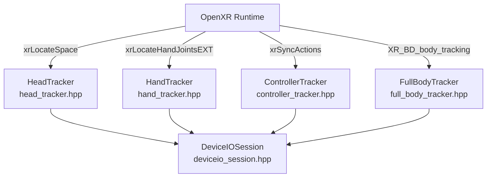
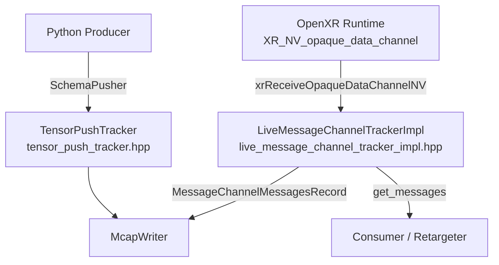

<!-- source: DeepWiki mcp.deepwiki.com · repo NVIDIA/IsaacCapture · extra page Tracker Catalog and Device Data Types · fetched 2026-10-26 -->

# Tracker Catalog and Device Data Types

<details>
<summary>Relevant source files</summary>

The following files were used as context for generating this wiki page:

- [docs/source/device/soma.rst](docs/source/device/soma.rst)
- [docs/source/device/trackers.rst](docs/source/device/trackers.rst)
- [examples/deviceio_live_view/python/isaaccapture_examples/deviceio_live_view/soma_hand.py](examples/deviceio_live_view/python/isaaccapture_examples/deviceio_live_view/soma_hand.py)
- [examples/haptic_feedback/python/hand_pinch_haptic_example.py](examples/haptic_feedback/python/hand_pinch_haptic_example.py)
- [examples/soma_hand_publisher/python/isaaccapture_examples/soma_hand_publisher/publisher.py](examples/soma_hand_publisher/python/isaaccapture_examples/soma_hand_publisher/publisher.py)
- [src/core/deviceio_base/cpp/inc/deviceio_base/haptic_command_reader_tracker_base.hpp](src/core/deviceio_base/cpp/inc/deviceio_base/haptic_command_reader_tracker_base.hpp)
- [src/core/deviceio_base/cpp/inc/deviceio_base/tensor_push_tracker_base.hpp](src/core/deviceio_base/cpp/inc/deviceio_base/tensor_push_tracker_base.hpp)
- [src/core/deviceio_trackers/cpp/haptic_command_reader_tracker.cpp](src/core/deviceio_trackers/cpp/haptic_command_reader_tracker.cpp)
- [src/core/deviceio_trackers/cpp/inc/deviceio_trackers/haptic_command_reader_tracker.hpp](src/core/deviceio_trackers/cpp/inc/deviceio_trackers/haptic_command_reader_tracker.hpp)
- [src/core/deviceio_trackers/cpp/inc/deviceio_trackers/tensor_push_tracker.hpp](src/core/deviceio_trackers/cpp/inc/deviceio_trackers/tensor_push_tracker.hpp)
- [src/core/deviceio_trackers/cpp/tensor_push_tracker.cpp](src/core/deviceio_trackers/cpp/tensor_push_tracker.cpp)
- [src/core/live_trackers/cpp/live_haptic_command_reader_tracker_impl.cpp](src/core/live_trackers/cpp/live_haptic_command_reader_tracker_impl.cpp)
- [src/core/live_trackers/cpp/live_haptic_command_reader_tracker_impl.hpp](src/core/live_trackers/cpp/live_haptic_command_reader_tracker_impl.hpp)
- [src/core/live_trackers/cpp/live_message_channel_tracker_impl.cpp](src/core/live_trackers/cpp/live_message_channel_tracker_impl.cpp)
- [src/core/live_trackers/cpp/live_message_channel_tracker_impl.hpp](src/core/live_trackers/cpp/live_message_channel_tracker_impl.hpp)
- [src/core/replay_trackers/cpp/replay_haptic_command_reader_tracker_impl.cpp](src/core/replay_trackers/cpp/replay_haptic_command_reader_tracker_impl.cpp)
- [src/core/replay_trackers/cpp/replay_haptic_command_reader_tracker_impl.hpp](src/core/replay_trackers/cpp/replay_haptic_command_reader_tracker_impl.hpp)
- [src/core/replay_trackers/cpp/replay_message_channel_tracker_impl.cpp](src/core/replay_trackers/cpp/replay_message_channel_tracker_impl.cpp)
- [src/core/replay_trackers/cpp/replay_message_channel_tracker_impl.hpp](src/core/replay_trackers/cpp/replay_message_channel_tracker_impl.hpp)
- [src/core/schema/fbs/soma_common.fbs](src/core/schema/fbs/soma_common.fbs)
- [src/core/schema/fbs/soma_hand_joint_poses.fbs](src/core/schema/fbs/soma_hand_joint_poses.fbs)
- [src/core/schema/fbs/soma_hand_joint_rotations.fbs](src/core/schema/fbs/soma_hand_joint_rotations.fbs)
- [src/core/schema/golden/soma_common.bfbs](src/core/schema/golden/soma_common.bfbs)
- [src/core/schema/golden/soma_hand_joint_poses.bfbs](src/core/schema/golden/soma_hand_joint_poses.bfbs)
- [src/core/schema/golden/soma_hand_joint_rotations.bfbs](src/core/schema/golden/soma_hand_joint_rotations.bfbs)
- [src/core/schema/python/soma_common_bindings.h](src/core/schema/python/soma_common_bindings.h)

</details>


## Purpose and Scope

Trackers serve as the consumer-side API for reading device pose, input, and telemetry data from an active `DeviceIOSession` [docs/source/device/trackers.rst:4-5](). Each tracker manages one logical device, queries the underlying OpenXR runtime or tensor stream every frame, and exposes the latest sample through typed `get_*()` accessors [docs/source/device/trackers.rst:6-7](). 

Trackers are partitioned into two principal categories: **OpenXR-direct trackers**, which query standard or vendor-specific OpenXR APIs (`xrLocateSpace`, `xrSyncActions`, etc.) [docs/source/device/trackers.rst:11-12](), and **SchemaTracker-based / advanced trackers**, which consume serialized FlatBuffer payloads transported over tensor collections or native message channels [docs/source/device/trackers.rst:19-21]().

---

## 1. OpenXR-Direct Trackers

OpenXR-direct trackers interface directly with the OpenXR session handles and action spaces. They extract standard VR primitives required for head-mounted teleoperation.

- **`HeadTracker`**: Manages the head-mounted display (HMD) head pose, providing tracking state and spatial coordinates relative to the reference space [docs/source/device/trackers.rst:14](). Defined in `src/core/deviceio_trackers/cpp/inc/deviceio_trackers/head_tracker.hpp` [docs/source/device/trackers.rst:14]().
- **`HandTracker`**: Manages articulated hand joint hierarchies for both left and right hands using standard OpenXR hand tracking extensions [docs/source/device/trackers.rst:15](). Defined in `src/core/deviceio_trackers/cpp/inc/deviceio_trackers/hand_tracker.hpp` [docs/source/device/trackers.rst:15]().
- **`ControllerTracker`**: Manages motion controller poses, trigger/thumbstick axes, and button states for left and right hands [docs/source/device/trackers.rst:16](). Defined in `src/core/deviceio_trackers/cpp/inc/deviceio_trackers/controller_tracker.hpp` [docs/source/device/trackers.rst:16]().
- **`FullBodyTracker`**: Provides a vendor-agnostic 24-joint full-body pose [docs/source/device/trackers.rst:17](). By default, the vendor implementation binds to the PICO `XR_BD_body_tracking` extension [docs/source/device/trackers.rst:17](). Defined in `src/core/deviceio_trackers/cpp/inc/deviceio_trackers/full_body_tracker.hpp` [docs/source/device/trackers.rst:17]().

### Diagram: OpenXR-Direct Tracker Architecture

Title: OpenXR-Direct Tracker Code Entities and Data Flow



Sources: `docs/source/device/trackers.rst:11-18`

---

## 2. SchemaTracker and Tensor-Push Trackers

SchemaTracker-based trackers instantiate custom device types by declaring FlatBuffer schemas and reading payloads from OpenXR tensor collections or pushed memory streams [docs/source/device/trackers.rst:19-21]().

### Generated Trackers (`trackers.toml`)
Managed via configuration manifests (`src/core/deviceio_trackers/trackers.toml`) and codegen scripts, these include:
- **`FrameMetadataTrackerOak`**: Frame metadata for OAK camera streams [docs/source/device/trackers.rst:23]().
- **`Generic3AxisPedalTracker`**: Foot pedal axis inputs [docs/source/device/trackers.rst:24]().
- **`JointStateTracker`**: Named joint-space device states for leader arms, exoskeletons, and gloves [docs/source/device/trackers.rst:25]().
- **`Se3Tracker`**: Generic 6-DoF pose sources (tracker pucks, mocap rigid bodies) [docs/source/device/trackers.rst:26]().
- **`SomaBodyJointRotationsTracker` / `SomaBodyJointPosesTracker`**: SOMA-X body joint controls (77 controls) [docs/source/device/trackers.rst:27-28]().
- **`SomaHandJointRotationsTracker` / `SomaHandJointPosesTracker`**: SOMA-X hand joint controls (25 controls) [docs/source/device/trackers.rst:29-30]().

### `TensorPushTracker`
`TensorPushTracker` enables Python or external processes to push tensor blobs and FlatBuffer payloads directly into the DeviceIO pipeline via `SchemaPusher` interfaces [docs/source/device/soma.rst:104-106](). 
- Defined in: `src/core/deviceio_trackers/cpp/inc/deviceio_trackers/tensor_push_tracker.hpp` ()
- Base interface: `src/core/deviceio_base/cpp/inc/deviceio_base/tensor_push_tracker_base.hpp` ()

---

## 3. Message Channel Trackers and Opaque Data

The `MessageChannelTracker` family manages arbitrary binary message transport and out-of-band communication channels via the `XR_NV_opaque_data_channel` extension [src/core/live_trackers/cpp/live_message_channel_tracker_impl.hpp:13-32]().

### Implementation Mechanics (`LiveMessageChannelTrackerImpl`)
`LiveMessageChannelTrackerImpl` wraps OpenXR opaque data channel functions (`xrCreateOpaqueDataChannelNV`, `xrReceiveOpaqueDataChannelNV`, `xrSendOpaqueDataChannelNV`) [src/core/live_trackers/cpp/live_message_channel_tracker_impl.hpp:69-74]().

During each `update(int64_t monotonic_time_ns)` call:
1. It queries channel connection status via `query_status()` [src/core/live_trackers/cpp/live_message_channel_tracker_impl.cpp:66]().
2. If disconnected, it attempts reconnection (`try_reopen_channel()`) [src/core/live_trackers/cpp/live_message_channel_tracker_impl.cpp:70]().
3. If connected, it drains pending messages into a FlatBuffer vector (`MessageChannelMessagesTrackedT`) [src/core/live_trackers/cpp/live_message_channel_tracker_impl.cpp:74]().
4. Oversized messages exceeding `max_message_size()` are bounded-read and dropped to clear queue blocks [src/core/live_trackers/cpp/live_message_channel_tracker_impl.cpp:146-151]().

### Diagram: Advanced Trackers and Message Channels

Title: Advanced Trackers, Schema Pushers, and Opaque Data Channels



Sources: `src/core/live_trackers/cpp/live_message_channel_tracker_impl.hpp:26-84`, `src/core/live_trackers/cpp/live_message_channel_tracker_impl.cpp:20-118`

---

## 4. Data Schema Conventions and Semantics

Every tracker's serialized representation follows a strict two-tier FlatBuffers convention defined under `src/core/schema/fbs` [docs/source/device/trackers.rst:50-51]().

```
+-----------------------------------------------------------------+
|                       Record Wrapper (Root)                     |
|  - data: Payload Table                                          |
|  - timestamp: DeviceDataTimestamp (raw device & local clocks)  |
+-----------------------------------------------------------------+
                                 |
                                 v
+-----------------------------------------------------------------+
|                         Payload Table                           |
|  - Device-specific fields (poses, joints, axes, messages)       |
+-----------------------------------------------------------------+
```

### Table: Schema Tier Summary

| Tier | Component | Role | Example |
| :--- | :--- | :--- | :--- |
| **Tier 1** | Payload Table | Contains raw device metrics; handed directly to consumers as owning handles [docs/source/device/trackers.rst:55,108-109](). | `HeadPose`, `HandPose`, `SomaHandJointRotations` [docs/source/device/trackers.rst:97](), [src/core/schema/fbs/soma_hand_joint_rotations.fbs:58]() |
| **Tier 2** | Record Wrapper | Root type wrapping payload plus `DeviceDataTimestamp` for MCAP recording [docs/source/device/trackers.rst:62-66,102](). | `HeadPoseRecord`, `SomaHandJointRotationsRecord` [docs/source/device/trackers.rst:63](), [src/core/schema/fbs/soma_hand_joint_rotations.fbs:71]() |

Sources: `docs/source/device/trackers.rst:50-103`, `src/core/schema/fbs/soma_hand_joint_rotations.fbs:58-76`

### The `_tracked` Recording Sub-Channel Semantics
Tensor collection producers can emit multiple samples per frame. 
- **`%channel%`**: Receives every intermediate sample for offline analysis [docs/source/device/trackers.rst:75-81]().
- **`%channel%_tracked`**: Receives exclusively the final sample observed by the live consumer during `update()` [docs/source/device/trackers.rst:75-76](). 

Replay sessions read from `%channel%_tracked` exclusively to guarantee deterministic execution matching live capture runs [docs/source/device/trackers.rst:79-81]().

### Zero-Copy Memory and Accessor Rules
- **Accessors**: `get_*()` returns `Serialized<T>` in C++ or read-only view classes in Python [docs/source/device/trackers.rst:108-112](). No deserialization unpack step occurs; joint arrays map to zero-copy NumPy views [docs/source/device/trackers.rst:111-112]().
- **Absence**: An empty handle indicates an absent payload (inactive device, missing sample, or replay gap); tested via `if (handle)` in C++ or `None` in Python [docs/source/device/trackers.rst:114-116]().
- **Mutability Warning**: Joint-array properties provide writable NumPy views due to DLPack constraints. Downstream consumers must copy buffers before in-place modification to prevent corrupting shared frame state [docs/source/device/trackers.rst:124-131]().

Sources: `docs/source/device/trackers.rst:46-142`

---

