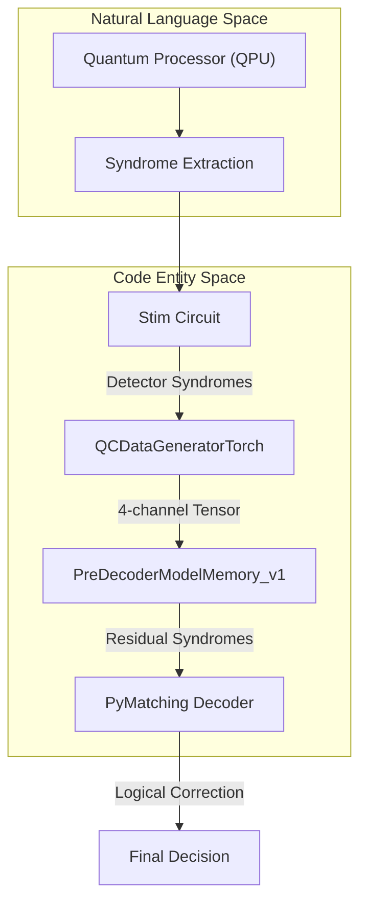
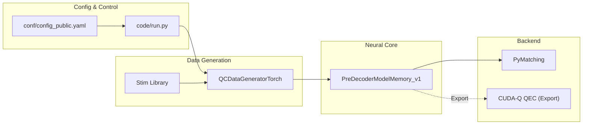

<!-- source: DeepWiki mcp.deepwiki.com · repo NVIDIA/Ising-Decoding · page 1 Overview · fetched 2026-10-26 -->

# Overview

Relevant source files

The following files were used as context for generating this wiki page:

- [NOTICE](NOTICE)
- [README.md](README.md)
- [code/tests/README_ORIENTATIONS_LONG_RUNNING.md](code/tests/README_ORIENTATIONS_LONG_RUNNING.md)
- [cookbook/predecoder.ipynb](cookbook/predecoder.ipynb)
- [images/ler_vs_time_model_card_p0.003_0.006_X_dark.svg](images/ler_vs_time_model_card_p0.003_0.006_X_dark.svg)
- [images/ler_vs_time_model_card_p0.003_0.006_X_light.svg](images/ler_vs_time_model_card_p0.003_0.006_X_light.svg)
- [images/predecoder_pipeline.png](images/predecoder_pipeline.png)

The Ising-Decoding project provides an AI-driven framework for building, training, and deploying scalable Quantum Error Correction (QEC) decoders. It specifically targets surface codes, utilizing a neural network pre-decoder to significantly reduce syndrome density before passing the remaining tasks to a standard algorithmic decoder like PyMatching.

## The Two-Tier Decoding Pipeline

The core concept of this project is a hybrid decoding strategy designed to overcome the throughput bottlenecks of traditional QEC.

1.  **Neural Pre-Decoder**: A 3D Convolutional Neural Network (CNN) consumes detector syndromes across both space and time [README.md:12-13](). It predicts local corrections to resolve high-density syndrome regions [cookbook/predecoder.ipynb:20-23]().
2.  **Standard Decoder**: The remaining, reduced set of syndromes is processed by a standard decoder (typically PyMatching) to produce the final logical decision [README.md:14-14]().

This approach allows for faster processing of syndromes and can improve the Logical Error Rate (LER) compared to using a standalone algorithmic decoder [cookbook/predecoder.ipynb:18-18]().

### Pre-decoder Workflow Logic

The following diagram illustrates how the system transitions from raw syndrome data to a final logical correction.

**Pre-Decoder Data Flow**

Sources: [README.md:10-18](), [cookbook/predecoder.ipynb:12-20]().

## Project Structure and Navigation

The codebase is organized into functional modules covering the full lifecycle of a QEC decoder, from circuit simulation to real-time deployment artifacts.

### System Components

| Component | Description | Primary Code Entities |
| :--- | :--- | :--- |
| **Orchestration** | Handles workflows (train, inference, ablation) and configuration. | `run.py`, `local_run.sh`, `Hydra` |
| **Model** | The 3D CNN architecture for syndrome reduction. | `PreDecoderModelMemory_v1`, `ModelFactory` |
| **QEC Layer** | Surface code construction and noise modeling. | `SurfaceCode`, `MemoryCircuit`, `NoiseModel` |
| **Data Pipeline** | Syndrome generation and precomputation. | `QCDataGeneratorTorch`, `precompute_frames.py` |
| **Evaluation** | Metrics for LER, SDR, and decoder comparisons. | `PreDecoderMemoryEvalModule`, `evaluation.metrics` |

**System Interaction Diagram**

Sources: [README.md:46-77](), [code/tests/README_ORIENTATIONS_LONG_RUNNING.md:5-5]().

## How to Navigate the Wiki

This wiki is structured to guide users from initial setup to deep architectural understanding and production deployment.

*   **[Getting Started](#1.1)**: Step-by-step instructions for installing dependencies (Stim, PyTorch) and running your first training or inference job using `local_run.sh` [README.md:79-129]().
*   **[Configuration Reference](#1.2)**: Detailed breakdown of `conf/config_public.yaml`, covering parameters like `model_id`, `distance`, and `noise_model` [README.md:85-88]().
*   **System Architecture**: Deep dives into the `PreDecoderModelMemory_v1` CNN, the 25-parameter circuit-level noise model, and the four surface code orientations (O1–O4) [code/tests/README_ORIENTATIONS_LONG_RUNNING.md:81-91]().
*   **Training and Inference**: Detailed explanations of the training loop (AdamW/Lion optimizers) and evaluation metrics such as Syndrome Density Reduction (SDR) and Logical Error Rate (LER).
*   **Model Export**: Instructions for converting PyTorch models to SafeTensors, ONNX, and TensorRT for integration with the CUDA-Q QEC real-time pipeline [README.md:27-31]().

Sources: [README.md:20-44](), [code/tests/README_ORIENTATIONS_LONG_RUNNING.md:1-30]().

---

