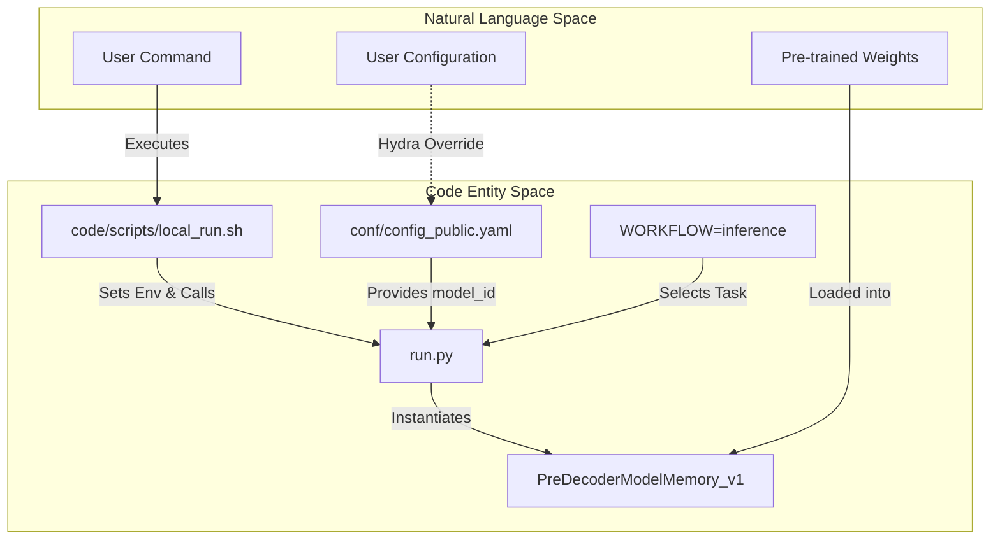
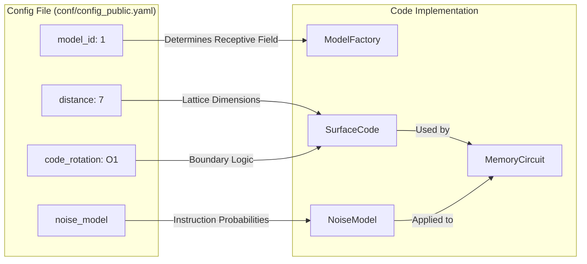

<!-- source: DeepWiki mcp.deepwiki.com · repo NVIDIA/Ising-Decoding · page 1.1 Getting Started · fetched 2026-10-26 -->

# Getting Started

<details>
<summary>Relevant source files</summary>

The following files were used as context for generating this wiki page:

- [Dockerfile](Dockerfile)
- [README.md](README.md)
- [TRAINING.md](TRAINING.md)
- [code/requirements_public_gpu_cu12.txt](code/requirements_public_gpu_cu12.txt)
- [code/requirements_public_gpu_cu13.txt](code/requirements_public_gpu_cu13.txt)
- [code/requirements_public_inference.txt](code/requirements_public_inference.txt)
- [code/requirements_public_train-cu12.txt](code/requirements_public_train-cu12.txt)
- [code/requirements_public_train-cu13.txt](code/requirements_public_train-cu13.txt)
- [conf/config_public.yaml](conf/config_public.yaml)

</details>


This page provides a step-by-step guide for new users to set up the Ising-Decoding environment, install dependencies, and run their first training or inference workflow. The project is designed to be flexible, supporting local execution, Docker containers, and SLURM-managed clusters.

### Prerequisites

The codebase targets Python versions **3.11, 3.12, and 3.13** [README.md:91-91](). It requires an NVIDIA GPU for training and accelerated inference, though basic inference can run on CPU with reduced performance.

Key external dependencies include:
*   **Stim**: For quantum circuit simulation and syndrome generation [code/requirements_public_inference.txt:23-23]().
*   **PyTorch**: The core deep learning framework [code/requirements_public_inference.txt:22-22]().
*   **Hydra**: For configuration management [code/requirements_public_inference.txt:19-19]().
*   **PyMatching**: Used as the "standard" decoder in the two-tier pipeline [README.md:14-14]().

---

### Installation Options

#### 1. Local Installation
Users can install dependencies directly into a virtual environment. Two requirement files are provided: one for inference-only and one for full training.

```bash
# Create environment
python -m venv .venv
source .venv/bin/activate

# For Inference only
pip install -r code/requirements_public_inference.txt

# For Training (select cu12 or cu13 based on your CUDA version)
pip install -r code/requirements_public_train-cu12.txt
```
Sources: [README.md:93-116]()

#### 2. Docker (Recommended for Training)
A `Dockerfile` is provided to build a consistent training environment. It bakes in Python 3.11 and PyTorch with the specified CUDA version [Dockerfile:18-32]().

```bash
# Build the image
docker build -t predecoder-train .

# Run training
docker run --rm --gpus all \
  -v $(pwd):/app:ro \
  -v $HOME/predecoder_outputs:/data \
  -e SHARED_OUTPUT_DIR=/data \
  predecoder-train
```
Sources: [TRAINING.md:15-30](), [Dockerfile:1-53]()

#### 3. SLURM Integration
For cluster environments, the `code/scripts/sbatch_train.sh` template allows for job submission. It automatically detects if a Docker image is available or falls back to a bare-metal installation via `cluster_install_deps.sh` [TRAINING.md:52-73](), [TRAINING.md:89-97]().

---

### Running the First Inference

The repository includes pre-trained models via Git LFS: `Ising-Decoder-SurfaceCode-1-Fast.pt` (R=9) and `Ising-Decoder-SurfaceCode-1-Accurate.pt` (R=13) [README.md:164-166]().

To run inference using a pre-trained model:
1. Set the `WORKFLOW` environment variable to `inference`.
2. Execute the local runner script.

```bash
WORKFLOW=inference bash code/scripts/local_run.sh
```
Sources: [README.md:128-129](), [README.md:150-166]()

#### System Data Flow: Inference Entry
The following diagram illustrates how the runner script initiates the inference pipeline and connects to the model entities.

**Inference Execution Flow**

Sources: [README.md:83-87](), [README.md:128-129](), [conf/config_public.yaml:23-31]()

---

### Configuration Interface: `config_public.yaml`

The `conf/config_public.yaml` file is the primary interface for users to define their QEC experiments. It abstracts complex internal settings into a few key parameters [conf/config_public.yaml:16-20]().

| Field | Description | Default |
| :--- | :--- | :--- |
| `model_id` | Selects the NN architecture (1-5) which determines the receptive field. | `1` |
| `distance` | The code distance ($d$) of the surface code. | `7` |
| `n_rounds` | Number of measurement rounds ($T$). | `7` |
| `code_rotation` | Surface code orientation (O1, O2, O3, or O4). | `O1` |
| `noise_model` | A 25-parameter circuit-level noise specification. | $p=0.003$ |

Sources: [conf/config_public.yaml:22-70]()

#### Mapping Config to Code Entities
This diagram bridges the high-level configuration fields to the specific classes and logic they control within the codebase.

**Configuration to Implementation Mapping**

Sources: [conf/config_public.yaml:23-40](), [README.md:10-14]()

---

### Troubleshooting Common Issues

*   **Shared Memory**: In Docker containers, syndrome data loading may crash if shared memory is too small. Use `--shm-size=1g` or set `PREDECODER_INFERENCE_NUM_WORKERS=0` [README.md:131-136]().
*   **Torch Compile**: If `torch.compile` causes segfaults, disable it by setting `TORCH_COMPILE=0` [README.md:145-147]().
*   **Training Samples**: Ensure `PREDECODER_TRAIN_SAMPLES` is large enough to cover the effective batch size (especially after epoch 0 when the batch size ramps to 2048) [README.md:140-143]().

Sources: [README.md:131-149]()

---

