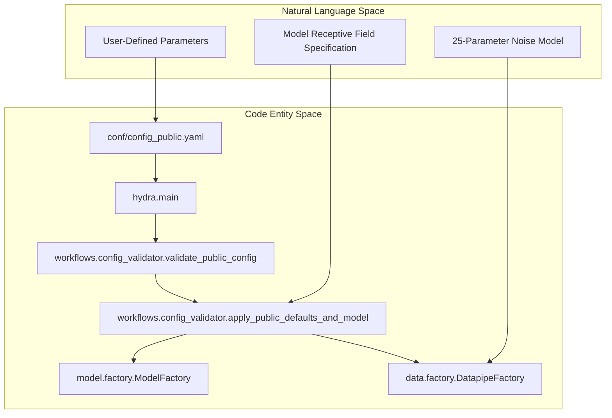
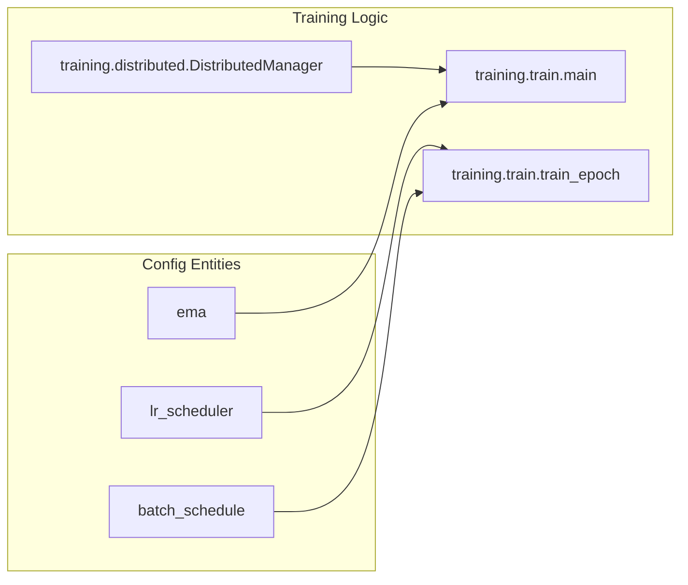

<!-- source: DeepWiki mcp.deepwiki.com · repo NVIDIA/Ising-Decoding · page 1.2 Configuration Reference · fetched 2026-10-26 -->

# Configuration Reference

Relevant source files

The following files were used as context for generating this wiki page:

- [.dockerignore](.dockerignore)
- [README.md](README.md)
- [code/scripts/cluster_train.sh](code/scripts/cluster_train.sh)
- [code/tests/test_predecoder.py](code/tests/test_predecoder.py)
- [code/workflows/run.py](code/workflows/run.py)
- [conf/config_pre_decoder_memory_surface_model_1_d9.yaml](conf/config_pre_decoder_memory_surface_model_1_d9.yaml)
- [conf/config_public.yaml](conf/config_public.yaml)
- [conf/config_qec_decoder_r13_fp8.yaml](conf/config_qec_decoder_r13_fp8.yaml)
- [conf/config_qec_decoder_r9_fp8.yaml](conf/config_qec_decoder_r9_fp8.yaml)

The Ising-Decoding project utilizes **Hydra** for configuration management, providing a flexible hierarchical system that merges user-facing parameters with internal architectural defaults. This page details the configuration structure, the validation logic, and the specific fields available in the public and internal configuration files.

## Configuration Hierarchy and Merging

The system follows a "Public-to-Internal" merging strategy. Users primarily interact with `conf/config_public.yaml`, which exposes a simplified surface of the most relevant parameters. During execution, the `run.py` entrypoint invokes `validate_public_config` and `apply_public_defaults_and_model` to bridge these user inputs with the full system configuration [code/workflows/run.py:55-60]().

### Configuration Data Flow
The following diagram illustrates how configuration values flow from the YAML files through the validation logic into the `ModelFactory` and `DatapipeFactory`.

**Configuration Resolution Pipeline**

Sources: [code/workflows/run.py:55-60](), [conf/config_public.yaml:22-40](), [code/workflows/config_validator.py:22-25]()

---

## Public Configuration (`config_public.yaml`)

This is the primary interface for standard training and inference workflows. It restricts the user to a safe subset of parameters to ensure compatibility with the pre-defined model architectures.

### Key Fields

| Field | Type | Description |
| :--- | :--- | :--- |
| `model_id` | `int` | Selects the model architecture (1–5). Each ID corresponds to a specific receptive field (e.g., ID 1 = R9, ID 4 = R13) [conf/config_public.yaml:23](). |
| `distance` | `int` | The code distance $d$ for evaluation [conf/config_public.yaml:26](). |
| `n_rounds` | `int` | Number of syndrome measurement rounds $T$ [conf/config_public.yaml:27](). |
| `workflow.task` | `string` | Execution mode: `train`, `inference`, or `decoder_ablation` [conf/config_public.yaml:31](). |
| `data.code_rotation` | `string` | Surface code orientation: `O1`, `O2`, `O3`, `O4` [conf/config_public.yaml:37](). |

### Noise Model Specification
The `data.noise_model` block defines a 25-parameter circuit-level noise model [conf/config_public.yaml:40-70](). This allows fine-grained control over:
*   **SPAM Errors**: `p_prep_X/Z` and `p_meas_X/Z`.
*   **Idle Errors**: `p_idle_cnot_X/Y/Z` (during gates) and `p_idle_spam_X/Y/Z` (during ancilla reset).
*   **Two-Qubit Errors**: 15 distinct Pauli error probabilities for CNOT gates (e.g., `p_cnot_XI`, `p_cnot_ZZ`).

Sources: [conf/config_public.yaml:23-70]()

---

## Pre-defined Decoder Configurations

The repository includes optimized configurations for the "Fast" (R9) and "Accurate" (R13) models described in the associated research. These files override specific model and data fields while inheriting training hyperparameters from internal defaults.

### R9 (Fast) Configuration
*   **File**: `conf/config_qec_decoder_r9_fp8.yaml`
*   **Model ID**: 1 (Receptive Field 9) [conf/config_qec_decoder_r9_fp8.yaml:13]()
*   **Target**: Optimized for lower latency inference.
*   **Noise**: Defaults to depolarizing noise $p=0.006$ [conf/config_qec_decoder_r9_fp8.yaml:27-52]().

### R13 (Accurate) Configuration
*   **File**: `conf/config_qec_decoder_r13_fp8.yaml`
*   **Model ID**: 4 (Receptive Field 13) [conf/config_qec_decoder_r13_fp8.yaml:13]()
*   **Target**: Optimized for maximum logical error rate (LER) reduction.

Sources: [conf/config_qec_decoder_r9_fp8.yaml:4-13](), [conf/config_qec_decoder_r13_fp8.yaml:4-13]()

---

## Internal Training Defaults

When a workflow is initialized, several "hidden" parameters are applied to the configuration object. These are primarily found in `conf/config_pre_decoder_memory_surface_model_1_d9.yaml` and govern the neural network's training regime.

### Architecture & Optimization Defaults
The `PreDecoderModelMemory_v1` architecture is configured with the following standard values:
*   **Filters**: `[128, 128, 128, 4]` (4-head output for $Z_{data}, X_{data}, Syn_X, Syn_Z$) [conf/config_pre_decoder_memory_surface_model_1_d9.yaml:54]().
*   **Optimizer**: `Lion` with `lr: 3e-4` and `weight_decay: 1e-7` [conf/config_pre_decoder_memory_surface_model_1_d9.yaml:72-75]().
*   **EMA**: Exponential Moving Average is enabled by default with `decay: 0.0001` [conf/config_pre_decoder_memory_surface_model_1_d9.yaml:101-103]().

### Batch Scheduling
The system uses a dynamic batch size schedule to stabilize training:
*   **Initial Batch**: 1024 [conf/config_pre_decoder_memory_surface_model_1_d9.yaml:87]().
*   **Ramp-up**: Starts after epoch 1 and reaches final size by epoch 3 [conf/config_pre_decoder_memory_surface_model_1_d9.yaml:89-90]().

**Training Pipeline Entity Mapping**

Sources: [conf/config_pre_decoder_memory_surface_model_1_d9.yaml:78-90](), [code/workflows/run.py:18](), [code/workflows/run.py:70-71]()

---

## Validation and Runtime Overrides

The `run.py` script performs critical runtime adjustments to the configuration before the model is instantiated.

1.  **Channel Inference**: If `model.input_channels` is not set, the system creates a single inference sample via `DatapipeFactory` to detect the required input dimensions [code/workflows/run.py:38-42]().
2.  **Output Consistency**: The `model.out_channels` is forced to 4 to match the four prediction heads (data errors and syndrome residuals) [code/workflows/run.py:33-35]().
3.  **Path Resolution**: Relative paths for checkpoints and data directories are resolved to absolute paths relative to the repository root [code/workflows/run.py:153-158]().

Sources: [code/workflows/run.py:32-54](), [code/workflows/run.py:153-158]()

---

