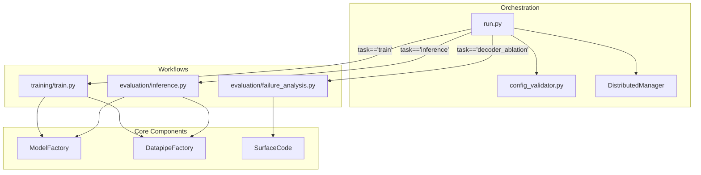
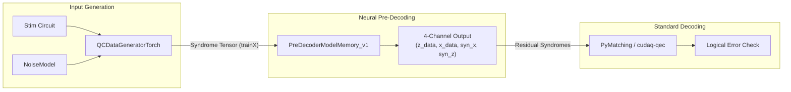

<!-- source: DeepWiki mcp.deepwiki.com · repo NVIDIA/Ising-Decoding · page 2 System Architecture · fetched 2026-10-26 -->

# System Architecture

Relevant source files

The following files were used as context for generating this wiki page:

- [README.md](README.md)
- [code/workflows/run.py](code/workflows/run.py)

The Ising-Decoding system is a two-tier quantum error correction (QEC) pipeline. It uses a neural network "pre-decoder" to process detector syndromes across space and time, predicting corrections that reduce syndrome density before passing the residual problem to a standard combinatorial decoder like PyMatching or a specialized decoder from the `cudaq-qec` library [README.md:10-14]().

## Subsystem Overview

The architecture is divided into five major functional blocks that handle the lifecycle from circuit simulation to real-time deployment.

### 1. Workflow Orchestration
The system is driven by a single entry point, `run.py`, which uses Hydra for configuration management [code/workflows/run.py:55-56](). It routes execution to specific tasks such as `train`, `inference`, or `decoder_ablation` based on the environment and configuration [code/workflows/run.py:70-94]().
*   **Key Responsibilities**: Config validation, model loading priority (SafeTensors vs. `.pt`), and distributed environment initialization via `DistributedManager`.
*   **Details**: See [Workflow Orchestration](#2.1).

### 2. Neural Network Model
The core of the pre-decoder is the `PreDecoderModelMemory_v1`, a 3D Convolutional Neural Network (CNN) designed to handle the spatio-temporal nature of surface code syndromes [code/model/pre_decoder_memory.py:27-28](). It uses residual blocks and is instantiated via a `ModelFactory` that maps `model_id` (1–5) to specific architectural hyperparameters like receptive fields [code/model/factory.py:24-27]().
*   **Key Responsibilities**: Predicting data qubit and syndrome corrections across 4 heads (`z_data`, `x_data`, `syn_x`, `syn_z`).
*   **Details**: See [Neural Network Model](#2.2).

### 3. QEC Surface Code Layer
This layer defines the quantum geometry. The `SurfaceCode` class handles lattice construction, including data-to-stabilizer mappings and boundary detector definitions [code/surface_code/surface_code.py:24-25](). It supports four orientations (XV, XH, ZV, ZH) to ensure the decoder is robust against different error types [code/surface_code/surface_code.py:126-130]().
*   **Key Responsibilities**: Generating Stim circuits, calculating homological equivalence, and mapping syndromes to grid coordinates for the CNN.
*   **Details**: See [QEC Surface Code Layer](#2.3).

### 4. Noise Model
The system employs a 25-parameter circuit-level noise model that simulates realistic hardware errors, including SPAM (State Preparation and Measurement), idling, and CNOT gate noise [code/surface_code/noise_model.py:24-26](). 
*   **Key Responsibilities**: Parameter upscaling for training (targeting $6 \times 10^{-3}$) and generating noisy syndrome frames via Stim.
*   **Details**: See [Noise Model](#2.4).

### 5. Data Pipeline & Evaluation
Syndromes flow from the `QCDataGeneratorTorch` into the model [code/data/generator_torch.py:30-31](). The evaluation stack measures performance using Logical Error Rate (LER) and Syndrome Density Reduction (SDR) [code/evaluation/metrics.py:24-26]().
*   **Key Responsibilities**: On-the-fly syndrome generation, precomputed frame loading, and benchmarking pre-decoder + MWPM performance.
*   **Details**: See [Data Pipeline](#3) and [Inference and Evaluation](#5).

## System Component Diagram

The following diagram illustrates the connectivity between the high-level workflows and the underlying code entities.

### Workflow to Code Mapping

**Sources:** [code/workflows/run.py:70-94](), [code/model/factory.py:24-27](), [code/data/factory.py:24-25]()

## Data Flow Architecture

The pre-decoder operates as a transformation layer within the larger QEC loop.

### Syndrome Processing Pipeline

**Sources:** [README.md:10-18](), [code/model/pre_decoder_memory.py:27-50](), [code/data/generator_torch.py:30-45]()

## Component Summary Table

| Subsystem | Primary Class/Module | File Reference |
| :--- | :--- | :--- |
| **Orchestrator** | `run.py` | [code/workflows/run.py:16-30]() |
| **Model** | `PreDecoderModelMemory_v1` | [code/model/pre_decoder_memory.py:27-28]() |
| **QEC Layer** | `SurfaceCode` | [code/surface_code/surface_code.py:24-25]() |
| **Noise** | `NoiseModel` | [code/surface_code/noise_model.py:24-25]() |
| **Data Pipe** | `QCDataGeneratorTorch` | [code/data/generator_torch.py:30-31]() |
| **Evaluation** | `PreDecoderMemoryEvalModule` | [code/evaluation/inference.py:43-44]() |

---
**Sources:**
*   [README.md:10-18]()
*   [code/workflows/run.py:16-94]()
*   [code/model/factory.py:24-27]()
*   [code/surface_code/surface_code.py:24-130]()
*   [code/surface_code/noise_model.py:24-26]()
*   [code/data/generator_torch.py:30-45]()
*   [code/evaluation/metrics.py:24-26]()

---

