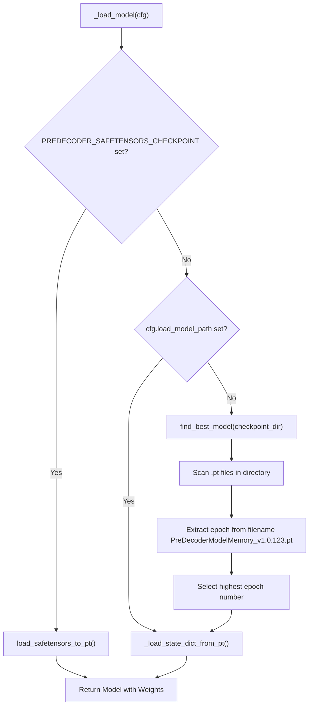
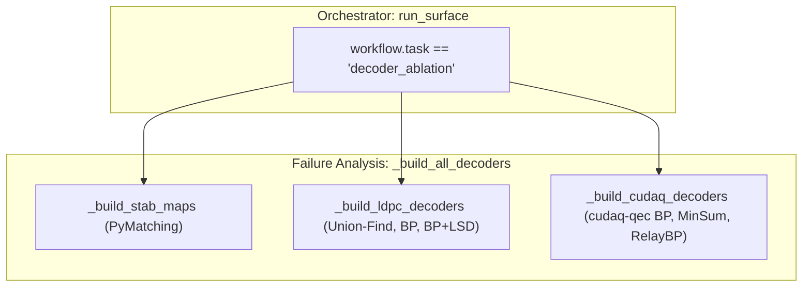

<!-- source: DeepWiki mcp.deepwiki.com · repo NVIDIA/Ising-Decoding · page 2.1 Workflow Orchestration · fetched 2026-10-26 -->

# Workflow Orchestration

Relevant source files

The following files were used as context for generating this wiki page:

- [code/evaluation/failure_analysis.py](code/evaluation/failure_analysis.py)
- [code/scripts/local_run.sh](code/scripts/local_run.sh)
- [code/tests/test_failure_analysis.py](code/tests/test_failure_analysis.py)
- [code/tests/test_public_config.py](code/tests/test_public_config.py)
- [code/workflows/run.py](code/workflows/run.py)

The Ising-Decoding project utilizes a centralized orchestration layer to manage the transition between training, inference, and comparative analysis. This layer is primarily controlled by `code/workflows/run.py`, which serves as the Hydra entry point, and `code/scripts/local_run.sh`, which manages environment variables and hardware detection.

## Execution Entry Points

Execution is routed through `run.py` using the `workflow.task` configuration parameter. The system supports three primary workflows in the public release: `train`, `inference`, and `decoder_ablation` [code/workflows/run.py:70-94]().

### Workflow Routing Logic

The `run_surface` function acts as the primary dispatcher [code/workflows/run.py:69-100]():

| Workflow Task | Target Function/Module | Purpose |
| :--- | :--- | :--- |
| `train` | `training.train.main` | Orchestrates model training, checkpointing, and validation [code/workflows/run.py:71](). |
| `inference` | `evaluation.inference.run_inference` | Evaluates a trained model's Logical Error Rate (LER) and Syndrome Density Reduction (SDR) [code/workflows/run.py:82](). |
| `decoder_ablation` | `evaluation.failure_analysis.decoder_ablation_study` | Compares neural pre-decoding against multiple global decoders (MWPM, LDPC, CUDA-Q) [code/workflows/run.py:94](). |
| `data` | `DatapipeFactory.create_dataloader` | Debug mode to verify syndrome generation shapes [code/workflows/run.py:86-88](). |

### The `local_run.sh` Wrapper
The `local_run.sh` script provides a user-friendly interface to the orchestrator, handling several critical setup steps:
1.  **GPU Detection**: Automatically calculates the number of available GPUs using `nvidia-smi` or respects `CUDA_VISIBLE_DEVICES` [code/scripts/local_run.sh:96-107]().
2.  **Configuration Snapshots**: Copies the active `config_public.yaml` and CLI overrides to the output directory to ensure reproducibility [code/scripts/local_run.sh:141-161]().
3.  **Environment Mapping**: Maps `WORKFLOW` and `ONNX_WORKFLOW` environment variables to Hydra overrides [code/scripts/local_run.sh:163-170]().

**Sources:** [code/workflows/run.py:1-100](), [code/scripts/local_run.sh:1-170]()

---

## Configuration Validation and Merging

The orchestrator enforces a strict validation boundary between the user-facing `config_public.yaml` and the internal system defaults.

### Validation Pipeline
Before execution, `run.py` calls `validate_public_config` to ensure no "hidden" internal fields (like optimizer internals or private data paths) have been injected into the public configuration [code/workflows/run.py:59](). This is followed by `apply_public_defaults_and_model`, which merges the validated public settings with the necessary internal architectural defaults [code/workflows/run.py:60]().

### IO Channel Inference
To ensure the model architecture matches the specific QEC code geometry (distance and rounds), the orchestrator performs late-bound IO channel inference [code/workflows/run.py:32-53]():
*   **Output Channels**: Forced to 4 to match the standard heads: `z_data`, `x_data`, `syn_x`, and `syn_z` [code/workflows/run.py:33-35]().
*   **Input Channels**: Inferred by instantiating a single-sample `Datapipe` and inspecting the `trainX` tensor shape [code/workflows/run.py:38-42]().

**Sources:** [code/workflows/run.py:22-60](), [code/tests/test_public_config.py:47-98]()

---

## Model Loading Priority

When a workflow requires a model (Inference or Ablation), the orchestrator follows a strict hierarchy to locate and load the weights.

### Loading Sequence Diagram

This diagram illustrates the logic within `_load_model` and its helper functions.

### Discovery Logic
*   **SafeTensors**: If the environment variable `PREDECODER_SAFETENSORS_CHECKPOINT` is provided, it takes absolute precedence. This is used for integrating with the CUDA-Q QEC C++ pipeline [code/scripts/local_run.sh:48]().
*   **Direct Path**: Users can specify a specific `.pt` file via `load_model_path`.
*   **Best-Model Discovery**: If no path is provided, `find_best_model` scans the checkpoint directory for files matching the pattern `PreDecoderModelMemory_v1.<EPOCH>.pt` and selects the one with the highest epoch [code/workflows/run.py:102-150]().

**Sources:** [code/workflows/run.py:102-170](), [code/scripts/local_run.sh:46-49]()

---

## Workflow Implementation Detail

### Inference Workflow
The inference workflow initializes the `DistributedManager`, loads the model, and invokes `run_inference` [code/workflows/run.py:77-82](). It supports an `ONNX_WORKFLOW` state machine (0-3) which can trigger ONNX export, TensorRT engine building, or loading pre-built engines for accelerated evaluation [code/scripts/local_run.sh:27-32]().

### Decoder Ablation Workflow
The `decoder_ablation` task routes to `evaluation.failure_analysis.decoder_ablation_study` [code/workflows/run.py:90-94](). This workflow is unique because it instantiates multiple global decoders to process the residual syndromes generated by the neural model.

#### Ablation System Components
The orchestrator sets up a factory-style initialization for global decoders:

**Sources:** [code/workflows/run.py:89-94](), [code/evaluation/failure_analysis.py:39-178](), [code/tests/test_failure_analysis.py:171-190]()

---

