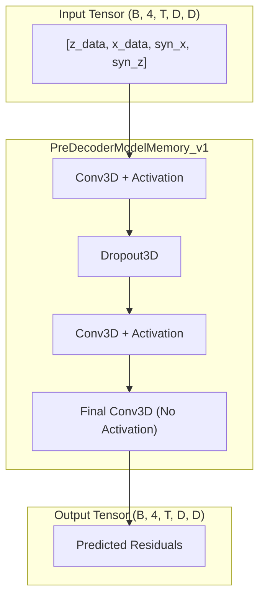
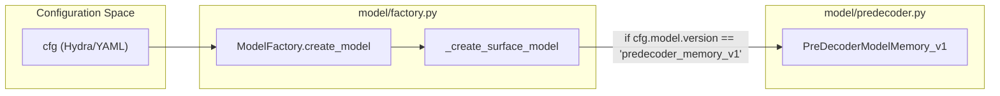

<!-- source: DeepWiki mcp.deepwiki.com · repo NVIDIA/Ising-Decoding · page 2.2 Neural Network Model · fetched 2026-10-26 -->

# Neural Network Model

Relevant source files

The following files were used as context for generating this wiki page:

- [code/model/__init__.py](code/model/__init__.py)
- [code/model/factory.py](code/model/factory.py)
- [code/model/predecoder.py](code/model/predecoder.py)
- [code/model/registry.py](code/model/registry.py)
- [code/tests/test_model_factory.py](code/tests/test_model_factory.py)
- [code/tests/test_predecoder.py](code/tests/test_predecoder.py)
- [code/tests/test_v3_optimizations.py](code/tests/test_v3_optimizations.py)
- [conf/config_pre_decoder_memory_surface_model_1_d9.yaml](conf/config_pre_decoder_memory_surface_model_1_d9.yaml)

The neural network model in the Ising-Decoding project is designed as a pre-decoder that processes quantum error correction (QEC) syndrome data to predict error locations. The primary architecture, `PreDecoderModelMemory_v1`, utilizes 3D Convolutional Neural Networks (CNNs) to handle the spatio-temporal nature of surface code syndromes over multiple measurement rounds.

## Architecture: PreDecoderModelMemory_v1

The `PreDecoderModelMemory_v1` class is the core architectural implementation. It treats the syndrome data as a 3D volume where the dimensions represent space ($D \times D$ lattice) and time ($T$ measurement rounds) [code/model/predecoder.py:65-71]().

### Model Design
*   **3D Convolutions**: The model consists of a sequence of 3D convolutional layers [code/model/predecoder.py:90-104](). Each layer applies a kernel across the spatial and temporal dimensions simultaneously, allowing the network to learn correlations between syndromes in adjacent rounds and neighboring qubits.
*   **Residual Blocks**: While the base `PreDecoderModelMemory_v1` uses a sequential stack of convolutions, the module provides a `ResidualBlock3D` component [code/model/predecoder.py:23-63](). This block includes batch normalization and skip connections to facilitate deeper architectures and stable training.
*   **Activation Functions**: Supported activations include `ReLU`, `GELU` (with tanh approximation), and `LeakyReLU`, configurable via the `model.activation` parameter [code/model/predecoder.py:106-114]().
*   **Dropout**: 3D Dropout is applied between hidden layers to prevent overfitting [code/model/predecoder.py:99-101]().

### Input/Output Channel Conventions
The model operates on a 4-channel input tensor representing the syndrome and data qubit state information [code/model/predecoder.py:117-118]().

| Channel Index | Name | Description |
| :--- | :--- | :--- |
| 0 | `z_data` | Z-basis data qubit syndrome/error information |
| 1 | `x_data` | X-basis data qubit syndrome/error information |
| 2 | `syn_x` | X-type check syndromes |
| 3 | `syn_z` | Z-type check syndromes |

The output channel count is typically configured to match the number of prediction heads required for the specific decoding task (e.g., predicting the most likely error for both X and Z basis) [code/model/predecoder.py:83-86]().

### Model Data Flow
The following diagram illustrates the transformation from input syndromes to the predicted error residuals.

**Pre-Decoder Data Flow**

Sources: [code/model/predecoder.py:65-118](), [code/tests/test_predecoder.py:32-38]()

## Model Registry and Receptive Fields

The `model/registry.py` file defines a set of standard configurations (`model_id` 1–5) used in the public release. These IDs map to specific hyperparameters that determine the network's depth, width, and receptive field [code/model/registry.py:18-25]().

### Receptive Field Calculation
The receptive field $R$ represents the range of measurement rounds and spatial distance the model considers for a single prediction. It is calculated as:
$$R = 1 + \sum_{i} (k_i - 1)$$
where $k_i$ is the kernel size of the $i$-th layer [code/model/registry.py:41-42]().

### Registered Models
| Model ID | Layers | Kernel Sizes | Num Filters | Receptive Field |
| :--- | :--- | :--- | :--- | :--- |
| 1 | 4 | [3, 3, 3, 3] | [128, 128, 128, 4] | 9 |
| 2 | 4 | [3, 3, 3, 3] | [256, 256, 256, 4] | 9 |
| 3 | 4 | [5, 5, 5, 5] | [128, 128, 128, 4] | 17 |
| 4 | 6 | [3, 3, 3, 3, 3, 3] | [128, 128, 128, 128, 128, 4] | 13 |
| 5 | 6 | [3, 3, 3, 3, 3, 3] | [256, 256, 256, 256, 256, 4] | 13 |

Sources: [code/model/registry.py:54-95](), [code/model/registry.py:98-108]()

## Model Instantiation via ModelFactory

The `ModelFactory` provides a unified interface for creating model instances from a configuration object. It handles versioning and architecture selection [code/model/factory.py:22-25]().

**Factory Pattern Implementation**

Sources: [code/model/factory.py:22-38](), [code/model/__init__.py:22-29]()

## Optimization and Training Support

The model architecture is compatible with several PyTorch optimization features:

*   **torch.compile**: The architecture is designed to be compatible with `torch.compile(mode='default')`, which is enabled by default in training configurations to improve execution speed on NVIDIA GPUs [conf/config_pre_decoder_memory_surface_model_1_d9.yaml:19-20]().
*   **EMA (Exponential Moving Average)**: Training supports maintaining an EMA of model weights. The system includes vectorized EMA updates using `torch._foreach_mul_` and `torch._foreach_add_` for high performance [code/tests/test_v3_optimizations.py:146-154](), [conf/config_pre_decoder_memory_surface_model_1_d9.yaml:101-103]().
*   **Mixed Precision**: The model supports both `FP16` and `BF16` training modes, as well as `TF32` for matrix multiplications and cuDNN operations [conf/config_pre_decoder_memory_surface_model_1_d9.yaml:14-18]().

Sources: [conf/config_pre_decoder_memory_surface_model_1_d9.yaml:14-20](), [code/tests/test_v3_optimizations.py:110-162]()

---

