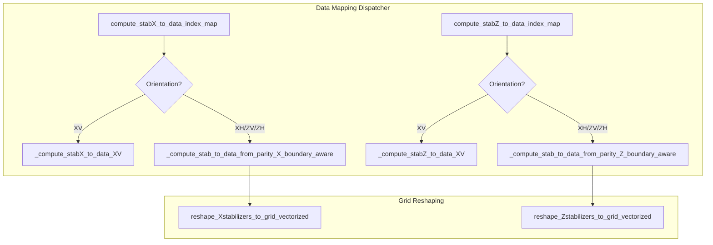
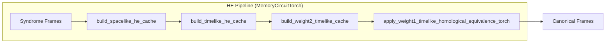
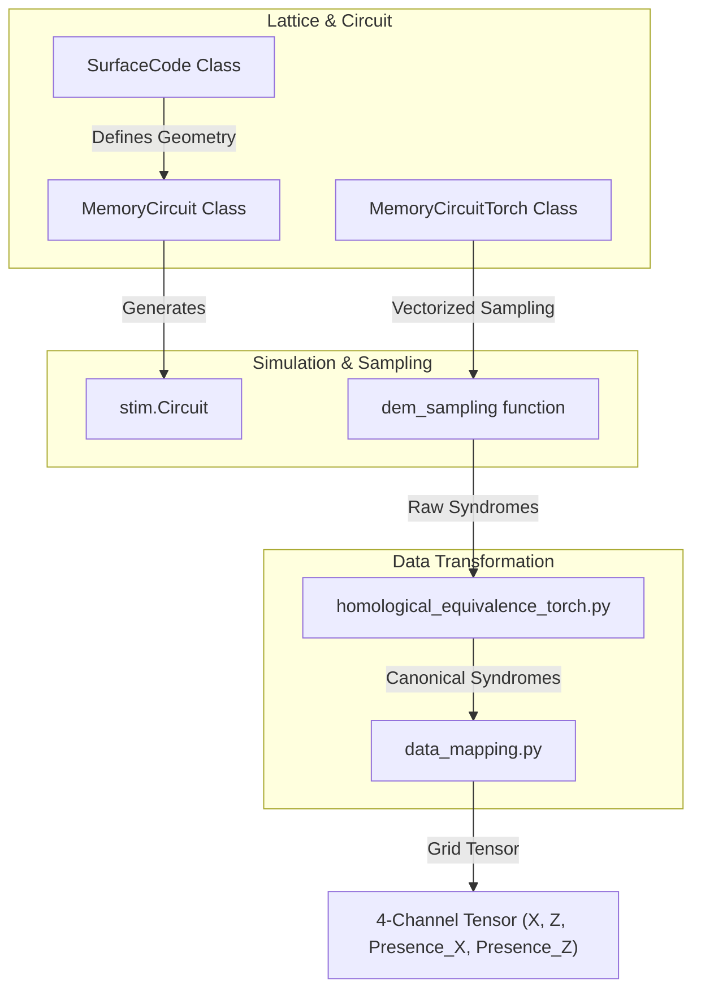

<!-- source: DeepWiki mcp.deepwiki.com · repo NVIDIA/Ising-Decoding · page 2.3 QEC Surface Code Layer · fetched 2026-10-26 -->

# QEC Surface Code Layer

Relevant source files

The following files were used as context for generating this wiki page:

- [code/data/generator_torch.py](code/data/generator_torch.py)
- [code/evaluation/metrics.py](code/evaluation/metrics.py)
- [code/qec/__init__.py](code/qec/__init__.py)
- [code/qec/surface_code/__init__.py](code/qec/surface_code/__init__.py)
- [code/qec/surface_code/data_mapping.py](code/qec/surface_code/data_mapping.py)
- [code/qec/surface_code/homological_equivalence.py](code/qec/surface_code/homological_equivalence.py)
- [code/qec/surface_code/homological_equivalence_torch.py](code/qec/surface_code/homological_equivalence_torch.py)
- [code/qec/surface_code/memory_circuit.py](code/qec/surface_code/memory_circuit.py)
- [code/qec/surface_code/memory_circuit_torch.py](code/qec/surface_code/memory_circuit_torch.py)
- [code/qec/surface_code/stim_utils.py](code/qec/surface_code/stim_utils.py)
- [code/tests/test_boundary_detectors.py](code/tests/test_boundary_detectors.py)
- [code/workflows/config_validator.py](code/workflows/config_validator.py)

The QEC Surface Code Layer provides the fundamental quantum error correction primitives for the decoding pipeline. It handles the construction of rotated surface code lattices, the generation of Stim-based memory circuits, and the mapping between physical syndrome data and the D×D grid format required by the neural network models.

## Surface Code Lattice Construction

The `SurfaceCode` class is the primary entity for defining the topological structure of the code. It supports rotated surface codes with odd distances [code/qec/surface_code/memory_circuit.py:28-54]().

### Orientation and Rotations
The codebase supports four distinct code orientations (O1–O4), which are mapped to internal representations of the first bulk syndrome type ('X' or 'Z') and the boundary orientation ('H' or 'V') [code/workflows/config_validator.py:37-43]().

| Public ID | Internal Alias | First Bulk Syndrome | Boundary Type |
| :--- | :--- | :--- | :--- |
| **O1** | XV | X | Vertical |
| **O2** | XH | X | Horizontal |
| **O3** | ZV | Z | Vertical |
| **O4** | ZH | Z | Horizontal |

Sources: [code/qec/surface_code/memory_circuit.py:56-62](), [code/workflows/config_validator.py:37-43]()

### Qubit Classification
The lattice is divided into three functional groups:
1.  **Data Qubits**: Qubits that store the logical information [code/qec/surface_code/memory_circuit.py:63]().
2.  **X-Check Qubits**: Ancilla qubits used to measure X-type stabilizers [code/qec/surface_code/memory_circuit.py:64]().
3.  **Z-Check Qubits**: Ancilla qubits used to measure Z-type stabilizers [code/qec/surface_code/memory_circuit.py:65]().

The `SurfaceCode` class generates these coordinates and builds the parity-check matrices `hx` and `hz` which define the mapping between stabilizers and their data qubit support [code/qec/surface_code/memory_circuit.py:75-90]().

## Memory Circuit Generation

The `MemoryCircuit` class (and its high-performance counterpart `MemoryCircuitTorch`) generates Stim circuits for memory experiments [code/qec/surface_code/memory_circuit.py:236-258]().

### 4-Phase Measurement Cycle
The memory circuit execution follows a standard QEC cycle:
1.  **Reset**: Initialization of ancilla and data qubits into the target basis.
2.  **Syndrome Extraction**: CNOT gate sequences between data and ancilla qubits to measure stabilizers.
3.  **Measurement**: Reading out the ancilla qubit states to detect errors.
4.  **Logical Measurement**: Final measurement of data qubits to determine the logical outcome.

### Boundary Detectors
The implementation includes "boundary detectors" which add specific detectors at the end of the circuit to capture errors that would otherwise only be seen during the final logical measurement [code/tests/test_boundary_detectors.py:53-75](). For a distance $d$ code, this adds $(d^2-1)/2$ detectors for the chosen basis [code/tests/test_boundary_detectors.py:77-80]().

Sources: [code/qec/surface_code/memory_circuit.py:236-258](), [code/tests/test_boundary_detectors.py:53-136]()

## Stabilizer-to-Data-Qubit Mappings

The neural network model expects syndrome data formatted as a spatial grid. The `data_mapping.py` module provides the logic to map linear stabilizer indices to specific data qubit locations on a $D \times D$ grid [code/qec/surface_code/data_mapping.py:16-29]().

### Boundary-Aware Selection
To ensure consistency across orientations, the mapping uses specific boundary conventions for weight-2 stabilizers:
*   **X-Stabilizers**: Pick the **Left** qubit for horizontal pairs and the **Top** qubit for vertical pairs [code/qec/surface_code/data_mapping.py:74-102]().
*   **Z-Stabilizers**: Pick the **Right** qubit for horizontal pairs and the **Top** qubit for vertical pairs [code/qec/surface_code/data_mapping.py:118-145]().

### Code Entity Space: Data Mapping Logic
The following diagram illustrates how the code routes mapping requests based on the selected orientation.

Sources: [code/qec/surface_code/data_mapping.py:34-151](), [code/qec/surface_code/__init__.py:28-40]()

## Homological Equivalence Transformations

To simplify training data and reduce the complexity of the syndrome space, the pipeline applies homological equivalence (HE) transformations. This process maps different physical error patterns that have the same syndrome and logical effect to a single canonical representative [code/qec/surface_code/homological_equivalence.py:18-29]().

### Transformation Types
1.  **Spacelike HE**: Canonicalizes errors within a single time slice by applying stabilizers to reduce the weight of error patterns (e.g., transforming weight-3/4 errors to weight-1/2) [code/qec/surface_code/homological_equivalence.py:24-26]().
2.  **Timelike HE**: Resolves equivalence across multiple measurement rounds, specifically handling measurement errors and time-correlated noise [code/qec/surface_code/homological_equivalence_torch.py:23-24]().

### High-Performance Implementation
The `MemoryCircuitTorch` utilizes a vectorized Torch implementation of HE to process large batches of syndrome data on the GPU [code/qec/surface_code/homological_equivalence_torch.py:32-40]().

Sources: [code/qec/surface_code/memory_circuit_torch.py:33-39](), [code/qec/surface_code/homological_equivalence_torch.py:19-25]()

## System Integration Diagram

This diagram bridges the high-level concepts of the Surface Code Layer with the specific Python classes and functions implemented in the codebase.

Sources: [code/qec/surface_code/memory_circuit.py:28-54](), [code/qec/surface_code/memory_circuit_torch.py:56-91](), [code/data/generator_torch.py:152-177]()

---

