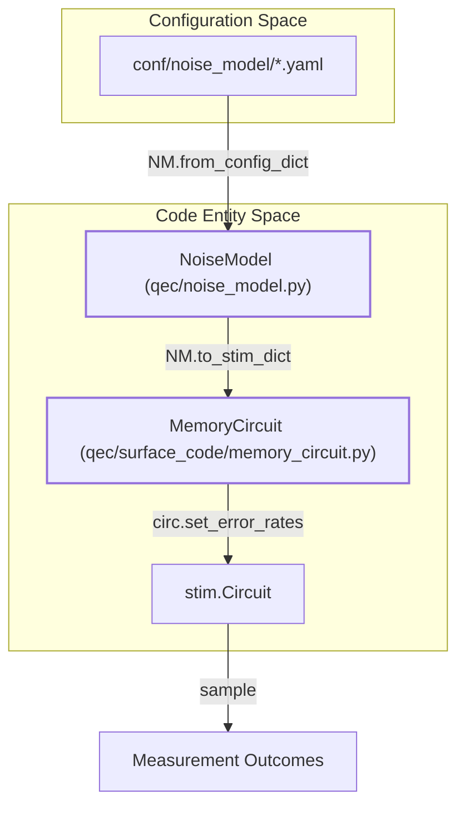
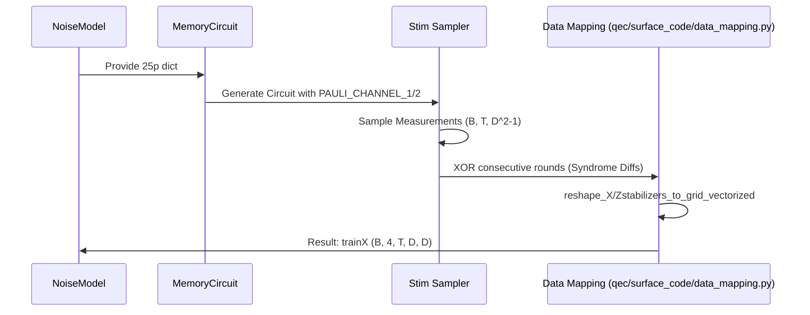

<!-- source: DeepWiki mcp.deepwiki.com · repo NVIDIA/Ising-Decoding · page 2.4 Noise Model · fetched 2026-10-26 -->

# Noise Model

Relevant source files

The following files were used as context for generating this wiki page:

- [code/qec/dem_sampling.py](code/qec/dem_sampling.py)
- [code/qec/noise_model.py](code/qec/noise_model.py)
- [code/qec/precompute_dem.py](code/qec/precompute_dem.py)
- [code/tests/test_dem_sampling.py](code/tests/test_dem_sampling.py)
- [code/tests/test_noise_model.py](code/tests/test_noise_model.py)

The Ising-Decoding project utilizes a comprehensive **25-parameter circuit-level noise model** to simulate realistic quantum hardware environments. This model moves beyond simple depolarizing noise by providing fine-grained control over specific error types, including state preparation, measurement, idling, and two-qubit gate errors.

## Overview of the 25 Parameters

The noise model is defined by 25 independent probability parameters that map directly to Stim circuit instructions. These parameters are grouped into four functional categories:

| Group | Parameters | Count | Description |
| :--- | :--- | :--- | :--- |
| **SPAM** | `p_prep_X/Z`, `p_meas_X/Z` | 4 | Errors during state preparation and measurement in X and Z bases. |
| **Idle (Bulk)** | `p_idle_cnot_X/Y/Z` | 3 | Single-qubit Pauli errors occurring on qubits during CNOT gate layers. |
| **Idle (SPAM)** | `p_idle_spam_X/Y/Z` | 3 | Single-qubit Pauli errors on data qubits during ancilla prep/reset windows. |
| **CNOT** | `p_cnot_IX` ... `p_cnot_ZZ` | 15 | All 15 possible two-qubit Pauli errors (excluding II) for CNOT gates. |

Sources: `[code/qec/noise_model.py:22-42]()`, `[code/qec/noise_model.py:108-143]()`

## NoiseModel Class API

The `NoiseModel` class is the central entity for managing these parameters. It is implemented as a Python `dataclass` and includes validation logic to ensure all probabilities are within the physical range $[0, 1]$.

### Key Methods
- `from_config_dict(config)`: Instantiates a model from a dictionary, typically loaded via Hydra from `conf/noise_model/`.
- `validate()`: Checks that individual probabilities are valid and that the sum of mutually exclusive errors (like CNOT or Idle channels) does not exceed 1.0. `[code/qec/noise_model.py:154-180]()`
- `get_max_probability()`: Returns the highest probability among all 25 parameters, often used as a proxy for the "physical error rate" $p$. `[code/qec/noise_model.py:214-218]()`
- `to_stim_dict()`: Converts the 25 parameters into a format compatible with `stim.Circuit` error instructions. `[code/qec/noise_model.py:246-277]()`

Sources: `[code/qec/noise_model.py:92-143]()`, `[code/qec/noise_model.py:154-180]()`

## Stim Instruction Mapping

The `NoiseModel` translates its internal parameters into specific Stim noise instructions within the `MemoryCircuit` generation process.

| Noise Parameter | Stim Instruction | Context |
| :--- | :--- | :--- |
| `p_prep_X/Z` | `Z_ERROR` / `X_ERROR` | Applied immediately after `R` or `RX` instructions. |
| `p_meas_X/Z` | `Z_ERROR` / `X_ERROR` | Applied immediately before `M` or `MX` instructions. |
| `p_idle_*` | `PAULI_CHANNEL_1` | Applied to idle qubits during gate or SPAM windows. |
| `p_cnot_*` | `PAULI_CHANNEL_2` | Applied to control and target qubits after a `CX` gate. |

Sources: `[code/qec/noise_model.py:97-107]()`, `[code/qec/noise_model.py:246-277]()`

### System Entity Mapping: Noise to Stim
The following diagram shows how the `NoiseModel` class interacts with the circuit generation and simulation layers.

Sources: `[code/qec/noise_model.py:41-42]()`, `[code/qec/noise_model.py:246-277]()`, `[code/tests/test_noise_model.py:149-151]()`

## Training and Upscaling

To improve the robustness of the Pre-Decoder neural network, training is often performed at noise levels higher than the target inference noise.

- **Upscale Target**: The constant `SURFACE_CODE_TRAINING_UPSCALE_TARGET` is set to `6e-3`. `[code/qec/noise_model.py:49]()`
- **Logic**: If the provided noise model has a maximum probability lower than the target, the function `get_training_upscaled_noise_model` scales all 25 parameters linearly so that the maximum probability matches the target. `[code/qec/noise_model.py:317-336]()`
- **Threshold Warning**: The code defines `SURFACE_CODE_THRESHOLD_APPROX = 7.5e-3`. If a noise model exceeds this value, the system may issue warnings as the code is likely operating above the hashing threshold. `[code/qec/noise_model.py:51]()`

Sources: `[code/qec/noise_model.py:49-51]()`, `[code/qec/noise_model.py:317-336]()`

## Noise Drift and Randomization

The model supports simulating "noise drift" where parameters deviate from their reference values over time or across samples.

- **Reference State**: The `NoiseModel` captures a `_reference` dictionary upon initialization. `[code/qec/noise_model.py:145-151]()`
- **Randomization**: The `randomize_from_drift` method allows parameters to vary within a specified `max_drift_ratio`. For example, a ratio of 0.1 allows a parameter to vary by ±10% of its reference value. `[code/qec/noise_model.py:284-314]()`

Sources: `[code/qec/noise_model.py:145-151]()`, `[code/qec/noise_model.py:284-314]()`

## Data Flow: From Noise Parameters to Syndrome Diffs

The noise model influences the generation of training data through a pipeline that converts circuit errors into grid-based syndrome tensors.

Sources: `[code/tests/test_noise_model.py:113-195]()`, `[code/qec/noise_model.py:246-277]()`

## Statistical Validation

The implementation includes rigorous statistical tests in `code/tests/test_noise_model.py` to ensure that the 25-parameter model correctly replicates expected syndrome densities.

- **Syndrome Diffs**: Tests compare XORed consecutive rounds rather than raw measurements. `[code/tests/test_noise_model.py:20-22]()`
- **Masking**: Inference-style masking is applied (masking non-basis syndromes at round 0 and the final round) to match the model's expected input distribution. `[code/tests/test_noise_model.py:21-22]()`, `[code/tests/test_noise_model.py:168-173]()`

Sources: `[code/tests/test_noise_model.py:18-26]()`, `[code/tests/test_noise_model.py:113-195]()`

---

