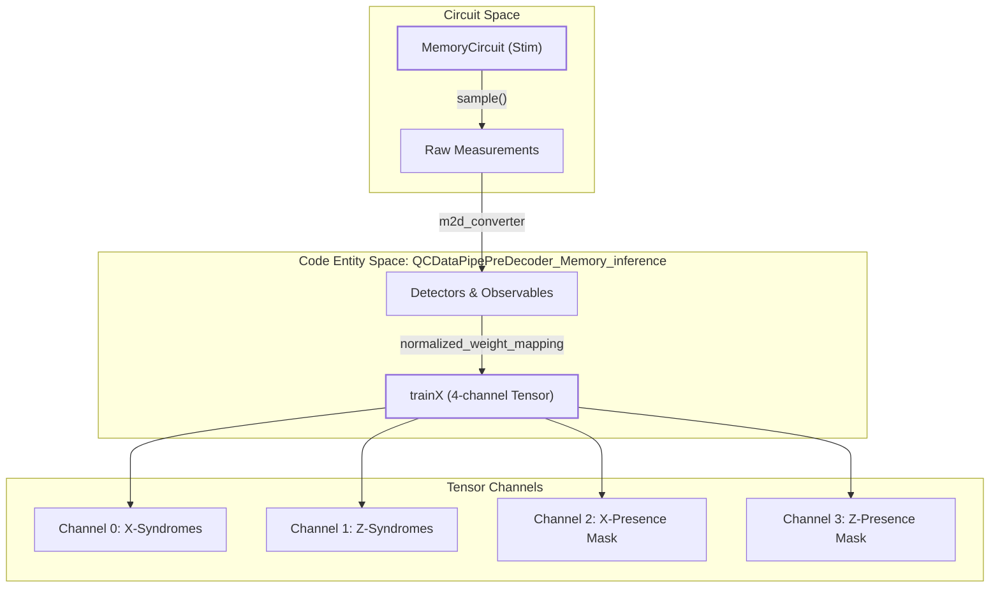
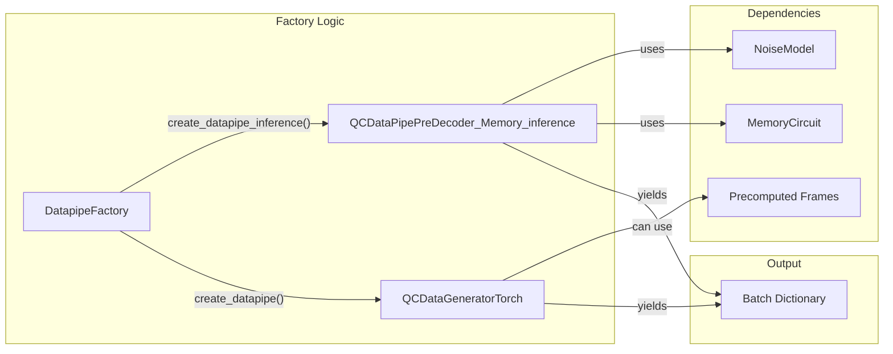

<!-- source: DeepWiki mcp.deepwiki.com · repo NVIDIA/Ising-Decoding · page 3 Data Pipeline · fetched 2026-10-26 -->

# Data Pipeline

Relevant source files

The following files were used as context for generating this wiki page:

- [.github/workflows/ci.yml](.github/workflows/ci.yml)
- [code/data/__init__.py](code/data/__init__.py)
- [code/data/datapipe_stim.py](code/data/datapipe_stim.py)
- [code/data/factory.py](code/data/factory.py)
- [code/tests/test_dataloader_multiprocessing.py](code/tests/test_dataloader_multiprocessing.py)

The data pipeline in the Ising-Decoding project is responsible for transforming quantum circuit simulations into structured tensor inputs for the neural network. It bridges the gap between Stim-based circuit sampling and the 4-channel 3D CNN architecture. The pipeline supports two primary modes: real-time generation during training/inference and high-performance loading from precomputed datasets.

### Pipeline Overview

The pipeline converts raw measurement outcomes from a `MemoryCircuit` into "syndrome differences" mapped onto a 2D grid that reflects the physical layout of the surface code. This process ensures that the spatial correlations of errors are preserved for the convolutional layers.

#### Data Flow: Circuit to Tensor
The following diagram illustrates how measurement bits are processed into the model's input format.

**Syndrome Processing Workflow**

Sources: [code/data/datapipe_stim.py:36-52](), [code/data/datapipe_stim.py:121-138](), [code/data/datapipe_stim.py:28-33]()

---

### On-the-Fly Data Generation

For training and standard inference, the pipeline generates data dynamically. This is handled by `QCDataGeneratorTorch` (for training) and `QCDataPipePreDecoder_Memory_inference` (for inference). The system uses `DatapipeFactory` to instantiate the appropriate generator based on the configuration.

- **Syndrome Differencing**: Instead of raw measurement values, the pipeline often calculates the difference between consecutive rounds to identify error events (detectors).
- **Mixed-Basis Support**: The pipeline can generate batches containing both X-basis and Z-basis memory experiments, controlled by the `measure_basis` parameter [code/data/datapipe_stim.py:76-77]().
- **Multiprocessing**: To maximize throughput, the datapipes are designed to be "pickle-safe," allowing them to run in parallel using the `spawn` multiprocessing context in PyTorch `DataLoader` [code/tests/test_dataloader_multiprocessing.py:13-15]().

For details, see [On-the-Fly Data Generation](#3.1).

Sources: [code/data/factory.py:26-32](), [code/data/datapipe_stim.py:36-40](), [code/tests/test_dataloader_multiprocessing.py:44-45]()

---

### Precomputed Frames

To reduce CPU overhead during large-scale training runs, the system supports loading precomputed syndrome frames. This is particularly useful when using complex noise models that are computationally expensive to simulate at runtime.

- **Offline Generation**: The `precompute_frames.py` script generates and saves batches of syndromes to the `frames_data/` directory.
- **Integration**: `generator_torch.py` can be configured to pull from these precomputed files, falling back to on-the-fly generation only if the requested data is missing.
- **Performance**: Using precomputed frames significantly increases GPU utilization by removing the Stim simulation bottleneck from the training loop.

For details, see [Precomputed Frames](#3.2).

Sources: [code/data/factory.py:58-60](), [code/data/__init__.py:15-22]()

---

### Component Interaction

The `DatapipeFactory` acts as the central router, selecting the data source based on the `cfg.datapipe` and `cfg.code` settings.

**Data Component Relationships**

Sources: [code/data/factory.py:34-48](), [code/data/factory.py:70-71](), [code/data/datapipe_stim.py:27-33]()

### Summary Table

| Feature | On-the-Fly (Inference) | Precomputed (Training) |
| :--- | :--- | :--- |
| **Primary Class** | `QCDataPipePreDecoder_Memory_inference` | `QCDataGeneratorTorch` |
| **Backend** | Stim (Live Sampling) | Disk (`frames_data/`) |
| **Noise Support** | Full 25-parameter `NoiseModel` | Static per-file configuration |
| **Use Case** | LER Evaluation / Testing | Large-scale model optimization |

Sources: [code/data/factory.py:26-32](), [code/data/datapipe_stim.py:112-122]()

---

