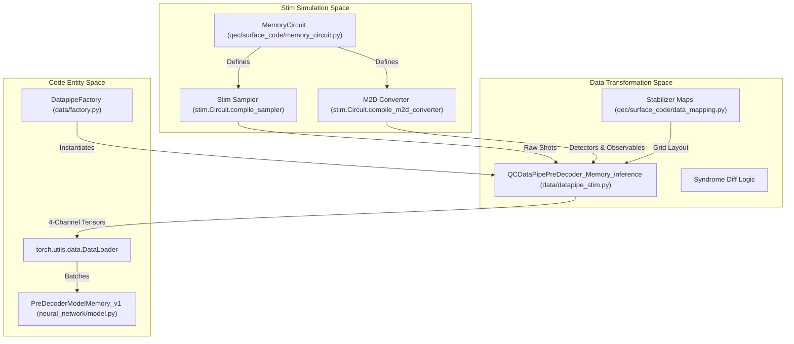
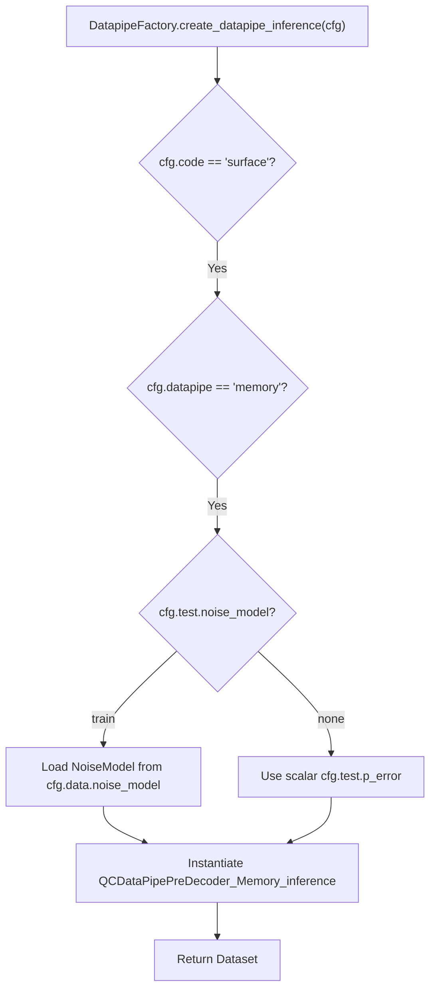

<!-- source: DeepWiki mcp.deepwiki.com · repo NVIDIA/Ising-Decoding · page 3.1 On-the-Fly Data Generation · fetched 2026-10-26 -->

# On-the-Fly Data Generation

Relevant source files

The following files were used as context for generating this wiki page:

- [.github/workflows/ci.yml](.github/workflows/ci.yml)
- [code/data/__init__.py](code/data/__init__.py)
- [code/data/datapipe_stim.py](code/data/datapipe_stim.py)
- [code/data/factory.py](code/data/factory.py)
- [code/data/precompute_frames.py](code/data/precompute_frames.py)
- [code/evaluation/__init__.py](code/evaluation/__init__.py)
- [code/evaluation/threshold_plot.py](code/evaluation/threshold_plot.py)
- [code/tests/test_data_factory.py](code/tests/test_data_factory.py)
- [code/tests/test_dataloader_multiprocessing.py](code/tests/test_dataloader_multiprocessing.py)
- [code/tests/test_precomputed_frames_fallback.py](code/tests/test_precomputed_frames_fallback.py)

This page describes the runtime data generation pipeline used for both training and inference. The system is designed to sample Stim circuits dynamically, transform raw measurement data into a 4-channel tensor format compatible with 3D CNNs, and support complex noise models with high throughput.

## Overview

The data pipeline provides two primary modes of operation:
1.  **Training Mode**: Uses `QCDataGeneratorTorch` (or similar generators) to produce infinite streams of noisy syndrome data.
2.  **Inference Mode**: Uses `QCDataPipePreDecoder_Memory_inference` to generate fixed-size datasets from Stim circuits for performance evaluation and Logical Error Rate (LER) calculation.

Both modes share a common tensor format and logic for mapping physical stabilizers to grid-based coordinates.

### Data Flow and Entity Mapping

The following diagram illustrates how the code entities interact to move data from a Stim circuit simulation into the neural network.

**Data Generation Pipeline Architecture**

Sources: [code/data/datapipe_stim.py:36-40](), [code/data/factory.py:26-32](), [code/qec/surface_code/memory_circuit.py:1-20]()

---

## The 4-Channel Tensor Format

The neural network expects a 4-channel input tensor, referred to as `trainX`. This format translates the irregular surface code lattice into a regular grid suitable for 3D convolutions.

| Channel | Name | Description |
| :--- | :--- | :--- |
| 0 | **X-syndromes** | Binary values of X-type stabilizer measurements (syndrome diffs). |
| 1 | **Z-syndromes** | Binary values of Z-type stabilizer measurements (syndrome diffs). |
| 2 | **X-presence** | Mask indicating valid X-stabilizer locations for the given code distance/rotation. |
| 3 | **Z-presence** | Mask indicating valid Z-stabilizer locations for the given code distance/rotation. |

The tensor shape is `(Batch, Channels, Time, Distance, Distance)`. 

### Syndrome Diff Computation
Instead of raw measurement values, the pipeline computes the **syndrome diff**: $d_t = m_t \oplus m_{t-1}$, where $m_t$ is the measurement at time $t$. This ensures that the network receives local change information, which is critical for identifying error chains in time [code/data/datapipe_stim.py:165-170]().

Sources: [code/data/datapipe_stim.py:86-95](), [code/data/datapipe_stim.py:21-22]()

---

## QCDataPipePreDecoder_Memory_inference

This class is the primary implementation for on-the-fly generation during inference. It encapsulates the `MemoryCircuit` and handles the mapping of Stim's 1D measurement arrays into the 4-channel 3D grid.

### Key Features
*   **Mixed-Basis Support**: Can generate batches containing only X-basis, only Z-basis, or a 50/50 mix ("both") [code/data/datapipe_stim.py:76-76]().
*   **Precomputed Transformations**: To maximize throughput, the stabilizer-to-grid index maps are precomputed during `__init__` [code/data/datapipe_stim.py:79-84]().
*   **Noise Model Integration**: Supports the 25-parameter `NoiseModel`. If a noise model is provided, it overrides the scalar `p_error` [code/data/datapipe_stim.py:98-101]().

### Multiprocessing and Pickle-Safety
The datapipe is designed to be "pickle-safe," allowing it to work with `torch.utils.data.DataLoader` using `num_workers > 0` and the `spawn` multiprocessing context [code/tests/test_dataloader_multiprocessing.py:13-15](). This is verified in CI to ensure no shared state causes deadlocks or memory corruption [code/.github/workflows/ci.yml:84-101]().

Sources: [code/data/datapipe_stim.py:36-52](), [code/tests/test_dataloader_multiprocessing.py:33-47]()

---

## DatapipeFactory

The `DatapipeFactory` serves as the entry point for creating data structures based on the Hydra configuration.

**Logic Flow in DatapipeFactory**

The factory ensures that if a user specifies `cfg.test.noise_model='train'`, the system strictly uses the complex noise model and refuses to fall back to a legacy scalar `p_error` if the noise model fails to load [code/data/factory.py:104-111]().

Sources: [code/data/factory.py:26-49](), [code/data/factory.py:65-122]()

---

## Implementation Details: Syndrome Mapping

The transformation from Stim measurements to the 4-channel grid is performed using precomputed index maps:
1.  **Data Index Map**: `compute_stabX_to_data_index_map` and `compute_stabZ_to_data_index_map` determine which grid coordinate $(i, j)$ corresponds to which Stim detector index [code/data/datapipe_stim.py:71-72]().
2.  **Presence Masks**: `normalized_weight_mapping_Xstab_memory` creates a binary mask of the lattice shape. This mask is stored in channels 2 and 3 of the `trainX` tensor to tell the CNN which grid cells are "padding" and which are active stabilizers [code/data/datapipe_stim.py:64-69]().

Sources: [code/data/datapipe_stim.py:62-75](), [code/qec/surface_code/data_mapping.py:28-33]()

---

