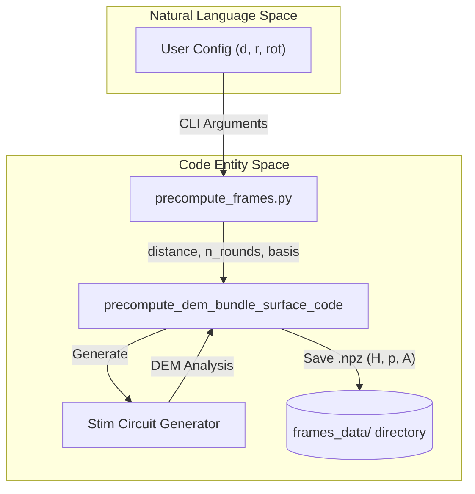
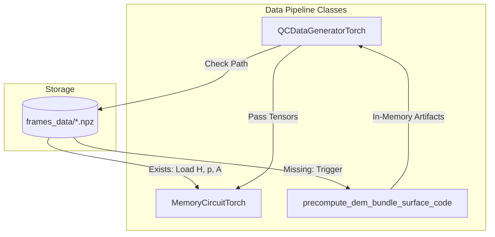

<!-- source: DeepWiki mcp.deepwiki.com · repo NVIDIA/Ising-Decoding · page 3.2 Precomputed Frames · fetched 2026-10-26 -->

# Precomputed Frames

Relevant source files

The following files were used as context for generating this wiki page:

- [code/data/generator_torch.py](code/data/generator_torch.py)
- [code/data/precompute_frames.py](code/data/precompute_frames.py)
- [code/evaluation/__init__.py](code/evaluation/__init__.py)
- [code/evaluation/metrics.py](code/evaluation/metrics.py)
- [code/evaluation/threshold_plot.py](code/evaluation/threshold_plot.py)
- [code/qec/surface_code/homological_equivalence.py](code/qec/surface_code/homological_equivalence.py)
- [code/tests/test_precomputed_frames_fallback.py](code/tests/test_precomputed_frames_fallback.py)
- [code/workflows/config_validator.py](code/workflows/config_validator.py)

In the Ising-Decoding pipeline, "Precomputed Frames" refer to the offline generation and storage of Decoder Error Model (DEM) bundles—specifically the parity-check matrix ($H$), marginal error probabilities ($p$), and homological equivalence maps ($A$). By precomputing these artifacts, the system avoids the significant overhead of Stim circuit parsing and DEM construction during the training loop or real-time inference.

### Offline Data Generation via precompute_frames.py

The script `code/data/precompute_frames.py` serves as the primary entry point for generating these artifacts. It allows users to specify ranges of distances and rounds to batch-process multiple surface code configurations.

**Key Operations:**
*   **Normalization:** Converts public orientation aliases (O1–O4) to internal rotation formats (XV, XH, ZV, ZH) [code/data/precompute_frames.py:49-56]().
*   **Bundle Generation:** Calls `precompute_dem_bundle_surface_code` to generate the four required `.npz` files for a given basis (X or Z) [code/data/precompute_frames.py:169-178]().
*   **Artifacts Produced:**
    *   `surface_d{d}_r{r}_{basis}_frame_predecoder.X.npz`: X-syndrome mapping.
    *   `surface_d{d}_r{r}_{basis}_frame_predecoder.Z.npz`: Z-syndrome mapping.
    *   `surface_d{d}_r{r}_{basis}_frame_predecoder.p.npz`: Marginal error probabilities.
    *   `surface_d{d}_r{r}_{basis}_frame_predecoder.A.npz`: Homological equivalence (HE) matrices [code/data/precompute_frames.py:29-33]().

**Sources:** [code/data/precompute_frames.py:16-34](), [code/data/precompute_frames.py:49-56](), [code/data/precompute_frames.py:169-178]()

---

### Data Flow: Generation to Storage

The following diagram illustrates how the precomputation script bridges the gap between the physical circuit definition (Stim) and the serialized artifacts used by the training pipeline.

**Precomputation Data Flow**

**Sources:** [code/data/precompute_frames.py:59-129](), [code/data/precompute_frames.py:169-178]()

---

### Fallback Mechanism and Resolution

The system is designed to be resilient to missing precomputed data. During the initialization of a training or inference workflow, `resolve_precomputed_frames_dir` checks for the existence of the required `.npz` files in the configured directory (defaulting to `frames_data/`).

| Condition | Action | Implementation Detail |
| :--- | :--- | :--- |
| **Files Found** | Use precomputed path | Returns the directory string to the generator [code/tests/test_precomputed_frames_fallback.py:34-43](). |
| **Files Missing** | In-memory generation | Returns `None`, triggering `QCDataGeneratorTorch` to build a nominal DEM bundle on-the-fly [code/data/generator_torch.py:113-136](). |
| **Default Path** | Repo root | `_default_precomputed_frames_dir` resolves to `<repo_root>/frames_data` [code/workflows/config_validator.py:55-64](). |

**Sources:** [code/workflows/config_validator.py:55-64](), [code/data/generator_torch.py:113-136](), [code/tests/test_precomputed_frames_fallback.py:27-43]()

---

### Integration in QCDataGeneratorTorch

The `QCDataGeneratorTorch` class integrates precomputed frames to initialize its underlying simulation engines. This integration occurs during the `__init__` phase of the data pipeline.

**Implementation Logic:**
1.  **Directory Check:** If `precomputed_frames_dir` is provided, the generator attempts to load artifacts from disk [code/data/generator_torch.py:157-176]().
2.  **In-Memory Fallback:** If the directory is `None`, it invokes `precompute_dem_bundle_surface_code` with `export=False` and `return_artifacts=True` to populate an internal `dem_cache` [code/data/generator_torch.py:113-136]().
3.  **Circuit Initialization:** The cached or loaded $H$, $p$, and $A$ tensors are passed to `MemoryCircuitTorch`, which handles the actual syndrome sampling and homological equivalence logic [code/data/generator_torch.py:153-176]().

**Generator Integration Architecture**

**Sources:** [code/data/generator_torch.py:113-136](), [code/data/generator_torch.py:153-176]()

---

### Configuration Reference

Precomputed frames are managed via the `data` section of the configuration:

*   `data.precomputed_frames_dir`: Path to the directory containing `.npz` files. If set to `null`, the system defaults to the internal fallback [code/workflows/config_validator.py:149]().
*   `data.code_rotation`: Must match the rotation used during precomputation (O1–O4) [code/workflows/config_validator.py:37-43]().
*   `data.meas_basis`: Determines whether the generator looks for "X", "Z", or "both" (mixed) basis frames [code/data/generator_torch.py:67-68]().

**Sources:** [code/workflows/config_validator.py:37-43](), [code/workflows/config_validator.py:149](), [code/data/generator_torch.py:67-68]()

---

