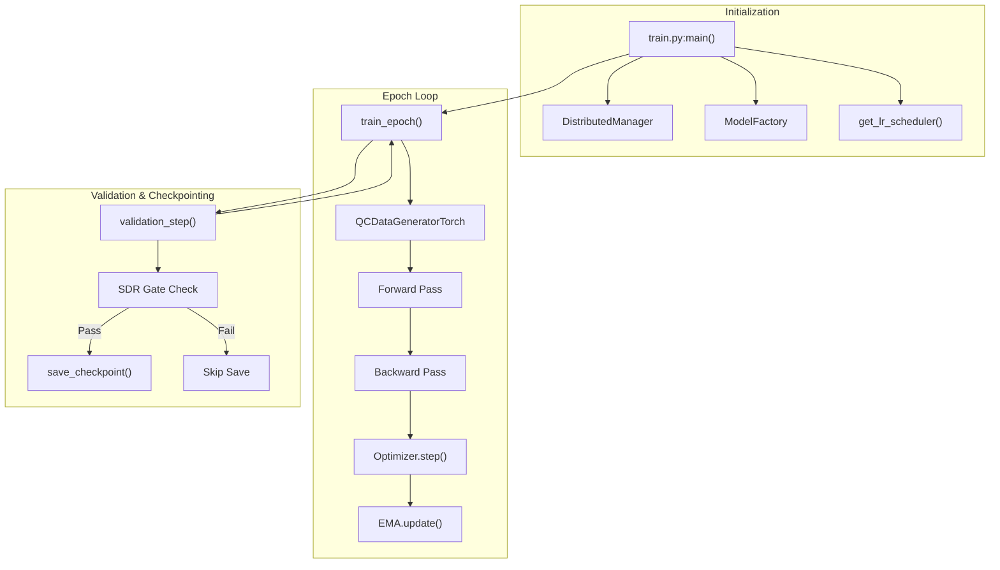
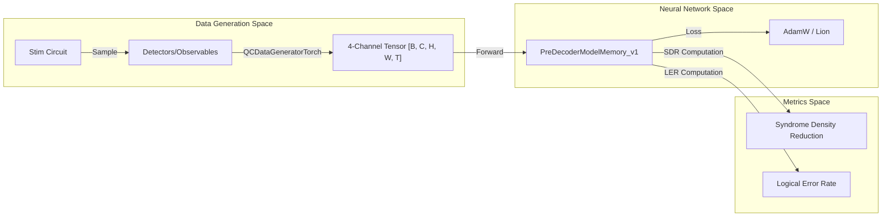

<!-- source: DeepWiki mcp.deepwiki.com · repo NVIDIA/Ising-Decoding · page 4 Training · fetched 2026-10-26 -->

# Training

Relevant source files

The following files were used as context for generating this wiki page:

- [TRAINING.md](TRAINING.md)
- [code/tests/test_training_utils.py](code/tests/test_training_utils.py)
- [code/training/train.py](code/training/train.py)

The training system in the Ising-Decoding project is designed for high-throughput, distributed optimization of neural pre-decoders. It orchestrates the full lifecycle of the model—from on-the-fly syndrome data generation to multi-GPU gradient descent and automated checkpointing. The primary entry point for this subsystem is `train.py`, which integrates Hydra-based configuration with PyTorch's distributed engine.

### Training Orchestration
The `train.py` module manages the high-level execution flow. It handles environment setup, model instantiation via the `ModelFactory`, and the execution of the training epochs. It also includes logic for noise model upscaling to improve model robustness during training [code/training/train.py:24-29]().

Key responsibilities of the training orchestrator include:
*   **Batch Scheduling**: Dynamically adjusting the per-device batch size based on the current epoch to ramp up training intensity [code/training/train.py:140-179]().
*   **Checkpoint Management**: Saving and loading model states, optimizer states, and EMA (Exponential Moving Average) weights to ensure continuity across job restarts [code/training/train.py:1255-1270]().
*   **Resource Monitoring**: Tracking wall time, throughput (samples/sec), and GPU utilization to provide a compact summary of training performance [code/training/train.py:51-53]().

### Training System Overview
The following diagram illustrates how the `train.py` script coordinates different components to execute the training lifecycle.

**Training Lifecycle Orchestration**

Sources: [code/training/train.py:83-107](), [code/training/train.py:1174-1310](), [code/training/train.py:1344-1365]()

---

### Training Loop and Optimization
The core logic for a single pass over the data resides in `train_epoch`. This function handles the iteration over synthetic syndrome batches generated by `QCDataGeneratorTorch`. The optimization process utilizes advanced techniques such as:
*   **Mixed Precision**: Using `torch.amp` for FP16 or BF16 training to accelerate computation [code/training/train.py:76-77]().
*   **Gradient Accumulation**: Decoupling the effective batch size from GPU memory limits by accumulating gradients over multiple steps [code/training/train.py:181-205]().
*   **Optimization Algorithms**: Support for standard `AdamW` or the memory-efficient `Lion` optimizer [code/training/train.py:92-93]().
*   **Early Stopping**: A time-based mechanism that monitors `job_time_limit_seconds` to gracefully exit and save before a cluster job expires [code/tests/test_training_utils.py:54-73]().

For details on the optimization inner loop, see [Training Loop and Optimization](#4.1).

### Distributed Training
To handle the high sample counts required for QEC training (often millions of samples per epoch), the system scales across multiple GPUs using PyTorch Distributed Data Parallel (DDP).
*   **Strategy**: The `DistributedManager` initializes the NCCL backend and sets up rank-specific seeding to ensure data diversity across the cluster [code/training/distributed.py:20-45]().
*   **Deployment**: Training is optimized for remote clusters using Docker containers and SLURM integration, as detailed in the `TRAINING.md` guide [TRAINING.md:1-50]().
*   **Throughput**: The system is designed to maximize throughput by using `static_graph=True` in DDP and minimizing CPU-GPU synchronization stalls [code/training/train.py:31-36]().

For details on the multi-GPU infrastructure, see [Distributed Training](#4.2).

### Training Data Flow
The data pipeline is tightly coupled with the training loop. While the system supports precomputed frames to reduce CPU overhead, it primarily defaults to on-the-fly generation to avoid massive disk I/O requirements for large-scale training.

**Data to Model Flow**

Sources: [code/training/train.py:103-107](), [code/training/train.py:110-138](), [code/tests/test_training_utils.py:133-166]()

### Checkpointing and SDR Gating
Checkpoints are not saved purely based on epoch count. To ensure only high-quality models are preserved, the system uses a **Syndrome Density Reduction (SDR) threshold gate**. If the model does not achieve a minimum reduction factor (e.g., 1.5x reduction in syndrome density), the checkpoint is skipped to save storage and focus on converged models [code/training/train.py:38-43]().

Sources:
*   `code/training/train.py`
*   `TRAINING.md`
*   `code/tests/test_training_utils.py`
*   `code/training/distributed.py`

---

