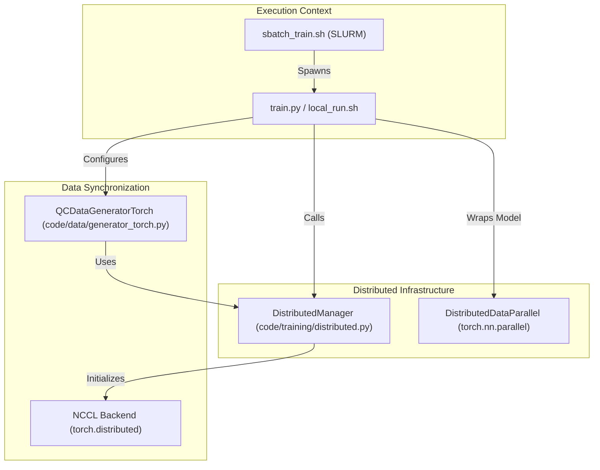
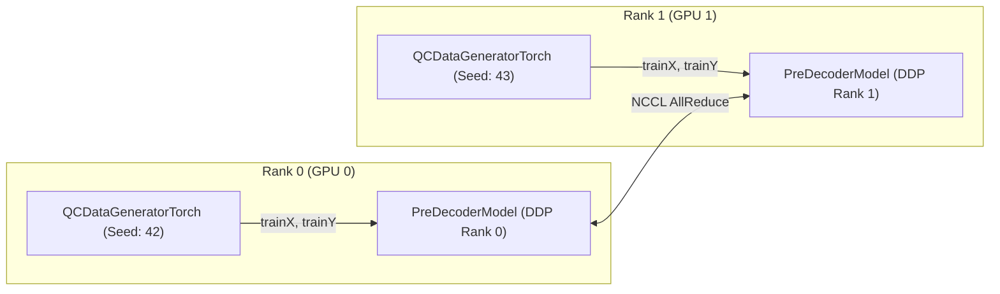

<!-- source: DeepWiki mcp.deepwiki.com · repo NVIDIA/Ising-Decoding · page 4.2 Distributed Training · fetched 2026-10-26 -->

# Distributed Training

Relevant source files

The following files were used as context for generating this wiki page:

- [.dockerignore](.dockerignore)
- [.github/workflows/ci-gpu.yml](.github/workflows/ci-gpu.yml)
- [TRAINING.md](TRAINING.md)
- [code/requirements_ci.txt](code/requirements_ci.txt)
- [code/scripts/cluster_container_install_and_train.sh](code/scripts/cluster_container_install_and_train.sh)
- [code/scripts/cluster_install_deps.sh](code/scripts/cluster_install_deps.sh)
- [code/scripts/cluster_train.sh](code/scripts/cluster_train.sh)
- [code/scripts/sbatch_train.sh](code/scripts/sbatch_train.sh)
- [code/tests/test_multi_gpu.py](code/tests/test_multi_gpu.py)
- [code/tests/test_torch_setup.py](code/tests/test_torch_setup.py)
- [code/training/distributed.py](code/training/distributed.py)
- [conf/config_qec_decoder_r13_fp8.yaml](conf/config_qec_decoder_r13_fp8.yaml)

The Ising-Decoding training system is designed for high-performance multi-GPU scaling using PyTorch's **Distributed Data Parallel (DDP)** and the **NCCL** communication backend. The implementation ensures that both model gradients and data generation are synchronized across nodes while maintaining rank-specific randomness for quantum error correction (QEC) syndrome sampling.

## Distributed Infrastructure

The core of the distributed setup is the `DistributedManager` class, which provides a lightweight wrapper around `torch.distributed` to manage process group initialization and device assignment.

### DistributedManager Implementation
The `DistributedManager` handles the transition from single-GPU to multi-GPU execution by inspecting environment variables typically set by `torchrun` or SLURM.

*   **Initialization**: The `initialize()` method [code/training/distributed.py:45-66]() detects the `WORLD_SIZE`, `RANK`, and `LOCAL_RANK`. If `WORLD_SIZE > 1`, it initializes the process group using the `nccl` backend for CUDA devices.
*   **Device Mapping**: Each rank is pinned to a specific GPU via `torch.cuda.set_device(local_rank)` [code/training/distributed.py:55-58]().
*   **DDP Configuration**: It exposes flags like `broadcast_buffers` and `find_unused_parameters` [code/training/distributed.py:79-80]() which are passed to the DDP wrapper.

### DDP Configuration
For optimal performance, the training loop utilizes specific DDP optimizations:
*   **Static Graph**: `static_graph=True` is used to allow DDP to optimize the communication strategy since the `PreDecoderModelMemory_v1` architecture does not change between iterations.
*   **Gradient Bucketing**: `gradient_as_bucket_view=True` is employed to reduce memory overhead by using views into the gradient buckets rather than allocating new tensors.

### Distributed Training Entity Map
The following diagram illustrates how the distributed components interact within the code space.

**Diagram: Distributed Training Components**

Sources: [code/training/distributed.py:35-86](), [code/scripts/local_run.sh:1-10](), [code/scripts/sbatch_train.sh:128-145]()

## Rank-Aware Data Generation

A critical requirement for training QEC decoders is ensuring that each GPU rank processes a unique set of noise samples to avoid gradient correlation.

*   **Seeding**: The `QCDataGeneratorTorch` uses a `base_seed` combined with the rank: `seed = base_seed + rank` [code/tests/test_multi_gpu.py:142-143](). This ensures that while the noise model parameters are identical across ranks, the actual error realizations are statistically independent.
*   **Batch Scaling**: The system supports world-size-aware batch scaling. If `PREDECODER_TRAIN_SAMPLES` is not explicitly set, the effective batch size scales linearly with the number of GPUs to maintain consistent throughput.
*   **Device Placement**: Tensors generated by `QCDataGeneratorTorch` are created directly on the GPU assigned to the local rank [code/tests/test_multi_gpu.py:133-151]() to prevent unnecessary CPU-to-GPU transfers.

### Data Flow across Ranks
The following diagram shows the data flow from the generator to the model across multiple GPUs.

**Diagram: Multi-GPU Data Flow**

Sources: [code/tests/test_multi_gpu.py:122-154](), [code/training/distributed.py:53-64]()

## Cluster Deployment

The repository provides several scripts to facilitate training on SLURM clusters and within Docker containers.

### SLURM Integration
The `sbatch_train.sh` script [code/scripts/sbatch_train.sh:1-73]() is the primary entry point for cluster runs. It handles:
*   **Resource Allocation**: Maps `--gres=gpu:N` to the internal `GPUS` environment variable [code/scripts/sbatch_train.sh:134]().
*   **Locking**: Implements a file-based lock mechanism `.lock_${EXPERIMENT_NAME}` [code/scripts/sbatch_train.sh:96-107]() to prevent multiple jobs from writing to the same experiment directory simultaneously.
*   **Environment Propagation**: Forwards training overrides like `PREDECODER_TRAIN_EPOCHS` and `PREDECODER_LR_MILESTONES` to the container or local runner [code/scripts/sbatch_train.sh:140-144]().

### Docker and Containerization
Training can be executed in two modes via `cluster_container_install_and_train.sh` [code/scripts/cluster_container_install_and_train.sh:1-32]():
1.  **Pre-built Image**: Using the `Dockerfile` to bake all dependencies (Python 3.11, PyTorch, etc.) into an image [TRAINING.md:13-35]().
2.  **Runtime Installation**: Installing dependencies into a persistent `INSTALL_DIR` at runtime if using a bare CUDA base image [TRAINING.md:36-51]().

### Deployment Script Table

| Script | Purpose | Key Feature |
| :--- | :--- | :--- |
| `sbatch_train.sh` | SLURM submission | Auto-detects Docker vs. Bare-metal [code/scripts/sbatch_train.sh:146-170]() |
| `cluster_train.sh` | Cluster entry point | Configures `SHARED_OUTPUT_DIR` and `LOG_BASE_DIR` [code/scripts/cluster_train.sh:45-70]() |
| `cluster_install_deps.sh` | Dependency management | Installs Miniconda and PyTorch with specific CUDA tags [code/scripts/cluster_install_deps.sh:51-86]() |

Sources: [TRAINING.md:75-97](), [code/scripts/sbatch_train.sh:1-170](), [code/scripts/cluster_train.sh:1-91]()

## Multi-GPU Validation

The system includes a dedicated test suite `code/tests/test_multi_gpu.py` to verify the distributed stack. These tests require at least 2 CUDA GPUs and use `torch.multiprocessing.spawn` to simulate a distributed environment.

*   **NCCL Check**: `test_allreduce_sum_two_gpus` [code/tests/test_multi_gpu.py:177-179]() validates that the process group can perform a sum reduction across ranks.
*   **DDP Check**: `test_ddp_gradient_sync` [code/tests/test_multi_gpu.py:186-188]() ensures that gradients are synchronized and finite after a backward pass across multiple ranks.
*   **Generator Check**: `test_per_rank_tensors_on_correct_device` [code/tests/test_multi_gpu.py:195-197]() confirms that tensors are allocated on the correct GPU index corresponding to the rank.

Sources: [code/tests/test_multi_gpu.py:15-24](), [.github/workflows/ci-gpu.yml:186-189]()

---

