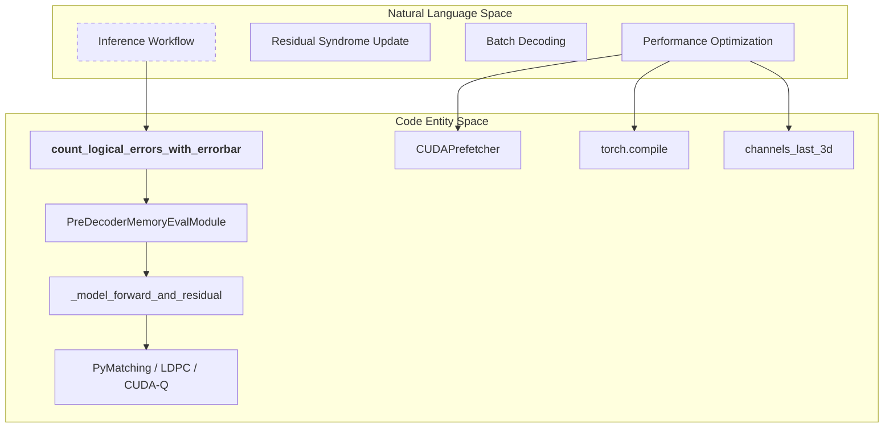
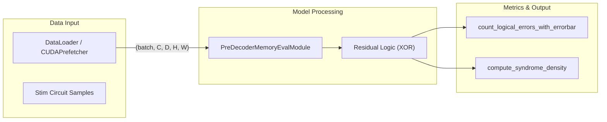

<!-- source: DeepWiki mcp.deepwiki.com · repo NVIDIA/Ising-Decoding · page 5 Inference and Evaluation · fetched 2026-10-26 -->

# Inference and Evaluation

Relevant source files

The following files were used as context for generating this wiki page:

- [code/evaluation/logical_error_rate.py](code/evaluation/logical_error_rate.py)
- [code/tests/test_inference_public_model.py](code/tests/test_inference_public_model.py)
- [code/tests/test_onnx_quant_workflow.py](code/tests/test_onnx_quant_workflow.py)

This section describes the inference and evaluation stack used to validate trained models and compare them against baseline decoders. The system supports high-throughput Logical Error Rate (LER) estimation, Syndrome Density Reduction (SDR) measurement, and a comprehensive ablation study framework for comparing multiple backend decoders.

The evaluation pipeline is designed for high performance, utilizing `torch.compile`, asynchronous data prefetching, and optimized batch decoding via `PyMatching` or `cudaq-qec`.

## Inference Workflow

The standard inference path is orchestrated by `run.py` when the workflow task is set to `inference` [workflows/run.py:270-281](). It applies a trained `PreDecoderModelMemory_v1` to syndrome data generated from a `MemoryCircuit`.

The core logic resides in `count_logical_errors_with_errorbar`, which manages the following:
*   **Data Streaming**: Uses `QCDataPipePreDecoder_Memory_inference` to provide syndrome tensors and observables [data/factory.py:168-175]().
*   **Model Application**: Wraps the model in `PreDecoderMemoryEvalModule` to handle the time-recurrent residual syndrome updates [evaluation/logical_error_rate.py:265-275]().
*   **Error Counting**: Compares the predicted logical flips from the decoder against the true observables to compute LER with statistical error bars [evaluation/logical_error_rate.py:533-550]().

### Inference System Stack
The diagram below illustrates how high-level inference concepts map to the underlying code entities.

**Sources:** [evaluation/logical_error_rate.py:17-49](), [evaluation/logical_error_rate.py:265-280](), [evaluation/logical_error_rate.py:533-560]()

## Key Evaluation Components

### Logical Error Rate (LER) Evaluation
The primary metric for decoder quality is the LER. The system evaluates LER by running the pre-decoder to reduce syndrome weight, then passing the "residual" syndromes to a backend combinatorial decoder (typically MWPM).
*   **Stabilizer Maps**: The module builds maps between the 3D syndrome grid and the underlying stabilizer indices using `_build_stab_maps` [evaluation/logical_error_rate.py:348-355]().
*   **Residual Equations**: It implements the logic where the output of the neural network is XORed with the original syndromes to produce a sparser set of defects [evaluation/logical_error_rate.py:408-415]().

For details, see [Logical Error Rate Evaluation](#5.1).

### Decoder Ablation Study
The ablation study workflow allows for a side-by-side comparison of different decoding algorithms on the same residual data. It supports:
*   **Backends**: `PyMatching` (MWPM), `LDPC` (Belief Propagation, Union-Find), and `cudaq-qec` (MinSum, RelayBP) [evaluation/logical_error_rate.py:1120-1145]().
*   **Metrics**: Tracks agreement rates between decoders and conditional LER based on the residual syndrome weight [evaluation/logical_error_rate.py:1210-1225]().

For details, see [Decoder Ablation Study](#5.2).

### Evaluation Metrics
Beyond LER, the system tracks internal model performance through:
*   **SDR (Syndrome Density Reduction)**: Measures the percentage of syndromes successfully "cleared" by the pre-decoder [evaluation/metrics.py:65-75]().
*   **MWPM Speedup**: Estimates the reduction in MWPM execution time based on the sparsity of the residual syndrome [evaluation/logical_error_rate.py:38-39]().

For details, see [Evaluation Metrics](#5.3).

## Data Flow and Code Mapping

The following diagram traces the flow of data from the `DataLoader` through the model and into the final metric computation.

**Sources:** [evaluation/logical_error_rate.py:580-600](), [evaluation/metrics.py:45-55](), [data/factory.py:170-185]()

## Performance Features
To ensure inference does not become a bottleneck during large-scale evaluation (e.g., $d=13$ with $10^6$ shots), several optimizations are active:
*   **Memory Format**: Uses `channels_last_3d` for optimal Tensor Core utilization on NVIDIA GPUs [evaluation/logical_error_rate.py:31-31]().
*   **Asynchronous Prefetching**: `CUDAPrefetcher` overlaps data transfer from CPU to GPU with model execution [evaluation/logical_error_rate.py:32-32]().
*   **Quantization**: Supports `INT8` and `FP8` via ONNX/TensorRT for production deployment [evaluation/logical_error_rate.py:74-80]().

**Sources:** [evaluation/logical_error_rate.py:17-49](), [evaluation/logical_error_rate.py:118-130]()

---

