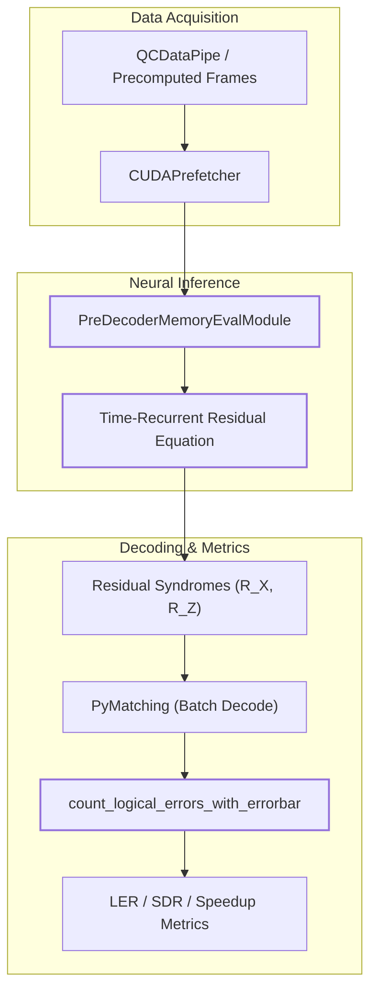
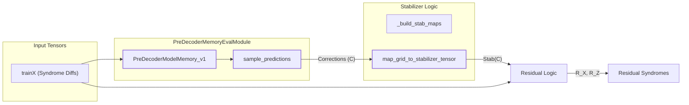

<!-- source: DeepWiki mcp.deepwiki.com · repo NVIDIA/Ising-Decoding · page 5.1 Logical Error Rate Evaluation · fetched 2026-10-26 -->

# Logical Error Rate Evaluation

Relevant source files

The following files were used as context for generating this wiki page:

- [code/data/precompute_frames.py](code/data/precompute_frames.py)
- [code/evaluation/__init__.py](code/evaluation/__init__.py)
- [code/evaluation/inference.py](code/evaluation/inference.py)
- [code/evaluation/logical_error_rate.py](code/evaluation/logical_error_rate.py)
- [code/evaluation/threshold_plot.py](code/evaluation/threshold_plot.py)
- [code/tests/test_inference_latency_timing.py](code/tests/test_inference_latency_timing.py)
- [code/tests/test_inference_public_model.py](code/tests/test_inference_public_model.py)
- [code/tests/test_logical_error_rate_helpers.py](code/tests/test_logical_error_rate_helpers.py)
- [code/tests/test_onnx_quant_workflow.py](code/tests/test_onnx_quant_workflow.py)
- [code/tests/test_oracle_predecoder.py](code/tests/test_oracle_predecoder.py)

This page describes the evaluation pipeline used to measure the performance of the pre-decoder model. The primary goal of this stage is to compute the **Logical Error Rate (LER)** and the **Syndrome Density Reduction (SDR)** by comparing the neural network's residual predictions against a baseline decoder (PyMatching).

The evaluation is orchestrated by the `run_inference_and_decode_pre_decoder_memory` pipeline, which utilizes a time-recurrent residual equation to process syndrome data across multiple QEC rounds.

### Pipeline Overview

The evaluation flow transforms raw detector measurements into residual syndromes, which are then passed to a Minimum Weight Perfect Matching (MWPM) decoder.

**Sources:** [code/evaluation/logical_error_rate.py:20-48](), [code/evaluation/inference.py:63-131]()

---

### Key Components

#### 1. PreDecoderMemoryEvalModule
This module wraps the core 3D CNN model for inference. It handles the conversion of model logits into binary predictions using either a fixed threshold or temperature-based sampling [code/evaluation/logical_error_rate.py:741-755](). It is designed to be compatible with `torch.compile` and ONNX export workflows [code/evaluation/logical_error_rate.py:28-30]().

#### 2. Time-Recurrent Residual Equation
The system computes "residual syndromes" ($R$) which represent the errors remaining after the pre-decoder's corrections are applied. This follows a specific parity logic across time steps ($T$):

*   **Initial Step ($t=0$):** $R_0 = (S_0 \oplus P_0 \oplus \text{Stab}(C_0))$
*   **Subsequent Steps ($t > 0$):** $R_t = (S_t \oplus P_t \oplus P_{t-1} \oplus \text{Stab}(C_t))$

Where $S$ is the syndrome difference, $P$ is the predicted syndrome error, and $\text{Stab}(C)$ is the syndrome change induced by predicted data qubit corrections [code/tests/test_oracle_predecoder.py:158-166]().

#### 3. Stabilizer Maps (`_build_stab_maps`)
To compute the residual equation efficiently on GPUs, the system builds static mapping tensors. These maps link data qubit indices to their corresponding stabilizers ($H_X$ and $H_Z$ matrices) [code/tests/test_oracle_predecoder.py:45-90]().
*   `Hx_idx` / `Hz_idx`: Indices of data qubits for each stabilizer.
*   `Hx_mask` / `Hz_mask`: Boolean masks to handle stabilizers with varying weights (degrees) [code/tests/test_oracle_predecoder.py:72-73]().

#### 4. CUDAPrefetcher
To maximize GPU utilization during inference, the `CUDAPrefetcher` performs asynchronous data transfers. It moves batches from CPU host memory to the GPU device while the model is processing the previous batch, effectively hiding the latency of the `DataLoader` [code/evaluation/logical_error_rate.py:32-33]().

---

### Implementation Detail: Residual Computation

The following diagram illustrates how the `PreDecoderMemoryEvalModule` interacts with the stabilizer maps to produce the inputs for the final decoder.

**Sources:** [code/evaluation/logical_error_rate.py:840-870](), [code/tests/test_oracle_predecoder.py:128-153]()

---

### Metrics and Evaluation

The evaluation process yields several critical performance indicators:

| Metric | Description | Code Entity |
| :--- | :--- | :--- |
| **LER** | Logical Error Rate (Mean + Standard Error) | `count_logical_errors_with_errorbar` |
| **SDR** | Syndrome Density Reduction (Percentage of syndromes removed) | `compute_syndrome_density` |
| **MWPM Speedup** | Ratio of baseline PyMatching latency to residual latency | `_time_single_shot_latency_stim` |
| **Agreement** | Percentage of shots where model and baseline agree | `logical_error_rate.py` |

#### Batch Decoding with PyMatching
The residual syndromes are decoded in parallel using `matcher.decode_batch`. To ensure valid comparison, the system interleaves $X$ and $Z$ residuals in a round-major order [code/tests/test_logical_error_rate_helpers.py:57-64]().

#### Latency Measurement
Latency is measured in $\mu s$ per round. The `_time_single_shot_latency_stim` function performs a set number of warmup iterations before timing the baseline and pre-decoded syndrome sets to calculate the speedup factor [code/tests/test_inference_latency_timing.py:52-58]().

**Sources:** [code/evaluation/logical_error_rate.py:70-71](), [code/evaluation/inference.py:48-60](), [code/evaluation/logical_error_rate.py:35-39]()

---

### Usage in Tests
The LER evaluation is validated through several test suites:
*   **Oracle Test:** Uses ground-truth labels as "perfect" predictions to verify that the residual syndrome calculation results in zero errors [code/tests/test_oracle_predecoder.py:5-10]().
*   **Public Model Test:** Validates that pre-trained models (e.g., $d=9, d=13$) achieve LER within expected tolerances compared to the MWPM baseline [code/tests/test_inference_public_model.py:107-118]().
*   **Latency Test:** Ensures the timing logic correctly scales with the number of QEC rounds [code/tests/test_inference_latency_timing.py:37-40]().

**Sources:** [code/tests/test_oracle_predecoder.py](), [code/tests/test_inference_public_model.py](), [code/tests/test_inference_latency_timing.py]()

---

