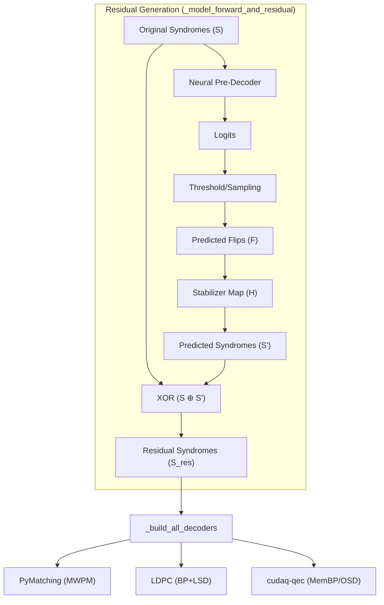
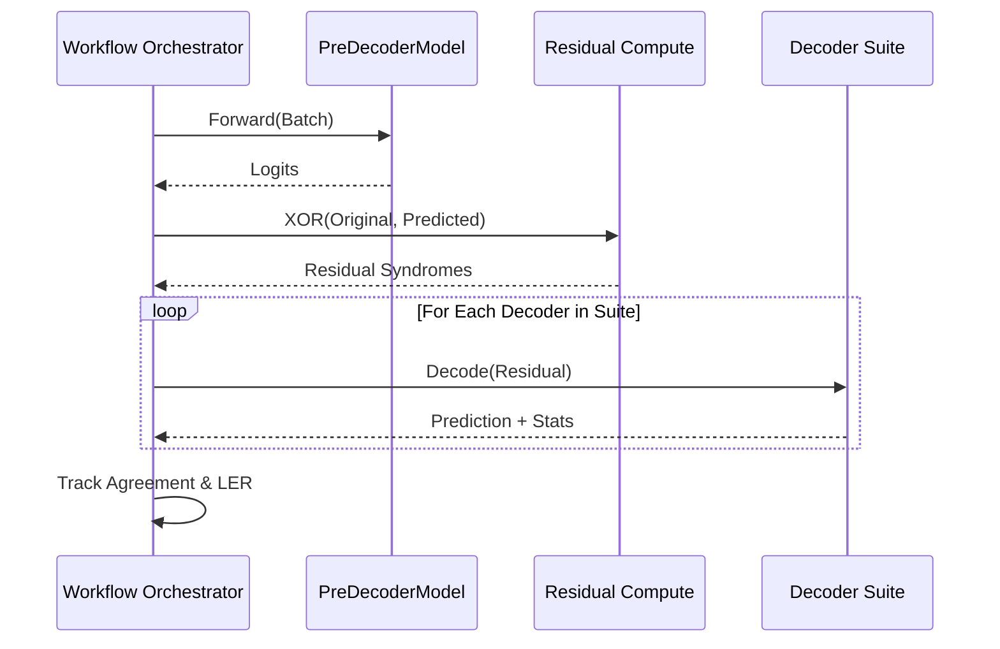

<!-- source: DeepWiki mcp.deepwiki.com · repo NVIDIA/Ising-Decoding · page 5.2 Decoder Ablation Study · fetched 2026-10-26 -->

# Decoder Ablation Study

Relevant source files

The following files were used as context for generating this wiki page:

- [code/evaluation/failure_analysis.py](code/evaluation/failure_analysis.py)
- [code/qec/dem_sampling.py](code/qec/dem_sampling.py)
- [code/scripts/local_run.sh](code/scripts/local_run.sh)
- [code/tests/test_dem_sampling.py](code/tests/test_dem_sampling.py)
- [code/tests/test_failure_analysis.py](code/tests/test_failure_analysis.py)

The `decoder_ablation_study` workflow is a specialized evaluation pipeline designed to compare the performance of multiple global decoders when applied to the same "residual syndromes" produced by a neural pre-decoder. This study allows for a direct comparison between standard algorithms (MWPM, Union-Find), advanced LDPC decoders (BP, BP+LSD), and GPU-accelerated solvers from the `cudaq-qec` library.

## Overview and Data Flow

The ablation study operates by taking a trained `PreDecoderModelMemory_v1` and using it to reduce the syndrome density of incoming noise. The remaining "residual" syndromes—those not flipped by the model's predictions—are then passed to a suite of global decoders to determine the final logical error rate (LER).

### Residual Syndrome Pipeline
The core logic resides in `_model_forward_and_residual` [[code/evaluation/failure_analysis.py:455-494]](). This function:
1.  Executes a forward pass of the neural model on a batch of syndromes.
2.  Applies a threshold (or sampling) to the model's logit outputs to generate discrete predictions.
3.  Computes the **residual syndrome** by XORing the original syndrome with the syndrome produced by the model's predicted data qubit flips.

Sources: [[code/evaluation/failure_analysis.py:455-494]](), [[code/evaluation/failure_analysis.py:326-361]]()

## Decoder Factory and Comparison

The workflow instantiates a diverse set of decoders via `_build_all_decoders` [[code/evaluation/failure_analysis.py:326-361]](). This factory creates a unified interface for three distinct decoder families:

### 1. PyMatching (MWPM)
Standard Minimum Weight Perfect Matching is used in two modes:
*   **Uncorrelated**: Standard MWPM.
*   **Correlated**: Uses a `Matching` object built from a Detector Error Model (DEM) that accounts for correlated error mechanisms [[code/evaluation/failure_analysis.py:339-340]]().

### 2. LDPC Decoders
The `_build_ldpc_decoders` function [[code/evaluation/failure_analysis.py:199-234]]() leverages the `ldpc` and `beliefmatching` libraries to construct:
*   **Union-Find**: A fast, sub-optimal clustering decoder.
*   **BP-only**: Belief Propagation (Sum-Product).
*   **BP+LSD-0**: Belief Propagation followed by Local Small-Distance (LSD) post-processing [[code/evaluation/failure_analysis.py:37]]().

### 3. CUDA-Q QEC Decoders
If `cudaq-qec` is available, the study includes high-performance GPU decoders via `_build_cudaq_decoders` [[code/evaluation/failure_analysis.py:43-178]](). This includes:
*   **cudaq-BP / cudaq-MinSum**: Standard and Min-Sum BP variants.
*   **cudaq-MemBP**: Min-Sum with memory effects (gamma0=0.5) for improved convergence [[code/evaluation/failure_analysis.py:118-129]]().
*   **cudaq-RelayBP**: Sequential relay BP optimized for surface codes [[code/evaluation/failure_analysis.py:151-172]]().
*   **OSD Variants**: BP combined with Ordered Statistics Decoding (OSD) at order 0 and 7 [[code/evaluation/failure_analysis.py:98-110]]().

| Decoder Category | Implementations | Convergence Metric |
| :--- | :--- | :--- |
| **Classical** | PyMatching (MWPM) | N/A |
| **LDPC (CPU)** | Union-Find, BP, BP+LSD | `converged` flag |
| **CUDA-Q (GPU)** | BP, MinSum, MemBP, RelayBP, OSD | `num_iter`, `converged` |

Sources: [[code/evaluation/failure_analysis.py:43-178]](), [[code/evaluation/failure_analysis.py:199-234]](), [[code/evaluation/failure_analysis.py:326-361]]()

## Execution and Metrics Tracking

The main execution loop in `decoder_ablation_study` [[code/evaluation/failure_analysis.py:497-695]]() iterates through the dataset and tracks several key metrics:

### Agreement and Convergence
For each batch, the system tracks whether different decoders agree on the logical observable prediction. This is critical for identifying "hard" syndromes where BP-based decoders fail to converge or diverge from MWPM [[code/evaluation/failure_analysis.py:610-630]]().

### Conditional LER by Residual Weight
The study categorizes results based on the Hamming weight of the residual syndrome. This allows researchers to see if the neural pre-decoder's failures (leaving behind high-weight residuals) correlate with global decoder failures [[code/evaluation/failure_analysis.py:633-652]]().

### Performance Statistics
The workflow logs:
*   **SDR (Syndrome Density Reduction)**: The ratio of original syndrome weight to residual syndrome weight [[code/evaluation/failure_analysis.py:596]]().
*   **Iteration Counts**: For `cudaq-qec` decoders, the number of iterations required to reach convergence is recorded [[code/evaluation/failure_analysis.py:191]]().
*   **Logical Errors**: Per-decoder LER with error bars [[code/evaluation/failure_analysis.py:672-680]]().

Sources: [[code/evaluation/failure_analysis.py:497-695]](), [[code/evaluation/failure_analysis.py:181-197]]()

## Implementation Details

### Stabilizer Maps
To compute the residual syndrome, the predictions on the data-qubit grid must be mapped back to the stabilizer (detector) space. This is handled by `_build_stab_maps` [[code/evaluation/logical_error_rate.py:126-174]](), which uses the `SurfaceCode` lattice geometry to identify which detectors are triggered by specific data qubit flips.

### Integration with CUDA-Q
The `_decode_cudaq_batch` function [[code/evaluation/failure_analysis.py:181-197]]() manages the data transfer between PyTorch/NumPy and the `cudaq_qec` C++ backend. It ensures syndromes are C-contiguous and handles the unpacking of the `opt_results` dictionary to extract convergence flags and iteration counts [[code/evaluation/failure_analysis.py:190-195]]().

Sources: [[code/evaluation/failure_analysis.py:181-197]](), [[code/evaluation/logical_error_rate.py:126-174]]()

---

