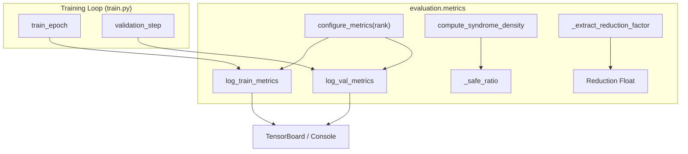
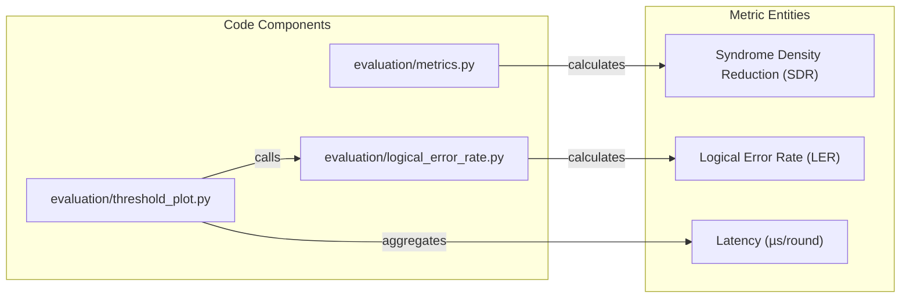

<!-- source: DeepWiki mcp.deepwiki.com · repo NVIDIA/Ising-Decoding · page 5.3 Evaluation Metrics · fetched 2026-10-26 -->

# Evaluation Metrics

Relevant source files

The following files were used as context for generating this wiki page:

- [.github/workflows/long-running-tests.yml](.github/workflows/long-running-tests.yml)
- [code/data/precompute_frames.py](code/data/precompute_frames.py)
- [code/evaluation/__init__.py](code/evaluation/__init__.py)
- [code/evaluation/threshold_plot.py](code/evaluation/threshold_plot.py)
- [code/tests/test_metrics_extras.py](code/tests/test_metrics_extras.py)
- [code/tests/test_metrics_safe_ratio.py](code/tests/test_metrics_safe_ratio.py)

The `evaluation.metrics` module provides the core logic for quantifying the performance of the Ising-Decoding pre-decoder. It focuses on two primary categories of measurement: **Logical Error Rate (LER)**, which measures the final decoding success, and **Syndrome Density Reduction (SDR)**, which measures the pre-decoder's efficiency in simplifying the syndrome graph for the second-tier decoder.

### Overview of Key Metrics

| Metric | TensorBoard Key | Description |
| :--- | :--- | :--- |
| **LER** | `Metrics/LER` | The probability that the combined pre-decoder + MWPM (PyMatching) system fails to correct an error. [code/evaluation/__init__.py:19-20]() |
| **SDR** | `Metrics/SDR` | The ratio of input syndrome bits to residual syndrome bits. High SDR indicates a cleaner graph for the backend decoder. [code/evaluation/__init__.py:19-20]() |
| **Loss** | `Loss/train_step` | The binary cross-entropy loss of the model's predictions against the true error locations. |

---

## Core Implementation

The metrics system is designed to be rank-aware for distributed training and provides utilities for extracting reduction factors from complex nested results.

### Metric Configuration and Data Flow

The `configure_metrics` function initializes the reporting environment. It returns two callables: one for logging step-wise training metrics and another for epoch-level validation.

**Sources:** [code/evaluation/metrics.py:26-34](), [code/evaluation/metrics.py:79-84]()

### Syndrome Density Computation
The `compute_syndrome_density` function calculates the sparsity of the syndrome before and after the pre-decoder. It uses `_safe_ratio` to handle edge cases where no syndromes are present (e.g., in low-noise regimes), ensuring that a 0/0 condition returns a ratio of 1.0 rather than an error. [code/tests/test_metrics_safe_ratio.py:24-40]()

#### The `sdr_as_percent` Guard
A critical interface contract exists for `compute_syndrome_density`: it must **not** accept the `sdr_as_percent` keyword argument. This flag is reserved for display logic in the training loop to toggle between percentage and multiplier formats. Passing this flag to the metrics module causes a `TypeError`. [code/tests/test_metrics_extras.py:72-85]()

---

## Metric Extraction and Surfacing

### Reduction Factor Extraction
The `_extract_reduction_factor` utility is used to parse results from the Stim-based evaluation pipeline. It can handle various return formats, including floats, integers, and nested dictionaries containing X and Z basis factors.

| Input Type | Logic | Example Output |
| :--- | :--- | :--- |
| `float` / `int` | Returns value as float | `2.0` |
| `dict` (X and Z) | Returns mean of X and Z factors | `3.0` (if X=2, Z=4) |
| `dict` (Single) | Returns the available factor | `2.0` |

**Sources:** [code/evaluation/metrics.py:43-68](), [code/tests/test_metrics_extras.py:41-68]()

### Threshold Plotting
The `threshold_plot.py` utility generates visualizations of LER vs. Physical Error Rate ($p$). It iterates through a range of $p$ values, running inference at each point to demonstrate the "threshold" where the logical error rate begins to drop exponentially.

*   **Function:** `compute_ler_for_p_range` [code/evaluation/threshold_plot.py:43-60]()
*   **Comparison:** It captures both `ler` (after pre-decoder) and `pymatch_ler` (baseline MWPM) to calculate the improvement. [code/evaluation/threshold_plot.py:120-149]()
*   **Latency Tracking:** The utility also surfaces `pymatch latency (baseline)` vs `pymatch latency (after predecoder)` to quantify the speedup provided by the reduced syndrome density. [code/evaluation/threshold_plot.py:160-170]()

---

## Integration with Workflows

Metrics are surfaced differently depending on the active workflow:

1.  **Training Workflow:** Focuses on `Loss/train_step` and `Metrics/SDR` to monitor model convergence.
2.  **Inference Workflow:** Focuses on `LER` and `SDR` across different code distances and orientations (O1–O4). [code/.github/workflows/long-running-tests.yml:135-141]()
3.  **Ablation Workflow:** Compares the metrics across different backend decoders (e.g., PyMatching vs. LDPC-BP).

### System Entity Mapping

**Sources:** [code/evaluation/__init__.py:15-24](), [code/evaluation/threshold_plot.py:34-41](), [code/evaluation/metrics.py:26-27]()

### Regression Testing
The metrics module is protected by high-shot statistical tests in the CI pipeline. The `statistical-noise-model` job runs $\ge 100k$ shots to ensure that LER measurements are statistically significant and that the noise model parameters are correctly mapped to the evaluation metrics. [code/.github/workflows/long-running-tests.yml:78-84]()

---

