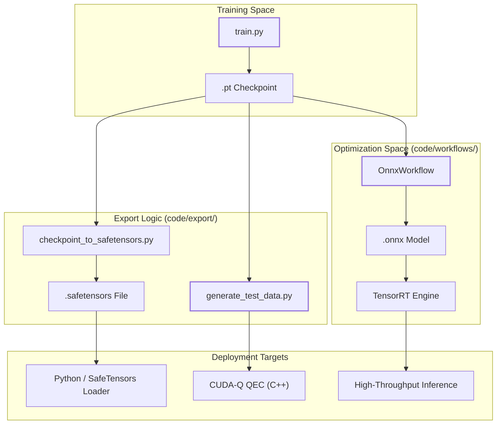
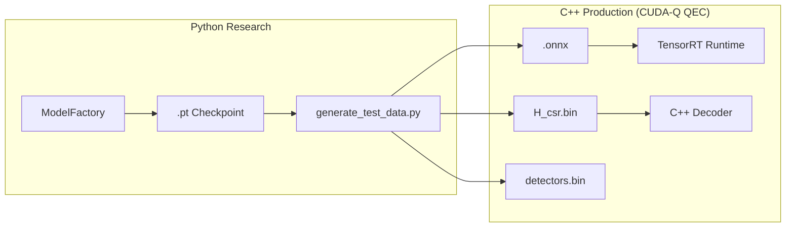

<!-- source: DeepWiki mcp.deepwiki.com · repo NVIDIA/Ising-Decoding · page 6 Model Export and Deployment · fetched 2026-10-26 -->

# Model Export and Deployment

Relevant source files

The following files were used as context for generating this wiki page:

- [README.md](README.md)
- [code/export/__init__.py](code/export/__init__.py)
- [code/export/safetensors_utils.py](code/export/safetensors_utils.py)

This page provides an overview of the pipeline for transitioning trained PyTorch models into production-ready formats. The Ising-Decoding project supports multiple export paths depending on the target latency and integration requirements, ranging from high-performance TensorRT engines to C++ compatible artifacts for real-time quantum error correction (QEC).

## Export Pipeline Overview

The export process typically begins after a model has been trained and validated using the standard PyTorch workflow [README.md:124-129](). The pipeline supports three primary deployment targets:
1.  **Python Inference**: Loading `.pt` or `.safetensors` files directly into the PyTorch runtime [README.md:150-168]().
2.  **TensorRT/ONNX**: High-performance execution with support for INT8/FP8 quantization [README.md:214-219]().
3.  **CUDA-Q QEC**: A real-time C++ pipeline requiring specific binary artifacts (`.bin`) and ONNX models [README.md:221-232]().

### Deployment Flow Architecture

The following diagram illustrates how code entities and scripts transform a trained model into various deployment artifacts.

**Model Export Entity Map**

Sources: [README.md:48-77](), [code/export/safetensors_utils.py:53-87](), [README.md:214-232]()

## ONNX and TensorRT Export

The project utilizes a state-machine based workflow, `OnnxWorkflow`, to manage the complexities of exporting to ONNX and optimizing for TensorRT. This workflow is triggered by setting the `ONNX_WORKFLOW` environment variable (values 0–3) [README.md:214-219]().

Key features include:
*   **Quantization**: Support for INT8 and FP8 post-training quantization (PTQ) using `nvidia-modelopt` or `onnxruntime` fallbacks.
*   **Calibration**: The system includes a mechanism to collect calibration data via `_collect_calibration_dets` to ensure accuracy after quantization.
*   **Engine Building**: Automatic generation of TensorRT engines with optimization profiles tailored to the model's receptive field.

For details on the quantization levels and engine building process, see [ONNX and TensorRT Export](#6.1).

Sources: [README.md:214-219](), [README.md:63-66]()

## SafeTensors and CUDA-Q QEC Integration

For integration with the CUDA-Q QEC real-time pipeline, models must be converted to formats that are easily consumable by C++ and hardware-accelerated environments.

### SafeTensors Conversion
The `checkpoint_to_safetensors.py` script [README.md:211-212]() converts standard PyTorch `.pt` files into the `SafeTensors` format. This format is preferred for production because it is header-only, provides fast zero-copy loading, and avoids the security risks associated with Python's `pickle` [code/export/safetensors_utils.py:15-19]().

### Real-Time Artifact Generation
The `generate_test_data.py` script [README.md:223-224]() is the primary utility for bridging the gap between Python-based research and C++ deployment. It produces a suite of artifacts required by the CUDA-Q QEC C++ application:
*   **Model**: An `.onnx` representation of the pre-decoder.
*   **Parity Matrix**: `H_csr.bin` (Compressed Sparse Row format).
*   **Metadata**: `detectors.bin` and `priors.bin` for the backend decoder.

**C++ Deployment Bridge**

Sources: [code/export/safetensors_utils.py:121-123](), [README.md:221-232]()

For details on generating these artifacts and using the SafeTensors utilities, see [SafeTensors Export and CUDA-Q QEC Integration](#6.2).

Sources: [README.md:211-232](), [code/export/safetensors_utils.py:89-130]()

---

