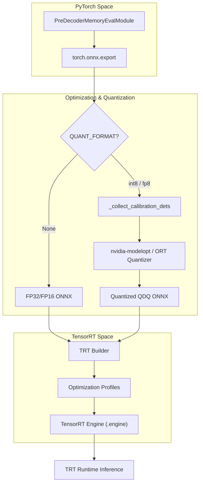
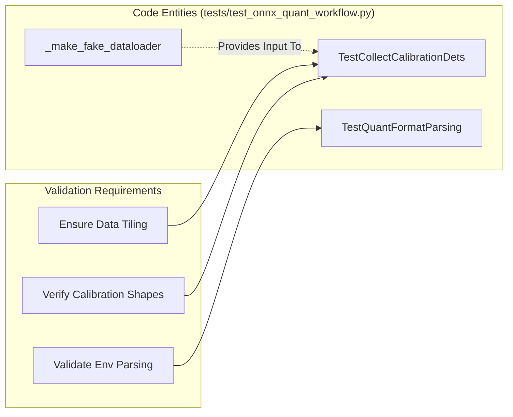

<!-- source: DeepWiki mcp.deepwiki.com · repo NVIDIA/Ising-Decoding · page 6.1 ONNX and TensorRT Export · fetched 2026-10-26 -->

# ONNX and TensorRT Export

Relevant source files

The following files were used as context for generating this wiki page:

- [.dockerignore](.dockerignore)
- [code/evaluation/failure_analysis.py](code/evaluation/failure_analysis.py)
- [code/evaluation/logical_error_rate.py](code/evaluation/logical_error_rate.py)
- [code/scripts/cluster_train.sh](code/scripts/cluster_train.sh)
- [code/scripts/local_run.sh](code/scripts/local_run.sh)
- [code/tests/test_failure_analysis.py](code/tests/test_failure_analysis.py)
- [code/tests/test_onnx_quant_workflow.py](code/tests/test_onnx_quant_workflow.py)
- [conf/config_qec_decoder_r13_fp8.yaml](conf/config_qec_decoder_r13_fp8.yaml)
- [conf/config_qec_decoder_r9_fp8.yaml](conf/config_qec_decoder_r9_fp8.yaml)

The Ising-Decoding pipeline provides a robust export path for transitioning PyTorch-trained models into high-performance inference engines. This is managed through the `OnnxWorkflow` state machine, which handles ONNX export, post-training quantization (INT8/FP8), and TensorRT engine building with optimization profiles.

## Overview of the Export Workflow

The export process is governed by the `ONNX_WORKFLOW` environment variable, which transitions the `PreDecoderMemoryEvalModule` through four distinct states [code/evaluation/logical_error_rate.py:23-26]().

| State | Enum Value | Description |
| :--- | :--- | :--- |
| `TORCH_ONLY` | 0 | Standard PyTorch inference. `torch.compile` is enabled by default [code/evaluation/logical_error_rate.py:77](). |
| `EXPORT_ONNX_ONLY` | 1 | Exports the model to ONNX format and terminates or continues to evaluation [code/evaluation/logical_error_rate.py:78](). |
| `EXPORT_AND_USE_TRT` | 2 | Exports ONNX, applies quantization (if requested), builds a TensorRT engine, and runs inference [code/evaluation/logical_error_rate.py:79](). |
| `USE_ENGINE_ONLY` | 3 | Skips export/build and loads an existing `.engine` file from the output directory [code/evaluation/logical_error_rate.py:80](). |

### Export Control Logic
The `OnnxWorkflow` class in `code/evaluation/logical_error_rate.py` defines these states [code/evaluation/logical_error_rate.py:74-81](). Users trigger these workflows via the `local_run.sh` script by setting `ONNX_WORKFLOW` before execution [code/scripts/local_run.sh:27-32]().

**Sources:** [code/evaluation/logical_error_rate.py:23-26](), [code/evaluation/logical_error_rate.py:74-81](), [code/scripts/local_run.sh:27-32]().

---

## Data Flow: From PyTorch to TensorRT

The following diagram illustrates the transformation of the `PreDecoderMemoryEvalModule` into a deployment-ready TensorRT engine.

### Pipeline Architecture

**Sources:** [code/evaluation/logical_error_rate.py:132-178](), [code/evaluation/logical_error_rate.py:181-200](), [code/scripts/local_run.sh:30-31]().

---

## Quantization and Calibration

The framework supports both INT8 and FP8 post-training quantization to reduce inference latency.

### Calibration Data Collection
To maintain accuracy during quantization, the system collects representative detector inputs using `_collect_calibration_dets` [code/evaluation/logical_error_rate.py:132-137]().
- **Functionality:** It iterates through the `test_dataloader`, strips observable columns from the `dets_and_obs` tensor, and aggregates a contiguous `uint8` array of detector samples [code/evaluation/logical_error_rate.py:157-178]().
- **Validation:** It ensures the detector width matches the expected configuration and tiles data if the dataloader is shorter than the requested `target_samples` [code/evaluation/logical_error_rate.py:160-177]().

### Quantization Backends
The system attempts to use `nvidia-modelopt` for high-performance quantization. If unavailable (e.g., in Python 3.13+ environments), it falls back to `onnxruntime.quantization` via `_ort_quantize_int8` [code/evaluation/logical_error_rate.py:181-200]().

| Format | Env Variable | Requirement |
| :--- | :--- | :--- |
| **INT8** | `QUANT_FORMAT=int8` | Static quantization of Conv/Gemm nodes [code/evaluation/logical_error_rate.py:181-186](). |
| **FP8** | `QUANT_FORMAT=fp8` | Requires `nvidia-modelopt` and Blackwell+ GPU [code/scripts/local_run.sh:31](). |

**Sources:** [code/evaluation/logical_error_rate.py:132-178](), [code/evaluation/logical_error_rate.py:181-200](), [code/tests/test_onnx_quant_workflow.py:108-178]().

---

## TensorRT Engine Building

When `ONNX_WORKFLOW=2` is active, the system invokes the TensorRT builder.

### Key Implementation Details
1. **Optimization Profiles:** The builder creates profiles for the input shapes used by the pre-decoder.
2. **Precision Selection:** Based on the `QUANT_FORMAT` and `enable_fp16` settings, the builder configures the network to use specific tactics.
3. **Engine Persistence:** Built engines are saved to the experiment's model directory to allow subsequent runs using `ONNX_WORKFLOW=3` [code/evaluation/logical_error_rate.py:25]().

### Integration with Decoder Ablation
The export pipeline is frequently used in conjunction with the `decoder_ablation` workflow to create a "Full GPU Pipeline" [code/scripts/local_run.sh:37-41](). In this mode:
- The **Neural Pre-Decoder** runs on TensorRT for maximum throughput.
- The **Residual Syndrome Decoders** (e.g., `cudaq-qec`) run on the GPU via `nv-qldpc-decoder` [code/evaluation/failure_analysis.py:43-56]().

**Sources:** [code/evaluation/logical_error_rate.py:21-26](), [code/scripts/local_run.sh:37-41](), [code/evaluation/failure_analysis.py:43-56]().

---

## Validation Suite

The `test_onnx_quant_workflow.py` suite validates the integrity of the export and quantization logic without requiring a physical GPU for basic parsing and collection tests.

### System-to-Code Association
The following diagram maps high-level validation requirements to specific test entities in the codebase.

### Key Tests
- `test_basic_shape_and_dtype`: Confirms `_collect_calibration_dets` returns the correct `uint8` dimensions [code/tests/test_onnx_quant_workflow.py:53-61]().
- `test_tiles_when_dataloader_too_short`: Validates the robustness of calibration when data is scarce [code/tests/test_onnx_quant_workflow.py:63-71]().
- `test_mq_quantize_called_with_correct_args_fp8`: A regression test ensuring FP8 calibration data preserves `uint8` precision instead of being incorrectly cast to `float32` [code/tests/test_onnx_quant_workflow.py:172-178]().

**Sources:** [code/tests/test_onnx_quant_workflow.py:48-106](), [code/tests/test_onnx_quant_workflow.py:108-178]().

---

