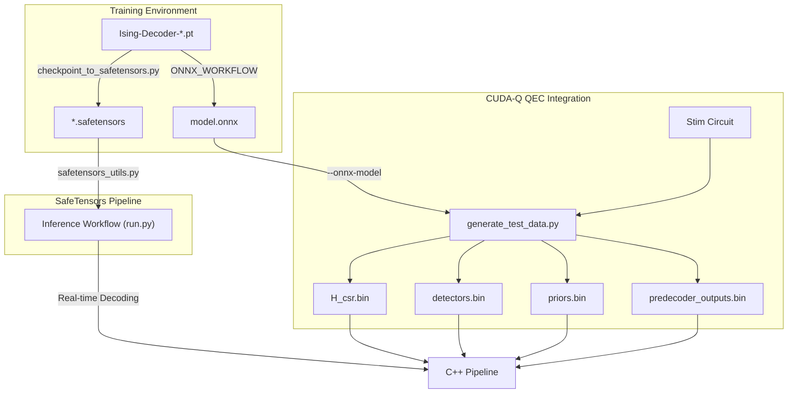
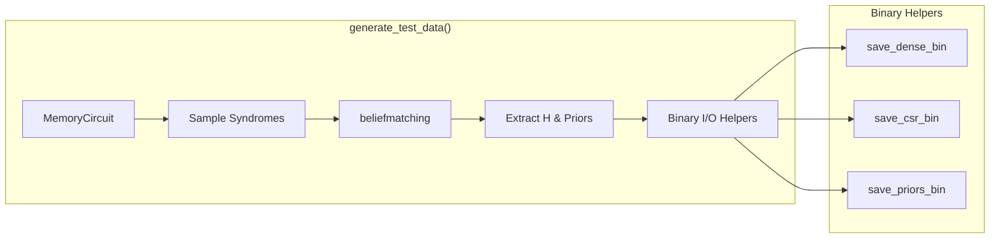

<!-- source: DeepWiki mcp.deepwiki.com · repo NVIDIA/Ising-Decoding · page 6.2 SafeTensors Export and CUDA-Q QEC Integration · fetched 2026-10-26 -->

# SafeTensors Export and CUDA-Q QEC Integration

<details>
<summary>Relevant source files</summary>

The following files were used as context for generating this wiki page:

- [code/export/__init__.py](code/export/__init__.py)
- [code/export/checkpoint_to_safetensors.py](code/export/checkpoint_to_safetensors.py)
- [code/export/generate_test_data.py](code/export/generate_test_data.py)
- [code/export/safetensors_utils.py](code/export/safetensors_utils.py)
- [code/scripts/check_python_compat.sh](code/scripts/check_python_compat.sh)
- [code/tests/test_safetensors_export.py](code/tests/test_safetensors_export.py)
- [code/tests/test_tensorrt_fallback.py](code/tests/test_tensorrt_fallback.py)
- [models/Ising-Decoder-SurfaceCode-1-Accurate.pt](models/Ising-Decoder-SurfaceCode-1-Accurate.pt)
- [models/Ising-Decoder-SurfaceCode-1-Fast.pt](models/Ising-Decoder-SurfaceCode-1-Fast.pt)

</details>


This page details the utilities for converting PyTorch checkpoints to the SafeTensors format and generating the necessary binary artifacts for integration with the **CUDA-Q QEC** C++ real-time pipeline. These tools bridge the gap between the Python-based training environment and high-performance deployment targets.

## Overview of Export Utilities

The export subsystem provides two primary paths for model deployment:
1.  **SafeTensors Conversion**: Migration of standard `.pt` checkpoints to `.safetensors` for faster, safer loading and improved metadata handling.
2.  **CUDA-Q QEC Artifact Generation**: Production of binary parity-check matrices, detector error models, and ONNX models for use in the C++ real-time decoding pipeline.

### Data Flow: Checkpoint to Production

The following diagram illustrates the transformation of a trained model into deployment-ready formats.

**Model Export and Artifact Generation Flow**

**Sources:** [code/export/checkpoint_to_safetensors.py:15-30](), [code/export/generate_test_data.py:16-22](), [code/export/safetensors_utils.py:15-19]()

---

## SafeTensors Conversion

The `checkpoint_to_safetensors.py` script is the primary tool for post-processing `.pt` checkpoints. It handles various state dict formats (including DDP-wrapped models) and embeds critical model architecture metadata directly into the SafeTensors header.

### Key Functions and Classes

| Entity | Location | Description |
| :--- | :--- | :--- |
| `_load_checkpoint_state_dict` | [code/export/checkpoint_to_safetensors.py:43-71]() | Normalizes `.pt` files, stripping `module.` prefixes and extracting the state dict from nested keys. |
| `save_safetensors` | [code/export/safetensors_utils.py:53-88]() | Writes tensors and architecture metadata (filters, kernel sizes, model ID) to disk. |
| `load_safetensors` | [code/export/safetensors_utils.py:90-130]() | Reconstructs a model via `ModelFactory` using metadata stored within the SafeTensors file. |
| `_build_minimal_cfg` | [code/export/safetensors_utils.py:37-51]() | Generates a lightweight configuration to instantiate the model without a full Hydra environment. |

### Integration with run.py
The workflow orchestrator `run.py` checks for the `PREDECODER_SAFETENSORS_CHECKPOINT` environment variable. If set, it bypasses standard checkpoint discovery and uses `load_safetensors` to initialize the model [code/tests/test_safetensors_export.py:148-150]().

**Sources:** [code/export/checkpoint_to_safetensors.py:74-145](), [code/export/safetensors_utils.py:1-131](), [code/tests/test_safetensors_export.py:35-116]()

---

## CUDA-Q QEC Artifact Generation

The `generate_test_data.py` script produces a suite of binary files required by the CUDA-Q QEC C++ pipeline. It uses `Stim` to generate circuits and `beliefmatching` to extract the Detector Error Model (DEM).

### Binary Artifact Specifications
All files are written in little-endian format with specific headers [code/export/generate_test_data.py:26-63]().

| Artifact | File Name | Header | Body Content |
| :--- | :--- | :--- | :--- |
| **Parity Check** | `H_csr.bin` | `rows, cols, nnz` (u32) | Binary CSR: indptr and indices (int32). |
| **Detectors** | `detectors.bin` | `samples, dets` (u32) | Row-major syndrome bits (int32). |
| **Priors** | `priors.bin` | `n` (u32) | Edge error probabilities (float64). |
| **Pre-decoder** | `predecoder_outputs.bin` | `samples, 1+dets` (u32) | Model output: column 0 is `pre_L`, rest are residual detectors. |

### Implementation Logic
The script bypasses heavy PyTorch imports where possible by manually constructing the `qec.surface_code` package structure to access `MemoryCircuit` without triggering data-mapping dependencies [code/export/generate_test_data.py:87-95]().

**Logic Flow in generate_test_data.py**

**Sources:** [code/export/generate_test_data.py:136-172](), [code/export/generate_test_data.py:178-220]()

---

## Pre-trained Models and Git LFS

The repository includes pre-trained checkpoints for the Ising-Decoder architecture, managed via Git LFS. These serve as the baseline for export and integration tasks.

| File Path | Description |
| :--- | :--- |
| `models/Ising-Decoder-SurfaceCode-1-Fast.pt` | Small, low-latency model (ID 1) optimized for speed [models/Ising-Decoder-SurfaceCode-1-Fast.pt:1-4](). |
| `models/Ising-Decoder-SurfaceCode-1-Accurate.pt` | Larger model (ID 1 variant) optimized for maximum SDR [models/Ising-Decoder-SurfaceCode-1-Accurate.pt:1-4](). |

These models can be converted to SafeTensors using:
```bash
PYTHONPATH=code python code/export/checkpoint_to_safetensors.py \
    --checkpoint models/Ising-Decoder-SurfaceCode-1-Fast.pt \
    --model-id 1 --fp16
```
[code/export/checkpoint_to_safetensors.py:21-25]()

---

## Technical Validation

The export system is validated through a dedicated test suite in `code/tests/test_safetensors_export.py`. This ensures:
*   **Bit-Exact Round-trips**: Verifying that `save_safetensors` and `load_safetensors` do not alter weights for both `fp32` and `fp16` [code/tests/test_safetensors_export.py:53-80]().
*   **Metadata Integrity**: Ensuring the `model_id` and `quant_format` are correctly recovered from the file header [code/tests/test_safetensors_export.py:82-93]().
*   **Workflow Integration**: Mocking the `run.py` environment to verify that setting the `PREDECODER_SAFETENSORS_CHECKPOINT` environment variable correctly triggers the SafeTensors loading path [code/tests/test_safetensors_export.py:152-175]().

**Sources:** [code/tests/test_safetensors_export.py:35-180](), [code/scripts/check_python_compat.sh:121-125]()

---

