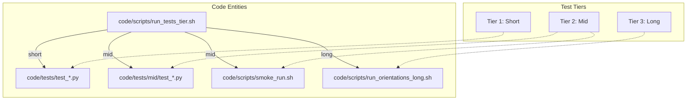
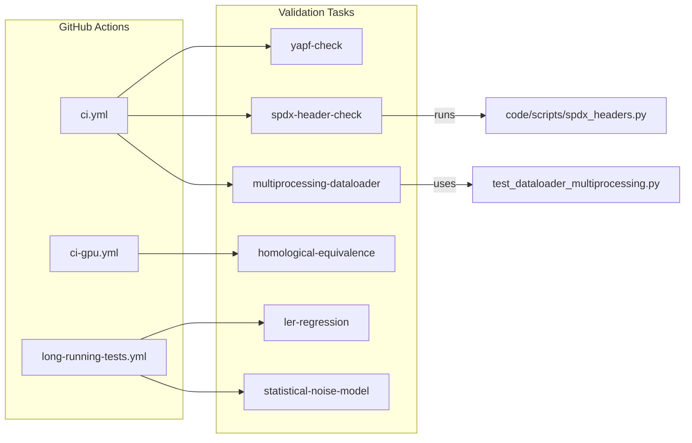

<!-- source: DeepWiki mcp.deepwiki.com · repo NVIDIA/Ising-Decoding · page 7 Testing and CI · fetched 2026-10-26 -->

# Testing and CI

Relevant source files

The following files were used as context for generating this wiki page:

- [.github/workflows/ci.yml](.github/workflows/ci.yml)
- [code/scripts/run_tests_tier.sh](code/scripts/run_tests_tier.sh)
- [code/tests/README_TEST_TIERS.md](code/tests/README_TEST_TIERS.md)
- [code/tests/test_dataloader_multiprocessing.py](code/tests/test_dataloader_multiprocessing.py)

This section provides an overview of the multi-tier testing strategy and the Continuous Integration (CI) infrastructure used to ensure the correctness, performance, and stability of the Ising-Decoding pipeline. The project employs a tiered approach to balance rapid developer feedback with exhaustive statistical validation.

### Testing Strategy Overview

The codebase utilizes a three-tier testing model, categorized by runtime and execution frequency. This ensures that critical logic is verified on every commit, while long-running statistical regressions are handled by scheduled workflows.

| Tier | Runtime | Frequency | Primary Purpose |
| :--- | :--- | :--- | :--- |
| **Short** | < 5 mins | Pre-merge (Every PR/Push) | Unit tests, config validation, and fast integration checks. |
| **Mid** | 5–10 mins | Post-merge / Pre-merge GPU | `torch.compile` validation and extended training stability. |
| **Long** | 30 mins+ | Daily / On-demand | Full orientation matrix (O1–O4) and LER regression benchmarks. |

The dispatcher script `code/scripts/run_tests_tier.sh` serves as the primary entry point for executing these tiers locally or within CI environments [code/scripts/run_tests_tier.sh:12-57]().

For details on directory structure and local execution, see [Test Suite Organization](#7.1).

### CI/CD Infrastructure

The project uses GitHub Actions to automate testing across different hardware profiles (CPU and GPU).

*   **`ci.yml`**: Handles linting (`yapf`), license header checks (`spdx_headers.py`), and CPU-based unit tests across multiple Python versions (3.11–3.13) [.github/workflows/ci.yml:38-78](). It also validates the `multiprocessing` safety of the data pipeline [.github/workflows/ci.yml:84-101]().
*   **`ci-gpu.yml`**: Executes GPU-accelerated tests, including mid-tier training runs that gate merges based on Logical Error Rate (LER) performance.
*   **`long-running-tests.yml`**: Manages heavy-duty validation such as 100k+ shot noise model simulations and full-epoch training at scale [code/tests/README_TEST_TIERS.md:78-85]().

For details on specific workflow triggers and jobs, see [CI Workflows](#7.2).

### System Mapping: Test Tiers to Code Entities

The following diagram maps the logical test tiers to the specific scripts and directories that implement them.

**Test Tier Implementation Map**

Sources: [code/scripts/run_tests_tier.sh:17-50](), [code/tests/README_TEST_TIERS.md:5-98]()

### System Mapping: CI Workflow Components

The following diagram associates CI workflow names with the specific validation tasks and scripts they execute.

**CI Workflow to Task Association**

Sources: [.github/workflows/ci.yml:38-101](), [code/tests/README_TEST_TIERS.md:108-113](), [code/tests/test_dataloader_multiprocessing.py:13-15]()

***

### Child Pages

*    **[Test Suite Organization](#)**
    Detailed breakdown of the three-tier model, directory layout, and the `run_tests_tier.sh` dispatcher logic. Covers `torch.compile` mid-tier tests and homological equivalence verification.
*    **[CI Workflows](#)**
    Deep dive into GitHub Actions configurations. Details on `ci.yml` (CPU/Lint), `ci-gpu.yml` (DDP/LER Gating), and `long-running-tests.yml` (Daily benchmarks and orientation coverage).

---

