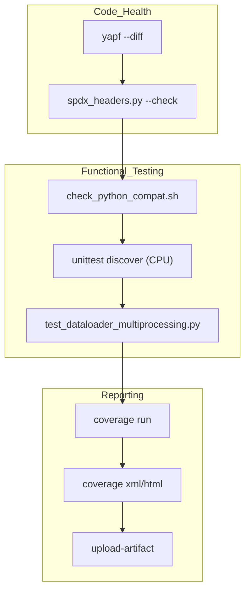
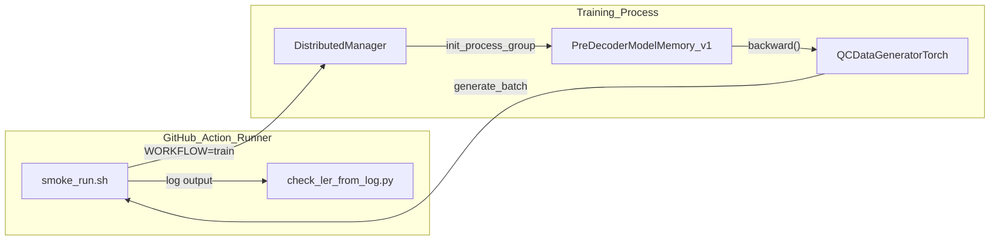

<!-- source: DeepWiki mcp.deepwiki.com · repo NVIDIA/Ising-Decoding · page 7.2 CI Workflows · fetched 2026-10-26 -->

# CI Workflows

Relevant source files

The following files were used as context for generating this wiki page:

- [.github/workflows/ci-gpu.yml](.github/workflows/ci-gpu.yml)
- [.github/workflows/ci.yml](.github/workflows/ci.yml)
- [.github/workflows/long-running-tests.yml](.github/workflows/long-running-tests.yml)
- [.github/workflows/pr_file_check.yaml](.github/workflows/pr_file_check.yaml)
- [code/scripts/check_ler_from_log.py](code/scripts/check_ler_from_log.py)
- [code/scripts/run_orientations_long.sh](code/scripts/run_orientations_long.sh)
- [code/scripts/smoke_run.sh](code/scripts/smoke_run.sh)
- [code/tests/measure_d9_ler.py](code/tests/measure_d9_ler.py)
- [code/tests/test_dataloader_multiprocessing.py](code/tests/test_dataloader_multiprocessing.py)
- [code/tests/test_inference_public_model.py](code/tests/test_inference_public_model.py)
- [code/tests/test_ler_pretrained_models.py](code/tests/test_ler_pretrained_models.py)
- [code/tests/test_metrics_extras.py](code/tests/test_metrics_extras.py)
- [code/tests/test_multi_gpu.py](code/tests/test_multi_gpu.py)

This page details the Continuous Integration (CI) infrastructure for the Ising-Decoding project. The system uses a multi-tiered testing strategy implemented via GitHub Actions to balance developer velocity with rigorous physical validation of the quantum error correction (QEC) decoders.

### Overview of Workflow Tiers

The CI pipeline is split into three primary workflows based on resource requirements and execution time:
1.  **CI (Standard):** Fast CPU-based checks (linting, unit tests, multiprocessing safety).
2.  **CI / GPU:** Hardware-accelerated tests including short training runs, LER performance gating, and Multi-GPU/DDP validation.
3.  **Long-running tests:** Daily statistical validation of noise models, orientation-specific inference (O1–O4), and regression testing.

---

## 1. Standard CI Workflow (`ci.yml`)

The standard CI workflow focuses on code health and basic functional correctness. It runs on every push and pull request.

### Key Components
*   **Static Analysis:** Uses `yapf` for code formatting checks and a custom script `code/scripts/spdx_headers.py` to ensure all files contain the required NVIDIA copyright and license headers [.github/workflows/ci.yml:38-56]().
*   **Unit Tests:** Executes the core test suite across Python 3.11, 3.12, and 3.13 using `code/scripts/check_python_compat.sh` [.github/workflows/ci.yml:57-78]().
*   **Multiprocessing Validation:** A specific job `multiprocessing-dataloader` verifies that `QCDataPipePreDecoder_Memory_inference` is pickle-safe and functions correctly when `num_workers > 0` using the `spawn` start method [.github/workflows/ci.yml:84-102]().
*   **Coverage Reporting:** Generates HTML and XML coverage reports for the unit test suite [.github/workflows/ci.yml:103-132]().

### Data Flow: Standard CI
The following diagram illustrates the execution flow of the `ci.yml` workflow.

"Standard CI Execution Flow"

Sources: [.github/workflows/ci.yml:38-132](), [code/tests/test_dataloader_multiprocessing.py:11-15]()

---

## 2. GPU CI Workflow (`ci-gpu.yml`)

The GPU workflow utilizes NVIDIA self-hosted runners to perform integration tests that require CUDA. It validates the full training and inference pipeline.

### Integration and Performance Gating
*   **Smoke Runs:** Executes `code/scripts/smoke_run.sh` which performs a short training (2 epochs, ~16k samples) followed by inference [.github/workflows/ci-gpu.yml:89-118]().
*   **LER Gating:** Uses `code/scripts/check_ler_from_log.py` to parse logs for the `[LER Validation]` tag. If the Logical Error Rate (LER) exceeds a defined threshold (e.g., 0.35 for short runs), the CI fails [.github/workflows/ci-gpu.yml:96]().
*   **Multi-GPU Validation:** The `multi-gpu-tests` job runs `code/tests/test_multi_gpu.py` using `torch.multiprocessing.spawn`. It validates:
    *   **NCCL:** `all_reduce` operations across ranks [.github/workflows/ci-gpu.yml:186-189]().
    *   **DDP:** Gradient synchronization in `PreDecoderModelMemory_v1` [.github/workflows/ci-gpu.yml:186-189]().
    *   **Data Locality:** Ensuring `QCDataGeneratorTorch` places tensors on the correct per-rank CUDA device [code/tests/test_multi_gpu.py:122-153]().

### Data Flow: GPU Validation
This diagram maps the interaction between the CI runner and the core training/distributed entities.

"GPU CI and Distributed Validation"

Sources: [.github/workflows/ci-gpu.yml:89-118](), [code/tests/test_multi_gpu.py:76-119](), [code/scripts/smoke_run.sh:43-58]()

---

## 3. Long-Running Tests (`long-running-tests.yml`)

This workflow runs daily or on-demand. It performs deep statistical validation that is too slow for standard PR checks.

### Statistical and Regression Jobs
*   **Statistical Noise Model:** Runs `test_noise_model.py` with `RUN_SLOW=1` to perform >=100k-shot tests, ensuring the 25-parameter noise model matches theoretical expectations [.github/workflows/long-running-tests.yml:78-129]().
*   **Orientation Inference:** Validates inference across all four surface code orientations (O1–O4) using `code/scripts/run_orientations_long.sh`. This ensures the homological equivalence logic in `SurfaceCode` is robust across rotations [.github/workflows/long-running-tests.yml:135-182]().
*   **LER Regression:** Uses `code/tests/test_inference_public_model.py` to compare current performance against pre-trained baselines (`Ising-Decoder-SurfaceCode-1-Fast.pt` and `Accurate.pt`). It asserts that `LER_after <= LER_baseline + tolerance` [code/tests/test_inference_public_model.py:36-48]().

### Commit Gating
To save resources, the scheduled workflow includes a `check-for-changes` job. It skips execution if no commits have landed on `main` in the last 24 hours, unless manually triggered [.github/workflows/long-running-tests.yml:46-72]().

---

## 4. PR File Check (`pr_file_check.yaml`)

This workflow enforces repository hygiene for Pull Requests:
*   **Size Limit:** Blocks any new file (except documentation assets like `.png` or `.ipynb`) exceeding 100KB [.github/workflows/pr_file_check.yaml:36-54]().
*   **Restricted Extensions:** Blocks forbidden file types such as `.exe`, `.zip`, or `.tar.gz` to prevent binary bloat [.github/workflows/pr_file_check.yaml:62-70]().

---

## Summary of CI Test Tiers

| Tier | Workflow File | Trigger | Primary Purpose |
| :--- | :--- | :--- | :--- |
| **Short** | `ci.yml` | Push/PR | Linting, unit tests, multiprocessing safety. |
| **Mid** | `ci-gpu.yml` | Push/PR | GPU functional tests, LER gating, Multi-GPU/DDP. |
| **Long** | `long-running-tests.yml` | Daily/Manual | Statistical validation, O1-O4 coverage, LER regression. |

Sources: [.github/workflows/ci.yml:16-26](), [.github/workflows/ci-gpu.yml:15-26](), [.github/workflows/long-running-tests.yml:22-34](), [.github/workflows/pr_file_check.yaml:10-16]()

---

