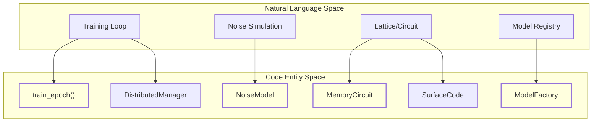
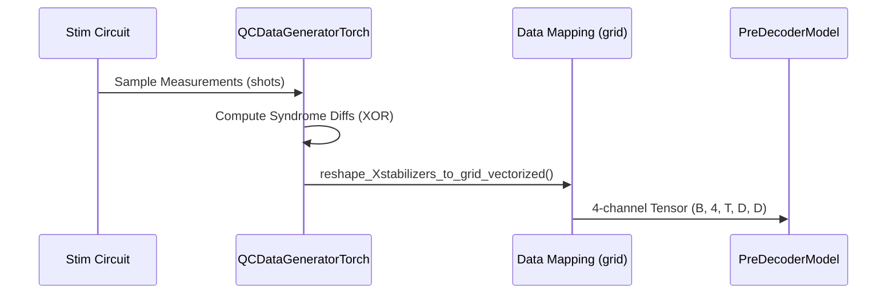

<!-- source: DeepWiki mcp.deepwiki.com · repo NVIDIA/Ising-Decoding · page 8 Glossary · fetched 2026-10-26 -->

# Glossary

Relevant source files

The following files were used as context for generating this wiki page:

- [NOTICE](NOTICE)
- [README.md](README.md)
- [code/data/generator_torch.py](code/data/generator_torch.py)
- [code/evaluation/failure_analysis.py](code/evaluation/failure_analysis.py)
- [code/evaluation/logical_error_rate.py](code/evaluation/logical_error_rate.py)
- [code/evaluation/metrics.py](code/evaluation/metrics.py)
- [code/model/registry.py](code/model/registry.py)
- [code/qec/noise_model.py](code/qec/noise_model.py)
- [code/qec/surface_code/homological_equivalence.py](code/qec/surface_code/homological_equivalence.py)
- [code/qec/surface_code/memory_circuit.py](code/qec/surface_code/memory_circuit.py)
- [code/scripts/local_run.sh](code/scripts/local_run.sh)
- [code/tests/README_ORIENTATIONS_LONG_RUNNING.md](code/tests/README_ORIENTATIONS_LONG_RUNNING.md)
- [code/tests/test_boundary_detectors.py](code/tests/test_boundary_detectors.py)
- [code/tests/test_failure_analysis.py](code/tests/test_failure_analysis.py)
- [code/tests/test_noise_model.py](code/tests/test_noise_model.py)
- [code/tests/test_onnx_quant_workflow.py](code/tests/test_onnx_quant_workflow.py)
- [code/tests/test_training_utils.py](code/tests/test_training_utils.py)
- [code/training/train.py](code/training/train.py)
- [code/workflows/config_validator.py](code/workflows/config_validator.py)
- [cookbook/predecoder.ipynb](cookbook/predecoder.ipynb)

This glossary defines technical terms, domain-specific concepts, and codebase abbreviations used throughout the Ising-Decoding project. It provides a mapping between high-level Quantum Error Correction (QEC) theory and the specific implementation details in the code.

## Core Concepts & Abbreviations

### Pre-decoder
A neural network model (specifically a 3D CNN) that processes quantum syndrome data to identify and resolve "local" or "easy" errors before they reach a global decoder.
*   **Implementation**: Defined in the `PreDecoderModelMemory_v1` class [code/model/predecoder_memory_v1.py:21-23]().
*   **Data Flow**: It takes a 4-channel tensor (X/Z syndromes and presence masks) and outputs logits representing the probability of an error at specific spacetime locations [code/data/generator_torch.py:54-61]().

### SDR (Syndrome Density Reduction)
A key performance metric for the pre-decoder. It measures the factor by which the neural network reduces the number of active detectors (syndromes) that the subsequent global decoder must process.
*   **Implementation**: Calculated in `compute_syndrome_density` [code/evaluation/metrics.py:65-67]().
*   **Usage**: Used as a "gate" during training; if SDR does not meet a specific threshold, early stopping or checkpointing behavior may be modified [code/training/train.py:38-43]().

### LER (Logical Error Rate)
The final probability that a logical qubit's state is incorrectly identified after both pre-decoding and global decoding are complete.
*   **Implementation**: Evaluated using `count_logical_errors_with_errorbar` [code/evaluation/metrics.py:108-110]().
*   **Function**: `compute_validation_ler` orchestrates this during the validation phase of training [code/training/train.py:98-100]().

### Surface Code Orientations (O1-O4)
The codebase supports four orientations of the surface code, which define the layout of stabilizers and boundaries.
*   **Mapping**:
    *   **O1 (XV)**: X-type first bulk syndrome, vertical boundary [code/tests/README_ORIENTATIONS_LONG_RUNNING.md:85-85]().
    *   **O2 (XH)**: X-type first bulk syndrome, horizontal boundary [code/tests/README_ORIENTATIONS_LONG_RUNNING.md:86-86]().
    *   **O3 (ZV)**: Z-type first bulk syndrome, vertical boundary [code/tests/README_ORIENTATIONS_LONG_RUNNING.md:87-87]().
    *   **O4 (ZH)**: Z-type first bulk syndrome, horizontal boundary [code/tests/README_ORIENTATIONS_LONG_RUNNING.md:88-88]().
*   **Implementation**: Handled by `data.code_rotation` in the configuration [code/tests/README_ORIENTATIONS_LONG_RUNNING.md:5-5]().

---

## System Entities & Code Mapping

The following diagram bridges the gap between high-level system components and their corresponding classes and files.

### System Entity Bridge

**Sources:** [code/training/train.py:55-107](), [code/qec/noise_model.py:38-47](), [code/qec/surface_code/memory_circuit.py:46-47](), [code/model/factory.py:89-89]().

---

## Technical Definitions

### Boundary Detectors
Special detectors added to the Stim circuit to handle errors at the edges of the surface code lattice. They ensure that every error mechanism is caught by at least one detector.
*   **Logic**: Added during `MemoryCircuit` initialization if `add_boundary_detectors=True` [code/tests/test_boundary_detectors.py:66-74]().
*   **Verification**: Tested for consistency across all distances and orientations in `TestBoundaryDetectorBasics` [code/tests/test_boundary_detectors.py:50-53]().

### Decoder Ablation Study
A workflow that compares the performance of multiple global decoders (e.g., PyMatching, Union-Find, BP+LSD) when processing the same residual syndromes produced by the pre-decoder.
*   **Implementation**: Located in `code/evaluation/failure_analysis.py` [code/evaluation/failure_analysis.py:15-18]().
*   **Decoders**: Includes `cudaq-qec` GPU-accelerated variants like `cudaq-BP` and `cudaq-RelayBP` [code/evaluation/failure_analysis.py:43-55]().

### ONNX Workflow (State Machine)
A series of steps (0-3) controlled by the `ONNX_WORKFLOW` environment variable to manage the transition from PyTorch to TensorRT.
*   **States**:
    *   `0`: PyTorch only [code/evaluation/logical_error_rate.py:77-77]().
    *   `1`: Export ONNX only [code/evaluation/logical_error_rate.py:78-78]().
    *   `2`: Export ONNX + Build TensorRT engine [code/evaluation/logical_error_rate.py:79-79]().
    *   `3`: Load pre-built engine only [code/evaluation/logical_error_rate.py:80-80]().

---

## Data Pipeline Flow

The following diagram illustrates how data flows from a quantum circuit simulation to the neural network input.

### Syndrome Data Flow

**Sources:** [code/qec/noise_model.py:151-165](), [code/qec/noise_model.py:184-192](), [code/data/generator_torch.py:54-61]().

---

## Component Table

| Term | Definition | File Pointer |
| :--- | :--- | :--- |
| **Batch Schedule** | Linear ramping of batch size during training to improve convergence. | [code/training/train.py:140-154]() |
| **DEM** | Detector Error Model; a Stim-generated representation of error probabilities. | [code/tests/test_boundary_detectors.py:154-156]() |
| **EMA** | Exponential Moving Average of model weights for improved stability. | [code/training/train.py:35-35]() |
| **Homological Equivalence** | A transformation that identifies if two sets of corrections are logically identical. | [code/qec/surface_code/homological_equivalence.py:1-5]() |
| **Quantization** | Reducing model precision (INT8/FP8) for faster inference via TensorRT. | [code/evaluation/logical_error_rate.py:118-129]() |
| **SafeTensors** | A safe and fast format for storing model checkpoints. | [code/scripts/local_run.sh:46-48]() |

**Sources:** [code/training/train.py:140-154](), [code/evaluation/logical_error_rate.py:118-129](), [code/scripts/local_run.sh:46-48]().