# Page: Overview

# Overview

<details>
<summary>Relevant source files</summary>

The following files were used as context for generating this wiki page:

- [NOTICE](NOTICE)
- [README.md](README.md)
- [code/tests/README_ORIENTATIONS_LONG_RUNNING.md](code/tests/README_ORIENTATIONS_LONG_RUNNING.md)
- [cookbook/predecoder.ipynb](cookbook/predecoder.ipynb)
- [images/ler_vs_time_model_card_p0.003_0.006_X_dark.svg](images/ler_vs_time_model_card_p0.003_0.006_X_dark.svg)
- [images/ler_vs_time_model_card_p0.003_0.006_X_light.svg](images/ler_vs_time_model_card_p0.003_0.006_X_light.svg)
- [images/predecoder_pipeline.png](images/predecoder_pipeline.png)

</details>


The Ising-Decoding project provides an AI-driven framework for building, training, and deploying scalable Quantum Error Correction (QEC) decoders. It specifically targets surface codes, utilizing a neural network pre-decoder to significantly reduce syndrome density before passing the remaining tasks to a standard algorithmic decoder like PyMatching.

## The Two-Tier Decoding Pipeline

The core concept of this project is a hybrid decoding strategy designed to overcome the throughput bottlenecks of traditional QEC.

1.  **Neural Pre-Decoder**: A 3D Convolutional Neural Network (CNN) consumes detector syndromes across both space and time [README.md:12-13](). It predicts local corrections to resolve high-density syndrome regions [cookbook/predecoder.ipynb:20-23]().
2.  **Standard Decoder**: The remaining, reduced set of syndromes is processed by a standard decoder (typically PyMatching) to produce the final logical decision [README.md:14-14]().

This approach allows for faster processing of syndromes and can improve the Logical Error Rate (LER) compared to using a standalone algorithmic decoder [cookbook/predecoder.ipynb:18-18]().

### Pre-decoder Workflow Logic

The following diagram illustrates how the system transitions from raw syndrome data to a final logical correction.

**Pre-Decoder Data Flow**
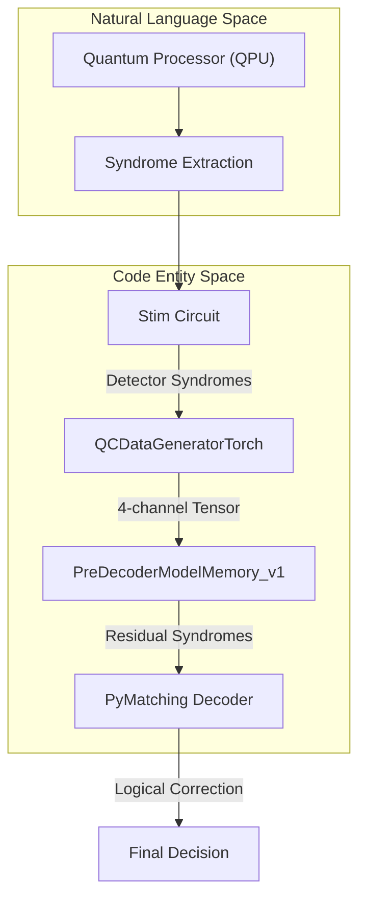
Sources: [README.md:10-18](), [cookbook/predecoder.ipynb:12-20]().

## Project Structure and Navigation

The codebase is organized into functional modules covering the full lifecycle of a QEC decoder, from circuit simulation to real-time deployment artifacts.

### System Components

| Component | Description | Primary Code Entities |
| :--- | :--- | :--- |
| **Orchestration** | Handles workflows (train, inference, ablation) and configuration. | `run.py`, `local_run.sh`, `Hydra` |
| **Model** | The 3D CNN architecture for syndrome reduction. | `PreDecoderModelMemory_v1`, `ModelFactory` |
| **QEC Layer** | Surface code construction and noise modeling. | `SurfaceCode`, `MemoryCircuit`, `NoiseModel` |
| **Data Pipeline** | Syndrome generation and precomputation. | `QCDataGeneratorTorch`, `precompute_frames.py` |
| **Evaluation** | Metrics for LER, SDR, and decoder comparisons. | `PreDecoderMemoryEvalModule`, `evaluation.metrics` |

**System Interaction Diagram**
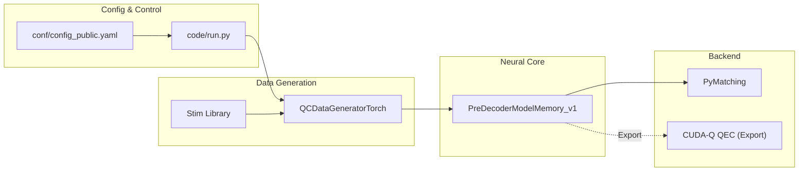
Sources: [README.md:46-77](), [code/tests/README_ORIENTATIONS_LONG_RUNNING.md:5-5]().

## How to Navigate the Wiki

This wiki is structured to guide users from initial setup to deep architectural understanding and production deployment.

*   **[Getting Started](#1.1)**: Step-by-step instructions for installing dependencies (Stim, PyTorch) and running your first training or inference job using `local_run.sh` [README.md:79-129]().
*   **[Configuration Reference](#1.2)**: Detailed breakdown of `conf/config_public.yaml`, covering parameters like `model_id`, `distance`, and `noise_model` [README.md:85-88]().
*   **System Architecture**: Deep dives into the `PreDecoderModelMemory_v1` CNN, the 25-parameter circuit-level noise model, and the four surface code orientations (O1–O4) [code/tests/README_ORIENTATIONS_LONG_RUNNING.md:81-91]().
*   **Training and Inference**: Detailed explanations of the training loop (AdamW/Lion optimizers) and evaluation metrics such as Syndrome Density Reduction (SDR) and Logical Error Rate (LER).
*   **Model Export**: Instructions for converting PyTorch models to SafeTensors, ONNX, and TensorRT for integration with the CUDA-Q QEC real-time pipeline [README.md:27-31]().

Sources: [README.md:20-44](), [code/tests/README_ORIENTATIONS_LONG_RUNNING.md:1-30]().

---

# Page: Getting Started

# Getting Started

<details>
<summary>Relevant source files</summary>

The following files were used as context for generating this wiki page:

- [Dockerfile](Dockerfile)
- [README.md](README.md)
- [TRAINING.md](TRAINING.md)
- [code/requirements_public_gpu_cu12.txt](code/requirements_public_gpu_cu12.txt)
- [code/requirements_public_gpu_cu13.txt](code/requirements_public_gpu_cu13.txt)
- [code/requirements_public_inference.txt](code/requirements_public_inference.txt)
- [code/requirements_public_train-cu12.txt](code/requirements_public_train-cu12.txt)
- [code/requirements_public_train-cu13.txt](code/requirements_public_train-cu13.txt)
- [conf/config_public.yaml](conf/config_public.yaml)

</details>


This page provides a step-by-step guide for new users to set up the Ising-Decoding environment, install dependencies, and run their first training or inference workflow. The project is designed to be flexible, supporting local execution, Docker containers, and SLURM-managed clusters.

### Prerequisites

The codebase targets Python versions **3.11, 3.12, and 3.13** [README.md:91-91](). It requires an NVIDIA GPU for training and accelerated inference, though basic inference can run on CPU with reduced performance.

Key external dependencies include:
*   **Stim**: For quantum circuit simulation and syndrome generation [code/requirements_public_inference.txt:23-23]().
*   **PyTorch**: The core deep learning framework [code/requirements_public_inference.txt:22-22]().
*   **Hydra**: For configuration management [code/requirements_public_inference.txt:19-19]().
*   **PyMatching**: Used as the "standard" decoder in the two-tier pipeline [README.md:14-14]().

---

### Installation Options

#### 1. Local Installation
Users can install dependencies directly into a virtual environment. Two requirement files are provided: one for inference-only and one for full training.

```bash
# Create environment
python -m venv .venv
source .venv/bin/activate

# For Inference only
pip install -r code/requirements_public_inference.txt

# For Training (select cu12 or cu13 based on your CUDA version)
pip install -r code/requirements_public_train-cu12.txt
```
Sources: [README.md:93-116]()

#### 2. Docker (Recommended for Training)
A `Dockerfile` is provided to build a consistent training environment. It bakes in Python 3.11 and PyTorch with the specified CUDA version [Dockerfile:18-32]().

```bash
# Build the image
docker build -t predecoder-train .

# Run training
docker run --rm --gpus all \
  -v $(pwd):/app:ro \
  -v $HOME/predecoder_outputs:/data \
  -e SHARED_OUTPUT_DIR=/data \
  predecoder-train
```
Sources: [TRAINING.md:15-30](), [Dockerfile:1-53]()

#### 3. SLURM Integration
For cluster environments, the `code/scripts/sbatch_train.sh` template allows for job submission. It automatically detects if a Docker image is available or falls back to a bare-metal installation via `cluster_install_deps.sh` [TRAINING.md:52-73](), [TRAINING.md:89-97]().

---

### Running the First Inference

The repository includes pre-trained models via Git LFS: `Ising-Decoder-SurfaceCode-1-Fast.pt` (R=9) and `Ising-Decoder-SurfaceCode-1-Accurate.pt` (R=13) [README.md:164-166]().

To run inference using a pre-trained model:
1. Set the `WORKFLOW` environment variable to `inference`.
2. Execute the local runner script.

```bash
WORKFLOW=inference bash code/scripts/local_run.sh
```
Sources: [README.md:128-129](), [README.md:150-166]()

#### System Data Flow: Inference Entry
The following diagram illustrates how the runner script initiates the inference pipeline and connects to the model entities.

**Inference Execution Flow**
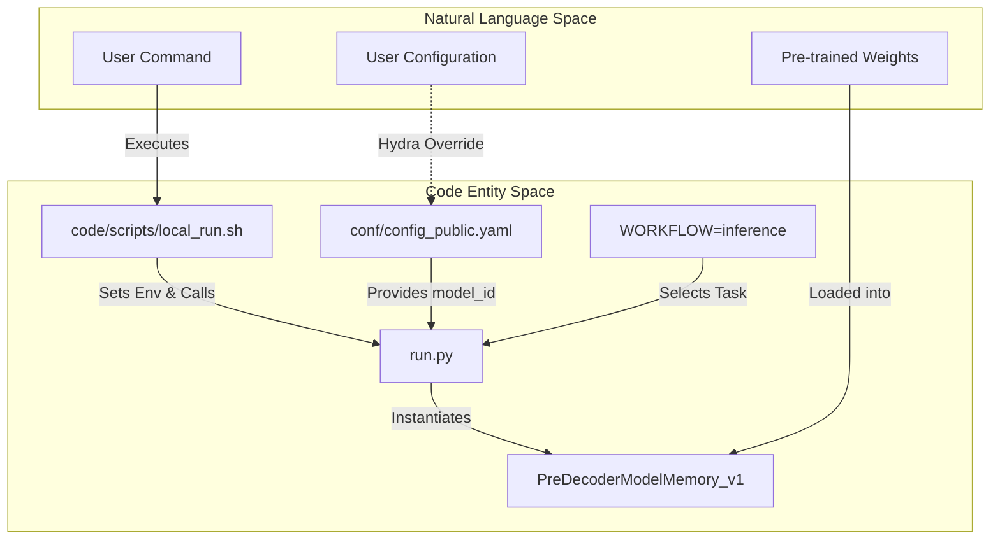
Sources: [README.md:83-87](), [README.md:128-129](), [conf/config_public.yaml:23-31]()

---

### Configuration Interface: `config_public.yaml`

The `conf/config_public.yaml` file is the primary interface for users to define their QEC experiments. It abstracts complex internal settings into a few key parameters [conf/config_public.yaml:16-20]().

| Field | Description | Default |
| :--- | :--- | :--- |
| `model_id` | Selects the NN architecture (1-5) which determines the receptive field. | `1` |
| `distance` | The code distance ($d$) of the surface code. | `7` |
| `n_rounds` | Number of measurement rounds ($T$). | `7` |
| `code_rotation` | Surface code orientation (O1, O2, O3, or O4). | `O1` |
| `noise_model` | A 25-parameter circuit-level noise specification. | $p=0.003$ |

Sources: [conf/config_public.yaml:22-70]()

#### Mapping Config to Code Entities
This diagram bridges the high-level configuration fields to the specific classes and logic they control within the codebase.

**Configuration to Implementation Mapping**
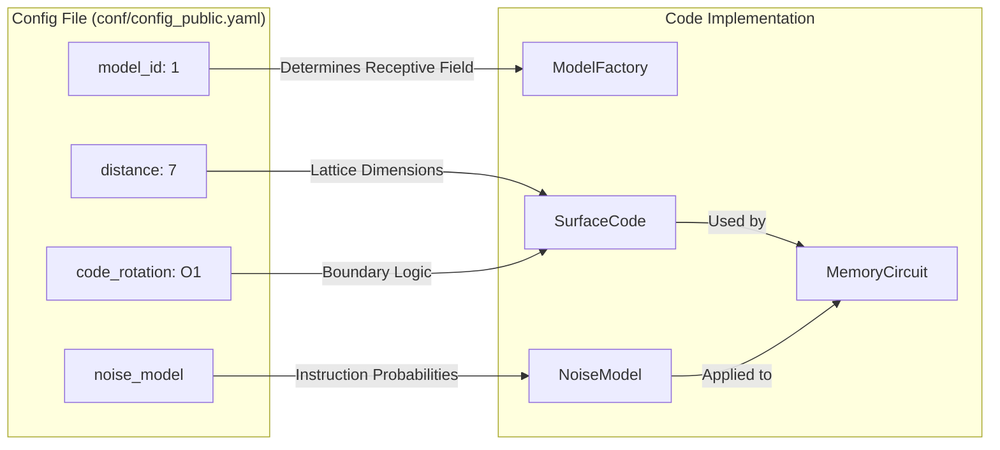
Sources: [conf/config_public.yaml:23-40](), [README.md:10-14]()

---

### Troubleshooting Common Issues

*   **Shared Memory**: In Docker containers, syndrome data loading may crash if shared memory is too small. Use `--shm-size=1g` or set `PREDECODER_INFERENCE_NUM_WORKERS=0` [README.md:131-136]().
*   **Torch Compile**: If `torch.compile` causes segfaults, disable it by setting `TORCH_COMPILE=0` [README.md:145-147]().
*   **Training Samples**: Ensure `PREDECODER_TRAIN_SAMPLES` is large enough to cover the effective batch size (especially after epoch 0 when the batch size ramps to 2048) [README.md:140-143]().

Sources: [README.md:131-149]()

---

# Page: Configuration Reference

# Configuration Reference

<details>
<summary>Relevant source files</summary>

The following files were used as context for generating this wiki page:

- [.dockerignore](.dockerignore)
- [README.md](README.md)
- [code/scripts/cluster_train.sh](code/scripts/cluster_train.sh)
- [code/tests/test_predecoder.py](code/tests/test_predecoder.py)
- [code/workflows/run.py](code/workflows/run.py)
- [conf/config_pre_decoder_memory_surface_model_1_d9.yaml](conf/config_pre_decoder_memory_surface_model_1_d9.yaml)
- [conf/config_public.yaml](conf/config_public.yaml)
- [conf/config_qec_decoder_r13_fp8.yaml](conf/config_qec_decoder_r13_fp8.yaml)
- [conf/config_qec_decoder_r9_fp8.yaml](conf/config_qec_decoder_r9_fp8.yaml)

</details>


The Ising-Decoding project utilizes **Hydra** for configuration management, providing a flexible hierarchical system that merges user-facing parameters with internal architectural defaults. This page details the configuration structure, the validation logic, and the specific fields available in the public and internal configuration files.

## Configuration Hierarchy and Merging

The system follows a "Public-to-Internal" merging strategy. Users primarily interact with `conf/config_public.yaml`, which exposes a simplified surface of the most relevant parameters. During execution, the `run.py` entrypoint invokes `validate_public_config` and `apply_public_defaults_and_model` to bridge these user inputs with the full system configuration [code/workflows/run.py:55-60]().

### Configuration Data Flow
The following diagram illustrates how configuration values flow from the YAML files through the validation logic into the `ModelFactory` and `DatapipeFactory`.

**Configuration Resolution Pipeline**
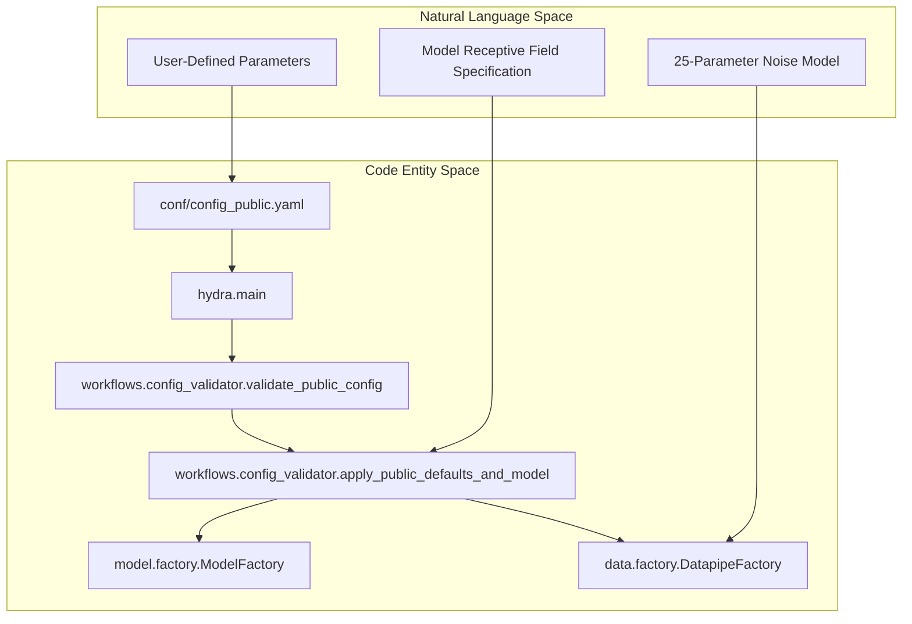
Sources: [code/workflows/run.py:55-60](), [conf/config_public.yaml:22-40](), [code/workflows/config_validator.py:22-25]()

---

## Public Configuration (`config_public.yaml`)

This is the primary interface for standard training and inference workflows. It restricts the user to a safe subset of parameters to ensure compatibility with the pre-defined model architectures.

### Key Fields

| Field | Type | Description |
| :--- | :--- | :--- |
| `model_id` | `int` | Selects the model architecture (1–5). Each ID corresponds to a specific receptive field (e.g., ID 1 = R9, ID 4 = R13) [conf/config_public.yaml:23](). |
| `distance` | `int` | The code distance $d$ for evaluation [conf/config_public.yaml:26](). |
| `n_rounds` | `int` | Number of syndrome measurement rounds $T$ [conf/config_public.yaml:27](). |
| `workflow.task` | `string` | Execution mode: `train`, `inference`, or `decoder_ablation` [conf/config_public.yaml:31](). |
| `data.code_rotation` | `string` | Surface code orientation: `O1`, `O2`, `O3`, `O4` [conf/config_public.yaml:37](). |

### Noise Model Specification
The `data.noise_model` block defines a 25-parameter circuit-level noise model [conf/config_public.yaml:40-70](). This allows fine-grained control over:
*   **SPAM Errors**: `p_prep_X/Z` and `p_meas_X/Z`.
*   **Idle Errors**: `p_idle_cnot_X/Y/Z` (during gates) and `p_idle_spam_X/Y/Z` (during ancilla reset).
*   **Two-Qubit Errors**: 15 distinct Pauli error probabilities for CNOT gates (e.g., `p_cnot_XI`, `p_cnot_ZZ`).

Sources: [conf/config_public.yaml:23-70]()

---

## Pre-defined Decoder Configurations

The repository includes optimized configurations for the "Fast" (R9) and "Accurate" (R13) models described in the associated research. These files override specific model and data fields while inheriting training hyperparameters from internal defaults.

### R9 (Fast) Configuration
*   **File**: `conf/config_qec_decoder_r9_fp8.yaml`
*   **Model ID**: 1 (Receptive Field 9) [conf/config_qec_decoder_r9_fp8.yaml:13]()
*   **Target**: Optimized for lower latency inference.
*   **Noise**: Defaults to depolarizing noise $p=0.006$ [conf/config_qec_decoder_r9_fp8.yaml:27-52]().

### R13 (Accurate) Configuration
*   **File**: `conf/config_qec_decoder_r13_fp8.yaml`
*   **Model ID**: 4 (Receptive Field 13) [conf/config_qec_decoder_r13_fp8.yaml:13]()
*   **Target**: Optimized for maximum logical error rate (LER) reduction.

Sources: [conf/config_qec_decoder_r9_fp8.yaml:4-13](), [conf/config_qec_decoder_r13_fp8.yaml:4-13]()

---

## Internal Training Defaults

When a workflow is initialized, several "hidden" parameters are applied to the configuration object. These are primarily found in `conf/config_pre_decoder_memory_surface_model_1_d9.yaml` and govern the neural network's training regime.

### Architecture & Optimization Defaults
The `PreDecoderModelMemory_v1` architecture is configured with the following standard values:
*   **Filters**: `[128, 128, 128, 4]` (4-head output for $Z_{data}, X_{data}, Syn_X, Syn_Z$) [conf/config_pre_decoder_memory_surface_model_1_d9.yaml:54]().
*   **Optimizer**: `Lion` with `lr: 3e-4` and `weight_decay: 1e-7` [conf/config_pre_decoder_memory_surface_model_1_d9.yaml:72-75]().
*   **EMA**: Exponential Moving Average is enabled by default with `decay: 0.0001` [conf/config_pre_decoder_memory_surface_model_1_d9.yaml:101-103]().

### Batch Scheduling
The system uses a dynamic batch size schedule to stabilize training:
*   **Initial Batch**: 1024 [conf/config_pre_decoder_memory_surface_model_1_d9.yaml:87]().
*   **Ramp-up**: Starts after epoch 1 and reaches final size by epoch 3 [conf/config_pre_decoder_memory_surface_model_1_d9.yaml:89-90]().

**Training Pipeline Entity Mapping**
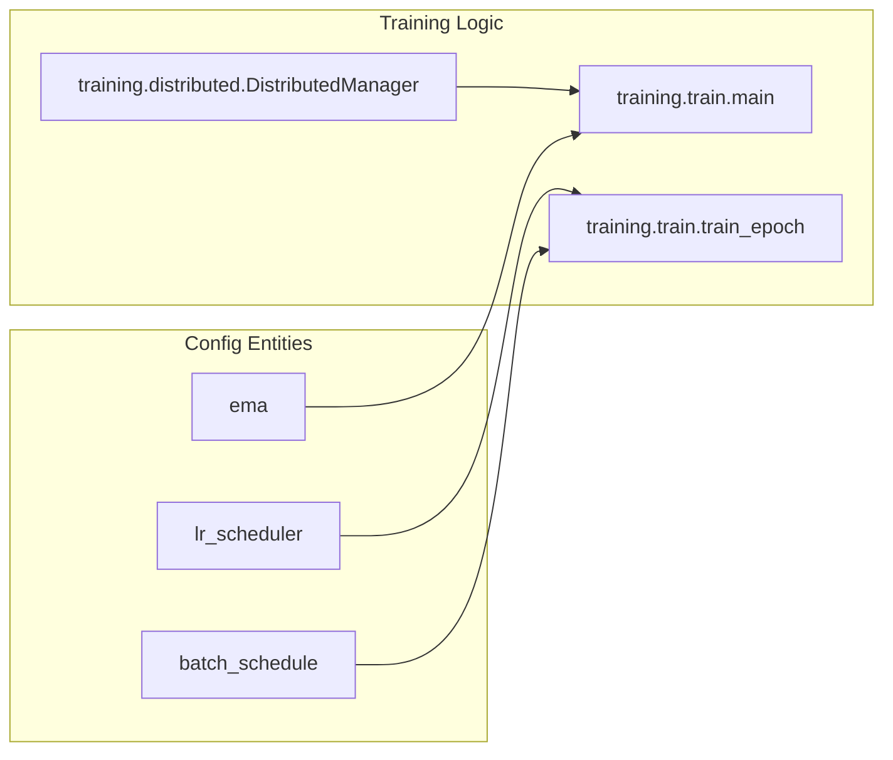
Sources: [conf/config_pre_decoder_memory_surface_model_1_d9.yaml:78-90](), [code/workflows/run.py:18](), [code/workflows/run.py:70-71]()

---

## Validation and Runtime Overrides

The `run.py` script performs critical runtime adjustments to the configuration before the model is instantiated.

1.  **Channel Inference**: If `model.input_channels` is not set, the system creates a single inference sample via `DatapipeFactory` to detect the required input dimensions [code/workflows/run.py:38-42]().
2.  **Output Consistency**: The `model.out_channels` is forced to 4 to match the four prediction heads (data errors and syndrome residuals) [code/workflows/run.py:33-35]().
3.  **Path Resolution**: Relative paths for checkpoints and data directories are resolved to absolute paths relative to the repository root [code/workflows/run.py:153-158]().

Sources: [code/workflows/run.py:32-54](), [code/workflows/run.py:153-158]()

---

# Page: System Architecture

# System Architecture

<details>
<summary>Relevant source files</summary>

The following files were used as context for generating this wiki page:

- [README.md](README.md)
- [code/workflows/run.py](code/workflows/run.py)

</details>


The Ising-Decoding system is a two-tier quantum error correction (QEC) pipeline. It uses a neural network "pre-decoder" to process detector syndromes across space and time, predicting corrections that reduce syndrome density before passing the residual problem to a standard combinatorial decoder like PyMatching or a specialized decoder from the `cudaq-qec` library [README.md:10-14]().

## Subsystem Overview

The architecture is divided into five major functional blocks that handle the lifecycle from circuit simulation to real-time deployment.

### 1. Workflow Orchestration
The system is driven by a single entry point, `run.py`, which uses Hydra for configuration management [code/workflows/run.py:55-56](). It routes execution to specific tasks such as `train`, `inference`, or `decoder_ablation` based on the environment and configuration [code/workflows/run.py:70-94]().
*   **Key Responsibilities**: Config validation, model loading priority (SafeTensors vs. `.pt`), and distributed environment initialization via `DistributedManager`.
*   **Details**: See [Workflow Orchestration](#2.1).

### 2. Neural Network Model
The core of the pre-decoder is the `PreDecoderModelMemory_v1`, a 3D Convolutional Neural Network (CNN) designed to handle the spatio-temporal nature of surface code syndromes [code/model/pre_decoder_memory.py:27-28](). It uses residual blocks and is instantiated via a `ModelFactory` that maps `model_id` (1–5) to specific architectural hyperparameters like receptive fields [code/model/factory.py:24-27]().
*   **Key Responsibilities**: Predicting data qubit and syndrome corrections across 4 heads (`z_data`, `x_data`, `syn_x`, `syn_z`).
*   **Details**: See [Neural Network Model](#2.2).

### 3. QEC Surface Code Layer
This layer defines the quantum geometry. The `SurfaceCode` class handles lattice construction, including data-to-stabilizer mappings and boundary detector definitions [code/surface_code/surface_code.py:24-25](). It supports four orientations (XV, XH, ZV, ZH) to ensure the decoder is robust against different error types [code/surface_code/surface_code.py:126-130]().
*   **Key Responsibilities**: Generating Stim circuits, calculating homological equivalence, and mapping syndromes to grid coordinates for the CNN.
*   **Details**: See [QEC Surface Code Layer](#2.3).

### 4. Noise Model
The system employs a 25-parameter circuit-level noise model that simulates realistic hardware errors, including SPAM (State Preparation and Measurement), idling, and CNOT gate noise [code/surface_code/noise_model.py:24-26](). 
*   **Key Responsibilities**: Parameter upscaling for training (targeting $6 \times 10^{-3}$) and generating noisy syndrome frames via Stim.
*   **Details**: See [Noise Model](#2.4).

### 5. Data Pipeline & Evaluation
Syndromes flow from the `QCDataGeneratorTorch` into the model [code/data/generator_torch.py:30-31](). The evaluation stack measures performance using Logical Error Rate (LER) and Syndrome Density Reduction (SDR) [code/evaluation/metrics.py:24-26]().
*   **Key Responsibilities**: On-the-fly syndrome generation, precomputed frame loading, and benchmarking pre-decoder + MWPM performance.
*   **Details**: See [Data Pipeline](#3) and [Inference and Evaluation](#5).

## System Component Diagram

The following diagram illustrates the connectivity between the high-level workflows and the underlying code entities.

### Workflow to Code Mapping
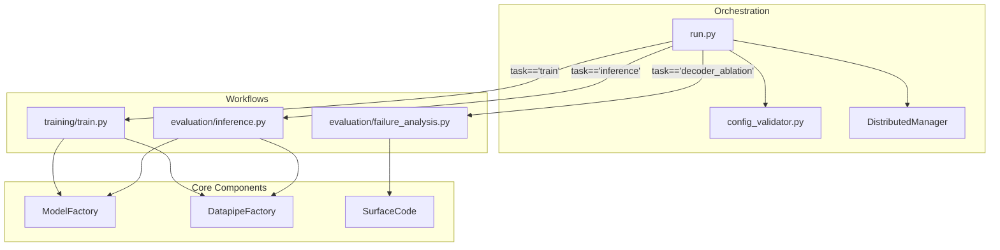
**Sources:** [code/workflows/run.py:70-94](), [code/model/factory.py:24-27](), [code/data/factory.py:24-25]()

## Data Flow Architecture

The pre-decoder operates as a transformation layer within the larger QEC loop.

### Syndrome Processing Pipeline
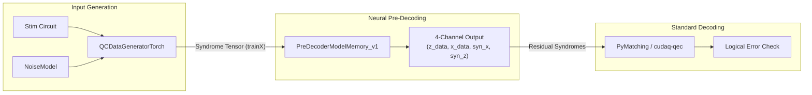
**Sources:** [README.md:10-18](), [code/model/pre_decoder_memory.py:27-50](), [code/data/generator_torch.py:30-45]()

## Component Summary Table

| Subsystem | Primary Class/Module | File Reference |
| :--- | :--- | :--- |
| **Orchestrator** | `run.py` | [code/workflows/run.py:16-30]() |
| **Model** | `PreDecoderModelMemory_v1` | [code/model/pre_decoder_memory.py:27-28]() |
| **QEC Layer** | `SurfaceCode` | [code/surface_code/surface_code.py:24-25]() |
| **Noise** | `NoiseModel` | [code/surface_code/noise_model.py:24-25]() |
| **Data Pipe** | `QCDataGeneratorTorch` | [code/data/generator_torch.py:30-31]() |
| **Evaluation** | `PreDecoderMemoryEvalModule` | [code/evaluation/inference.py:43-44]() |

---
**Sources:**
*   [README.md:10-18]()
*   [code/workflows/run.py:16-94]()
*   [code/model/factory.py:24-27]()
*   [code/surface_code/surface_code.py:24-130]()
*   [code/surface_code/noise_model.py:24-26]()
*   [code/data/generator_torch.py:30-45]()
*   [code/evaluation/metrics.py:24-26]()

---

# Page: Workflow Orchestration

# Workflow Orchestration

<details>
<summary>Relevant source files</summary>

The following files were used as context for generating this wiki page:

- [code/evaluation/failure_analysis.py](code/evaluation/failure_analysis.py)
- [code/scripts/local_run.sh](code/scripts/local_run.sh)
- [code/tests/test_failure_analysis.py](code/tests/test_failure_analysis.py)
- [code/tests/test_public_config.py](code/tests/test_public_config.py)
- [code/workflows/run.py](code/workflows/run.py)

</details>


The Ising-Decoding project utilizes a centralized orchestration layer to manage the transition between training, inference, and comparative analysis. This layer is primarily controlled by `code/workflows/run.py`, which serves as the Hydra entry point, and `code/scripts/local_run.sh`, which manages environment variables and hardware detection.

## Execution Entry Points

Execution is routed through `run.py` using the `workflow.task` configuration parameter. The system supports three primary workflows in the public release: `train`, `inference`, and `decoder_ablation` [code/workflows/run.py:70-94]().

### Workflow Routing Logic

The `run_surface` function acts as the primary dispatcher [code/workflows/run.py:69-100]():

| Workflow Task | Target Function/Module | Purpose |
| :--- | :--- | :--- |
| `train` | `training.train.main` | Orchestrates model training, checkpointing, and validation [code/workflows/run.py:71](). |
| `inference` | `evaluation.inference.run_inference` | Evaluates a trained model's Logical Error Rate (LER) and Syndrome Density Reduction (SDR) [code/workflows/run.py:82](). |
| `decoder_ablation` | `evaluation.failure_analysis.decoder_ablation_study` | Compares neural pre-decoding against multiple global decoders (MWPM, LDPC, CUDA-Q) [code/workflows/run.py:94](). |
| `data` | `DatapipeFactory.create_dataloader` | Debug mode to verify syndrome generation shapes [code/workflows/run.py:86-88](). |

### The `local_run.sh` Wrapper
The `local_run.sh` script provides a user-friendly interface to the orchestrator, handling several critical setup steps:
1.  **GPU Detection**: Automatically calculates the number of available GPUs using `nvidia-smi` or respects `CUDA_VISIBLE_DEVICES` [code/scripts/local_run.sh:96-107]().
2.  **Configuration Snapshots**: Copies the active `config_public.yaml` and CLI overrides to the output directory to ensure reproducibility [code/scripts/local_run.sh:141-161]().
3.  **Environment Mapping**: Maps `WORKFLOW` and `ONNX_WORKFLOW` environment variables to Hydra overrides [code/scripts/local_run.sh:163-170]().

**Sources:** [code/workflows/run.py:1-100](), [code/scripts/local_run.sh:1-170]()

---

## Configuration Validation and Merging

The orchestrator enforces a strict validation boundary between the user-facing `config_public.yaml` and the internal system defaults.

### Validation Pipeline
Before execution, `run.py` calls `validate_public_config` to ensure no "hidden" internal fields (like optimizer internals or private data paths) have been injected into the public configuration [code/workflows/run.py:59](). This is followed by `apply_public_defaults_and_model`, which merges the validated public settings with the necessary internal architectural defaults [code/workflows/run.py:60]().

### IO Channel Inference
To ensure the model architecture matches the specific QEC code geometry (distance and rounds), the orchestrator performs late-bound IO channel inference [code/workflows/run.py:32-53]():
*   **Output Channels**: Forced to 4 to match the standard heads: `z_data`, `x_data`, `syn_x`, and `syn_z` [code/workflows/run.py:33-35]().
*   **Input Channels**: Inferred by instantiating a single-sample `Datapipe` and inspecting the `trainX` tensor shape [code/workflows/run.py:38-42]().

**Sources:** [code/workflows/run.py:22-60](), [code/tests/test_public_config.py:47-98]()

---

## Model Loading Priority

When a workflow requires a model (Inference or Ablation), the orchestrator follows a strict hierarchy to locate and load the weights.

### Loading Sequence Diagram

This diagram illustrates the logic within `_load_model` and its helper functions.

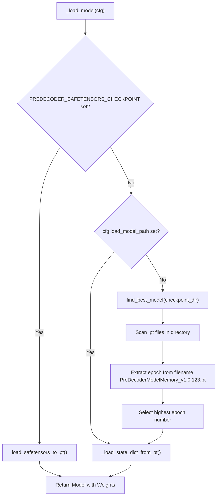

### Discovery Logic
*   **SafeTensors**: If the environment variable `PREDECODER_SAFETENSORS_CHECKPOINT` is provided, it takes absolute precedence. This is used for integrating with the CUDA-Q QEC C++ pipeline [code/scripts/local_run.sh:48]().
*   **Direct Path**: Users can specify a specific `.pt` file via `load_model_path`.
*   **Best-Model Discovery**: If no path is provided, `find_best_model` scans the checkpoint directory for files matching the pattern `PreDecoderModelMemory_v1.<EPOCH>.pt` and selects the one with the highest epoch [code/workflows/run.py:102-150]().

**Sources:** [code/workflows/run.py:102-170](), [code/scripts/local_run.sh:46-49]()

---

## Workflow Implementation Detail

### Inference Workflow
The inference workflow initializes the `DistributedManager`, loads the model, and invokes `run_inference` [code/workflows/run.py:77-82](). It supports an `ONNX_WORKFLOW` state machine (0-3) which can trigger ONNX export, TensorRT engine building, or loading pre-built engines for accelerated evaluation [code/scripts/local_run.sh:27-32]().

### Decoder Ablation Workflow
The `decoder_ablation` task routes to `evaluation.failure_analysis.decoder_ablation_study` [code/workflows/run.py:90-94](). This workflow is unique because it instantiates multiple global decoders to process the residual syndromes generated by the neural model.

#### Ablation System Components
The orchestrator sets up a factory-style initialization for global decoders:

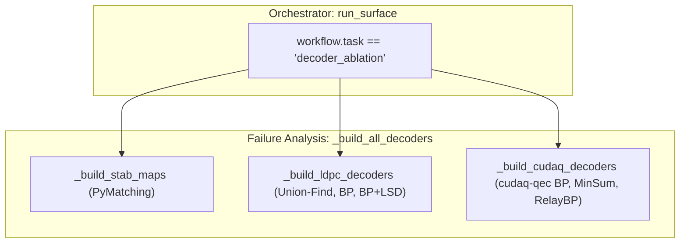

**Sources:** [code/workflows/run.py:89-94](), [code/evaluation/failure_analysis.py:39-178](), [code/tests/test_failure_analysis.py:171-190]()

---

# Page: Neural Network Model

# Neural Network Model

<details>
<summary>Relevant source files</summary>

The following files were used as context for generating this wiki page:

- [code/model/__init__.py](code/model/__init__.py)
- [code/model/factory.py](code/model/factory.py)
- [code/model/predecoder.py](code/model/predecoder.py)
- [code/model/registry.py](code/model/registry.py)
- [code/tests/test_model_factory.py](code/tests/test_model_factory.py)
- [code/tests/test_predecoder.py](code/tests/test_predecoder.py)
- [code/tests/test_v3_optimizations.py](code/tests/test_v3_optimizations.py)
- [conf/config_pre_decoder_memory_surface_model_1_d9.yaml](conf/config_pre_decoder_memory_surface_model_1_d9.yaml)

</details>


The neural network model in the Ising-Decoding project is designed as a pre-decoder that processes quantum error correction (QEC) syndrome data to predict error locations. The primary architecture, `PreDecoderModelMemory_v1`, utilizes 3D Convolutional Neural Networks (CNNs) to handle the spatio-temporal nature of surface code syndromes over multiple measurement rounds.

## Architecture: PreDecoderModelMemory_v1

The `PreDecoderModelMemory_v1` class is the core architectural implementation. It treats the syndrome data as a 3D volume where the dimensions represent space ($D \times D$ lattice) and time ($T$ measurement rounds) [code/model/predecoder.py:65-71]().

### Model Design
*   **3D Convolutions**: The model consists of a sequence of 3D convolutional layers [code/model/predecoder.py:90-104](). Each layer applies a kernel across the spatial and temporal dimensions simultaneously, allowing the network to learn correlations between syndromes in adjacent rounds and neighboring qubits.
*   **Residual Blocks**: While the base `PreDecoderModelMemory_v1` uses a sequential stack of convolutions, the module provides a `ResidualBlock3D` component [code/model/predecoder.py:23-63](). This block includes batch normalization and skip connections to facilitate deeper architectures and stable training.
*   **Activation Functions**: Supported activations include `ReLU`, `GELU` (with tanh approximation), and `LeakyReLU`, configurable via the `model.activation` parameter [code/model/predecoder.py:106-114]().
*   **Dropout**: 3D Dropout is applied between hidden layers to prevent overfitting [code/model/predecoder.py:99-101]().

### Input/Output Channel Conventions
The model operates on a 4-channel input tensor representing the syndrome and data qubit state information [code/model/predecoder.py:117-118]().

| Channel Index | Name | Description |
| :--- | :--- | :--- |
| 0 | `z_data` | Z-basis data qubit syndrome/error information |
| 1 | `x_data` | X-basis data qubit syndrome/error information |
| 2 | `syn_x` | X-type check syndromes |
| 3 | `syn_z` | Z-type check syndromes |

The output channel count is typically configured to match the number of prediction heads required for the specific decoding task (e.g., predicting the most likely error for both X and Z basis) [code/model/predecoder.py:83-86]().

### Model Data Flow
The following diagram illustrates the transformation from input syndromes to the predicted error residuals.

**Pre-Decoder Data Flow**
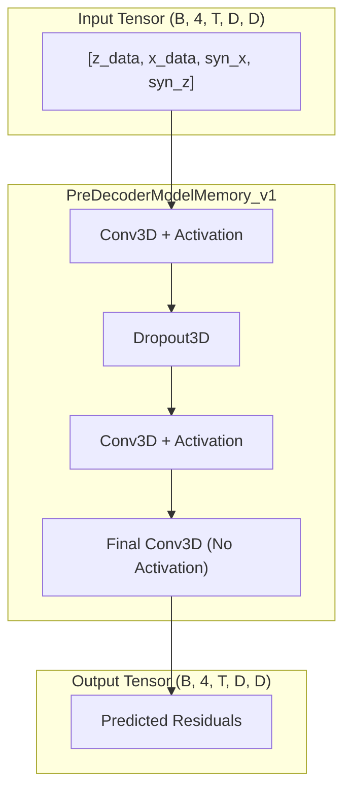
Sources: [code/model/predecoder.py:65-118](), [code/tests/test_predecoder.py:32-38]()

## Model Registry and Receptive Fields

The `model/registry.py` file defines a set of standard configurations (`model_id` 1–5) used in the public release. These IDs map to specific hyperparameters that determine the network's depth, width, and receptive field [code/model/registry.py:18-25]().

### Receptive Field Calculation
The receptive field $R$ represents the range of measurement rounds and spatial distance the model considers for a single prediction. It is calculated as:
$$R = 1 + \sum_{i} (k_i - 1)$$
where $k_i$ is the kernel size of the $i$-th layer [code/model/registry.py:41-42]().

### Registered Models
| Model ID | Layers | Kernel Sizes | Num Filters | Receptive Field |
| :--- | :--- | :--- | :--- | :--- |
| 1 | 4 | [3, 3, 3, 3] | [128, 128, 128, 4] | 9 |
| 2 | 4 | [3, 3, 3, 3] | [256, 256, 256, 4] | 9 |
| 3 | 4 | [5, 5, 5, 5] | [128, 128, 128, 4] | 17 |
| 4 | 6 | [3, 3, 3, 3, 3, 3] | [128, 128, 128, 128, 128, 4] | 13 |
| 5 | 6 | [3, 3, 3, 3, 3, 3] | [256, 256, 256, 256, 256, 4] | 13 |

Sources: [code/model/registry.py:54-95](), [code/model/registry.py:98-108]()

## Model Instantiation via ModelFactory

The `ModelFactory` provides a unified interface for creating model instances from a configuration object. It handles versioning and architecture selection [code/model/factory.py:22-25]().

**Factory Pattern Implementation**
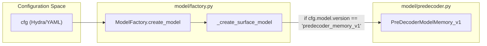
Sources: [code/model/factory.py:22-38](), [code/model/__init__.py:22-29]()

## Optimization and Training Support

The model architecture is compatible with several PyTorch optimization features:

*   **torch.compile**: The architecture is designed to be compatible with `torch.compile(mode='default')`, which is enabled by default in training configurations to improve execution speed on NVIDIA GPUs [conf/config_pre_decoder_memory_surface_model_1_d9.yaml:19-20]().
*   **EMA (Exponential Moving Average)**: Training supports maintaining an EMA of model weights. The system includes vectorized EMA updates using `torch._foreach_mul_` and `torch._foreach_add_` for high performance [code/tests/test_v3_optimizations.py:146-154](), [conf/config_pre_decoder_memory_surface_model_1_d9.yaml:101-103]().
*   **Mixed Precision**: The model supports both `FP16` and `BF16` training modes, as well as `TF32` for matrix multiplications and cuDNN operations [conf/config_pre_decoder_memory_surface_model_1_d9.yaml:14-18]().

Sources: [conf/config_pre_decoder_memory_surface_model_1_d9.yaml:14-20](), [code/tests/test_v3_optimizations.py:110-162]()

---

# Page: QEC Surface Code Layer

# QEC Surface Code Layer

<details>
<summary>Relevant source files</summary>

The following files were used as context for generating this wiki page:

- [code/data/generator_torch.py](code/data/generator_torch.py)
- [code/evaluation/metrics.py](code/evaluation/metrics.py)
- [code/qec/__init__.py](code/qec/__init__.py)
- [code/qec/surface_code/__init__.py](code/qec/surface_code/__init__.py)
- [code/qec/surface_code/data_mapping.py](code/qec/surface_code/data_mapping.py)
- [code/qec/surface_code/homological_equivalence.py](code/qec/surface_code/homological_equivalence.py)
- [code/qec/surface_code/homological_equivalence_torch.py](code/qec/surface_code/homological_equivalence_torch.py)
- [code/qec/surface_code/memory_circuit.py](code/qec/surface_code/memory_circuit.py)
- [code/qec/surface_code/memory_circuit_torch.py](code/qec/surface_code/memory_circuit_torch.py)
- [code/qec/surface_code/stim_utils.py](code/qec/surface_code/stim_utils.py)
- [code/tests/test_boundary_detectors.py](code/tests/test_boundary_detectors.py)
- [code/workflows/config_validator.py](code/workflows/config_validator.py)

</details>


The QEC Surface Code Layer provides the fundamental quantum error correction primitives for the decoding pipeline. It handles the construction of rotated surface code lattices, the generation of Stim-based memory circuits, and the mapping between physical syndrome data and the D×D grid format required by the neural network models.

## Surface Code Lattice Construction

The `SurfaceCode` class is the primary entity for defining the topological structure of the code. It supports rotated surface codes with odd distances [code/qec/surface_code/memory_circuit.py:28-54]().

### Orientation and Rotations
The codebase supports four distinct code orientations (O1–O4), which are mapped to internal representations of the first bulk syndrome type ('X' or 'Z') and the boundary orientation ('H' or 'V') [code/workflows/config_validator.py:37-43]().

| Public ID | Internal Alias | First Bulk Syndrome | Boundary Type |
| :--- | :--- | :--- | :--- |
| **O1** | XV | X | Vertical |
| **O2** | XH | X | Horizontal |
| **O3** | ZV | Z | Vertical |
| **O4** | ZH | Z | Horizontal |

Sources: [code/qec/surface_code/memory_circuit.py:56-62](), [code/workflows/config_validator.py:37-43]()

### Qubit Classification
The lattice is divided into three functional groups:
1.  **Data Qubits**: Qubits that store the logical information [code/qec/surface_code/memory_circuit.py:63]().
2.  **X-Check Qubits**: Ancilla qubits used to measure X-type stabilizers [code/qec/surface_code/memory_circuit.py:64]().
3.  **Z-Check Qubits**: Ancilla qubits used to measure Z-type stabilizers [code/qec/surface_code/memory_circuit.py:65]().

The `SurfaceCode` class generates these coordinates and builds the parity-check matrices `hx` and `hz` which define the mapping between stabilizers and their data qubit support [code/qec/surface_code/memory_circuit.py:75-90]().

## Memory Circuit Generation

The `MemoryCircuit` class (and its high-performance counterpart `MemoryCircuitTorch`) generates Stim circuits for memory experiments [code/qec/surface_code/memory_circuit.py:236-258]().

### 4-Phase Measurement Cycle
The memory circuit execution follows a standard QEC cycle:
1.  **Reset**: Initialization of ancilla and data qubits into the target basis.
2.  **Syndrome Extraction**: CNOT gate sequences between data and ancilla qubits to measure stabilizers.
3.  **Measurement**: Reading out the ancilla qubit states to detect errors.
4.  **Logical Measurement**: Final measurement of data qubits to determine the logical outcome.

### Boundary Detectors
The implementation includes "boundary detectors" which add specific detectors at the end of the circuit to capture errors that would otherwise only be seen during the final logical measurement [code/tests/test_boundary_detectors.py:53-75](). For a distance $d$ code, this adds $(d^2-1)/2$ detectors for the chosen basis [code/tests/test_boundary_detectors.py:77-80]().

Sources: [code/qec/surface_code/memory_circuit.py:236-258](), [code/tests/test_boundary_detectors.py:53-136]()

## Stabilizer-to-Data-Qubit Mappings

The neural network model expects syndrome data formatted as a spatial grid. The `data_mapping.py` module provides the logic to map linear stabilizer indices to specific data qubit locations on a $D \times D$ grid [code/qec/surface_code/data_mapping.py:16-29]().

### Boundary-Aware Selection
To ensure consistency across orientations, the mapping uses specific boundary conventions for weight-2 stabilizers:
*   **X-Stabilizers**: Pick the **Left** qubit for horizontal pairs and the **Top** qubit for vertical pairs [code/qec/surface_code/data_mapping.py:74-102]().
*   **Z-Stabilizers**: Pick the **Right** qubit for horizontal pairs and the **Top** qubit for vertical pairs [code/qec/surface_code/data_mapping.py:118-145]().

### Code Entity Space: Data Mapping Logic
The following diagram illustrates how the code routes mapping requests based on the selected orientation.

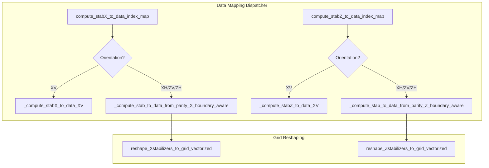
Sources: [code/qec/surface_code/data_mapping.py:34-151](), [code/qec/surface_code/__init__.py:28-40]()

## Homological Equivalence Transformations

To simplify training data and reduce the complexity of the syndrome space, the pipeline applies homological equivalence (HE) transformations. This process maps different physical error patterns that have the same syndrome and logical effect to a single canonical representative [code/qec/surface_code/homological_equivalence.py:18-29]().

### Transformation Types
1.  **Spacelike HE**: Canonicalizes errors within a single time slice by applying stabilizers to reduce the weight of error patterns (e.g., transforming weight-3/4 errors to weight-1/2) [code/qec/surface_code/homological_equivalence.py:24-26]().
2.  **Timelike HE**: Resolves equivalence across multiple measurement rounds, specifically handling measurement errors and time-correlated noise [code/qec/surface_code/homological_equivalence_torch.py:23-24]().

### High-Performance Implementation
The `MemoryCircuitTorch` utilizes a vectorized Torch implementation of HE to process large batches of syndrome data on the GPU [code/qec/surface_code/homological_equivalence_torch.py:32-40]().


Sources: [code/qec/surface_code/memory_circuit_torch.py:33-39](), [code/qec/surface_code/homological_equivalence_torch.py:19-25]()

## System Integration Diagram

This diagram bridges the high-level concepts of the Surface Code Layer with the specific Python classes and functions implemented in the codebase.

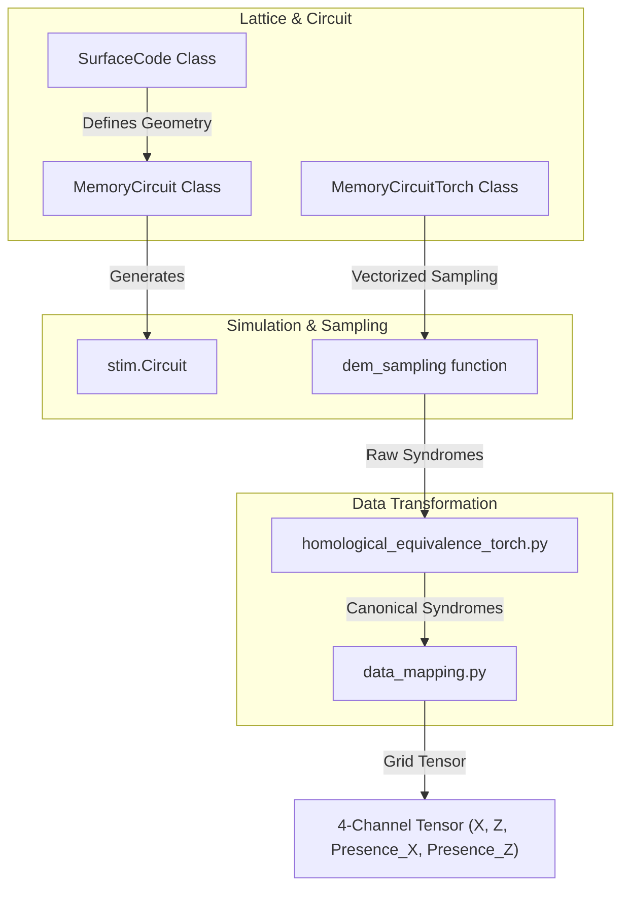
Sources: [code/qec/surface_code/memory_circuit.py:28-54](), [code/qec/surface_code/memory_circuit_torch.py:56-91](), [code/data/generator_torch.py:152-177]()

---

# Page: Noise Model

# Noise Model

<details>
<summary>Relevant source files</summary>

The following files were used as context for generating this wiki page:

- [code/qec/dem_sampling.py](code/qec/dem_sampling.py)
- [code/qec/noise_model.py](code/qec/noise_model.py)
- [code/qec/precompute_dem.py](code/qec/precompute_dem.py)
- [code/tests/test_dem_sampling.py](code/tests/test_dem_sampling.py)
- [code/tests/test_noise_model.py](code/tests/test_noise_model.py)

</details>


The Ising-Decoding project utilizes a comprehensive **25-parameter circuit-level noise model** to simulate realistic quantum hardware environments. This model moves beyond simple depolarizing noise by providing fine-grained control over specific error types, including state preparation, measurement, idling, and two-qubit gate errors.

## Overview of the 25 Parameters

The noise model is defined by 25 independent probability parameters that map directly to Stim circuit instructions. These parameters are grouped into four functional categories:

| Group | Parameters | Count | Description |
| :--- | :--- | :--- | :--- |
| **SPAM** | `p_prep_X/Z`, `p_meas_X/Z` | 4 | Errors during state preparation and measurement in X and Z bases. |
| **Idle (Bulk)** | `p_idle_cnot_X/Y/Z` | 3 | Single-qubit Pauli errors occurring on qubits during CNOT gate layers. |
| **Idle (SPAM)** | `p_idle_spam_X/Y/Z` | 3 | Single-qubit Pauli errors on data qubits during ancilla prep/reset windows. |
| **CNOT** | `p_cnot_IX` ... `p_cnot_ZZ` | 15 | All 15 possible two-qubit Pauli errors (excluding II) for CNOT gates. |

Sources: `[code/qec/noise_model.py:22-42]()`, `[code/qec/noise_model.py:108-143]()`

## NoiseModel Class API

The `NoiseModel` class is the central entity for managing these parameters. It is implemented as a Python `dataclass` and includes validation logic to ensure all probabilities are within the physical range $[0, 1]$.

### Key Methods
- `from_config_dict(config)`: Instantiates a model from a dictionary, typically loaded via Hydra from `conf/noise_model/`.
- `validate()`: Checks that individual probabilities are valid and that the sum of mutually exclusive errors (like CNOT or Idle channels) does not exceed 1.0. `[code/qec/noise_model.py:154-180]()`
- `get_max_probability()`: Returns the highest probability among all 25 parameters, often used as a proxy for the "physical error rate" $p$. `[code/qec/noise_model.py:214-218]()`
- `to_stim_dict()`: Converts the 25 parameters into a format compatible with `stim.Circuit` error instructions. `[code/qec/noise_model.py:246-277]()`

Sources: `[code/qec/noise_model.py:92-143]()`, `[code/qec/noise_model.py:154-180]()`

## Stim Instruction Mapping

The `NoiseModel` translates its internal parameters into specific Stim noise instructions within the `MemoryCircuit` generation process.

| Noise Parameter | Stim Instruction | Context |
| :--- | :--- | :--- |
| `p_prep_X/Z` | `Z_ERROR` / `X_ERROR` | Applied immediately after `R` or `RX` instructions. |
| `p_meas_X/Z` | `Z_ERROR` / `X_ERROR` | Applied immediately before `M` or `MX` instructions. |
| `p_idle_*` | `PAULI_CHANNEL_1` | Applied to idle qubits during gate or SPAM windows. |
| `p_cnot_*` | `PAULI_CHANNEL_2` | Applied to control and target qubits after a `CX` gate. |

Sources: `[code/qec/noise_model.py:97-107]()`, `[code/qec/noise_model.py:246-277]()`

### System Entity Mapping: Noise to Stim
The following diagram shows how the `NoiseModel` class interacts with the circuit generation and simulation layers.

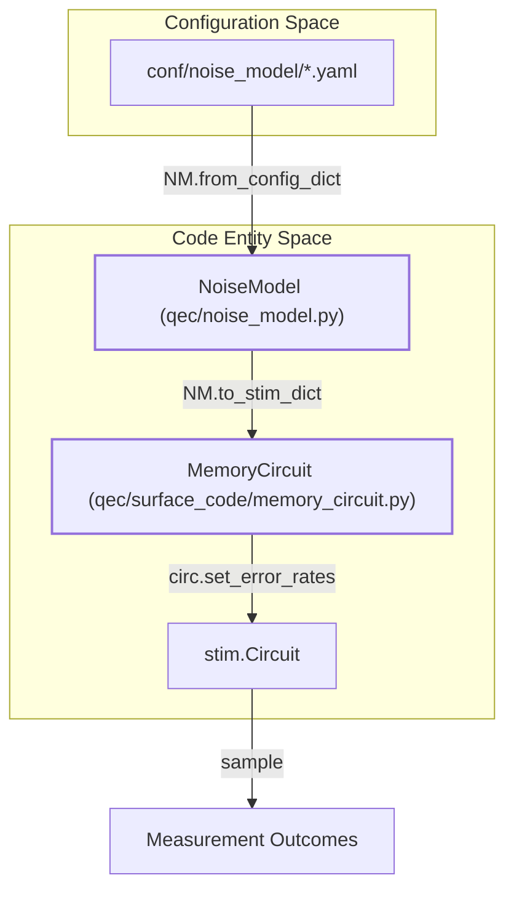
Sources: `[code/qec/noise_model.py:41-42]()`, `[code/qec/noise_model.py:246-277]()`, `[code/tests/test_noise_model.py:149-151]()`

## Training and Upscaling

To improve the robustness of the Pre-Decoder neural network, training is often performed at noise levels higher than the target inference noise.

- **Upscale Target**: The constant `SURFACE_CODE_TRAINING_UPSCALE_TARGET` is set to `6e-3`. `[code/qec/noise_model.py:49]()`
- **Logic**: If the provided noise model has a maximum probability lower than the target, the function `get_training_upscaled_noise_model` scales all 25 parameters linearly so that the maximum probability matches the target. `[code/qec/noise_model.py:317-336]()`
- **Threshold Warning**: The code defines `SURFACE_CODE_THRESHOLD_APPROX = 7.5e-3`. If a noise model exceeds this value, the system may issue warnings as the code is likely operating above the hashing threshold. `[code/qec/noise_model.py:51]()`

Sources: `[code/qec/noise_model.py:49-51]()`, `[code/qec/noise_model.py:317-336]()`

## Noise Drift and Randomization

The model supports simulating "noise drift" where parameters deviate from their reference values over time or across samples.

- **Reference State**: The `NoiseModel` captures a `_reference` dictionary upon initialization. `[code/qec/noise_model.py:145-151]()`
- **Randomization**: The `randomize_from_drift` method allows parameters to vary within a specified `max_drift_ratio`. For example, a ratio of 0.1 allows a parameter to vary by ±10% of its reference value. `[code/qec/noise_model.py:284-314]()`

Sources: `[code/qec/noise_model.py:145-151]()`, `[code/qec/noise_model.py:284-314]()`

## Data Flow: From Noise Parameters to Syndrome Diffs

The noise model influences the generation of training data through a pipeline that converts circuit errors into grid-based syndrome tensors.

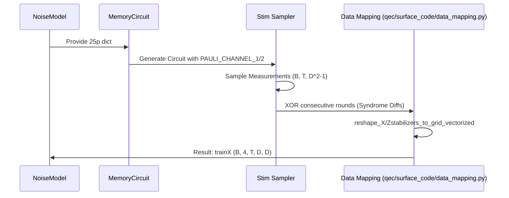
Sources: `[code/tests/test_noise_model.py:113-195]()`, `[code/qec/noise_model.py:246-277]()`

## Statistical Validation

The implementation includes rigorous statistical tests in `code/tests/test_noise_model.py` to ensure that the 25-parameter model correctly replicates expected syndrome densities.

- **Syndrome Diffs**: Tests compare XORed consecutive rounds rather than raw measurements. `[code/tests/test_noise_model.py:20-22]()`
- **Masking**: Inference-style masking is applied (masking non-basis syndromes at round 0 and the final round) to match the model's expected input distribution. `[code/tests/test_noise_model.py:21-22]()`, `[code/tests/test_noise_model.py:168-173]()`

Sources: `[code/tests/test_noise_model.py:18-26]()`, `[code/tests/test_noise_model.py:113-195]()`

---

# Page: Data Pipeline

# Data Pipeline

<details>
<summary>Relevant source files</summary>

The following files were used as context for generating this wiki page:

- [.github/workflows/ci.yml](.github/workflows/ci.yml)
- [code/data/__init__.py](code/data/__init__.py)
- [code/data/datapipe_stim.py](code/data/datapipe_stim.py)
- [code/data/factory.py](code/data/factory.py)
- [code/tests/test_dataloader_multiprocessing.py](code/tests/test_dataloader_multiprocessing.py)

</details>


The data pipeline in the Ising-Decoding project is responsible for transforming quantum circuit simulations into structured tensor inputs for the neural network. It bridges the gap between Stim-based circuit sampling and the 4-channel 3D CNN architecture. The pipeline supports two primary modes: real-time generation during training/inference and high-performance loading from precomputed datasets.

### Pipeline Overview

The pipeline converts raw measurement outcomes from a `MemoryCircuit` into "syndrome differences" mapped onto a 2D grid that reflects the physical layout of the surface code. This process ensures that the spatial correlations of errors are preserved for the convolutional layers.

#### Data Flow: Circuit to Tensor
The following diagram illustrates how measurement bits are processed into the model's input format.

**Syndrome Processing Workflow**
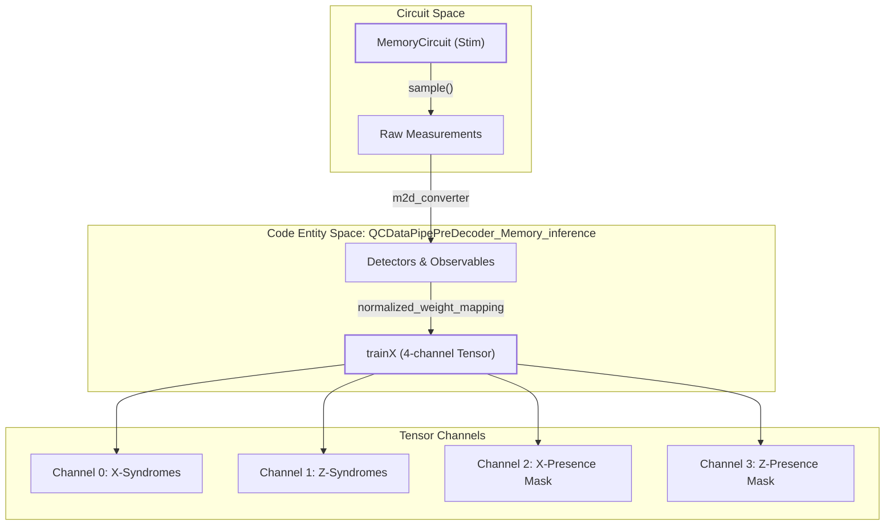
Sources: [code/data/datapipe_stim.py:36-52](), [code/data/datapipe_stim.py:121-138](), [code/data/datapipe_stim.py:28-33]()

---

### On-the-Fly Data Generation

For training and standard inference, the pipeline generates data dynamically. This is handled by `QCDataGeneratorTorch` (for training) and `QCDataPipePreDecoder_Memory_inference` (for inference). The system uses `DatapipeFactory` to instantiate the appropriate generator based on the configuration.

- **Syndrome Differencing**: Instead of raw measurement values, the pipeline often calculates the difference between consecutive rounds to identify error events (detectors).
- **Mixed-Basis Support**: The pipeline can generate batches containing both X-basis and Z-basis memory experiments, controlled by the `measure_basis` parameter [code/data/datapipe_stim.py:76-77]().
- **Multiprocessing**: To maximize throughput, the datapipes are designed to be "pickle-safe," allowing them to run in parallel using the `spawn` multiprocessing context in PyTorch `DataLoader` [code/tests/test_dataloader_multiprocessing.py:13-15]().

For details, see [On-the-Fly Data Generation](#3.1).

Sources: [code/data/factory.py:26-32](), [code/data/datapipe_stim.py:36-40](), [code/tests/test_dataloader_multiprocessing.py:44-45]()

---

### Precomputed Frames

To reduce CPU overhead during large-scale training runs, the system supports loading precomputed syndrome frames. This is particularly useful when using complex noise models that are computationally expensive to simulate at runtime.

- **Offline Generation**: The `precompute_frames.py` script generates and saves batches of syndromes to the `frames_data/` directory.
- **Integration**: `generator_torch.py` can be configured to pull from these precomputed files, falling back to on-the-fly generation only if the requested data is missing.
- **Performance**: Using precomputed frames significantly increases GPU utilization by removing the Stim simulation bottleneck from the training loop.

For details, see [Precomputed Frames](#3.2).

Sources: [code/data/factory.py:58-60](), [code/data/__init__.py:15-22]()

---

### Component Interaction

The `DatapipeFactory` acts as the central router, selecting the data source based on the `cfg.datapipe` and `cfg.code` settings.

**Data Component Relationships**
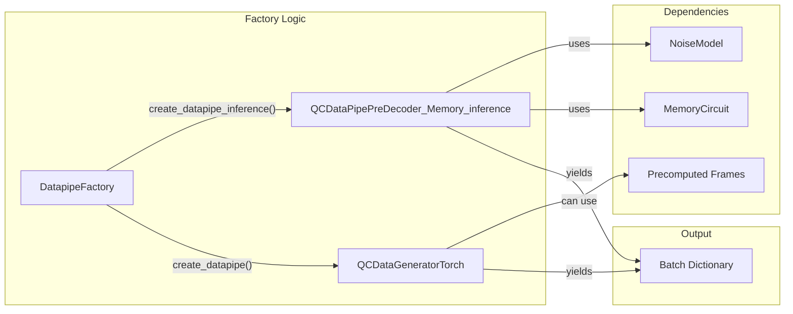
Sources: [code/data/factory.py:34-48](), [code/data/factory.py:70-71](), [code/data/datapipe_stim.py:27-33]()

### Summary Table

| Feature | On-the-Fly (Inference) | Precomputed (Training) |
| :--- | :--- | :--- |
| **Primary Class** | `QCDataPipePreDecoder_Memory_inference` | `QCDataGeneratorTorch` |
| **Backend** | Stim (Live Sampling) | Disk (`frames_data/`) |
| **Noise Support** | Full 25-parameter `NoiseModel` | Static per-file configuration |
| **Use Case** | LER Evaluation / Testing | Large-scale model optimization |

Sources: [code/data/factory.py:26-32](), [code/data/datapipe_stim.py:112-122]()

---

# Page: On-the-Fly Data Generation

# On-the-Fly Data Generation

<details>
<summary>Relevant source files</summary>

The following files were used as context for generating this wiki page:

- [.github/workflows/ci.yml](.github/workflows/ci.yml)
- [code/data/__init__.py](code/data/__init__.py)
- [code/data/datapipe_stim.py](code/data/datapipe_stim.py)
- [code/data/factory.py](code/data/factory.py)
- [code/data/precompute_frames.py](code/data/precompute_frames.py)
- [code/evaluation/__init__.py](code/evaluation/__init__.py)
- [code/evaluation/threshold_plot.py](code/evaluation/threshold_plot.py)
- [code/tests/test_data_factory.py](code/tests/test_data_factory.py)
- [code/tests/test_dataloader_multiprocessing.py](code/tests/test_dataloader_multiprocessing.py)
- [code/tests/test_precomputed_frames_fallback.py](code/tests/test_precomputed_frames_fallback.py)

</details>


This page describes the runtime data generation pipeline used for both training and inference. The system is designed to sample Stim circuits dynamically, transform raw measurement data into a 4-channel tensor format compatible with 3D CNNs, and support complex noise models with high throughput.

## Overview

The data pipeline provides two primary modes of operation:
1.  **Training Mode**: Uses `QCDataGeneratorTorch` (or similar generators) to produce infinite streams of noisy syndrome data.
2.  **Inference Mode**: Uses `QCDataPipePreDecoder_Memory_inference` to generate fixed-size datasets from Stim circuits for performance evaluation and Logical Error Rate (LER) calculation.

Both modes share a common tensor format and logic for mapping physical stabilizers to grid-based coordinates.

### Data Flow and Entity Mapping

The following diagram illustrates how the code entities interact to move data from a Stim circuit simulation into the neural network.

**Data Generation Pipeline Architecture**
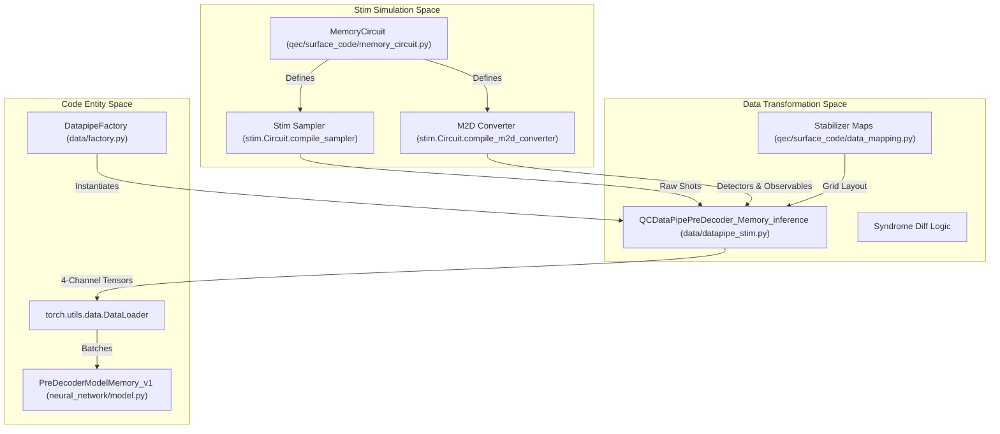
Sources: [code/data/datapipe_stim.py:36-40](), [code/data/factory.py:26-32](), [code/qec/surface_code/memory_circuit.py:1-20]()

---

## The 4-Channel Tensor Format

The neural network expects a 4-channel input tensor, referred to as `trainX`. This format translates the irregular surface code lattice into a regular grid suitable for 3D convolutions.

| Channel | Name | Description |
| :--- | :--- | :--- |
| 0 | **X-syndromes** | Binary values of X-type stabilizer measurements (syndrome diffs). |
| 1 | **Z-syndromes** | Binary values of Z-type stabilizer measurements (syndrome diffs). |
| 2 | **X-presence** | Mask indicating valid X-stabilizer locations for the given code distance/rotation. |
| 3 | **Z-presence** | Mask indicating valid Z-stabilizer locations for the given code distance/rotation. |

The tensor shape is `(Batch, Channels, Time, Distance, Distance)`. 

### Syndrome Diff Computation
Instead of raw measurement values, the pipeline computes the **syndrome diff**: $d_t = m_t \oplus m_{t-1}$, where $m_t$ is the measurement at time $t$. This ensures that the network receives local change information, which is critical for identifying error chains in time [code/data/datapipe_stim.py:165-170]().

Sources: [code/data/datapipe_stim.py:86-95](), [code/data/datapipe_stim.py:21-22]()

---

## QCDataPipePreDecoder_Memory_inference

This class is the primary implementation for on-the-fly generation during inference. It encapsulates the `MemoryCircuit` and handles the mapping of Stim's 1D measurement arrays into the 4-channel 3D grid.

### Key Features
*   **Mixed-Basis Support**: Can generate batches containing only X-basis, only Z-basis, or a 50/50 mix ("both") [code/data/datapipe_stim.py:76-76]().
*   **Precomputed Transformations**: To maximize throughput, the stabilizer-to-grid index maps are precomputed during `__init__` [code/data/datapipe_stim.py:79-84]().
*   **Noise Model Integration**: Supports the 25-parameter `NoiseModel`. If a noise model is provided, it overrides the scalar `p_error` [code/data/datapipe_stim.py:98-101]().

### Multiprocessing and Pickle-Safety
The datapipe is designed to be "pickle-safe," allowing it to work with `torch.utils.data.DataLoader` using `num_workers > 0` and the `spawn` multiprocessing context [code/tests/test_dataloader_multiprocessing.py:13-15](). This is verified in CI to ensure no shared state causes deadlocks or memory corruption [code/.github/workflows/ci.yml:84-101]().

Sources: [code/data/datapipe_stim.py:36-52](), [code/tests/test_dataloader_multiprocessing.py:33-47]()

---

## DatapipeFactory

The `DatapipeFactory` serves as the entry point for creating data structures based on the Hydra configuration.

**Logic Flow in DatapipeFactory**
```mermaid
graph TD
    START["DatapipeFactory.create_datapipe_inference(cfg)"]
    CHECK_CODE{"cfg.code == 'surface'?"}
    CHECK_PIPE{"cfg.datapipe == 'memory'?"}
    NM_MODE{"cfg.test.noise_model?"}
    
    START --> CHECK_CODE
    CHECK_CODE -- Yes --> CHECK_PIPE
    CHECK_PIPE -- Yes --> NM_MODE
    
    NM_MODE -- "train" --> LOAD_NM["Load NoiseModel from cfg.data.noise_model"]
    NM_MODE -- "none" --> NO_NM["Use scalar cfg.test.p_error"]
    
    LOAD_NM --> INST["Instantiate QCDataPipePreDecoder_Memory_inference"]
    NO_NM --> INST
    INST --> RETURN["Return Dataset"]
```

The factory ensures that if a user specifies `cfg.test.noise_model='train'`, the system strictly uses the complex noise model and refuses to fall back to a legacy scalar `p_error` if the noise model fails to load [code/data/factory.py:104-111]().

Sources: [code/data/factory.py:26-49](), [code/data/factory.py:65-122]()

---

## Implementation Details: Syndrome Mapping

The transformation from Stim measurements to the 4-channel grid is performed using precomputed index maps:
1.  **Data Index Map**: `compute_stabX_to_data_index_map` and `compute_stabZ_to_data_index_map` determine which grid coordinate $(i, j)$ corresponds to which Stim detector index [code/data/datapipe_stim.py:71-72]().
2.  **Presence Masks**: `normalized_weight_mapping_Xstab_memory` creates a binary mask of the lattice shape. This mask is stored in channels 2 and 3 of the `trainX` tensor to tell the CNN which grid cells are "padding" and which are active stabilizers [code/data/datapipe_stim.py:64-69]().

Sources: [code/data/datapipe_stim.py:62-75](), [code/qec/surface_code/data_mapping.py:28-33]()

---

# Page: Precomputed Frames

# Precomputed Frames

<details>
<summary>Relevant source files</summary>

The following files were used as context for generating this wiki page:

- [code/data/generator_torch.py](code/data/generator_torch.py)
- [code/data/precompute_frames.py](code/data/precompute_frames.py)
- [code/evaluation/__init__.py](code/evaluation/__init__.py)
- [code/evaluation/metrics.py](code/evaluation/metrics.py)
- [code/evaluation/threshold_plot.py](code/evaluation/threshold_plot.py)
- [code/qec/surface_code/homological_equivalence.py](code/qec/surface_code/homological_equivalence.py)
- [code/tests/test_precomputed_frames_fallback.py](code/tests/test_precomputed_frames_fallback.py)
- [code/workflows/config_validator.py](code/workflows/config_validator.py)

</details>


In the Ising-Decoding pipeline, "Precomputed Frames" refer to the offline generation and storage of Decoder Error Model (DEM) bundles—specifically the parity-check matrix ($H$), marginal error probabilities ($p$), and homological equivalence maps ($A$). By precomputing these artifacts, the system avoids the significant overhead of Stim circuit parsing and DEM construction during the training loop or real-time inference.

### Offline Data Generation via precompute_frames.py

The script `code/data/precompute_frames.py` serves as the primary entry point for generating these artifacts. It allows users to specify ranges of distances and rounds to batch-process multiple surface code configurations.

**Key Operations:**
*   **Normalization:** Converts public orientation aliases (O1–O4) to internal rotation formats (XV, XH, ZV, ZH) [code/data/precompute_frames.py:49-56]().
*   **Bundle Generation:** Calls `precompute_dem_bundle_surface_code` to generate the four required `.npz` files for a given basis (X or Z) [code/data/precompute_frames.py:169-178]().
*   **Artifacts Produced:**
    *   `surface_d{d}_r{r}_{basis}_frame_predecoder.X.npz`: X-syndrome mapping.
    *   `surface_d{d}_r{r}_{basis}_frame_predecoder.Z.npz`: Z-syndrome mapping.
    *   `surface_d{d}_r{r}_{basis}_frame_predecoder.p.npz`: Marginal error probabilities.
    *   `surface_d{d}_r{r}_{basis}_frame_predecoder.A.npz`: Homological equivalence (HE) matrices [code/data/precompute_frames.py:29-33]().

**Sources:** [code/data/precompute_frames.py:16-34](), [code/data/precompute_frames.py:49-56](), [code/data/precompute_frames.py:169-178]()

---

### Data Flow: Generation to Storage

The following diagram illustrates how the precomputation script bridges the gap between the physical circuit definition (Stim) and the serialized artifacts used by the training pipeline.

**Precomputation Data Flow**
```mermaid
graph TD
    subgraph "Natural Language Space"
        User["User Config (d, r, rot)"]
    end

    subgraph "Code Entity Space"
        Script["precompute_frames.py"]
        DEM_Func["precompute_dem_bundle_surface_code"]
        Stim["Stim Circuit Generator"]
        Files[("frames_data/ directory")]
    end

    User -- "CLI Arguments" --> Script
    Script -- "distance, n_rounds, basis" --> DEM_Func
    DEM_Func -- "Generate" --> Stim
    Stim -- "DEM Analysis" --> DEM_Func
    DEM_Func -- "Save .npz (H, p, A)" --> Files
```
**Sources:** [code/data/precompute_frames.py:59-129](), [code/data/precompute_frames.py:169-178]()

---

### Fallback Mechanism and Resolution

The system is designed to be resilient to missing precomputed data. During the initialization of a training or inference workflow, `resolve_precomputed_frames_dir` checks for the existence of the required `.npz` files in the configured directory (defaulting to `frames_data/`).

| Condition | Action | Implementation Detail |
| :--- | :--- | :--- |
| **Files Found** | Use precomputed path | Returns the directory string to the generator [code/tests/test_precomputed_frames_fallback.py:34-43](). |
| **Files Missing** | In-memory generation | Returns `None`, triggering `QCDataGeneratorTorch` to build a nominal DEM bundle on-the-fly [code/data/generator_torch.py:113-136](). |
| **Default Path** | Repo root | `_default_precomputed_frames_dir` resolves to `<repo_root>/frames_data` [code/workflows/config_validator.py:55-64](). |

**Sources:** [code/workflows/config_validator.py:55-64](), [code/data/generator_torch.py:113-136](), [code/tests/test_precomputed_frames_fallback.py:27-43]()

---

### Integration in QCDataGeneratorTorch

The `QCDataGeneratorTorch` class integrates precomputed frames to initialize its underlying simulation engines. This integration occurs during the `__init__` phase of the data pipeline.

**Implementation Logic:**
1.  **Directory Check:** If `precomputed_frames_dir` is provided, the generator attempts to load artifacts from disk [code/data/generator_torch.py:157-176]().
2.  **In-Memory Fallback:** If the directory is `None`, it invokes `precompute_dem_bundle_surface_code` with `export=False` and `return_artifacts=True` to populate an internal `dem_cache` [code/data/generator_torch.py:113-136]().
3.  **Circuit Initialization:** The cached or loaded $H$, $p$, and $A$ tensors are passed to `MemoryCircuitTorch`, which handles the actual syndrome sampling and homological equivalence logic [code/data/generator_torch.py:153-176]().

**Generator Integration Architecture**
```mermaid
graph TD
    subgraph "Data Pipeline Classes"
        Generator["QCDataGeneratorTorch"]
        MemCirc["MemoryCircuitTorch"]
        DEM_Bundle["precompute_dem_bundle_surface_code"]
    end

    subgraph "Storage"
        Disk[("frames_data/*.npz")]
    end

    Generator -- "Check Path" --> Disk
    Disk -- "Exists: Load H, p, A" --> MemCirc
    Disk -- "Missing: Trigger" --> DEM_Bundle
    DEM_Bundle -- "In-Memory Artifacts" --> Generator
    Generator -- "Pass Tensors" --> MemCirc
```
**Sources:** [code/data/generator_torch.py:113-136](), [code/data/generator_torch.py:153-176]()

---

### Configuration Reference

Precomputed frames are managed via the `data` section of the configuration:

*   `data.precomputed_frames_dir`: Path to the directory containing `.npz` files. If set to `null`, the system defaults to the internal fallback [code/workflows/config_validator.py:149]().
*   `data.code_rotation`: Must match the rotation used during precomputation (O1–O4) [code/workflows/config_validator.py:37-43]().
*   `data.meas_basis`: Determines whether the generator looks for "X", "Z", or "both" (mixed) basis frames [code/data/generator_torch.py:67-68]().

**Sources:** [code/workflows/config_validator.py:37-43](), [code/workflows/config_validator.py:149](), [code/data/generator_torch.py:67-68]()

---

# Page: Training

# Training

<details>
<summary>Relevant source files</summary>

The following files were used as context for generating this wiki page:

- [TRAINING.md](TRAINING.md)
- [code/tests/test_training_utils.py](code/tests/test_training_utils.py)
- [code/training/train.py](code/training/train.py)

</details>


The training system in the Ising-Decoding project is designed for high-throughput, distributed optimization of neural pre-decoders. It orchestrates the full lifecycle of the model—from on-the-fly syndrome data generation to multi-GPU gradient descent and automated checkpointing. The primary entry point for this subsystem is `train.py`, which integrates Hydra-based configuration with PyTorch's distributed engine.

### Training Orchestration
The `train.py` module manages the high-level execution flow. It handles environment setup, model instantiation via the `ModelFactory`, and the execution of the training epochs. It also includes logic for noise model upscaling to improve model robustness during training [code/training/train.py:24-29]().

Key responsibilities of the training orchestrator include:
*   **Batch Scheduling**: Dynamically adjusting the per-device batch size based on the current epoch to ramp up training intensity [code/training/train.py:140-179]().
*   **Checkpoint Management**: Saving and loading model states, optimizer states, and EMA (Exponential Moving Average) weights to ensure continuity across job restarts [code/training/train.py:1255-1270]().
*   **Resource Monitoring**: Tracking wall time, throughput (samples/sec), and GPU utilization to provide a compact summary of training performance [code/training/train.py:51-53]().

### Training System Overview
The following diagram illustrates how the `train.py` script coordinates different components to execute the training lifecycle.

**Training Lifecycle Orchestration**
```mermaid
graph TD
    subgraph "Initialization"
        A["train.py:main()"] --> B["DistributedManager"]
        A --> C["ModelFactory"]
        A --> D["get_lr_scheduler()"]
    end

    subgraph "Epoch Loop"
        E["train_epoch()"] --> F["QCDataGeneratorTorch"]
        F --> G["Forward Pass"]
        G --> H["Backward Pass"]
        H --> I["Optimizer.step()"]
        I --> J["EMA.update()"]
    end

    subgraph "Validation & Checkpointing"
        K["validation_step()"] --> L["SDR Gate Check"]
        L -- "Pass" --> M["save_checkpoint()"]
        L -- "Fail" --> N["Skip Save"]
    end

    A --> E
    E --> K
    K --> E
```
Sources: [code/training/train.py:83-107](), [code/training/train.py:1174-1310](), [code/training/train.py:1344-1365]()

---

### Training Loop and Optimization
The core logic for a single pass over the data resides in `train_epoch`. This function handles the iteration over synthetic syndrome batches generated by `QCDataGeneratorTorch`. The optimization process utilizes advanced techniques such as:
*   **Mixed Precision**: Using `torch.amp` for FP16 or BF16 training to accelerate computation [code/training/train.py:76-77]().
*   **Gradient Accumulation**: Decoupling the effective batch size from GPU memory limits by accumulating gradients over multiple steps [code/training/train.py:181-205]().
*   **Optimization Algorithms**: Support for standard `AdamW` or the memory-efficient `Lion` optimizer [code/training/train.py:92-93]().
*   **Early Stopping**: A time-based mechanism that monitors `job_time_limit_seconds` to gracefully exit and save before a cluster job expires [code/tests/test_training_utils.py:54-73]().

For details on the optimization inner loop, see [Training Loop and Optimization](#4.1).

### Distributed Training
To handle the high sample counts required for QEC training (often millions of samples per epoch), the system scales across multiple GPUs using PyTorch Distributed Data Parallel (DDP).
*   **Strategy**: The `DistributedManager` initializes the NCCL backend and sets up rank-specific seeding to ensure data diversity across the cluster [code/training/distributed.py:20-45]().
*   **Deployment**: Training is optimized for remote clusters using Docker containers and SLURM integration, as detailed in the `TRAINING.md` guide [TRAINING.md:1-50]().
*   **Throughput**: The system is designed to maximize throughput by using `static_graph=True` in DDP and minimizing CPU-GPU synchronization stalls [code/training/train.py:31-36]().

For details on the multi-GPU infrastructure, see [Distributed Training](#4.2).

### Training Data Flow
The data pipeline is tightly coupled with the training loop. While the system supports precomputed frames to reduce CPU overhead, it primarily defaults to on-the-fly generation to avoid massive disk I/O requirements for large-scale training.

**Data to Model Flow**
```mermaid
graph LR
    subgraph "Data Generation Space"
        STIM["Stim Circuit"] -- "Sample" --> DET["Detectors/Observables"]
        DET -- "QCDataGeneratorTorch" --> TENSOR["4-Channel Tensor [B, C, H, W, T]"]
    end

    subgraph "Neural Network Space"
        TENSOR -- "Forward" --> PRED["PreDecoderModelMemory_v1"]
        PRED -- "Loss" --> OPT["AdamW / Lion"]
    end

    subgraph "Metrics Space"
        PRED -- "SDR Computation" --> SDR["Syndrome Density Reduction"]
        PRED -- "LER Computation" --> LER["Logical Error Rate"]
    end
```
Sources: [code/training/train.py:103-107](), [code/training/train.py:110-138](), [code/tests/test_training_utils.py:133-166]()

### Checkpointing and SDR Gating
Checkpoints are not saved purely based on epoch count. To ensure only high-quality models are preserved, the system uses a **Syndrome Density Reduction (SDR) threshold gate**. If the model does not achieve a minimum reduction factor (e.g., 1.5x reduction in syndrome density), the checkpoint is skipped to save storage and focus on converged models [code/training/train.py:38-43]().

Sources:
*   `code/training/train.py`
*   `TRAINING.md`
*   `code/tests/test_training_utils.py`
*   `code/training/distributed.py`

---

# Page: Training Loop and Optimization

# Training Loop and Optimization

<details>
<summary>Relevant source files</summary>

The following files were used as context for generating this wiki page:

- [code/tests/test_checkpoint_resume.py](code/tests/test_checkpoint_resume.py)
- [code/tests/test_training_logging.py](code/tests/test_training_logging.py)
- [code/tests/test_training_progress.py](code/tests/test_training_progress.py)
- [code/tests/test_training_utils.py](code/tests/test_training_utils.py)
- [code/training/capture.py](code/training/capture.py)
- [code/training/logging.py](code/training/logging.py)
- [code/training/optimizers.py](code/training/optimizers.py)
- [code/training/train.py](code/training/train.py)
- [code/training/utils.py](code/training/utils.py)

</details>


This page provides a technical deep dive into the training execution logic of the Ising-Decoding project. It covers the lifecycle of a training epoch, the optimization strategies employed to improve convergence and hardware utilization, and the safety mechanisms for long-running jobs.

## Training Lifecycle Overview

The training process is orchestrated by `code/training/train.py`. It utilizes a custom loop rather than a high-level framework to maintain fine-grained control over gradient accumulation, mixed-precision scaling, and on-the-fly data generation.

### Core Entities and Data Flow

The following diagram illustrates how the training loop components interact during a single step.

**Training Step Data Flow**
```mermaid
graph TD
    subgraph "Data Space"
        "QCDataGeneratorTorch" -- "generate_batch()" --> "Batch_Dict"
    end

    subgraph "Optimization Space"
        "Batch_Dict" -- "Forward Pass" --> "Loss_Tensor"
        "Loss_Tensor" -- "backward()" --> "GradScaler"
        "GradScaler" -- "step()" --> "AdamW/Lion"
        "AdamW/Lion" -- "update" --> "Model_Weights"
        "Model_Weights" -- "EMA_Update" --> "EMA_Model"
    end

    subgraph "Monitoring Space"
        "Loss_Tensor" --> "SummaryWriter"
        "EMA_Model" -- "Validation" --> "LER/SDR_Metrics"
        "LER/SDR_Metrics" --> "SummaryWriter"
    end

    style "QCDataGeneratorTorch" stroke-dasharray: 5 5
```
Sources: `[code/training/train.py:1298-1450]()`, `[code/training/train.py:1020-1150]()`

## Execution Logic: `train_epoch`

The `train_epoch` function handles the iteration over the generated data for a single epoch. It manages several critical performance and correctness features:

### 1. Gradient Accumulation
To support large effective batch sizes on limited GPU memory, the loop uses `accumulate_steps`. Gradients are only synchronized across GPUs (via DDP) and updated by the optimizer every $N$ steps.
*   **Logic:** `model.no_sync()` is used during accumulation phases to prevent premature NCCL communication `[code/training/train.py:1082-1085]()`.
*   **Scaling:** As the batch size ramps up, `accumulate_steps` is adjusted to keep the effective batch size consistent or growing as configured `[code/training/train.py:181-205]()`.

### 2. Mixed Precision (FP16/BF16)
The loop utilizes `torch.amp.autocast` for forward passes and `torch.cuda.amp.GradScaler` to manage gradient scaling for FP16 training `[code/training/train.py:1091-1100]()`. This significantly improves throughput on NVIDIA Ampere and Hopper architectures.

### 3. Exponential Moving Average (EMA)
The system maintains an EMA of the model weights. The EMA model is typically used for validation and final inference as it provides a more stable representation of the learned parameters.
*   **Implementation:** Updates occur after every optimizer step using an optimized `_foreach` implementation to minimize kernel launch overhead `[code/training/train.py:1123-1135]()`.

Sources: `[code/training/train.py:1020-1168]()`

## Optimization Algorithms

### Optimizers: AdamW and Lion
The project supports standard `AdamW` and the memory-efficient `Lion` optimizer.
*   **Lion Optimizer:** Implemented in `training.optimizers.Lion`, it uses the sign of the momentum for updates, which can provide better generalization in some QEC contexts `[code/training/optimizers.py:24-91]()`.
*   **DebugLion:** A variant that includes built-in NaN/Inf detection to skip updates if gradients explode, preventing model divergence `[code/training/optimizers.py:93-157]()`.

### Learning Rate Scheduling
The `get_lr_scheduler` function provides two primary schedules `[code/training/optimizers.py:160-205]()`:
1.  **Warmup then Decay:** Linear warmup for a fixed number of steps followed by multi-step gamma decay.
2.  **Cosine with Warmup:** Linear warmup followed by a cosine annealing schedule to a minimum LR.

### Batch Size Ramping
The `get_current_per_device_batch_size` function implements a linear ramp `[code/training/train.py:140-179]()`. This allows the model to start training on small batches (stabilizing early gradients) and transition to larger batches for better GPU utilization and gradient estimation as training progresses.

Sources: `[code/training/optimizers.py:1-205]()`, `[code/training/train.py:140-180]()`

## Validation and Checkpointing

### Validation Step
The `validation_step` function evaluates the EMA model on a held-out set of syndromes. It computes:
*   **LER (Logical Error Rate):** The frequency of uncorrected logical failures.
*   **SDR (Syndrome Density Reduction):** A metric indicating how much the pre-decoder has simplified the syndrome for the second-tier decoder `[code/training/train.py:921-1017]()`.

### SDR Threshold Gate
A unique feature of this training loop is the `syndrome_density_threshold`. Checkpoints are only saved if the model achieves a minimum SDR (e.g., 1.5x reduction) `[code/training/train.py:38-43]()`. This prevents saving "best" models that haven't actually learned to simplify the noise effectively `[code/training/train.py:1473-1485]()`.

### Time-Based Early Stopping
For execution in SLURM or time-limited environments, `should_stop_due_to_time` monitors the average duration of recent epochs. If the estimated time for the next epoch plus a safety margin exceeds the job limit, training performs a clean exit and saves a final checkpoint `[code/training/utils.py:56-106]()`.

Sources: `[code/training/train.py:921-1017]()`, `[code/training/utils.py:56-106]()`, `[code/evaluation/metrics.py:95-101]()`

## Monitoring and Logging

Training progress is logged via `TensorBoard` and a compact console summary.

| TensorBoard Key | Description |
| :--- | :--- |
| `Loss/train_step` | Smooth loss per optimizer update |
| `Metrics/LER` | Logical Error Rate from validation |
| `Metrics/SDR` | Syndrome Density Reduction factor |
| `Speed/throughput_samp_per_s` | Samples processed per second |
| `Speed/ms_per_batch` | Wall clock time for a single forward/backward pass |

**Logging Architecture**
```mermaid
graph LR
    subgraph "train.py Loop"
        "L[Loss]"
        "T[Throughput]"
    end

    subgraph "Validation"
        "V[LER/SDR]"
    end

    "L" --> "SummaryWriter"
    "T" --> "SummaryWriter"
    "V" --> "SummaryWriter"
    "SummaryWriter" --> "events.out.tfevents"
    "events.out.tfevents" --> "training_progress.py"
```
Sources: `[code/training/train.py:50-54]()`, `[code/scripts/training_progress.py:5-15]()`

## Implementation Details: Checkpoint Resilience

The system is designed for seamless resume. `load_checkpoint` restores the model, EMA weights, optimizer state, and the LR scheduler's internal step counter `[code/training/utils.py:314-410]()`. This ensures that resuming a job does not cause a "spike" in the learning rate or skip data in the batch schedule `[code/tests/test_checkpoint_resume.py:120-184]()`.

Sources: `[code/training/utils.py:314-480]()`, `[code/tests/test_checkpoint_resume.py:1-205]()`

---

# Page: Distributed Training

# Distributed Training

<details>
<summary>Relevant source files</summary>

The following files were used as context for generating this wiki page:

- [.dockerignore](.dockerignore)
- [.github/workflows/ci-gpu.yml](.github/workflows/ci-gpu.yml)
- [TRAINING.md](TRAINING.md)
- [code/requirements_ci.txt](code/requirements_ci.txt)
- [code/scripts/cluster_container_install_and_train.sh](code/scripts/cluster_container_install_and_train.sh)
- [code/scripts/cluster_install_deps.sh](code/scripts/cluster_install_deps.sh)
- [code/scripts/cluster_train.sh](code/scripts/cluster_train.sh)
- [code/scripts/sbatch_train.sh](code/scripts/sbatch_train.sh)
- [code/tests/test_multi_gpu.py](code/tests/test_multi_gpu.py)
- [code/tests/test_torch_setup.py](code/tests/test_torch_setup.py)
- [code/training/distributed.py](code/training/distributed.py)
- [conf/config_qec_decoder_r13_fp8.yaml](conf/config_qec_decoder_r13_fp8.yaml)

</details>


The Ising-Decoding training system is designed for high-performance multi-GPU scaling using PyTorch's **Distributed Data Parallel (DDP)** and the **NCCL** communication backend. The implementation ensures that both model gradients and data generation are synchronized across nodes while maintaining rank-specific randomness for quantum error correction (QEC) syndrome sampling.

## Distributed Infrastructure

The core of the distributed setup is the `DistributedManager` class, which provides a lightweight wrapper around `torch.distributed` to manage process group initialization and device assignment.

### DistributedManager Implementation
The `DistributedManager` handles the transition from single-GPU to multi-GPU execution by inspecting environment variables typically set by `torchrun` or SLURM.

*   **Initialization**: The `initialize()` method [code/training/distributed.py:45-66]() detects the `WORLD_SIZE`, `RANK`, and `LOCAL_RANK`. If `WORLD_SIZE > 1`, it initializes the process group using the `nccl` backend for CUDA devices.
*   **Device Mapping**: Each rank is pinned to a specific GPU via `torch.cuda.set_device(local_rank)` [code/training/distributed.py:55-58]().
*   **DDP Configuration**: It exposes flags like `broadcast_buffers` and `find_unused_parameters` [code/training/distributed.py:79-80]() which are passed to the DDP wrapper.

### DDP Configuration
For optimal performance, the training loop utilizes specific DDP optimizations:
*   **Static Graph**: `static_graph=True` is used to allow DDP to optimize the communication strategy since the `PreDecoderModelMemory_v1` architecture does not change between iterations.
*   **Gradient Bucketing**: `gradient_as_bucket_view=True` is employed to reduce memory overhead by using views into the gradient buckets rather than allocating new tensors.

### Distributed Training Entity Map
The following diagram illustrates how the distributed components interact within the code space.

**Diagram: Distributed Training Components**
```mermaid
graph TD
    subgraph "Distributed Infrastructure"
        DM["DistributedManager (code/training/distributed.py)"]
        DDP["DistributedDataParallel (torch.nn.parallel)"]
    end

    subgraph "Execution Context"
        TR["train.py / local_run.sh"]
        SR["sbatch_train.sh (SLURM)"]
    end

    subgraph "Data Synchronization"
        QCG["QCDataGeneratorTorch (code/data/generator_torch.py)"]
        NCCL["NCCL Backend (torch.distributed)"]
    end

    SR -->|Spawns| TR
    TR -->|Calls| DM
    DM -->|Initializes| NCCL
    TR -->|Wraps Model| DDP
    TR -->|Configures| QCG
    QCG -->|Uses| DM
```
Sources: [code/training/distributed.py:35-86](), [code/scripts/local_run.sh:1-10](), [code/scripts/sbatch_train.sh:128-145]()

## Rank-Aware Data Generation

A critical requirement for training QEC decoders is ensuring that each GPU rank processes a unique set of noise samples to avoid gradient correlation.

*   **Seeding**: The `QCDataGeneratorTorch` uses a `base_seed` combined with the rank: `seed = base_seed + rank` [code/tests/test_multi_gpu.py:142-143](). This ensures that while the noise model parameters are identical across ranks, the actual error realizations are statistically independent.
*   **Batch Scaling**: The system supports world-size-aware batch scaling. If `PREDECODER_TRAIN_SAMPLES` is not explicitly set, the effective batch size scales linearly with the number of GPUs to maintain consistent throughput.
*   **Device Placement**: Tensors generated by `QCDataGeneratorTorch` are created directly on the GPU assigned to the local rank [code/tests/test_multi_gpu.py:133-151]() to prevent unnecessary CPU-to-GPU transfers.

### Data Flow across Ranks
The following diagram shows the data flow from the generator to the model across multiple GPUs.

**Diagram: Multi-GPU Data Flow**
```mermaid
graph LR
    subgraph "Rank 0 (GPU 0)"
        G0["QCDataGeneratorTorch (Seed: 42)"]
        M0["PreDecoderModel (DDP Rank 0)"]
    end

    subgraph "Rank 1 (GPU 1)"
        G1["QCDataGeneratorTorch (Seed: 43)"]
        M1["PreDecoderModel (DDP Rank 1)"]
    end

    G0 -->|trainX, trainY| M0
    G1 -->|trainX, trainY| M1
    
    M0 <-->|NCCL AllReduce| M1
```
Sources: [code/tests/test_multi_gpu.py:122-154](), [code/training/distributed.py:53-64]()

## Cluster Deployment

The repository provides several scripts to facilitate training on SLURM clusters and within Docker containers.

### SLURM Integration
The `sbatch_train.sh` script [code/scripts/sbatch_train.sh:1-73]() is the primary entry point for cluster runs. It handles:
*   **Resource Allocation**: Maps `--gres=gpu:N` to the internal `GPUS` environment variable [code/scripts/sbatch_train.sh:134]().
*   **Locking**: Implements a file-based lock mechanism `.lock_${EXPERIMENT_NAME}` [code/scripts/sbatch_train.sh:96-107]() to prevent multiple jobs from writing to the same experiment directory simultaneously.
*   **Environment Propagation**: Forwards training overrides like `PREDECODER_TRAIN_EPOCHS` and `PREDECODER_LR_MILESTONES` to the container or local runner [code/scripts/sbatch_train.sh:140-144]().

### Docker and Containerization
Training can be executed in two modes via `cluster_container_install_and_train.sh` [code/scripts/cluster_container_install_and_train.sh:1-32]():
1.  **Pre-built Image**: Using the `Dockerfile` to bake all dependencies (Python 3.11, PyTorch, etc.) into an image [TRAINING.md:13-35]().
2.  **Runtime Installation**: Installing dependencies into a persistent `INSTALL_DIR` at runtime if using a bare CUDA base image [TRAINING.md:36-51]().

### Deployment Script Table

| Script | Purpose | Key Feature |
| :--- | :--- | :--- |
| `sbatch_train.sh` | SLURM submission | Auto-detects Docker vs. Bare-metal [code/scripts/sbatch_train.sh:146-170]() |
| `cluster_train.sh` | Cluster entry point | Configures `SHARED_OUTPUT_DIR` and `LOG_BASE_DIR` [code/scripts/cluster_train.sh:45-70]() |
| `cluster_install_deps.sh` | Dependency management | Installs Miniconda and PyTorch with specific CUDA tags [code/scripts/cluster_install_deps.sh:51-86]() |

Sources: [TRAINING.md:75-97](), [code/scripts/sbatch_train.sh:1-170](), [code/scripts/cluster_train.sh:1-91]()

## Multi-GPU Validation

The system includes a dedicated test suite `code/tests/test_multi_gpu.py` to verify the distributed stack. These tests require at least 2 CUDA GPUs and use `torch.multiprocessing.spawn` to simulate a distributed environment.

*   **NCCL Check**: `test_allreduce_sum_two_gpus` [code/tests/test_multi_gpu.py:177-179]() validates that the process group can perform a sum reduction across ranks.
*   **DDP Check**: `test_ddp_gradient_sync` [code/tests/test_multi_gpu.py:186-188]() ensures that gradients are synchronized and finite after a backward pass across multiple ranks.
*   **Generator Check**: `test_per_rank_tensors_on_correct_device` [code/tests/test_multi_gpu.py:195-197]() confirms that tensors are allocated on the correct GPU index corresponding to the rank.

Sources: [code/tests/test_multi_gpu.py:15-24](), [.github/workflows/ci-gpu.yml:186-189]()

---

# Page: Inference and Evaluation

# Inference and Evaluation

<details>
<summary>Relevant source files</summary>

The following files were used as context for generating this wiki page:

- [code/evaluation/logical_error_rate.py](code/evaluation/logical_error_rate.py)
- [code/tests/test_inference_public_model.py](code/tests/test_inference_public_model.py)
- [code/tests/test_onnx_quant_workflow.py](code/tests/test_onnx_quant_workflow.py)

</details>


This section describes the inference and evaluation stack used to validate trained models and compare them against baseline decoders. The system supports high-throughput Logical Error Rate (LER) estimation, Syndrome Density Reduction (SDR) measurement, and a comprehensive ablation study framework for comparing multiple backend decoders.

The evaluation pipeline is designed for high performance, utilizing `torch.compile`, asynchronous data prefetching, and optimized batch decoding via `PyMatching` or `cudaq-qec`.

## Inference Workflow

The standard inference path is orchestrated by `run.py` when the workflow task is set to `inference` [workflows/run.py:270-281](). It applies a trained `PreDecoderModelMemory_v1` to syndrome data generated from a `MemoryCircuit`.

The core logic resides in `count_logical_errors_with_errorbar`, which manages the following:
*   **Data Streaming**: Uses `QCDataPipePreDecoder_Memory_inference` to provide syndrome tensors and observables [data/factory.py:168-175]().
*   **Model Application**: Wraps the model in `PreDecoderMemoryEvalModule` to handle the time-recurrent residual syndrome updates [evaluation/logical_error_rate.py:265-275]().
*   **Error Counting**: Compares the predicted logical flips from the decoder against the true observables to compute LER with statistical error bars [evaluation/logical_error_rate.py:533-550]().

### Inference System Stack
The diagram below illustrates how high-level inference concepts map to the underlying code entities.

```mermaid
graph TD
    subgraph "Natural Language Space"
        A["Inference Workflow"]
        B["Residual Syndrome Update"]
        C["Batch Decoding"]
        D["Performance Optimization"]
    end

    subgraph "Code Entity Space"
        A --> E["count_logical_errors_with_errorbar"]
        E --> F["PreDecoderMemoryEvalModule"]
        F --> G["_model_forward_and_residual"]
        G --> H["PyMatching / LDPC / CUDA-Q"]
        
        D --> I["CUDAPrefetcher"]
        D --> J["torch.compile"]
        D --> K["channels_last_3d"]
    end

    style A stroke-dasharray: 5 5
    style E font-weight:bold
```
**Sources:** [evaluation/logical_error_rate.py:17-49](), [evaluation/logical_error_rate.py:265-280](), [evaluation/logical_error_rate.py:533-560]()

## Key Evaluation Components

### Logical Error Rate (LER) Evaluation
The primary metric for decoder quality is the LER. The system evaluates LER by running the pre-decoder to reduce syndrome weight, then passing the "residual" syndromes to a backend combinatorial decoder (typically MWPM).
*   **Stabilizer Maps**: The module builds maps between the 3D syndrome grid and the underlying stabilizer indices using `_build_stab_maps` [evaluation/logical_error_rate.py:348-355]().
*   **Residual Equations**: It implements the logic where the output of the neural network is XORed with the original syndromes to produce a sparser set of defects [evaluation/logical_error_rate.py:408-415]().

For details, see [Logical Error Rate Evaluation](#5.1).

### Decoder Ablation Study
The ablation study workflow allows for a side-by-side comparison of different decoding algorithms on the same residual data. It supports:
*   **Backends**: `PyMatching` (MWPM), `LDPC` (Belief Propagation, Union-Find), and `cudaq-qec` (MinSum, RelayBP) [evaluation/logical_error_rate.py:1120-1145]().
*   **Metrics**: Tracks agreement rates between decoders and conditional LER based on the residual syndrome weight [evaluation/logical_error_rate.py:1210-1225]().

For details, see [Decoder Ablation Study](#5.2).

### Evaluation Metrics
Beyond LER, the system tracks internal model performance through:
*   **SDR (Syndrome Density Reduction)**: Measures the percentage of syndromes successfully "cleared" by the pre-decoder [evaluation/metrics.py:65-75]().
*   **MWPM Speedup**: Estimates the reduction in MWPM execution time based on the sparsity of the residual syndrome [evaluation/logical_error_rate.py:38-39]().

For details, see [Evaluation Metrics](#5.3).

## Data Flow and Code Mapping

The following diagram traces the flow of data from the `DataLoader` through the model and into the final metric computation.

```mermaid
graph LR
    subgraph "Data Input"
        DL["DataLoader / CUDAPrefetcher"]
        STIM["Stim Circuit Samples"]
    end

    subgraph "Model Processing"
        MOD["PreDecoderMemoryEvalModule"]
        RES["Residual Logic (XOR)"]
    end

    subgraph "Metrics & Output"
        LER["count_logical_errors_with_errorbar"]
        SDR["compute_syndrome_density"]
    end

    DL -->|"(batch, C, D, H, W)"| MOD
    MOD --> RES
    RES --> LER
    RES --> SDR
```
**Sources:** [evaluation/logical_error_rate.py:580-600](), [evaluation/metrics.py:45-55](), [data/factory.py:170-185]()

## Performance Features
To ensure inference does not become a bottleneck during large-scale evaluation (e.g., $d=13$ with $10^6$ shots), several optimizations are active:
*   **Memory Format**: Uses `channels_last_3d` for optimal Tensor Core utilization on NVIDIA GPUs [evaluation/logical_error_rate.py:31-31]().
*   **Asynchronous Prefetching**: `CUDAPrefetcher` overlaps data transfer from CPU to GPU with model execution [evaluation/logical_error_rate.py:32-32]().
*   **Quantization**: Supports `INT8` and `FP8` via ONNX/TensorRT for production deployment [evaluation/logical_error_rate.py:74-80]().

**Sources:** [evaluation/logical_error_rate.py:17-49](), [evaluation/logical_error_rate.py:118-130]()

---

# Page: Logical Error Rate Evaluation

# Logical Error Rate Evaluation

<details>
<summary>Relevant source files</summary>

The following files were used as context for generating this wiki page:

- [code/data/precompute_frames.py](code/data/precompute_frames.py)
- [code/evaluation/__init__.py](code/evaluation/__init__.py)
- [code/evaluation/inference.py](code/evaluation/inference.py)
- [code/evaluation/logical_error_rate.py](code/evaluation/logical_error_rate.py)
- [code/evaluation/threshold_plot.py](code/evaluation/threshold_plot.py)
- [code/tests/test_inference_latency_timing.py](code/tests/test_inference_latency_timing.py)
- [code/tests/test_inference_public_model.py](code/tests/test_inference_public_model.py)
- [code/tests/test_logical_error_rate_helpers.py](code/tests/test_logical_error_rate_helpers.py)
- [code/tests/test_onnx_quant_workflow.py](code/tests/test_onnx_quant_workflow.py)
- [code/tests/test_oracle_predecoder.py](code/tests/test_oracle_predecoder.py)

</details>


This page describes the evaluation pipeline used to measure the performance of the pre-decoder model. The primary goal of this stage is to compute the **Logical Error Rate (LER)** and the **Syndrome Density Reduction (SDR)** by comparing the neural network's residual predictions against a baseline decoder (PyMatching).

The evaluation is orchestrated by the `run_inference_and_decode_pre_decoder_memory` pipeline, which utilizes a time-recurrent residual equation to process syndrome data across multiple QEC rounds.

### Pipeline Overview

The evaluation flow transforms raw detector measurements into residual syndromes, which are then passed to a Minimum Weight Perfect Matching (MWPM) decoder.

```mermaid
graph TD
    subgraph "Data Acquisition"
        A["QCDataPipe / Precomputed Frames"] --> B["CUDAPrefetcher"]
    end

    subgraph "Neural Inference"
        B --> C["PreDecoderMemoryEvalModule"]
        C --> D["Time-Recurrent Residual Equation"]
    end

    subgraph "Decoding & Metrics"
        D --> E["Residual Syndromes (R_X, R_Z)"]
        E --> F["PyMatching (Batch Decode)"]
        F --> G["count_logical_errors_with_errorbar"]
        G --> H["LER / SDR / Speedup Metrics"]
    end

    style C stroke-width:2px
    style D stroke-width:2px
    style G stroke-width:2px
```
**Sources:** [code/evaluation/logical_error_rate.py:20-48](), [code/evaluation/inference.py:63-131]()

---

### Key Components

#### 1. PreDecoderMemoryEvalModule
This module wraps the core 3D CNN model for inference. It handles the conversion of model logits into binary predictions using either a fixed threshold or temperature-based sampling [code/evaluation/logical_error_rate.py:741-755](). It is designed to be compatible with `torch.compile` and ONNX export workflows [code/evaluation/logical_error_rate.py:28-30]().

#### 2. Time-Recurrent Residual Equation
The system computes "residual syndromes" ($R$) which represent the errors remaining after the pre-decoder's corrections are applied. This follows a specific parity logic across time steps ($T$):

*   **Initial Step ($t=0$):** $R_0 = (S_0 \oplus P_0 \oplus \text{Stab}(C_0))$
*   **Subsequent Steps ($t > 0$):** $R_t = (S_t \oplus P_t \oplus P_{t-1} \oplus \text{Stab}(C_t))$

Where $S$ is the syndrome difference, $P$ is the predicted syndrome error, and $\text{Stab}(C)$ is the syndrome change induced by predicted data qubit corrections [code/tests/test_oracle_predecoder.py:158-166]().

#### 3. Stabilizer Maps (`_build_stab_maps`)
To compute the residual equation efficiently on GPUs, the system builds static mapping tensors. These maps link data qubit indices to their corresponding stabilizers ($H_X$ and $H_Z$ matrices) [code/tests/test_oracle_predecoder.py:45-90]().
*   `Hx_idx` / `Hz_idx`: Indices of data qubits for each stabilizer.
*   `Hx_mask` / `Hz_mask`: Boolean masks to handle stabilizers with varying weights (degrees) [code/tests/test_oracle_predecoder.py:72-73]().

#### 4. CUDAPrefetcher
To maximize GPU utilization during inference, the `CUDAPrefetcher` performs asynchronous data transfers. It moves batches from CPU host memory to the GPU device while the model is processing the previous batch, effectively hiding the latency of the `DataLoader` [code/evaluation/logical_error_rate.py:32-33]().

---

### Implementation Detail: Residual Computation

The following diagram illustrates how the `PreDecoderMemoryEvalModule` interacts with the stabilizer maps to produce the inputs for the final decoder.

```mermaid
graph LR
    subgraph "Input Tensors"
        X["trainX (Syndrome Diffs)"]
    end

    subgraph "PreDecoderMemoryEvalModule"
        M["PreDecoderModelMemory_v1"]
        S["sample_predictions"]
    end

    subgraph "Stabilizer Logic"
        MAP["_build_stab_maps"]
        G["map_grid_to_stabilizer_tensor"]
    end

    X --> M
    M --> S
    S -->|"Corrections (C)"| G
    G -->|"Stab(C)"| R["Residual Logic"]
    X --> R
    R -->|"R_X, R_Z"| OUT["Residual Syndromes"]

    style M stroke-width:2px
    style S stroke-width:2px
    style G stroke-width:2px
```
**Sources:** [code/evaluation/logical_error_rate.py:840-870](), [code/tests/test_oracle_predecoder.py:128-153]()

---

### Metrics and Evaluation

The evaluation process yields several critical performance indicators:

| Metric | Description | Code Entity |
| :--- | :--- | :--- |
| **LER** | Logical Error Rate (Mean + Standard Error) | `count_logical_errors_with_errorbar` |
| **SDR** | Syndrome Density Reduction (Percentage of syndromes removed) | `compute_syndrome_density` |
| **MWPM Speedup** | Ratio of baseline PyMatching latency to residual latency | `_time_single_shot_latency_stim` |
| **Agreement** | Percentage of shots where model and baseline agree | `logical_error_rate.py` |

#### Batch Decoding with PyMatching
The residual syndromes are decoded in parallel using `matcher.decode_batch`. To ensure valid comparison, the system interleaves $X$ and $Z$ residuals in a round-major order [code/tests/test_logical_error_rate_helpers.py:57-64]().

#### Latency Measurement
Latency is measured in $\mu s$ per round. The `_time_single_shot_latency_stim` function performs a set number of warmup iterations before timing the baseline and pre-decoded syndrome sets to calculate the speedup factor [code/tests/test_inference_latency_timing.py:52-58]().

**Sources:** [code/evaluation/logical_error_rate.py:70-71](), [code/evaluation/inference.py:48-60](), [code/evaluation/logical_error_rate.py:35-39]()

---

### Usage in Tests
The LER evaluation is validated through several test suites:
*   **Oracle Test:** Uses ground-truth labels as "perfect" predictions to verify that the residual syndrome calculation results in zero errors [code/tests/test_oracle_predecoder.py:5-10]().
*   **Public Model Test:** Validates that pre-trained models (e.g., $d=9, d=13$) achieve LER within expected tolerances compared to the MWPM baseline [code/tests/test_inference_public_model.py:107-118]().
*   **Latency Test:** Ensures the timing logic correctly scales with the number of QEC rounds [code/tests/test_inference_latency_timing.py:37-40]().

**Sources:** [code/tests/test_oracle_predecoder.py](), [code/tests/test_inference_public_model.py](), [code/tests/test_inference_latency_timing.py]()

---

# Page: Decoder Ablation Study

# Decoder Ablation Study

<details>
<summary>Relevant source files</summary>

The following files were used as context for generating this wiki page:

- [code/evaluation/failure_analysis.py](code/evaluation/failure_analysis.py)
- [code/qec/dem_sampling.py](code/qec/dem_sampling.py)
- [code/scripts/local_run.sh](code/scripts/local_run.sh)
- [code/tests/test_dem_sampling.py](code/tests/test_dem_sampling.py)
- [code/tests/test_failure_analysis.py](code/tests/test_failure_analysis.py)

</details>


The `decoder_ablation_study` workflow is a specialized evaluation pipeline designed to compare the performance of multiple global decoders when applied to the same "residual syndromes" produced by a neural pre-decoder. This study allows for a direct comparison between standard algorithms (MWPM, Union-Find), advanced LDPC decoders (BP, BP+LSD), and GPU-accelerated solvers from the `cudaq-qec` library.

## Overview and Data Flow

The ablation study operates by taking a trained `PreDecoderModelMemory_v1` and using it to reduce the syndrome density of incoming noise. The remaining "residual" syndromes—those not flipped by the model's predictions—are then passed to a suite of global decoders to determine the final logical error rate (LER).

### Residual Syndrome Pipeline
The core logic resides in `_model_forward_and_residual` [[code/evaluation/failure_analysis.py:455-494]](). This function:
1.  Executes a forward pass of the neural model on a batch of syndromes.
2.  Applies a threshold (or sampling) to the model's logit outputs to generate discrete predictions.
3.  Computes the **residual syndrome** by XORing the original syndrome with the syndrome produced by the model's predicted data qubit flips.

```mermaid
graph TD
    subgraph "Residual Generation (_model_forward_and_residual)"
        IN["Original Syndromes (S)"] --> MODEL["Neural Pre-Decoder"]
        MODEL --> LOGITS["Logits"]
        LOGITS --> THRESH["Threshold/Sampling"]
        THRESH --> PREDS["Predicted Flips (F)"]
        PREDS --> STAB_MAP["Stabilizer Map (H)"]
        STAB_MAP --> P_SYN["Predicted Syndromes (S')"]
        IN --> XOR["XOR (S ⊕ S')"]
        P_SYN --> XOR
        XOR --> RES_SYN["Residual Syndromes (S_res)"]
    end

    RES_SYN --> FACTORY["_build_all_decoders"]
    FACTORY --> D1["PyMatching (MWPM)"]
    FACTORY --> D2["LDPC (BP+LSD)"]
    FACTORY --> D3["cudaq-qec (MemBP/OSD)"]
```
Sources: [[code/evaluation/failure_analysis.py:455-494]](), [[code/evaluation/failure_analysis.py:326-361]]()

## Decoder Factory and Comparison

The workflow instantiates a diverse set of decoders via `_build_all_decoders` [[code/evaluation/failure_analysis.py:326-361]](). This factory creates a unified interface for three distinct decoder families:

### 1. PyMatching (MWPM)
Standard Minimum Weight Perfect Matching is used in two modes:
*   **Uncorrelated**: Standard MWPM.
*   **Correlated**: Uses a `Matching` object built from a Detector Error Model (DEM) that accounts for correlated error mechanisms [[code/evaluation/failure_analysis.py:339-340]]().

### 2. LDPC Decoders
The `_build_ldpc_decoders` function [[code/evaluation/failure_analysis.py:199-234]]() leverages the `ldpc` and `beliefmatching` libraries to construct:
*   **Union-Find**: A fast, sub-optimal clustering decoder.
*   **BP-only**: Belief Propagation (Sum-Product).
*   **BP+LSD-0**: Belief Propagation followed by Local Small-Distance (LSD) post-processing [[code/evaluation/failure_analysis.py:37]]().

### 3. CUDA-Q QEC Decoders
If `cudaq-qec` is available, the study includes high-performance GPU decoders via `_build_cudaq_decoders` [[code/evaluation/failure_analysis.py:43-178]](). This includes:
*   **cudaq-BP / cudaq-MinSum**: Standard and Min-Sum BP variants.
*   **cudaq-MemBP**: Min-Sum with memory effects (gamma0=0.5) for improved convergence [[code/evaluation/failure_analysis.py:118-129]]().
*   **cudaq-RelayBP**: Sequential relay BP optimized for surface codes [[code/evaluation/failure_analysis.py:151-172]]().
*   **OSD Variants**: BP combined with Ordered Statistics Decoding (OSD) at order 0 and 7 [[code/evaluation/failure_analysis.py:98-110]]().

| Decoder Category | Implementations | Convergence Metric |
| :--- | :--- | :--- |
| **Classical** | PyMatching (MWPM) | N/A |
| **LDPC (CPU)** | Union-Find, BP, BP+LSD | `converged` flag |
| **CUDA-Q (GPU)** | BP, MinSum, MemBP, RelayBP, OSD | `num_iter`, `converged` |

Sources: [[code/evaluation/failure_analysis.py:43-178]](), [[code/evaluation/failure_analysis.py:199-234]](), [[code/evaluation/failure_analysis.py:326-361]]()

## Execution and Metrics Tracking

The main execution loop in `decoder_ablation_study` [[code/evaluation/failure_analysis.py:497-695]]() iterates through the dataset and tracks several key metrics:

### Agreement and Convergence
For each batch, the system tracks whether different decoders agree on the logical observable prediction. This is critical for identifying "hard" syndromes where BP-based decoders fail to converge or diverge from MWPM [[code/evaluation/failure_analysis.py:610-630]]().

### Conditional LER by Residual Weight
The study categorizes results based on the Hamming weight of the residual syndrome. This allows researchers to see if the neural pre-decoder's failures (leaving behind high-weight residuals) correlate with global decoder failures [[code/evaluation/failure_analysis.py:633-652]]().

### Performance Statistics
The workflow logs:
*   **SDR (Syndrome Density Reduction)**: The ratio of original syndrome weight to residual syndrome weight [[code/evaluation/failure_analysis.py:596]]().
*   **Iteration Counts**: For `cudaq-qec` decoders, the number of iterations required to reach convergence is recorded [[code/evaluation/failure_analysis.py:191]]().
*   **Logical Errors**: Per-decoder LER with error bars [[code/evaluation/failure_analysis.py:672-680]]().

```mermaid
sequenceDiagram
    participant W as Workflow Orchestrator
    participant M as PreDecoderModel
    participant R as Residual Compute
    participant D as Decoder Suite

    W->>M: Forward(Batch)
    M-->>W: Logits
    W->>R: XOR(Original, Predicted)
    R-->>W: Residual Syndromes
    loop For Each Decoder in Suite
        W->>D: Decode(Residual)
        D-->>W: Prediction + Stats
    end
    W->>W: Track Agreement & LER
```
Sources: [[code/evaluation/failure_analysis.py:497-695]](), [[code/evaluation/failure_analysis.py:181-197]]()

## Implementation Details

### Stabilizer Maps
To compute the residual syndrome, the predictions on the data-qubit grid must be mapped back to the stabilizer (detector) space. This is handled by `_build_stab_maps` [[code/evaluation/logical_error_rate.py:126-174]](), which uses the `SurfaceCode` lattice geometry to identify which detectors are triggered by specific data qubit flips.

### Integration with CUDA-Q
The `_decode_cudaq_batch` function [[code/evaluation/failure_analysis.py:181-197]]() manages the data transfer between PyTorch/NumPy and the `cudaq_qec` C++ backend. It ensures syndromes are C-contiguous and handles the unpacking of the `opt_results` dictionary to extract convergence flags and iteration counts [[code/evaluation/failure_analysis.py:190-195]]().

Sources: [[code/evaluation/failure_analysis.py:181-197]](), [[code/evaluation/logical_error_rate.py:126-174]]()

---

# Page: Evaluation Metrics

# Evaluation Metrics

<details>
<summary>Relevant source files</summary>

The following files were used as context for generating this wiki page:

- [.github/workflows/long-running-tests.yml](.github/workflows/long-running-tests.yml)
- [code/data/precompute_frames.py](code/data/precompute_frames.py)
- [code/evaluation/__init__.py](code/evaluation/__init__.py)
- [code/evaluation/threshold_plot.py](code/evaluation/threshold_plot.py)
- [code/tests/test_metrics_extras.py](code/tests/test_metrics_extras.py)
- [code/tests/test_metrics_safe_ratio.py](code/tests/test_metrics_safe_ratio.py)

</details>


The `evaluation.metrics` module provides the core logic for quantifying the performance of the Ising-Decoding pre-decoder. It focuses on two primary categories of measurement: **Logical Error Rate (LER)**, which measures the final decoding success, and **Syndrome Density Reduction (SDR)**, which measures the pre-decoder's efficiency in simplifying the syndrome graph for the second-tier decoder.

### Overview of Key Metrics

| Metric | TensorBoard Key | Description |
| :--- | :--- | :--- |
| **LER** | `Metrics/LER` | The probability that the combined pre-decoder + MWPM (PyMatching) system fails to correct an error. [code/evaluation/__init__.py:19-20]() |
| **SDR** | `Metrics/SDR` | The ratio of input syndrome bits to residual syndrome bits. High SDR indicates a cleaner graph for the backend decoder. [code/evaluation/__init__.py:19-20]() |
| **Loss** | `Loss/train_step` | The binary cross-entropy loss of the model's predictions against the true error locations. |

---

## Core Implementation

The metrics system is designed to be rank-aware for distributed training and provides utilities for extracting reduction factors from complex nested results.

### Metric Configuration and Data Flow

The `configure_metrics` function initializes the reporting environment. It returns two callables: one for logging step-wise training metrics and another for epoch-level validation.

```mermaid
graph TD
    subgraph "evaluation.metrics"
        A["configure_metrics(rank)"] --> B["log_train_metrics"]
        A --> C["log_val_metrics"]
        D["compute_syndrome_density"] --> E["_safe_ratio"]
        F["_extract_reduction_factor"] --> G["Reduction Float"]
    end

    subgraph "Training Loop (train.py)"
        H["train_epoch"] --> B
        I["validation_step"] --> C
    end

    B --> J["TensorBoard / Console"]
    C --> J
```
**Sources:** [code/evaluation/metrics.py:26-34](), [code/evaluation/metrics.py:79-84]()

### Syndrome Density Computation
The `compute_syndrome_density` function calculates the sparsity of the syndrome before and after the pre-decoder. It uses `_safe_ratio` to handle edge cases where no syndromes are present (e.g., in low-noise regimes), ensuring that a 0/0 condition returns a ratio of 1.0 rather than an error. [code/tests/test_metrics_safe_ratio.py:24-40]()

#### The `sdr_as_percent` Guard
A critical interface contract exists for `compute_syndrome_density`: it must **not** accept the `sdr_as_percent` keyword argument. This flag is reserved for display logic in the training loop to toggle between percentage and multiplier formats. Passing this flag to the metrics module causes a `TypeError`. [code/tests/test_metrics_extras.py:72-85]()

---

## Metric Extraction and Surfacing

### Reduction Factor Extraction
The `_extract_reduction_factor` utility is used to parse results from the Stim-based evaluation pipeline. It can handle various return formats, including floats, integers, and nested dictionaries containing X and Z basis factors.

| Input Type | Logic | Example Output |
| :--- | :--- | :--- |
| `float` / `int` | Returns value as float | `2.0` |
| `dict` (X and Z) | Returns mean of X and Z factors | `3.0` (if X=2, Z=4) |
| `dict` (Single) | Returns the available factor | `2.0` |

**Sources:** [code/evaluation/metrics.py:43-68](), [code/tests/test_metrics_extras.py:41-68]()

### Threshold Plotting
The `threshold_plot.py` utility generates visualizations of LER vs. Physical Error Rate ($p$). It iterates through a range of $p$ values, running inference at each point to demonstrate the "threshold" where the logical error rate begins to drop exponentially.

*   **Function:** `compute_ler_for_p_range` [code/evaluation/threshold_plot.py:43-60]()
*   **Comparison:** It captures both `ler` (after pre-decoder) and `pymatch_ler` (baseline MWPM) to calculate the improvement. [code/evaluation/threshold_plot.py:120-149]()
*   **Latency Tracking:** The utility also surfaces `pymatch latency (baseline)` vs `pymatch latency (after predecoder)` to quantify the speedup provided by the reduced syndrome density. [code/evaluation/threshold_plot.py:160-170]()

---

## Integration with Workflows

Metrics are surfaced differently depending on the active workflow:

1.  **Training Workflow:** Focuses on `Loss/train_step` and `Metrics/SDR` to monitor model convergence.
2.  **Inference Workflow:** Focuses on `LER` and `SDR` across different code distances and orientations (O1–O4). [code/.github/workflows/long-running-tests.yml:135-141]()
3.  **Ablation Workflow:** Compares the metrics across different backend decoders (e.g., PyMatching vs. LDPC-BP).

### System Entity Mapping

```mermaid
graph LR
    subgraph "Metric Entities"
        SDR["Syndrome Density Reduction (SDR)"]
        LER["Logical Error Rate (LER)"]
        LAT["Latency (µs/round)"]
    end

    subgraph "Code Components"
        MET["evaluation/metrics.py"]
        LER_MOD["evaluation/logical_error_rate.py"]
        TP["evaluation/threshold_plot.py"]
    end

    MET -- "calculates" --> SDR
    LER_MOD -- "calculates" --> LER
    TP -- "aggregates" --> LAT
    TP -- "calls" --> LER_MOD
```
**Sources:** [code/evaluation/__init__.py:15-24](), [code/evaluation/threshold_plot.py:34-41](), [code/evaluation/metrics.py:26-27]()

### Regression Testing
The metrics module is protected by high-shot statistical tests in the CI pipeline. The `statistical-noise-model` job runs $\ge 100k$ shots to ensure that LER measurements are statistically significant and that the noise model parameters are correctly mapped to the evaluation metrics. [code/.github/workflows/long-running-tests.yml:78-84]()

---

# Page: Model Export and Deployment

# Model Export and Deployment

<details>
<summary>Relevant source files</summary>

The following files were used as context for generating this wiki page:

- [README.md](README.md)
- [code/export/__init__.py](code/export/__init__.py)
- [code/export/safetensors_utils.py](code/export/safetensors_utils.py)

</details>


This page provides an overview of the pipeline for transitioning trained PyTorch models into production-ready formats. The Ising-Decoding project supports multiple export paths depending on the target latency and integration requirements, ranging from high-performance TensorRT engines to C++ compatible artifacts for real-time quantum error correction (QEC).

## Export Pipeline Overview

The export process typically begins after a model has been trained and validated using the standard PyTorch workflow [README.md:124-129](). The pipeline supports three primary deployment targets:
1.  **Python Inference**: Loading `.pt` or `.safetensors` files directly into the PyTorch runtime [README.md:150-168]().
2.  **TensorRT/ONNX**: High-performance execution with support for INT8/FP8 quantization [README.md:214-219]().
3.  **CUDA-Q QEC**: A real-time C++ pipeline requiring specific binary artifacts (`.bin`) and ONNX models [README.md:221-232]().

### Deployment Flow Architecture

The following diagram illustrates how code entities and scripts transform a trained model into various deployment artifacts.

**Model Export Entity Map**
```mermaid
graph TD
    subgraph "Training Space"
        A["train.py"] --> B[".pt Checkpoint"]
    end

    subgraph "Export Logic (code/export/)"
        B --> C["checkpoint_to_safetensors.py"]
        C --> D[".safetensors File"]
        B --> E["generate_test_data.py"]
    end

    subgraph "Optimization Space (code/workflows/)"
        B --> F["OnnxWorkflow"]
        F --> G[".onnx Model"]
        G --> H["TensorRT Engine"]
    end

    subgraph "Deployment Targets"
        D --> I["Python / SafeTensors Loader"]
        E --> J["CUDA-Q QEC (C++)"]
        H --> K["High-Throughput Inference"]
    end

    style A stroke-width:2px
    style F stroke-width:2px
    style E stroke-width:2px
```
Sources: [README.md:48-77](), [code/export/safetensors_utils.py:53-87](), [README.md:214-232]()

## ONNX and TensorRT Export

The project utilizes a state-machine based workflow, `OnnxWorkflow`, to manage the complexities of exporting to ONNX and optimizing for TensorRT. This workflow is triggered by setting the `ONNX_WORKFLOW` environment variable (values 0–3) [README.md:214-219]().

Key features include:
*   **Quantization**: Support for INT8 and FP8 post-training quantization (PTQ) using `nvidia-modelopt` or `onnxruntime` fallbacks.
*   **Calibration**: The system includes a mechanism to collect calibration data via `_collect_calibration_dets` to ensure accuracy after quantization.
*   **Engine Building**: Automatic generation of TensorRT engines with optimization profiles tailored to the model's receptive field.

For details on the quantization levels and engine building process, see [ONNX and TensorRT Export](#6.1).

Sources: [README.md:214-219](), [README.md:63-66]()

## SafeTensors and CUDA-Q QEC Integration

For integration with the CUDA-Q QEC real-time pipeline, models must be converted to formats that are easily consumable by C++ and hardware-accelerated environments.

### SafeTensors Conversion
The `checkpoint_to_safetensors.py` script [README.md:211-212]() converts standard PyTorch `.pt` files into the `SafeTensors` format. This format is preferred for production because it is header-only, provides fast zero-copy loading, and avoids the security risks associated with Python's `pickle` [code/export/safetensors_utils.py:15-19]().

### Real-Time Artifact Generation
The `generate_test_data.py` script [README.md:223-224]() is the primary utility for bridging the gap between Python-based research and C++ deployment. It produces a suite of artifacts required by the CUDA-Q QEC C++ application:
*   **Model**: An `.onnx` representation of the pre-decoder.
*   **Parity Matrix**: `H_csr.bin` (Compressed Sparse Row format).
*   **Metadata**: `detectors.bin` and `priors.bin` for the backend decoder.

**C++ Deployment Bridge**
```mermaid
graph LR
    subgraph "Python Research"
        M["ModelFactory"] --> P[".pt Checkpoint"]
        P --> S["generate_test_data.py"]
    end

    subgraph "C++ Production (CUDA-Q QEC)"
        S --> ONNX[".onnx"]
        S --> H["H_csr.bin"]
        S --> D["detectors.bin"]
        ONNX --> RT["TensorRT Runtime"]
        H --> DEC["C++ Decoder"]
    end
```
Sources: [code/export/safetensors_utils.py:121-123](), [README.md:221-232]()

For details on generating these artifacts and using the SafeTensors utilities, see [SafeTensors Export and CUDA-Q QEC Integration](#6.2).

Sources: [README.md:211-232](), [code/export/safetensors_utils.py:89-130]()

---

# Page: ONNX and TensorRT Export

# ONNX and TensorRT Export

<details>
<summary>Relevant source files</summary>

The following files were used as context for generating this wiki page:

- [.dockerignore](.dockerignore)
- [code/evaluation/failure_analysis.py](code/evaluation/failure_analysis.py)
- [code/evaluation/logical_error_rate.py](code/evaluation/logical_error_rate.py)
- [code/scripts/cluster_train.sh](code/scripts/cluster_train.sh)
- [code/scripts/local_run.sh](code/scripts/local_run.sh)
- [code/tests/test_failure_analysis.py](code/tests/test_failure_analysis.py)
- [code/tests/test_onnx_quant_workflow.py](code/tests/test_onnx_quant_workflow.py)
- [conf/config_qec_decoder_r13_fp8.yaml](conf/config_qec_decoder_r13_fp8.yaml)
- [conf/config_qec_decoder_r9_fp8.yaml](conf/config_qec_decoder_r9_fp8.yaml)

</details>


The Ising-Decoding pipeline provides a robust export path for transitioning PyTorch-trained models into high-performance inference engines. This is managed through the `OnnxWorkflow` state machine, which handles ONNX export, post-training quantization (INT8/FP8), and TensorRT engine building with optimization profiles.

## Overview of the Export Workflow

The export process is governed by the `ONNX_WORKFLOW` environment variable, which transitions the `PreDecoderMemoryEvalModule` through four distinct states [code/evaluation/logical_error_rate.py:23-26]().

| State | Enum Value | Description |
| :--- | :--- | :--- |
| `TORCH_ONLY` | 0 | Standard PyTorch inference. `torch.compile` is enabled by default [code/evaluation/logical_error_rate.py:77](). |
| `EXPORT_ONNX_ONLY` | 1 | Exports the model to ONNX format and terminates or continues to evaluation [code/evaluation/logical_error_rate.py:78](). |
| `EXPORT_AND_USE_TRT` | 2 | Exports ONNX, applies quantization (if requested), builds a TensorRT engine, and runs inference [code/evaluation/logical_error_rate.py:79](). |
| `USE_ENGINE_ONLY` | 3 | Skips export/build and loads an existing `.engine` file from the output directory [code/evaluation/logical_error_rate.py:80](). |

### Export Control Logic
The `OnnxWorkflow` class in `code/evaluation/logical_error_rate.py` defines these states [code/evaluation/logical_error_rate.py:74-81](). Users trigger these workflows via the `local_run.sh` script by setting `ONNX_WORKFLOW` before execution [code/scripts/local_run.sh:27-32]().

**Sources:** [code/evaluation/logical_error_rate.py:23-26](), [code/evaluation/logical_error_rate.py:74-81](), [code/scripts/local_run.sh:27-32]().

---

## Data Flow: From PyTorch to TensorRT

The following diagram illustrates the transformation of the `PreDecoderMemoryEvalModule` into a deployment-ready TensorRT engine.

### Pipeline Architecture
```mermaid
graph TD
    subgraph "PyTorch Space"
        A["PreDecoderMemoryEvalModule"] --> B["torch.onnx.export"]
    end

    subgraph "Optimization & Quantization"
        B --> C{"QUANT_FORMAT?"}
        C -- "None" --> D["FP32/FP16 ONNX"]
        C -- "int8 / fp8" --> E["_collect_calibration_dets"]
        E --> F["nvidia-modelopt / ORT Quantizer"]
        F --> G["Quantized QDQ ONNX"]
    end

    subgraph "TensorRT Space"
        D --> H["TRT Builder"]
        G --> H
        H --> I["Optimization Profiles"]
        I --> J["TensorRT Engine (.engine)"]
    end

    J --> K["TRT Runtime Inference"]
```
**Sources:** [code/evaluation/logical_error_rate.py:132-178](), [code/evaluation/logical_error_rate.py:181-200](), [code/scripts/local_run.sh:30-31]().

---

## Quantization and Calibration

The framework supports both INT8 and FP8 post-training quantization to reduce inference latency.

### Calibration Data Collection
To maintain accuracy during quantization, the system collects representative detector inputs using `_collect_calibration_dets` [code/evaluation/logical_error_rate.py:132-137]().
- **Functionality:** It iterates through the `test_dataloader`, strips observable columns from the `dets_and_obs` tensor, and aggregates a contiguous `uint8` array of detector samples [code/evaluation/logical_error_rate.py:157-178]().
- **Validation:** It ensures the detector width matches the expected configuration and tiles data if the dataloader is shorter than the requested `target_samples` [code/evaluation/logical_error_rate.py:160-177]().

### Quantization Backends
The system attempts to use `nvidia-modelopt` for high-performance quantization. If unavailable (e.g., in Python 3.13+ environments), it falls back to `onnxruntime.quantization` via `_ort_quantize_int8` [code/evaluation/logical_error_rate.py:181-200]().

| Format | Env Variable | Requirement |
| :--- | :--- | :--- |
| **INT8** | `QUANT_FORMAT=int8` | Static quantization of Conv/Gemm nodes [code/evaluation/logical_error_rate.py:181-186](). |
| **FP8** | `QUANT_FORMAT=fp8` | Requires `nvidia-modelopt` and Blackwell+ GPU [code/scripts/local_run.sh:31](). |

**Sources:** [code/evaluation/logical_error_rate.py:132-178](), [code/evaluation/logical_error_rate.py:181-200](), [code/tests/test_onnx_quant_workflow.py:108-178]().

---

## TensorRT Engine Building

When `ONNX_WORKFLOW=2` is active, the system invokes the TensorRT builder.

### Key Implementation Details
1. **Optimization Profiles:** The builder creates profiles for the input shapes used by the pre-decoder.
2. **Precision Selection:** Based on the `QUANT_FORMAT` and `enable_fp16` settings, the builder configures the network to use specific tactics.
3. **Engine Persistence:** Built engines are saved to the experiment's model directory to allow subsequent runs using `ONNX_WORKFLOW=3` [code/evaluation/logical_error_rate.py:25]().

### Integration with Decoder Ablation
The export pipeline is frequently used in conjunction with the `decoder_ablation` workflow to create a "Full GPU Pipeline" [code/scripts/local_run.sh:37-41](). In this mode:
- The **Neural Pre-Decoder** runs on TensorRT for maximum throughput.
- The **Residual Syndrome Decoders** (e.g., `cudaq-qec`) run on the GPU via `nv-qldpc-decoder` [code/evaluation/failure_analysis.py:43-56]().

**Sources:** [code/evaluation/logical_error_rate.py:21-26](), [code/scripts/local_run.sh:37-41](), [code/evaluation/failure_analysis.py:43-56]().

---

## Validation Suite

The `test_onnx_quant_workflow.py` suite validates the integrity of the export and quantization logic without requiring a physical GPU for basic parsing and collection tests.

### System-to-Code Association
The following diagram maps high-level validation requirements to specific test entities in the codebase.

```mermaid
graph LR
    subgraph "Validation Requirements"
        R1["Verify Calibration Shapes"]
        R2["Validate Env Parsing"]
        R3["Ensure Data Tiling"]
    end

    subgraph "Code Entities (tests/test_onnx_quant_workflow.py)"
        E1["TestCollectCalibrationDets"]
        E2["TestQuantFormatParsing"]
        E3["_make_fake_dataloader"]
    end

    R1 --> E1
    R2 --> E2
    R3 --> E1
    E3 -. "Provides Input To" .-> E1
```

### Key Tests
- `test_basic_shape_and_dtype`: Confirms `_collect_calibration_dets` returns the correct `uint8` dimensions [code/tests/test_onnx_quant_workflow.py:53-61]().
- `test_tiles_when_dataloader_too_short`: Validates the robustness of calibration when data is scarce [code/tests/test_onnx_quant_workflow.py:63-71]().
- `test_mq_quantize_called_with_correct_args_fp8`: A regression test ensuring FP8 calibration data preserves `uint8` precision instead of being incorrectly cast to `float32` [code/tests/test_onnx_quant_workflow.py:172-178]().

**Sources:** [code/tests/test_onnx_quant_workflow.py:48-106](), [code/tests/test_onnx_quant_workflow.py:108-178]().

---

# Page: SafeTensors Export and CUDA-Q QEC Integration

# SafeTensors Export and CUDA-Q QEC Integration

<details>
<summary>Relevant source files</summary>

The following files were used as context for generating this wiki page:

- [code/export/__init__.py](code/export/__init__.py)
- [code/export/checkpoint_to_safetensors.py](code/export/checkpoint_to_safetensors.py)
- [code/export/generate_test_data.py](code/export/generate_test_data.py)
- [code/export/safetensors_utils.py](code/export/safetensors_utils.py)
- [code/scripts/check_python_compat.sh](code/scripts/check_python_compat.sh)
- [code/tests/test_safetensors_export.py](code/tests/test_safetensors_export.py)
- [code/tests/test_tensorrt_fallback.py](code/tests/test_tensorrt_fallback.py)
- [models/Ising-Decoder-SurfaceCode-1-Accurate.pt](models/Ising-Decoder-SurfaceCode-1-Accurate.pt)
- [models/Ising-Decoder-SurfaceCode-1-Fast.pt](models/Ising-Decoder-SurfaceCode-1-Fast.pt)

</details>


This page details the utilities for converting PyTorch checkpoints to the SafeTensors format and generating the necessary binary artifacts for integration with the **CUDA-Q QEC** C++ real-time pipeline. These tools bridge the gap between the Python-based training environment and high-performance deployment targets.

## Overview of Export Utilities

The export subsystem provides two primary paths for model deployment:
1.  **SafeTensors Conversion**: Migration of standard `.pt` checkpoints to `.safetensors` for faster, safer loading and improved metadata handling.
2.  **CUDA-Q QEC Artifact Generation**: Production of binary parity-check matrices, detector error models, and ONNX models for use in the C++ real-time decoding pipeline.

### Data Flow: Checkpoint to Production

The following diagram illustrates the transformation of a trained model into deployment-ready formats.

**Model Export and Artifact Generation Flow**
```mermaid
graph TD
    subgraph "Training Environment"
        A["Ising-Decoder-*.pt"] -- "checkpoint_to_safetensors.py" --> B["*.safetensors"]
        A -- "ONNX_WORKFLOW" --> C["model.onnx"]
    end

    subgraph "SafeTensors Pipeline"
        B -- "safetensors_utils.py" --> D["Inference Workflow (run.py)"]
    end

    subgraph "CUDA-Q QEC Integration"
        C -- "--onnx-model" --> E["generate_test_data.py"]
        F["Stim Circuit"] --> E
        E --> G["H_csr.bin"]
        E --> H["detectors.bin"]
        E --> I["priors.bin"]
        E --> J["predecoder_outputs.bin"]
    end

    D -- "Real-time Decoding" --> K["C++ Pipeline"]
    G & H & I & J --> K
```
**Sources:** [code/export/checkpoint_to_safetensors.py:15-30](), [code/export/generate_test_data.py:16-22](), [code/export/safetensors_utils.py:15-19]()

---

## SafeTensors Conversion

The `checkpoint_to_safetensors.py` script is the primary tool for post-processing `.pt` checkpoints. It handles various state dict formats (including DDP-wrapped models) and embeds critical model architecture metadata directly into the SafeTensors header.

### Key Functions and Classes

| Entity | Location | Description |
| :--- | :--- | :--- |
| `_load_checkpoint_state_dict` | [code/export/checkpoint_to_safetensors.py:43-71]() | Normalizes `.pt` files, stripping `module.` prefixes and extracting the state dict from nested keys. |
| `save_safetensors` | [code/export/safetensors_utils.py:53-88]() | Writes tensors and architecture metadata (filters, kernel sizes, model ID) to disk. |
| `load_safetensors` | [code/export/safetensors_utils.py:90-130]() | Reconstructs a model via `ModelFactory` using metadata stored within the SafeTensors file. |
| `_build_minimal_cfg` | [code/export/safetensors_utils.py:37-51]() | Generates a lightweight configuration to instantiate the model without a full Hydra environment. |

### Integration with run.py
The workflow orchestrator `run.py` checks for the `PREDECODER_SAFETENSORS_CHECKPOINT` environment variable. If set, it bypasses standard checkpoint discovery and uses `load_safetensors` to initialize the model [code/tests/test_safetensors_export.py:148-150]().

**Sources:** [code/export/checkpoint_to_safetensors.py:74-145](), [code/export/safetensors_utils.py:1-131](), [code/tests/test_safetensors_export.py:35-116]()

---

## CUDA-Q QEC Artifact Generation

The `generate_test_data.py` script produces a suite of binary files required by the CUDA-Q QEC C++ pipeline. It uses `Stim` to generate circuits and `beliefmatching` to extract the Detector Error Model (DEM).

### Binary Artifact Specifications
All files are written in little-endian format with specific headers [code/export/generate_test_data.py:26-63]().

| Artifact | File Name | Header | Body Content |
| :--- | :--- | :--- | :--- |
| **Parity Check** | `H_csr.bin` | `rows, cols, nnz` (u32) | Binary CSR: indptr and indices (int32). |
| **Detectors** | `detectors.bin` | `samples, dets` (u32) | Row-major syndrome bits (int32). |
| **Priors** | `priors.bin` | `n` (u32) | Edge error probabilities (float64). |
| **Pre-decoder** | `predecoder_outputs.bin` | `samples, 1+dets` (u32) | Model output: column 0 is `pre_L`, rest are residual detectors. |

### Implementation Logic
The script bypasses heavy PyTorch imports where possible by manually constructing the `qec.surface_code` package structure to access `MemoryCircuit` without triggering data-mapping dependencies [code/export/generate_test_data.py:87-95]().

**Logic Flow in generate_test_data.py**
```mermaid
graph LR
    subgraph "generate_test_data()"
        M["MemoryCircuit"] --> S["Sample Syndromes"]
        S --> B["beliefmatching"]
        B --> H["Extract H & Priors"]
        H --> Save["Binary I/O Helpers"]
    end

    subgraph "Binary Helpers"
        Save --> D["save_dense_bin"]
        Save --> C["save_csr_bin"]
        Save --> P["save_priors_bin"]
    end
```
**Sources:** [code/export/generate_test_data.py:136-172](), [code/export/generate_test_data.py:178-220]()

---

## Pre-trained Models and Git LFS

The repository includes pre-trained checkpoints for the Ising-Decoder architecture, managed via Git LFS. These serve as the baseline for export and integration tasks.

| File Path | Description |
| :--- | :--- |
| `models/Ising-Decoder-SurfaceCode-1-Fast.pt` | Small, low-latency model (ID 1) optimized for speed [models/Ising-Decoder-SurfaceCode-1-Fast.pt:1-4](). |
| `models/Ising-Decoder-SurfaceCode-1-Accurate.pt` | Larger model (ID 1 variant) optimized for maximum SDR [models/Ising-Decoder-SurfaceCode-1-Accurate.pt:1-4](). |

These models can be converted to SafeTensors using:
```bash
PYTHONPATH=code python code/export/checkpoint_to_safetensors.py \
    --checkpoint models/Ising-Decoder-SurfaceCode-1-Fast.pt \
    --model-id 1 --fp16
```
[code/export/checkpoint_to_safetensors.py:21-25]()

---

## Technical Validation

The export system is validated through a dedicated test suite in `code/tests/test_safetensors_export.py`. This ensures:
*   **Bit-Exact Round-trips**: Verifying that `save_safetensors` and `load_safetensors` do not alter weights for both `fp32` and `fp16` [code/tests/test_safetensors_export.py:53-80]().
*   **Metadata Integrity**: Ensuring the `model_id` and `quant_format` are correctly recovered from the file header [code/tests/test_safetensors_export.py:82-93]().
*   **Workflow Integration**: Mocking the `run.py` environment to verify that setting the `PREDECODER_SAFETENSORS_CHECKPOINT` environment variable correctly triggers the SafeTensors loading path [code/tests/test_safetensors_export.py:152-175]().

**Sources:** [code/tests/test_safetensors_export.py:35-180](), [code/scripts/check_python_compat.sh:121-125]()

---

# Page: Testing and CI

# Testing and CI

<details>
<summary>Relevant source files</summary>

The following files were used as context for generating this wiki page:

- [.github/workflows/ci.yml](.github/workflows/ci.yml)
- [code/scripts/run_tests_tier.sh](code/scripts/run_tests_tier.sh)
- [code/tests/README_TEST_TIERS.md](code/tests/README_TEST_TIERS.md)
- [code/tests/test_dataloader_multiprocessing.py](code/tests/test_dataloader_multiprocessing.py)

</details>


This section provides an overview of the multi-tier testing strategy and the Continuous Integration (CI) infrastructure used to ensure the correctness, performance, and stability of the Ising-Decoding pipeline. The project employs a tiered approach to balance rapid developer feedback with exhaustive statistical validation.

### Testing Strategy Overview

The codebase utilizes a three-tier testing model, categorized by runtime and execution frequency. This ensures that critical logic is verified on every commit, while long-running statistical regressions are handled by scheduled workflows.

| Tier | Runtime | Frequency | Primary Purpose |
| :--- | :--- | :--- | :--- |
| **Short** | < 5 mins | Pre-merge (Every PR/Push) | Unit tests, config validation, and fast integration checks. |
| **Mid** | 5–10 mins | Post-merge / Pre-merge GPU | `torch.compile` validation and extended training stability. |
| **Long** | 30 mins+ | Daily / On-demand | Full orientation matrix (O1–O4) and LER regression benchmarks. |

The dispatcher script `code/scripts/run_tests_tier.sh` serves as the primary entry point for executing these tiers locally or within CI environments [code/scripts/run_tests_tier.sh:12-57]().

For details on directory structure and local execution, see [Test Suite Organization](#7.1).

### CI/CD Infrastructure

The project uses GitHub Actions to automate testing across different hardware profiles (CPU and GPU).

*   **`ci.yml`**: Handles linting (`yapf`), license header checks (`spdx_headers.py`), and CPU-based unit tests across multiple Python versions (3.11–3.13) [.github/workflows/ci.yml:38-78](). It also validates the `multiprocessing` safety of the data pipeline [.github/workflows/ci.yml:84-101]().
*   **`ci-gpu.yml`**: Executes GPU-accelerated tests, including mid-tier training runs that gate merges based on Logical Error Rate (LER) performance.
*   **`long-running-tests.yml`**: Manages heavy-duty validation such as 100k+ shot noise model simulations and full-epoch training at scale [code/tests/README_TEST_TIERS.md:78-85]().

For details on specific workflow triggers and jobs, see [CI Workflows](#7.2).

### System Mapping: Test Tiers to Code Entities

The following diagram maps the logical test tiers to the specific scripts and directories that implement them.

**Test Tier Implementation Map**
```mermaid
graph TD
    subgraph "Test Tiers"
        T1["Tier 1: Short"]
        T2["Tier 2: Mid"]
        T3["Tier 3: Long"]
    end

    subgraph "Code Entities"
        UT["code/tests/test_*.py"]
        MT["code/tests/mid/test_*.py"]
        SR["code/scripts/smoke_run.sh"]
        OL["code/scripts/run_orientations_long.sh"]
        DS["code/scripts/run_tests_tier.sh"]
    end

    DS -- "short" --> UT
    DS -- "mid" --> SR
    DS -- "mid" --> MT
    DS -- "long" --> OL

    T1 -.-> UT
    T2 -.-> SR
    T2 -.-> MT
    T3 -.-> OL
```
Sources: [code/scripts/run_tests_tier.sh:17-50](), [code/tests/README_TEST_TIERS.md:5-98]()

### System Mapping: CI Workflow Components

The following diagram associates CI workflow names with the specific validation tasks and scripts they execute.

**CI Workflow to Task Association**
```mermaid
graph LR
    subgraph "GitHub Actions"
        CI["ci.yml"]
        CIGPU["ci-gpu.yml"]
        CILONG["long-running-tests.yml"]
    end

    subgraph "Validation Tasks"
        YAPF["yapf-check"]
        SPDX["spdx-header-check"]
        MPL["multiprocessing-dataloader"]
        HE["homological-equivalence"]
        LER["ler-regression"]
        NOISE["statistical-noise-model"]
    end

    CI --> YAPF
    CI --> SPDX
    CI --> MPL
    CIGPU --> HE
    CILONG --> LER
    CILONG --> NOISE

    MPL -- "uses" --> TDL["test_dataloader_multiprocessing.py"]
    SPDX -- "runs" --> SH["code/scripts/spdx_headers.py"]
```
Sources: [.github/workflows/ci.yml:38-101](), [code/tests/README_TEST_TIERS.md:108-113](), [code/tests/test_dataloader_multiprocessing.py:13-15]()

***

### Child Pages

*   <a name="7.1"></a> **[Test Suite Organization](#)**
    Detailed breakdown of the three-tier model, directory layout, and the `run_tests_tier.sh` dispatcher logic. Covers `torch.compile` mid-tier tests and homological equivalence verification.
*   <a name="7.2"></a> **[CI Workflows](#)**
    Deep dive into GitHub Actions configurations. Details on `ci.yml` (CPU/Lint), `ci-gpu.yml` (DDP/LER Gating), and `long-running-tests.yml` (Daily benchmarks and orientation coverage).

---

# Page: Test Suite Organization

# Test Suite Organization

<details>
<summary>Relevant source files</summary>

The following files were used as context for generating this wiki page:

- [code/scripts/run_tests_tier.sh](code/scripts/run_tests_tier.sh)
- [code/tests/README_TEST_TIERS.md](code/tests/README_TEST_TIERS.md)
- [code/tests/mid/test_homological_equivalence.py](code/tests/mid/test_homological_equivalence.py)
- [code/tests/mid/test_w2_compile.py](code/tests/mid/test_w2_compile.py)
- [code/tests/mid/test_w2_verify.py](code/tests/mid/test_w2_verify.py)
- [code/tests/test_boundary_detector_integration.py](code/tests/test_boundary_detector_integration.py)
- [code/tests/test_gpu.py](code/tests/test_gpu.py)
- [code/tests/test_stim_utils.py](code/tests/test_stim_utils.py)
- [code/tests/test_training_capture.py](code/tests/test_training_capture.py)
- [code/tests/test_training_distributed_logging_capture.py](code/tests/test_training_distributed_logging_capture.py)

</details>


The Ising-Decoding project utilizes a three-tier testing model designed to balance developer velocity with rigorous statistical validation. This suite ranges from fast, local unit tests to long-running, multi-GPU orientation and regression benchmarks.

## Three-Tier Test Model

The testing strategy is categorized by runtime and execution frequency, as defined in `code/tests/README_TEST_TIERS.md` [code/tests/README_TEST_TIERS.md:1-113]().

| Tier | Name | Runtime | Frequency | Focus |
| :--- | :--- | :--- | :--- | :--- |
| **Tier 1** | **Short** | < 5 min | Pre-merge (PR) | Correctness, config validation, basic integration. |
| **Tier 2** | **Mid** | 5–10 min | Post-merge (Main) | `torch.compile` validation, LER stability (32k samples). |
| **Tier 3** | **Long** | 30 min+ | Daily / On-demand | Orientation matrix (O1–O4), LER regression, scale training. |

### Test Directory Layout
- `code/tests/`: Contains Tier 1 unit tests and integration tests [code/tests/README_TEST_TIERS.md:14-21]().
- `code/tests/mid/`: Contains Tier 2 tests, specifically those exercising `torch.compile` and complex homological equivalence (HE) logic [code/tests/README_TEST_TIERS.md:42-43]().
- `code/scripts/`: Contains the shell dispatchers for executing these tiers [code/scripts/run_tests_tier.sh:1-60]().

---

## Tier 1: Short (Unit & Integration)

Tier 1 tests ensure the fundamental components of the pipeline are functional. These are executed by the `unit-tests` and `gpu-tests` CI jobs [code/tests/README_TEST_TIERS.md:26-26]().

### Key Components
- **GPU Functionality**: `test_gpu.py` exercises CUDA code paths for `dem_sampling`, `MemoryCircuitTorch` batch generation, and model forward passes [code/tests/test_gpu.py:15-184]().
- **Boundary Detectors**: `test_boundary_detector_integration.py` verifies that when `add_boundary_detectors=True`, the resulting `stim_circuit` detector count matches the expected residual syndrome size for all four orientations (XV, XH, ZV, ZH) [code/tests/test_boundary_detector_integration.py:17-175]().
- **Utilities**: Tests for `stim_utils.py` cover REPEAT block unfolding and instruction injection [code/tests/test_stim_utils.py:15-84](). Training state captures are validated in `test_training_capture.py` [code/tests/test_training_capture.py:15-51]().

**Tier 1 Execution Flow**
The `run_tests_tier.sh` script uses `unittest discover` to find all `test_*.py` files in the root test directory, excluding the `mid/` subdirectory [code/scripts/run_tests_tier.sh:18-23]().

---

## Tier 2: Mid (Optimization & Stability)

Tier 2 focuses on performance optimizations and algorithmic correctness for Homological Equivalence (HE). These tests typically require a GPU and are triggered via `run_tests_tier.sh mid` [code/scripts/run_tests_tier.sh:24-42]().

### Homological Equivalence (HE) Validation
The `test_homological_equivalence.py` suite provides exhaustive testing for spacelike and timelike HE:
- **Weight Reduction**: Validates that `weight_reduction_X` and `weight_reduction_Z` non-increasingly reduce error weights [code/tests/mid/test_homological_equivalence.py:196-215]().
- **Syndrome Invariance**: Ensures that `simplify_X` and `simplify_Z` maintain the same syndrome while reducing error counts [code/tests/mid/test_homological_equivalence.py:218-241]().
- **Timelike HE**: Validates `apply_timelike_homological_equivalence` for accepting or rejecting syndrome shifts based on parity [code/tests/mid/test_homological_equivalence.py:15-26]().

### Weight-2 Step and Compilation
- **Density Guarantee**: `test_w2_verify.py` checks that the `_simplify_time_w2_step` function maintains or decreases error density across batches [code/tests/mid/test_w2_verify.py:36-70]().
- **Torch Compilation**: `test_w2_compile.py` exercises the compiled weight-2 loop via `_get_compiled_weight2_loop` at multiple code distances ($d=5$ to $d=13$) to ensure `torch.compile` compatibility and numerical stability [code/tests/mid/test_w2_compile.py:31-104]().

**Tier 2 Logic Mapping**
The following diagram maps the high-level Tier 2 requirements to the specific code entities responsible for HE and compilation.

**Tier 2: Optimization and HE Mapping**
```mermaid
graph TD
    subgraph "Tier 2 Requirements"
        A["Torch Compile Validation"]
        B["HE Algorithm Correctness"]
        C["Stability Check (32k samples)"]
    end

    subgraph "Code Entity Space (code/tests/mid/)"
        A --> T_W2C["test_w2_compile.py"]
        B --> T_HE["test_homological_equivalence.py"]
        B --> T_W2V["test_w2_verify.py"]
        C --> SMOKE["smoke_run.sh"]
    end

    subgraph "Internal Functions"
        T_W2C --> CFN["_get_compiled_weight2_loop"]
        T_HE --> WRX["weight_reduction_X"]
        T_HE --> THE["apply_timelike_homological_equivalence"]
        T_W2V --> W2S["_simplify_time_w2_step"]
    end
```
Sources: [code/tests/mid/test_w2_compile.py:31-104](), [code/tests/mid/test_homological_equivalence.py:15-65](), [code/tests/mid/test_w2_verify.py:36-70](), [code/scripts/run_tests_tier.sh:24-42]().

---

## Tier 3: Long (Regression & Scale)

Tier 3 runs full-scale workloads to validate the system's statistical performance. These are orchestrated by `run_orientations_long.sh` and dispatched via `run_tests_tier.sh long` [code/scripts/run_tests_tier.sh:43-49]().

### Tasks
- **Orientation Matrix**: Runs training or inference across all four orientations (O1–O4) to ensure no orientation-specific regressions [code/tests/README_TEST_TIERS.md:83-83]().
- **LER Regression**: Validates Logical Error Rate (LER) quality at large distances ($d=9, d=13$) using pre-trained models [code/tests/README_TEST_TIERS.md:84-84]().
- **Full-Epoch Training**: Executes a 1-epoch run with 2 million samples to confirm convergence and validation LER thresholds [code/tests/README_TEST_TIERS.md:85-85]().

---

## The run_tests_tier.sh Dispatcher

The `run_tests_tier.sh` script acts as the central entry point for all test tiers, handling environment setup and routing [code/scripts/run_tests_tier.sh:1-60]().

**Dispatcher Data Flow**
```mermaid
graph LR
    USER["User / CI"] -- "short | mid | long" --> DISPATCH["run_tests_tier.sh"]

    subgraph "Execution Paths"
        DISPATCH -- "short" --> UT["python3 -m unittest discover"]
        DISPATCH -- "mid" --> SR["smoke_run.sh"]
        DISPATCH -- "mid" --> MUT["python3 -m unittest discover code/tests/mid"]
        DISPATCH -- "long" --> ROL["run_orientations_long.sh"]
    end

    UT --> OUT1["Unit Test Results"]
    SR --> OUT2["2-Epoch LER Results"]
    MUT --> OUT3["HE/Compile Results"]
    ROL --> OUT4["Full Orientation Matrix"]
```
Sources: [code/scripts/run_tests_tier.sh:12-57](), [code/tests/README_TEST_TIERS.md:1-113]().

### Usage Examples
- **Run Short Tiers**: `bash code/scripts/run_tests_tier.sh short` [code/scripts/run_tests_tier.sh:18-23]().
- **Run Mid Tiers with Custom Samples**:
  ```bash
  PREDECODER_TRAIN_SAMPLES=65536 bash code/scripts/run_tests_tier.sh mid
  ```
  [code/scripts/run_tests_tier.sh:31-37]().
- **Run Long Training**: `ORIENTATIONS_LONG_TASK=train bash code/scripts/run_tests_tier.sh long` [code/scripts/run_tests_tier.sh:47-48]().

---

# Page: CI Workflows

# CI Workflows

<details>
<summary>Relevant source files</summary>

The following files were used as context for generating this wiki page:

- [.github/workflows/ci-gpu.yml](.github/workflows/ci-gpu.yml)
- [.github/workflows/ci.yml](.github/workflows/ci.yml)
- [.github/workflows/long-running-tests.yml](.github/workflows/long-running-tests.yml)
- [.github/workflows/pr_file_check.yaml](.github/workflows/pr_file_check.yaml)
- [code/scripts/check_ler_from_log.py](code/scripts/check_ler_from_log.py)
- [code/scripts/run_orientations_long.sh](code/scripts/run_orientations_long.sh)
- [code/scripts/smoke_run.sh](code/scripts/smoke_run.sh)
- [code/tests/measure_d9_ler.py](code/tests/measure_d9_ler.py)
- [code/tests/test_dataloader_multiprocessing.py](code/tests/test_dataloader_multiprocessing.py)
- [code/tests/test_inference_public_model.py](code/tests/test_inference_public_model.py)
- [code/tests/test_ler_pretrained_models.py](code/tests/test_ler_pretrained_models.py)
- [code/tests/test_metrics_extras.py](code/tests/test_metrics_extras.py)
- [code/tests/test_multi_gpu.py](code/tests/test_multi_gpu.py)

</details>


This page details the Continuous Integration (CI) infrastructure for the Ising-Decoding project. The system uses a multi-tiered testing strategy implemented via GitHub Actions to balance developer velocity with rigorous physical validation of the quantum error correction (QEC) decoders.

### Overview of Workflow Tiers

The CI pipeline is split into three primary workflows based on resource requirements and execution time:
1.  **CI (Standard):** Fast CPU-based checks (linting, unit tests, multiprocessing safety).
2.  **CI / GPU:** Hardware-accelerated tests including short training runs, LER performance gating, and Multi-GPU/DDP validation.
3.  **Long-running tests:** Daily statistical validation of noise models, orientation-specific inference (O1–O4), and regression testing.

---

## 1. Standard CI Workflow (`ci.yml`)

The standard CI workflow focuses on code health and basic functional correctness. It runs on every push and pull request.

### Key Components
*   **Static Analysis:** Uses `yapf` for code formatting checks and a custom script `code/scripts/spdx_headers.py` to ensure all files contain the required NVIDIA copyright and license headers [.github/workflows/ci.yml:38-56]().
*   **Unit Tests:** Executes the core test suite across Python 3.11, 3.12, and 3.13 using `code/scripts/check_python_compat.sh` [.github/workflows/ci.yml:57-78]().
*   **Multiprocessing Validation:** A specific job `multiprocessing-dataloader` verifies that `QCDataPipePreDecoder_Memory_inference` is pickle-safe and functions correctly when `num_workers > 0` using the `spawn` start method [.github/workflows/ci.yml:84-102]().
*   **Coverage Reporting:** Generates HTML and XML coverage reports for the unit test suite [.github/workflows/ci.yml:103-132]().

### Data Flow: Standard CI
The following diagram illustrates the execution flow of the `ci.yml` workflow.

"Standard CI Execution Flow"
```mermaid
graph TD
    subgraph "Code_Health"
        A["yapf --diff"] --> B["spdx_headers.py --check"]
    end

    subgraph "Functional_Testing"
        C["check_python_compat.sh"] --> D["unittest discover (CPU)"]
        D --> E["test_dataloader_multiprocessing.py"]
    end

    subgraph "Reporting"
        F["coverage run"] --> G["coverage xml/html"]
        G --> H["upload-artifact"]
    end

    B --> C
    E --> F
```
Sources: [.github/workflows/ci.yml:38-132](), [code/tests/test_dataloader_multiprocessing.py:11-15]()

---

## 2. GPU CI Workflow (`ci-gpu.yml`)

The GPU workflow utilizes NVIDIA self-hosted runners to perform integration tests that require CUDA. It validates the full training and inference pipeline.

### Integration and Performance Gating
*   **Smoke Runs:** Executes `code/scripts/smoke_run.sh` which performs a short training (2 epochs, ~16k samples) followed by inference [.github/workflows/ci-gpu.yml:89-118]().
*   **LER Gating:** Uses `code/scripts/check_ler_from_log.py` to parse logs for the `[LER Validation]` tag. If the Logical Error Rate (LER) exceeds a defined threshold (e.g., 0.35 for short runs), the CI fails [.github/workflows/ci-gpu.yml:96]().
*   **Multi-GPU Validation:** The `multi-gpu-tests` job runs `code/tests/test_multi_gpu.py` using `torch.multiprocessing.spawn`. It validates:
    *   **NCCL:** `all_reduce` operations across ranks [.github/workflows/ci-gpu.yml:186-189]().
    *   **DDP:** Gradient synchronization in `PreDecoderModelMemory_v1` [.github/workflows/ci-gpu.yml:186-189]().
    *   **Data Locality:** Ensuring `QCDataGeneratorTorch` places tensors on the correct per-rank CUDA device [code/tests/test_multi_gpu.py:122-153]().

### Data Flow: GPU Validation
This diagram maps the interaction between the CI runner and the core training/distributed entities.

"GPU CI and Distributed Validation"
```mermaid
graph LR
    subgraph "GitHub_Action_Runner"
        SR["smoke_run.sh"]
        CL["check_ler_from_log.py"]
    end

    subgraph "Training_Process"
        TM["DistributedManager"]
        PD["PreDecoderModelMemory_v1"]
        GEN["QCDataGeneratorTorch"]
    end

    SR -- "WORKFLOW=train" --> TM
    TM -- "init_process_group" --> PD
    PD -- "backward()" --> GEN
    GEN -- "generate_batch" --> SR
    SR -- "log output" --> CL
```
Sources: [.github/workflows/ci-gpu.yml:89-118](), [code/tests/test_multi_gpu.py:76-119](), [code/scripts/smoke_run.sh:43-58]()

---

## 3. Long-Running Tests (`long-running-tests.yml`)

This workflow runs daily or on-demand. It performs deep statistical validation that is too slow for standard PR checks.

### Statistical and Regression Jobs
*   **Statistical Noise Model:** Runs `test_noise_model.py` with `RUN_SLOW=1` to perform >=100k-shot tests, ensuring the 25-parameter noise model matches theoretical expectations [.github/workflows/long-running-tests.yml:78-129]().
*   **Orientation Inference:** Validates inference across all four surface code orientations (O1–O4) using `code/scripts/run_orientations_long.sh`. This ensures the homological equivalence logic in `SurfaceCode` is robust across rotations [.github/workflows/long-running-tests.yml:135-182]().
*   **LER Regression:** Uses `code/tests/test_inference_public_model.py` to compare current performance against pre-trained baselines (`Ising-Decoder-SurfaceCode-1-Fast.pt` and `Accurate.pt`). It asserts that `LER_after <= LER_baseline + tolerance` [code/tests/test_inference_public_model.py:36-48]().

### Commit Gating
To save resources, the scheduled workflow includes a `check-for-changes` job. It skips execution if no commits have landed on `main` in the last 24 hours, unless manually triggered [.github/workflows/long-running-tests.yml:46-72]().

---

## 4. PR File Check (`pr_file_check.yaml`)

This workflow enforces repository hygiene for Pull Requests:
*   **Size Limit:** Blocks any new file (except documentation assets like `.png` or `.ipynb`) exceeding 100KB [.github/workflows/pr_file_check.yaml:36-54]().
*   **Restricted Extensions:** Blocks forbidden file types such as `.exe`, `.zip`, or `.tar.gz` to prevent binary bloat [.github/workflows/pr_file_check.yaml:62-70]().

---

## Summary of CI Test Tiers

| Tier | Workflow File | Trigger | Primary Purpose |
| :--- | :--- | :--- | :--- |
| **Short** | `ci.yml` | Push/PR | Linting, unit tests, multiprocessing safety. |
| **Mid** | `ci-gpu.yml` | Push/PR | GPU functional tests, LER gating, Multi-GPU/DDP. |
| **Long** | `long-running-tests.yml` | Daily/Manual | Statistical validation, O1-O4 coverage, LER regression. |

Sources: [.github/workflows/ci.yml:16-26](), [.github/workflows/ci-gpu.yml:15-26](), [.github/workflows/long-running-tests.yml:22-34](), [.github/workflows/pr_file_check.yaml:10-16]()

---

# Page: Glossary

# Glossary

<details>
<summary>Relevant source files</summary>

The following files were used as context for generating this wiki page:

- [NOTICE](NOTICE)
- [README.md](README.md)
- [code/data/generator_torch.py](code/data/generator_torch.py)
- [code/evaluation/failure_analysis.py](code/evaluation/failure_analysis.py)
- [code/evaluation/logical_error_rate.py](code/evaluation/logical_error_rate.py)
- [code/evaluation/metrics.py](code/evaluation/metrics.py)
- [code/model/registry.py](code/model/registry.py)
- [code/qec/noise_model.py](code/qec/noise_model.py)
- [code/qec/surface_code/homological_equivalence.py](code/qec/surface_code/homological_equivalence.py)
- [code/qec/surface_code/memory_circuit.py](code/qec/surface_code/memory_circuit.py)
- [code/scripts/local_run.sh](code/scripts/local_run.sh)
- [code/tests/README_ORIENTATIONS_LONG_RUNNING.md](code/tests/README_ORIENTATIONS_LONG_RUNNING.md)
- [code/tests/test_boundary_detectors.py](code/tests/test_boundary_detectors.py)
- [code/tests/test_failure_analysis.py](code/tests/test_failure_analysis.py)
- [code/tests/test_noise_model.py](code/tests/test_noise_model.py)
- [code/tests/test_onnx_quant_workflow.py](code/tests/test_onnx_quant_workflow.py)
- [code/tests/test_training_utils.py](code/tests/test_training_utils.py)
- [code/training/train.py](code/training/train.py)
- [code/workflows/config_validator.py](code/workflows/config_validator.py)
- [cookbook/predecoder.ipynb](cookbook/predecoder.ipynb)

</details>


This glossary defines technical terms, domain-specific concepts, and codebase abbreviations used throughout the Ising-Decoding project. It provides a mapping between high-level Quantum Error Correction (QEC) theory and the specific implementation details in the code.

## Core Concepts & Abbreviations

### Pre-decoder
A neural network model (specifically a 3D CNN) that processes quantum syndrome data to identify and resolve "local" or "easy" errors before they reach a global decoder.
*   **Implementation**: Defined in the `PreDecoderModelMemory_v1` class [code/model/predecoder_memory_v1.py:21-23]().
*   **Data Flow**: It takes a 4-channel tensor (X/Z syndromes and presence masks) and outputs logits representing the probability of an error at specific spacetime locations [code/data/generator_torch.py:54-61]().

### SDR (Syndrome Density Reduction)
A key performance metric for the pre-decoder. It measures the factor by which the neural network reduces the number of active detectors (syndromes) that the subsequent global decoder must process.
*   **Implementation**: Calculated in `compute_syndrome_density` [code/evaluation/metrics.py:65-67]().
*   **Usage**: Used as a "gate" during training; if SDR does not meet a specific threshold, early stopping or checkpointing behavior may be modified [code/training/train.py:38-43]().

### LER (Logical Error Rate)
The final probability that a logical qubit's state is incorrectly identified after both pre-decoding and global decoding are complete.
*   **Implementation**: Evaluated using `count_logical_errors_with_errorbar` [code/evaluation/metrics.py:108-110]().
*   **Function**: `compute_validation_ler` orchestrates this during the validation phase of training [code/training/train.py:98-100]().

### Surface Code Orientations (O1-O4)
The codebase supports four orientations of the surface code, which define the layout of stabilizers and boundaries.
*   **Mapping**:
    *   **O1 (XV)**: X-type first bulk syndrome, vertical boundary [code/tests/README_ORIENTATIONS_LONG_RUNNING.md:85-85]().
    *   **O2 (XH)**: X-type first bulk syndrome, horizontal boundary [code/tests/README_ORIENTATIONS_LONG_RUNNING.md:86-86]().
    *   **O3 (ZV)**: Z-type first bulk syndrome, vertical boundary [code/tests/README_ORIENTATIONS_LONG_RUNNING.md:87-87]().
    *   **O4 (ZH)**: Z-type first bulk syndrome, horizontal boundary [code/tests/README_ORIENTATIONS_LONG_RUNNING.md:88-88]().
*   **Implementation**: Handled by `data.code_rotation` in the configuration [code/tests/README_ORIENTATIONS_LONG_RUNNING.md:5-5]().

---

## System Entities & Code Mapping

The following diagram bridges the gap between high-level system components and their corresponding classes and files.

### System Entity Bridge
```mermaid
graph TD
    subgraph "Natural Language Space"
        A["Training Loop"]
        B["Noise Simulation"]
        C["Lattice/Circuit"]
        D["Model Registry"]
    end

    subgraph "Code Entity Space"
        A1["train_epoch()"]
        A2["DistributedManager"]
        B1["NoiseModel"]
        C1["MemoryCircuit"]
        C2["SurfaceCode"]
        D1["ModelFactory"]
    end

    A --> A1
    A --> A2
    B --> B1
    C --> C1
    C --> C2
    D --> D1

    style A1 fill:none,stroke-width:2px
    style B1 fill:none,stroke-width:2px
    style C1 fill:none,stroke-width:2px
    style D1 fill:none,stroke-width:2px
```
**Sources:** [code/training/train.py:55-107](), [code/qec/noise_model.py:38-47](), [code/qec/surface_code/memory_circuit.py:46-47](), [code/model/factory.py:89-89]().

---

## Technical Definitions

### Boundary Detectors
Special detectors added to the Stim circuit to handle errors at the edges of the surface code lattice. They ensure that every error mechanism is caught by at least one detector.
*   **Logic**: Added during `MemoryCircuit` initialization if `add_boundary_detectors=True` [code/tests/test_boundary_detectors.py:66-74]().
*   **Verification**: Tested for consistency across all distances and orientations in `TestBoundaryDetectorBasics` [code/tests/test_boundary_detectors.py:50-53]().

### Decoder Ablation Study
A workflow that compares the performance of multiple global decoders (e.g., PyMatching, Union-Find, BP+LSD) when processing the same residual syndromes produced by the pre-decoder.
*   **Implementation**: Located in `code/evaluation/failure_analysis.py` [code/evaluation/failure_analysis.py:15-18]().
*   **Decoders**: Includes `cudaq-qec` GPU-accelerated variants like `cudaq-BP` and `cudaq-RelayBP` [code/evaluation/failure_analysis.py:43-55]().

### ONNX Workflow (State Machine)
A series of steps (0-3) controlled by the `ONNX_WORKFLOW` environment variable to manage the transition from PyTorch to TensorRT.
*   **States**:
    *   `0`: PyTorch only [code/evaluation/logical_error_rate.py:77-77]().
    *   `1`: Export ONNX only [code/evaluation/logical_error_rate.py:78-78]().
    *   `2`: Export ONNX + Build TensorRT engine [code/evaluation/logical_error_rate.py:79-79]().
    *   `3`: Load pre-built engine only [code/evaluation/logical_error_rate.py:80-80]().

---

## Data Pipeline Flow

The following diagram illustrates how data flows from a quantum circuit simulation to the neural network input.

### Syndrome Data Flow
```mermaid
sequenceDiagram
    participant S as Stim Circuit
    participant QG as QCDataGeneratorTorch
    participant DM as Data Mapping (grid)
    participant M as PreDecoderModel

    S->>QG: Sample Measurements (shots)
    QG->>QG: Compute Syndrome Diffs (XOR)
    QG->>DM: reshape_Xstabilizers_to_grid_vectorized()
    DM->>M: 4-channel Tensor (B, 4, T, D, D)
```
**Sources:** [code/qec/noise_model.py:151-165](), [code/qec/noise_model.py:184-192](), [code/data/generator_torch.py:54-61]().

---

## Component Table

| Term | Definition | File Pointer |
| :--- | :--- | :--- |
| **Batch Schedule** | Linear ramping of batch size during training to improve convergence. | [code/training/train.py:140-154]() |
| **DEM** | Detector Error Model; a Stim-generated representation of error probabilities. | [code/tests/test_boundary_detectors.py:154-156]() |
| **EMA** | Exponential Moving Average of model weights for improved stability. | [code/training/train.py:35-35]() |
| **Homological Equivalence** | A transformation that identifies if two sets of corrections are logically identical. | [code/qec/surface_code/homological_equivalence.py:1-5]() |
| **Quantization** | Reducing model precision (INT8/FP8) for faster inference via TensorRT. | [code/evaluation/logical_error_rate.py:118-129]() |
| **SafeTensors** | A safe and fast format for storing model checkpoints. | [code/scripts/local_run.sh:46-48]() |

**Sources:** [code/training/train.py:140-154](), [code/evaluation/logical_error_rate.py:118-129](), [code/scripts/local_run.sh:46-48]().