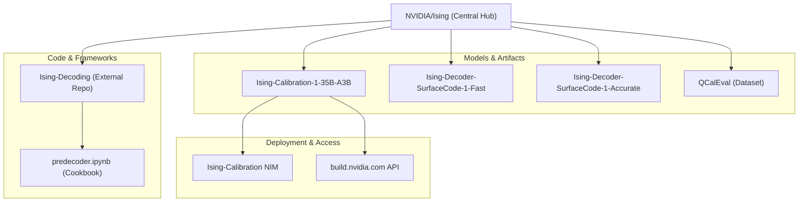
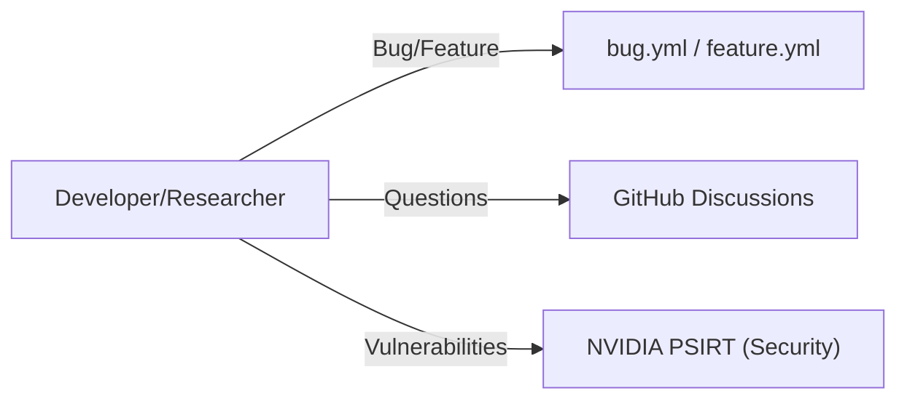

<!-- source: DeepWiki mcp.deepwiki.com · repo NVIDIA/Ising · page 1 Overview · fetched 2026-10-26 -->

# Overview

Relevant source files

The following files were used as context for generating this wiki page:

- [README.md](README.md)

The NVIDIA Ising project is a comprehensive ecosystem of open models, tools, and cookbooks designed to accelerate the development of quantum computing workflows. It serves as a central hub for researchers and engineers to access state-of-the-art AI solutions for critical quantum challenges, specifically focusing on **quantum device calibration** and **quantum error correction (QEC)** [README.md:1-9]().

The project is structured as a collection of modular components, including vision-language models for hardware characterization, neural network decoders for error correction, and standardized evaluation datasets [README.md:26-60]().

## Project Scope and Ecosystem

NVIDIA Ising functions as an umbrella repository that connects several specialized resources:

*   **Model Zoo**: A family of pre-trained models hosted on Hugging Face, including the `Ising-Calibration-1-35B-A3B` vision-language model and the `Ising-Decoder-SurfaceCode-1` family [README.md:26-36]().
*   **Deployment Infrastructure**: Production-ready deployment options via NVIDIA NIM (NVIDIA Inference Microservices) and hosted API endpoints on `build.nvidia.com` [README.md:39-52]().
*   **Training Frameworks**: External repositories like `Ising-Decoding` that provide the necessary source code for training and optimizing AI decoders [README.md:62-66]().
*   **Evaluation Datasets**: Standardized benchmarks such as `QCalEval` for measuring the performance of quantum calibration agents [README.md:54-58]().

### Project Architecture and Workflow

The project is organized into two primary functional pipelines:
1.  **The Calibration Pipeline**: Uses vision-language models to interpret quantum hardware diagnostics and automate device setup.
2.  **The Decoding Pipeline**: Implements AI pre-decoders to identify and correct errors in surface code quantum computers.

For a detailed breakdown of these pipelines and how the hub repository integrates them, see [Project Purpose and Architecture](#1.1).

### Repository Relationship Diagram

The following diagram illustrates how the `NVIDIA/Ising` hub connects users to various code entities and external artifacts.

**Sources:** [README.md:9-78]()

## Core Components

The repository organizes its resources into categories that support different stages of the quantum computing lifecycle:

| Component | Entity Name | Purpose |
| :--- | :--- | :--- |
| **Calibration Model** | `Ising-Calibration-1-35B-A3B` | Vision-language model for interpreting quantum device calibration data. |
| **Decoder Models** | `Ising-Decoder-SurfaceCode-1` | AI pre-decoders (Fast and Accurate variants) for error correction. |
| **Evaluation** | `QCalEval` | Dataset for benchmarking quantum calibration agents. |
| **Training Hub** | `Ising-Decoding` | Repository containing logic for training AI-based decoders. |

**Sources:** [README.md:30-66]()

## Access and Navigation

NVIDIA Ising is designed for immediate practical application. Engineers can interact with the project through several entry points:

*   **Hugging Face**: Access model weights and datasets directly [README.md:7]().
*   **NVIDIA NIM**: Deploy the calibration model as a containerized microservice [README.md:41-44]().
*   **Cookbooks**: Follow step-by-step guides like the `Ising-Decoder-Tutorial` for training, quantization, and inference optimization [README.md:74-78]().

For instructions on how to set up your environment and access these tools, see [Getting Started and Access Points](#1.2).

### Support and Contribution

This repository serves as the primary contact point for the community. Users can report bugs, request features, or participate in discussions regarding any part of the Ising family [README.md:81-87]().

**Sources:** [README.md:81-90]()

---
**Sources:**
- [README.md:1-100]()

---

