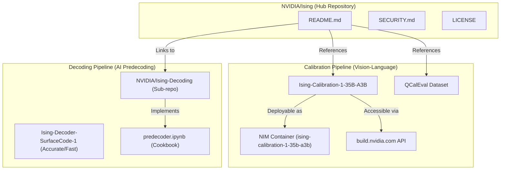
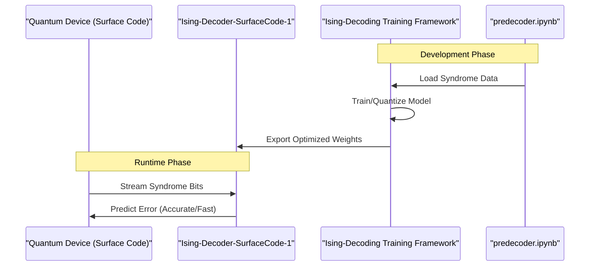

<!-- source: DeepWiki mcp.deepwiki.com · repo NVIDIA/Ising · page 1.1 Project Purpose and Architecture · fetched 2026-10-26 -->

# Project Purpose and Architecture

Relevant source files

The following files were used as context for generating this wiki page:

- [README.md](README.md)

NVIDIA Ising serves as a centralized hub for open-source models, tools, and workflows designed to accelerate quantum computing development. The project focuses on two critical bottlenecks in quantum hardware operation: **Device Calibration** and **Quantum Error Correction (QEC) Decoding**. By providing pre-trained models and specialized training frameworks, NVIDIA Ising enables researchers to integrate AI-driven pipelines into the quantum control stack.

## High-Level Architecture

The repository functions as a "hub" that orchestrates a unified quantum computing workflow by tying together external sub-repositories, model weights on Hugging Face, and optimized inference containers via NVIDIA NIM.

### The Two-Pipeline Workflow

The architecture is divided into two distinct functional pipelines that address different stages of the quantum computing lifecycle:

1.  **Calibration Pipeline**: A vision-language approach to characterizing and tuning quantum devices.
2.  **Decoding Pipeline**: A high-speed inference framework for real-time error detection in surface code architectures.

### System Architecture Diagram
This diagram illustrates how the `NVIDIA/Ising` hub connects the various code entities and external artifacts.

**Sources:** [README.md:1-22](), [README.md:62-67](), [README.md:74-78]()

---

## 1. Calibration Pipeline

The Calibration Pipeline is designed to automate the complex process of tuning quantum hardware parameters. This pipeline utilizes a large-scale vision-language model (VLM) to act as a "Calibration Agent."

### Key Components
*   **Model**: `Ising-Calibration-1-35B-A3B`. This 35-billion parameter model is optimized for interpreting visual data from quantum device characterization (such as spectroscopy plots) and providing calibration instructions [README.md:30-32]().
*   **Evaluation**: The `QCalEval` dataset provides a standardized benchmark for assessing the performance of AI agents in quantum calibration tasks [README.md:56-58]().
*   **Deployment**: The pipeline supports three access modes:
    *   **Direct Weights**: Available on Hugging Face [README.md:32]().
    *   **Containerized Inference**: NVIDIA NIM (NVIDIA Inference Microservice) for local deployment [README.md:41-43]().
    *   **Cloud API**: Hosted endpoint at `build.nvidia.com` for rapid integration [README.md:49-51]().

**Sources:** [README.md:26-36](), [README.md:39-43](), [README.md:47-51](), [README.md:54-58]()

---

## 2. Decoding Pipeline

The Decoding Pipeline focuses on Quantum Error Correction (QEC). It provides the tools necessary to train and deploy "Predecoders"—AI models that process syndrome data from surface codes to identify errors.

### Implementation and Data Flow
The decoding logic is primarily housed in the external `Ising-Decoding` repository, which the hub links to as the primary training framework [README.md:64-66]().

### Key Components
*   **Models**: Two variants of the `Ising-Decoder-SurfaceCode-1` are provided to balance the trade-off between error-correction accuracy and inference latency:
    *   **Accurate**: 1.79M parameters for higher fidelity [README.md:33]().
    *   **Fast**: 0.91M parameters for minimized latency [README.md:34]().
*   **Training Framework**: The `Ising-Decoding` repository provides the necessary environment to train these predecoders using syndrome data [README.md:64-66]().
*   **Optimization**: The `predecoder.ipynb` cookbook guides users through the full lifecycle: training, optimized inference, and quantization to ensure the models can run within the tight timing constraints of quantum control hardware [README.md:74-78]().

**Sources:** [README.md:30-34](), [README.md:62-67](), [README.md:74-78]()

---

## Hub Integration

The `NVIDIA/Ising` repository acts as the central management point for the entire ecosystem. While the actual training code for decoders resides in `Ising-Decoding`, the hub provides:
*   **Issue Tracking**: Centralized bug reporting and feature requests for all models and sub-repositories [README.md:81-87]().
*   **Security**: Unified security disclosure process via NVIDIA PSIRT [README.md:89]().
*   **Licensing**: Standardized Apache 2.0 licensing across the project [README.md:93-95]().

**Sources:** [README.md:9-10](), [README.md:81-95]()

---

