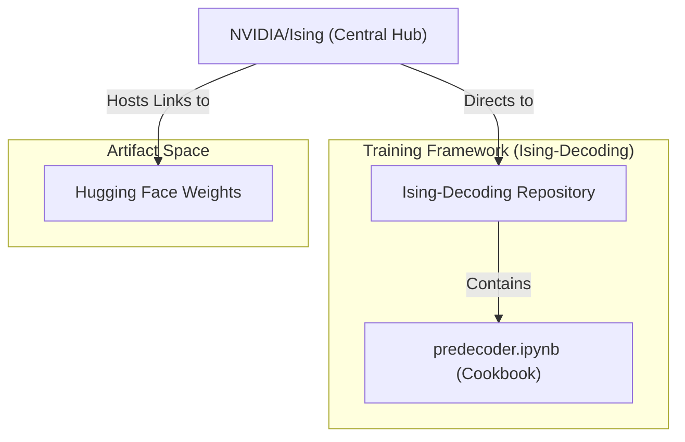
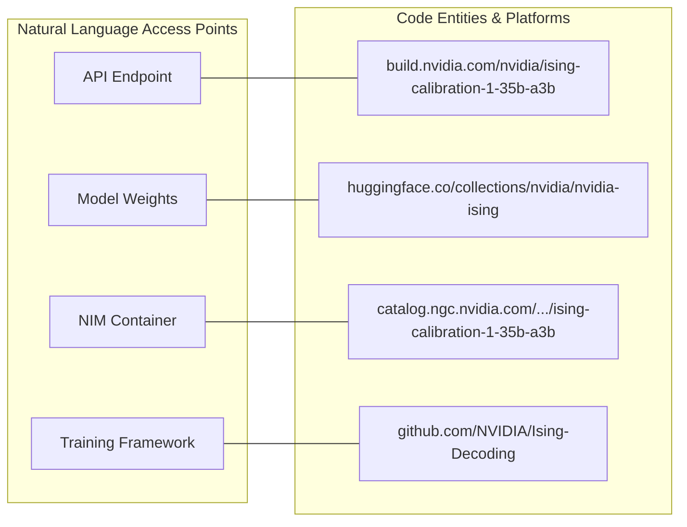

<!-- source: DeepWiki mcp.deepwiki.com · repo NVIDIA/Ising · page 1.2 Getting Started and Access Points · fetched 2026-10-26 -->

# Getting Started and Access Points

Relevant source files

The following files were used as context for generating this wiki page:

- [README.md](README.md)

This page provides a practical guide for engineers to access the NVIDIA Ising family of quantum computing tools. It covers the primary access points for models (Hugging Face, NIM containers, and API endpoints), navigation to the training frameworks, and the protocol for community engagement and support.

## Accessing Models and Artifacts

The NVIDIA Ising project distributes models and datasets through three primary channels depending on the user's infrastructure needs: pre-trained weights for local development, containerized microservices for enterprise deployment, and hosted APIs for rapid prototyping.

### 1. Hugging Face (Model Weights & Datasets)
The `nvidia-ising` collection on Hugging Face serves as the primary repository for model weights and evaluation datasets. This is the starting point for engineers looking to perform local inference or fine-tuning.

| Artifact Name | Type | Description |
| :--- | :--- | :--- |
| `Ising-Calibration-1-35B-A3B` | Model | Vision-language model for quantum device calibration. |
| `Ising-Decoder-SurfaceCode-1-Accurate` | Model | AI predecoder for surface code QEC (1.79M params). |
| `Ising-Decoder-SurfaceCode-1-Fast` | Model | AI predecoder for surface code QEC (0.91M params). |
| `QCalEval` | Dataset | Evaluation dataset for quantum calibration agents. |

Sources: [README.md:26-36](), [README.md:54-58]()

### 2. NVIDIA NIM (Containerized Deployment)
For production environments, the Calibration model is available as an **NVIDIA NIM (NVIDIA Inference Microservice)**. NIMs provide a pre-optimized, containerized runtime for deploying AI models on NVIDIA GPUs.

*   **Calibration NIM:** `ising-calibration-1-35b-a3b`
*   **Location:** NVIDIA NGC Catalog.

Sources: [README.md:39-43]()

### 3. Build.nvidia.com (API Endpoints)
Engineers can interact with the Calibration model via a hosted API endpoint without local hardware setup. This is ideal for testing the vision-language capabilities of the calibration agent before full deployment.

*   **API Endpoint:** `ising-calibration-1-35b-a3b` via `build.nvidia.com`.

Sources: [README.md:47-51]()

## Navigating the Decoding Framework

While this repository acts as the central hub, the active training and optimization logic for quantum error correction (QEC) resides in the `Ising-Decoding` repository.

### Data Flow: From Hub to Training
The following diagram illustrates how an engineer moves from the central Ising hub to the specific implementation details of the Decoding pipeline.

**Ising Ecosystem Navigation**

Sources: [README.md:62-66](), [README.md:74-78]()

### The Ising-Decoder Tutorial
The primary entry point for engineers working on error correction is the `predecoder.ipynb` notebook. This guide covers the full lifecycle of a surface code predecoder:
1.  **Training:** Utilizing syndrome data to train the AI models.
2.  **Inference Optimization:** Techniques for near-real-time performance.
3.  **Quantization:** Reducing the model footprint for integration with quantum control hardware.

Sources: [README.md:74-78]()

## System Access Point Mapping

This diagram bridges the conceptual "Access Points" to the specific code entities and external platforms defined in the repository.

**Access Point to Code Entity Mapping**

Sources: [README.md:26-36](), [README.md:39-43](), [README.md:47-51](), [README.md:62-66]()

## Support and Community Engagement

The `NVIDIA/Ising` repository serves as the centralized location for project management and support across all Ising-related sub-projects.

*   **Bug Reports:** Use the `bug.yml` template for reporting issues in the models or framework.
*   **Feature Requests:** Use the `feature.yml` template to suggest improvements.
*   **Discussions:** The GitHub Discussions tab is the primary venue for general questions and technical architecture debate.
*   **Security:** Security vulnerabilities should **not** be reported via public issues. Instead, follow the NVIDIA PSIRT process detailed in `SECURITY.md`.

Sources: [README.md:81-89]()

---

