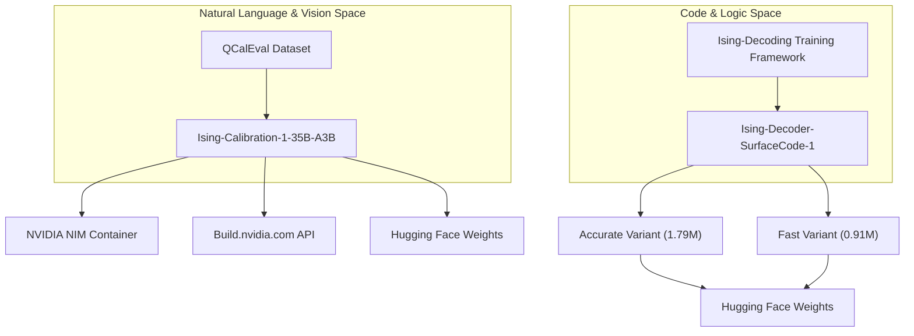

<!-- source: DeepWiki mcp.deepwiki.com · repo NVIDIA/Ising · page 2 Models and Datasets · fetched 2026-10-26 -->

# Models and Datasets

Relevant source files

The following files were used as context for generating this wiki page:

- [README.md](README.md)

The NVIDIA Ising project provides a suite of open-source AI models and evaluation datasets designed to accelerate the development of quantum computing hardware and software. These artifacts are categorized into two primary functional areas: **Quantum Device Calibration** and **Quantum Error Correction (QEC) Decoding**.

This page provides a high-level catalog of these assets and their access points. For detailed technical specifications, deployment guides, and performance metrics, refer to the child pages linked in each section.

### AI Artifact Ecosystem

The following diagram illustrates the relationship between the published models, their respective datasets, and the deployment interfaces available within the NVIDIA Ising ecosystem.

**Diagram: Ising Model and Dataset Architecture**

Sources: [README.md:26-58](), [README.md:64-78]()

---

## Quantum Calibration Models

Quantum device calibration is the process of tuning control parameters to ensure high-fidelity qubit operations. The Ising project introduces vision-language models (VLMs) to automate and enhance this workflow.

### Ising-Calibration-1-35B-A3B
This is a 35B-A3B parameter vision-language model specifically trained to act as an agent for quantum device calibration. It interprets visual data from quantum experiments and suggests control parameter adjustments.

*   **Primary Use Case:** Automated calibration agents for quantum hardware.
*   **Access Points:** Available as raw weights on Hugging Face, a ready-to-deploy NVIDIA NIM container, or via a hosted API endpoint on Build.nvidia.com.
*   **Evaluation:** Paired with the **QCalEval** dataset for benchmarking calibration agent performance.

For details, see [Calibration Model: Ising-Calibration-1-35B-A3B](#2.1).

**Sources:** [README.md:32-32](), [README.md:43-43](), [README.md:51-51](), [README.md:58-58]()

---

## Quantum Error Correction (QEC) Decoders

Decoding is a critical step in quantum error correction where "syndromes" (error signals) are processed to identify and correct physical qubit errors. The Ising project provides pre-trained AI decoders for the Surface Code.

### Ising-Decoder-SurfaceCode-1
The project offers two pre-trained variants of AI predecoders for surface code quantum error correction. These models are designed to be integrated into a larger decoding pipeline to provide fast, high-accuracy error identification.

| Model Variant | Parameters | Focus |
| :--- | :--- | :--- |
| **Ising-Decoder-SurfaceCode-1-Accurate** | 1.79M | Maximizing logical error suppression. |
| **Ising-Decoder-SurfaceCode-1-Fast** | 0.91M | Minimizing inference latency for real-time control. |

*   **Training Framework:** These models are developed using the [Ising-Decoding](https://github.com/NVIDIA/Ising-Decoding) repository.
*   **Optimization:** The [Ising-Decoder-Tutorial](https://github.com/NVIDIA/Ising-Decoding/blob/main/cookbook/predecoder.ipynb) provides instructions on quantizing and optimizing these models for hardware deployment.

For details, see [Decoder Models: Ising-Decoder-SurfaceCode-1](#2.2).

**Sources:** [README.md:33-34](), [README.md:66-66](), [README.md:78-78]()

---

## Summary of Published Artifacts

The following table summarizes all currently available models and datasets in the NVIDIA Ising family.

| Artifact Name | Type | Repository / Hub |
| :--- | :--- | :--- |
| `Ising-Calibration-1-35B-A3B` | VLM Model | [HuggingFace](https://huggingface.co/nvidia/Ising-Calibration-1-35B-A3B) |
| `QCalEval` | Dataset | [HuggingFace Datasets](https://huggingface.co/datasets/nvidia/QCalEval) |
| `Ising-Decoder-SurfaceCode-1-Accurate` | AI Decoder | [HuggingFace](https://huggingface.co/nvidia/Ising-Decoder-SurfaceCode-1-Accurate) |
| `Ising-Decoder-SurfaceCode-1-Fast` | AI Decoder | [HuggingFace](https://huggingface.co/nvidia/Ising-Decoder-SurfaceCode-1-Fast) |

**Sources:** [README.md:30-58]()

---

