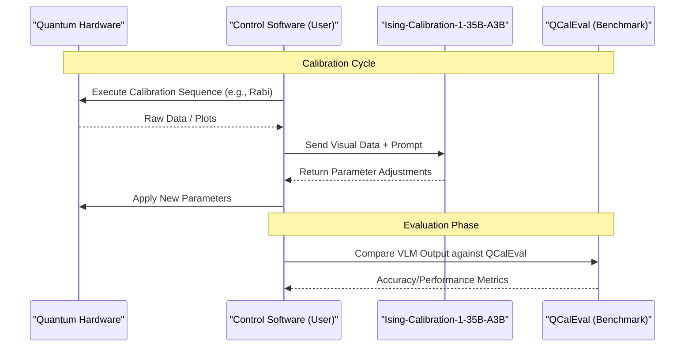

<!-- source: DeepWiki mcp.deepwiki.com · repo NVIDIA/Ising · page 2.1 Calibration Model: Ising-Calibration-1-35B-A3B · fetched 2026-10-26 -->

# Calibration Model: Ising-Calibration-1-35B-A3B

<details>
<summary>Relevant source files</summary>

The following files were used as context for generating this wiki page:

- [README.md](README.md)

</details>


The `Ising-Calibration-1-35B-A3B` is a specialized vision-language model (VLM) designed to automate and optimize the calibration of quantum devices [README.md:32-32](). By interpreting visual data from quantum experiments and translating it into actionable calibration parameters, the model serves as a critical component in the NVIDIA Ising calibration pipeline.

## Model Architecture and Specifications

The model utilizes a 35B-A3B architecture, optimized for high-reasoning tasks required in quantum physics and hardware characterization [README.md:32-32](). As a vision-language model, it is capable of processing multi-modal inputs, such as qubit spectroscopy plots or Rabi oscillation graphs, to provide diagnostic feedback or parameter adjustments.

| Attribute | Specification |
| :--- | :--- |
| **Model Name** | Ising-Calibration-1-35B-A3B |
| **Type** | Vision-Language Model (VLM) |
| **Parameters** | 35B-A3B |
| **Primary Use Case** | Quantum Device Calibration |
| **Training Context** | Device characterization and automated tuning |

**Sources:**
- [README.md:32-32]()

## Deployment Options

NVIDIA provides three primary methods for deploying and interacting with the `Ising-Calibration-1-35B-A3B` model, ranging from local hosting to managed cloud APIs.

### 1. Hugging Face Weights
For researchers requiring full control over the inference environment or fine-tuning capabilities, the model weights are hosted on Hugging Face [README.md:32-32](). This allows for integration into custom Python workflows using standard libraries like `transformers`.

### 2. NVIDIA NIM (NVIDIA Inference Microservice)
The model is available as a NIM container, providing a production-ready, optimized inference environment [README.md:43-43](). NIMs encapsulate the model with an optimized inference engine (such as TensorRT-LLM) and provide a standardized API.

### 3. Build.nvidia.com API
For rapid prototyping without infrastructure management, NVIDIA provides a hosted API endpoint [README.md:51-51](). This allows users to send calibration data (images and text prompts) directly to NVIDIA-managed infrastructure.

### Deployment Architecture Diagram

The following diagram illustrates how different deployment modes bridge the gap between local quantum control software and the Ising calibration intelligence.

**Model Access and Data Flow**
```mermaid
graph TD
    subgraph "Quantum_Control_Environment"
        [Local_Control_Software]
        [Experiment_Data_Images]
    end

    subgraph "Deployment_Modes"
        [HuggingFace_Weights] --> |"Local_Inference"| [Ising-Calibration-1-35B-A3B]
        [NIM_Container] --> |"Self-Hosted_API"| [Ising-Calibration-1-35B-A3B]
        [Build_Nvidia_API] --> |"Cloud_API"| [Ising-Calibration-1-35B-A3B]
    end

    [Experiment_Data_Images] --> [Deployment_Modes]
    [Ising-Calibration-1-35B-A3B] --> |"Calibration_Parameters"| [Local_Control_Software]
```

**Sources:**
- [README.md:32-32]()
- [README.md:43-43]()
- [README.md:51-51]()

## Evaluation: QCalEval Dataset

To ensure the reliability and accuracy of the calibration model, NVIDIA provides the **QCalEval** dataset [README.md:58-58](). This dataset serves as a benchmark for evaluating AI agents tasked with quantum calibration.

*   **Purpose:** To measure the model's ability to correctly interpret quantum experimental results and suggest valid tuning steps.
*   **Content:** A collection of labeled quantum characterization data, including common failure modes and optimal calibration states.
*   **Availability:** Hosted on Hugging Face for public use [README.md:58-58]().

**Sources:**
- [README.md:58-58]()

## Calibration Workflow

The intended workflow for `Ising-Calibration-1-35B-A3B` involves a closed-loop system where the model acts as the "intelligence" layer between the quantum hardware and the control software.

### Logic Flow Diagram

This diagram maps the conceptual calibration loop to the specific entities provided in the Ising repository.

**Calibration Intelligence Loop**


**Sources:**
- [README.md:32-32]()
- [README.md:58-58]()
- [README.md:99-99]()

---

