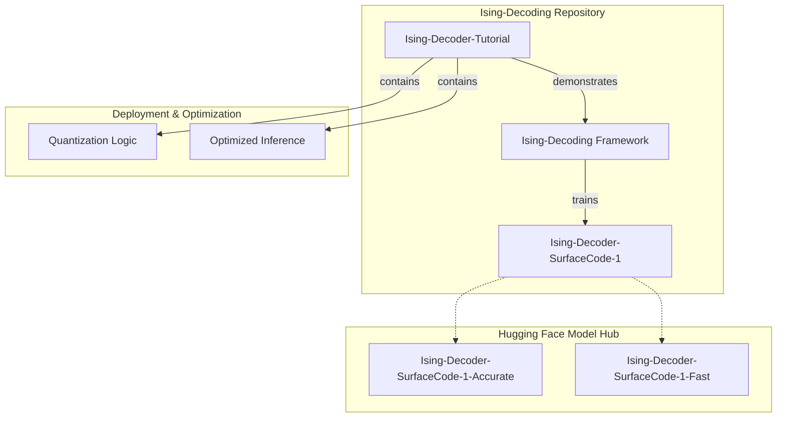
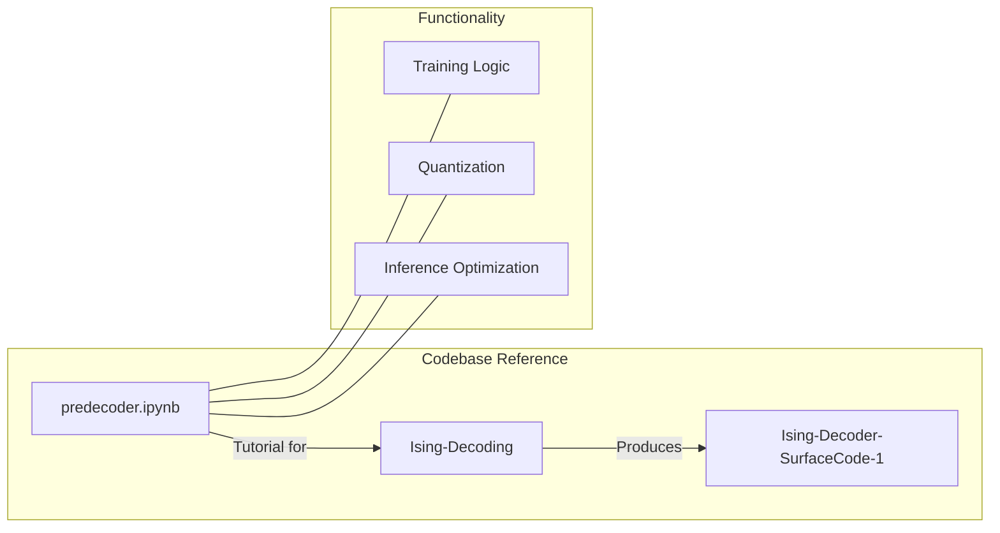

<!-- source: DeepWiki mcp.deepwiki.com · repo NVIDIA/Ising · page 2.2 Decoder Models: Ising-Decoder-SurfaceCode-1 · fetched 2026-10-26 -->

# Decoder Models: Ising-Decoder-SurfaceCode-1

Relevant source files

The following files were used as context for generating this wiki page:

- [README.md](README.md)

This page provides a technical deep dive into the **Ising-Decoder-SurfaceCode-1** model family, which consists of specialized AI predecoders designed for surface code quantum error correction (QEC). These models are optimized to process syndrome data and assist in identifying error patterns in quantum processors.

## Model Variants and Architecture

The Ising project provides two distinct variants of the surface code predecoder to address the critical trade-off between decoding accuracy and execution latency. Both models are designed to integrate into the decoding pipeline to improve the reliability of quantum computations.

| Model Variant | Parameters | Primary Use Case | Hugging Face Link |
|:---|:---|:---|:---|
| **Ising-Decoder-SurfaceCode-1-Accurate** | 1.79M | Maximum error suppression; high-fidelity applications. | [HuggingFace](https://huggingface.co/nvidia/Ising-Decoder-SurfaceCode-1-Accurate) |
| **Ising-Decoder-SurfaceCode-1-Fast** | 0.91M | Low-latency requirements; near-real-time control loops. | [HuggingFace](https://huggingface.co/nvidia/Ising-Decoder-SurfaceCode-1-Fast) |

### Accuracy vs. Latency Trade-off
The **Accurate** model (1.79M parameters) provides higher expressive power for complex error correlations but requires more computational cycles. The **Fast** model (0.91M parameters) is a pruned/distilled version optimized for hardware environments where the decoding window is extremely tight, such as FPGA or specialized ASIC integration for real-time feedback [README.md:33-34]().

**Sources:**
- [README.md:33-34]()

---

## Technical Workflow: From Syndrome to Correction

The Ising-Decoder models function as "predecoders." They take syndrome measurements (the parity checks from a surface code) as input and output predicted error probabilities or simplified error representations that can be used by a backend solver.

### Data Flow and Code Entities
The following diagram illustrates the relationship between the pre-trained models, the training framework, and the tutorial resources.

**System Architecture: Ising-Decoding Pipeline**

**Sources:**
- [README.md:66-66]()
- [README.md:78-78]()

---

## Implementation and Tutorials

The models are supported by a comprehensive training and optimization framework located in the [Ising-Decoding](https://github.com/NVIDIA/Ising-Decoding) repository [README.md:66-66]().

### Ising-Decoder-Tutorial (predecoder.ipynb)
The primary entry point for engineers is the `predecoder.ipynb` cookbook. This tutorial covers the end-to-end lifecycle of a surface code decoder:

1.  **Training:** How to use the `Ising-Decoding` framework to train models on synthetic or hardware-captured syndrome data [README.md:78-78]().
2.  **Quantization:** Techniques to reduce the model footprint from floating-point to integer representations (e.g., INT8 or FP8) to fit on edge-compute hardware [README.md:78-78]().
3.  **Optimized Inference:** Strategies for minimizing the time between receiving a syndrome and outputting a correction [README.md:78-78]().

**Code Entity Mapping**

**Sources:**
- [README.md:66-66]()
- [README.md:74-78]()

---

## Deployment and Access

The Ising-Decoder models are hosted on Hugging Face as part of the NVIDIA Ising collection. Unlike the Calibration model, which is available via NIM containers and API endpoints, the Decoder models are typically downloaded as weights for local integration into custom QEC software stacks.

*   **Hugging Face Collection:** [nvidia/nvidia-ising](https://huggingface.co/collections/nvidia/nvidia-ising) [README.md:36-36]()
*   **Repository for Training:** [NVIDIA/Ising-Decoding](https://github.com/NVIDIA/Ising-Decoding) [README.md:66-66]()

**Sources:**
- [README.md:30-36]()
- [README.md:66-66]()

---

