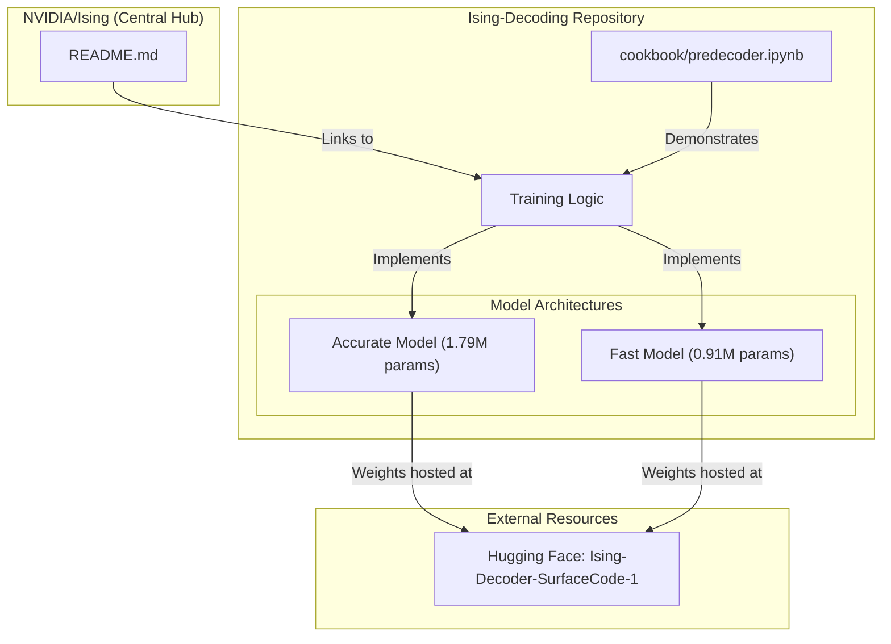

<!-- source: DeepWiki mcp.deepwiki.com · repo NVIDIA/Ising · page 3 Ising-Decoding Training Framework · fetched 2026-10-26 -->

# Ising-Decoding Training Framework

<details>
<summary>Relevant source files</summary>

The following files were used as context for generating this wiki page:

- [README.md](README.md)

</details>


The **Ising-Decoding Training Framework** is a specialized environment designed to manage the full lifecycle of AI-based quantum error correction (QEC) decoders. While the main `NVIDIA/Ising` repository serves as a central hub for models and datasets, the actual training logic and optimization routines reside in the [Ising-Decoding](https://github.com/NVIDIA/Ising-Decoding) sub-repository [README.md:64-66]().

This framework focuses on the **Decoding Pipeline**, specifically for surface code predecoders. It provides the infrastructure to take raw syndrome data, train neural network architectures (such as the Accurate and Fast variants), and optimize them for the extreme low-latency requirements of quantum control hardware.

### System Architecture and Code Mapping

The following diagram illustrates how the logical components of the training framework map to specific code entities and external resources within the NVIDIA Ising ecosystem.

**Diagram: Decoding Framework Code Mapping**

**Sources:** [README.md:30-36](), [README.md:64-66](), [README.md:74-78]()

---

### Training AI Decoders
The training workflow utilizes syndrome data to teach AI models how to predict error patterns in surface code lattices. The framework is designed to handle the specific data structures required for QEC, allowing users to train models that balance prediction accuracy with computational overhead.

The primary entry point for understanding this workflow is the `predecoder.ipynb` cookbook, which provides a step-by-step guide to the training process within the Ising-Decoding repository [README.md:74-78]().

For details, see [Training AI Decoders](#3.1).

**Sources:** [README.md:66](), [README.md:78]()

---

### Inference Optimization and Quantization
Once a model is trained, it must be optimized for deployment. Quantum error correction requires decisions to be made in "near-real-time" to prevent error propagation. The framework includes tools for:
*   **Quantization:** Reducing the precision of model weights (e.g., from FP32 to INT8) to decrease the memory footprint and increase throughput [README.md:78]().
*   **Inference Optimization:** Techniques to ensure the decoder can keep pace with the quantum hardware's cycle time.

These optimizations are critical for the "Fast" model variant (0.91M parameters), which is specifically tailored for high-speed execution [README.md:34]().

For details, see [Inference Optimization and Quantization](#3.2).

**Sources:** [README.md:33-34](), [README.md:78]()

---

### Framework Components Overview

The table below summarizes the relationship between the training framework and the artifacts it produces.

| Component | Code Entity / Link | Purpose |
| :--- | :--- | :--- |
| **Training Hub** | [Ising-Decoding Repo](https://github.com/NVIDIA/Ising-Decoding) | Central repository for training scripts and logic [README.md:66](). |
| **Step-by-Step Guide** | `cookbook/predecoder.ipynb` | Practical tutorial for training and quantizing models [README.md:78](). |
| **Accurate Variant** | `Ising-Decoder-SurfaceCode-1-Accurate` | High-fidelity model with 1.79M parameters [README.md:33](). |
| **Fast Variant** | `Ising-Decoder-SurfaceCode-1-Fast` | Latency-optimized model with 0.91M parameters [README.md:34](). |

**Sources:** [README.md:30-34](), [README.md:66](), [README.md:78]()

---

### Workflow Integration

The training framework bridges the gap between raw quantum syndrome data and deployable AI agents. The following diagram shows the lifecycle from data to optimized inference.

**Diagram: Decoding Lifecycle Workflow**
```mermaid
flowgraph LR
    DATA["Syndrome Data"] --> TRAIN["Training (Ising-Decoding)"]
    TRAIN --> MODEL["Pre-trained Model (Accurate/Fast)"]
    MODEL --> QUANT["Quantization & Optimization"]
    QUANT --> DEPLOY["Hardware-Ready Inference"]

    subgraph "Ising-Decoding Repository Scope"
        TRAIN
        QUANT
    end
```
**Sources:** [README.md:66](), [README.md:78]()

---

