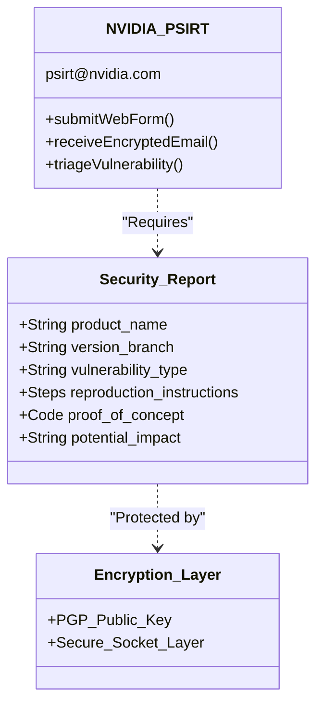

<!-- source: DeepWiki mcp.deepwiki.com · repo NVIDIA/Ising · page 4.1 Security Vulnerability Reporting · fetched 2026-10-26 -->

# Security Vulnerability Reporting

<details>
<summary>Relevant source files</summary>

The following files were used as context for generating this wiki page:

- [SECURITY.md](SECURITY.md)

</details>


The NVIDIA Ising project adheres to a coordinated vulnerability disclosure process managed by the NVIDIA Product Security Incident Response Team (PSIRT). This page outlines the technical protocols for identifying, reporting, and resolving security vulnerabilities within the Ising codebase, including its calibration and decoding pipelines.

## Reporting Protocol and Constraints

To maintain the integrity of the security process, all potential vulnerabilities must be reported through private channels. Public disclosure via GitHub issues or pull requests is strictly prohibited to prevent the exposure of exploit vectors before a patch is available.

| Rule | Description |
| :--- | :--- |
| **No Public Issues** | Do not report security vulnerabilities through GitHub Issues [SECURITY.md:5-5](). |
| **Redirection** | If a vulnerability is reported publicly, maintainers will limit discussion and redirect the reporter to private channels [SECURITY.md:5-5](). |
| **Primary Channel** | Reports should be submitted via the official Web Form or PGP-encrypted email [SECURITY.md:10-11](). |

**Sources:**
- [SECURITY.md:1-6]()
- [SECURITY.md:7-12]()

## Data Flow: Vulnerability Disclosure Process

The following diagram illustrates the flow of security information from the initial discovery by a researcher to the ingestion by the NVIDIA PSIRT system.

### Figure 1: Vulnerability Reporting Data Flow
```mermaid
graph TD
    subgraph "Researcher_Space"
        "A[Identify Vulnerability]" --> "B{Choose Channel}"
    end

    subgraph "NVIDIA_PSIRT_Ingestion"
        "B" -- "HTTPS POST" --> "C[Web_Submission_Form]"
        "B" -- "SMTP_PGP_Encrypted" --> "D[psirt@nvidia.com]"
        "C" --> "E[PSIRT_Internal_Triage]"
        "D" --> "E"
    end

    subgraph "Code_Entity_Context"
        "E" --> "F[Assess_Ising_Repository]"
        "F" --> "G[Ising-Calibration-Pipeline]"
        "F" --> "H[Ising-Decoding-Framework]"
    end

    "G" -- "Validation" --> "I[Coordinated_Disclosure_Notice]"
    "H" -- "Validation" --> "I"
```
**Sources:**
- [SECURITY.md:9-12]()
- [SECURITY.md:20-20]()

## Required Information for Technical Reports

To ensure a timely response and effective remediation, reports must contain specific technical metadata. This allows the PSIRT team to reproduce the issue within the context of the Ising project's specific quantum computing tools.

The report must include the following entities:
1.  **Product Identification**: The specific branch or version of the Ising repository (e.g., `main` or a specific release tag) [SECURITY.md:14-14]().
2.  **Vulnerability Classification**: The technical category, such as arbitrary code execution, denial of service (DoS), or buffer overflows [SECURITY.md:15-15]().
3.  **Reproduction Steps**: Detailed instructions to trigger the vulnerability [SECURITY.md:16-16]().
4.  **Artifacts**: Proof-of-concept (PoC) scripts or exploit code [SECURITY.md:17-17]().
5.  **Impact Analysis**: An assessment of how the vulnerability affects the quantum error correction or calibration workflows [SECURITY.md:18-18]().

**Sources:**
- [SECURITY.md:13-18]()

## Secure Communication Channels

NVIDIA provides two primary methods for private disclosure. For email communications, the use of Pretty Good Privacy (PGP) is encouraged to protect sensitive exploit data in transit.

### Figure 2: Security Entity Association


### Channel Details
*   **Web Submission**: [Security Vulnerability Submission Form](https://www.nvidia.com/object/submit-security-vulnerability.html) [SECURITY.md:10-10]().
*   **Encrypted Email**: Send to `psirt@nvidia.com` using the [NVIDIA Public PGP Key](https://www.nvidia.com/en-us/security/pgp-key) [SECURITY.md:11-12]().

**Sources:**
- [SECURITY.md:9-12]()
- [SECURITY.md:24-25]()

## Response and Acknowledgement

NVIDIA follows a coordinated vulnerability disclosure policy. While a formal bug bounty program is not currently active for this repository, NVIDIA provides public acknowledgement for researchers whose reports lead to a security fix [SECURITY.md:20-20]().

Further information regarding the lifecycle of a security report can be found at the [NVIDIA Product Security Portal](https://www.nvidia.com/en-us/security) [SECURITY.md:24-25]().

**Sources:**
- [SECURITY.md:20-20]()
- [SECURITY.md:24-25]()

---

