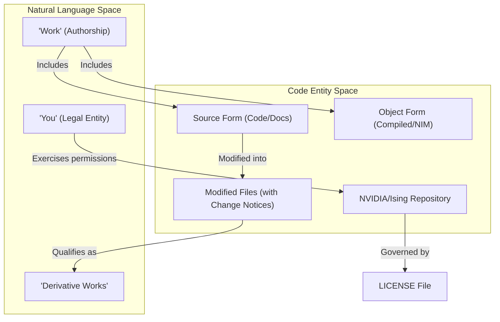
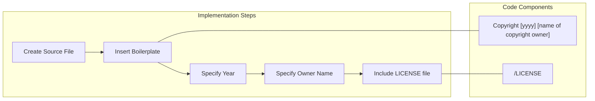

<!-- source: DeepWiki mcp.deepwiki.com · repo NVIDIA/Ising · page 4.2 License: Apache 2.0 · fetched 2026-10-26 -->

# License: Apache 2.0

Relevant source files

The following files were used as context for generating this wiki page:

- [LICENSE](LICENSE)

The NVIDIA Ising repository is governed by the **Apache License, Version 2.0**. This is a permissive free software license that allows users to use the software for any purpose, distribute it, modify it, and distribute modified versions of the software under the terms of the license, without concern for royalties [LICENSE:2-11]().

## Rights Granted

The license provides two primary grants of rights to users ("You") of the Work:

### 1. Copyright License
Each contributor grants a perpetual, worldwide, non-exclusive, no-charge, royalty-free, irrevocable copyright license [LICENSE:67-69](). This allows for:
* Reproduction and distribution of the `Work` or `Derivative Works` [LICENSE:70-72]().
* Preparation of `Derivative Works` [LICENSE:70]().
* Public display and performance [LICENSE:71]().

### 2. Patent License
Contributors grant a perpetual, worldwide, non-exclusive, no-charge, royalty-free, irrevocable patent license to make, use, sell, and import the `Work` [LICENSE:74-78](). This grant applies specifically to patent claims licensable by the contributor that are necessarily infringed by their `Contribution(s)` alone or in combination with the `Work` [LICENSE:79-82]().

### Patent Retaliation Clause
To protect the community, the patent license includes a termination clause. If a user institutes patent litigation against any entity alleging that the `Work` constitutes patent infringement, then any patent licenses granted to that user under this license for that `Work` shall terminate as of the date the litigation is filed [LICENSE:82-88]().

**Sources:** [LICENSE:67-88]()

## Redistribution Requirements

Users may redistribute the `Work` or `Derivative Works` in any medium, provided they meet the following conditions:

| Condition | Requirement Detail |
| :--- | :--- |
| **License Copy** | You must provide a copy of the Apache 2.0 License to any recipients [LICENSE:95-97](). |
| **Change Notices** | Any modified files must carry prominent notices stating that the files were changed [LICENSE:98-99](). |
| **Notice Retention** | You must retain all copyright, patent, trademark, and attribution notices from the Source form of the Work [LICENSE:101-103](). |
| **NOTICE File** | If the Work includes a `NOTICE` file, Derivative Works must include a readable copy of those attribution notices [LICENSE:107-111](). |

**Sources:** [LICENSE:90-123]()

## Legal Entities and Contributions

The license defines the relationship between the `Licensor` (NVIDIA/Contributors) and the `Legal Entity` (the user).

### Contribution Flow and Definitions
The following diagram maps the natural language definitions of the license to the entities involved in the codebase lifecycle.

**Diagram: License Entity Relationships**

**Sources:** [LICENSE:8-65]()

## Disclaimer of Warranty and Limitation of Liability

The license provides the work on an "AS IS" BASIS, without warranties or conditions of any kind [LICENSE:171-175]().

*   **No Warranty:** Contributors provide no guarantees regarding title, non-infringement, merchantability, or fitness for a particular purpose [LICENSE:175-180]().
*   **Limitation of Liability:** In no event and under no legal theory shall any contributor be liable for damages, including direct, indirect, special, incidental, or consequential damages arising out of the use or inability to use the Work [LICENSE:182-192]().

**Sources:** [LICENSE:171-198]()

## Applying the License to Your Work

To apply the Apache 2.0 license to new works, the following boilerplate should be attached to the files, replacing the brackets with your own identifying information:

**Diagram: License Application Workflow**

**Sources:** [LICENSE:200-218]()

---

