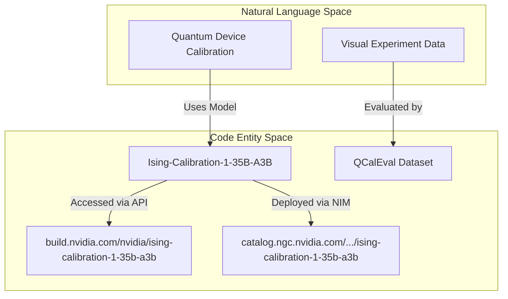
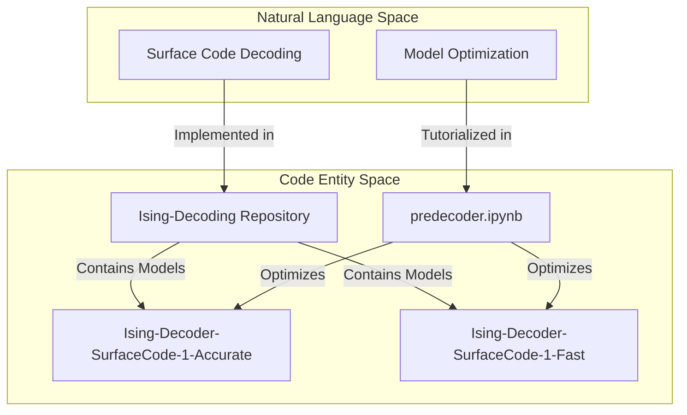

<!-- source: DeepWiki mcp.deepwiki.com · repo NVIDIA/Ising · page 5 Glossary · fetched 2026-10-26 -->

# Glossary

Relevant source files

The following files were used as context for generating this wiki page:

- [LICENSE](LICENSE)
- [README.md](README.md)
- [SECURITY.md](SECURITY.md)

This glossary provides definitions for codebase-specific terms, quantum computing concepts, and NVIDIA product names used throughout the NVIDIA Ising project. It serves as a technical reference for engineers onboarding to the calibration and decoding pipelines.

## Core Project Terms

| Term | Definition |
|:---|:---|
| **NVIDIA Ising** | The central hub and family of tools, models, and cookbooks designed to accelerate quantum computing workflows, specifically focusing on device calibration and error correction [README.md:1-9](). |
| **Ising-Calibration** | A vision-language model (VLM) pipeline used to automate the calibration of quantum devices by interpreting visual data from quantum experiments [README.md:32-33](). |
| **Ising-Decoding** | A dedicated repository and training framework used to develop AI-based decoders for Quantum Error Correction (QEC) [README.md:66-67](). |
| **Predecoder** | A specialized AI model (Fast or Accurate variants) that processes syndrome data before or in conjunction with a full quantum error correction decoder [README.md:33-34](). |
| **QCalEval** | An evaluation dataset specifically curated for benchmarking quantum calibration agents [README.md:58-59](). |

**Sources:** [README.md:1-79]()

## Quantum Computing Concepts

| Term | Definition |
|:---|:---|
| **Surface Code** | A specific type of topological quantum error-correcting code where qubits are arranged on a 2D lattice. The Ising project provides decoders specifically for this architecture [README.md:33-34](). |
| **Syndrome** | The output of parity measurements in a quantum error-correcting code. These "syndromes" indicate where errors may have occurred without collapsing the quantum state of the data qubits. |
| **Decoding** | The process of identifying the most likely physical errors that occurred on a quantum processor based on the observed measurement syndromes. |
| **Calibration** | The process of tuning control parameters (pulses, frequencies) of a quantum processor to ensure high-fidelity gate operations. |

**Sources:** [README.md:3-34](), [README.md:78-79]()

## NVIDIA Product Names & Infrastructure

| Term | Definition |
|:---|:---|
| **NIM (NVIDIA Inference Microservice)** | A set of easy-to-use cloud-native microservices designed to accelerate the deployment of generative AI models. The `Ising-Calibration-1-35B-A3B` model is provided as a NIM [README.md:41-43](). |
| **Build.nvidia.com** | An API endpoint and hosted interface for testing and integrating NVIDIA models without local infrastructure setup [README.md:51-52](). |
| **NGC (NVIDIA GPU Cloud)** | The container registry where Ising NIMs are hosted [README.md:43-43](). |
| **PSIRT** | NVIDIA's Product Security Incident Response Team, responsible for handling security vulnerability reports [SECURITY.md:20-20](). |

**Sources:** [README.md:39-52](), [SECURITY.md:20-25]()

## System Architecture Mapping

The following diagrams bridge the natural language concepts of the Ising project to the specific code entities and repositories.

### Calibration Pipeline Entity Mapping
This diagram maps the calibration workflow to the specific model identifiers and API endpoints used in the codebase.

**Sources:** [README.md:32-58]()

### Decoding Framework Entity Mapping
This diagram maps the decoding components to their respective repositories and implementation files.

**Sources:** [README.md:33-34](), [README.md:66-78]()

## Legal and Security Abbreviations

| Abbreviation | Full Term | Description |
|:---|:---|:---|
| **Apache 2.0** | Apache License, Version 2.0 | The permissive software license governing the Ising repository [LICENSE:2-4](). |
| **PGP** | Pretty Good Privacy | Encryption standard used for secure communication with the NVIDIA PSIRT team [SECURITY.md:12-12](). |
| **CVD** | Coordinated Vulnerability Disclosure | The policy under which NVIDIA acknowledges externally reported security issues [SECURITY.md:20-20](). |

**Sources:** [LICENSE:1-11](), [SECURITY.md:1-20]()