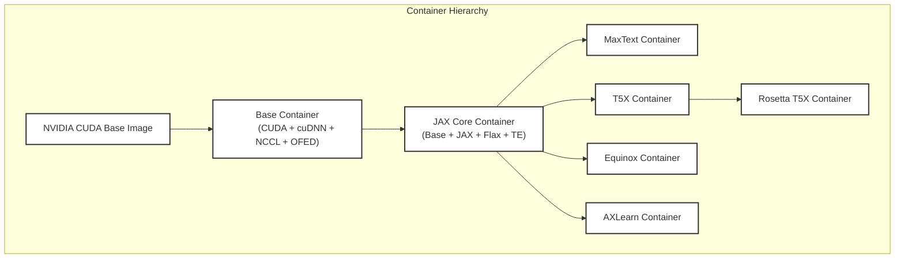
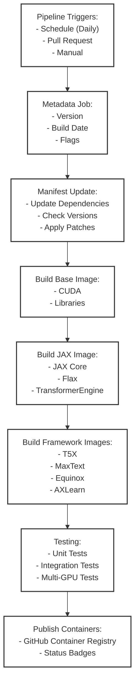
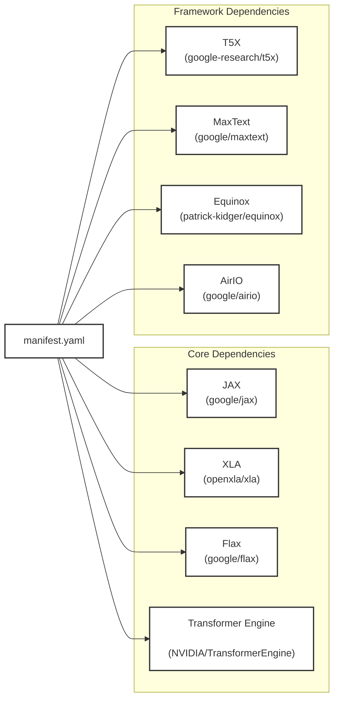
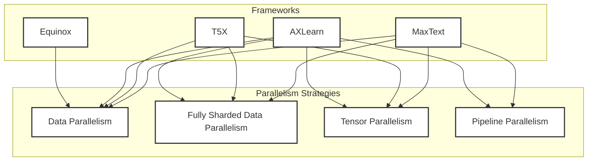
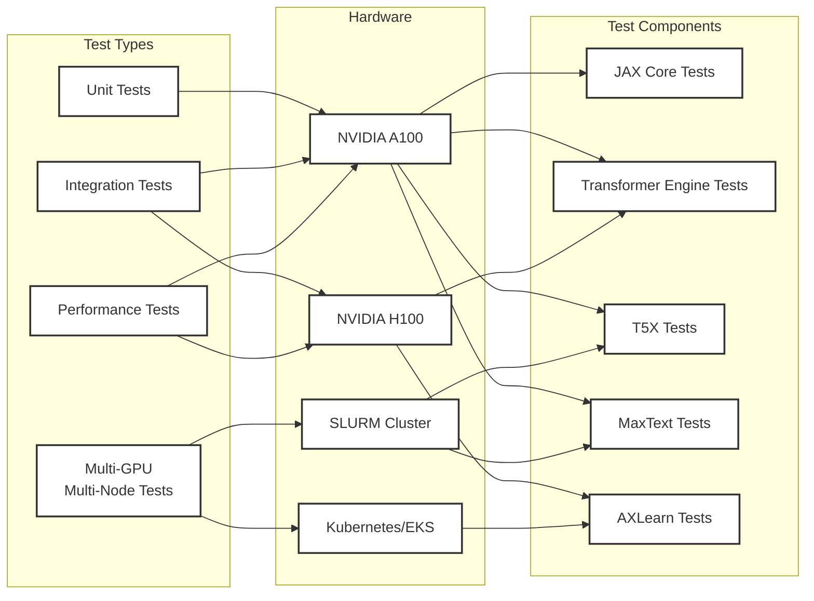

<!-- source: DeepWiki mcp.deepwiki.com · repo NVIDIA/JAX-Toolbox · page 1 Overview · fetched 2026-10-26 -->

# Overview

<details>
<summary>Relevant source files</summary>

The following files were used as context for generating this wiki page:

- [.github/container/manifest.yaml](.github/container/manifest.yaml)
- [.github/workflows/_ci.yaml](.github/workflows/_ci.yaml)
- [.github/workflows/ci.yaml](.github/workflows/ci.yaml)
- [README.md](README.md)

</details>


This page provides a high-level overview of JAX-Toolbox, a comprehensive system that delivers optimized Docker containers, a robust CI/CD pipeline, and performance-tuned examples for JAX-based deep learning frameworks on NVIDIA GPUs. 

JAX-Toolbox simplifies the development and deployment experience of JAX applications on NVIDIA hardware through containerization, automated testing, and performance optimization. For specific details about container architecture, see [Container System Architecture](#2), and for CI/CD pipeline details, refer to [CI/CD Pipeline](#3).

Sources: [README.md:1-6]()

## Core Components

JAX-Toolbox consists of the following core components:

1. **Container System**: A hierarchical set of Docker containers from base CUDA images to framework-specific containers
2. **CI/CD Pipeline**: Automated workflows for building, testing, and publishing containers
3. **Framework Support**: Integration with popular JAX-based ML frameworks
4. **Testing Infrastructure**: Comprehensive testing across different hardware configurations
5. **Performance Tools**: Utilities for profiling and optimizing JAX applications

Sources: [README.md:6-17](), [.github/workflows/ci.yaml:1-47]()

## Container Architecture

JAX-Toolbox uses a layered container architecture that builds from NVIDIA CUDA base images up to specialized framework containers.



Each container serves a specific purpose:

| Container | Purpose | Image |
|-----------|---------|-------|
| Base | Foundation with CUDA, cuDNN, NCCL, and networking libraries | `ghcr.io/nvidia/jax:base` |
| JAX Core | JAX, Flax, and Transformer Engine | `ghcr.io/nvidia/jax:jax` |
| MaxText | Large language model training | `ghcr.io/nvidia/jax:maxtext` |
| T5X | Text-to-text and vision transformers | `ghcr.io/nvidia/jax:t5x` |
| Equinox | Scientific machine learning | `ghcr.io/nvidia/jax:equinox` |
| AXLearn | Advanced ML research | `ghcr.io/nvidia/jax:axlearn` |

Sources: [README.md:11-16](), [.github/workflows/_ci.yaml:40-139]()

## Build and CI/CD System

JAX-Toolbox employs a sophisticated CI/CD pipeline to build, test, and publish Docker containers. The pipeline is triggered by pull requests, scheduled events, or manual dispatch.



The build process consists of several stages:

1. **Metadata Collection**: Determines build date, version tags, and publication settings
2. **Manifest Update**: Ensures all dependencies are at their latest verified commits
3. **Base Image Build**: Creates the foundation CUDA container
4. **JAX Core Build**: Builds JAX with GPU optimizations
5. **Framework-Specific Builds**: Builds containers for each supported framework
6. **Testing**: Runs various test suites on different hardware configurations
7. **Publication**: Publishes containers to GitHub Container Registry

Sources: [.github/workflows/ci.yaml:57-437](), [.github/workflows/_ci.yaml:1-39]()

## Dependency Management

JAX-Toolbox manages dependencies through a manifest system that tracks specific commits of various components to ensure compatibility and reproducibility.



The manifest system:
- Tracks specific git commits for each dependency
- Supports patching through the patch distribution system
- Enables reproducible builds with consistent dependencies
- Simplifies updating dependencies across the entire system

Sources: [.github/container/manifest.yaml:1-104](), [.github/workflows/ci.yaml:134-190]()

## Supported Frameworks and Models

JAX-Toolbox supports several key JAX-based machine learning frameworks:

| Framework | Supported Models | Use Cases | Container |
|-----------|-----------------|-----------|-----------|
| MaxText | GPT, LLaMA, Gemma, Mistral, Mixtral | Pre-training | `ghcr.io/nvidia/jax:maxtext` |
| T5X | T5, ViT | Pre-training, fine-tuning | `ghcr.io/nvidia/jax:t5x` |
| T5X (Imagen) | Imagen | Pre-training | `ghcr.io/nvidia/jax:t5x-imagen` |
| AXLearn | Fuji | Pre-training | `ghcr.io/nvidia/jax:axlearn` |
| Equinox | Various | Scientific ML | `ghcr.io/nvidia/jax:equinox` |

These frameworks support different parallelism strategies for efficient multi-GPU, multi-node training:



Sources: [README.md:8-16](), [.github/workflows/_ci.yaml:84-138]()

## Testing Infrastructure

JAX-Toolbox employs a comprehensive testing infrastructure to ensure quality and performance across different hardware configurations.



The testing system verifies:
- Core JAX functionality on GPUs
- Framework-specific components
- Multi-GPU and multi-node scaling
- Performance characteristics
- Integration with various cluster management systems

Sources: [.github/workflows/_ci.yaml:179-570](), [README.md:18-205]()

## Performance Optimization

JAX-Toolbox includes performance optimizations for NVIDIA GPUs through environment variables and XLA flags:

| XLA Flag | Purpose |
|----------|---------|
| `--xla_gpu_enable_latency_hiding_scheduler` | Improves communication/compute overlap |
| `--xla_gpu_enable_triton_gemm` | Controls GEMM kernel selection |

| Environment Variable | Purpose |
|---------------------|---------|
| `NCCL_NVLS_ENABLE` | Controls NVLink SHARP for multi-GPU communication |

The repository also provides profiling tools like `nsys-jax` for performance analysis and optimization.

Sources: [README.md:213-226](), [.github/workflows/_ci.yaml:233-337]()

## Usage and Access

JAX-Toolbox containers are publicly available via GitHub Container Registry:

```
ghcr.io/nvidia/jax:<framework>       # Latest build
ghcr.io/nvidia/jax:<framework>-YYYY-MM-DD  # Specific date
```

For example:
```bash
docker pull ghcr.io/nvidia/jax:maxtext
docker run --gpus all --shm-size=1g ghcr.io/nvidia/jax:maxtext
```

Special considerations:
- Docker containers require `--gpus all` flag for GPU access
- Shared memory size should be increased with `--shm-size=1g` to avoid bus errors
- Multi-node deployments can leverage SLURM or Kubernetes integration

Sources: [README.md:209-211](), [README.md:249-279]()

---

