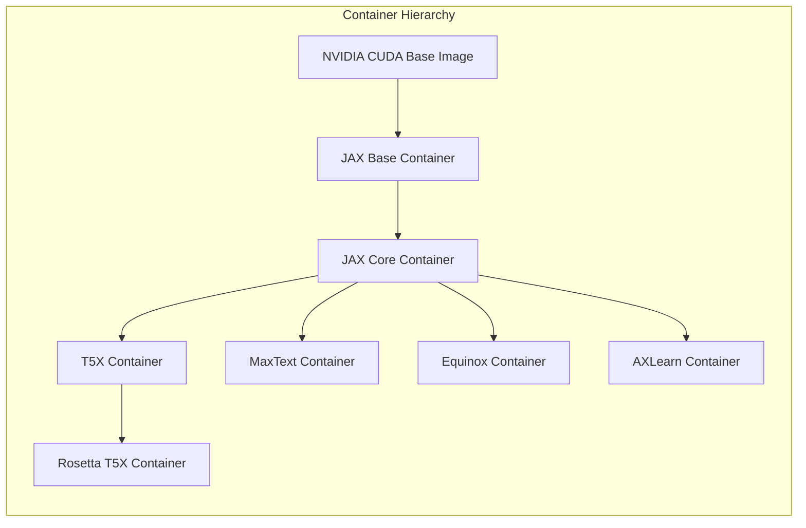
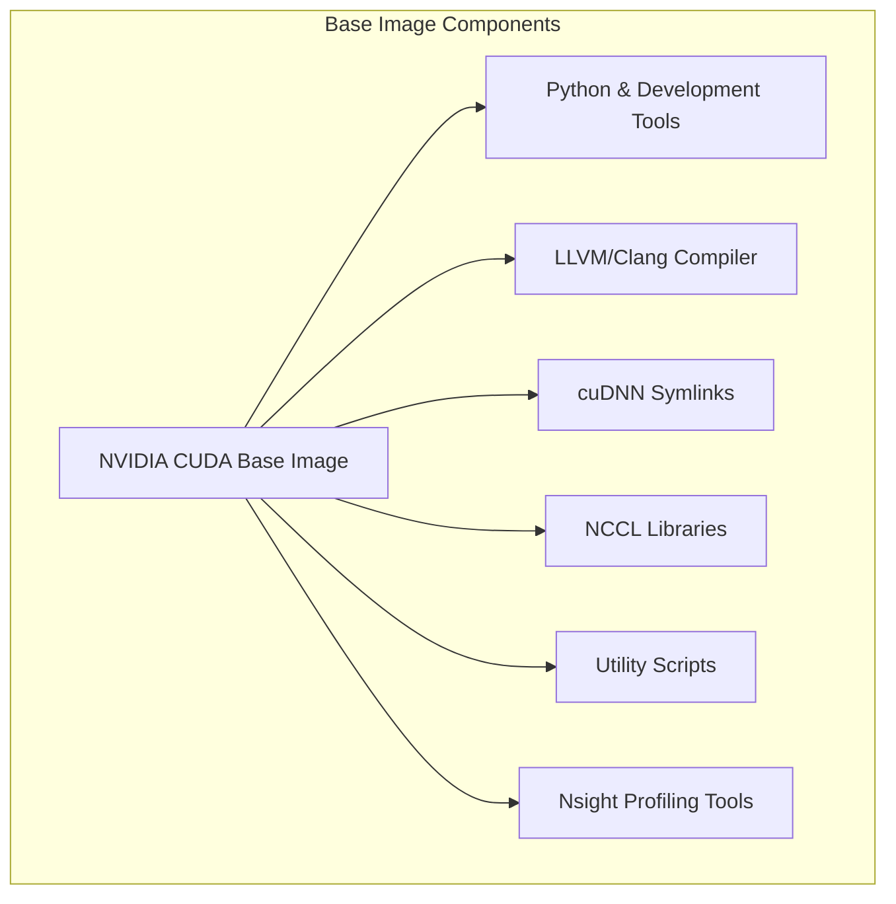
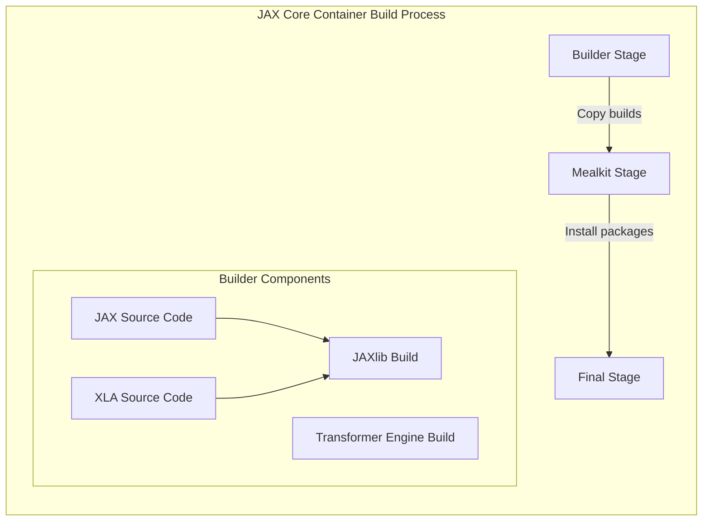
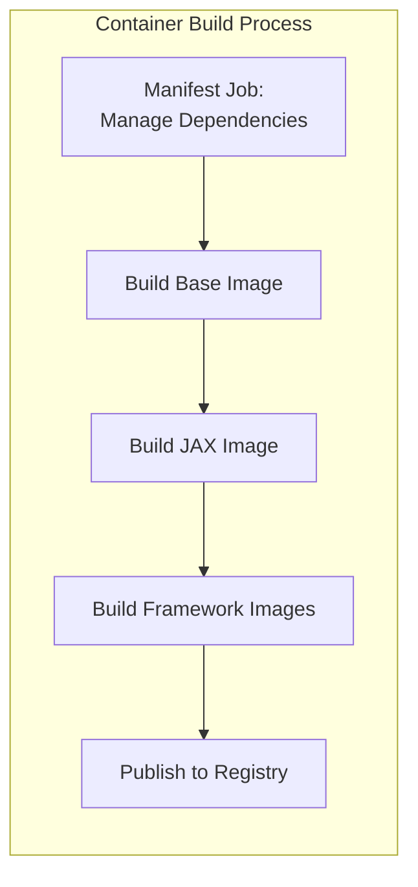
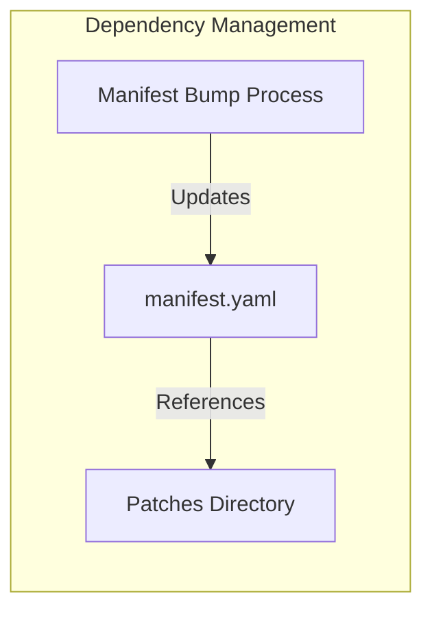

<!-- source: DeepWiki mcp.deepwiki.com · repo NVIDIA/JAX-Toolbox · page 2 Container System Architecture · fetched 2026-10-26 -->

# Container System Architecture

Relevant source files

The following files were used as context for generating this wiki page:

- [.github/container/Dockerfile.base](.github/container/Dockerfile.base)
- [.github/container/Dockerfile.jax](.github/container/Dockerfile.jax)
- [.github/container/build-jax.sh](.github/container/build-jax.sh)
- [.github/container/manifest.yaml](.github/container/manifest.yaml)
- [.github/container/test-jax.sh](.github/container/test-jax.sh)
- [.github/workflows/_build_base.yaml](.github/workflows/_build_base.yaml)
- [.github/workflows/_ci.yaml](.github/workflows/_ci.yaml)
- [.github/workflows/ci.yaml](.github/workflows/ci.yaml)
- [README.md](README.md)

This page describes the architecture of the JAX-Toolbox container system, including the hierarchy, build process, and container organization. For information about CI/CD pipelines that build these containers, see [CI/CD Pipeline](#3).

## Overview

JAX-Toolbox provides a comprehensive container system for building, testing, and deploying JAX-based machine learning frameworks on NVIDIA GPUs. The container system follows a hierarchical architecture with three main layers - base images, JAX core images, and framework-specific images - each building upon the previous layer.

Sources: [README.md:11-17](), [.github/workflows/_ci.yaml:153-170]()

## Container Hierarchy

### Base Image

The base image is built from an NVIDIA CUDA base image and provides the foundation for all other containers. It includes Python, essential development tools, and utilities needed for building JAX and related libraries.

Key components of the base image include:

- Python and essential development tools
- LLVM/Clang compiler for building JAX
- cuDNN and NCCL libraries for GPU acceleration
- JAX-specific profiling tools (nsys-jax)
- Dependency manifest system for reproducibility

The base image is defined in the `Dockerfile.base` file and is tagged as `ghcr.io/nvidia/jax:base`.

Sources: [.github/container/Dockerfile.base:1-178](), [README.md:42-47]()

### JAX Core Container

The JAX Core container extends the base image and includes JAX, Flax, and Transformer Engine. This container serves as the foundation for all framework-specific containers.

Key components of the JAX Core container include:

- JAX library built from source
- XLA compiler for hardware acceleration
- Flax neural network library
- NVIDIA Transformer Engine for optimized transformer models
- Environment variables for performance tuning

The JAX Core container uses a two-stage build process:
1. **Builder Stage**: Compiles JAX, jaxlib, and Transformer Engine
2. **Mealkit Stage**: Packages source code and build artifacts
3. **Final Stage**: Installs libraries from the mealkit stage

The JAX Core container is defined in the `Dockerfile.jax` file and is tagged as `ghcr.io/nvidia/jax:jax`.

Sources: [.github/container/Dockerfile.jax:1-137](), [README.md:60-65]()

### Framework-Specific Containers

Framework-specific containers extend the JAX Core container and add specific machine learning frameworks. Each framework container is built to support specific use cases and model architectures.

| Framework | Container Tag | Use Cases | Models |
|-----------|---------------|-----------|--------|
| MaxText | `ghcr.io/nvidia/jax:maxtext` | Pre-training LLMs | GPT, LLaMA, Gemma, Mistral, Mixtral |
| T5X | `ghcr.io/nvidia/jax:t5x` | Pre-training, fine-tuning | T5, ViT |
| Imagen | `ghcr.io/nvidia/t5x:imagen-*` | Pre-training | Imagen |
| AXLearn | `ghcr.io/nvidia/jax:axlearn` | Pre-training | Fuji |
| Equinox | `ghcr.io/nvidia/jax:equinox` | Scientific computing | Various |

Some frameworks, like T5X, have both upstream and "Rosetta" variants:
- **Upstream**: Direct integration of the original framework
- **Rosetta**: NVIDIA-optimized version with additional patches for performance

Sources: [README.md:11-17](), [.github/workflows/_ci.yaml:84-137]()

## Build Process

The container build process follows a CI/CD pipeline that builds images for multiple architectures (amd64 and arm64) in a specific order.

Key aspects of the build process:

1. **Dependency Management**: Uses a manifest file (`manifest.yaml`) to track and update dependencies
2. **Two-Stage Builds**: Uses "mealkit" and "final" stages for efficient builds
3. **Architecture Support**: Builds for both amd64 and arm64 architectures
4. **Caching**: Uses Bazel caching for efficient rebuilds
5. **Testing**: Includes unit and integration tests for each container

The build process is orchestrated by GitHub Actions workflows and produces both dated tags (e.g., `jax-2023-05-01`) and the "latest" tag for each container type.

Sources: [.github/workflows/ci.yaml:57-180](), [.github/workflows/_ci.yaml:40-178]()

## Container Registry and Tagging

All containers are published to the GitHub Container Registry under the `ghcr.io/nvidia/jax` namespace. The containers follow a consistent tagging convention:

- **Latest tag**: `ghcr.io/nvidia/jax:<container-name>`
- **Dated tag**: `ghcr.io/nvidia/jax:<container-name>-YYYY-MM-DD`

For example:
- `ghcr.io/nvidia/jax:jax` (latest JAX Core container)
- `ghcr.io/nvidia/jax:jax-2023-05-01` (specific dated version)

In addition to the final containers, mealkit (intermediate) containers are also published to the registry under `ghcr.io/nvidia/jax-mealkit`.

Sources: [README.md:209-211](), [.github/workflows/ci.yaml:412-429]()

## Environment Variables and Configuration

The JAX-Toolbox containers include environment variables that tune JAX and XLA performance for NVIDIA GPUs.

| Environment Variable | Value | Purpose |
|---------------------|-------|---------|
| `XLA_FLAGS` | `--xla_gpu_enable_latency_hiding_scheduler=true` | Enables XLA's latency hiding scheduler |
| `XLA_FLAGS` | `--xla_gpu_enable_triton_gemm=false` | Uses cuBLAS instead of Triton GEMM |
| `NCCL_NVLS_ENABLE` | `0` | Disables NVLink SHARP |

These environment variables are set in the JAX Core container and are inherited by all framework containers. Additional framework-specific environment variables may be set in individual framework containers.

Sources: [README.md:215-226](), [.github/container/Dockerfile.jax:93-96]()

## Dependency Management

JAX-Toolbox uses a manifest-based system to manage dependencies. The manifest file (`manifest.yaml`) specifies the exact versions of dependencies used in the build process, ensuring reproducibility.

The manifest file includes:
- Git repository URLs
- Commit hashes for pinned versions
- Patches to apply during the build process

This system allows for consistent, reproducible builds and simplifies updating dependencies through a "bump manifest" process.

Sources: [.github/container/manifest.yaml:1-104](), [.github/workflows/ci.yaml:134-189]()

## Multi-Architecture Support

JAX-Toolbox containers support both amd64 (x86_64) and arm64 (aarch64) architectures, allowing them to run on a variety of hardware platforms.

The build process includes architecture-specific optimizations:
- For amd64: Optimized for Intel Sandy Bridge and newer processors
- For arm64: Optimized for ARMv8-A architecture

The architecture-specific builds are coordinated by the CI/CD pipeline, which builds containers for both architectures in parallel and combines them into multi-arch manifests.

Sources: [.github/container/build-jax.sh:202-211](), [.github/workflows/ci.yaml:191-211]()

---

