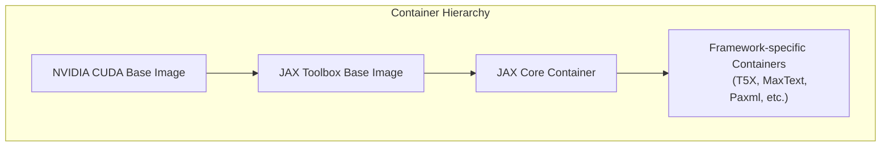
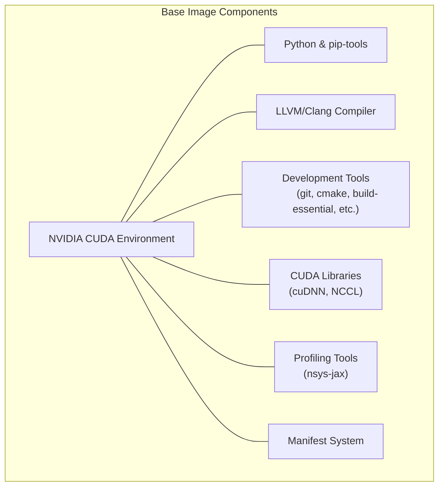
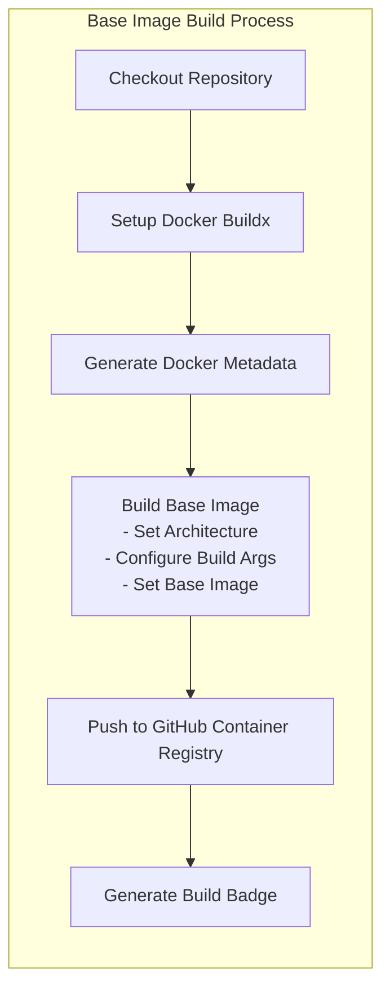

<!-- source: DeepWiki mcp.deepwiki.com · repo NVIDIA/JAX-Toolbox · page 2.1 Base Image · fetched 2026-10-26 -->

# Base Image

<details>
<summary>Relevant source files</summary>

The following files were used as context for generating this wiki page:

- [.github/container/Dockerfile.base](.github/container/Dockerfile.base)
- [.github/workflows/_build_base.yaml](.github/workflows/_build_base.yaml)

</details>


## Purpose and Scope

The Base Image serves as the foundational layer in the JAX-Toolbox container hierarchy. It provides the essential CUDA environment, system dependencies, development tools, and Python infrastructure necessary for building and running JAX and JAX-based machine learning frameworks on NVIDIA GPUs.

This page documents the structure, components, and build process of the Base Image. For information about the JAX Core Container that builds upon this base, see [JAX Core Container](#2.2).

## Container Hierarchy Overview

The Base Image is the first layer in the JAX-Toolbox container architecture, providing the foundation upon which all other containers are built.



Sources: [.github/container/Dockerfile.base:1-12]()

## Base Image Components

The Base Image is constructed from a NVIDIA CUDA base image, to which key components are added to support JAX and machine learning workloads.



Sources: [.github/container/Dockerfile.base:20-176]()

## Key Components

### Foundational Image and Environment

The Base Image is built upon NVIDIA's CUDA deep learning container, specifically designed for development environments:

```
nvcr.io/nvidia/cuda-dl-base:25.03-cuda12.8-devel-ubuntu24.04
```

This provides the foundational CUDA runtime, libraries, and development tools upon which the JAX ecosystem is built.

Sources: [.github/container/Dockerfile.base:1-18]()

### Development Tools and Python Environment

The Base Image installs a comprehensive set of development tools and Python packages to support the build and execution of JAX and JAX-based frameworks.

| Category | Components |
|----------|------------|
| Build Tools | build-essential, cmake, checkinstall |
| Source Control | git |
| Utilities | curl, wget, vim, jq, zip, rsync |
| Compiler | LLVM/Clang (version 18) |
| Python | Python 3, pip, pip-tools |

Sources: [.github/container/Dockerfile.base:20-137]()

### CUDA Libraries and Utilities

The Base Image ensures proper configuration of critical CUDA libraries:

#### cuDNN Symlinks

The container includes script to create symbolic links for cuDNN libraries, ensuring they are properly discovered by the JAX runtime.

Sources: [.github/container/Dockerfile.base:139-144]()

#### NCCL Configuration

NVIDIA Collective Communications Library (NCCL) is essential for multi-GPU training. The Base Image:
- Creates symbolic links for NCCL libraries
- Installs NCCL sanity check utility
- Provides jax-nccl-test and parallel-launch utilities

Sources: [.github/container/Dockerfile.base:146-161]()

### Profiling Support

The Base Image includes nsys-jax, a JAX/XLA-aware profiling tool that extends NVIDIA Nsight Systems to better support JAX workloads.

Sources: [.github/container/Dockerfile.base:163-168]()

### Manifest System

The Base Image includes the manifest system that manages dependencies and patches across the JAX-Toolbox containers:

- `/opt/manifest.d/manifest.yaml` - Defines versions and dependencies
- Support scripts for distribution creation and version bumping
- Patch directory for applying fixes to dependencies

Sources: [.github/container/Dockerfile.base:170-177]()

## Build Process

The Base Image is built as part of the JAX-Toolbox CI/CD pipeline using GitHub Actions.



Sources: [.github/workflows/_build_base.yaml:67-181]()

### Build Configuration

The Base Image build supports the following key configuration options:

| Configuration | Description |
|---------------|-------------|
| `ARCHITECTURE` | CPU architecture to build for (amd64, arm64) |
| `BASE_IMAGE` | Base CUDA image to use (default: latest) |
| `BUILD_DATE` | Build date in YYYY-MM-DD format |
| `GIT_USER_NAME` | Git username for container configuration |
| `GIT_USER_EMAIL` | Git email for container configuration |
| `JAX_TOOLBOX_REF` | JAX-Toolbox reference to use (default: current branch or SHA) |

Sources: [.github/workflows/_build_base.yaml:6-45](), [.github/container/Dockerfile.base:2-6]()

### Multi-Architecture Support

The Base Image build process supports multiple CPU architectures:

- `amd64` (x86_64): Standard architecture for most server deployments
- `arm64` (aarch64): Used for ARM-based deployments

Special handling is incorporated for ARM architecture, particularly with libraries like h5py that may require additional dependencies.

Sources: [.github/container/Dockerfile.base:52-57](), [.github/workflows/_build_base.yaml:8-9]()

## Docker Image Tagging and Storage

Completed Base Images are:

1. Tagged using the GitHub run ID and architecture (e.g., `{run_id}-base-{architecture}`)
2. Pushed to GitHub Container Registry as `ghcr.io/nvidia/jax-toolbox-internal`
3. Used as the foundation for building the JAX Core container

This tagging scheme ensures traceability between built artifacts and the GitHub Actions workflow that produced them.

Sources: [.github/workflows/_build_base.yaml:51-131]()

## Conclusion

The Base Image provides the foundation for the entire JAX-Toolbox container ecosystem. It combines:

1. NVIDIA's CUDA development environment
2. Essential system libraries and development tools
3. Python environment with pip-tools
4. CUDA libraries (cuDNN, NCCL) with proper configurations
5. Profiling support for JAX workloads

This unified foundation ensures consistent build and runtime environments across all layers of the JAX-Toolbox container hierarchy.

---

