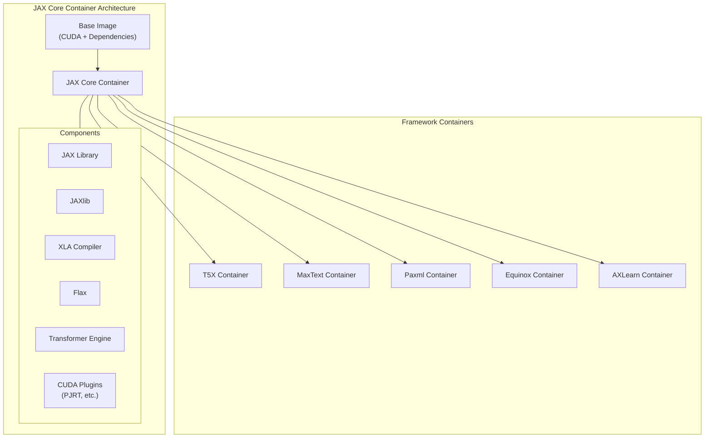
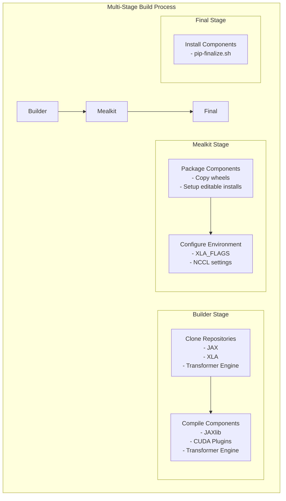
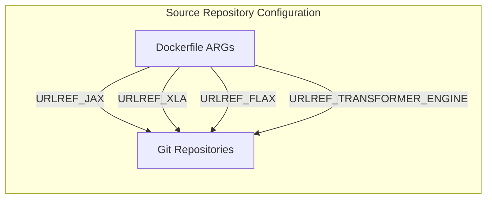
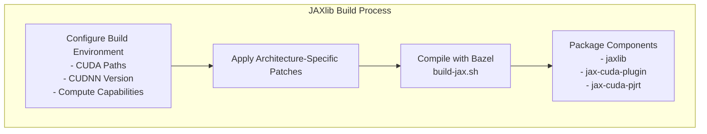
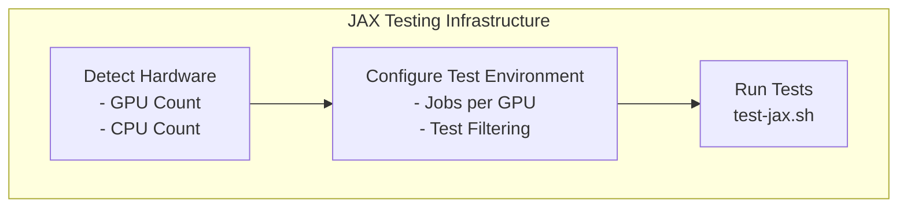

<!-- source: DeepWiki mcp.deepwiki.com · repo NVIDIA/JAX-Toolbox · page 2.2 JAX Core Container · fetched 2026-10-26 -->

# JAX Core Container

<details>
<summary>Relevant source files</summary>

The following files were used as context for generating this wiki page:

- [.github/container/Dockerfile.jax](.github/container/Dockerfile.jax)
- [.github/container/build-jax.sh](.github/container/build-jax.sh)
- [.github/container/local_cuda_arch](.github/container/local_cuda_arch)
- [.github/container/test-jax.sh](.github/container/test-jax.sh)

</details>


This document describes the JAX Core Container within JAX-Toolbox, which provides the foundation for all JAX-based machine learning framework containers. For information about framework-specific containers that build upon this image, see [Framework Containers](#2.3).

## Overview

The JAX Core Container is a Docker container that packages JAX, XLA, Flax, and Transformer Engine into a single, optimized environment for NVIDIA GPUs. It serves as the base image for all framework-specific containers in JAX-Toolbox, providing consistent JAX functionality across the ecosystem.



Sources: [.github/container/Dockerfile.jax:1-136]()

## Multi-Stage Build Process

The JAX Core Container uses a multi-stage build process to optimize the final image size and build caching. The build process consists of three main stages:

1. **Builder Stage** - Compiles JAX, JAXlib, and CUDA plugins from source
2. **Mealkit Stage** - Packs built components for installation
3. **Final Stage** - Installs all components and finalizes the container



Sources: [.github/container/Dockerfile.jax:18-136]()

## Core Components

The JAX Core Container includes the following key components:

| Component | Description | Source |
|-----------|-------------|--------|
| JAX | The main JAX library providing automatic differentiation and XLA compilation | Cloned from GitHub |
| JAXlib | The compiled JAX backend libraries | Built from source |
| XLA | The Accelerated Linear Algebra compiler | Cloned from GitHub |
| Flax | Neural network library for JAX | Cloned from GitHub |
| Transformer Engine | NVIDIA's library for accelerating Transformer models | Built from source |
| CUDA Plugins | JAX CUDA plugins for GPU acceleration | Built from source |

Sources: [.github/container/Dockerfile.jax:22-57](), [.github/container/Dockerfile.jax:81-129]()

## Build Configuration

The JAX Core Container build is highly configurable through build arguments in the Dockerfile and options in the build scripts. Key configuration points include:

### Source Repositories and Versions

The container builds components directly from source repositories. The repositories and versions can be configured via build arguments:



Sources: [.github/container/Dockerfile.jax:3-11]()

### CUDA Compute Capabilities

The build can be configured for specific NVIDIA GPU architectures:

1. **Local Detection**: Automatically detects the GPU architecture of the build machine
2. **All Architectures**: Builds for all supported architectures
3. **Specific Architectures**: Builds for user-specified architectures

Sources: [.github/container/build-jax.sh:213-222](), [.github/container/local_cuda_arch:1-2]()

## Building JAXlib

The core of the build process is compiling JAXlib with the appropriate CUDA support. This is handled by the `build-jax.sh` script, which:

1. Configures build parameters based on the CUDA environment
2. Applies architecture-specific optimizations and patches
3. Builds JAXlib and CUDA plugins using Bazel
4. Creates editable installations for development



Sources: [.github/container/build-jax.sh:309-319](), [.github/container/build-jax.sh:169-307]()

## Performance Optimizations

The JAX Core Container includes several performance optimizations for NVIDIA GPUs:

1. **XLA Flags**: Optimized XLA configuration for GPU performance
2. **NCCL Settings**: Configuration for optimal multi-GPU communication
3. **Bazel Cache**: Support for local and remote Bazel caching to speed up builds

Sources: [.github/container/Dockerfile.jax:92-96](), [.github/container/build-jax.sh:224-232]()

## Testing Capabilities

The container includes comprehensive testing infrastructure for validating JAX functionality:

### Test Batteries

The test system supports different predefined test batteries:

| Battery | Description |
|---------|-------------|
| `large` | Large-scale tests that require significant GPU memory |
| `gpu` | GPU-specific tests |
| `backend-independent` | Tests that are independent of the backend |

### Multi-GPU Testing

The testing infrastructure automatically scales to the available GPUs, with configurable parallelism:



Sources: [.github/container/test-jax.sh:100-107](), [.github/container/test-jax.sh:135-167]()

## Usage Examples

The JAX Core Container serves two primary purposes:

1. As a development environment for JAX and JAXlib
2. As a base image for framework-specific containers

### Using as a Development Environment

```bash
# Pull the container
docker pull ghcr.io/nvidia/jax:latest

# Run with GPU access
docker run --gpus all -it ghcr.io/nvidia/jax:latest

# Run Python with JAX
python -c "import jax; print(jax.devices())"
```

### Using as a Base Image

Framework containers extend the JAX Core Container with additional libraries and configurations:

```Dockerfile
FROM ghcr.io/nvidia/jax:latest

# Add framework-specific components
RUN pip install t5x
```

Sources: [.github/container/Dockerfile.jax:2]()

## Conclusion

The JAX Core Container provides a robust, optimized foundation for JAX-based machine learning on NVIDIA GPUs. By packaging JAX, XLA, Flax, and Transformer Engine in a single, well-tested container, it enables consistent development and deployment across the JAX ecosystem.

---

