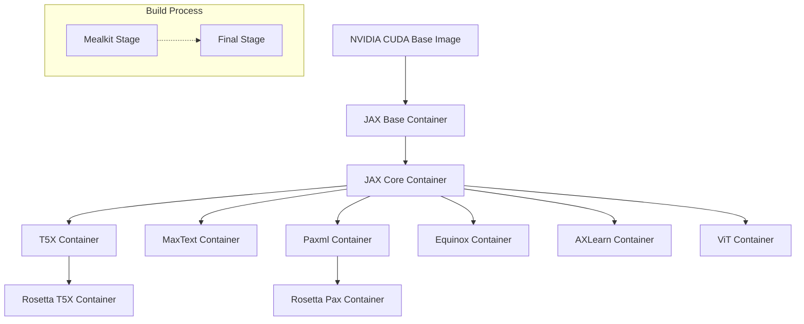
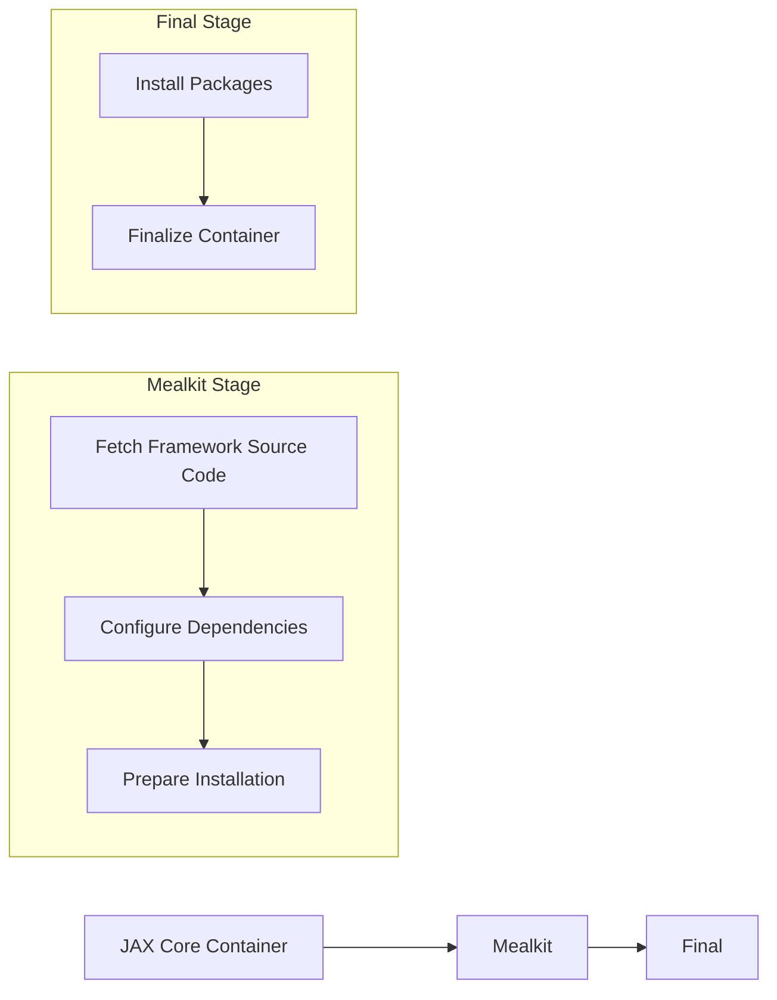
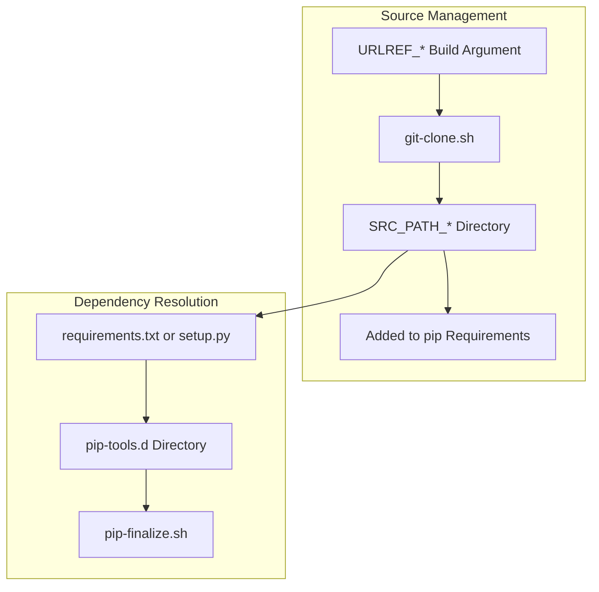
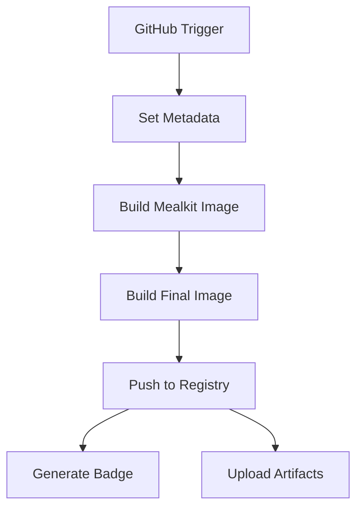
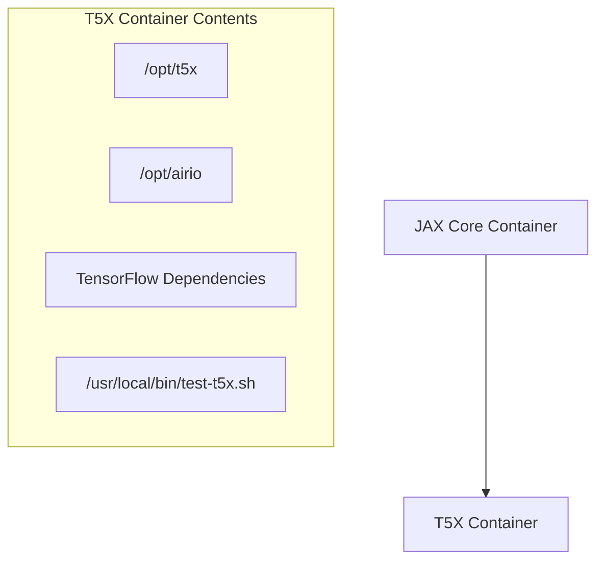
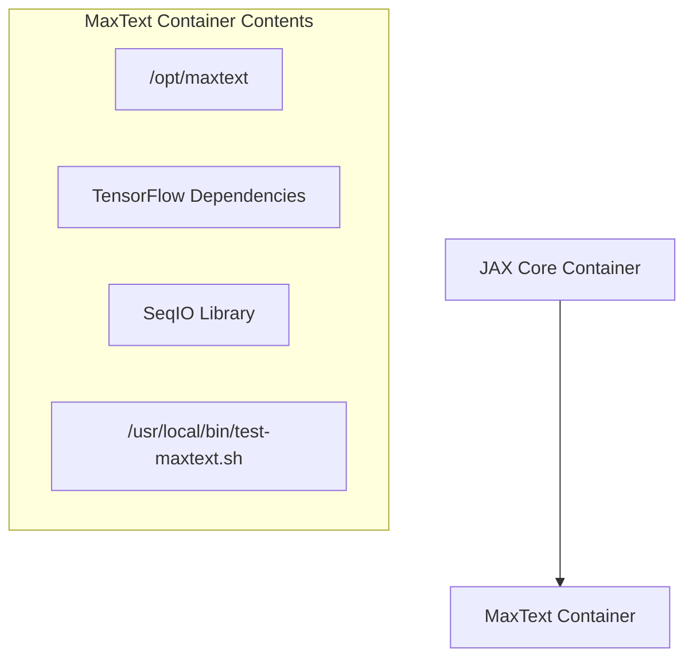
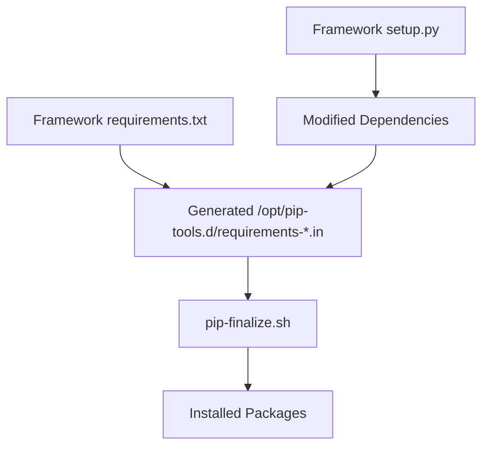
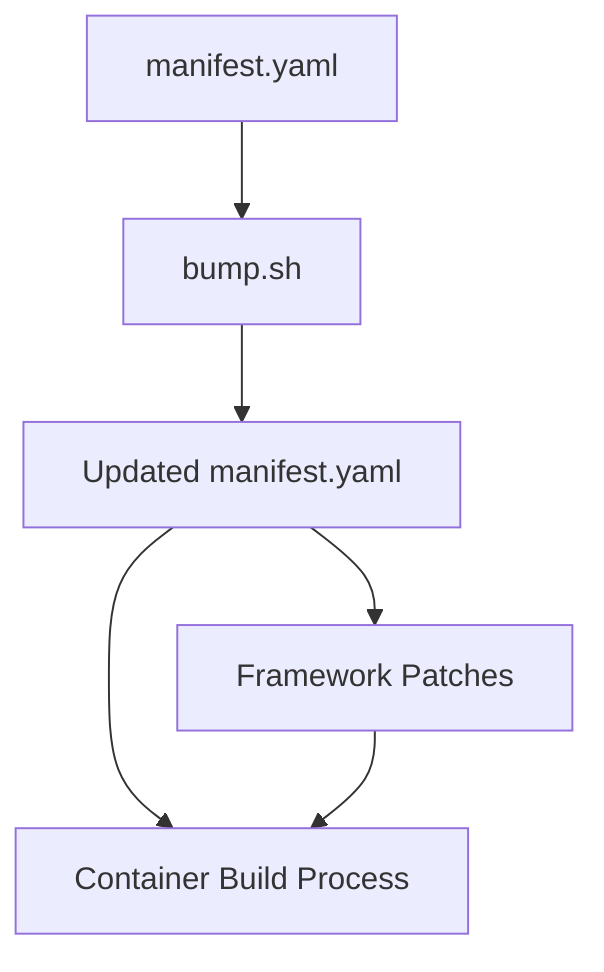

<!-- source: DeepWiki mcp.deepwiki.com · repo NVIDIA/JAX-Toolbox · page 2.3 Framework Containers · fetched 2026-10-26 -->

# Framework Containers

Relevant source files

The following files were used as context for generating this wiki page:

- [.github/container/Dockerfile.maxtext](.github/container/Dockerfile.maxtext)
- [.github/container/Dockerfile.t5x](.github/container/Dockerfile.t5x)
- [.github/container/bump.sh](.github/container/bump.sh)
- [.github/workflows/_build.yaml](.github/workflows/_build.yaml)

## Purpose and Scope

Framework Containers in JAX-Toolbox are specialized Docker images that extend the JAX Core Container to provide pre-configured environments for specific JAX-based machine learning frameworks such as T5X, MaxText, Paxml, and others. This document describes how these framework-specific containers are structured, built, and integrated into the JAX-Toolbox ecosystem.

For information about the JAX Core Container that serves as the foundation for these framework containers, see [JAX Core Container](#2.2).

## Container Architecture

Framework containers follow a layered architecture pattern where each container builds upon the previous layer.

### Framework Container Hierarchy

Sources: [.github/container/Dockerfile.t5x:11-69](), [.github/container/Dockerfile.maxtext:11-55]()

### Two-Stage Build Process

Framework containers use a two-stage build process:

1. **Mealkit Stage**: Prepares the build environment, fetches source code, and configures dependencies
2. **Final Stage**: Installs packages and finalizes the container

This approach optimizes image size and improves build caching.

Sources: [.github/container/Dockerfile.t5x:11-21](), [.github/container/Dockerfile.t5x:68-75](), [.github/container/Dockerfile.maxtext:11-50](), [.github/container/Dockerfile.maxtext:50-56]()

## Framework Container Build Process

### Common Build Arguments

Each framework container uses several build arguments:

| Build Argument | Description | Example |
|----------------|-------------|---------|
| BASE_IMAGE | Base JAX container to build from | ghcr.io/nvidia/jax:mealkit |
| URLREF_* | Git repository URL and reference | https://github.com/google-research/t5x.git#main |
| SRC_PATH_* | Path where source code is placed | /opt/t5x |
| BUILD_DATE | Build timestamp for versioning | 2024-01-22 |
| BAZEL_CACHE | URL for Bazel remote cache | (Internal cache URL) |

Sources: [.github/container/Dockerfile.t5x:5-9](), [.github/container/Dockerfile.maxtext:3-5](), [.github/workflows/_build.yaml:130-134](), [.github/workflows/_build.yaml:164-167]()

### Framework Source Code Management

The framework containers fetch their source code directly from Git repositories. The specific commit or branch is determined by the `URLREF_*` build argument.

Sources: [.github/container/Dockerfile.t5x:18-60](), [.github/container/Dockerfile.maxtext:15-39](), [.github/container/bump.sh:86-112]()

### CI/CD Integration

Framework containers are built as part of the JAX-Toolbox CI/CD pipeline. The `_build.yaml` workflow defines the build process for all containers.

Sources: [.github/workflows/_build.yaml:71-211]()

## Supported Framework Containers

Each framework container extends the JAX Core container with specific machine learning frameworks:

### T5X Container

T5X is Google Research's framework for training and evaluating sequence models (particularly T5 models). The T5X container includes:

- T5X framework source code
- AirIO library for input/output processing
- TensorFlow dependencies for data processing

Sources: [.github/container/Dockerfile.t5x:18-61](), [.github/container/Dockerfile.t5x:63]()

### MaxText Container

MaxText is an open source LLM reference implementation focused on performance. The MaxText container includes:

- MaxText framework source code
- Machine learning dependencies (absl, protobuf, etc.)
- TensorFlow and SeqIO dependencies

Sources: [.github/container/Dockerfile.maxtext:15-39](), [.github/container/Dockerfile.maxtext:45]()

## Dependency Management

Framework containers use a structured approach to manage dependencies through the build process.

### Requirements Management

Dependencies are managed through:

1. Requirements files (`requirements.txt`)
2. Direct setup.py modifications
3. Additional pip requirements files in `/opt/pip-tools.d/`

When dependencies conflict or need modifications, the build process patches the requirements files during the mealkit stage.

Sources: [.github/container/Dockerfile.t5x:21-60](), [.github/container/Dockerfile.maxtext:17-39]()

### Architecture-Specific Modifications

The build process includes logic to handle different CPU architectures (AMD64, ARM64):

- For ARM64 builds, specific patches are applied to handle compatibility issues
- Some dependencies have architecture-specific requirements or alternatives

Sources: [.github/container/Dockerfile.t5x:34-51]()

## Relationship to Manifest System

Framework containers integrate with JAX-Toolbox's manifest system for version management:

1. The `bump.sh` script updates framework versions in the manifest
2. The manifest controls which versions of frameworks are built
3. Patches can be applied to framework sources during the build process

Sources: [.github/container/bump.sh:1-113]()

## Testing Integration

Each framework container includes a test script (`test-*.sh`) that verifies the container's functionality. These tests are executed as part of the CI/CD pipeline to ensure each framework container works as expected.

Sources: [.github/container/Dockerfile.t5x:63](), [.github/container/Dockerfile.maxtext:45]()

---

