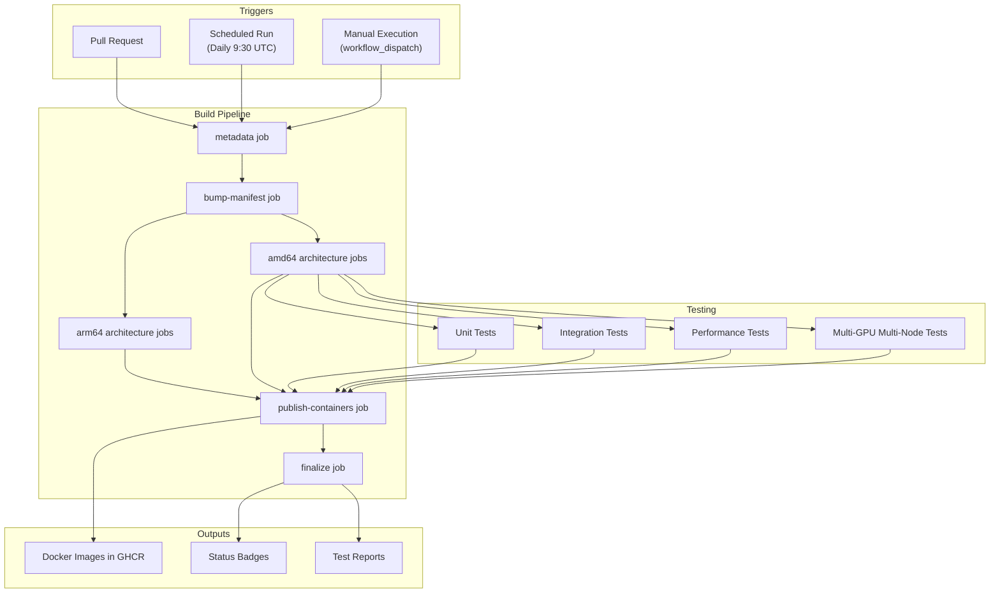
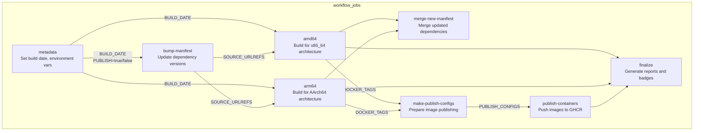
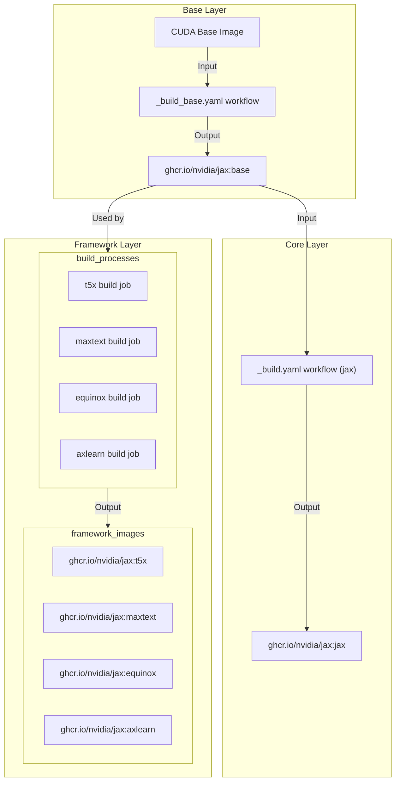
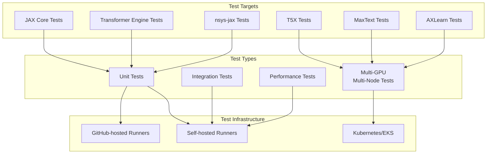
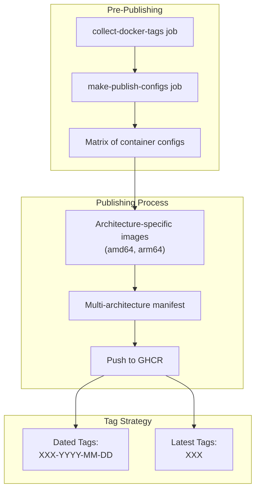
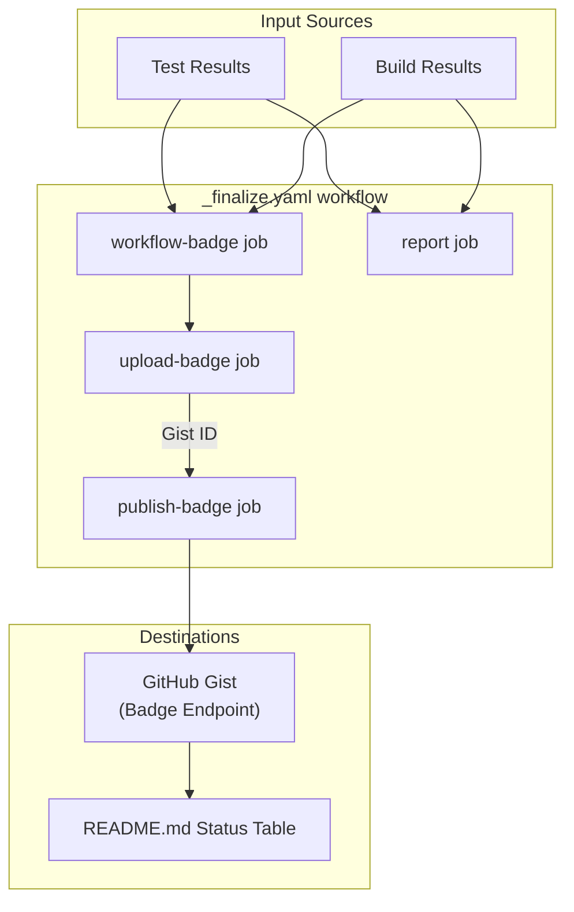

<!-- source: DeepWiki mcp.deepwiki.com · repo NVIDIA/JAX-Toolbox · page 3 CI/CD Pipeline · fetched 2026-10-26 -->

# CI/CD Pipeline

<details>
<summary>Relevant source files</summary>

The following files were used as context for generating this wiki page:

- [.github/container/local_cuda_arch](.github/container/local_cuda_arch)
- [.github/container/manifest.yaml](.github/container/manifest.yaml)
- [.github/workflows/__copy_gist.yaml](.github/workflows/__copy_gist.yaml)
- [.github/workflows/_ci.yaml](.github/workflows/_ci.yaml)
- [.github/workflows/_finalize.yaml](.github/workflows/_finalize.yaml)
- [.github/workflows/_sitrep_mgmn.yaml](.github/workflows/_sitrep_mgmn.yaml)
- [.github/workflows/assistant.yaml](.github/workflows/assistant.yaml)
- [.github/workflows/ci.yaml](.github/workflows/ci.yaml)
- [README.md](README.md)

</details>


This document describes the continuous integration and continuous deployment (CI/CD) pipeline used in JAX-Toolbox. It explains the workflow architecture, build processes, testing infrastructure, and image publishing mechanisms. For information about the container system architecture itself, see [Container System Architecture](#2).

## Overview

The JAX-Toolbox CI/CD pipeline automates the building, testing, and publishing of Docker containers for JAX and related ML frameworks optimized for NVIDIA GPUs. It ensures containers are properly tested across various hardware configurations and publishes verified images to GitHub Container Registry (GHCR).

**Title: JAX-Toolbox CI/CD Pipeline Overview**


Sources: [.github/workflows/ci.yaml:1-438](), [README.md:18-207]()

## Workflow Triggers

The CI/CD pipeline can be initiated through three different mechanisms:

1. **Scheduled Runs**: Daily builds run at 9:30 UTC via CRON trigger
2. **Pull Requests**: Triggered when PRs are opened, reopened, or synchronized (except for markdown-only changes)
3. **Manual Execution**: Can be manually triggered with custom parameters via GitHub Actions UI

When manually triggered, the workflow accepts the following input parameters:

| Parameter | Description | Default |
|-----------|-------------|---------|
| `PUBLISH` | Push dated images and update 'latest' tag | `false` |
| `BUMP_MANIFEST` | Update Git repos in manifest.yaml to head of tree | `true` |
| `MERGE_BUMPED_MANIFEST` | Attempt to PR/merge manifest branch | `false` |
| `CUDA_IMAGE` | CUDA image to use as base | `'latest'` |
| `SOURCE_OVERRIDES` | Comma-separated PACKAGE=URL#REF overrides | `''` |

Sources: [.github/workflows/ci.yaml:3-42]()

## Core Pipeline Components

**Title: CI/CD Pipeline Component Workflow**


Sources: [.github/workflows/ci.yaml:57-437]()

### Metadata Job

The `metadata` job runs first and performs essential setup:

1. Cancels workflow if triggered by a draft PR
2. Sets build date in format `YYYY-MM-DD`
3. Determines if images should be published
4. Configures manifest branch name
5. Sets CUDA image to use

Sources: [.github/workflows/ci.yaml:59-132]()

### Dependency Management

The CI/CD pipeline uses a manifest file to track dependency versions. The `bump-manifest` job:

1. Checks out the repository
2. Tests the manifest bumping functionality
3. Updates `manifest.yaml` with latest dependencies (if enabled)
4. Generates build arguments for source code URLs and references

The manifest file specifies Git repositories, commit hashes, and patches for each dependency.

**Example manifest entry:**
```yaml
jax:
  url: https://github.com/google/jax.git
  tracking_ref: main
  latest_verified_commit: 8f4658ecdbe40cde0c43a9ab127359347943c076
  mode: git-clone
```

Sources: [.github/workflows/ci.yaml:134-189](), [.github/container/manifest.yaml:1-104]()

## Build Process

The build process constructs a hierarchy of Docker images across multiple architectures.

**Title: Container Build Hierarchy**


Sources: [.github/workflows/_ci.yaml:41-170]()

### Architecture Support

The pipeline builds images for two architectures in parallel:

1. **amd64** (x86_64): Standard architecture for server and desktop systems
2. **arm64** (AArch64): Architecture for ARM-based systems

The build processes for both architectures are nearly identical but run independently.

Sources: [.github/workflows/ci.yaml:191-211]()

### Build Stages

Each container is built using a two-stage process:

1. **Mealkit Stage**: Contains build tools and development dependencies 
2. **Final Stage**: Contains only runtime dependencies for smaller image size

The CI pipeline keeps track of both stages as they may be useful for different purposes.

Sources: [.github/workflows/_ci.yaml:140-170]()

## Testing Infrastructure

The pipeline employs a comprehensive testing strategy across multiple dimensions:

**Title: Testing Infrastructure Map**


Sources: [.github/workflows/_ci.yaml:179-649](), [.github/workflows/_sitrep_mgmn.yaml:1-168]()

### Unit Tests

Unit tests verify the functionality of individual components:

- **JAX Core**: Tests JAX basic functionality and GPU backend
- **Transformer Engine**: Tests the NVIDIA Transformer Engine integration
- **nsys-jax**: Tests the NVIDIA profiling tool integration

Sources: [.github/workflows/_ci.yaml:201-331]()

### Integration Tests

The pipeline includes distribution tests that verify:

- Extra-only distribution
- Mirror-only distribution
- Upstream-only distribution
- Local patch distribution

Sources: [.github/workflows/_ci.yaml:179-199]()

### Multi-GPU Multi-Node Tests

The pipeline runs advanced distributed tests on Kubernetes/EKS infrastructure:

- **T5X**: Tests distributed model training
- **MaxText**: Tests large language model training
- **AXLearn**: Tests Fuji model distributed training

These tests verify that the frameworks can properly utilize multiple GPUs across multiple nodes.

Sources: [.github/workflows/_ci.yaml:503-648](), [.github/workflows/_sitrep_mgmn.yaml:1-168]()

## Image Publishing

After successful testing, images are published to GitHub Container Registry (GHCR).

**Title: Image Publishing Process**


Sources: [.github/workflows/ci.yaml:412-437]()

### Publishing Configuration

The `make-publish-configs` job:

1. Collects Docker tags from all builds
2. Creates a configuration matrix for publishing
3. Determines which images should be published

When publishing is enabled, images are pushed with:
- Dated tags (e.g., `ghcr.io/nvidia/jax:maxtext-2023-10-15`)
- Latest tags (e.g., `ghcr.io/nvidia/jax:maxtext`)

Sources: [.github/workflows/ci.yaml:325-411]()

## Status Reporting and Badges

The pipeline generates status badges and comprehensive reports to provide visibility into build and test status.

**Title: Status Badge Generation**


The badge system shows:
- Build status for each component and architecture
- Test status for various test suites
- Overall workflow metadata

These badges are displayed in the repository's README.md to provide at-a-glance status information.

Sources: [.github/workflows/_finalize.yaml:1-274](), [README.md:18-207]()

## Custom Workflow Parameters

The CI/CD pipeline can be manually triggered with custom parameters to control its behavior:

| Parameter | Purpose |
|-----------|---------|
| `PUBLISH` | When `true`, push images to GHCR and update 'latest' tags |
| `BUMP_MANIFEST` | When `true`, update dependencies in manifest.yaml |
| `MERGE_BUMPED_MANIFEST` | When `true`, create PR to merge updated manifest |
| `CUDA_IMAGE` | Specify a custom CUDA base image |
| `SOURCE_OVERRIDES` | Override specific package sources with custom URLs/refs |

Sources: [.github/workflows/ci.yaml:16-42]()

## Conclusion

The JAX-Toolbox CI/CD pipeline provides a robust system for building, testing, and publishing optimized JAX containers for NVIDIA GPUs. Through automated testing across multiple architectures and hardware configurations, it ensures that the published images are reliable and performant.

The pipeline's modular design allows for flexibility in building different components, while its comprehensive testing strategy validates functionality across various scenarios. The status reporting system provides visibility into the pipeline's health and the quality of the published images.

---

