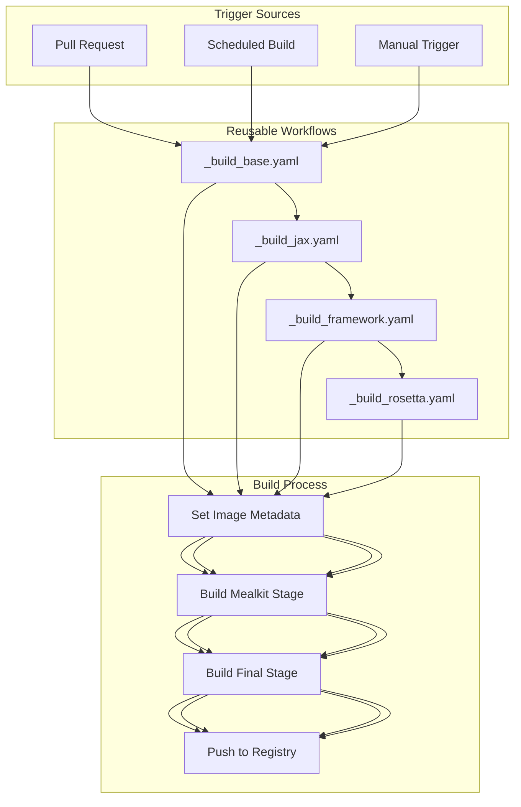
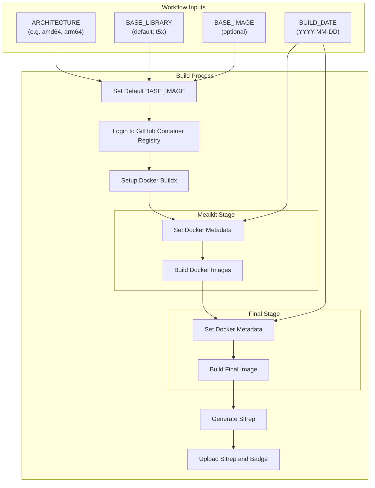
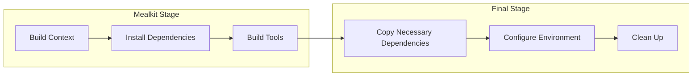
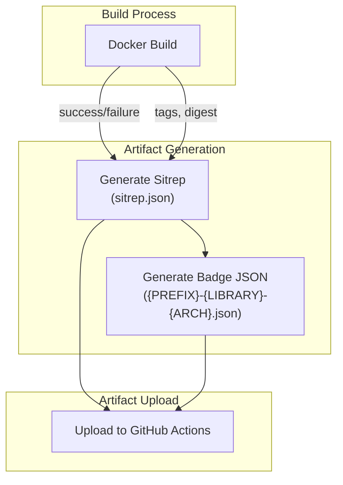
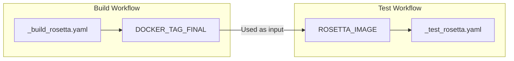
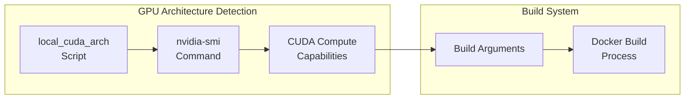
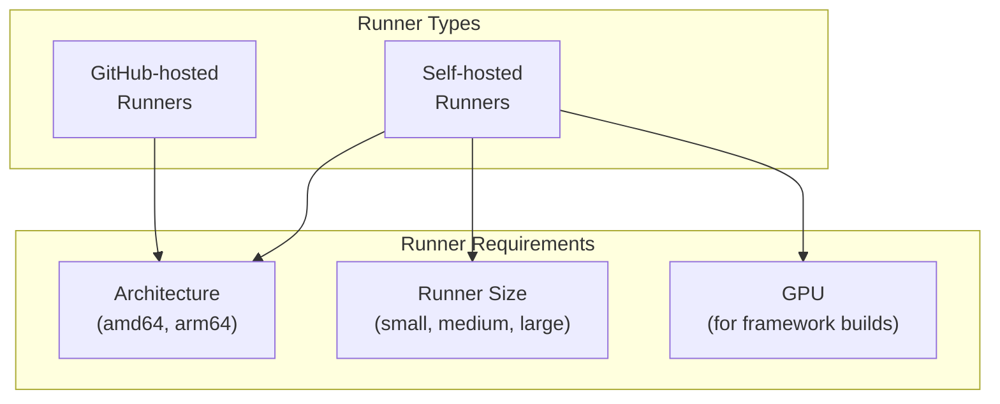

<!-- source: DeepWiki mcp.deepwiki.com · repo NVIDIA/JAX-Toolbox · page 3.1 Build Workflows · fetched 2026-10-26 -->

# Build Workflows

Relevant source files

The following files were used as context for generating this wiki page:

- [.github/container/local_cuda_arch](.github/container/local_cuda_arch)
- [.github/workflows/_build_rosetta.yaml](.github/workflows/_build_rosetta.yaml)
- [.github/workflows/_test_rosetta.yaml](.github/workflows/_test_rosetta.yaml)
- [rosetta/rosetta/projects/vit/integration_test.py](rosetta/rosetta/projects/vit/integration_test.py)

This page documents the GitHub Actions workflows used in JAX-Toolbox to build container images for JAX and various ML frameworks. These workflows form the core build infrastructure of the CI/CD pipeline. For information about the testing infrastructure, see [Test Infrastructure](#3.2), and for reporting systems, see [Badges and Reporting](#3.3).

## Build Workflow Architecture

The JAX-Toolbox build system uses modular, reusable GitHub Actions workflows to build container images. These workflows follow a hierarchical pattern that mirrors the container architecture described in the [Container System Architecture](#2) section.

Sources: [.github/workflows/_build_rosetta.yaml:1-186]()

## Rosetta Build Workflow

The Rosetta build workflow is representative of how JAX-Toolbox builds container images. This workflow is defined in the `_build_rosetta.yaml` file and is called by parent workflows.

Sources: [.github/workflows/_build_rosetta.yaml:1-186]()

## Two-Stage Build Process

JAX-Toolbox uses a two-stage build process to optimize container size and build caching. This approach is evident in the Rosetta build workflow and is a common pattern across all build workflows in the system.

Sources: [.github/workflows/_build_rosetta.yaml:90-141]()

The mealkit stage is named after the meal-kit delivery service concept—it contains all ingredients and tools needed to build the software but may include components that aren't needed in the final runtime environment. The final stage creates a streamlined image with only the necessary components for running the software.

## Workflow Inputs and Parameters

The build workflows accept various inputs to customize the build process. Taking the Rosetta build workflow as an example:

| Input | Description | Default |
|-------|-------------|---------|
| `ARCHITECTURE` | CPU architecture to build for (e.g., amd64, arm64) | *Required* |
| `BASE_LIBRARY` | Choice of base library (e.g., t5x, paxml) | `t5x` |
| `BASE_IMAGE` | Base docker image | `ghcr.io/nvidia/upstream-{BASE_LIBRARY}:latest` |
| `BUILD_DATE` | Build date in YYYY-MM-DD format | `NOT SPECIFIED` |
| `ARTIFACT_NAME` | Name of the artifact zip file | `artifact-rosetta-build` |
| `BADGE_FILENAME_PREFIX` | Name prefix for the badge JSON file | `badge-rosetta-build` |

Sources: [.github/workflows/_build_rosetta.yaml:3-33]()

## Workflow Outputs

The build workflows produce several outputs that can be consumed by downstream workflows:

| Output | Description |
|--------|-------------|
| `DOCKER_TAG_MEALKIT` | Tags of the mealkit image build |
| `DOCKER_TAG_FINAL` | Tags of the complete image built |

Sources: [.github/workflows/_build_rosetta.yaml:34-40]()

These outputs enable other workflows to reference the built images for testing or deployment.

## Build Artifacts and Badges

Each build workflow generates artifacts that provide information about the build process:

1. **Sitrep JSON** - Contains summary information about the build, including tags, digest, and outcome
2. **Badge JSON** - Used to generate status badges for display in the repository

Sources: [.github/workflows/_build_rosetta.yaml:144-185]()

## Integration with Testing

After container images are built, they are often passed to testing workflows. For example, the Rosetta build workflow outputs image tags that can be used as inputs to the Rosetta test workflow.

Sources: [.github/workflows/_build_rosetta.yaml:34-40](), [.github/workflows/_test_rosetta.yaml:1-112]()

The test workflow pulls the specified image, runs tests, and generates reports that can be used to determine the quality of the build.

## GPU Architecture Detection

When building for specific GPU architectures, JAX-Toolbox includes utilities to detect and configure the build for the available hardware:

Sources: [.github/container/local_cuda_arch:1-2]()

This detection allows the build process to optimize for the specific GPU hardware available in the build environment.

## Runner Requirements

The build workflows typically run on GitHub-hosted or self-hosted runners with specific requirements:

Sources: [.github/workflows/_build_rosetta.yaml:54](), [.github/workflows/_test_rosetta.yaml:37-41]()

The Rosetta build workflow, for example, runs on self-hosted runners with the specified architecture and size.

---

