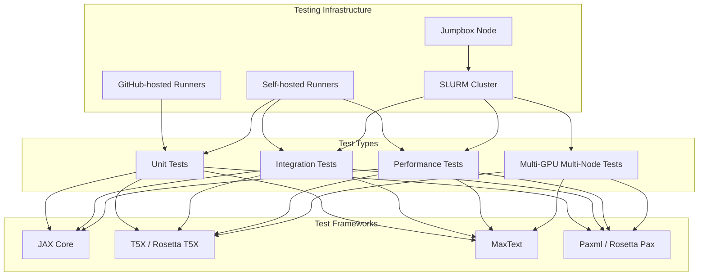
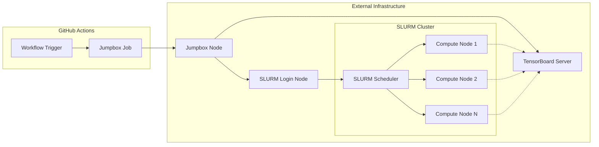
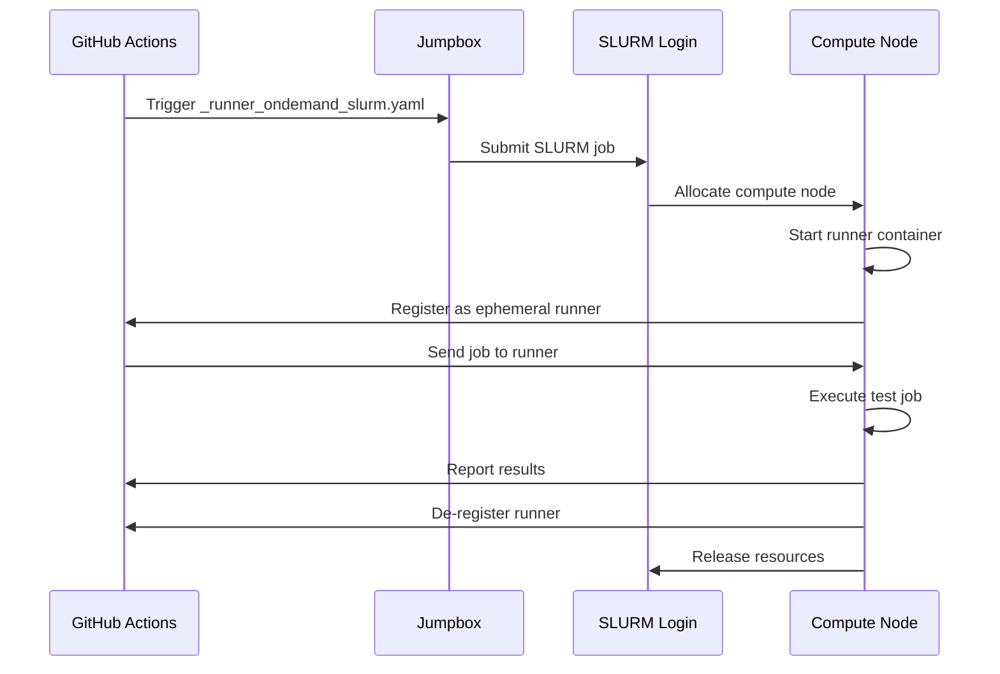
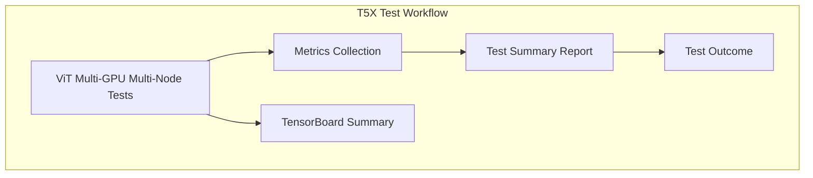
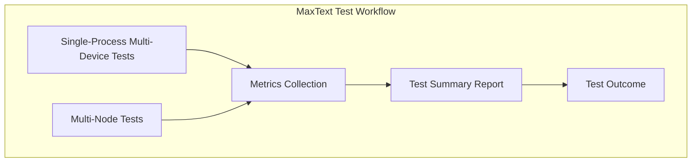
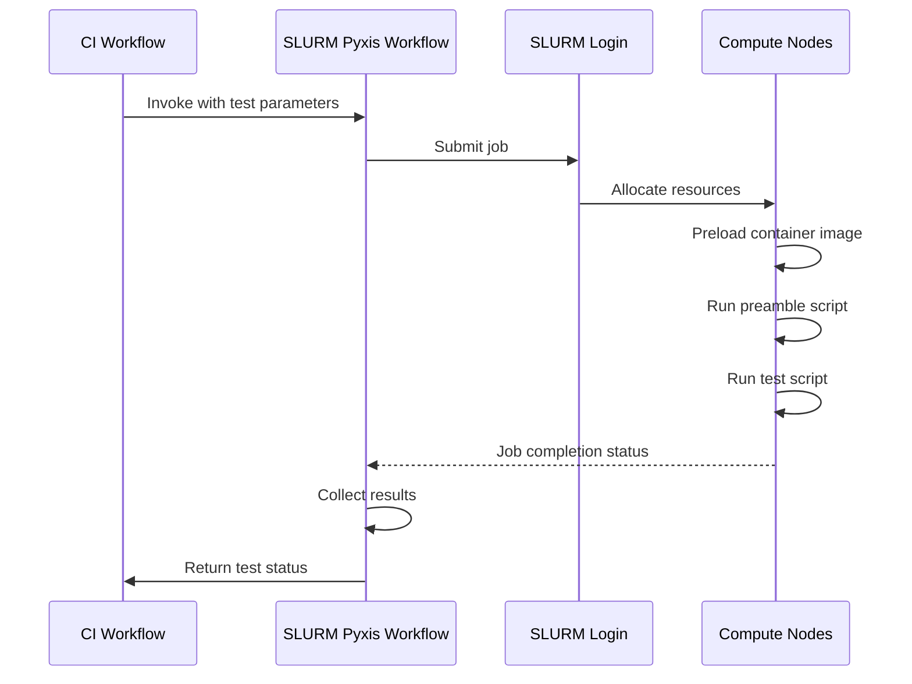
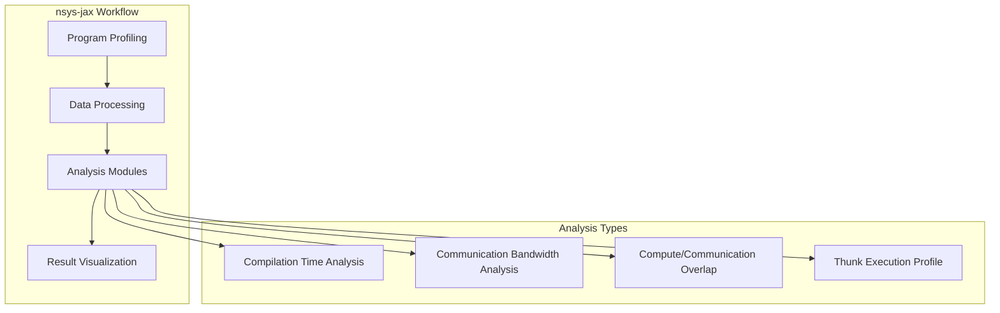
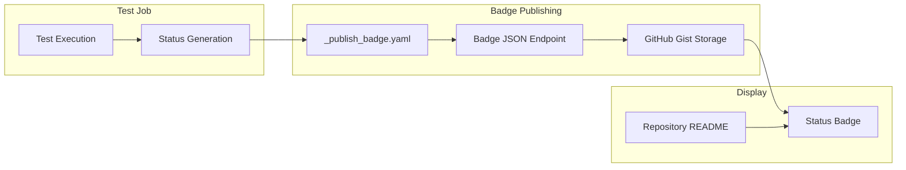
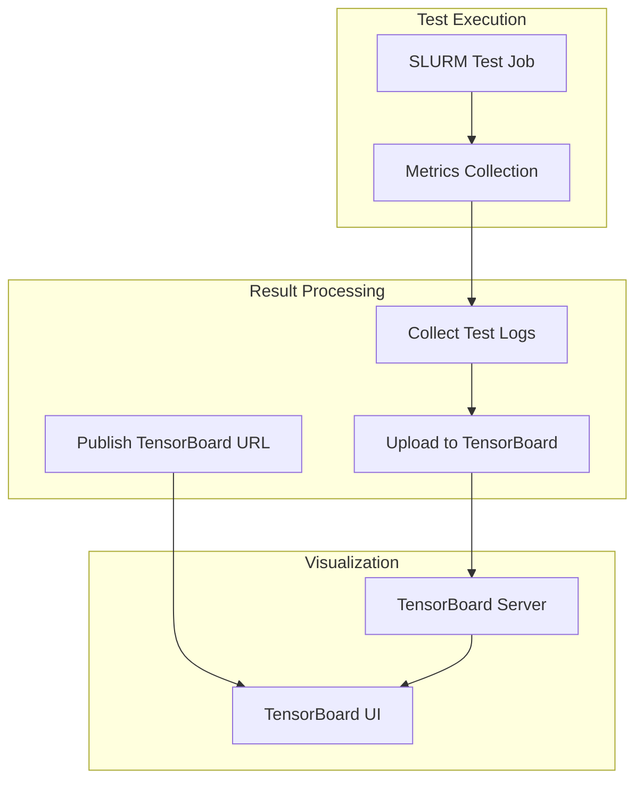

<!-- source: DeepWiki mcp.deepwiki.com · repo NVIDIA/JAX-Toolbox · page 3.2 Test Infrastructure · fetched 2026-10-26 -->

# Test Infrastructure

Relevant source files

The following files were used as context for generating this wiki page:

- [.github/actions/setup-ssh/action.yml](.github/actions/setup-ssh/action.yml)
- [.github/container/nsys_jax/nsys_jax/analyses/Analysis.ipynb](.github/container/nsys_jax/nsys_jax/analyses/Analysis.ipynb)
- [.github/container/nsys_jax/nsys_jax/analyses/communication.py](.github/container/nsys_jax/nsys_jax/analyses/communication.py)
- [.github/container/nsys_jax/nsys_jax/analyses/summary.py](.github/container/nsys_jax/nsys_jax/analyses/summary.py)
- [.github/container/nsys_jax/nsys_jax/analysis.py](.github/container/nsys_jax/nsys_jax/analysis.py)
- [.github/container/nsys_jax/nsys_jax/data_loaders.py](.github/container/nsys_jax/nsys_jax/data_loaders.py)
- [.github/container/nsys_jax/nsys_jax/scripts/utils.py](.github/container/nsys_jax/nsys_jax/scripts/utils.py)
- [.github/container/nsys_jax/pyproject.toml](.github/container/nsys_jax/pyproject.toml)
- [.github/container/nsys_jax/tests/test_overlap_program.py](.github/container/nsys_jax/tests/test_overlap_program.py)
- [.github/container/test-t5x.sh](.github/container/test-t5x.sh)
- [.github/workflows/_publish_badge.yaml](.github/workflows/_publish_badge.yaml)
- [.github/workflows/_publish_t5x_pax_results.yaml](.github/workflows/_publish_t5x_pax_results.yaml)
- [.github/workflows/_runner_ondemand_slurm.yaml](.github/workflows/_runner_ondemand_slurm.yaml)
- [.github/workflows/_sandbox.yaml](.github/workflows/_sandbox.yaml)
- [.github/workflows/_test_maxtext.yaml](.github/workflows/_test_maxtext.yaml)
- [.github/workflows/_test_slurm_pyxis.yaml](.github/workflows/_test_slurm_pyxis.yaml)
- [.github/workflows/_test_t5x_rosetta.yaml](.github/workflows/_test_t5x_rosetta.yaml)
- [.github/workflows/_test_unit.yaml](.github/workflows/_test_unit.yaml)
- [.github/workflows/scripts/wait_for_slurm_job.sh](.github/workflows/scripts/wait_for_slurm_job.sh)

This document describes the testing infrastructure used in JAX-Toolbox, including the types of tests, testing environments, workflow execution, and reporting mechanisms. For information about the CI/CD pipeline architecture and build processes, see [CI/CD Pipeline](#3).

## Overview

JAX-Toolbox implements a comprehensive testing system that validates functionality, performance, and compatibility across various JAX-based machine learning frameworks. The testing infrastructure spans multiple execution environments, from local GitHub runners to distributed SLURM clusters, enabling coverage of single-GPU unit tests through multi-node distributed training.

Sources:
- [.github/workflows/_test_unit.yaml:1-151]()
- [.github/workflows/_test_t5x_rosetta.yaml:1-282]()
- [.github/workflows/_test_maxtext.yaml:1-387]()
- [.github/workflows/_test_slurm_pyxis.yaml:1-240]()

## Test Types

JAX-Toolbox implements several types of tests to ensure reliability and performance:

### Unit Tests

Unit tests verify the functionality of individual components in isolation. These tests run on GitHub-hosted runners or self-hosted runners and target core functionality of JAX and the ML frameworks.

The unit test workflow is implemented in [.github/workflows/_test_unit.yaml](), which sets up appropriate runners and executes tests within containerized environments.

### Integration Tests

Integration tests verify that framework components work together correctly. These tests typically involve running small models on synthetic data to ensure end-to-end functionality.

### Performance Tests

Performance tests measure throughput, latency, and resource utilization of models and training pipelines. These tests track performance metrics over time to catch regressions.

### Multi-GPU Multi-Node Tests

These specialized tests verify distributed training capabilities across multiple GPUs and compute nodes, ensuring frameworks can scale properly. They validate:

- Data Parallelism
- Fully Sharded Data Parallelism (FSDP)
- Tensor Parallelism
- Pipeline Parallelism

Sources:
- [.github/workflows/_test_t5x_rosetta.yaml:35-152]()
- [.github/workflows/_test_maxtext.yaml:38-329]()

## Testing Environments

### SLURM Cluster

The SLURM cluster is a multi-node environment used for running distributed training tests. It's accessed via a jumpbox node that manages job submission and monitoring.

SLURM jobs are managed through a series of scripts that handle job submission, monitoring, and result collection:

1. Job submission using [.github/workflows/_test_slurm_pyxis.yaml]()
2. Job monitoring with [.github/workflows/scripts/wait_for_slurm_job.sh]()
3. Result collection and metrics analysis

Sources:
- [.github/workflows/_test_slurm_pyxis.yaml:1-240]()
- [.github/workflows/scripts/wait_for_slurm_job.sh:1-26]()
- [.github/workflows/_runner_ondemand_slurm.yaml:1-114]()

### Self-hosted Runners

JAX-Toolbox uses self-hosted runners for tests requiring specific hardware configurations like NVIDIA GPUs. These runners can be:

- Persistent self-hosted runners for regular testing
- On-demand runners provisioned via SLURM for specific test jobs

The on-demand runner system creates ephemeral GitHub Actions runners from SLURM jobs, providing flexibility and resource optimization:

Sources:
- [.github/workflows/_runner_ondemand_slurm.yaml:1-114]()
- [.github/workflows/_test_unit.yaml:28-35]()

### GitHub-hosted Runners

Standard GitHub-hosted runners are used for lightweight tests that don't require specialized hardware.

## Test Workflow Execution

JAX-Toolbox uses a structured approach to test execution, with framework-specific workflows that handle different test scenarios.

### T5X/Rosetta T5X Testing

The T5X testing workflow validates both standard T5X and the Rosetta T5X variant:

Sources:
- [.github/workflows/_test_t5x_rosetta.yaml:35-282]()
- [.github/container/test-t5x.sh:1-260]()

### MaxText Testing

The MaxText testing workflow validates single-process multi-device configurations and multi-node distributed training:

Sources:
- [.github/workflows/_test_maxtext.yaml:38-386]()

### Generic SLURM Testing

The generic SLURM testing workflow can be used for running any containerized test on the SLURM cluster:

Sources:
- [.github/workflows/_test_slurm_pyxis.yaml:1-240]()

## Test Analysis and Profiling

JAX-Toolbox includes advanced tools for analyzing test performance and profiling JAX applications.

### nsys-jax

`nsys-jax` is a specialized profiling tool that extends NVIDIA Nsight Systems for JAX. It collects detailed information about:

- GPU kernel execution
- Communication operations (NCCL collectives)
- Host-device synchronization
- XLA compilation

The tool provides several analysis capabilities:

1. Compilation time analysis
2. Communication bandwidth analysis
3. Overlap analysis (compute/communication)
4. Thunk execution profiling

Sources:
- [.github/container/nsys_jax/nsys_jax/analysis.py:1-428]()
- [.github/container/nsys_jax/nsys_jax/data_loaders.py:1-467]()
- [.github/container/nsys_jax/nsys_jax/analyses/communication.py:1-299]()
- [.github/container/nsys_jax/nsys_jax/analyses/summary.py:1-149]()
- [.github/container/nsys_jax/nsys_jax/analyses/Analysis.ipynb:1-506]()

## Test Reporting and Visualization

### Test Result Badges

Test results are published as badges using a shield.io endpoint JSON format:

The badge publishing workflow ([.github/workflows/_publish_badge.yaml]()) processes test results into a standardized format and publishes them to a GitHub Gist, which serves as the endpoint for shield.io badges.

Sources:
- [.github/workflows/_publish_badge.yaml:1-94]()
- [.github/workflows/_test_t5x_rosetta.yaml:242-272]()
- [.github/workflows/_test_maxtext.yaml:365-386]()

### TensorBoard Integration

Performance metrics from tests are uploaded to a TensorBoard server for visualization:

The test workflows include steps to upload metrics to a TensorBoard server and generate URLs for easy access to visualizations.

Sources:
- [.github/workflows/_test_t5x_rosetta.yaml:136-149]()
- [.github/workflows/_test_maxtext.yaml:146-158]()
- [.github/workflows/_publish_t5x_pax_results.yaml:1-50]()

## Testing Utility Components

### SSH Setup Action

Many testing workflows require SSH access to external resources like SLURM clusters. The SSH setup action ([.github/actions/setup-ssh/action.yml]()) provides a reusable component for configuring SSH keys and known hosts.

### SLURM Job Management

The SLURM job management script ([.github/workflows/scripts/wait_for_slurm_job.sh]()) provides utilities for monitoring SLURM jobs, handling a key part of the testing infrastructure for distributed tests.

### Test Metrics Analysis

JAX-Toolbox includes tools for analyzing test metrics, identifying performance regressions, and generating reports. These tools are crucial for maintaining performance standards across framework versions.

Sources:
- [.github/actions/setup-ssh/action.yml:1-32]()
- [.github/workflows/scripts/wait_for_slurm_job.sh:1-26]()

## Sandbox Environment

JAX-Toolbox includes a sandbox workflow ([.github/workflows/_sandbox.yaml]()) for testing new GitHub Actions features in development branches before merging them into the main workflow files.

Sources:
- [.github/workflows/_sandbox.yaml:1-42]()

---

